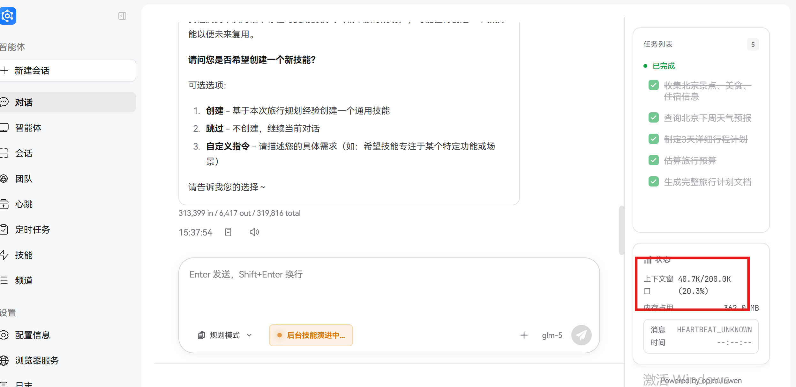
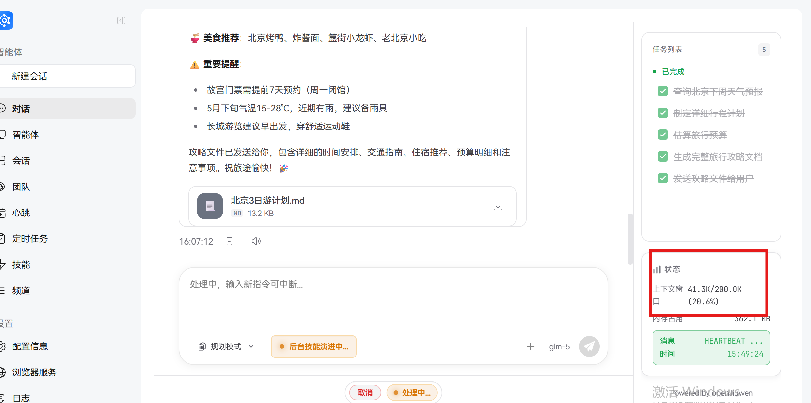

# 上下文压缩

## 1. 概念科普

### 1.1 上下文的概念

在 AI 对话系统中，**上下文**指的是对话过程中产生的所有历史信息，包括用户的提问、AI 的回答、工具调用的结果等。这些信息共同构成了 AI 理解当前对话状态和提供准确回答的基础。

### 1.2 上下文窗口限制

尽管上下文对于 AI 理解对话至关重要，但所有 AI 模型都存在**上下文窗口限制**——即模型在单轮对话中能够处理的最大信息量（通常以 Token 数量衡量）。当对话超出这个限制时，AI 会出现以下问题：

- 响应速度显著变慢
- 早期关键信息被遗忘
- 回答准确性下降
- 系统资源消耗过大

### 1.3 上下文压缩的概念

**上下文压缩**是一种智能优化技术，通过对历史对话内容进行分析、筛选和精简，在保持对话连贯性的前提下，将上下文信息压缩到模型可处理的范围内。

其核心思想可以类比为：在阅读一本长篇小说时，我们不需要记住每一个细节，只需要记住关键情节和人物关系，就能理解故事的发展。

JiuwenSwarm 可以通过上下文卸载机制，使用 `[[OFFLOAD:...]]` 格式的索引标记替换被卸载的大工具消息，在显著减少上下文数据量的同时保留其检索能力：模型可通过 `[[HANDLE:...]]` 标记将原文重新加载回上下文。

> **注意**：默认情况下，被压缩器替换的内容无法召回；被卸载的大工具消息始终可以重新加载。开启 `compression_recall_config.enabled` 后，压缩内容也可以通过 `[[COMPRESSION_RECALL: id=...]]` 按需召回。

### 1.4 应用场景

上下文压缩技术适用于各种需要长时间对话的场景：

- **数据分析**：处理大量数据表格和分析结果
- **项目管理**：跨多天的项目跟进和讨论
- **代码开发**：长时间的代码编写和调试
- **文档创作**：长篇文档的协作编写
- **客户支持**：复杂问题的长时间解决过程

## 2. 基础使用

### 2.1 开启上下文压缩

上下文压缩功能**默认开启**：`jiuwenswarm-init` 生成的 `config.yaml` 中为 `enabled: true`。如需关闭，编辑 `config.yaml`：

```yaml
react:
  context_engine_config:
    enabled: false        # 关闭整个上下文引擎（含下列所有处理器）
```

### 2.2 查看上下文压缩状态

开启上下文压缩后，您可以通过以下方式查看压缩状态：

**方式一：查看对话状态面板**

点击输入框中模型选择器旁的上下文用量指示器，弹出面板会实时显示上下文窗口的使用情况：



状态面板包含以下信息：

- 当前占用比例及已用 Token 数 / 上下文窗口
- 按系统提示词、工具与连接器、技能、对话消息分类的用量
- KV 缓存命中率

**方式二：通过 Slash 命令查看**

> **注意**：`/ctx` 命令显示的是会话信息（模型、模式、语言、通道、时间戳），不显示 Token 用量；请使用上下文用量面板查看。

## 3. 案例实践

为便于演示上下文压缩效果，本案例将触发阈值调整为 40K，以便在较短对话中观察压缩过程。

当前版本中，触发阈值以模型上下文窗口的比例表示（如 `trigger_context_ratio`，默认 `0.8`）。开发者可根据接入模型和业务需求，调整 `config.yaml` 中各处理器的比例参数，或在模型配置中设置上下文窗口大小。

### 3.1 无上下文压缩的情况

**场景**：用户与 AI 咨询北京3天旅行计划（单一请求）

**对话过程**：

```
User: 帮我规划一个下周去北京的3天旅行计划
Assistant: 好的，我来为您规划一个详细的北京3天旅行计划。
Tool: 正在查询北京天气和景点信息...
Tool Response: 返回了详细的天气数据和景点推荐
Assistant: 根据您的需求，我为您制定了以下旅行计划：

【北京3天深度游行程】

Day 1: 天安门广场 → 故宫 → 景山公园
- 上午：天安门广场看升旗
- 中午：故宫游览
- 下午：景山公园俯瞰故宫全景

Day 2: 八达岭长城 → 明十三陵
- 上午：八达岭长城
- 下午：明十三陵

Day 3: 颐和园 → 圆明园 → 南锣鼓巷
- 上午：颐和园
- 中午：圆明园
- 下午：南锣鼓巷感受老北京文化

美食推荐：北京烤鸭、炸酱面、涮羊肉

重要提醒：请提前预约故宫门票
```

**说明**：

- 图片中可看到：AI回复内容包含丰富的旅行信息
- 图片右下角状态面板显示：上下文窗口 41.3K/200.0K (20.6%)
- Token消耗主要来自：AI的详细回复内容 + 工具调用返回的数据

**最终结果**：

- 整个对话的上下文 Token 数已达到 41.3K，占用模型窗口的 20.6%
- 后续对话风险：如果用户继续追问细节或请求扩展计划，上下文会继续增长
- 潜在问题：随着对话深入，可能接近模型上下文窗口上限



### 3.2 有上下文压缩的情况

**相同场景**：用户与 AI 咨询北京3天旅行计划（单一请求）

**相同任务**：获得详细且可用的北京3天旅行计划

**对话过程**：

```
User: 帮我规划一个下周去北京的3天旅行计划
Assistant: 好的，我来为您规划一个详细的北京3天旅行计划。
Tool: 正在查询北京天气和景点信息...
Tool Response: 返回了详细的天气数据和景点推荐
Assistant: 根据您的需求，我为您制定了以下旅行计划：

【北京3天深度游行程】

Day 1: 天安门广场 → 故宫 → 景山公园
...（系统自动压缩了详细行程内容）

[[OFFLOAD: 旅行计划详情已压缩，核心信息保留]]
```

**说明**：

- 图片中可看到：AI完成了完整的旅行计划任务
- 图片右下角状态面板显示：上下文窗口 40.7K/200.0K (20.3%)

**最终结果**：

- 整个对话的上下文 Token 数保持在 40.7K，占用模型窗口的 20.3%
- AI 保持核心信息记忆：能够处理后续的进一步请求
- 系统能够完成更多关联任务：如创建技能等扩展功能
- 用户体验优化：可以继续进行多轮交互和功能扩展


### 3.3 实际效果说明

从两张示例图片的实际数据来看（基于40k阈值测试）：

1. **上下文 Token 使用**：
   - 无压缩场景：41.3K Token
   - 有压缩场景：40.7K Token
   - 两者差异不大，说明在单次详细请求场景下，压缩主要优化的是信息结构而非简单减少Token数量
2. **系统功能表现**：
   - 两种场景均成功完成了旅行计划生成
   - 有压缩场景额外支持了技能创建等扩展功能
   - 内存占用稳定在362MB左右，系统资源消耗差异不明显
3. **实际价值体现**：
   - 上下文压缩通过优化信息结构，使系统能够更好地处理后续扩展请求
   - 保持核心信息完整性的同时，提升了系统的功能扩展性
4. **阈值说明**：
   - 当前示例基于 40K Token 触发阈值测试，便于快速观察压缩效果
   - 生产环境中阈值随模型上下文窗口按比例计算（默认 `trigger_context_ratio: 0.8`），可根据实际需求调整
## 4. 特性解读

### 4.1 动态触发机制

上下文压缩不是固定的预处理步骤。在 `jiuwenswarm-init` 生成的配置下，各处理器按上下文占用相对于**模型上下文窗口的比例**动态触发：

- **压缩器**：对话压缩器、当前轮次压缩器和轮次级别压缩器在上下文占用达到 `trigger_context_ratio`（默认 `0.8`）时触发，并压缩至 `min_target_context_ratio`（默认 `0.1`）
- **即时卸载**：新增工具消息超过上下文窗口的 `add_message_threshold_ratio`（默认 `0.1`）时立即卸载
- **闲时（TTL）卸载**：距上次模型请求空闲超过 `ttl_seconds`（默认 `300`）秒，且上下文占用超过 `ttl_context_occupancy_ratio`（默认 `0.5`）时，超过窗口 `ttl_message_threshold_ratio`（默认 `0.05`）的工具消息会被卸载
- **上下文窗口大小**：取自模型配置中的上下文窗口，或 `context_window_tokens`（如已设置）；否则使用 256K 默认值
- **Token 计数**：默认按字符串长度估算 Token 数；设置 `enable_tiktoken_counter: true` 可使用分词器精确计数

### 4.2 智能识别和压缩

系统采用先进的自然语言处理技术，能够：

- **区分消息类型**：自动识别用户消息、AI 回答和工具结果
- **识别重要性**：基于语义分析判断消息的重要程度
- **选择压缩方式**：对不同类型的内容采用不同的压缩策略
  - 对工具返回的冗长数据进行摘要
  - 对重复信息进行合并
  - 对不重要的内容进行过滤

### 4.3 关键信息保护

上下文压缩不会丢失重要信息，系统会：

- **保留最近消息**：`keep_recent_messages` 保留最新消息不被压缩（当前轮次压缩器默认 `4`，轮次级别压缩器默认 `0`）
- **受保护工具**：`protected_tool_names` 中工具的输出（默认 `read_file`、`read_pdf`）不会被卸载
- **保留完整轮次**：支持 `keep_last_round` 的处理器（默认 `true`）会完整保留最新一轮用户-助手对话
- **识别关键内容**：通过语义分析自动识别并保留关键信息

### 4.4 检索能力保持

上下文压缩不会破坏对话的检索能力：

- **卸载索引**：被卸载的工具消息在上下文中替换为 `[[OFFLOAD:...]]` 索引标记
- **重新加载**：`enable_reload: true`（默认）时，模型可通过 `[[HANDLE:...]]` 标记将原文拉回上下文
- **压缩召回（可选）**：开启后，对话、当前轮次和轮次级别压缩器会将原始消息分块归档到会话目录的 `compression_recall/` 下（`chunk_size_tokens` 默认 `3000`，`chunk_overlap_tokens` 默认 `500`），模型可通过 `[[COMPRESSION_RECALL: id=...]]` 按需召回

### 4.5 性能优化

上下文压缩能够显著提升系统性能：

- **减少内存占用**：将上下文数据量减少 50%-80%
- **提高响应速度**：降低模型推理时间，提升用户体验
- **支持更长对话**：突破模型上下文窗口限制，支持长时间对话
- **降低成本**：减少 Token 消耗，降低使用成本

## 5. 进阶配置

以下为 `jiuwenswarm-init`（v0.2.5）生成的 `context_engine_config` 配置及其默认值：

```yaml
react:
  context_engine_config:
    enabled: true
    enable_reload: true               # 模型可通过 [[HANDLE:...]] 重新加载已卸载的消息
    enable_tiktoken_counter: false    # false：按字符串长度估算 Token 数
    enable_context_debug: false       # 落盘最终发送给模型的消息及处理器判断记录（JSONL，可能包含用户数据）
    # context_window_tokens: 262144   # 可选：覆盖上下文窗口；不填则使用模型配置或 256K 默认值

    compression_recall_config:
      enabled: false
      chunk_size_tokens: 3000
      chunk_overlap_tokens: 500       # 须小于 chunk_size_tokens

    message_summary_offloader_config:
      protected_tool_names: ["read_file", "read_pdf"]
      add_message_threshold_ratio: 0.1
      ttl_seconds: 300
      ttl_context_occupancy_ratio: 0.5
      ttl_message_threshold_ratio: 0.05

    session_memory_compressor_config:
      enabled: false
      trigger_context_ratio: 0.8
      memory:
        update_trigger_context_ratio: 0.1

    dialogue_compressor_config:
      trigger_context_ratio: 0.8
      min_target_context_ratio: 0.1

    current_round_compressor_config:
      trigger_context_ratio: 0.8
      min_target_context_ratio: 0.1
      keep_recent_messages: 4

    round_level_compressor_config:
      trigger_context_ratio: 0.8
      min_target_context_ratio: 0.1
      keep_recent_messages: 0
```

| 处理器 | 作用 |
| --- | --- |
| `message_summary_offloader` | 将超大工具消息摘要化并卸载，保留 `[[OFFLOAD:...]]` 索引 |
| `dialogue_compressor` | 整体对话历史过长时，将旧对话压缩为摘要 |
| `current_round_compressor` | 单轮对话（含工具调用链）过长时，压缩当前轮次 |
| `round_level_compressor` | 多轮长对话的渐进式压缩；最强力，最后触发 |
| `session_memory_compressor` | 压缩发生前将已提交的关键信息沉淀为会话记忆笔记，后续注入上下文（默认关闭） |

> **注意**：所有比例均相对于模型的上下文窗口。`enable_context_debug` 为 `true` 时，调试记录默认写入 `{workspace}/context/{session_id}_context/context_debug/`（可通过 `context_debug_dir` 或环境变量 `OPENJIUWEN_CONTEXT_DEBUG_DIR` 修改）。

> agent-core 中的处理器配置类还支持其他字段，例如绝对值的 `tokens_threshold`、`messages_threshold`、`keep_last_round` 以及自定义提示词。以上为 `jiuwenswarm-init` 写入的取值；完整字段及默认值请参阅 `openjiuwen/core/context_engine/processor/` 下的配置类。
---

## 返回导航

- [返回文档首页](../README.md)
- [返回项目首页](../../README_CN.md)
