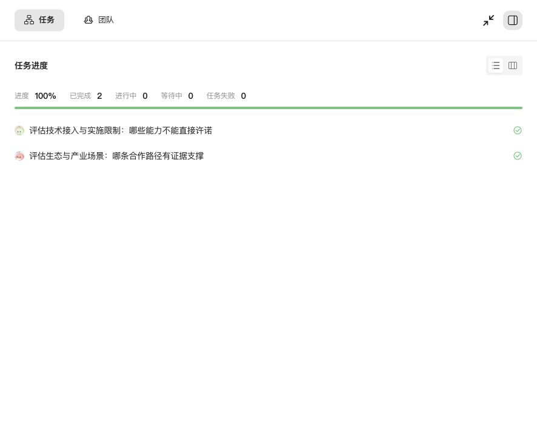

# JiuwenSwarm 集群模式结果核验实践

> **目标**：帮助已能启动 JiuwenSwarm 的用户，用一份固定资料同时运行单 Agent 和集群模式任务，并核验三件事：协作是否真实发生、执行过程是否有失败、结论是否忠于来源。
>
> **英文版：** [English Version](../../en/development-practices/JiuwenSwarm-Cluster-Mode-Result-Verification.md)

---

## 1. 概述

集群模式结束时，任务面板显示“已完成”，Leader 也会给出汇总。但这两项只说明执行链路跑完了，不说明结论正确。本文用一次真实试跑说明如何把“任务完成”和“结果可信”分开检查。

### 1.1 适用场景

- 首次评估集群模式，需要确认是多个成员实际分工，而不是一个模型模拟多个角色。
- 用 Agent 做资料研究或评估类任务，结论需要逐条对应来源。
- 需要为团队内部演示或选型保留可复查的运行记录。

### 1.2 本文环境

| 项目 | 配置值 |
|------|--------|
| 操作系统 | macOS |
| Python | 3.11，独立虚拟环境 |
| 安装包 | PyPI 发行包 `workswarm 0.2.7`，依赖 `openjiuwen 0.1.19` |
| 模型 | DeepSeek，界面中的模型名为 `deepseek-flash` |
| 运行日期 | 2026-10-21 |

> ⚠️ **注意**：本文所有数据来自一次限定输入的试跑，不代表典型性能、费用或生产可用性。

---

## 2. 准备隔离环境

### 2.1 安装与启动

建议为试跑单独创建虚拟环境和数据目录，避免影响已有工作区：

```bash
python3.11 -m venv .venv
source .venv/bin/activate
pip install "workswarm==0.2.7"

export JIUWENSWARM_HOME="$PWD/demo-home"
jiuwenswarm-init
jiuwenswarm-start
```

启动成功后，在浏览器访问 `http://localhost:5173`。

### 2.2 关于数据目录

- `JIUWENSWARM_HOME` 用于替换用户主目录，配置与工作区会生成在 `$JIUWENSWARM_HOME/.jiuwenswarm`。该变量在 `jiuwenswarm/common/utils.py` 的 `get_user_home()` 中读取。
- 如需运行多个长期实例，请优先参考 [单机多实例运行](../单机多实例运行.md)。
- 默认端口为 `18092 / 19000 / 19001 / 5173`，端口被占用时的处理方式见 [快速开始](../Quickstart.md)。

---

## 3. 配置模型

在 Web 界面的设置中添加模型服务，填写服务地址和凭据，测试连接后选择模型。具体字段以 [配置信息](../配置信息.md) 和当前界面为准。

> ❌ **禁止**：不要把模型凭据写入提示词、结果文件或公开截图。

---

## 4. 准备固定输入

核验的前提是输入固定。本次在工作区内放入一个 `sources.md`，包含 7 条公开资料摘录，每条带编号：

```markdown
## S1 某平台官网首页
……摘录原文……

## S6 分布式 Team 文档
该文档面向开发与集成测试。同一通道分布式 Team 当前采用单活 session 语义……
```

固定输入有两个作用：

- Agent 不联网，结果差异只来自模型和框架，便于复现。
- 每条结论都能回到具体编号核对。

---

## 5. 设计两组任务

两组任务读取同一份资料，但输出长度和形式不同，因此不直接比较耗时。

### 5.1 单 Agent 基线

在单 Agent 模式下发送：

```text
读取工作区 sources.md，只使用该文件，不联网、不读取其他目录、不安装依赖、不发消息。
输出一页建议，保存到 single-result.md。包含：3 条带 [S编号] 的已知事实、
2 个需确认的问题、3 项最小验证步骤。事实与建议分开，不得编造规模或承诺。
总字数不超过 600 字。不要创建定时任务或调用其他 Agent。
```

### 5.2 集群模式

切换到集群模式后发送：

```text
读取工作区 sources.md，只使用该文件，不联网、不读取其他目录、不安装依赖。
组织两位成员并行评估：一位负责生态与场景，一位负责技术接入与实施限制。
每位提交最多 200 字的正式成果，至少含一条 [S编号] 事实和一个待确认项。
Leader 审核两份成果的来源和边界后，综合保存 team-result.md，不超过 700 字。
不因成员口头“完成”就认定来源审核通过。最多两位成员，不再扩展团队。
```

> 💡 **提示**：提示词中显式限定成员数量和输出位置，便于事后核对轨迹。

---

## 6. 核验三件事

### 6.1 协作是否真实发生

不要只看 Leader 的汇总文字，应检查工具调用轨迹和任务状态。可通过 [调试追踪](../调试追踪.md) 查看每轮的工具调用。本次集群任务的轨迹中能看到：

| 工具 | 次数 | 说明 |
|------|------|------|
| `build_team` | 1 | 组建团队 |
| `spawn_teammate` | 2 | 创建两位成员 |
| `create_task` | 2 | 为成员创建任务 |
| `claim_task` | 4 | 成员认领任务 |
| `send_message` | 3 | 成员与 Leader 之间的消息 |

任务面板显示 2 项任务均为已完成：



这说明两位成员确实各自领取并完成了任务，不是一个模型在一次回复里扮演多个角色。

### 6.2 执行过程是否有失败

“已完成”不等于过程没有出错。本次统计结果如下：

| 检查项 | 单 Agent | 集群模式 |
|--------|----------|----------|
| 会话首末事件时间差 | 约 36 秒 | 约 137 秒 |
| 工具调用次数 | 14 | 59 |
| 标记为失败的工具结果 | 1 次（`write_file`） | 4 次（1 次 `create_task`，3 次 `write_file`） |
| 输出文件 | 1 份 | 2 份成员成果 + 1 份汇总 |

失败均在后续步骤中恢复，最终文件齐全。建议在记录中保留失败次数，而不是只写“成功完成”。

另一个值得注意的现象是：单 Agent 的 600 字短任务调用了 14 次工具，其中多次用于字数自检。短任务的工具开销可以作为调优对象。

### 6.3 结论是否忠于来源

这一项最容易被忽略。本次两份成员成果中，有两处表述超出了来源：

| 来源原文 | 成员表述 | 问题 |
|----------|----------|------|
| S6：“该文档面向开发与集成测试” | “分布式 Team 限开发测试” | 把文档的目标读者说成了功能限制 |
| S2：公开项目“不能直接称为”平台自有产品 | “非自有产品” | 把“无法认定”说成了确定的否定 |

Leader 在汇总时仍判定两份成果通过。本次任务记录中 `reviewer` 字段为 `null`，即没有配置独立审核角色。

建议按下表逐条记录核验结果，而不是依赖模型自称“已核对”：

| 输出原文 | 对应来源编号 | 是否扩大含义 | 修正意见 |
|----------|--------------|--------------|----------|
| …… | S6 | 是 | 改为“该文档面向开发与集成测试” |

> 💡 **提示**：如果结论准确性很重要，可以在团队中单独增加一位只负责来源核验的成员，并要求其输出上表，再由 Leader 汇总。

---

## 7. 用量记录口径

本次单 Agent 任务的用量汇总为：输入 431,945、输出 5,417、合计 437,362 Token，其中缓存 402,688，命中率约 93.2%。

记录用量时请注意：

- 该数字是框架记录的累计调用量，包含缓存，不等于服务商的计费 Token。
- 本次集群任务未取得同口径的汇总，因此不与单 Agent 比较。
- 未对账服务商账单前，不建议据此推算费用或节省比例。

---

## 8. 结论与局限

本次试跑可以确认：

- 发行包可在 macOS 本机安装、初始化并启动。
- 集群模式确实创建了两位成员和两项任务，有独立成果和 Leader 汇总。
- 任务状态完成、Leader 汇总通过、结论忠于来源，是三项需要分别检查的内容。

本次未验证：跨机器分布式运行、Team Organization、SwarmFlow 人工节点、重启恢复、持续并发和安全隔离。单次样本也不能用于框架之间的性能比较。

---

## 9. 常见问题

### 9.1 Leader 判定通过，是否还需要人工核验

**问题描述**：Leader 汇总中写明成员成果已通过审核。

**解决方案**：仍需按第 6.3 节逐条核对来源。本次案例中，Leader 判定通过的成果包含两处超出来源的表述。

### 9.2 如何确认结果不是单个模型模拟的

**问题描述**：汇总文字中出现多个角色发言，但无法判断是否真的分工。

**解决方案**：检查轨迹中是否有 `spawn_teammate`、`create_task`、`claim_task` 调用，以及任务面板中的任务数量和状态。

### 9.3 启动时端口被占用

**问题描述**：此前的实例未完全停止，或端口被其他应用占用。

**解决方案**：参考 [快速开始](../Quickstart.md) 中的端口说明，使用 `jiuwenswarm-start --stop default` 停止旧实例。

---

## 返回导航

- [返回文档首页](../../README.md)
- [返回项目首页](../../../README_CN.md)
