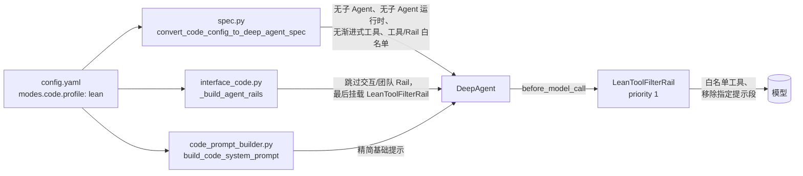

# 精简编码模式

`modes.code.profile: lean` 是面向**无头编码**（实现驱动器、基准评测、CI 任务）的 Code 模式配置档：只向模型展示编码任务需要的工具，并移除描述交互、团队与委派功能的提示文本。默认配置档不变；桌面端、TUI、Web 用户不开启就看不到任何差异。

English: [Lean coding profile](../en/LeanCodingProfile.md)

## 1. 为什么

Code 模式的每次模型调用都包含固定部分（系统提示 + 工具 schema）与增长部分（历史与工具结果）。在本分支上用一次无头调用实测（`scripts/measure_code_prompt.py`，tiktoken `cl100k_base`）：

| 配置档 | 系统提示 | 其中技能目录 | 工具 schema | 展示的工具数 | 每次调用固定 token |
|---|---|---|---|---|---|
| default | 36,648 字符 / 7,862 token | 130 字符 | 46,779 字符 / 13,313 token | 21 | **21,175** |
| lean | 22,255 字符 / 4,798 token | 0 | 15,757 字符 / 4,457 token | 6 | **9,255**（−56%） |

默认工具：`fetch_webpage, read_file, write_file, edit_file, glob, grep, bash, subagent_spawn, subagent_wait, subagent_list, subagent_send_input, subagent_close, subagent_resume, task_tool, skill_tool, tool_search, tool_call, todo_create, todo_list, todo_get, todo_modify`。
精简工具：`read_file, write_file, edit_file, glob, grep, bash`（构建中若有 `run_tests`、`code_search`、`find_symbol`、`symbol_outline` 也保留）。

默认档的数字取决于已安装的技能目录：本次测量的技能目录为 130 字符；评审在技能目录为 6,099 字符的数据目录上测得 23,385 → 9,263 固定 token（−60%）。精简档的数字不变，因为它去掉了技能目录。

在 SWE-bench Pro 试跑与第 1 波 A/B 评测中，Agent 基本只使用 `bash`、`read_file`、`edit_file`、`grep`、`write_file`、`glob`（约 860 次调用中仅 1 次 `code_search`、1 次 `symbol_outline`）。每题约 40 次模型调用，固定部分要付约 40 次；每次少约 1.2 万 token，相当于每题少约 50 万 token。

## 2. 工作原理

不修改 agent-core。配置档只用到 jiuwenswarm 自有的三处代码和一个公开的 Rail 钩子。



1. **Spec 转换**（`jiuwenswarm/agents/harness/code/spec.py`）：不构建子 Agent，关闭子 Agent 运行时（去掉 `task_tool` 与 `subagent_*`）；关闭渐进式工具披露（去掉 `tool_search`、`tool_call` 与延迟工具目录提示）；`modes.code.tools` 与 `modes.code.rails` 只保留白名单项（去掉网页工具、`skill_toolkit`、`SkillUseRail`、`WorktreeRail`）。
2. **Rail 组装**（`JiuwenSwarmCodeAdapter._build_agent_rails`）：`skip_rails` 中的固定 Rail 不构建；因为适配层其他代码会直接读取这些属性，它们被置为 `None`，与构建失败时一致。最后追加 `LeanToolFilterRail`。
3. **LeanToolFilterRail**（`jiuwenswarm/agents/harness/code/lean_profile.py`）：priority 1，在所有 Rail 之后运行于公开的 `before_model_call` 钩子；只保留 `ctx.inputs.tools` 中的白名单工具，并从系统提示构建器中移除指定的 `PromptSection`。工具仍注册，只是模型看不到。它也覆盖后续由其他代码注册的工具：实测隐藏了 16 个（`cron*`、`coding_memory_*`、`get_current_goal`、`submit_goal_report`、`list_files`、`switch_mode`、`user_todos`），关闭渐进式披露后它们原本会直接暴露。任何异常只记录日志，本轮照常进行。
4. **基础提示**（`code_prompt_builder.build_code_system_prompt("lean")`）：与默认相同的段落，去掉子 Agent 路由段、todo 小节、`list_files` 提及与 `ask_user` 升级语句。`build_code_system_prompt()`（默认）与改动前逐字节一致。

精简模式保留：运行时/回复提示、安全、心跳、权限中断、文件系统（`SysOperationRail`）、**项目记忆**（`AGENTS.md`/`CLAUDE.md` 项目说明）、Agent 模式处理、上下文处理与卸载恢复，以及本分支的三个完成度 Rail（`CodeExecutionDisciplineRail`、`ImplementCompletenessRail`、`CodeCompletionGateRail`）。

### 工具对照

| 工具 | 注册位置（jiuwenswarm 侧） | 精简模式 |
|---|---|---|
| `read_file`、`write_file`、`edit_file`、`glob`、`grep`、`bash` | `_build_filesystem_rail` 构建的 `SysOperationRail` | 保留 |
| `list_files` | 同一 Rail（渐进式披露下为延迟工具） | 过滤隐藏 |
| `fetch_webpage` 等网页工具 | `modes.code.tools` → `_TOOL_BUILD_NAMES` | 从 spec 去掉 |
| `skill_tool` + 技能目录 | `modes.code.rails` 中的 `SkillUseRail` | 从 spec 去掉（`rails_allow`） |
| 技能检索工具/提示 | `modes.code.tools`、`_skill_retrieval_prompt_rail` | 去掉 / 跳过 Rail |
| `task_tool`、`subagent_*` | Code 子 Agent 构建 + `_subagent_rail` | 无子 Agent、关闭运行时、跳过 Rail |
| `tool_search`、`tool_call` | 渐进式披露（`ProgressiveToolSpec`） | spec 中关闭 |
| `todo_create/list/get/modify` | `_code_task_planning_rail` | 跳过 Rail |
| `ask_user` | `_code_ask_user_rail` | 跳过 Rail |
| 计划审批中断 | `_code_plan_approval_rail` | 跳过 Rail |
| `coding_memory_*` | `_coding_memory_rail`（及记忆配置） | 跳过 Rail，过滤隐藏 |
| `lsp` | `_lsp_rail` | 跳过 Rail |
| `cron*`、目标工具、`switch_mode`、`user_todos` | 适配层注册、`AgentModeRail`、确认中断 Rail | 过滤隐藏 |

## 3. 配置

所有键位于 `config.yaml`（及两个分布式团队模板）的 `modes.code` 下。

| 键 | 默认值 | 含义 |
|---|---|---|
| `profile` | `default` | `default` = 现有行为；`lean` = 本配置档。未知值回退为 `default` 并告警。 |
| `lean.tools_allow` | `[read_file, write_file, edit_file, bash, grep, glob, run_tests, code_search, find_symbol, symbol_outline]` | 模型可见的工具；未注册的名字忽略（首次调用时以一条 WARNING 列出）。若没有任何名字与已注册工具匹配，则保留完整工具列表并告警，拼写错误不会让模型失去所有工具。`run_tests` 来自验证闭环 MR。 |
| `lean.rails_allow` | `[]` | 保留的 `modes.code.rails` 动态 Rail。 |
| `lean.skip_rails` | 代码默认（见 `DEFAULT_SKIP_RAILS`） | 不构建的固定 Rail（其 `_RailBuildInfo` 属性名）。 |
| `lean.drop_prompt_sections` | 代码默认（见 `DEFAULT_DROP_PROMPT_SECTIONS`） | 每次模型调用前移除的提示段。 |
| `lean.disable_subagents` | `true` | 不构建子 Agent，关闭子 Agent 运行时。 |
| `lean.disable_progressive_tool` | `true` | 关闭 `tool_search` / `tool_call` 渐进式披露。 |
| `lean.log_sections` | `true` | 首次模型调用时记录保留/隐藏的工具与剩余提示段大小。 |

关闭方式：`profile: default`（或删除该键）。各 `lean.*` 开关也可单独放宽，例如 `disable_subagents: false` 保留子 Agent，其余工具仍隐藏。

### 在无头运行中启用

进程 CLI 与其他入口读取同一个 `config.yaml`，只需在其数据目录中设置：

```yaml
modes:
  code:
    profile: lean
```

无头 process 运行以覆盖项传入：

```bash
jiuwenswarm-process --implement ... --set modes.code.profile=lean
```

## 4. 如何确认生效

会话开始与首次模型调用时，Agent Server 日志（`<数据目录>/agent/.logs/agent_server.log` / `full.log`）：

```text
[JiuwenSwarmCodeAdapter] lean coding profile: skipped rails=['_skill_retrieval_prompt_rail', '_symphony_orchestration_rail', '_session_messaging_route_rail', '_lsp_rail', '_coding_memory_rail', '_code_ask_user_rail', '_code_task_planning_rail', '_code_agent_rail', '_code_plan_approval_rail', '_subagent_rail']
[LeanToolFilterRail] tools kept=['bash', 'edit_file', 'glob', 'grep', 'read_file', 'write_file'] dropped=['coding_memory_edit', ..., 'switch_mode', 'user_todos']
[LeanToolFilterRail] prompt sections removed=['memory', 'memory_forbidden'] remaining(chars)={'identity': 13968, 'safety': 770, 'offload': 776, 'env': 922, 'directory_boundaries': 2614, 'input': 546, 'output': 2647}
```

设置 `react.context_engine_config.enable_context_debug: true` 后，完整请求写入 `<workspace>/context/<session>_context/context_debug/llm_request.jsonl`；`scripts/measure_code_prompt.py --data-dir <已初始化的数据目录>` 自动对两个配置档执行并打印第 1 节的表（每个配置档一次短模型调用，deepseek-flash 约 $0.01）。

## 5. 限制

- 节省只针对每次调用的**固定**部分；历史与工具结果不变（那部分见上下文瘦身）。
- agent-core 拥有的工具**描述**（例如约 7.7k 字符的 `bash`）长度不变；本配置档只决定展示哪些工具。
- 集群/团队组装路径（`agents/swarm/providers`）不受本配置档控制；它作用于进程 CLI、TUI、Web 与桌面端使用的 Code 适配层。
- 过滤只控制模型可见性，不阻止执行：隐藏的工具仍然注册，若按名字调用仍会被分派。模型通常只调用展示给它的工具，但这不是权限边界（权限请用工具权限配置）。
- 提示段按名字移除；若某 Rail 改了段名，需要把新名字加入 `drop_prompt_sections`。
- 两个共享的 jiuwenswarm 提示段是**裁剪而非删除**：精简模式下去掉 `directory_boundaries` 中的「已安装扩展资产」小节和 `input` 中的「系统消息」（cron/notify）小节，其余保留——`directory_boundaries` 还包含「不要写入智能体内部数据」的规则（含 `todo/` 一行），`input` 描述用户消息格式。裁剪按标记进行（`LEAN_PRUNE_BLOCKS`），标记变化时该小节保持原样。
- 精简提示生成函数按标记编辑默认 Code 段；上游若修改标题或句子，会记录 WARNING 并保留原文，而不是让 Agent 创建失败。
