# 系统插件

系统插件可以在不修改 JiuwenSwarm 主程序的情况下，为页面、会话、Agent 执行流程或 Gateway 增加新能力。

---

## 系统插件能做什么

| 能力 | 例子 |
|------|------|
| 扩展页面 | 在输入框上方显示状态条，在侧边栏增加面板，在设置中增加选项。 |
| 感知会话 | 在会话开始、消息收发、上下文用量变化或任务结束时执行处理。 |
| 调整 Agent 行为 | 补充上下文、登记工具或处理服务端命令。 |
| 扩展 Gateway | 在请求进入 AgentServer 前处理鉴权、路由等逻辑。 |
| 管理运行状态 | 安装、启用、禁用、重载、切换版本和卸载。 |
| 故障还原 | 从存档点恢复插件启用状态，并自动重启后台服务。 |

系统插件与普通“插件”是两种不同的扩展。系统插件卡片带有“系统插件”标签，可以直接在页面中区分。

## 快速上手

下面使用 **TokenWeather** 演示安装和使用过程。TokenWeather 启用后，会在对话输入框上方显示当前会话已使用的 Token、上下文窗口上限和使用占比。

### 1. 安装 TokenWeather

1. 打开 JiuwenSwarm，点击左侧「**扩展**」。
2. 进入「**插件广场 → 系统插件**」。
3. 找到 TokenWeather，点击「**安装**」。

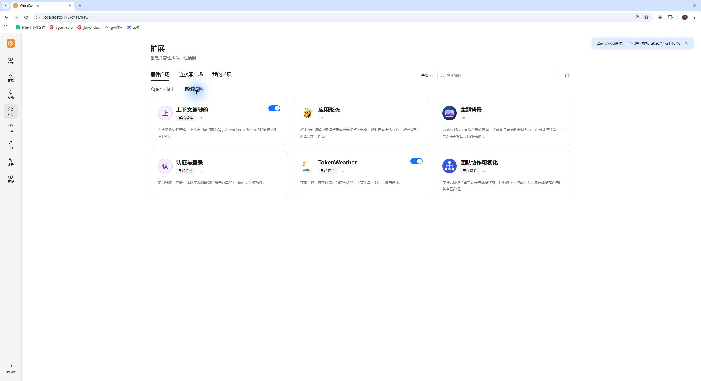

如果已经有其他系统插件处于启用状态，安装前会提示“开启多个系统插件”。确认这些插件可以同时使用后，再继续安装。

### 2. 启用或禁用插件

安装完成后，进入「**我的扩展 → 插件**」。带有“系统插件”标签的卡片右上角有一个开关。

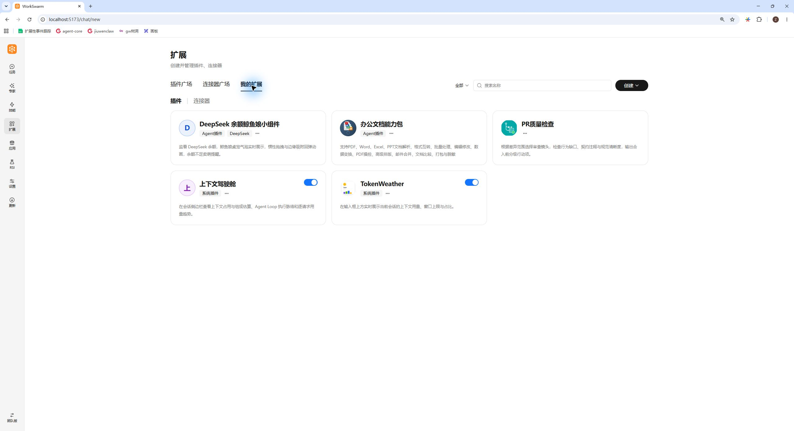

- 开关为蓝色：插件已启用。
- 开关为灰色：插件已禁用，安装文件仍然保留。
- 再次打开开关：插件重新启用，不需要重新安装。

启用和禁用不会显示“安装中”等小字。如果同时启用多个系统插件，页面会提醒可能发生冲突。

### 3. 查看 TokenWeather 是否生效

1. 确认 TokenWeather 的开关为蓝色。
2. 打开一个对话并发送消息。
3. 等待 Agent 回复完成，查看输入框上方是否出现 TokenWeather 状态条。

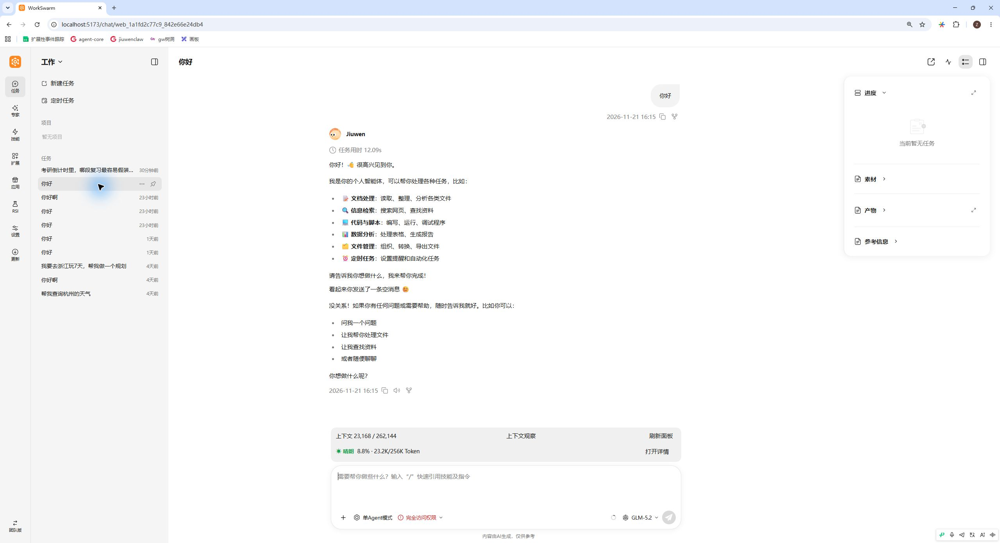

进入「**设置 → 常规 → 显示设置**」，可以隐藏或重新显示状态条。这个开关只控制页面展示，不会禁用插件。

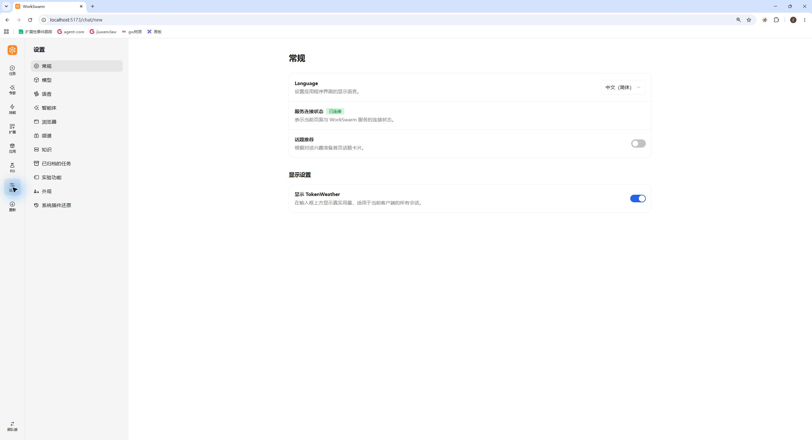

## 三种安装方式

系统插件可以从页面上传、在对话中安装，也可以在程序启动前放入系统插件安装目录。

### 方式一：在页面上传 ZIP 包

1. 进入「**扩展 → 我的扩展 → 插件**」。
2. 点击右上角「**创建 → 上传文件创建**」。
3. 选择系统插件 ZIP 包并确认上传。

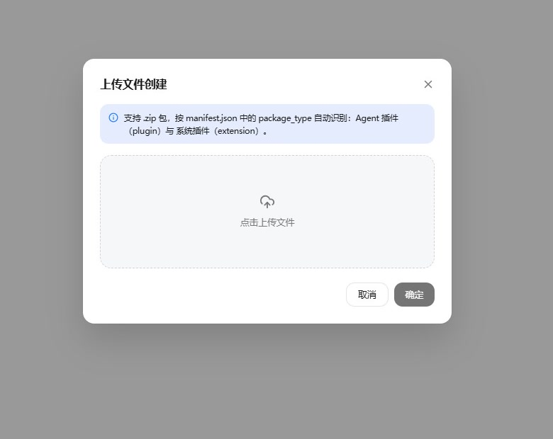

ZIP 根目录需要直接包含 `manifest.json`，不能在外层再套一层同名目录。上传成功后，系统插件会出现在“我的扩展”中。

### 方式二：在对话中使用 `/extension`

在任务输入框输入 `/`，选择 `/extension`，再输入操作和参数。例如：

```text
/extension install "C:\Users\admin\Desktop\token_weather.zip"
```

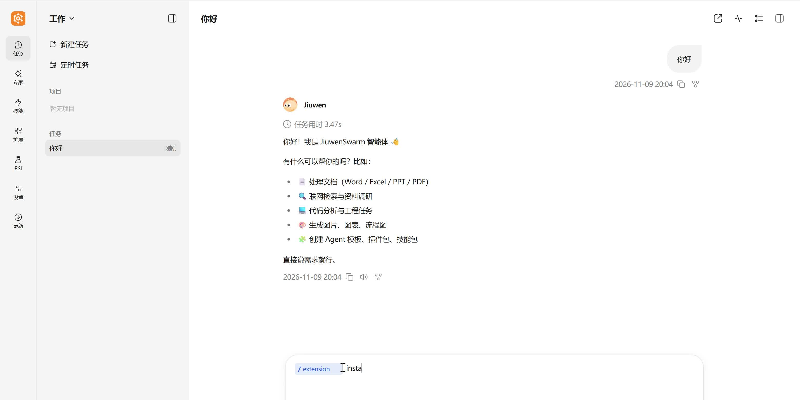

常用命令如下：

```text
/extension query
/extension query <package_id>
/extension install "<ZIP 的绝对路径>"
/extension reload <package_id>
/extension uninstall <package_id>
```

- `query`：查看已经安装的系统插件。
- `install`：安装本机可访问的 ZIP 包。
- `reload`：重新加载当前启用版本。
- `uninstall`：卸载插件。

### 方式三：放入系统插件安装目录

系统插件安装目录默认为：

```text
~/.jiuwenswarm/extension_pkgs
```

在 Windows 中通常是：

```text
C:\Users\<用户名>\.jiuwenswarm\extension_pkgs
```

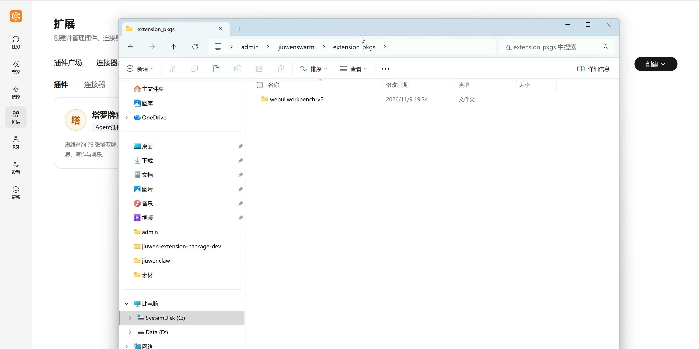

1. 退出 JiuwenSwarm。
2. 将合法的系统插件包放入安装目录。
3. 重新启动 JiuwenSwarm。
4. 进入“我的扩展”查看安装结果。

程序运行期间临时放入的新插件不会立即安装，也不会出现在“我的扩展”或 `/extension query` 中。重新启动后，程序才会统一读取安装目录。

## 查看详情和管理版本

点击系统插件卡片可以进入详情页。

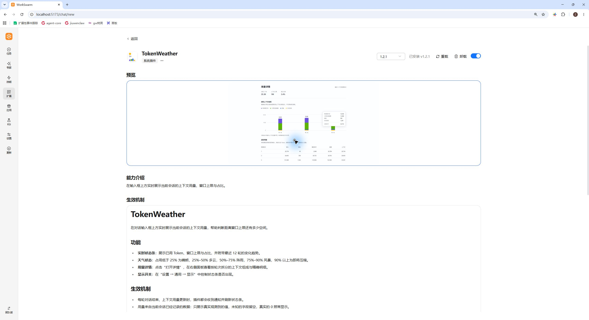

| 操作 | 作用 |
|------|------|
| 版本 | 查看已经安装的版本，并切换当前使用的版本。 |
| 重载 | 重新加载当前启用版本，适合插件代码或配置更新后立即生效。 |
| 卸载 | 删除当前版本或该插件的全部版本。 |
| 开关 | 启用或禁用插件，和“我的扩展”卡片上的开关一致。 |
| 文件预览 | 查看插件包中的声明、代码和说明文件。 |

同一个系统插件可以保留多个版本。切换版本后，目标版本生效，旧版本仍然保留，之后可以再切换回来。

### 卸载一个版本或全部版本

点击「卸载」后有两种选择：

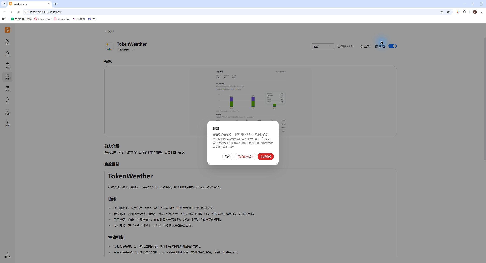

- **仅卸载当前版本**：只删除当前选择的版本，其他版本继续保留。
- **全部卸载**：删除这个系统插件的全部版本。

不确定时，优先选择“仅卸载当前版本”。

## 使用内置 Skill 开发系统插件

JiuwenSwarm 内置了系统插件开发 Skill。你可以用自然语言描述想要的效果，Agent 会完成代码生成、测试、打包，并在需要安装或调整效果时向你确认。

### 1. 找到系统插件开发 Skill

进入「**技能 → 我的技能**」，找到系统插件开发 Skill。当前 Skill 名称为 `jiuwen-system-plugin-dev`；不同版本页面上的显示名称可能略有不同。

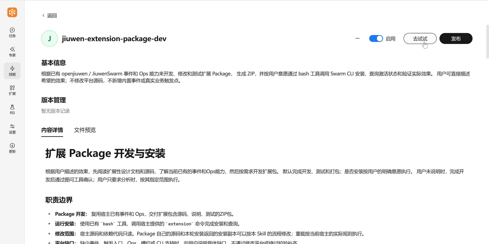

### 2. 用自然语言说明需求

新建任务，直接说明插件要显示在哪里、展示什么内容，以及什么时候更新。例如：

```text
帮我开发一个系统插件，在对话输入框上方显示当前上下文已使用的 Token、窗口上限和占比。
```

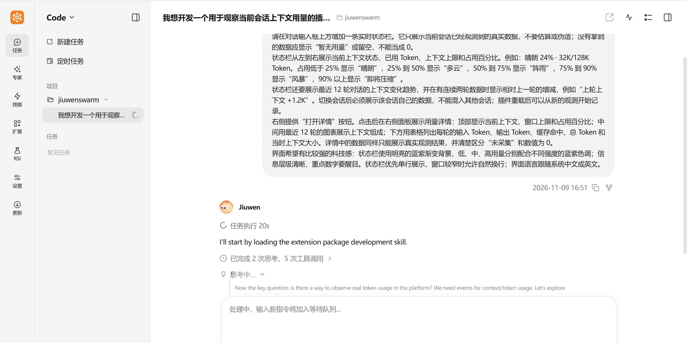

### 3. 等待 Agent 生成插件

Agent 会查找当前版本可用的事件和页面能力，然后生成插件代码、测试和 ZIP 包。生成过程中不需要手动编写文件。

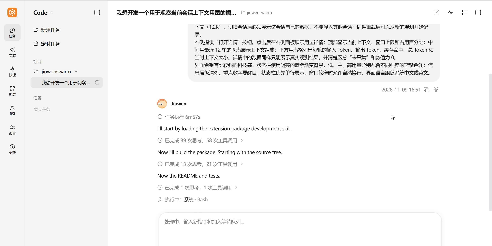

### 4. 回答确认问题并调整效果

涉及页面效果时，Agent 会询问是否安装、效果是否符合预期，或让你选择下一步操作。按照页面提示回答即可；如果不满意，可以直接说明要改的颜色、位置、文案或交互。

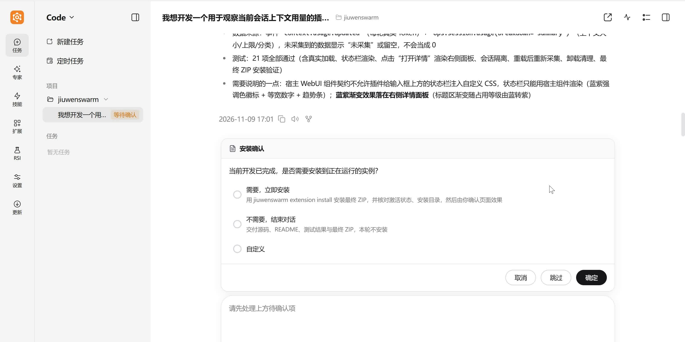

### 5. 查看生成结果

插件安装并启用后，打开对应页面检查效果。后续再次提出修改时，Agent 会保留相同的 `package.id`，生成一个新版本，旧版本仍可在系统插件详情页中切换。

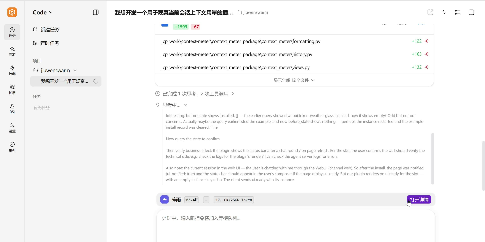

## 系统插件还原

如果启用插件后页面打不开、服务异常或插件之间发生冲突，可以使用系统插件还原。

1. 打开「**设置 → 系统插件还原**」。
2. 选择故障发生前的存档点。
3. 展开记录，核对还原后的插件状态。
4. 点击右上角「还原」，阅读提示后确认。

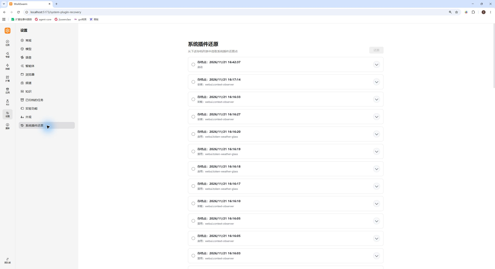

JiuwenSwarm 会记录最近 50 条启动、安装、卸载、启用、禁用和还原操作。还原会恢复所选时刻的启用状态，并自动重启后台服务。已经删除的插件不会重新下载，插件此前写入的文件或外部系统数据也不会被撤销。

## 常见问题

### 插件已启用，但页面没有变化怎么办

1. 确认插件卡片开关为蓝色。
2. 查看详情页中的能力介绍，确认它应该出现在哪个页面。
3. 打开真实会话并完成一轮对话；有些插件要等对应事件发生后才会显示。
4. 在详情页点击「重载」，再刷新目标页面。

### 为什么安装或启用时提示“开启多个系统插件”

多个系统插件可能使用同一页面位置或处理同一事件。这个提示不是报错。确认插件之间没有冲突后，可以继续开启。

### 禁用和卸载有什么区别

- 禁用：停止插件运行，文件和版本仍在，可以随时重新启用。
- 卸载：删除一个或全部安装版本；全部卸载后不能直接恢复文件。

### 运行时把插件放进安装目录，为什么看不到

安装目录只在程序启动时统一读取。请重新启动 JiuwenSwarm，或改用页面上传和 `/extension install` 安装。

---

## 相关文档

- [OpenJiuwen 扩展性开发指南](<extension/【目录】openjiuwen 扩展性开发指南.md>)
- [创建第一个 OpenJiuwen 扩展](<extension/2.【创建扩展】创建第一个 OpenJiuwen 扩展.md>)
