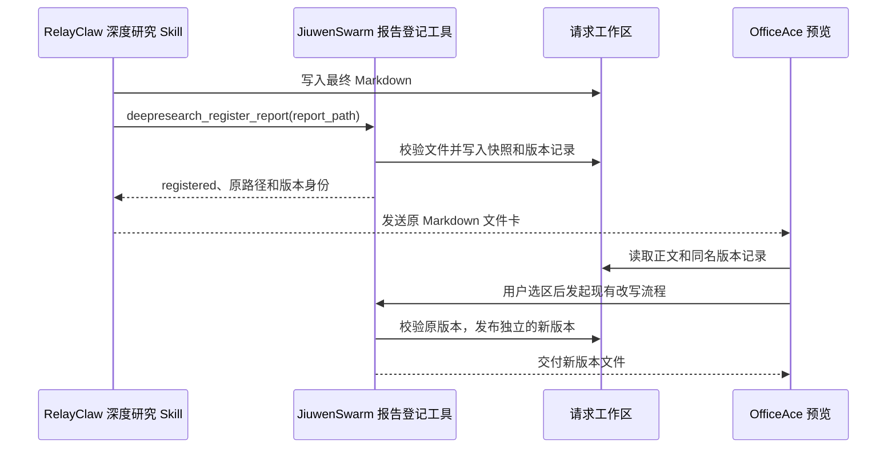

# 主 Agent 自写深度研究报告改写适配方案

| 项目 | 内容 |
|---|---|
| 缺陷 | [BUG20261120413289](https://devcloud.cn-north-4.huaweicloud.com/ipdproject/project/3a2cbf8b017b4bdab0f0efbbb0a90f9a/scrum/work/list/Bug/1330602603233763329/detail?domain=1304102108848033793) |
| 日期 | 2026-11-26 |
| 状态 | 本地已有候选实现，本文供评审与转测 |
| 范围 | OfficeAce 深度研究 Skill 交付的主 Agent 自写 Markdown |
| 测试基线 | 两仓本地候选、隔离的 macOS OfficeAce Web、DeepSeek-V4.1-Flash-1017 |
| 接口规范 | [主 Agent 深度研究报告登记](../specs/S_26_main-agent-report-registration.md) |

## 问题与目标

用户打开深度研究交付的 Markdown，选中一段文字后，希望像打开引擎报告一样看到「润色、扩写、缩写」。缺陷现场交付的是主 Agent 另写的文件。普通写文件流程只写正文，预览按文件名寻找同名的 `.provenance.json`，因此无法读取版本身份，选区菜单也没有出现。改写后端还依赖正文快照来验证原文和引用。

方案是在主 Agent 写完最终 Markdown 后、发送文件卡前登记原文件。用户从原文件进入改写，改写结果作为独立的新版本交付。此次范围是报告登记、交付和改写；现有研究证据判定继续适用。

## 处理流程

1. **RelayClaw 负责交付时机。** Skill 用写文件工具返回的路径调用登记工具。登记成功后用 `send_file_to_user` 发送返回的原路径。引擎返回的原始报告已有自己的发布入口。用户只需要 Word 等后续格式时，登记仅在 Markdown 本身也要交付的情况下执行。
2. **JiuwenSwarm 负责版本记录。** `deepresearch_register_report(report_path)` 随 `deepresearch` 技能激活。工具从当前请求获取会话和工作区，校验目标是工作区内可安全读取的 UTF-8 Markdown 普通文件。然后写入 `<stem>.final-result.json` 和 `<stem>.provenance.json`。成功返回 `status=registered`、`report_path`、`document_id` 和 `revision_id`。
3. **OfficeAce 复用现有改写。** 版本记录沿用 schema v2，包含文档和版本标识、正文哈希及快照哈希。普通来源链接保留在正文中。预览解析出有效版本后启用菜单，后端继续使用已有的 `prepare_rewrite` 和 `commit_rewrite` 校验选区并发布新版本。

## 失败处理与兼容

| 场景 | 预期 |
|---|---|
| 同一份正文重复登记 | 返回原有版本身份，避免重复产生版本记录。 |
| 正文内容已变化或同名快照冲突 | 返回 `REVISION_CONFLICT`，保留磁盘上原有文件。 |
| 写完快照后登记中断 | 本次可捕获的写入失败清理本次创建的文件。若重试时仅有字节完全一致的快照，可继续完成登记。 |
| 旧引擎缺少工具或登记失败 | Skill 在工具不可用时尝试重新加载一次。仍不可用或登记失败时，继续交付已保存的 Markdown，并提示本次暂不支持局部改写。 |
| 普通历史 Markdown | 历史交付物按原有预览规则处理。本方案的触发点是新交付流程。 |

登记放在交付之前，文件卡到达时预览已有可读取的版本记录。若只给前端强开菜单，改写准备仍会在读取版本记录时失败。将登记延后到用户第一次点击改写，还需要让前端识别哪些普通 Markdown 是本次研究的最终产物，并在打开入口前建立版本。原位登记可以复用当前预览、引用和版本校验，同时保留正文原路径及相对资源链接。

## 代码位置与发布顺序

| 仓库 | 主要修改位置 |
|---|---|
| JiuwenSwarm | [rewrite_tools.py](../../common/tools/deepresearch/rewrite_tools.py) 提供登记入口，[document_rewrite.py](../../common/tools/deepresearch_plugin/document_rewrite.py) 执行安全读取和版本写入。[工具注册](../../common/tools/deepresearch/__init__.py)与[工作区绑定](../../common/rails/progressive_tool_rail.py)接入现有工具生命周期。 |
| RelayClaw | `office-claw-skills/deepresearch/SKILL.md` 增加交付前登记和失败提示。 `relayclaw-shared-runtime.ts`、`TeamCatalog.ts` 将新工具纳入 Office Excel 和专家团模式的现有工具限制。 |

先发布提供登记工具的 JiuwenSwarm，再更新 RelayClaw 的 Skill 与工具策略。验收实例应核对 RelayClaw 构建目录、实际加载的 Skill 文件和 JiuwenSwarm 的 Python 模块路径。若计划用 3003 演示，启动后以监听进程的工作目录和后端加载路径确认候选版本。端口号本身无法区分不同签出的服务。

回滚时先恢复旧版 Skill 交付规则，再按需撤回登记工具。已登记的版本记录使用现有 schema，回滚时可保留这些文件。

## 验收口径

| 场景 | 通过条件 |
|---|---|
| 主 Agent 自写报告 | 从 OfficeAce 发起真实任务。日志能关联写文件、登记和发送成功。打开同一个文件卡，选中文字出现三个改写选项。 |
| 选区改写 | 执行一次改写并打开新文件卡。原版保持不变，新版只改所选正文，版本链和哈希匹配。 |
| 重复调用与异常 | 覆盖重复登记、跨工作区路径、正文变化、快照写入后的故障和旧引擎缺工具。失败不影响原文件的正常交付。 |
| 既有场景 | 复核引擎原始 Markdown 的改写、仅交付 Word 的流程和普通 Markdown 预览。 |
| Windows 企业版 | 在含两仓候选的安装包执行真实任务，保存任务交付、选区菜单和新版本三处界面证据。 |

## 已有验证与交付状态

2026-11-25 的隔离 Web 实测从浏览器发起真实模型任务。主 Agent 写出《虚构图书馆盘点简报》，登记后通过文件卡交付。原报告预览出现三个改写选项，点击「缩写」后收到并打开 v2。校验脚本确认缩写仅替换所选的一句，原文与新版本哈希及父子版本关系匹配。原句「目前我们已经对图书馆的藏书情况进行了一次基础性的初步核对。」变成「目前，我们已初步核对图书馆藏书情况。」。

两仓当前为本地候选。Windows 企业版安装包验收待执行。实测截图为重开原报告和 v2 后补拍的预览画面，任务执行证据以原次日志和校验结果为准。
