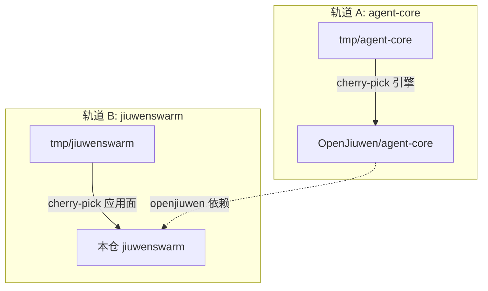
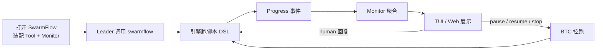
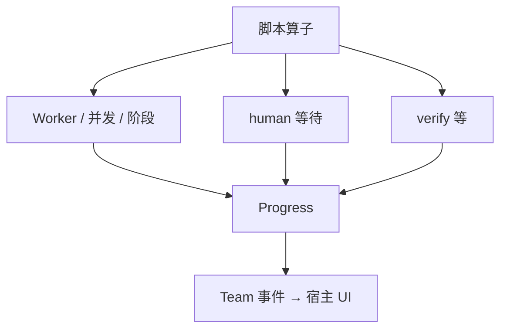

# SwarmFlow 双仓迁移工作清单（agent-core + JiuwenSwarm）

## 元信息

| 项 | 值 |
|---|---|
| 日期 | 2026-10-31 |
| 状态 | 开发中（轨道 B Phase B1 P0 已落地） |
| 范围 | **轨道 A**：`tmp\agent-core` → `agent-core`（SwarmFlow 引擎）。**轨道 B**：`tmp\jiuwenswarm` → 本仓（应用侧宿主与产品面）。引擎实现不进本仓源树 |
| 关联 spec | 暂无（本仓落地后建议 `S_22+`；agent-core 侧对齐其模块 `docs/specs`，如 S_18/S_21/S_25） |
| 确认 | 引擎归 agent-core、应用面归本仓（2026-10-31）；分阶段切片与并行节奏仍待确认 |
| 作者 | wudawei |
| 源仓 A | `D:\work\OpenJiuwen\tmp\agent-core` |
| 目标仓 A | `D:\work\OpenJiuwen\agent-core` |
| 源仓 B | `D:\work\OpenJiuwen\tmp\jiuwenswarm` |
| 目标仓 B | `D:\work\OpenJiuwen\jiuwenswarm`（本文档所在仓） |

## 1. 阅读说明

本文回答两件事：

1. **轨道 A**：把 tmp 的 agent-core 里 SwarmFlow **引擎**相关代码迁到正式 `agent-core`。
2. **轨道 B**：把 tmp 的 jiuwenswarm 里 SwarmFlow **产品面**迁到本仓。

两轨代码仓库分离、PR 分离；端到端联调依赖轨道 A 交付后的 `openjiuwen` 被本仓消费。前部写差距与取舍；落地后把实际偏差与验证写入文末「开发归档」。

**边界澄清：**

| 名称 | 是什么 | 迁到哪里 |
|---|---|---|
| SwarmFlow 引擎 | `openjiuwen.agent_teams.workflow`、BTC、Governor、SwarmflowTool、backends、progress 等 | **轨道 A → `agent-core`**；**不**拷进本仓 |
| 本仓宿主与通道 | Team 装配、monitor、RPC、TUI/Web、HITL reply | **轨道 B → 本仓** |
| `jiuwenswarm/agents/swarm` | Team 成员声明式装配 | 轨道 B；仅 Design/SwarmFlow 相关 provider |

**推荐阅读顺序：** §2 结论 → §5 取舍 → **§6 流程图** → **§8 轨道 A** → **§9 轨道 B** → §10 联调与铁律。

## 2. 背景与结论

### 2.1 背景

- tmp **agent-core** 的 SwarmFlow 引擎相对正式 **agent-core** 大约领先半代～一代（workflow 树约 533KB/40 文件 vs 267KB/33 文件；单测约 429KB/34 vs 153KB/16；包版本 0.1.19 vs 0.1.16）。
- tmp **jiuwenswarm** 已形成较完整产品体验（控跑、完整 state/monitor、Web 树/图、Design→脚本等）；本仓仅有骨架 + 专家团稳定性线。

### 2.2 一句话结论

**引擎走轨道 A（tmp\agent-core → agent-core），应用面走轨道 B（tmp\jiuwenswarm → 本仓）。**  
本仓只消费已具备能力的 `openjiuwen`，不 vendoring 引擎；两轨均 cherry-pick，禁止整包覆盖目标仓已有稳定性/debate 等独有工作。

### 2.3 端到端关键场景（两轨都完成后）

| 场景 | 依赖轨道 | 目标 |
|---|---|---|
| Leader `swarmflow()` 跑脚本 | A + B | 引擎跑通 + 本仓 monitor/`workflow.updated` |
| pause / resume / stop | A（BTC `run_id`+`stop`）+ B（RPC/UI） | 可按 run 控跑 |
| verify / activity / 第三方 agent | A（P1/P2）+ B（状态投影/UI） | 事件与视图对齐 |
| Design 图→脚本 | B（design 运行时）+ A（同一引擎） | 画布可执行 |
| SwarmFlow 关时峰控 | B（AdmissionRail） | 默认 false + admission 保留 |

## 3. 范围与非目标

### 3.1 包含

| 轨道 | 包含 |
|---|---|
| A | `openjiuwen/agent_teams/workflow/**` 及直接接线：`runtime/background_task_controller.py`、`tools/tool_factory`（SwarmflowTool/expert）、`schema/events`（progress）、configurator/Governor/Budget 相关符号、prompts/locales、单测与模块 docs；按需补 `experts/`、`external_*`、`fork.py` |
| B | 本仓 Team 宿主、控制面接线、状态聚合、Gateway/RPC、TUI/Web、Design 应用链、swarmskill、测试与用户文档；`pyproject` 指向轨道 A 产物 |

### 3.2 不包含

- 把引擎源码拷进本仓，或在本仓重写一套引擎。
- 用源仓整树覆盖目标仓（A：勿覆盖 debate / 更大的 `native_harness`；B：勿覆盖 Admission/epoch/distributed/dissolve）。
- 把本仓 `enable_swarmflow` 默认改回 `true`。
- 把 `swarmflow_reply` 从 `common/schema` 搬回 `gateway/swarmflow_reply.py`。
- 非 SwarmFlow 的 agent-core 大域（组织/群聊等）除非 expert/external 硬依赖，否则不顺手整包迁。

## 4. 设计约束、假设与待决问题

- **已确认约束**
  - 引擎实现只落 `agent-core`；本仓只做宿主与产品面。
  - 本仓 `enable_swarmflow` 默认 `false`；关时靠 `TeamAdmissionRail`。
  - 轨道 A 文档写入目标仓模块布局：`openjiuwen/agent_teams/docs/`（不是 tmp 的 `.agents/agent-docs`）。
- **关键假设**
  - 轨道 B 真联调前，所用 `openjiuwen` 已含轨道 A P0（至少 BTC `run_id`/`stop`、基础 SwarmflowTool 控跑、必要 progress kind）。
  - 应用侧 `ReqMethod.SWARMFLOW_*` 落点可本地扩 enum 或对齐 protocol。
- **待决问题**
  - 轨道 A：`EngineError`（tmp）vs `WorkflowError`（目标）统一方案。
  - 轨道 A：locale 路径 `descs/{lang}/workflow/swarmflow.md` vs `descs/{lang}/swarmflow.md`。
  - 两轨并行节奏：B 是否先合宿主 + mock，再钉 A 的 pin 联调。
  - 轨道 B Phase 4（Design）是否与控跑/Web 同批。

## 5. 总体方案与设计取舍

### 5.1 方案概览

1. **轨道 A** 按 P0 控跑契约 → P1 backends/verify/external → P2 事件 → P3 测/文档 合入正式 agent-core。  
2. **轨道 B** 按 Phase 0 接线核对 → P0 控制面/状态机 → TUI → Web → Design → Skill/文档 合入本仓。  
3. 本仓 `pyproject` 指向轨道 A 已发布/可装版本后做端到端验收。

### 5.2 关键决策

#### D-01 双仓分离，禁止引擎进本仓树

- 选择：引擎只迁 agent-core；本仓消费依赖。
- 代价：联调节奏耦合；引擎缺口回 A，不在 B 补实现。

#### D-02 两轨皆 cherry-pick，禁止整包覆盖

- A：保留目标仓 debate、更大的 `native_harness`、kv_cache swarmflow 边界测等。  
- B：保留 Admission、epoch、distributed、dissolve-reset、`long_horizon`、`common/schema/swarmflow_reply`。

#### D-03 BTC / Progress 为跨仓硬契约

- A 必须先落地 `run_id` 键、`stop`、扩展 ProgressKind；B 的 pause/resume/stop 与 monitor 依赖该契约。  
- 代价：A P0 对目标仓 BTC 是 breaking change，宿主需同步。

#### D-04 `swarmflow_reply` 保持本仓 `common/schema` 落点

- 从 tmp jiuwenswarm 迁 Gateway 时改 import，不回退旧路径。

### 5.3 替代方案与排除理由

| 候选 | 拒绝原因 | 重新评估条件 |
|---|---|---|
| R-01 引擎 vendoring 进本仓 | 与双仓边界冲突 | 取消「引擎归 core」 |
| R-02 只迁 A 不迁 B | 产品面仍不可用 | 仅要库能力 |
| R-03 只迁 B 不迁 A | 控跑/verify 等依赖缺失 | A 已超集且 pin 已指向 |
| R-04 整树覆盖目标仓 | 丢失 debate / Admission 等 | 目标仓独有线废弃 |

## 6. SwarmFlow 流程叙述与简图

以下描述 **迁齐后的目标行为**（对照 tmp）。本仓现状见 §7。

### 6.1 整体过程（叙述）

SwarmFlow 可以看成「Leader 丢一个编排脚本给引擎后台跑，宿主把进度投到前端，用户还能暂停/恢复/停止，必要时人机插一句再继续」。按链路拆成五步：

1. **打开能力并装配**  
   用户 `/swarmflow on`（或配置 `enable_swarmflow`）后，会话写入 SwarmFlow 配置，Team 构建时挂上 `SwarmflowTool`、并发 Governor / Budget，以及 `WorkflowMonitorHandler`。若关闭，则不走 SwarmFlow 工具链，峰控回落本仓已有的 `TeamAdmissionRail`。

2. **Leader 启动一次运行**  
   Leader 调用 `swarmflow` 工具，传入脚本（或 Design 画布先编译成脚本再跑）。`SwarmflowTool` 向 `BackgroundTaskController` 登记 `run_id`，并异步启动 `run_swarmflow` 引擎；Leader 本轮不必阻塞等整棵树跑完。

3. **引擎按 DSL 往下执行**  
   脚本里的 `agent` / `parallel` / `phase` / `human` / `verify` 等算子由引擎调度：拉起一次性 Worker（或外部 CLI / 专家）、做人机等待、做校验与预算。执行过程持续发出 Progress 事件（开始、阶段、agent 活动、暂停/停止、完成/失败等）。

4. **宿主投影到 UI**  
   Monitor 消费进度事件，聚合成 `WorkflowRunState`，再发 `workflow.updated`。TUI（`/swarmflows`）与 Web（树/图）据此刷新。暂停/恢复/停止走 Gateway → `handle_swarmflow_control` → BTC → 引擎，前端同步 paused / 终态。

5. **人机节点（可选）**  
   脚本遇到 `human` 时挂起并提示前端；用户通过 `chat.swarmflow_reply` 回传，适配器投递到对应 `run_id`，引擎继续后续算子。

**双仓分工：** 引擎、工具、BTC、Progress 属轨道 A（agent-core）；开关、monitor、RPC、TUI/Web、HITL、Design 编译属轨道 B（本仓）。

### 6.2 简图

## 7. 现状差距摘要

### 7.1 轨道 A（agent-core）

| 指标 | tmp\agent-core | agent-core |
|---|---:|---:|
| package version | 0.1.19 | 0.1.16 |
| `agent_teams/workflow` | ~40 文件 / ~533KB | ~33 文件 / ~267KB |
| workflow 单测 | ~34 / ~429KB | ~16 / ~153KB |
| `concurrency.py` | 同字节 | 同字节（可不动） |
| BTC | `run_id` + pause/resume/**stop** + `set_launcher` | `task_id`、仅全量 pause/resume、**无 stop** |
| ProgressKind | 含 activity / verify_* / workflow_paused\|stopped | 缺上述 |
| SRC-only 要点 | `engine/verify.py`、`review.py`、`activity_emitter`、`expert_specs`、`external_*`、prompts | 无 |
| 目标仓独有 | — | `debate.py`、DebateRoundCapRail、更大 `native_harness`、kv_cache swarmflow 边界测 |

### 7.2 轨道 B（本仓）

| 项 | 证据（相对 tmp jiuwenswarm） |
|---|---|
| `workflow_state` / monitor | 体量约一半；缺 pause/nested/verify/activity 等 |
| `handle_swarmflow_control` / `SWARMFLOW_*` / BTC 接线 / `persist_session_swarmflow_config` | 本仓 **0 命中** |
| Web Graph/Tree/advisory、`server/runtime/design`、`harness/design` | **缺失** |
| 必须保留 | AdmissionRail、`enable_swarmflow:false`、epoch/distributed、dissolve、reply schema 落点、稳定性文档 |

---

## 8. 轨道 A — agent-core 引擎迁移清单

> 工作目录：在 `D:\work\OpenJiuwen\agent-core` 内改；对照 `D:\work\OpenJiuwen\tmp\agent-core`。  
> 文档写入目标仓 `openjiuwen/agent_teams/docs/`，不要写回 tmp 的 `.agents/agent-docs`。

### 8.1 Phase A0 — 契约钉（先于大合并）

- [ ] 决议异常基类：`EngineError`（tmp）vs `WorkflowError`（目标）— 统一后全量替换，禁止双基类。
- [ ] 钉 BTC 契约：注册键 **`run_id`**；`pause`/`resume`/`stop(run_id=?)`；`set_launcher`。
- [ ] 钉 ProgressKind 增量：`agent_activity`、`verify_*`、`workflow_paused`/`workflow_stopped` 及关联字段。
- [ ] 决议 locale 路径布局并改加载器一致。
- [ ] （建议）短文写入目标仓 specs，供轨道 B 引用。

**验收：** 书面契约可被轨道 B Phase 0 对照；无大段代码合入亦可先完成决议。

### 8.2 Phase A1（P0）— 核心引擎与控跑

- [ ] merge `workflow/engine/{errors,runner,runtime,journal,budget,loader,facade}.py` 及 `engine/backends/{base,mock}.py`、`engine/__init__.py`。
- [ ] merge `workflow/tool_swarmflow.py`（`_control_run`、seal、relaunch、budget 注入等）。
- [ ] merge `workflow/{runner,schema}.py`（resume/WAL/activity 支撑）。
- [ ] merge `runtime/background_task_controller.py`（按 A0 契约；**API break**）。
- [ ] 符号级核对 `tools/tool_factory.py`、`agent/agent_configurator.py`（Governor/Budget；**禁止整文件覆盖**）。
- [ ] 以目标仓为基线核对 `harness/native_harness.py` 的 BTC 透传（目标仓文件更大，勿用 tmp 覆盖）。
- [ ] `concurrency.py` 已对齐则可跳过。

**验收：** system e2e + `test_pause_resume` / `test_swarmflow_invoke_control`（迁入后）绿；可对指定 run `stop`。

### 8.3 Phase A2（P1）— Backends / HITL / verify / external

- [ ] add `workflow/engine/verify.py`、`workflow/review.py`。
- [ ] merge `workflow/engine/primitives.py`（含 `verify()`）。
- [ ] add `workflow/backends/activity_emitter.py`、`expert_specs.py`、`external_{fork,model,turns}.py`。
- [ ] merge `avatar_session_backend.py`、`team_worker_backend.py`（含 SwarmflowActivityRail）、`budget_rail.py`、`worktree.py`。
- [ ] 按需补依赖：`experts/**`、`external/**`、`fork.py`（与目标仓已有 `cli_agent` **三路合并**，勿单向下盖）。
- [ ] 迁 prompts：`leader_swarmflow` + reviewer 角色 × cn/en。
- [ ] expert 路径可拆独立 PR：`derive_swarmflow_expert_specs` + tool_factory expert 工具。

**验收：** `test_verify*`、`test_external_*`、`test_avatar_session_backend`、`test_worker_backend` 等子集绿。

### 8.4 Phase A3（P2）— Observability

- [ ] merge `workflow/engine/progress.py`（ProgressKind + 事件字段）。
- [ ] merge `schema/events.py` 中 `WorkflowProgressTeamEvent` 等（保持兼容加字段）。
- [ ] 接通 tool_swarmflow / observer 发布路径；按需 `i18n.py` swarmflow 键。

**验收：** `test_verify_fork_progress_events`、`test_observer`；轨道 B 可消费新 kind。

### 8.5 Phase A4（P3）— 测试 / 文档 / locales

- [ ] 迁 SRC-only 单测（如 `test_swarmflow_invoke_control`、`test_verify*`、`test_external_*`、`test_expert_specs`、`test_swarmflow_abort_branch` 等）。
- [ ] 合 SRC-larger 单测；**保留**目标仓 `test_kv_cache_swarmflow_stateful_registry_boundary.py`。
- [ ] 按目标仓 docs 布局补 F_81+、**S_25**，刷新 S_18/S_21、`workflow/AGENTS.md`。
- [ ] 统一并扩容 locale `swarmflow.md`；bump `pyproject` version（parity 后）。

**验收：** workflow 单测集相对 tmp 能力对齐；文档可在目标仓路径检索。

### 8.6 轨道 A 合并铁律

1. 禁止用 tmp 整树覆盖 `agent/`、`harness/`、`rails/`。  
2. 禁止删除目标仓 debate 线与 kv_cache swarmflow 边界测。  
3. BTC / Progress / 异常基类变更必须显式、可被轨道 B 引用。  
4. 文档只写入目标仓模块 `docs/`。  
5. external/cli_agent 双向演进处做 3-way merge。

### 8.7 轨道 A 建议 PR 切片

1. **PR-A0**：契约钉（可纯文档）  
2. **PR-A1**：P0 引擎 + BTC + tool_swarmflow  
3. **PR-A2a**：activity + worker/avatar（可无 external）  
4. **PR-A2b**：verify + prompts  
5. **PR-A2c**：external + expert（可并行）  
6. **PR-A3**：events/progress/i18n  
7. **PR-A4**：单测 + docs + locales + version bump  

---

## 9. 轨道 B — 本仓应用侧迁移清单

> 工作目录：本仓；对照 `D:\work\OpenJiuwen\tmp\jiuwenswarm`。  
> **不**迁入 `openjiuwen.agent_teams.workflow` 源码。

### 9.1 Phase B0 — 接线前提核对

- [x] 列出所需 core API（BTC、`SwarmflowTool`、progress 字段等），对照轨道 A 交付物。
- [x] 不可用 → **开轨道 A 任务**，不在本仓实现引擎。
- [x] 记录本仓应指向的 `openjiuwen` 版本/分支。
- [x] 决定 `ReqMethod.SWARMFLOW_PAUSE|RESUME|STOP` 落点。
- [x] core 未就绪时允许 mock BTC 先合宿主。

**验收：** API 清单与「可用/待 A」清楚；本仓无引擎源码 diff。

### 9.2 Phase B1 — P0 配置灌入 + 控制面 + 状态机

- [x] `config_loader`：`_apply_swarmflow_budget`、`enable_swarmflow` / concurrency / progressive；保留 `resource_admission`。
- [x] `resources/config.yaml`、`common/config.py` budget helpers（按需）。
- [x] `persist_session_swarmflow_config` / restore / resolve；`team_manager` 写入 spec（**保留** epoch/admission）。
- [x] **接线** BTC：`get_background_task_controller`、`_dispatch_swarmflow_controller`、control miss 分类。
- [x] `handle_swarmflow_control` + dispatch；Gateway 放行 `swarmflow.pause|resume|stop`。
- [x] 升级 `workflow_state.py` / `workflow_monitor_handler.py`。
- [x] 迁入 `test_ws_swarmflow_control.py`；扩充 state/monitor 测。

**验收：** 开 SwarmFlow 后 monitor 挂上；按 run 控跑可观察；`enable_swarmflow=false` 时 Admission 仍生效。

### 9.3 Phase B2 — TUI

- [x] `workflows.ts`、`swarmflow.ts`（budget）、keybindings、`app-screen.ts`（符号级；未整文件覆盖）。
- [x] `swarmflow-control-keys.test.mjs`。
- [x] 刷新中英文 TUI SwarmFlow 指南（控制相关补丁；未整份替换 SOURCE 厚文档）。

### 9.4 Phase B3 — Web

- [x] 迁 `SwarmflowGraphView` / `TreeView` / `swarmflowAdvisory.ts` 及 teamArea 最小配套（`workflowTypes` / store / `workflow.updated`）。
- [x] advisory MessageItem strip；树视图控钮打同一 RPC。
- [ ] 历史恢复灌入 `workflowRuns`、成员面板按 run 分组、HITL 多卡终态清理（缩减项，待续）。

### 9.5 Phase B4 — Design graph→swarmflow

- [ ] **暂缓**：迁 `agents/harness/design/**`、`server/runtime/design/**`。
- [ ] **暂缓**：`design_rails` / `designer_tools`；合并 assembly（与 admission / long_horizon 共存）。
- [ ] **暂缓**：`test_swarmflow_expert_fixture.py`。

> 冲突评估（2026-11-05）：SOURCE Design 链还拉动整包 `server/runtime/designer/**`；本仓 `registry`/`assembly` 仅有 `long_horizon`，与 SOURCE 设计装配硬冲突。按 F_01「Web/Design 可缩」先不整包迁入，待单独切片与 `long_horizon` 符号级合并。

### 9.6 Phase B5 — Skills / 文档 / polish

- [x] `swarmskill-creator` 对齐、相关测与配图（软对齐；未迁 `gateway/swarmflow_reply.py`）。
- [ ] Cron / reply 回归；README 叙事与真实能力对齐。
- [ ] 建议归档本仓 `S_22+`；更新 harness `AGENTS.md` 域表。

### 9.7 轨道 B 合并铁律

1. 禁止在本仓迁移/vendoring 引擎；缺口回轨道 A。  
2. 禁止 tmp 整文件覆盖 `team_manager` / `distributed_runtime` / `team_admission_rail` / dissolve-reset。  
3. 禁止默认打开 `enable_swarmflow`；禁止删除 `resource_admission`。  
4. 禁止 reply 契约搬回 `gateway/swarmflow_reply.py`。  
5. 每阶段跑 Admission 相关测 + 本阶段新测 + `test_swarmflow_reply_*`。

### 9.8 轨道 B 建议 PR 切片

1. **PR-B1**：B0 + B1  
2. **PR-B2**：TUI  
3. **PR-B3**：Web  
4. **PR-B4**：Design  
5. **PR-B5**：Skill/文档/spec  

---

## 10. 跨仓衔接与实施影响

| 变更面 | 仓 | 说明 |
|---|---|---|
| workflow / BTC / progress / SwarmflowTool | agent-core | 轨道 A |
| Team monitor / RPC / UI / Design 应用链 | 本仓 | 轨道 B |
| `pyproject` openjiuwen pin | 本仓 | 指向 A 已交付版本 |
| Gateway 接口说明 | 本仓 `gateway/docs/` | 控跑方法 |
| core 模块 specs/features | agent-core `openjiuwen/agent_teams/docs/` | 勿写入本仓冒充引擎契约 |

**建议顺序：** A0 → A1（P0）→（可选并行 B0/B1 + mock）→ A 事件面足够后 B 真联调 → B2/B3 → A2/A3 与 B3/B4 按产品优先级交错 → A4/B5 收口。

## 11. 验证设计与通过条件

| ID | 轨道 | 场景 | 预期（设计期） |
|---|---|---|---|
| F01-V-A01 | A | BTC | `run_id` 级 pause/resume/stop；`set_launcher` 可用 |
| F01-V-A02 | A | 基础跑脚本 | system e2e + invoke control 测绿 |
| F01-V-A03 | A | verify/activity/external | 对应单测子集绿；ProgressKind 齐全 |
| F01-V-A04 | A | 回归 | debate / kv_cache swarmflow 边界测仍绿 |
| F01-V-B01 | B | 接线 | 指向 A 产物可 import BTC；**本仓无引擎 diff** |
| F01-V-B02 | B | 开关+monitor | `/swarmflow on` 后 `workflow.updated` 可观测 |
| F01-V-B03 | B | 控跑 | UI/RPC → 同一 BTC 行为 |
| F01-V-B04 | B | Admission | `enable_swarmflow=false` 峰控仍成立 |
| F01-V-B05 | B | HITL | `chat.swarmflow_reply` 闭环 |
| F01-V-B06–08 | B | TUI / Web / Design | 分阶段验收 |
| F01-V-E2E | A+B | 端到端 | Leader 脚本 + 控跑 + 视图与 tmp 产品面 parity（按已迁范围） |

## 12. 风险与已知限制

- **BTC breaking change**（task_id → run_id、新增 stop）：A/B 必须同窗口对齐。  
- **异常基类 / locale 路径分叉**：未决议就合并易双轨。  
- **`agent_configurator` / `team_agent` 体量差大**：必须符号级合入。  
- **两轨节奏**：A 未 P0 则 B 端到端不可验；B 可先合 + mock。  
- **Web/Design 面宽**：B3/B4 可缩最小集。  
- **文档根目录不同**：A 用模块 docs；B 用 harness `features/F_01`（本文）+ 产品 `docs/zh|en`。

## 13. 日期评审与设计修订

| 日期 | 事项 | 结论 |
|---|---|---|
| 2026-10-31 | 起草本仓应用侧清单 | 草稿 |
| 2026-10-31 | 确认引擎不迁本仓、归 agent-core | D-01 |
| 2026-10-31 | 增补轨道 A：`tmp\agent-core` → `agent-core` 差距与分阶段清单 | 本文升级为双仓清单；待确认 Error 基类、locale 路径、两轨并行节奏、B Design 是否同批 |
| 2026-10-31 | 增补 §6 SwarmFlow 流程图 | 初稿为多张细图 |
| 2026-10-31 | §6 改为整体叙述 + 两张简图 | 去掉原五张复杂流程图 |
| 2026-11-05 | 轨道 B Phase B1 P0 宿主落地 | 本仓 ReqMethod/RPC/BTC/config；venv editable 指向本地 `agent-core` |
| 2026-11-05 | B2–B5 冲突评估 + 可迁切片落地 | B2/B3 最小集 + B5 软对齐；B4 暂缓（long_horizon / designer 硬冲突） |

---

## 开发归档（jw-dev 落地后填写）

### 实际范围与偏差

**轨道 B（本仓，2026-11-05）— Phase B0/B1 P0：**

- 本地 enum 扩 `ReqMethod.SWARMFLOW_PAUSE|RESUME|STOP`（`swarmflow.pause|resume|stop`），不依赖 `openjiuwen_protocol`。
- 落地 `handle_swarmflow_control` → `dispatch.HANDLERS`；HTTP routes；Web/TUI forward allowlist。
- `team_manager`：会话级 `BackgroundTaskController` 注册表、`_dispatch_swarmflow_controller`、pause/cancel 生命周期挂钩；**保留** epoch / Admission / dissolve。
- `team_helpers`：persist/restore/resolve 会话 swarmflow 配置；流式 Runner 传入 `background_task_controller`。
- `config_loader`：`_apply_swarmflow_budget` + `progressive_tool`；`common.config` budget helper；`enable_swarmflow` 默认仍为 **false**。
- `workflow_state` / `workflow_monitor_handler` 升级到 SOURCE 超集（pause/nested/verify/activity、`stop_run`）；保留本仓 `sessions_root` 持久化；相关单测约 191 passed / 6 skipped。
- `pyproject` / `uv.lock` 已改指向 [`w1101627533/agent-core@swarmflow`](https://gitcode.com/w1101627533/agent-core/tree/swarmflow)（含 uv `override-dependencies`，压住 deepsearch 的 dev-stable 传递依赖）。

**轨道 B（本仓，2026-11-05）— Phase B2/B3/B5（冲突评估后切片）：**

- **冲突结论：** B2 为部分合并（壳已在）；B3 与经典 `team.snapshot`/`ToolPanel`/`teamArea` 硬冲突，禁止整包覆盖；B4 与本仓 `long_horizon` + 缺失 designer 栈硬冲突 → **暂缓**；B5 为内容漂移软对齐。
- **B2：** 符号级迁入 `paused`/budget、`/swarmflow --budget`、`Shift+B/P/S` → pause/resume/stop RPC、控制键测试与指南补丁；未整换 `app-screen.ts` / 厚指南。
- **B3 最小集：** 新增 Tree/Graph/`workflowTypes`/`swarmflowAdvisory`；`sessionStore.workflowRuns` + `useWebSocket` 的 `workflow.updated`；`TaskPlanningPanel` 在 `workflowRuns.length>0` 时切树/图，否则保留经典板；MessageItem advisory strip；依赖 `@xyflow/react`/`@dagrejs/dagre`。未替换 ToolPanel / TeamMembersPanel / teamHistoryPanelRestore。
- **B4：** 暂缓（见 §9.5）。
- **B5：** 对齐 `swarmskill-creator`（含 `skill_display`、validator、workflow 模板、合规清单）、中英文 SwarmSkills 文档、配图与相关单测；未迁 `gateway/swarmflow_reply.py`。

**轨道 A：** 本批未改 agent-core 源树；消费侧核对本地 `D:\work\OpenJiuwen\agent-core` BTC 已含 `run_id`/`stop`/`set_launcher`。

### 验证记录

| ID | 版本/环境 | 命令或入口 | 结果 | 未覆盖 |
|---|---|---|---|---|
| F01-V-B01 | 本仓 + editable agent-core | import BTC；`hasattr(stop/set_launcher)` | 通过 | 正式 pin 未改 |
| F01-V-B03 | unit | `pytest tests/unit_tests/agentserver/test_ws_swarmflow_control.py -o addopts="--asyncio-mode=auto"` | 11 passed | 真引擎联调 |
| F01-V-B04 | 配置默认 | `enable_swarmflow: false` + `resource_admission` 保留 | 静态确认 | 未重跑 admission 测 |
| F01-V-B06 | TUI | `swarmflow-control-keys.test.mjs` + tsc（子代理） | 通过 | 主界面 paused 横幅未迁 |
| F01-V-B07 | Web | Tree/Graph + `workflow.updated` 接线；相关 tsc 0 error（子代理） | 通过 | 历史恢复 / 成员分组 / 真联调 UI |
| F01-V-B08 | Design | — | 未做（B4 暂缓） | 整包 Design |

### 遗留

- cancel/pause 路径以外的更多 BTC 调用点可按 tmp 继续补齐：advisory `_inject_swarmflow_context(..., controller=)`（本仓尚无该路径）、`Runner.start_agent_team_streaming` 中断恢复（本仓仅 `_run_agent_team_streaming`）。
- SOURCE `quiesce_for_delete` / `stop_paused_session_runtime` 在本仓无对等 API（删除走 `stop_session_runtime`），不强制映射。
- `wire_truncate` 分页/agent summary（`_build_workflow_detail_paginated`、`_workflow_agent_summary`）未迁 → 相关单测 skip。
- `restore_session_budget` / 独立 budget 读写 API 未迁（monitor 已可同事务写 `session_budget`）。
- B3 续：历史恢复灌入 `workflowRuns`、成员/轨迹按 run 分组、HITL 多卡终态清理。
- B4 Design 整包 + 与 `long_horizon` 符号级合并。
- B5 剩余：Cron/reply 回归、README 叙事、`S_22+` / harness 域表。
- 运行态：`TeamWorkspaceManager.workspace_cache` 缺失会导致 `swarmflow` 后台任务失败（与图2 `wfs3g18we` 同源），需轨道 A/宿主侧另修；与 B2–B5 UI 迁入正交。
- 端到端 F01-V-E2E 待 Web 刷新依赖并在 `enable_swarmflow` 会话联调。
