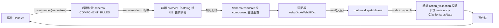

# WebUI 渲染节点组件开发模板

本文面向给 WebUI 渲染协议新增节点组件的开发者。组件契约以 [S_17 Props 权威规约](../../../../../../../../extensions_v2/docs/specs/S_17_webui-component-props.md) 为准；规则、适配器与测试负责实现和验证。示例中的 `Meter` 只用于演示新增流程，不是现有组件。本文只覆盖"新增一个渲染节点组件"；新增事件类型、槽位和 Ops 不在本文范围，分别见[内置事件开发模板](../../../../../../../../extensions_v2/docs/designs/builtin-event-development-guide.md)与[F_07 界面项与交互](../../../../../../../../extensions_v2/docs/features/F_07_ui-contributions.md)。本文与扩展 V2 的《内置事件开发模板》同级，放在前端子系统的 `docs/designs/` 下。最近修订：2026-11-04。

## 1. 先看整体流程

### 1.1 组件从声明到显示经过哪些层



要点：

- S_17 定义三端共享契约，后端负责最终执行校验：`COMPONENT_RULES` 未登记的组件在下行前被拒，未知 props 同样拒绝。
- 前端 `catalog` 是同一份契约的镜像：protocol 用它校验整帧，渲染层用它和注册表做精确一致性检查。
- 渲染层不解释业务：适配器只把已校验的节点转成 React 元素，并把交互按节点声明上报。

### 1.2 前后端各登记什么

| 层 | 位置 | 作用 | 漏改的后果 |
| --- | --- | --- | --- |
| 前端组件规则 | `catalog/components/<name>.ts` 与 `catalog/componentCatalog.ts` | 前端协议校验、默认值准备与跨字段检查 | 整帧被拒（未知组件/非法 props）；目录组装直接抛错 |
| 前端适配器 | `renderer/adapters/webuiXxx/WebUIXxx.tsx` 与 `renderer/adapters/componentRegistry.ts` | 把规范化节点渲染成 React 元素 | `assertCatalogMatchesRegistry` 在挂载前抛错，实例降级为失败态 |
| 后端校验规则 | `extensions_v2/webui/component_rules.py` 的 `COMPONENT_RULES` | 按 S_17 校验组件是否存在、props 与事件数据是否合法 | 插件 `ops.ui.render` 失败，前端看不到该组件 |
| 共享用例 | `tests/fixtures/webuiComponentCases.json`、`tests/fixtures/webuiEventCases.json` | 前后端同一份正反用例 | 只验证一侧，规则容易漂移 |
| 文档 | `S_01`、`F_01`、扩展 V2 的 `webui/README.md` | 契约、行为与插件用法 | 文档与实现不一致 |

### 1.3 先找真实入口

- 目录组装：`src/features/webui/catalog/componentCatalog.ts`；规则类型：`catalog/types.ts`。
- 适配器注册表：`src/features/webui/renderer/adapters/componentRegistry.ts`。
- 渲染与一致性：`renderer/SchemaRenderer.tsx`、`renderer/validate.ts`。
- 后端规则与校验：`extensions_v2/webui/component_rules.py`（`COMPONENT_RULES`、`validate_props`、`validate_event_data`）与 `extensions_v2/webui/schema.py`。
- 共享用例：`jiuwenswarm/channels/web/frontend/tests/fixtures/webuiComponentCases.json`、同目录的 `webuiEventCases.json`。

## 2. 代码放在哪里

```text
jiuwenswarm/channels/web/frontend/
├── src/features/webui/
│   ├── catalog/
│   │   ├── types.ts                    # WebUIComponentRule / WebUIPropRule
│   │   ├── componentCatalog.ts         # 组装组件目录（新规则在这里登记）
│   │   ├── slots.ts                    # 槽位规则与根组件约束
│   │   └── components/
│   │       ├── shared.ts               # 规则助手（text/bool/token/...）
│   │       ├── tag.ts                  # 最简真实规则示例
│   │       └── ...                     # 新组件规则加在这里
│   ├── renderer/
│   │   ├── types.ts                    # 适配器契约 WebUIAdapterProps
│   │   ├── SchemaRenderer.tsx          # 按 component 查注册表并递归渲染
│   │   └── adapters/
│   │       ├── componentRegistry.ts    # 适配器注册（新适配器在这里登记）
│   │       └── webuiTag/WebUITag.tsx   # 最简真实适配器示例
│   └── docs/                           # 本文、F_01、S_01
├── tests/
│   ├── fixtures/webuiComponentCases.json   # 前后端共享的 props 正反用例
│   ├── fixtures/webuiEventCases.json       # 前后端共享的事件数据用例
│   ├── webuiContracts.test.mjs             # 目录规则与用例
│   ├── webuiComponents.test.mjs            # 目录/注册表一致性与真实渲染
│   └── webuiComponentsReact.test.mjs       # 适配器交互回归
└── scripts/build-webui-components.mjs      # 组件测试的 esbuild 入口

jiuwenswarm/extensions_v2/webui/
├── component_rules.py                  # 后端规则表与事件数据校验
└── schema.py                           # 节点/事件遍历校验
```

命名约定：

- wire 里的组件名用 PascalCase，前后端与适配器注册表的键必须完全一致。
- 规则文件用小写驼峰（如 `treeSelect.ts`），导出规则变量（如 `treeSelectRule`）。
- 适配器目录为 `webui<Name>/`，组件为 `WebUI<Name>`；样式文件和 `index.ts` 按需要添加。
- 交互元素与承载语义的元素按 `channels/web/AGENTS.md` 的 data-testid 规则命名，前缀 `webui`，例如 `webui-tag`、`webui-input`。

## 3. 新增一个组件的完整步骤

维护顺序：先在 S_17 登记组件完整 props、默认值、children、事件和功能影响，再同步前后端规则、适配器、插件、测试和使用文档。

### 3.1 定义组件规则

规则类型见 `catalog/types.ts` 的 `WebUIComponentRule`：

| 字段 | 说明 |
| --- | --- |
| `name` | 组件名，必须与后端 `COMPONENT_RULES` 的键、适配器注册表的键一致 |
| `props` | 属性规则表，字段值用 `shared.ts` 的助手构造 |
| `defaults` | 协议允许的默认值；每个键必须已在 `props` 声明 |
| `allowChildren` | 是否允许子节点 |
| `required` | 必填属性名 |
| `events` | 允许绑定的事件及事件数据规则；事件名只能取自白名单 |
| `content` | 受限内容区，仅 Tabs 使用 |
| `childComponents` | 子节点允许的组件范围 |
| `validate` | 类型与必填通过后的跨字段约束 |
| `validateEvent` | 事件数据的组件语义校验（如只读禁 change） |
| `prepare` | 在合法属性上补齐默认值，不修改输入 |

规则约束：

- 事件白名单固定为 `WEBUI_COMPONENT_EVENTS` 的 6 个：`ui.click`、`ui.change`、`ui.press_enter`、`ui.search`、`ui.clear`、`ui.select`；新增事件名不在本文范围。
- `defaults` 的每个键必须已在 `props` 声明，否则 `createCatalog` 抛错。
- `validate` 只做跨字段约束，类型与必填由协议统一处理；`validateEvent` 在通用 payload 形状检查之后执行。
- 组件特有的规模限制（如 Tabs 的 8 层/512 项、Image 尺寸）放 `protocol/limits.ts`，并同步后端 `webui/constants.py`。

示例（新增组件 `Meter`，示例代码，非现有组件）：

```ts
// catalog/components/meter.ts
import { bool, component, number, object, text, token } from './shared.ts';

export const meterRule = component('Meter', {
  label: text,
  value: { kind: 'number', min: 0, max: 100 },
  showLabel: bool,
  tone: token('neutral', 'success', 'warning', 'danger'),
}, {
  required: ['value'],
  defaults: { showLabel: true, tone: 'neutral' },
  events: { 'ui.click': object({}) },
});
```

对照真实写法：[tag.ts](../../catalog/components/tag.ts)（最简，无子节点）、[input.ts](../../catalog/components/input.ts)（多事件与 `validateEvent`）、[tabs.ts](../../catalog/components/tabs.ts)（受限内容区）。

### 3.2 组装目录

在 `catalog/componentCatalog.ts` 中导入规则并加入 `components` 数组：

```ts
import { meterRule } from './components/meter.ts';

export const componentCatalog = createCatalog({
  components: [
    ...basicComponentRules,
    inputRule, switchRule, selectRule, treeSelectRule,
    sliderRule, tabsRule, emptyRule, imageRule, dividerRule, cardRule, tagRule, panelRule,
    fileTreeRule, filePreviewRule, iframeRule, avatarRule, meterRule,
  ],
  slots: webUISlots,
});
```

`createCatalog` 在初始化时检查重复组件、白名单外事件和未声明的默认值，规则不完整会直接抛错，避免"可校验但不可渲染"的静默状态。

### 3.3 实现适配器

适配器契约见 `renderer/types.ts` 的 `WebUIAdapterProps`：

| 字段 | 说明 |
| --- | --- |
| `node` | 规范化节点：`key`、`component`、`props`、`children`、`events`、`contentGroups` |
| `context` | 可信上下文：`instanceKey`、`sessionId`、`connected`、`componentState`、`styles` |
| `children` | 已渲染的子节点 |
| `contentGroups` | 受限内容区（键到已渲染节点列表），目前只有 Tabs 使用 |
| `emit` | 上报交互，返回 `WebUIInteractionResult`（`status`/`receipt`/`error`） |
| `appearance` | 宿主注入的外观（`className`/`style` 等），优先于组件默认样式 |

实现约束：

- 只读 `node`，不要访问 runtime、transport、WebClient 或网络；渲染层不发起业务请求。
- 只有 `node.events[...]` 存在时才派发对应事件，`data` 必须符合规则；`context.connected` 为 false 或组件禁用时不要派发。
- 合法 replace 会按 `renderGeneration` 整树重建；需要跨帧保留的交互值用 `context.componentState`（参考 FileTree）。
- 内置文案走 `react-i18next`（参考 FileTree、FilePreview、Iframe）；不要硬编码颜色，使用宿主语义 token；插件不能传 `className`/`style`，外观只从 `appearance` 取。
- 交互元素和承载语义的元素加 `data-testid="webui-xxx"`；渲染失败交给实例错误边界，不要自行吞掉异常继续渲染半棵树。

示例（示例代码）：

```tsx
// renderer/adapters/webuiMeter/WebUIMeter.tsx
import { Progress } from 'antd';
import type { WebUIAdapterProps } from '../../types.ts';

export function WebUIMeter({ node, context, emit, appearance }: WebUIAdapterProps) {
  const props = node.props as { value: number; tone?: string };
  const disabled = !context.connected;
  const status = props.tone === 'danger' ? 'exception' : props.tone === 'success' ? 'success' : 'normal';
  const onClick = node.events['ui.click'] && !disabled
    ? () => { void emit('ui.click', {}); }
    : undefined;
  return (
    <Progress
      data-testid="webui-meter"
      type="circle"
      percent={props.value}
      status={status}
      className={appearance?.className}
      style={appearance?.style}
      onClick={onClick}
    />
  );
}
```

交互事件写法参考 [WebUIInput.tsx](../../renderer/adapters/webuiInput/WebUIInput.tsx)（change/click/press_enter 与组合输入）和 [WebUISwitch.tsx](../../renderer/adapters/webuiSwitch/WebUISwitch.tsx)（change/click）。

### 3.4 注册适配器

在 `renderer/adapters/componentRegistry.ts` 中导入并登记：

```ts
import { WebUIMeter } from './webuiMeter/WebUIMeter.tsx';

export function createComponentRendererRegistry() {
  return createRendererRegistry({
    // ...
    Meter: WebUIMeter,
  });
}
```

`assertCatalogMatchesRegistry` 要求目录与注册表精确对应：缺失适配器或多余适配器都会在子树挂载前抛错，`WebUIProvider` 与真实组装入口共用该校验。运行时不做全局注册。

### 3.5 后端同步校验规则

在 `extensions_v2/webui/component_rules.py` 的 `COMPONENT_RULES` 中登记同一个组件：

```python
"props": {
    "label": TEXT,
    "value": {"kind": "number", "min": 0, "max": 100},
    "showLabel": BOOL,
    "tone": token("neutral", "success", "warning", "danger"),
},
"required": ("value",),
"events": {"ui.click": NO_DATA},
```

说明：

- 后端规则词汇覆盖前端 `WebUIPropRule` 的主要 kind（`token`/`string`/`boolean`/`number`/`null`/`array`/`object`/`record`/`union`/`nodes`/`lazy`），另有树选项、文件节点等组合规则；前端独有的 `string-list`/`record-list` 在后端用 `array`/`record` 组合表达。默认值由前端目录负责，后端不复制。
- `schema.py` 的节点遍历会拒绝未登记组件与未知 props；`validate_props` 负责类型、必填和跨字段约束；`validate_event_data` 负责事件数据语义。
- 后端负责最终拒绝：前端放过而后端拒绝时，整帧失败，插件侧收到 `webui.render.error`；两端都须符合 S_17 并写用例。
- 若组件要作为槽位根组件（类似 Panel/Iframe 的整页组件），还要同步 `catalog/slots.ts` 的 `rootComponents`、`schema.py` 的根节点限制以及 F_07/F_08 的槽位文档。

### 3.6 补测试与共享用例

- `tests/fixtures/webuiComponentCases.json`：`valid`/`invalid` 两个数组，元素为 `[组件名, props]`；前端 `test:webui-contracts` 与后端 pytest 共用。
- `tests/fixtures/webuiEventCases.json`：数组元素为 `{component, props, event, data, allowed}`；前端 `test:webui-events` 与后端 pytest 共用。
- `tests/webuiContracts.test.mjs`：目录组件清单是硬编码数组，新增组件要加入。
- `tests/webuiComponents.test.mjs`：注册表适配器断言清单是硬编码数组，新增组件要加入。
- `tests/webuiComponentsReact.test.mjs`：用 JSDOM 渲染真实适配器并断言交互，新增组件补一段。
- 后端 `tests/unit_tests/extensions_v2/webui/test_webui_events.py`：包含组件数量与清单断言（当前 `len(COMPONENT_RULES) == 21`），新增时同步更新并补专项用例。
- 如需在组件测试里导出额外符号，更新 `tests/fixtures/webuiComponents.ts`（esbuild 入口）。

### 3.7 更新文档

- `extensions_v2/docs/specs/S_17_webui-component-props.md`：唯一属性规范；先登记字段、默认值、嵌套结构、事件及影响功能，再实施变更。
- `docs/specs/S_01_components.md`：组件清单、必要时新增不变量（C-NN）、限制与验证入口。
- `docs/features/F_01_antd-components.md`：组件范围与数量、模块职责、渲染与外观行为、验证入口。
- `extensions_v2/webui/README.md`：插件可用的组件列表与写法（组件对插件开放时）。
- 涉及槽位根组件时同步 [F_07](../../../../../../../../extensions_v2/docs/features/F_07_ui-contributions.md) 与 [F_08](../../../../../../../../extensions_v2/docs/features/F_08_frontend-render.md)。
- 更新各文档的"最近修订"日期。

### 3.8 完成后检查清单

- [ ] 前后端组件名、props 名、默认值和必填项完全一致。
- [ ] `events` 只使用 6 个白名单事件，事件数据规则前后端一致。
- [ ] `createCatalog` 不抛错，`assertCatalogMatchesRegistry` 通过。
- [ ] 后端 `COMPONENT_RULES` 已登记，未知 props 会被拒。
- [ ] 共享 JSON 有正常与失败用例；前端 contracts/components/events 与后端 pytest 通过。
- [ ] 适配器不访问网络或 runtime，没有硬编码颜色，插件无法控制 `className`/`style`。
- [ ] 交互元素有 `data-testid`，内置文案中英文都补齐。
- [ ] 深度、节点数、文本量和帧大小预算未超；组件特有上限已同步 `protocol/limits.ts` 与 `webui/constants.py`。
- [ ] S_01、F_01、`webui/README.md` 已更新，链接可点。

## 4. 常见错误与边界

1. 只加适配器、不加规则：组件测试入口会报 `Missing component rule`，`assertCatalogMatchesRegistry` 也会失败。
2. 只加规则、不加适配器：`assertCatalogMatchesRegistry` 在挂载前抛错，实例整体进入失败态。
3. 事件名不在白名单：`createCatalog` 直接抛 `unsupported event`。
4. 默认值未在 `props` 声明：`createCatalog` 抛 `default prop is not declared`。
5. 后端漏改：插件 `ops.ui.render` 收到 `component not allowed` 或 `invalid <component>.<prop>`，前端表现为"组件没出现"。
6. 事件数据与规则不一致：后端 `validate_event_data` 返回 false，交互被拒为 `invalid_action`，业务 Handler 不会执行。
7. 在适配器里直接发请求：违反渲染层契约，并绕过 revision、实例和连接校验。
8. 插件可控样式：`className`/`style` 只来自宿主 `appearance`，插件只能使用协议允许的语义 props。
9. 误升协议版本：新增组件通常不需要改 `schema_version`；当前组件协议固定为 1，只有破坏性协议变化才调整。

## 5. 验证命令与参考

```bash
# 前端（在 jiuwenswarm/channels/web/frontend 下）
npm run test:webui-contracts
npm run test:webui-events
npm run test:webui-components
npm run test:webui-protocol
npm run test:webui-renderer
npm run build        # 可选：tsc 与 vite 构建，验证类型与打包

# 后端（仓库根目录）
uv run pytest tests/unit_tests/extensions_v2/webui/test_webui_events.py
```

按仓库约束，不运行 ESLint、Prettier、Ruff、Pylint、mypy 等格式化与静态检查工具。

参考实现（由简到繁）：

- 最简无子节点：[WebUITag.tsx](../../renderer/adapters/webuiTag/WebUITag.tsx) 与 [tag.ts](../../catalog/components/tag.ts)。
- 多事件与本地编辑态：[WebUIInput.tsx](../../renderer/adapters/webuiInput/WebUIInput.tsx)、[WebUISwitch.tsx](../../renderer/adapters/webuiSwitch/WebUISwitch.tsx)。
- 受限内容区：[WebUITabs.tsx](../../renderer/adapters/webuiTabs/WebUITabs.tsx) 与 [tabs.ts](../../catalog/components/tabs.ts)。
- 复杂异步与错误态：[FileTree.tsx](../../renderer/adapters/webuiFileTree/FileTree.tsx)、[FilePreview.tsx](../../renderer/adapters/webuiFilePreview/FilePreview.tsx)。

相关文档：

- [S_01 组件规则](../specs/S_01_components.md)
- [F_01 WebUI 组件目录与渲染适配](../features/F_01_antd-components.md)
- [F_08 前端渲染](../../../../../../../../extensions_v2/docs/features/F_08_frontend-render.md)
- [扩展 V2 WebUI 插件用法](../../../../../../../../extensions_v2/webui/README.md)
- [内置事件开发模板](../../../../../../../../extensions_v2/docs/designs/builtin-event-development-guide.md)
