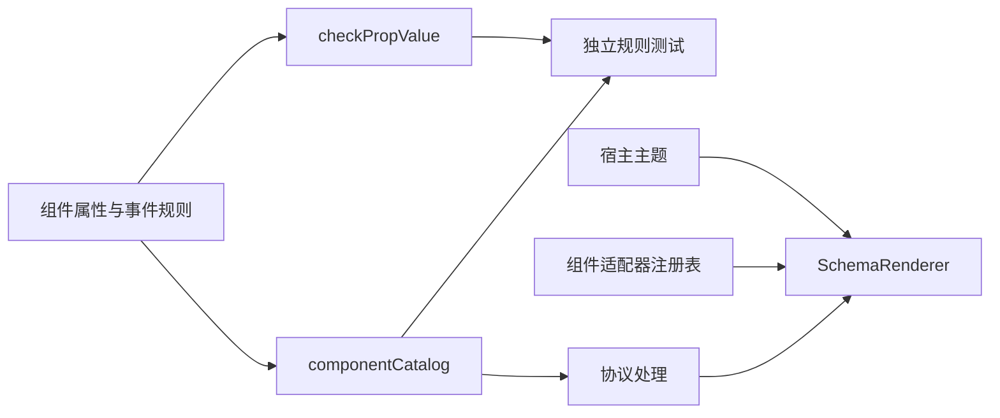

# WebUI 组件目录与渲染适配

建档日期：2026-10-30。最近修订：2026-11-04。关联契约：[S_01 组件规则](../specs/S_01_components.md)。
Props 统一规范建设：新增扩展 V2 的 [S_17 Props 权威规约](../../../../../../../../extensions_v2/docs/specs/S_17_webui-component-props.md)，作为插件侧、后端和前端共同遵循的属性定义；
本次核对完整字段、嵌套结构、事件、默认值和功能影响，并将后续变更顺序写入仓库规则。
实施及验证记录在本文件维护；属性清单只在 S_17 维护，现有规则代码继续负责执行，尚无自动生成链路。
本文件说明组件目录、属性校验器与渲染适配器的职责；整体运行时与页面渲染见
[F_08 前端渲染](../../../../../../../../extensions_v2/docs/features/F_08_frontend-render.md)。

## 背景与范围

组件目录集中描述组件属性、事件数据和槽位规则，供校验器及其他消费者查询。
目录包含 21 个组件（包括 `Avatar`、`FileTree`、`FilePreview`、`Dropdown` 与 `Icon`），并登记应用范围的 `application.entry`、`application.sidebar.footer` 与 13 个会话范围槽位。登记组件或槽位只表示可查询其规则，
实际显示仍取决于渲染器注册和页面挂载。

## 方案与取舍

组件规则描述属性类型、默认值、必填字段、事件数据和跨属性限制。`checkPropValue`
验证规则对应的数据，返回错误字符串或 `null`，不发送网络请求，也不修改渲染树。
例如 Input 的 `ui.change` 数据必须同时携带字符串 `value` 和布尔值 `isComposing`。

组件 `validate` 在属性类型及必填校验通过后检查跨字段约束；`prepare` 在合法属性上补充默认值。
两者与单项值校验职责分离，消费者需要按此顺序调用。
节点事件通过目录中的 `events` 规则校验，适配器通过 `emit(event, data)` 触发当前节点声明的动作。

## 模块职责

| 模块 | 职责 |
| --- | --- |
| `catalog/components/` | 非文件组件的属性、事件规则与共享函数 |
| `catalog/componentCatalog.ts` | 组装组件目录 |
| `catalog/slots.ts` | 声明槽位规则与根组件约束 |
| `catalog/types.ts` | 规则类型、目录构建与一致性检查 |
| `contracts/wire.ts` | 组件事件常量和协议版本常量 |
| `protocol/checkPropValue.ts` | 单项属性与事件数据的通用校验 |
| `renderer/adapters/` | 将规范化节点映射为 React 与 Ant Design 组件 |
| `react/WebUIThemeProvider.tsx` | 将宿主语义 token 与语言设置传给 WebUI 子树 |

`checkPropValue` 中的 nodes 规则只检查数组规模，完整节点遍历、Tabs 内容组和事件绑定校验
属于协议管线的职责。协议管线同时检查槽位根组件约束，返回与输入隔离的只读规范化树。

## 渲染与外观

**Avatar 原生属性与插件头像（2026-11-04）**

Avatar 适配器只把 url 映射到 AntD 的 src，并透传 props.children 文本、alt、gap、size、shape
及受控 style；样式中的 backgroundColor、color、fontSize 分别使用 AntD 原生 style 字段。
图像优先、图像加载失败时显示 children、文本自适应缩放与 gap 均由 AntD 自身处理。
未声明内容时使用原生空头像；alt 只描述图片，不作为显示内容。不再接受 name，宿主不提取
首字母、不做账号哈希、不选色，也不根据尺寸计算字母字号。

style 只开放 backgroundColor、color 和 fontSize。两种颜色接受 CSS 十六进制的 3、4、6、8
位形式；fontSize 接受 1–4096 的数值像素，gap 接受 0–4096 的数值像素，其他样式键被拒绝。
这些限制在前端、Gateway 与 AgentServer 同步校验。颜色直接传给 AntD，不做宿主转换或修正。

登录示例负责账号展示：trim 与 NFC 规范化后，使用 regex 的 Unicode 字素分割生成大写首字素，
并按完整名称的确定性哈希选择六色之一，通过 children 与 style 下发。色板为
`#B1E795`、`#FDBD71`、`#FE9187`、`#FDBDCE`、`#89D7D8`、`#87CEEB`，字色为白色。
插件分别声明侧栏 14px、20px 菜单头像 10px 的字号；宿主不包含登录、账号或 teammate 的展示规则。

验证入口为前端组件、共享属性向量与 Gateway 登录示例测试，分别覆盖原生属性透传、图片优先与
失败后的原生 children 渲染、非法属性拒绝，以及插件内 Unicode 首字素、稳定配色和双尺寸声明。
验证结果：前端组件测试 134 项、契约测试 134 项、Gateway 与 AgentServer WebUI 事件测试
434 项全部通过，Vite 生产打包通过。重新打包并安装插件、正常重启服务后，在
`localhost:5173/chat/new` 实际页面分别验证 URL 图片与 props.children 文本模式；原标签页被
另一浏览器会话占用，验证使用同一地址的新标签页。侧栏与菜单头像分别为 32px/20px，插件下发
字号分别为 14px/10px；当前账号两处均为 T、背景 rgb(137, 215, 216)、白字，刷新后一致。
最终保留正式文本头像包，安装前后账号数据库 SHA-256 相同，现有登录会话继续有效。
遵循本地约束，未运行 tsc、格式化或静态检查工具；未验证 Chrome 107 与其他操作系统。

**普通按钮尺寸统一（2026-11-03）**

WebUI Button 的普通尺寸为 `size="medium"`（兼容 md），未指定 size 时也使用此尺寸。宿主通过 Ant Design
Button 组件 token 统一为高 32px、字号 14px、左右 padding 16px、图文间距 8px、圆角 8px，
并取消按钮的默认阴影。纯文字与图文按钮共用内边距，纯图标按钮沿用 32px 方形点击区。
小、大尺寸保留各自的尺寸语义；插件不直接配置 padding 或 CSS。Workbench 按钮辅助函数默认使用 md，
因此输入框上下方的普通操作与其余普通按钮使用同一规格。

验证：组件测试通过 69 项，Workbench 定向测试通过 7 项。独立浏览器预览使用真实 Provider 与
Button 适配器，实测普通、图文、主要、危险、ghost、禁用按钮均为高 32px、字号 14px、
左右 padding 16px、间距 8px、圆角 8px、无阴影，纯图标按钮为 32px 方形、图标为 16px。
本次未执行完整应用构建或在运行中的聊天页面复验。

**图标白名单单一维护入口（2026-11-03）**

Button 与 Dropdown 共用前端 `src/features/webui/icons/whitelist.json`，包含约 100 个 Lucide
图标及旧名称 `refresh` 的兼容别名。白名单记录协议名称与 Lucide 导出名称的对应关系，
宿主继续控制尺寸、颜色与按钮交互外观。新增图标只编辑该 JSON，不再手工修改组件枚举。

`scripts/generate-webui-icons.mjs` 校验名称、别名及已安装 Lucide 导出，生成前端静态导入表与
后端 Python 名单。生成文件随源码提交，后端运行时无需 Node 或前端源码。前端 dev/build 和
组件、契约测试自动执行生成，也可运行 `npm run generate:webui-icons`；
`npm run check:webui-icons` 检查生成结果是否过期。生成表只命名导入白名单图标，不使用全库动态索引。

验证结果：组件测试通过 69 项、契约测试通过 109 项、后端 WebUI 事件与 Workbench 测试通过 255 项。
覆盖全部白名单图标的 SVG 输出、主题颜色与尺寸、别名一致性、Button 新图标的标签与事件、
前后端名单一致性及非法名称拒绝。生成同步检查通过；本次未做完整应用构建或浏览器视觉复验。

**独立图标组件 Icon（2026-11-04）**

新增叶子组件 `Icon`，复用同一图标白名单：`name` 必填且只接受白名单名称，`size` 可选
small/medium/large（兼容 sm/md/lg，缺省 medium），不提供 `aria-label` 时按装饰图标渲染
`aria-hidden`，提供时必须非空并作为可访问名称。适配器从生成表读取 Lucide 组件，尺寸映射宿主
字号 token（small/medium/large 对应 SM/LG/XL），外观只取宿主注入的 className/style，
不开放任意 SVG、className 或 style；组件没有子节点和事件，也不作为槽位专用根组件。
协议版本不因新增组件变化。

**文字按钮与头部操作的外观边界（2026-11-03）**

聊天头部原来为所有插件 Button 注入刷新图标并隐藏标签，其他动作也会显示为刷新。
本次移除该槽位的 Button 内容覆盖，由插件显式声明 `icon="refresh"`、`iconOnly=true`
及 `variant="ghost"`；前后端同步扩展 Button 的图标白名单，Box 的槽位布局沿用现状。

`variant="ghost"` 继续映射为 Ant Design `type="text"`。主题提供器把 Button 的
`textHoverBg` 映射到 `--color-action-secondary`，与对话区原生按钮的 hover 一致；
聊天头部原生按钮及图标 Dropdown 的 hover 也使用该 token。其他 Button 变体保留库的颜色语义。
不通过重新实现原生文字按钮或向插件开放 style/className 达成外观统一。

验证结果：`test:webui-components` 通过 67 项，覆盖 refresh 图标、文字按钮标签与事件、
主题颜色更新；`test:webui-contracts` 通过 108 项；Python 的工作台轮次与 WebUI 事件测试
通过 254 项，包含头部树声明及前后端共享属性用例。
独立浏览器页加载真实组件、聊天 CSS、Tailwind 与浅色主题，确认顶部原生按钮、对话区复制按钮、
插件文字按钮、刷新图标按钮及省略号 Dropdown 的实际 hover 背景均为 `rgb(244, 244, 245)`。
当前 Chrome 聊天窗口访问授权超时，尚未在运行中的完整聊天页面复验；暗色仅有主题映射单元验证。

**轮次操作的图标入口**

Workbench 的轮次操作改用一个省略号菜单，保留刷新和详情两项业务行为。实现限定在 WebUI
组件及示例包，不修改聊天面板的槽位挂载代码。Button 新增受控的 `icon="ellipsis"` 与
`iconOnly`；纯图标模式保留 label 作为可访问名称。Dropdown 新增同名 icon 属性，由组件
直接渲染 Ant Design text 按钮，要求提供 ariaLabel；未声明 icon 的旧触发区继续使用 children。
展开状态只在组件本地保存，展开时保留浅灰背景，选择菜单项后关闭并派发一次 ui.select。

采用 Dropdown 自带图标入口，避免额外嵌套可聚焦按钮；不向插件开放任意 SVG、style 或
className。初版图标名称仅含 ellipsis，后续头部操作增加的 refresh 见上文。组件回归验证图标标签、展开/关闭、
菜单派发和禁用行为；共享属性用例由前后端共同验证。

2026-11-03 定向验证：`test:webui-components` 通过，新增纯图标 Button、Dropdown
展开/选择/关闭、禁用、断连和旧子节点触发区的回归；`test:webui-contracts` 通过 107 项。
Python 的 Workbench 轮次菜单与 WebUI 事件测试通过 252 项，覆盖前后端共享属性用例及轮次隔离。
尚未在实际聊天页面进行视觉验收。

`createComponentRendererRegistry()` 创建只读注册表。宿主组装时必须保证目录与注册表精确对应，
缺失适配器时拒绝组装；运行中找不到适配器则由实例错误边界处理，不能显示半棵可交互树。

Box 将 direction、gap、align、justify、wrap 和 flex 映射为 Ant Design Flex 属性。
Text 使用 Typography.Text，使用 `value` 提供文案，对齐 `type`、`strong`、`italic`、`underline`、`delete`、`code`、`mark`、`keyboard`、`disabled`、`ellipsis` 等属性；Button 对齐 Ant Design Button 属性并将 `ui.click` 交给节点绑定发送，断连或 disabled 时禁用。
按钮关闭中文双字自动插空格，保留插件原始标签。
Avatar、Card、Divider、Empty、Image 和 Tag 使用对应 Ant Design 组件（Avatar 使用 `src`）；Panel 只渲染内容，标题由宿主负责。
Iframe 固定使用 sandbox（脚本、表单、弹窗、模态框与下载白名单），不允许 `allow-same-origin`，并保留 referrerPolicy 限制。
加载提示为不拦截鼠标的角标，避免子资源未加载完时阻挡文档内的点击；隐藏或断连时释放浏览上下文，重新激活后重新加载。
2026-11-04 Iframe 体验调整：组件内提供适应面板和桌面宽度两种本地显示模式，默认适应面板；
桌面模式将 iframe 最小视口设为 1280px，由外层容器承载横向滚动，避免依赖跨域网页自身的滚动条。
模式切换只调整尺寸，不重建文档。重新加载按钮重建当前 src 的文档，在新标签页打开入口使用配置的 src，
不推断 iframe 内导航后的地址。加载超过 15 秒显示非阻塞提示，继续等待 load，不将超时判为失败。
这些操作仅由宿主处理，不新增组件属性或插件事件。当前实现与定向验证结果见下文验证记录。
安全取舍和兼容限制见 [F_08 的 Iframe 决策](../../../../../../../../extensions_v2/docs/features/F_08_frontend-render.md#46-iframe-权限与点击交互)。

FileTree 使用现有实例状态端口保存滚动位置和宽度，解决目录数据 replace 后重挂载导致滚动回到顶部的问题。
组件右侧分界线支持拖拽和左右方向键，默认宽度为 240px；调整时为相邻预览保留空间，窄容器中自动收缩。
滚动和宽度只在本地保存，不增加协议字段、插件事件或服务端目录缓存；全局重挂载规则保持不变。

FilePreview 保留文件标题和文本视图，在组件内部用原生 img 加载图片，不添加插件子节点。
宿主文件服务对 16 KiB 以内的文本继续返回 content；更大文本（最多 1 MiB）、图片和 PDF 返回 downloadUrl。
URL 指向从已授权文件描述符复制的受管快照，有效期为 10 分钟，并携带可信会话上下文中的用户路由信息。
原文件替换或删除不改变已签发快照；过期后重新选择文件获取新 URL。
文本 URL 按有界流读取并校验 UTF-8，HTML 仍逐字展示。
PDF 复用旧文件预览的原生 iframe 方式，不设置 sandbox，但只允许同源签名下载端点。
前端先以 `Range: bytes=0-4` 请求确认 application/pdf 响应和 `%PDF-` 文件头，拒绝重定向，
通过后让 iframe 使用原始下载 URL 加载，保留原生查看器的 Range 能力。
检查只收集前 5 字节，收到足够数据即取消读取，避免服务端忽略 Range 时下载整份文件；切换文件时中止检查。
后端也检查 PDF 文件头并沿用受管快照签发。文件头检查不保证 PDF 结构完整，最终展示仍取决于浏览器内建查看器。

Input 使用 Ant Design Input 管理本地编辑值，优先从 value、defaultValue 初始化。
已声明的 `ui.change` 发送 `{value, isComposing}`；未绑定事件时仍可编辑。
组合输入结束时发送一次 `isComposing=false` 的提交值，随后浏览器重复的同值提交不再派发。
disabled、readOnly 和断连状态阻止编辑派发；合法 replace 重置草稿，非法更新保留当前输入。
清空按钮通过同一个 change 事件发送空字符串，不额外产生 clear 事件。
声明 `ui.press_enter` 后，Enter 使用当前编辑值发送 `{value}`，不要求同时绑定 change。
组合输入中、原生 isComposing 标志为 true 或 keyCode 为 229 时忽略 Enter，避免确认候选词时误提交。
disabled、readOnly 和断连时也不提交；空值与回执尚未完成时的再次提交沿用普通派发规则。
声明 `ui.click` 后，点击输入框发送当前编辑值 `{value}`；只读输入仍允许点击，disabled 或断连时不派发。

Switch 使用 Ant Design Switch 管理本地开关状态，按 checked、defaultChecked、false 的顺序初始化。
切换时为已绑定的 `ui.change` 发送 `{checked}`；未绑定事件时仍可本地切换。
disabled、loading 或断连时禁用；合法 replace 重新初始化状态，不因初始化或更新主动派发 change。
可独立绑定 `ui.click` 接收切换后的 `{checked}`；同时绑定 change 和 click 时，一次点击依次派发两个事件。

Select 使用 Ant Design Select 管理本地选择值，value 优先于 defaultValue；合法 replace 重新初始化选择。
选择选项为已绑定的 `ui.select` 发送单个选项值 `{value}`，多选模式也按本次选择的选项发送。
搜索按 label 过滤，为已绑定的 `ui.search` 发送 `{searchValue}`；清空为已绑定的 `ui.clear` 发送 `{}`。
选择值变化由组件本地更新，可选 change 发送完整选择值，包含取消选项与清空；未绑定事件时保留默认操作，disabled 或断连时禁用。

TreeSelect 使用 Ant Design TreeSelect 管理本地选择值，treeData 的 key 缺省取 value，搜索按 title 过滤。
选中节点时为已绑定的 `ui.select` 发送该节点 `{value}`，为已绑定的 `ui.change` 发送整体选择值：
单选为字符串，multiple 或 treeCheckable 为数组，清空后分别为 null 与空数组。
清空动作另为已绑定的 `ui.clear` 发送 `{}`；三项分别绑定，未绑定事件时仍可本地选择，disabled 或断连时禁用。

Slider 使用 Ant Design Slider 管理本地数值，按 value、defaultValue 的顺序初始化，目录在缺省时准备合法默认值。
拖动或键盘调整的每次有效变化为已绑定的 `ui.change` 发送数值 `{value}`，不合并中间值、不等待回执。
未绑定事件时仍可本地调整；disabled 或断连时禁用，合法 replace 重新初始化数值。

Tabs 使用 Ant Design Tabs 管理本地激活页，activeKey 优先于 defaultActiveKey，缺省取首个可用页签。
切换页签时为已绑定的 `ui.change` 发送 `{activeKey}`；未绑定事件时仍可本地切换，disabled 页签与断连时不可切换。
隐藏页内容通过内容激活边界停用，其节点绑定在不可见期间释放，因此不会派发事件。
默认保留已挂载隐藏页的本地状态，destroyOnHidden 时卸载并在切回后重新初始化；页签内容计入 8 层与 512 节点预算。

Dropdown 使用 Ant Design Dropdown 渲染触发区与菜单，触发区由子节点提供，菜单项来自 `items` 数组。
点击或键盘展开由组件本地管理，不派发事件；菜单项选中时为已绑定的 `ui.select` 发送 `{key}`，
禁用项与断连时不派发。`danger` 菜单项由库渲染告警样式，`placement` 控制弹出方向。

插件不能提供 style 或 className。宿主可通过 `WebUIStyleOverrides` 按组件注入外观，
宿主样式优先；Box 与 Button 还可使用原生元素承接宿主布局和按钮样式。
适配器保留库组件的属性和交互语义，不复制整套控件实现。

`WebUIProvider` 内的主题提供器读取宿主 CSS 语义 token，生成 Ant Design 调色板所需的具体值，
并映射字体、字号与圆角。根元素的主题、颜色模式、class 或内联样式变化时重新读取；
缺失的 token 使用库默认值。语言设置决定库内置文案，主题与语言配置只作用于 WebUI 子树。
主题初始化保持 Provider 子树挂载，不释放已有实例或重复上报 ready。

## 验证入口

### 2026-11-03 组件接口修复

本次修复范围为 Select 整体选择事件、文本和按钮变体、行数校验、Dropdown 触发区以及尺寸别名。
Select 新增可选 `ui.change`，发送整体值，保留原有 select/search/clear 绑定；前后端共同检查模式、
选项、重复值和 maxCount。已作为初始值下发的禁用选项可保留，但不能通过事件新增禁用选项。
Text 的显式 tone 优先于 variant；primary、danger、ghost 分别映射主题主色、错误色、弱化文本色；
Button.secondary 使用 filled 外观。max_lines 只接受正整数，省略表示不限行。
Dropdown 必须在 icon 与非空 children 中选择一个触发区，避免空入口或静默丢弃子节点。
size 统一推荐 small/medium/large，兼容 sm/md/lg；Switch/Card 只支持 small/medium 两档，
Avatar 继续兼容 default 和像素数值。别名在组件准备阶段转换，后端接受相同取值。
槽位 rootComponents 的说明明确区分专用根组件许可与右侧面板的完整根白名单，允许范围保持原样。
采用兼容别名和可选事件，避免现有插件批量迁移；不通过放开任意样式解决变体问题。
验证计划：组件属性、完整渲染树、真实适配器交互及后端交互门禁回归；页面由用户手工验证。
实施状态：代码与文档已更新。前端组件、契约、事件测试共 286 项通过；后端规则测试共 291 项通过。
未运行格式化与静态检查工具；未打开浏览器，实际页面效果由用户手工验证。

`npm run test:webui-contracts` 检查属性合法与非法输入、组件事件数据、跨属性约束、
默认值准备以及目录登记范围。协议、运行时、传输和渲染器分别由
`test:webui-protocol`、`test:webui-runtime`、`test:webui-transport` 和 `test:webui-renderer` 验证。
`test:webui-components` 使用真实适配器验证布局、文本、按钮派发、Switch 状态与 change/click、
Select 选择/搜索/清空、TreeSelect 选择/整体值/清空、Slider 数值变更、Tabs 页签切换与内容重建、
Dropdown 菜单展开与 ui.select、宿主外观、主题继承和 Iframe 生命周期。
`test:webui-input` 定向验证 Input 的 click、change 与 Enter 数据、组合输入保护、禁用、草稿更新和 WebClient 传输封装。

2026-11-03 文件预览及目录交互定向验证：`test:webui-components` 通过 60 项，
包含目录展开与预览更新后的滚动恢复、拖拽与键盘调宽、节点状态隔离及移除/清空后的重置；
后端 `test_session_files.py` 与 `test_webui_events.py` 通过 252 项，Windows 下跳过符号链接和 FIFO 两项。
此前独立测试页中的图片和大文本显示正常；PDF 在带沙箱的试验分支中为空白，曾暂停 PDF 预览。
本次改用来源受限的原生 PDF iframe，实际浏览器中的显示效果尚待手工验证，不将此前空白的原因认定为已查明。
本次 `test:webui-components` 通过 65 项；`test_session_files.py` 通过 21 项，Windows 下跳过符号链接和 FIFO 两项。
回归覆盖原生 PDF iframe、来源及响应检查、有界读取与切换取消，以及可信用户路由、快照隔离、有效期和失败清理。
本次修复后 `test:webui-components` 通过 63 项；后端文件服务、Ops、组件规则、受管资源和下载端点
定向测试通过 333 项，Windows 下跳过符号链接及 FIFO 相关测试 6 项；AgentOS 受管下载分支另通过 5 项。
尚未完成完整 WebClient 跨进程及 AgentOS 部署联调。

2026-11-04 Iframe 体验调整验证：`npm run test:webui-components` 通过 78 项。
新增回归覆盖适应面板/桌面宽度切换不重建文档、外层滚动样式、同 URL 重新加载、失败后重试、
原始地址的新标签页入口，以及慢加载提示在 load、隐藏和卸载时的计时器清理。
本次使用 JSDOM 验证交互及样式规则，未操作浏览器；真实网页的滚动条、窄屏和主题显示待用户手工验证。

2026-11-04 文案字段统一：Button 和 Text 以字符串 `value` 提供文案，前后端不接受
`props.children`，也不为这次尚未发布的字段变更保留别名。适配器将 `value` 映射为 React 内容，
容器的节点级 children 不变；工作台、Token Weather 及相关示例和断言同步迁移。
Button 的 `type` 等样式属性继续按白名单校验，不通过放开未知属性解决插件渲染失败。
前端 `test:webui-components`、`test:webui-contracts`、`test:webui-events` 分别通过 80、139、93 项，
包括空文案、点击派发、children 拒绝及非法更新保留上一帧有效界面。
使用 Python 3.12 虚拟环境直接调用后端规则、树校验和序列化，133 个用例通过。
pytest 被环境缺少 `openjiuwen.core.events.ops_impl.store` 阻断，未完成后端完整回归。
未操作浏览器、未运行静态检查或完整构建；运行服务是否已加载当前源码及实际插件恢复仍待手工确认。

### 2026-11-04 Props 权威规约与三端核对

新增 S_17，逐项列出当前 21 个组件、162 个顶层 props、嵌套对象、事件数据、子节点与根限制。
功能影响清单覆盖插件视图、校验、序列化、实例与事件门禁、适配器、全部 15 个槽位及页面宿主、
主题图标、文件资源、通信转发、示例和安装副本。根目录与两端 AGENTS、S_01、开发指南和中英文插件说明均引用该规范。
后续属性变更从 S_17 开始，默认同步相关实现与调用方；当前不提供从 Markdown 自动生成实现的能力。

核对发现并修复两处已有差异：前端 Dropdown 拒绝空菜单 key；后端 Divider 拒绝两种标题来源并存和竖向标题子节点，
并补充共享非法属性用例及前后端完整树回归（包含 Tabs 内嵌场景）。

验证结果：

- 临时核对脚本确认 S_17 与两端的全部组件名、字段名和必填项一致，文档默认值与前端目录一致；
  递归比较两端属性 / 事件类型、嵌套字段、枚举与子节点许可，补齐共同默认规模限制后结果一致。
- `npm run test:webui-contracts` 通过 150 项，`npm run test:webui-components` 通过 84 项。
- Python 3.12：`test_webui_events.py -k "divider or component_cases"` 通过 9 项；
  `-k "shared_browser or dropdown"` 通过 209 项，两次均使用 `--no-cov`，不代表完整后端测试。
- 9 份维护入口和规范文档的 158 个相对链接均有效；新文件单独检查空白，Git 未暂存和暂存差异检查通过。

首次测试受沙箱子进程 / 用户日志目录权限限制，授权后重跑通过。未运行格式化、静态检查、完整构建或浏览器操作；
运行服务和已安装插件副本未在本次任务中重启或更新，页面验收由用户手工完成。

### 2026-11-04 Icon 组件

新增叶子组件 Icon，字段与 [S_17 §4.21](../../../../../../../../extensions_v2/docs/specs/S_17_webui-component-props.md)
一致：name 必填并限定共享白名单（含 refresh 别名），size 可选 small/medium/large（兼容 sm/md/lg，缺省回退 medium），
aria-label 可选且提供时必须去空白后非空；省略标签时按装饰图标渲染 aria-hidden，提供时以 trim 后文本作为 img 名称。
组件无子节点、无事件，也不作为槽位专用根组件。适配器从生成表读取 Lucide 组件，尺寸映射宿主字号 token
（small/medium/large 对应 SM/LG/XL），外观只取宿主注入的 className/style，不开放任意 SVG、className 或 style。
catalog 规则、适配器注册、后端 COMPONENT_RULES 与共享正反用例同步更新；组件总数由 20 调整为 21。

验证结果：

- 前端按 package.json 相同的 esbuild 参数重建测试入口并直接运行测试文件（当前会话沙箱禁止测试脚本的
  子进程写入工作区缓存，原 `npm run test:webui-*` 未能直接执行）：test:webui-contracts 150 项、
  webuiComponents 19 项、webuiComponentsReact 65 项、test:webui-events 93 项、test:webui-protocol 14 项、
  test:webui-renderer 16 项通过，均为 0 失败；SVG 导入按原构建脚本的 stub 行为等价处理后验证。
- 后端 test_webui_events.py 通过 336 项，包含 4 条合法与 5 条非法 Icon 共享属性用例。
- 未运行格式化、静态检查、完整构建，也未在浏览器中做视觉验收。

### 2026-11-04 合并后插件 Props 对齐

Gateway 规则仍使用旧 Button / Text / Avatar 字段，导致新前端拒绝登录示例，
而 FS / MCP Probe 的旧排版字段也无法通过 AgentServer 当前校验。
按 S_17 将示例迁移为 Button.value、Text.type / strong / code / ellipsis、Avatar.src；
不增加旧字段别名。单行截断改用 ellipsis，多行截断没有等价属性，移除该限制并保留原有内容长度上限。

Gateway 共用组件同步新字段、尺寸别名、Select.ui.change 和 FilePreview.downloadUrl，
继续保留本域的 Form / Form.Item、Button.form、布局、Input.autoComplete、Image.fit 与富菜单能力。
前端表单名称和引用与 Gateway 统一为非空、最多 200 UTF-8 字节，规则至少声明一种校验条件。
Button.icon 从同一图标白名单生成本域规则，不跨宿主 import；Gateway 继续拒绝独立 Icon 与 Dropdown.icon。
补齐 AgentServer Dropdown 展示触发区及 Gateway Divider 标题约束，保持完整树校验一致。

验证结果：

- `npm run test:webui-contracts` 和 `npm run test:webui-components` 各通过 150 项；
  后者包含 53 条 Gateway / 浏览器共享完整树用例。React 测试有 act / useLayoutEffect 警告，退出码为 0。
- Python 3.12：Gateway Extensions V2 全目录、AgentServer test_webui_events.py、
  test_probe_example_props.py 共通过 656 项；覆盖登录 ZIP 安装及交互、共用属性和事件向量、探测面板空态 / 成功 / 失败。
- 新增 Dropdown 多触发节点、交互后代、Image 预览约束后，相关两侧定向回归 9 项通过。

未运行格式化、静态检查、完整构建或浏览器验证。未更新真实安装副本或重启服务；
修改仓库示例不会自动更新已安装插件，需按示例说明更新副本并重新加载对应宿主。
