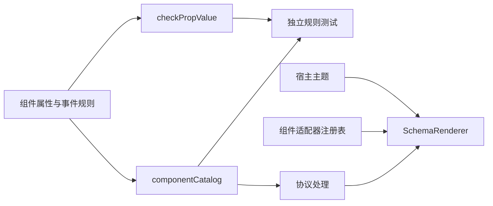

# WebUI 组件目录与渲染适配

建档日期：2026-10-30。关联契约：[S_01 组件规则](../specs/S_01_components.md)。
本文件说明组件目录、属性校验器与渲染适配器的职责；整体运行时与页面渲染见
[F_08 前端渲染](../../../../../../../../extensions_v2/docs/features/F_08_frontend-render.md)。

## 背景与范围

组件目录集中描述组件属性、事件数据和槽位规则，供校验器及其他消费者查询。
目录不包含文件组件和 `application.entry`。登记组件或槽位只表示可查询其规则，
实际显示仍取决于渲染器注册和页面挂载。

## 方案与取舍

组件规则描述属性类型、默认值、必填字段、事件数据和跨属性限制。`checkPropValue`
验证规则对应的数据，返回错误字符串或 `null`，不发送网络请求，也不修改渲染树。
例如 Input 的 `ui.change` 数据必须同时携带字符串 `value` 和布尔值 `isComposing`。

组件 `validate` 在属性类型及必填校验通过后检查跨字段约束；`prepare` 在合法属性上补充默认值。
两者与单项值校验职责分离，消费者需要按此顺序调用。
节点事件通过目录中的 `events` 规则校验，适配器通过 `emit(event, data)` 触发当前节点声明的动作。

## 模块职责

| 模块 | 职责 |
| --- | --- |
| `catalog/components/` | 非文件组件的属性、事件规则与共享函数 |
| `catalog/componentCatalog.ts` | 组装组件目录 |
| `catalog/slots.ts` | 声明槽位规则与根组件约束 |
| `catalog/types.ts` | 规则类型、目录构建与一致性检查 |
| `contracts/wire.ts` | 组件事件常量和协议版本常量 |
| `protocol/checkPropValue.ts` | 单项属性与事件数据的通用校验 |
| `renderer/adapters/` | 将规范化节点映射为 React 与 Ant Design 组件 |
| `react/WebUIThemeProvider.tsx` | 将宿主语义 token 与语言设置传给 WebUI 子树 |

`checkPropValue` 中的 nodes 规则只检查数组规模，完整节点遍历、Tabs 内容组和事件绑定校验
属于协议管线的职责。协议管线同时检查槽位根组件约束，返回与输入隔离的只读规范化树。

## 渲染与外观

`createComponentRendererRegistry()` 创建只读注册表。宿主组装时必须保证目录与注册表精确对应，
缺失适配器时拒绝组装；运行中找不到适配器则由实例错误边界处理，不能显示半棵可交互树。

Box 将 direction、gap、align、justify、wrap 和 flex 映射为 Ant Design Flex 属性。
Text 使用 Typography.Text，映射 monospace、max_lines 与语义 tone；Button 将 `ui.click` 交给节点绑定发送，断连或 disabled 时禁用。
按钮关闭中文双字自动插空格，保留插件原始标签。
Card、Divider、Empty、Image 和 Tag 使用对应 Ant Design 组件；Panel 只渲染内容，标题由宿主负责。
Iframe 保留 sandbox 与 referrerPolicy 限制，隐藏或断连时释放浏览上下文，重新激活后重新加载。

Input 使用 Ant Design Input 管理本地编辑值，优先从 value、defaultValue 初始化。
已声明的 `ui.change` 发送 `{value, isComposing}`；未绑定事件时仍可编辑。
组合输入结束时发送一次 `isComposing=false` 的提交值，随后浏览器重复的同值提交不再派发。
disabled、readOnly 和断连状态阻止编辑派发；合法 replace 重置草稿，非法更新保留当前输入。
清空按钮通过同一个 change 事件发送空字符串，不额外产生 clear 事件。
声明 `ui.press_enter` 后，Enter 使用当前编辑值发送 `{value}`，不要求同时绑定 change。
组合输入中、原生 isComposing 标志为 true 或 keyCode 为 229 时忽略 Enter，避免确认候选词时误提交。
disabled、readOnly 和断连时也不提交；空值与回执尚未完成时的再次提交沿用普通派发规则。
声明 `ui.click` 后，点击输入框发送当前编辑值 `{value}`；只读输入仍允许点击，disabled 或断连时不派发。

Switch 使用 Ant Design Switch 管理本地开关状态，按 checked、defaultChecked、false 的顺序初始化。
切换时为已绑定的 `ui.change` 发送 `{checked}`；未绑定事件时仍可本地切换。
disabled、loading 或断连时禁用；合法 replace 重新初始化状态，不因初始化或更新主动派发 change。
可独立绑定 `ui.click` 接收切换后的 `{checked}`；同时绑定 change 和 click 时，一次点击依次派发两个事件。

Select 使用 Ant Design Select 管理本地选择值，value 优先于 defaultValue；合法 replace 重新初始化选择。
选择选项为已绑定的 `ui.select` 发送单个选项值 `{value}`，多选模式也按本次选择的选项发送。
搜索按 label 过滤，为已绑定的 `ui.search` 发送 `{searchValue}`；清空为已绑定的 `ui.clear` 发送 `{}`。
选择值变化由组件本地更新，不额外派发 change；未绑定事件时保留默认操作，disabled 或断连时禁用。

插件不能提供 style 或 className。宿主可通过 `WebUIStyleOverrides` 按组件注入外观，
宿主样式优先；Box 与 Button 还可使用原生元素承接宿主布局和按钮样式。
适配器保留库组件的属性和交互语义，不复制整套控件实现。

`WebUIProvider` 内的主题提供器读取宿主 CSS 语义 token，生成 Ant Design 调色板所需的具体值，
并映射字体、字号与圆角。根元素的主题、颜色模式、class 或内联样式变化时重新读取；
缺失的 token 使用库默认值。语言设置决定库内置文案，主题与语言配置只作用于 WebUI 子树。
主题初始化保持 Provider 子树挂载，不释放已有实例或重复上报 ready。

## 验证入口

`npm run test:webui-contracts` 检查属性合法与非法输入、组件事件数据、跨属性约束、
默认值准备以及目录登记范围。协议、运行时、传输、渲染器和存储分别由
`test:webui-protocol`、`test:webui-runtime`、`test:webui-transport`、`test:webui-renderer`
和 `test:webui-store` 验证。
`test:webui-components` 使用真实适配器验证布局、文本、按钮派发、Switch 状态与 change/click、
Select 选择/搜索/清空、宿主外观、主题继承和 Iframe 生命周期。
`test:webui-input` 定向验证 Input 的 click、change 与 Enter 数据、组合输入保护、禁用、草稿更新和 WebClient 传输封装。
