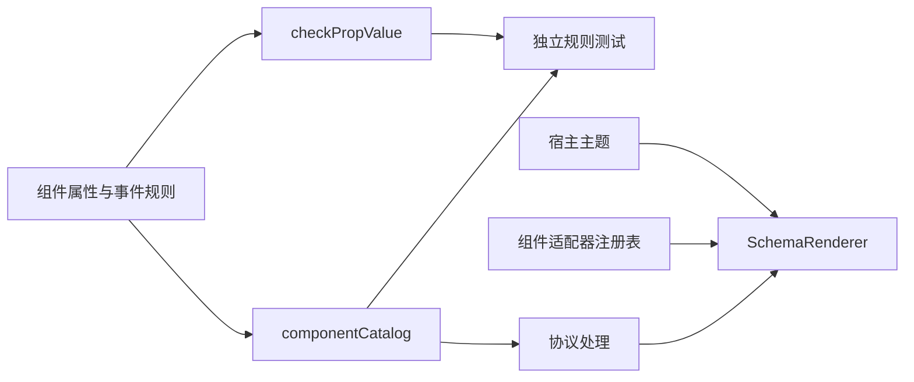

# WebUI 组件目录与渲染适配

建档日期：2026-10-30。最近修订：2026-11-03。关联契约：[S_01 组件规则](../specs/S_01_components.md)。
本文件说明组件目录、属性校验器与渲染适配器的职责；整体运行时与页面渲染见
[F_08 前端渲染](../../../../../../../../extensions_v2/docs/features/F_08_frontend-render.md)。

## 背景与范围

组件目录集中描述组件属性、事件数据和槽位规则，供校验器及其他消费者查询。
目录包含 20 个组件（包括 `Avatar`、`FileTree`、`FilePreview` 与 `Dropdown`），并登记应用范围的 `application.entry`、`application.sidebar.footer` 与 13 个会话范围槽位。登记组件或槽位只表示可查询其规则，
实际显示仍取决于渲染器注册和页面挂载。

## 方案与取舍

组件规则描述属性类型、默认值、必填字段、事件数据和跨属性限制。`checkPropValue`
验证规则对应的数据，返回错误字符串或 `null`，不发送网络请求，也不修改渲染树。
例如 Input 的 `ui.change` 数据必须同时携带字符串 `value` 和布尔值 `isComposing`。

组件 `validate` 在属性类型及必填校验通过后检查跨字段约束；`prepare` 在合法属性上补充默认值。
两者与单项值校验职责分离，消费者需要按此顺序调用。
节点事件通过目录中的 `events` 规则校验，适配器通过 `emit(event, data)` 触发当前节点声明的动作。

## 模块职责

| 模块 | 职责 |
| --- | --- |
| `catalog/components/` | 非文件组件的属性、事件规则与共享函数 |
| `catalog/componentCatalog.ts` | 组装组件目录 |
| `catalog/slots.ts` | 声明槽位规则与根组件约束 |
| `catalog/types.ts` | 规则类型、目录构建与一致性检查 |
| `contracts/wire.ts` | 组件事件常量和协议版本常量 |
| `protocol/checkPropValue.ts` | 单项属性与事件数据的通用校验 |
| `renderer/adapters/` | 将规范化节点映射为 React 与 Ant Design 组件 |
| `react/WebUIThemeProvider.tsx` | 将宿主语义 token 与语言设置传给 WebUI 子树 |

`checkPropValue` 中的 nodes 规则只检查数组规模，完整节点遍历、Tabs 内容组和事件绑定校验
属于协议管线的职责。协议管线同时检查槽位根组件约束，返回与输入隔离的只读规范化树。

## 渲染与外观

**轮次操作的图标入口**

Workbench 的轮次操作改用一个省略号菜单，保留刷新和详情两项业务行为。实现限定在 WebUI
组件及示例包，不修改聊天面板的槽位挂载代码。Button 新增受控的 `icon="ellipsis"` 与
`iconOnly`；纯图标模式保留 label 作为可访问名称。Dropdown 新增同名 icon 属性，由组件
直接渲染 Ant Design text 按钮，要求提供 ariaLabel；未声明 icon 的旧触发区继续使用 children。
展开状态只在组件本地保存，展开时保留浅灰背景，选择菜单项后关闭并派发一次 ui.select。

采用 Dropdown 自带图标入口，避免额外嵌套可聚焦按钮；不向插件开放任意 SVG、style 或
className。图标名称先限定为本次使用的 ellipsis。组件回归验证图标标签、展开/关闭、
菜单派发和禁用行为；共享属性用例由前后端共同验证。

2026-11-03 定向验证：`test:webui-components` 通过，新增纯图标 Button、Dropdown
展开/选择/关闭、禁用、断连和旧子节点触发区的回归；`test:webui-contracts` 通过 107 项。
Python 的 Workbench 轮次菜单与 WebUI 事件测试通过 252 项，覆盖前后端共享属性用例及轮次隔离。
尚未在实际聊天页面进行视觉验收。

`createComponentRendererRegistry()` 创建只读注册表。宿主组装时必须保证目录与注册表精确对应，
缺失适配器时拒绝组装；运行中找不到适配器则由实例错误边界处理，不能显示半棵可交互树。

Box 将 direction、gap、align、justify、wrap 和 flex 映射为 Ant Design Flex 属性。
Text 使用 Typography.Text，映射 monospace、max_lines 与语义 tone；Button 将 `ui.click` 交给节点绑定发送，断连或 disabled 时禁用。
按钮关闭中文双字自动插空格，保留插件原始标签。
Card、Divider、Empty、Image 和 Tag 使用对应 Ant Design 组件；Panel 只渲染内容，标题由宿主负责。
Iframe 固定使用 sandbox（脚本、表单、弹窗、模态框与下载白名单），不允许 `allow-same-origin`，并保留 referrerPolicy 限制。
加载提示为不拦截鼠标的角标，避免子资源未加载完时阻挡文档内的点击；隐藏或断连时释放浏览上下文，重新激活后重新加载。
安全取舍和兼容限制见 [F_08 的 Iframe 决策](../../../../../../../../extensions_v2/docs/features/F_08_frontend-render.md#46-iframe-权限与点击交互)。

FileTree 使用现有实例状态端口保存滚动位置和宽度，解决目录数据 replace 后重挂载导致滚动回到顶部的问题。
组件右侧分界线支持拖拽和左右方向键，默认宽度为 240px；调整时为相邻预览保留空间，窄容器中自动收缩。
滚动和宽度只在本地保存，不增加协议字段、插件事件或服务端目录缓存；全局重挂载规则保持不变。

FilePreview 保留文件标题和文本视图，在组件内部用原生 img 加载图片，不添加插件子节点。
宿主文件服务对 16 KiB 以内的文本继续返回 content；更大文本（最多 1 MiB）、图片和 PDF 返回 downloadUrl。
URL 指向从已授权文件描述符复制的受管快照，有效期为 10 分钟，并携带可信会话上下文中的用户路由信息。
原文件替换或删除不改变已签发快照；过期后重新选择文件获取新 URL。
文本 URL 按有界流读取并校验 UTF-8，HTML 仍逐字展示。
PDF 复用旧文件预览的原生 iframe 方式，不设置 sandbox，但只允许同源签名下载端点。
前端先以 `Range: bytes=0-4` 请求确认 application/pdf 响应和 `%PDF-` 文件头，拒绝重定向，
通过后让 iframe 使用原始下载 URL 加载，保留原生查看器的 Range 能力。
检查只收集前 5 字节，收到足够数据即取消读取，避免服务端忽略 Range 时下载整份文件；切换文件时中止检查。
后端也检查 PDF 文件头并沿用受管快照签发。文件头检查不保证 PDF 结构完整，最终展示仍取决于浏览器内建查看器。

Input 使用 Ant Design Input 管理本地编辑值，优先从 value、defaultValue 初始化。
已声明的 `ui.change` 发送 `{value, isComposing}`；未绑定事件时仍可编辑。
组合输入结束时发送一次 `isComposing=false` 的提交值，随后浏览器重复的同值提交不再派发。
disabled、readOnly 和断连状态阻止编辑派发；合法 replace 重置草稿，非法更新保留当前输入。
清空按钮通过同一个 change 事件发送空字符串，不额外产生 clear 事件。
声明 `ui.press_enter` 后，Enter 使用当前编辑值发送 `{value}`，不要求同时绑定 change。
组合输入中、原生 isComposing 标志为 true 或 keyCode 为 229 时忽略 Enter，避免确认候选词时误提交。
disabled、readOnly 和断连时也不提交；空值与回执尚未完成时的再次提交沿用普通派发规则。
声明 `ui.click` 后，点击输入框发送当前编辑值 `{value}`；只读输入仍允许点击，disabled 或断连时不派发。

Switch 使用 Ant Design Switch 管理本地开关状态，按 checked、defaultChecked、false 的顺序初始化。
切换时为已绑定的 `ui.change` 发送 `{checked}`；未绑定事件时仍可本地切换。
disabled、loading 或断连时禁用；合法 replace 重新初始化状态，不因初始化或更新主动派发 change。
可独立绑定 `ui.click` 接收切换后的 `{checked}`；同时绑定 change 和 click 时，一次点击依次派发两个事件。

Select 使用 Ant Design Select 管理本地选择值，value 优先于 defaultValue；合法 replace 重新初始化选择。
选择选项为已绑定的 `ui.select` 发送单个选项值 `{value}`，多选模式也按本次选择的选项发送。
搜索按 label 过滤，为已绑定的 `ui.search` 发送 `{searchValue}`；清空为已绑定的 `ui.clear` 发送 `{}`。
选择值变化由组件本地更新，不额外派发 change；未绑定事件时保留默认操作，disabled 或断连时禁用。

TreeSelect 使用 Ant Design TreeSelect 管理本地选择值，treeData 的 key 缺省取 value，搜索按 title 过滤。
选中节点时为已绑定的 `ui.select` 发送该节点 `{value}`，为已绑定的 `ui.change` 发送整体选择值：
单选为字符串，multiple 或 treeCheckable 为数组，清空后分别为 null 与空数组。
清空动作另为已绑定的 `ui.clear` 发送 `{}`；三项分别绑定，未绑定事件时仍可本地选择，disabled 或断连时禁用。

Slider 使用 Ant Design Slider 管理本地数值，按 value、defaultValue 的顺序初始化，目录在缺省时准备合法默认值。
拖动或键盘调整的每次有效变化为已绑定的 `ui.change` 发送数值 `{value}`，不合并中间值、不等待回执。
未绑定事件时仍可本地调整；disabled 或断连时禁用，合法 replace 重新初始化数值。

Tabs 使用 Ant Design Tabs 管理本地激活页，activeKey 优先于 defaultActiveKey，缺省取首个可用页签。
切换页签时为已绑定的 `ui.change` 发送 `{activeKey}`；未绑定事件时仍可本地切换，disabled 页签与断连时不可切换。
隐藏页内容通过内容激活边界停用，其节点绑定在不可见期间释放，因此不会派发事件。
默认保留已挂载隐藏页的本地状态，destroyOnHidden 时卸载并在切回后重新初始化；页签内容计入 8 层与 512 节点预算。

Dropdown 使用 Ant Design Dropdown 渲染触发区与菜单，触发区由子节点提供，菜单项来自 `items` 数组。
点击或键盘展开由组件本地管理，不派发事件；菜单项选中时为已绑定的 `ui.select` 发送 `{key}`，
禁用项与断连时不派发。`danger` 菜单项由库渲染告警样式，`placement` 控制弹出方向。

插件不能提供 style 或 className。宿主可通过 `WebUIStyleOverrides` 按组件注入外观，
宿主样式优先；Box 与 Button 还可使用原生元素承接宿主布局和按钮样式。
适配器保留库组件的属性和交互语义，不复制整套控件实现。

`WebUIProvider` 内的主题提供器读取宿主 CSS 语义 token，生成 Ant Design 调色板所需的具体值，
并映射字体、字号与圆角。根元素的主题、颜色模式、class 或内联样式变化时重新读取；
缺失的 token 使用库默认值。语言设置决定库内置文案，主题与语言配置只作用于 WebUI 子树。
主题初始化保持 Provider 子树挂载，不释放已有实例或重复上报 ready。

## 验证入口

`npm run test:webui-contracts` 检查属性合法与非法输入、组件事件数据、跨属性约束、
默认值准备以及目录登记范围。协议、运行时、传输和渲染器分别由
`test:webui-protocol`、`test:webui-runtime`、`test:webui-transport` 和 `test:webui-renderer` 验证。
`test:webui-components` 使用真实适配器验证布局、文本、按钮派发、Switch 状态与 change/click、
Select 选择/搜索/清空、TreeSelect 选择/整体值/清空、Slider 数值变更、Tabs 页签切换与内容重建、
Dropdown 菜单展开与 ui.select、宿主外观、主题继承和 Iframe 生命周期。
`test:webui-input` 定向验证 Input 的 click、change 与 Enter 数据、组合输入保护、禁用、草稿更新和 WebClient 传输封装。

2026-11-03 文件预览及目录交互定向验证：`test:webui-components` 通过 60 项，
包含目录展开与预览更新后的滚动恢复、拖拽与键盘调宽、节点状态隔离及移除/清空后的重置；
后端 `test_session_files.py` 与 `test_webui_events.py` 通过 252 项，Windows 下跳过符号链接和 FIFO 两项。
此前独立测试页中的图片和大文本显示正常；PDF 在带沙箱的试验分支中为空白，曾暂停 PDF 预览。
本次改用来源受限的原生 PDF iframe，实际浏览器中的显示效果尚待手工验证，不将此前空白的原因认定为已查明。
本次 `test:webui-components` 通过 65 项；`test_session_files.py` 通过 21 项，Windows 下跳过符号链接和 FIFO 两项。
回归覆盖原生 PDF iframe、来源及响应检查、有界读取与切换取消，以及可信用户路由、快照隔离、有效期和失败清理。
本次修复后 `test:webui-components` 通过 63 项；后端文件服务、Ops、组件规则、受管资源和下载端点
定向测试通过 333 项，Windows 下跳过符号链接及 FIFO 相关测试 6 项；AgentOS 受管下载分支另通过 5 项。
尚未完成完整 WebClient 跨进程及 AgentOS 部署联调。
