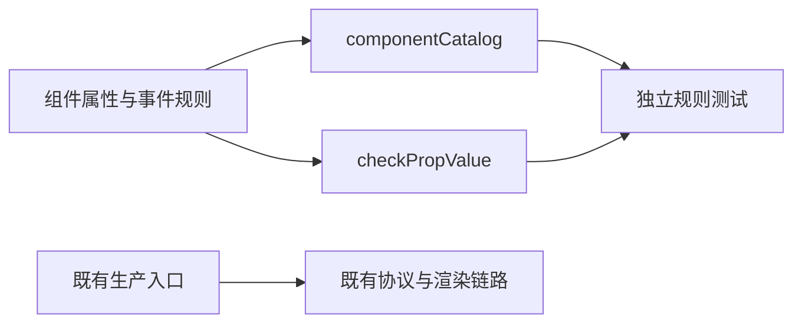

# WebUI 组件契约与 Ant Design 组件接入

建档日期：2026-10-30。关联契约：[S_01 组件规则](../specs/S_01_components.md)。
本文件维护组件接入的实施范围和验证记录；整体运行时和页面迁移见
[F_08 前端渲染](../../../../../../../../extensions_v2/docs/features/F_08_frontend-render.md)。

## 背景与范围

当前基线已具备可注入目录的协议管线和运行时，生产页面仍使用旧渲染链路。
本次从已完成的 `rsi_native_v2` 提取组件契约，为后续按功能接入渲染器和生产宿主准备模块。
提取以该分支已有实现为功能上限，不新增组件、事件、属性或兼容转换。

第一组仅包含组件规则、目录、事件名与独立属性校验器。Ant Design 依赖、渲染器、
运行时事件迁移、插件校验与派发、页面挂载留在后续组；文件组件和 `application.entry` 不纳入本组。
目录中登记槽位只表示可查询其规则，不表示页面已挂载或支持无会话路由。

## 方案与取舍

组件规则描述属性类型、默认值、必填字段、事件数据和跨属性限制。`checkPropValue`
验证规则对应的数据，返回错误字符串或 `null`，不发送网络请求，也不修改渲染树。
例如 Input 的 `ui.change` 数据必须同时携带字符串 `value` 和布尔值 `isComposing`。

保留来源的目录划分和通用校验器，不复制每个组件的解析逻辑到生产运行时。
此时直接用来源文件替换全部公共类型，会使现有 `action` 消费方失效，因此只增补目录需要的类型和常量，
现有 `allowAction`、`actionEvent` 及其检查保留到消费方迁移时一起删除。
不新增 action 到 events 的运行时转换，不按协议版本分流。

## 实施边界

| 模块 | 本组处理 |
| --- | --- |
| `catalog/components/` | 原样提取来源的非文件组件规则与共享函数 |
| `catalog/componentCatalog.ts` | 沿用来源组装，裁掉 FileTree、FilePreview |
| `catalog/slots.ts` | 沿用来源槽位规则，裁掉 application.entry；不接页面 |
| `catalog/types.ts` | 增补来源规则类型、事件白名单检查和根组件约束描述；保留既有 action 字段供当前消费者使用 |
| `contracts/wire.ts` | 增补来源组件事件常量和版本常量；不替换当前节点及交互结构 |
| `protocol/checkPropValue.ts` | 原样提取来源独立校验器；当前协议遍历器暂不切换 |
| 插件模型与派发 | 后续和对应校验、消费方一起迁移，避免先发送尚未接通的 events 帧 |

来源帧版本保持为 1。当前运行时仍按原契约处理 action；新目录尚未传给生产协议入口。
Tabs 内容组、根组件位置、完整节点字段与事件绑定的校验，需要随协议遍历器迁移后才生效。
不能把本组属性规则测试通过解释为页面、后端或真实插件已经接通。

## 验证设计与执行记录

定向测试检查属性合法与非法输入、组件事件数据、跨属性约束、默认值准备以及目录中的范围裁减。
既有 protocol、runtime、transport、renderer 和 store 用例用于检查当前消费者是否被破坏。
生产打包直接调用 Vite，不运行 tsc、lint 或 formatter。

2026-10-30 在 Windows、Node.js 24.19.0 下完成当前工作区验证：

| 入口 | 结果 |
| --- | --- |
| `test:webui-contracts` | 86 项通过 |
| `test:webui-protocol` | 13 项通过 |
| `test:webui-runtime` | 18 项通过 |
| `test:webui-transport` | 6 项通过 |
| `test:webui-renderer` | 13 项通过 |
| `test:webui-store` | 10 项通过 |
| `node node_modules/vite/bin/vite.js build` | 成功；有混合动态/静态导入和大 chunk 提示 |

环境未提供 npm 命令，以上测试通过 Node 的 `execSync` 执行 `package.json` 中对应脚本原文，
并将本地 `node_modules/.bin` 加入 PATH。Node 测试运行器及 Vite 在沙箱内遇到 `spawn EPERM`，
获准在沙箱外重跑后通过。未运行 tsc、lint、mypy 或 formatter。

来源核对结果：15 个组件规则/共享文件及独立校验器共 16 个源码文件与完成分支逐字节一致。
组件目录组装只裁掉两个文件组件，槽位目录只裁掉 application.entry；现有公共类型中的增补保留当前 action 消费方。
另检查新增文件空白、文档链接及已暂存/未暂存差异。全部 146 项测试只证明本组规则和既有消费者回归，
Vite 成功只证明当前应用可打包，不代表新目录已接入生产或真实插件已联调。

## 已知遗留

目录规则尚未接入生产协议管线；渲染器、插件派发与页面挂载均未迁移。
本组不提供浏览器或真实前后端往返的验收结论。
