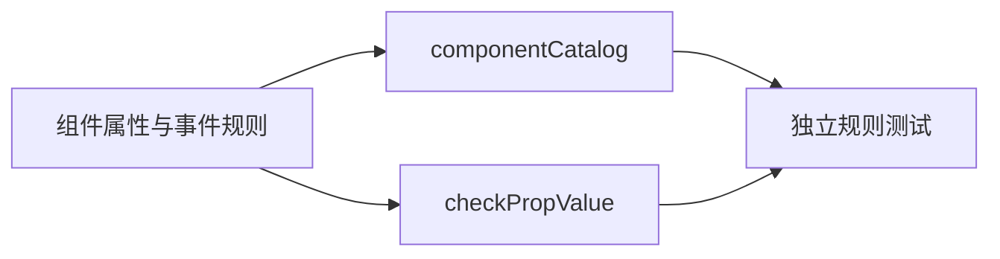

# WebUI 组件目录与属性校验

建档日期：2026-10-30。关联契约：[S_01 组件规则](../specs/S_01_components.md)。
本文件说明组件目录与属性校验器的职责；整体运行时与页面渲染见
[F_08 前端渲染](../../../../../../../../extensions_v2/docs/features/F_08_frontend-render.md)。

## 背景与范围

组件目录集中描述组件属性、事件数据和槽位规则，供校验器及其他消费者查询。
目录不包含文件组件和 `application.entry`。登记组件或槽位只表示可查询其规则，
实际显示仍取决于渲染器注册和页面挂载。

## 方案与取舍

组件规则描述属性类型、默认值、必填字段、事件数据和跨属性限制。`checkPropValue`
验证规则对应的数据，返回错误字符串或 `null`，不发送网络请求，也不修改渲染树。
例如 Input 的 `ui.change` 数据必须同时携带字符串 `value` 和布尔值 `isComposing`。

组件 `validate` 在属性类型及必填校验通过后检查跨字段约束；`prepare` 在合法属性上补充默认值。
两者与单项值校验职责分离，消费者需要按此顺序调用。
节点事件通过目录中的 `events` 规则校验，适配器通过 `emit(event, data)` 触发当前节点声明的动作。

## 模块职责

| 模块 | 职责 |
| --- | --- |
| `catalog/components/` | 非文件组件的属性、事件规则与共享函数 |
| `catalog/componentCatalog.ts` | 组装组件目录 |
| `catalog/slots.ts` | 声明槽位规则与根组件约束 |
| `catalog/types.ts` | 规则类型、目录构建与一致性检查 |
| `contracts/wire.ts` | 组件事件常量和协议版本常量 |
| `protocol/checkPropValue.ts` | 单项属性与事件数据的通用校验 |

`checkPropValue` 中的 nodes 规则只检查数组规模，完整节点遍历、Tabs 内容组和事件绑定校验
属于协议管线的职责。协议管线同时检查槽位根组件约束，返回与输入隔离的只读规范化树。

## 验证入口

`npm run test:webui-contracts` 检查属性合法与非法输入、组件事件数据、跨属性约束、
默认值准备以及目录登记范围。协议、运行时、传输、渲染器和存储分别由
`test:webui-protocol`、`test:webui-runtime`、`test:webui-transport`、`test:webui-renderer`
和 `test:webui-store` 验证。
