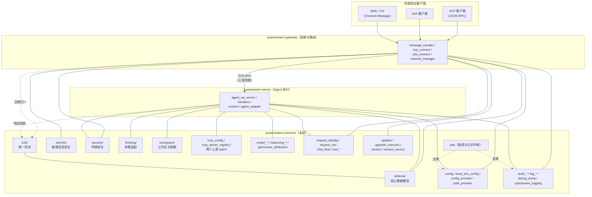
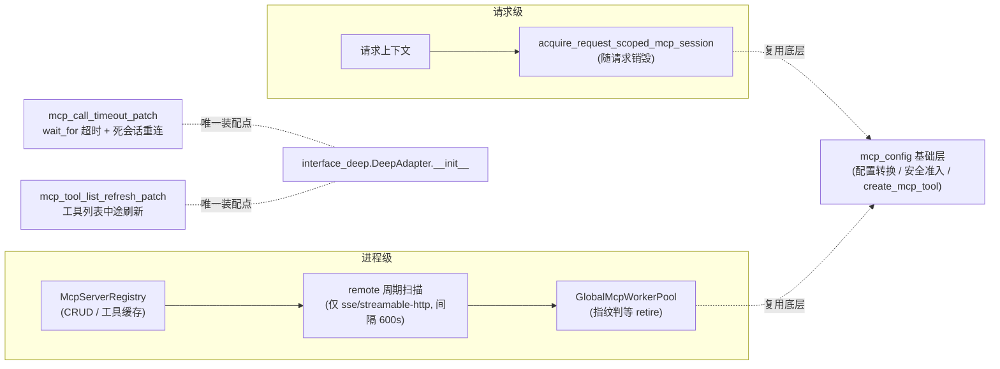
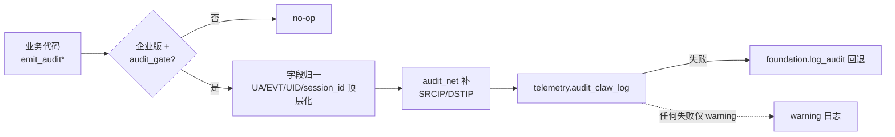
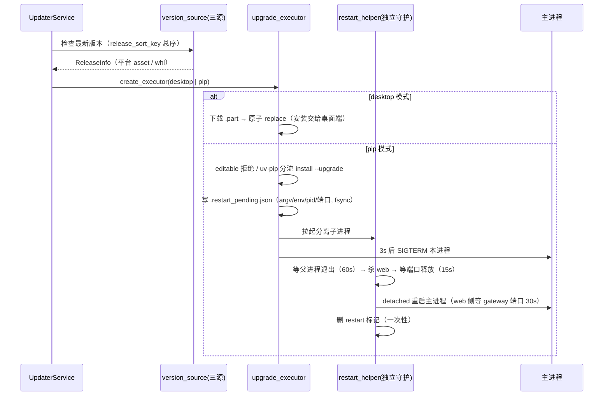
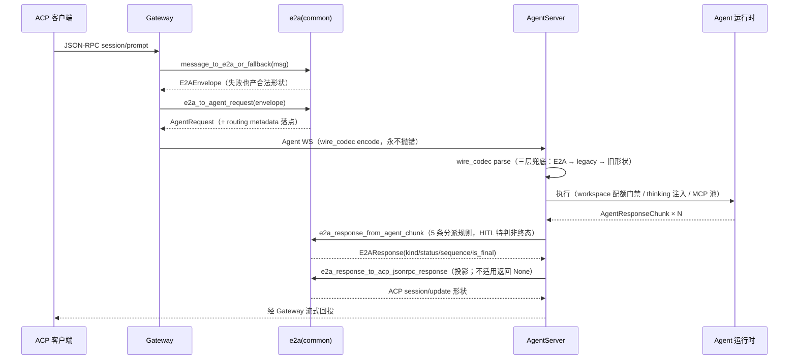

# common 公共基础层架构文档

## 1. 概述

`jiuwenswarm.common` 是 Gateway 与 AgentServer 双进程共用的公共基础层：协议信封
（e2a）、核心数据模型（schema）、敏感信息（secrets）、传输安全（security）、thinking
适配（thinking）、工作区安全与配额（workspace）六个子包，加约 50 个顶层模块（配置与
环境、MCP 集成、模型与推理、文件传输、审计日志、请求上下文、会话生命周期、自升级）。

核心设计目标：

- **单向依赖** —— 全仓五层（server / gateway / agents / channels / extensions）向下
  依赖 common，common 不反向 import 任何一层；e2a 子包零 openjiuwen 依赖
- **统一信封** —— 外协议（ACP / A2A / Channel）在系统边缘归一为 E2A，内部世界只见
  `AgentRequest` / `AgentResponse`
- **版本错位容忍** —— wire 三层兜底（E2A → legacy blob → 旧形状），双进程可独立升级
- **fail-open / fail-closed 全局分界** —— 观测类失败不阻断业务；安全边界失败直接拒绝
- **删除权最小化** —— 工作区九分区 + 三分区删除白名单 + 四层校验链
- **双轨环境变量** —— Track B 业务键永不驻留 os.environ，多 agent 隔离的地基
- **SPI 扩展** —— 配置源 / 路径 / 加密 / 持久化介质走协议 + 注册表，企业注入零侵入
- **上游补丁收口** —— 对 openjiuwen SDK 的 monkeypatch 集中为两个幂等模块，单一装配点
- **单一版本真源** —— `version.__version__` 全仓唯一，pre-release 总序比较

---

## 2. 架构总览



---

## 3. 模块结构

按主题域分组（完整逐文件注释的模块地图见模块
[AGENTS.md](../../AGENTS.md#模块地图)，此处为分层视角）：

```
jiuwenswarm/common/
├── __init__.py                  # 空：无聚合导出
│
├── e2a/                         # ── 协议域 ──
│   ├── constants.py             #    词法表根（25 常量：kind/状态/ACP 方法表/内部键）
│   ├── models.py                #    E2AEnvelope / E2AResponse / E2AProvenance
│   ├── adapters.py              #    ACP / A2A ↔ E2A 双向适配
│   ├── gateway_normalize.py     #    边缘归一唯一正门 + agent chunk ↔ E2AResponse 分派
│   ├── wire_codec.py            #    线编解码三层兜底
│   ├── agent_compat.py          #    E2AEnvelope → AgentRequest
│   └── acp/                     #    ACP 投影（protocol / tool_updates / session_updates）
│
├── schema/                      # ── 数据域 ──（__init__ 导出四件核心模型）
│   ├── message.py               #    ReqMethod(~260) / EventType(43) / Mode / Message
│   ├── agent.py                 #    PermissionContext / AgentRequest / Response / Chunk
│   ├── ask_user.py              #    HITL 问答契约（frozen + JSON Schema）
│   ├── chat_send.py             #    ChatSendParams（chat.send 入参 TypedDict）
│   ├── event_base.py            #    HookEventBase（scope 前缀自动注入）
│   └── swarmflow_reply.py       #    前向契约（无消费方）
│
├── secrets/                     # ── 敏感信息安全 ──（__init__ 仅导出 SecretStore）
│   ├── store.py                 #    L1 门面（get/set 明文进出，单例）
│   ├── registry.py              #    L2 注册表路由（secret_registry.yaml）
│   ├── transform.py / envelope.py  # L3 变换决策树 + ENC:v1 信封
│   ├── providers/               #    算法提供方（AES-256-GCM / X25519 DEK）
│   └── persistence/             #    L4 介质适配（env/file/default_file/db-stub/gateway）
│
├── security/                    # ── 传输安全 ──
│   ├── base_crypto.py           #    CryptoProvider Protocol
│   ├── link_mtls.py             #    mTLS 三态（off/observe/enforce）
│   └── ws_origin.py             #    WS Origin 白名单
│
├── thinking/                    # ── thinking 参数适配 ──
│   └── types → vendor_map → adapter → rail → register_hook   # 五级管线
│
├── workspace/                   # ── 工作区安全与配额 ──
│   ├── zones.py                 #    九分区 + DELETABLE_ZONES + 前缀规则 + 词法校验
│   ├── service.py               #    WorkspaceService（删除四层链 / preview / download）
│   └── quota.py                 #    配额门禁 + ContextVar 身份绑定
│
├── <配置与环境>                  # config / config_provider / path_provider /
│                                # local_env_config / hooks_config / http_proxy_config /
│                                # kv_cache_affinity_config / mode_matrix / work_mode / context_keys
├── <MCP 集成>                    # mcp_config / mcp_server_registry /
│                                # mcp_call_timeout_patch / mcp_tool_list_refresh_patch
├── <模型与推理>                  # model_client_extensions / model_config_validation /
│                                # model_identity / openrouter_attribution /
│                                # reasoning_config / reasoning_injector
├── <文件传输>                    # file_transfer_config / file_transfer_types
├── <审计与日志>                  # audit_{emit,gate,net} / log_{context,preview} /
│                                # openjiuwen_logging / debug_dump / openjiuwen_rail_compat /
│                                # stage_timer / ws_diagnostics / ws_limits
├── <请求上下文>                  # request_ext / request_identity / chat_final /
│                                # tool_display / tool_ownership / coding_memory_paths
├── <会话生命周期>                # todo_generation / todo_snapshot / cleanup /
│                                # cron_team_completion / git_safe_directory
├── <自升级>                      # updater / updater_restart_helper / upgrade_executor /
│                                # version / version_source
├── utils.py                     # 路径中枢 + 日志装配 + 杂项工具（~4040 行）
└── docs/                        # specs(14) / designs(2) / features / bugfix
```

---

## 4. 核心概念

### 4.1 E2A 信封模型

```python
class E2AEnvelope:            # 请求向
    protocol_version: str     # 恒 "1.0"
    request_id: str
    method: str               # 对应 ReqMethod 域
    params: dict              # 唯一业务字典
    is_stream: bool
    provenance: E2AProvenance # source_protocol / converter / converted_at / details
    agent_ref: str | None     # V2 agent 引用透传

class E2AResponse:            # 响应向
    response_kind: str        # 14 种 kind（chat.delta / tool.call / hitl.card / ...）
    status: str
    sequence: int             # 流序（解析失败归 0）
    is_final: bool            # HITL 特判 False + in_progress
    projections: dict         # 各目标协议的投影缓存
```

入站装配链（唯一正门）：

```text
message_to_e2a_or_fallback(msg)
  ├── 尝试 envelope_from_acp_jsonrpc / envelope_from_a2a_send_message / Channel 直读
  ├── 成功 → 正常 E2AEnvelope
  └── 失败 → fallback 信封（合法形状，下游 agent_compat 硬拒绝 RuntimeError）
e2a_to_agent_request(envelope)
  ├── fallback → RuntimeError（fallback 不允许流入执行层）
  ├── web 方向 → web_routing_identity + apply_routing_metadata
  └── 正常 → AgentRequest（method 非法抛 ValueError）
```

### 4.2 双轨环境变量与 overlay

```text
┌─ Track A：spawn 键 ── 驻留 os.environ（进程级）
│
└─ Track B：业务键 ── 进程内 (session_id, agent_id) tip bag
     tip = active ∪ staged（staged 胜）
     effective_tip = tip ∪ overlay（overlay 键存在即覆盖；miss 即 unset，不回退 tip）
     出口：export_agent_environ（加解密 + JIUWENCLAW_* ↔ JIUWENSWARM_* 别名互换）
```

配置装配链：

```text
get_config()
  → config_provider SPI（企业注入，fail-open 回退 Default）
  → YAML 模板 + 用户 override 合并（缓存键：path + mtime_ns）
  → resolve_env_vars（${VAR} / ${VAR:-def} / ${VAR-def}；Track A 直读 os.environ，
    其余走 tip；敏感名经 ExtensionRegistry crypto 解密）
  → agent 视图缓存（键：(sid, aid) + overlay hash）
  ※ tip 写入（set_os_environ）联动失效 ns 缓存
```

### 4.3 工作区九分区与删除安全链

```text
WorkspaceZone 九分区：
  SESSION_WORKSPACE / SESSION_TODO / SESSION_META / SKILLS /
  ROLE_MD / MEMORY / RUNTIME / ARTIFACT / OTHER

DELETABLE_ZONES（唯一删除许可）：
  SESSION_WORKSPACE / SESSION_TODO / ARTIFACT

delete_entries 四层安全链（顺序即契约）：
  ① zone 白名单 ──► ② 词法校验（绝对路径/../NUL 拒绝）
  ──► ③ symlink 只 unlink（不递归进目标）──► ④ resolve 二次校验 + 深度 32 / 条目 5000
```

配额语义：`-1` 无限 / `0` 零配额 / 策略缺失 fallback 10 TiB；soft 80% 观测 / hard 100%
拦截；`used + add >= hard` 即拒（`WorkspaceQuotaExceeded`）。

### 4.4 secrets 四层装配

```text
SecretStore（L1 门面，单例）
   │ get/set/delete（明文进出）
   ▼
SecretRegistry（L2）── secret_registry.yaml：bundled(~60) + 用户同 key 覆盖
   │ 条目：key → storage(介质) + location(路径/env 名) + field(dotted)
   ▼
transform（L3 决策树）
   encode：空值直存 → 显式 algorithm → ENC:v1 信封
           → legacy 敏感名 + custom crypto → Provider 加密 → 其余明文
   decode：全链 fail-open 返回原文
   ▼
PersistenceGateway（L4）── env / file / default_file(secrets_store.json) / db(stub)
                           无跨介质 fallback（找不到即失败）
```

### 4.5 进程级单例与 SPI

| 机制 | 模块 | 说明 |
|------|------|------|
| 单例 | `SecretStore.get_instance()` | secrets 门面 |
| 单例 | `get_mcp_server_registry()` | MCP 注册表 + 全局 worker 池 |
| SPI | `config_provider`（register/get/reset） | 配置源覆盖（企业注入） |
| SPI | `path_provider`（register/get/reset） | ~20 类目录落点覆盖（多租户） |
| 协议 | `CryptoProvider`（base_crypto） | 实际容器是 extensions 的 ExtensionRegistry |
| 协议 | `PersistenceGateway` 分发 | 介质适配器注册 |

---

## 5. 关键机制

### 5.1 MCP 两级 worker 池与上游补丁



印章契约：自建 remote client 必须补打 `_jws_call_timeout`，否则 timeout patch 的内层
300s 兜底会先掐断长调用。

### 5.2 观测链：审计打点数据流



### 5.3 自升级代际重启



---

## 6. 执行流程

### 6.1 一次 ACP 会话请求的端到端（入站 → 出站）



### 6.2 进程启动装配序

```text
app_gateway / app_agentserver 启动：
  ① import utils（隐式 setup_logger + LogRecordFactory 源头脱敏）
  ② install_async_dump_handler（USR1 活体快照）
  ③ bootstrap_openjiuwen_logging（workspace ready 后、openjiuwen logger 触发前）
  ④ load_extra_model_clients（env 白名单 + EXTENSION_DIRS）
  ⑤ [gateway] start_background_cleanup（10min 延迟 → 每 24h）
  ⑥ [agentserver] register_thinking_hook + start_mcp_registry_runtime
  ⑦ [首次 DeepAdapter 构造] apply_mcp_call_timeout_patch
     + apply_mcp_tool_list_refresh_patch（interface_deep，唯一装配点）
请求级 ContextVar 绑定（必须成对）：
  log_session（bind/unbind）· quota identity（bind/reset）·
  tip overlay（bind/reset）· path session（bind/...）
```

---

## 7. 关键设计决策

| 决策 | 理由 |
|------|------|
| 空 `__init__` + 窄门面 | 顶层聚合会让"import 即全量初始化"副作用面失控；schema 四件 / secrets 一件已是跨层稳定契约的全部 |
| E2A 边缘归一唯一正门 | 多协议适配器各自为政会分叉；失败也产 fallback 信封保证边界永不漏裸异常 |
| wire 三层兜底 | Gateway / AgentServer 独立部署时版本错位是常态；旧消息必须能解 |
| fallback 信封硬拒绝 | fallback 形状是"待归一"中间态，流入执行层等于未定义行为 |
| e2a 零 SDK 依赖 | 信封模型可被独立协议网关复用，不被 openjiuwen 版本绑死 |
| 解密 fail-open、encode 严格 | 用户手填明文密钥是合法输入；但落盘前必须过决策树 |
| 删除白名单而非黑名单 | 白名单扩面必须过 spec 评审；黑名单漏一项就是数据事故 |
| symlink 只 unlink | follow 符号链接删除 = TOCTOU 逃逸的经典路径 |
| 配额默认关闭 + 最终一致 | 配额观测不应成为可用性风险；写入门禁仍同步生效 |
| Track B 永不驻留 os.environ | 多 agent 同进程并存时，os.environ 是全局单例，放进去就串味 |
| overlay 绑定即 seal | miss 回退 tip 会让任务 A 的配置渗透进任务 B |
| tip 写入联动失效 config 缓存 | 否则 agent 改了密钥、配置视图还读旧值 |
| monkeypatch 单装配点 + `_PATCHED` 幂等 | 补丁散落多点会随 SDK 升级成雷区；常量化目标名一处可改 |
| wait_for 而非 anyio.fail_after | 跨 task cancel scope 语义（TC_MCP_CALL_014） |
| thinking/reasoning 窄白名单 | 前缀宽匹配曾让 GLM-4 误吃 GLM-5 参数 |
| WS 限额双轨不统一 | 内部链流式事件 vs 浏览器链 base64 文档，载荷形态不同 |
| 版本总序（stable>pre>类型序） | 字符串比较会把 0.10 排在 0.9 前、pre-release 当 stable |
| pip 模式强制 PyPI 源 | gitcode/github 资产只服务 desktop；pip 环境拉 whl 才可靠 |
| 编辑器占位 api_base 黑名单 | 文档示例配置进生产会以神秘 404 失败，宁可前置拒绝 |
| 工具归属 `{name}_{owner}` id | 防并发注册覆盖 + teardown 可按 owner 回收 |

---

## 8. 公共 API 面

```python
# ── schema（子包 __init__ 唯一聚合出口） ──
from jiuwenswarm.common.schema import (
    Message, AgentRequest, AgentResponse, AgentResponseChunk,
)
# 子模块导入：ReqMethod / EventType / Mode / ChatSendParams /
#   AskUserAnswer / AskUserResponse / normalize_ask_user_response / HookEventBase ...

# ── secrets（子包 __init__ 唯一聚合出口） ──
from jiuwenswarm.common.secrets import SecretStore
SecretStore.get_instance()          # 进程级单例
store.get(key) / store.set(key, value) / store.delete(key)   # 明文进出

# ── e2a（全路径导入，无门面） ──
from jiuwenswarm.common.e2a.gateway_normalize import (
    message_to_e2a_or_fallback,     # 入站唯一正门
    e2a_response_from_agent_chunk,  # chunk → E2AResponse（5 条分派规则）
    e2a_response_to_agent_chunk,    # 逆向
)
from jiuwenswarm.common.e2a.agent_compat import e2a_to_agent_request
from jiuwenswarm.common.e2a.wire_codec import (
    parse_agent_server_wire_unary, parse_agent_server_wire_chunk,
    encode_agent_response_for_wire,  # 永不抛错
)
from jiuwenswarm.common.e2a.models import E2AEnvelope, E2AResponse

# ── security / thinking / workspace（全路径导入，无门面） ──
from jiuwenswarm.common.security.link_mtls import LinkMTLSConfig
from jiuwenswarm.common.thinking import adapter as thinking_adapter
from jiuwenswarm.common.workspace.service import WorkspaceService, WorkspaceError
from jiuwenswarm.common.workspace.quota import (
    check_workspace_write, WorkspaceQuotaExceeded,
    bind_quota_identity, reset_quota_identity, resolve_tenant_root,
)
from jiuwenswarm.common.workspace.zones import WorkspaceZone, DELETABLE_ZONES

# ── 配置与环境（消费面最广三件：utils 100+ / local_env_config 77 / config 40+） ──
from jiuwenswarm.common.config import (
    get_config, get_config_raw, set_config, update_config, clear_config_cache,
)
from jiuwenswarm.common.local_env_config import (
    get_local_config, read_env, set_os_environ, export_agent_environ,
    bind_agent_env_ns, bind_task_env_overlay, effective_tip,
)
from jiuwenswarm.common.config_provider import (
    ConfigProvider, register_config_provider, get_config_provider, reset_config_provider,
)
from jiuwenswarm.common.path_provider import (
    PathProvider, PathCategory, register_path_provider, current_path_context,
)
from jiuwenswarm.common.mode_matrix import resolve_request_mode, deprecate_mode
from jiuwenswarm.common.work_mode import normalize_work_mode, SUPPORTED_WORK_MODES

# ── MCP ──
from jiuwenswarm.common.mcp_config import (
    create_mcp_tool, build_mcp_server_config, acquire_request_scoped_mcp_session,
)
from jiuwenswarm.common.mcp_server_registry import (
    get_mcp_server_registry, start_mcp_registry_runtime, snapshot_for_chat,
)
from jiuwenswarm.common.mcp_call_timeout_patch import apply_mcp_call_timeout_patch
from jiuwenswarm.common.mcp_tool_list_refresh_patch import apply_mcp_tool_list_refresh_patch

# ── 模型与推理 ──
from jiuwenswarm.common.model_client_extensions import load_extra_model_clients
from jiuwenswarm.common.model_identity import build_model_identity_reference
from jiuwenswarm.common.openrouter_attribution import inject_attribution_to_config
from jiuwenswarm.common.reasoning_injector import inject_reasoning_params

# ── 观测 ──
from jiuwenswarm.common.audit_emit import emit_audit, emit_audit_ua, emit_audit_evt
from jiuwenswarm.common.log_context import bind_log_session, unbind_log_session
from jiuwenswarm.common.log_preview import preview_text
from jiuwenswarm.common.debug_dump import dump_async_state, install_async_dump_handler

# ── 请求上下文 ──
from jiuwenswarm.common.request_identity import (
    normalize_routing_identity, apply_routing_metadata, web_routing_identity,
)
from jiuwenswarm.common.request_ext import get_ext, build_ext_from_source
from jiuwenswarm.common.chat_final import annotate_chat_final

# ── 会话生命周期 / 自升级 ──
from jiuwenswarm.common.todo_snapshot import load_todo_snapshot_for_frontend
from jiuwenswarm.common.cleanup import start_background_cleanup
from jiuwenswarm.common.cron_team_completion import (
    new_cron_team_round_state, apply_cron_team_round_event, cron_team_round_should_end,
)
from jiuwenswarm.common.updater import UpdaterService, UpdateStatus
from jiuwenswarm.common.upgrade_executor import create_executor
from jiuwenswarm.common.version import __version__
from jiuwenswarm.common.version_source import release_sort_key

# ── 路径与日志中枢 ──
from jiuwenswarm.common.utils import (
    get_root_dir, get_logs_dir, get_agent_workspace_dir,
    setup_logger, mask_sensitive, prepare_workspace, fix_json_arguments,
    AsyncLRUCache, wait_for_tcp_port, normalize_tenant_scope_id,
)
```

> 没有列出的符号不代表不可用——全量公开入口、按模块的消费者地图与修改前必读的
> 不变量 / 检查单，见模块 [AGENTS.md](../../AGENTS.md) 与
> [`docs/specs/`](../specs/)（S_01–S_14）。
