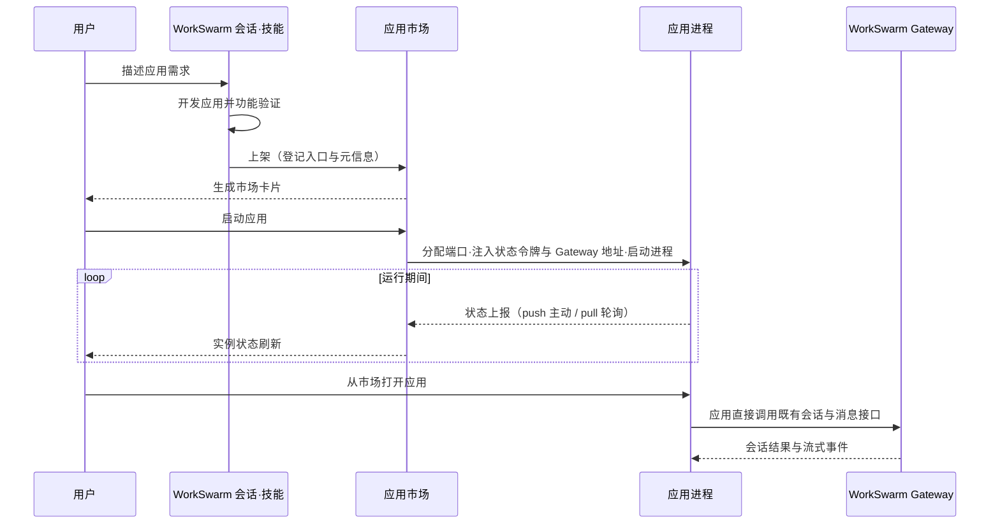

# 应用市场

## 定位

应用市场是 WorkSwarm 的本地应用管理扩展，将会话中开发的网页应用集中展示和管理，支持上架、启动、停止和删除。用户从“扩展 → 应用市场”进入，通过应用卡片打开和使用应用。

应用可以是小游戏，也可以是学习、办公等工具。**WorkSwarm 应用开发**技能（`workswarm-app-builder`）负责指导应用开发、接入 WorkSwarm 能力和上架；应用市场只负责应用的运行管理。

## 基本运行原理

- **上架**：技能调用应用市场的发布能力，登记应用入口、名称、描述和图标，生成市场卡片。
- **运行**：市场分配应用端口，注入 WorkSwarm Gateway 访问地址并启动应用；停止时先经 `/_workswarm/shutdown`（状态令牌鉴权）请求应用自行清理并退出（宽限 8 秒，让应用的退出清理如删除角色会话有机会执行），超时或应用未实现该端点时回退停止脚本与强制终止，随后回收端口；角色会话的删除由应用在退出处理中完成。
- **页面联动**：Web 内嵌页面和 Electron 独立窗口按应用 ID 隔离；关闭页面不停止服务，停止/删除成功后只关闭对应应用容器，不影响其他应用或聊天 browser 页签。
- **状态上报**：每个运行实例签发独立的状态令牌（经 `WORKSWARM_STATUS_TOKEN` 注入），应用按 push 主动上报运行状态，或由市场按 pull 轮询应用的 `/_workswarm/status` 读取（静态托管默认 pull）。上报携带单调递增序号，旧消息不会覆盖新状态；市场据此跟踪 `starting / running / stopping` 生命周期——启动后等待应用进入 `running`（最长 30 秒），发现应用自行退出则转入 `stopping` 清理。
- **AI 能力**：应用自己的客户端或服务直接访问 Gateway，不经过应用市场。应用按 AI 角色管理会话，复用默认模型策略和历史；超时、重试、清空及退出删除均由应用负责。

市场通过 `WORKSWARM_SOURCE_SESSION` 向启动和停止脚本传入创建应用的来源会话 ID（未登记来源时为空）。应用服务端通过 Gateway 的 `session.get_metadata` 查询其 `project_id` 与 `work_mode`，创建角色会话时继承这两个字段，使 NPC 会话展示在创建应用的项目下；后续消息使用相同工作模式。来源缺失或查询失败时应明确报错，不能静默创建到默认项目。旧市场可使用应用自身保存的来源会话配置。

`WORKSWARM_SOURCE_SESSION` passes the manifest's source session ID to start and stop scripts. The app queries `session.get_metadata` through Gateway and inherits `project_id` and `work_mode` when creating NPC sessions and sending messages. Missing or unavailable sources must produce an explicit error. Apps on older hosts may use their own saved source session configuration.

纯对话 NPC 可在 `session.create` 中指定 `execution_profile:"app_role"` 和 `role_instructions`：保留精简基础系统提示、应用角色规则及自身历史，不加载项目指令、记忆、技能或工具。项目归属不变，支持流式响应和取消。详见[角色会话说明](../../../docs/zh/AppRoleSessions.md)。

Text-only NPCs can create sessions with `execution_profile:"app_role"` and `role_instructions`. They retain a compact base system prompt, application character rules, and their own dialogue history, without project instructions, memory, skills, or tools. Project ownership is unchanged; streaming and cancellation remain available. See [application role sessions](../../../docs/en/AppRoleSessions.md).

市场注入的 `WORKSWARM_GATEWAY_API_URL` 为 Web Channel `/ws`，`WORKSWARM_GATEWAY_URL` 为通用 `/tui`；地址缺失时应用明确报错。状态令牌仅用于状态上报，不能用作会话接口凭据。纯静态托管不提供 AI 转发；有服务端需求的应用可提供自己的 `scripts/app_server.py`，由启动模板运行。

应用市场不承载具体应用的业务逻辑、角色记忆或 AI 消息转发。应用、技能和市场扩展分别维护：更新技能不需要重启 WorkSwarm，修改应用通常只需刷新页面或重启该应用。

## 打开应用：Web 与桌面分开

普通 Web 端保留应用市场右侧 sandbox iframe 内嵌面板（应用须允许嵌入），支持展开、收起、关闭页面。Electron 使用独立的内置浏览器窗口，不显示子窗口任务栏按钮；最小化后从应用市场“打开／恢复应用”恢复，重复打开不重载当前对局。

两端的“编辑”共用每个应用持久绑定的编辑会话；首次未绑定或确认会话已删除时，在来源会话原项目创建真实空会话并保存关联，预填名称和源码入口（不发送）。再次点击保留原会话历史及草稿，并在右侧展开应用页签；未运行的应用会先启动，失败则留在市场。Electron 在独立窗口与编辑侧栏之间移动同一原生页面，保留运行状态和应用持久分区；Web 复用同一 iframe。关闭编辑页签只隐藏对应预览，不停止服务。侧栏顶栏的“重新加载应用预览”可反复重载页面，不重启服务、不清持久化存档；页面内存态会重置，Web 预览回到应用入口。

Edit creates an empty conversation in the original app conversation’s project, with the app name and source entry prefilled as an unsent draft, and shows the app in the right sidebar on both Web and Electron. A stopped app starts first; startup failure leaves the user in App Market. Electron moves the same native page between its window and the editor without losing its runtime or storage partition. Web reuses the existing iframe. Closing the editor tab does not stop the app. Reload app preview reloads only the page, preserving its service and browser storage. In-memory page state resets; Web previews return to the app entry URL.

关闭窗口或页面后服务继续运行。实例停止、删除或从实例列表消失时，市场清理其对应容器。Electron 使用按应用 ID 划分的持久分区。Web 为每个应用分配专属的 `*.localhost` 主机，避免端口复用时读到其他应用的缓存。浏览器存储按协议、主机和端口隔离，原 `127.0.0.1` 来源的数据不会自动迁移。多存档、世界状态及 NPC 会话绑定由应用存档系统负责。

Closing an app page leaves its service running. The market removes the corresponding page when its instance stops or disappears. Web apps use distinct `*.localhost` origins so a reused port cannot pick up another app's cached resources. Browser storage from the previous `127.0.0.1` origin does not migrate automatically. Electron uses a persistent partition for each app.

## 应用开发技能

应用开发与上架能力由内置技能 **WorkSwarm 应用开发**（`workswarm-app-builder`）提供。它会指导开发者生成应用、准备图标与简介、接入 AI 能力、验证功能并上架，无需手动编写市场登记数据。

该技能为内置自研技能（与 agent-creator 等一致），随 WorkSwarm 启动自动安装，无需手动部署：

- 在“技能 → 我的技能 → 内置技能”中选择 **WorkSwarm 内置能力**。
- 在会话输入框的“+ → 技能”中选择总目录，描述应用开发需求；模型按目录读取应用开发说明。
- 应用开发适用于 **code 模式**，由总目录提示词引导；其他模式提示切换后再开发，不增加发布接口的模式拦截。
- 技能源码位于 [jiuwenswarm/resources/agent/workspace/skills/workswarm-builtin/references/capabilities/workswarm-app-builder](../../resources/agent/workspace/skills/workswarm-builtin/references/capabilities/workswarm-app-builder/)。

## 使用技能

技能启用后，描述应用需求即可进入开发流程，两种方式任选其一，上架结果均可在“扩展 → 应用市场”查看。

### 方式一：明确选择应用开发能力

在 code 模式选择 **WorkSwarm 内置能力**，并明确使用其中的应用开发能力：

> 使用内置应用开发能力，帮我开发一个五子棋小游戏，支持AI对战

明确选择应用开发能力后进入开发与上架流程，完成开发和验证后自动上架，无需在需求中重复技能名、WorkSwarm 或“上架”。用户明确要求暂不上架时，遵循用户要求。

### 方式二：直接描述需求

不选择技能，输入相同的需求。WorkSwarm 会根据应用开发和 AI 对战需求自动匹配该技能，开发和验证完成后，在当前对话中提示是否上架；用户确认后执行发布。此方式要求总目录处于启用状态。选择总目录本身不代表授权发布。

### 上架行为

- 上架提示针对具体应用，不将整个会话标记为“已上架”。
- 同一会话可以开发和上架多个应用。

应用开发规范与接口用法见 [技能说明](../../resources/agent/workspace/skills/workswarm-builtin/references/capabilities/workswarm-app-builder/SKILL.md)。

`app_market.edit_session` resolves the app-owned persistent editor conversation through routed Core RPCs. First use creates an empty conversation in the source project; subsequent clicks preserve its history and draft. Only a confirmed missing session permits replacement. Transient errors retain the binding; republishing preserves it, while deleting an app does not delete its conversation. Concurrent requests are serialized per app.

编辑会话标题栏提供“打开应用预览”，关闭侧栏或刷新后都可恢复；应用未运行时先启动。普通会话不显示此入口。The editor header keeps an Open app preview action after closing the pane or refreshing. It starts a stopped app before restoring its preview; ordinary conversations do not show this action.
