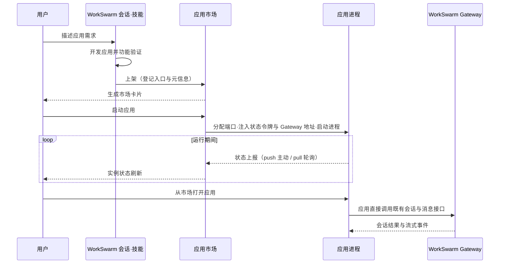

# 应用市场

## 定位

应用市场是 WorkSwarm 的本地应用管理扩展，将会话中开发的网页应用集中展示和管理，支持上架、启动、停止和删除。用户从“扩展 → 应用市场”进入，通过应用卡片打开和使用应用。

应用可以是小游戏，也可以是学习、办公等工具。**WorkSwarm 应用开发**技能（`workswarm-app-builder`）负责指导应用开发、接入 WorkSwarm 能力和上架；应用市场只负责应用的运行管理。

## 基本运行原理

- **上架**：技能调用应用市场的发布能力，登记应用入口、名称、描述和图标，生成市场卡片。
- **运行**：市场分配应用端口，注入 WorkSwarm Gateway 访问地址并启动应用；停止时先经 `/_workswarm/shutdown`（状态令牌鉴权）请求应用自行清理并退出（宽限 8 秒，让应用的退出清理如删除角色会话有机会执行），超时或应用未实现该端点时回退停止脚本与强制终止，随后回收端口；角色会话的删除由应用在退出处理中完成。
- **页面联动**：Web 内嵌页面和 Electron 独立窗口按应用 ID 隔离；关闭页面不停止服务，停止/删除成功后只关闭对应应用容器，不影响其他应用或聊天 browser 页签。
- **状态上报**：每个运行实例签发独立的状态令牌（经 `WORKSWARM_STATUS_TOKEN` 注入），应用按 push 主动上报运行状态，或由市场按 pull 轮询应用的 `/_workswarm/status` 读取（静态托管默认 pull）。上报携带单调递增序号，旧消息不会覆盖新状态；市场据此跟踪 `starting / running / stopping` 生命周期——启动后等待应用进入 `running`（最长 30 秒），发现应用自行退出则转入 `stopping` 清理。
- **AI 能力**：应用自己的客户端或服务直接访问 Gateway，不经过应用市场。应用按 AI 角色管理会话，复用默认模型策略和历史；超时、重试、清空及退出删除均由应用负责。

所有市场应用启动前都须绑定可用项目。市场安装 Hub 应用时按当前应用目录创建或绑定项目；Hub 登记不继承旧副本的项目和编辑会话绑定，本地发布应用与旧安装缺少绑定时在启动前补齐。应用优先使用市场注入的 `WORKSWARM_APP_PROJECT_ID` 和 `WORKSWARM_APP_WORK_MODE`。兼容旧宿主时，本地发布应用可用 `WORKSWARM_SOURCE_SESSION` 调用 Gateway 的 `session.get_metadata`。

Every market app needs an available project before it can start. Installation creates or links a project for the current Hub app directory; a Hub registration never inherits project or editor bindings from an older copy. The market repairs missing bindings for locally published apps and older installations before launching them. Use the injected `WORKSWARM_APP_PROJECT_ID` and `WORKSWARM_APP_WORK_MODE`. On older hosts, locally published apps can use `WORKSWARM_SOURCE_SESSION` to query `session.get_metadata`.

纯对话 NPC 可在 `session.create` 中指定 `execution_profile:"app_role"` 和 `role_instructions`：保留精简基础系统提示、应用角色规则及自身历史，不加载项目指令、记忆、技能或工具。项目归属不变，支持流式响应和取消。详见[角色会话说明](../../../docs/zh/AppRoleSessions.md)。

Text-only NPCs can create sessions with `execution_profile:"app_role"` and `role_instructions`. They retain a compact base system prompt, application character rules, and their own dialogue history, without project instructions, memory, skills, or tools. Project ownership is unchanged; streaming and cancellation remain available. See [application role sessions](../../../docs/en/AppRoleSessions.md).

市场注入的 `WORKSWARM_GATEWAY_API_URL` 为 Web Channel `/ws`，`WORKSWARM_GATEWAY_URL` 为通用 `/tui`；地址缺失时应用明确报错。状态令牌仅用于状态上报，不能用作会话接口凭据。纯静态托管不提供 AI 转发；有服务端需求的应用可提供自己的 `scripts/app_server.py`，由启动模板运行。

应用市场不承载具体应用的业务逻辑、角色记忆或 AI 消息转发。应用、技能和市场扩展分别维护：更新技能不需要重启 WorkSwarm，修改应用通常只需刷新页面或重启该应用。

## Hub 应用更新与二次开发 / Updates and local development

在已安装的 Hub 应用卡片点击「转为本地应用」，即可在原目录编辑、运行或发布。转换保留同一张卡片、数据和 Git 历史。项目目录一致时保留原项目和编辑会话。项目目录不一致时，市场尝试为应用目录绑定独立项目，并停止使用旧绑定的运行实例。应用退出原 Hub 资产的更新流程。

Choose **Convert to Local App** on an installed Hub app to edit, run, or publish it from its current directory. The card, data, and Git history stay in place. A project rooted in the app directory keeps its editor sessions. If the directory differs, the market tries to bind an independent project and stops instances using the old binding. The app stops receiving updates for the original Hub asset.

发布抽屉顶部预览应用图标、名称、版本和简介。停止、删除等市场操作的结果显示在右上角，卡片列表保持原位。

The publish drawer previews the app icon, name, version, and description. App Market reports actions such as stopping or deleting an app in the upper-right corner, keeping the card list in place.

从 Hub 安装或更新后，「我的应用」使用安装包里的图标，离线也能显示。旧应用的安装目录里已有可用图标时，刷新列表即可恢复。

After installing or updating a Hub app, **My Apps** uses the packaged icon and can display it offline. Refreshing the list restores icons for older installations that already contain a usable image.

应用市场默认打开「我的应用」。点击运行中的应用卡片可打开应用，从卡片菜单可查看详情。在详情页删除或卸载成功后会返回「我的应用」。从详情页选择重新安装会进入「应用广场」。详情页会显示更新进度，并提供取消入口。

App Market opens to **My Apps** by default. Click a running app's card to open the app, or choose **View details** from the card menu. Deleting or uninstalling an app from its detail page returns you to **My Apps**. Choosing **Reinstall** opens **App Plaza**. The detail page shows update progress and lets you cancel the update.

更新前，应用绑定的所有编辑会话都必须空闲。更新只替换程序文件和版本、名称、简介、图标等描述字段，保留 `app_id`、市场登记、pin 状态、创建时间、项目与编辑会话绑定。更新时会备份完整的旧工作目录，成功提示会显示备份位置。安装目录内的 `data/` 和 Git 仓库会复制到新版本。Hub 随包服务脚本仅继承启动所需的系统环境变量，默认在 WebChannel 绑定回环地址的部署开启。共享部署可设 `APP_MARKET_ALLOW_HUB_CODE=0`，受信部署可设为 `1`。

All editor sessions linked to the app must be idle before updating. Updates replace the program files and package metadata and retain the app ID, pin, creation time, project, and editor bindings. Updates back up the entire previous working directory and report its location. The installed `data/` directory and Git repository are copied to the new release. Bundled Hub servers inherit only the system environment needed to launch. Execution defaults to enabled for loopback WebChannel bindings. Set `APP_MARKET_ALLOW_HUB_CODE=0` on shared deployments or opt in with `1` on trusted deployments.

**下架并保留文件**停止实例并移除市场登记，保留程序目录和数据。**删除并清理文件**先下架，再将 `data/` 和 `.git` 归档到 `.app-archive/`，随后尝试清理应用目录。本地应用的客户端须在 `confirm_work_dir` 中回显该目录。Project 和编辑会话记录保留。市场保留文件系统根、用户主目录、JiuwenSwarm 数据目录、当前工作目录、安装根及其上级、归档目录，以及其他应用登记正在使用的目录。目录被占用或清理失败时，应用保持下架，右上角提示显示目录和原因。已有归档时，提示也会显示归档位置。

**Remove and keep files** stops the app and removes its market registration while keeping the program directory and data. **Delete and clean files** removes the registration, archives `data/` and `.git` under `.app-archive/`, and then attempts to remove the application directory. For local apps, the caller must echo the directory in `confirm_work_dir`. Project and editor session records are retained. The market keeps filesystem roots, the user's home, the JiuwenSwarm data directory, the current working directory, the installation root and its parents, archive directories, and directories still used by another registration. If the filesystem reports that the directory is in use or cleanup fails for another reason, the app stays unlisted. The top-right notification shows the directory, the reason, and the archive location when available.

## 打开应用：Web 与桌面分开

普通 Web 端保留应用市场右侧 sandbox iframe 内嵌面板（应用须允许嵌入），支持展开、收起、关闭页面。Electron 使用独立的内置浏览器窗口，不显示子窗口任务栏按钮；最小化后从应用市场“打开／恢复应用”恢复，重复打开不重载当前对局。

两端的“编辑”每次点击都在应用项目下新建一个会话，并在输入框预填应用名称、版本、简介、源码入口和简短的二次开发引导（不自动发送）。未运行的应用会先启动，失败则留在市场。Electron 在独立窗口与编辑侧栏之间移动同一原生页面，保留运行状态和应用持久分区；Web 复用同一 iframe。关闭编辑页签只隐藏对应预览，不停止服务。侧栏顶栏的“重新加载应用预览”可反复重载页面，不重启服务、不清持久化存档；页面内存态会重置，Web 预览回到应用入口。

Each Edit click creates a new conversation in the app-owned project and prefills the input with the app name, version, description, source entry, and a short development guide without sending it. A stopped app starts first; startup failure leaves the user in App Market. Electron moves the same native page between its window and the editor without losing its runtime or storage partition. Web reuses the existing iframe. Closing the editor tab does not stop the app. Reload app preview reloads only the page, preserving its service and browser storage. In-memory page state resets; Web previews return to the app entry URL.

关闭窗口或页面后服务继续运行。实例停止、删除或从实例列表消失时，市场清理其对应容器。Electron 使用按应用 ID 划分的持久分区。Web 为每个应用分配专属的 `*.localhost` 主机，避免端口复用时读到其他应用的缓存。浏览器存储按协议、主机和端口隔离，原 `127.0.0.1` 来源的数据不会自动迁移。多存档、世界状态及 NPC 会话绑定由应用存档系统负责。

Closing an app page leaves its service running. The market removes the corresponding page when its instance stops or disappears. Web apps use distinct `*.localhost` origins so a reused port cannot pick up another app's cached resources. Browser storage from the previous `127.0.0.1` origin does not migrate automatically. Electron uses a persistent partition for each app.

## 应用开发技能

应用开发与上架能力由内置技能 **WorkSwarm 应用开发**（`workswarm-app-builder`）提供。它会指导开发者生成应用、准备图标与简介、接入 AI 能力、验证功能并上架，无需手动编写市场登记数据。

该技能为内置自研技能（与 agent-creator 等一致），随 WorkSwarm 启动自动安装，无需手动部署：

- 在“技能 → 我的技能 → 内置技能”中选择 **WorkSwarm 内置能力**。
- 在会话输入框的“+ → 技能”中选择总目录，描述应用开发需求；模型按目录读取应用开发说明。
- 应用开发适用于 **code 模式**，由总目录提示词引导；其他模式提示切换后再开发，不增加发布接口的模式拦截。
- 技能源码位于 [jiuwenswarm/resources/agent/workspace/skills/workswarm-builtin/references/capabilities/workswarm-app-builder](../../resources/agent/workspace/skills/workswarm-builtin/references/capabilities/workswarm-app-builder/)。

## 使用技能

技能启用后，描述应用需求即可进入开发流程，两种方式任选其一，上架结果均可在“扩展 → 应用市场”查看。

### 方式一：明确选择应用开发能力

在 code 模式选择 **WorkSwarm 内置能力**，并明确使用其中的应用开发能力：

> 使用内置应用开发能力，帮我开发一个五子棋小游戏，支持AI对战

明确选择应用开发能力后进入开发与上架流程，完成开发和验证后自动上架，无需在需求中重复技能名、WorkSwarm 或“上架”。用户明确要求暂不上架时，遵循用户要求。

### 方式二：直接描述需求

不选择技能，输入相同的需求。WorkSwarm 会根据应用开发和 AI 对战需求自动匹配该技能，开发和验证完成后，在当前对话中提示是否上架；用户确认后执行发布。此方式要求总目录处于启用状态。选择总目录本身不代表授权发布。

### 上架行为

- 上架提示针对具体应用，不将整个会话标记为“已上架”。
- 同一会话可以开发和上架多个应用。

本地应用和已安装的 Hub 应用可在详情页查看「AI 角色」。该栏目读取应用包的 `app-ai-roles.json`。独立角色并排展示，会话说明写入各自的卡片。同一团队的成员与共享会话说明集中展示。省略头像时显示由角色名生成的占位头像。新开发的 AI 应用按[角色清单规范](../../resources/agent/workspace/skills/workswarm-builtin/references/capabilities/workswarm-app-builder/references/ai-roles.md)随包提供清单，发布时据此声明 `ai`。

The **AI Roles** section on local and installed app details reads the app's `app-ai-roles.json`. Independent roles share a grid, with session notes inside each card. Team members appear together with their shared session notes. Roles without an image use a name-based avatar. New apps that call AI at runtime ship a role declaration, which App Market uses to mark `ai` capability when publishing.

应用开发规范与接口用法见 [技能说明](../../resources/agent/workspace/skills/workswarm-builtin/references/capabilities/workswarm-app-builder/SKILL.md)。

`app_market.edit_session` uses routed Core RPCs to create a conversation for each distinct edit operation. Retries can reuse the operation's `edit_token`. Requests are serialized per app. Republishing preserves the app bindings for all editor conversations, and deleting an app preserves the conversations.

编辑会话标题栏提供“打开应用预览”，关闭侧栏或刷新后都可恢复；应用未运行时先启动。普通会话不显示此入口。The editor header keeps an Open app preview action after closing the pane or refreshing. It starts a stopped app before restoring its preview; ordinary conversations do not show this action.

Web 和桌面端都可在应用市场翻页选择 Hub 应用，并在安装前确认目录。更新应用需要连接首次安装时使用的 Hub。本地开发应用目录缺失时，恢复原路径即可继续使用。

In the web and desktop clients, browse the market pages and confirm the installation directory. Connect to the original Hub to update an installed app. For a local development app with a missing directory, restore its original path to use its existing registration.
