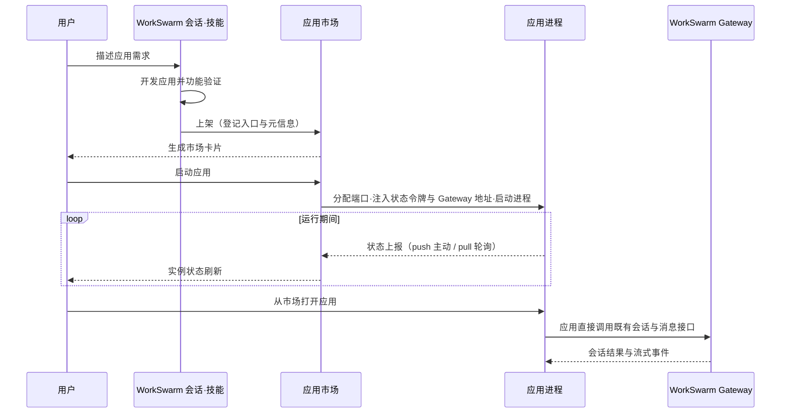

# 应用市场

## 定位

应用市场是 WorkSwarm 的本地应用管理扩展，将会话中开发的网页应用集中展示和管理，支持上架、启动、停止和删除。用户从“扩展 → 应用市场”进入，通过应用卡片打开和使用应用。

应用可以是小游戏，也可以是学习、办公等工具。**WorkSwarm 应用开发**技能（`workswarm-app-builder`）负责指导应用开发、接入 WorkSwarm 能力和上架；应用市场只负责应用的运行管理。

## 基本运行原理

- **上架**：技能调用应用市场的发布能力，登记应用入口、名称、描述和图标，生成市场卡片。
- **运行**：市场分配应用端口，注入 WorkSwarm Gateway 访问地址并启动应用；停止时回收应用进程和端口；角色会话由应用退出逻辑清理。
- **状态上报**：每个运行实例签发独立的状态令牌（经 `WORKSWARM_STATUS_TOKEN` 注入），应用按 push 主动上报运行状态，或由市场按 pull 轮询应用的 `/_workswarm/status` 读取（静态托管默认 pull）。上报携带单调递增序号，旧消息不会覆盖新状态；市场据此跟踪 `starting / running / stopping` 生命周期——启动后等待应用进入 `running`（最长 30 秒），发现应用自行退出则转入 `stopping` 清理。
- **AI 能力**：应用自己的客户端或服务直接访问 Gateway，不经过应用市场。应用按 AI 角色管理会话，复用默认模型策略和历史；超时、重试、清空及退出删除均由应用负责。

市场注入的 `WORKSWARM_GATEWAY_API_URL` 为 Web Channel `/ws`，`WORKSWARM_GATEWAY_URL` 为通用 `/tui`；地址缺失时应用明确报错。状态令牌仅用于状态上报，不能用作会话接口凭据。纯静态托管不提供 AI 转发；有服务端需求的应用可提供自己的 `scripts/app_server.py`，由启动模板运行。

应用市场不承载具体应用的业务逻辑、角色记忆或 AI 消息转发。应用、技能和市场扩展分别维护：更新技能不需要重启 WorkSwarm，修改应用通常只需刷新页面或重启该应用。

## 应用开发技能

应用开发与上架能力由内置技能 **WorkSwarm 应用开发**（`workswarm-app-builder`）提供。它会指导开发者生成应用、准备图标与简介、接入 AI 能力、验证功能并上架，无需手动编写市场登记数据。

该技能为内置自研技能（与 agent-creator 等一致），随 WorkSwarm 启动自动安装，无需手动部署：

- 在“技能 → 我的技能 → 内置技能”中查看和开关。
- 在会话输入框的“+ → 技能”中搜索选择。
- 技能源码位于 [jiuwenswarm/resources/agent/workspace/skills/workswarm-app-builder](../../resources/agent/workspace/skills/workswarm-app-builder/)。

## 使用技能

技能启用后，描述应用需求即可进入开发流程，两种方式任选其一，上架结果均可在“扩展 → 应用市场”查看。

### 方式一：主动选择技能

在会话中选择 **WorkSwarm 应用开发**，直接描述应用需求：

> 帮我开发一个五子棋小游戏，支持AI对战

选择技能后即进入开发与上架流程，完成开发和验证后自动上架，无需在需求中重复技能名、WorkSwarm 或“上架”。用户明确要求暂不上架时，遵循用户要求。

### 方式二：直接描述需求

不选择技能，输入相同的需求。WorkSwarm 会根据应用开发和 AI 对战需求自动匹配该技能，开发和验证完成后，在当前对话中提示是否上架；用户确认后执行发布。此方式要求技能处于启用状态。

### 上架行为

- 上架提示针对具体应用，不将整个会话标记为“已上架”。
- 同一会话可以开发和上架多个应用。

应用开发规范与接口用法见 [技能说明](../../resources/agent/workspace/skills/workswarm-app-builder/SKILL.md)。
