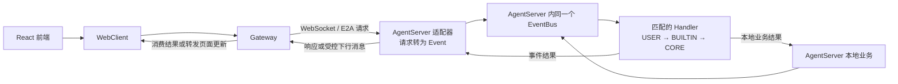
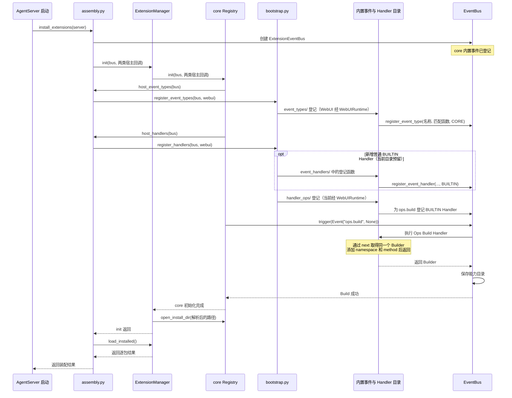
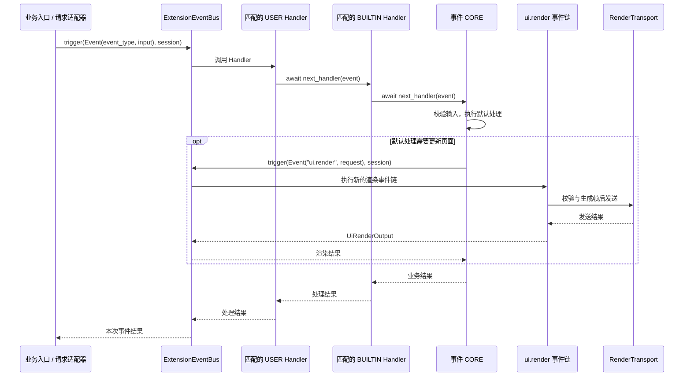
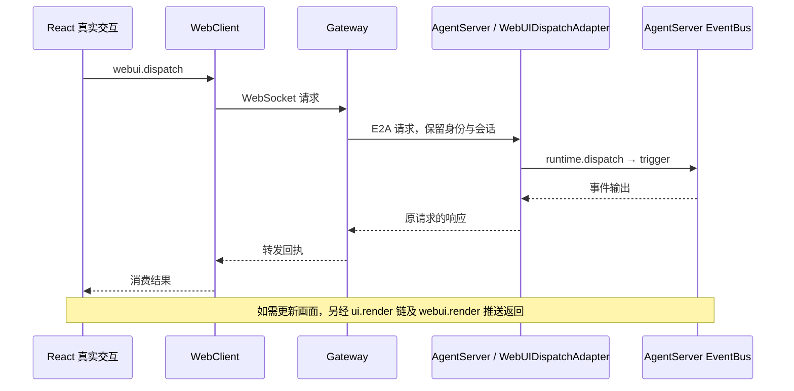
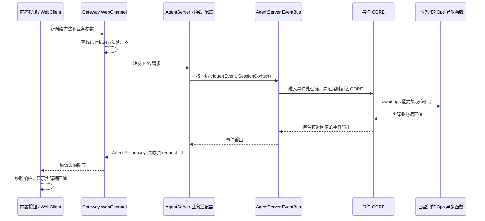
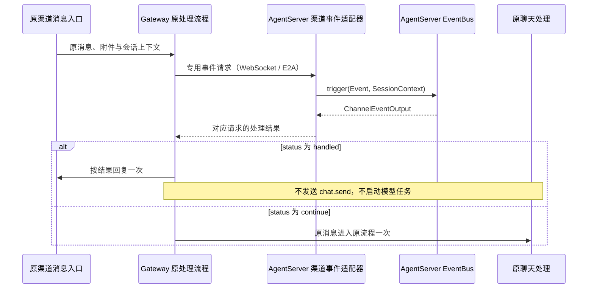

# JiuwenSwarm 内置事件开发模板

本文面向 WebClient、Gateway 和 AgentServer 开发者。目录以当前实现为准，新增示例文件另行标注；管理、事件和 WebUI 类型使用真实接口，业务处理用带注释的伪代码表示。本文只指导 swarm 内置事件开发。最近修订：2026-10-27。

## 1. 先看整体流程

### 1.1 事件在哪里执行

三类开发者提供的事件和 Python Handler 都在 AgentServer 中执行。只有 AgentServer 装配本套 EventBus；WebClient 和 Gateway 通过 WebSocket 上报请求、取得结果或执行所属模块的动作。事件属于哪个业务模块，与事件链在哪个进程执行是两回事。



### 1.2 文件放在哪里，登记后怎样生效

三类目录中的文件提供登记函数，`bootstrap.py` 汇总这些登记，`assembly.py` 将汇总函数作为宿主回调传入初始化。core 调用回调后完成一次能力构建；业务发生时才执行普通 Handler。



### 1.3 触发后按什么顺序执行

下图画出处理继续到 CORE 的分支。匹配的 USER、BUILTIN Handler 可以按契约短路；同层按登记顺序执行。CORE 负责默认动作，不再调用 next。



`next_handler` 推进当前链；`trigger` 发起新的事件链。`ops.<能力集>.<方法>()` 调用 Build 时登记的异步函数，只有该函数内部调用 `trigger`，才会再触发事件。事件返回后，入口不要再次执行已经由 CORE 完成的动作。

匹配结果在进入执行链前已经固定，Handler 替换 `event_input` 后不会重新匹配；多次调用 `next_handler` 会重复执行下游处理。普通 Handler 故障是否跳过、哪些异常继续传播，遵循 core [Events 公共契约](../../../../../agent-core/openjiuwen/core/events/docs/specs/S_01_events-contract.md)；业务入口负责处理向外传播的错误和取消。EventBus 不自动重试，也不撤销已发生的操作。

### 1.4 先找到真实入口和最终生效位置

从用户实际使用的入口向下查，确认原动作在哪里执行，再确定事件插入的位置。启动阶段登记事件类型、Handler 和 Ops，不代表某项业务已经经过事件链；仅新增一个启动演示或无人调用的发布函数，也不能代替真实业务接入。

实现前用当前源码中的函数名回答以下问题：

| 要确认什么 | 需要找到的位置 |
| --- | --- |
| 谁发起业务 | 原有页面、渠道消息入口或本地业务方法，以及实际调用方 |
| 跨进程怎样到达 | 请求使用的网络方法，以及 Gateway 转发和 AgentServer 适配器的实际登记入口 |
| 事件在哪执行 | 该入口所在进程、AgentServer 适配器或本地触发方法、已装配的 Bus |
| 原动作由谁执行 | CORE 内部的默认实现，或事件返回“继续”后由原流程执行；两者选清楚 |
| 结果怎样生效 | 消费事件输出的调用方、当前实例读取的状态，以及用户最后看到或使用的结果 |

资源池、当前实例的可用集合和最终使用者可能读取不同状态。沿公开接口查完写入与读取两侧，不能仅凭底层登记成功就判断业务可用，也不能直接修改其它模块的私有集合来补接线。
如果业务本来在实例初始化时发生，可以在该真实生命周期中触发；不要为了展示效果另加一条启动专用路径。原入口需要等待结果时，必须 `await` 并消费输出，继续和短路都要验证原动作的执行次数。

## 2. 三个模块共用的目录和启动方式

### 2.1 代码放在哪里

下面列出现有目录和主要文件；标为“新增示例”的文件是本模板的开发落点，尚需实现。

```text
jiuwenswarm/extensions_v2/
├── __init__.py
├── assembly.py                         # 创建运行实例，接入唯一一次初始化
├── bootstrap.py                        # 汇总事件、普通 Handler 与 Ops 登记
├── config.py                           # 解析安装目录
├── event_types/                        # 内置事件名、输入输出、匹配及类型登记
│   ├── __init__.py
│   ├── webui.py                        # 已有：WebUI 事件登记，第 3 章在此扩充
│   ├── context_usage.py                # 已有：用量事件
│   ├── matching.py                     # 已有：匹配辅助函数
│   ├── channel_event.py                # 新增示例
│   └── agent_event.py                  # 新增示例
├── event_handlers/                     # 内置普通 BUILTIN Handler；当前仅预留目录
│   ├── __init__.py
│   ├── webui_handler.py                # 新增示例
│   ├── channel_handler.py              # 新增示例
│   └── agent_handler.py                # 新增示例
├── handler_ops/                        # 内置 Ops 能力、ops.build Handler 与登记
│   ├── __init__.py
│   ├── ui.py                           # 已有：ui 能力，第 3 章在此扩充
│   ├── channel_ops.py                  # 新增示例
│   └── agent_ops.py                    # 新增示例
├── management/
│   ├── __init__.py
│   └── registry.py                     # ExtensionManager，委托 core Registry
└── webui/                              # WebUI 适配器、模型、渲染与传输服务
    ├── adapter.py
    ├── models.py
    ├── runtime.py
    └── core_handlers/                  # 依赖 WebUI 运行时的 CORE
        ├── __init__.py
        ├── action_core.py              # 已有：上行 UI 默认处理
        ├── render_core.py              # 已有：渲染默认处理
        └── custom_core.py              # 新增示例：本章自定义事件的 CORE
```

CORE 随类型一起登记；通用 CORE 可与事件定义同文件，依赖 WebUI 运行时的 CORE 放在 `webui/core_handlers/`。`event_handlers/` 放额外的 BUILTIN Handler，`handler_ops/` 按能力名称分文件，所有能力仍在 AgentServer 中登记和执行。

### 2.2 启动时登记事件、Handler 和 Ops 能力

当前 `assembly.py` 已把 `bootstrap.register_event_types`、`bootstrap.register_handlers` 包装成两类宿主回调。第 3～5 章的新登记加到 `bootstrap.py`。**新增文件必须显式接入，不会因为放进目录就自动生效。**

```python
from openjiuwen.core.events import ExtensionEventBus
from openjiuwen.core.extension import ActivationReport

from jiuwenswarm.extensions_v2 import bootstrap
from jiuwenswarm.extensions_v2.assembly import ExtensionAssembly


# assembly.py：摘出已有入口的登记关系，不新增第二次初始化。
async def initialize_builtin(
    assembly: ExtensionAssembly,
    *,
    host_version: str | None,
) -> list[ActivationReport]:
    def register_event_types(bus: ExtensionEventBus) -> None:
        bootstrap.register_event_types(bus, assembly.webui)

    def register_handlers(bus: ExtensionEventBus) -> None:
        bootstrap.register_handlers(bus, assembly.webui)

    await assembly.manager.init(
        assembly.bus,
        host_version=host_version,
        host_event_types=register_event_types,
        host_handlers=register_handlers,
    )
    # 门面委托 Registry.init 执行回调和唯一一次 ops.build，再设置安装目录。
    # 保留生产入口已有的单例、失败处理和后续步骤，不再手工触发 Build。
    return await assembly.manager.load_installed()
```

安装目录仍由 `resolve_install_dir()` 解析，默认 `~/.jiuwenswarm/extension_pkgs`；core 只接收路径。接入新登记时，同一事件或 Ops namespace 只登记一次。

首次 Build 成功后不再增删 Build Handler，内置能力调整通过重启重新装配。

## 3. WebClient 开发模板：界面交互

WebClient 交互可以来自扩展槽位，也可以来自内置页面。本章以槽位事件 `ui.custom` 为例，按文件说明声明与登记；独立内置交互按相同分工定义自己的业务模型，请求接入见第 3.7 节。

### 3.1 文件与事件契约

| 文件 | 本章要提供的内容 |
| --- | --- |
| `event_types/webui.py` | 事件名、输入输出模型引用、匹配函数、类型登记 |
| `webui/core_handlers/custom_core.py` | 新增示例：依赖 WebUI 运行时的 CORE 工厂 |
| `event_handlers/webui_handler.py` | BUILTIN Handler、Handler 登记 |
| `handler_ops/ui.py` | 需要从其它 Handler 主动触发时，在已有 ui 能力中增加方法 |
| `webui/constants.py` | 将槽位交互事件加入 `WebUIEvent` 和 `UPSTREAM_EVENTS` |
| `webui/adapter.py` 与前端 | 槽位交互的请求校验、事件转换与上报；独立请求的适配器及两端登记见第 3.7.2 节 |

### 3.2 定义事件名、输入和输出

```python
# event_types/webui.py：在已有文件中扩充。
from __future__ import annotations

from typing import TYPE_CHECKING
from openjiuwen.core.events import EventType
from jiuwenswarm.extensions_v2.webui.models import UiActionInput, UiActionOutput

UI_EVENT_TYPE: EventType = "ui.custom"  # 替换为确认后的新事件名，同步加入上行白名单。

# 复用真实输入 UiActionInput，不重新定义同名类：
#   event_type: str
#   target: RenderTarget，含 session_id、slot_id、package_id、instance_key
#   payload: Mapping[str, Any]，本事件需要的字段及校验规则由开发者确定。
#
# 复用真实输出 UiActionOutput：
#   accepted: bool，status: str，code: str | None
# 以下 CORE、BUILTIN、Ops 和触发入口都使用这两个模型。
```

### 3.3 定义匹配函数、CORE 和类型登记

```python
# webui/core_handlers/custom_core.py：新增示例，依赖 WebUI 运行时的 CORE。
from __future__ import annotations

from typing import TYPE_CHECKING
from openjiuwen.core.events import Event, EventHandler, EventHandlerOps, EventNext
from jiuwenswarm.extensions_v2.webui.models import UiActionInput, UiActionOutput

if TYPE_CHECKING:
    from jiuwenswarm.extensions_v2.webui.runtime import WebUIRuntime


def build_webui_core(runtime: WebUIRuntime) -> EventHandler:
    async def ui_core(
        event: Event,
        ops: EventHandlerOps | None,
        next_handler: EventNext,
    ) -> UiActionOutput:
        request = event.event_input
        if not isinstance(request, UiActionInput):
            raise TypeError("UI event requires UiActionInput")
        # 按事件契约校验目标与参数，借助 runtime 中的服务执行默认处理。
        # 返回 UiActionOutput；CORE 不调用 next_handler。
        # 需要所有 Handler 执行前完成的校验，应放到请求适配器。
        raise NotImplementedError("实现本事件的默认处理")

    return ui_core
```

```python
# event_types/webui.py：接上节的常量与模型，登记仍留在事件定义模块。
from openjiuwen.core.events import ExtensionEventBus, MatchPattern
from jiuwenswarm.extensions_v2.webui.core_handlers.custom_core import build_webui_core

if TYPE_CHECKING:
    from jiuwenswarm.extensions_v2.webui.runtime import WebUIRuntime


def match_webui_event(event_input: object, match_pattern: MatchPattern) -> bool:
    if not isinstance(event_input, UiActionInput):
        return False
    # 比较声明的匹配字段，例如 target.slot_id、payload.action_id；空模式全匹配。
    # 只选择 Handler，不执行请求校验、网络调用或业务操作。
    raise NotImplementedError("实现 UI 输入字段匹配")


def register(bus: ExtensionEventBus, runtime: WebUIRuntime) -> None:
    bus.register_event_type(UI_EVENT_TYPE, match_webui_event, build_webui_core(runtime))
    # register 是本章新增的汇总入口，这里只展示新增类型；保留原有 ui.render 等登记。
    # 新事件同步加入 WebUIEvent、UPSTREAM_EVENTS 和前端类型。
    # 若原逻辑遍历白名单注册，改为在同一处选择本事件的 CORE，不重复登记。
```

### 3.4 定义 BUILTIN Handler 和登记入口

```python
# event_handlers/webui_handler.py
from openjiuwen.core.events import (
    Event, EventHandlerOps, EventNext, ExtensionEventBus, HandlerLevel,
)
from jiuwenswarm.extensions_v2.event_types.webui import UI_EVENT_TYPE
from jiuwenswarm.extensions_v2.webui.models import UiActionInput, UiActionOutput


async def on_webui_event(
    event: Event,
    ops: EventHandlerOps | None,
    next_handler: EventNext,
) -> UiActionOutput:
    if not isinstance(event.event_input, UiActionInput):
        raise TypeError("UI event requires UiActionInput")
    # 在这里增加前置处理；按契约短路时也必须返回 UiActionOutput。
    output = await next_handler(event)
    if not isinstance(output, UiActionOutput):
        raise TypeError("UI event must return UiActionOutput")
    # 在这里记录或加工结果；Ops 与 next 只在本次 Handler 调用中使用。
    return output


def register(bus: ExtensionEventBus) -> None:
    bus.register_event_handler(UI_EVENT_TYPE, on_webui_event, {}, HandlerLevel.BUILTIN)
    # {} 表示全部接收；按需改为本事件匹配函数支持的字段模式。
```

### 3.5 定义 Ops 能力和 Build Handler

Ops 向 Handler 提供可主动调用的能力，按业务需要新增或复用。先确定能力集、具体方法和输入输出，再由 Build Handler 将对应的异步函数加入 Builder。运行时，CORE 或其它 Handler 调用该方法并使用返回值；方法可以直接执行业务，也可以按需要触发另一条事件链。

下面以从其它 Handler 触发 `ui.custom` 为例，在现有 ui Build Handler 中增加 `dispatch`，同时保留已有 `render`。仅从前端上报此事件时，沿用请求适配器即可。

```python
# handler_ops/ui.py：在已有工厂中补充能力，不另建一套 ui Build Handler。
from openjiuwen.core.events import (
    OPS_BUILD_EVENT_TYPE, Event, EventHandler, EventHandlerOps,
    EventHandlerOpsBuilder, EventNext, ExtensionEventBus, HandlerLevel,
)
from jiuwenswarm.extensions_v2.event_types.webui import UI_EVENT_TYPE
from jiuwenswarm.extensions_v2.webui.constants import WebUIEvent
from jiuwenswarm.extensions_v2.webui.models import (
    UiActionInput, UiActionOutput, UiRenderInput,
)


def build_webui_ops_build_handler(bus: ExtensionEventBus, render_event_type: str) -> EventHandler:
    async def ui_render(ops_view: EventHandlerOps, request: UiRenderInput) -> object:
        # 保留已有能力：使用当前会话，发起新的 ui.render 事件链。
        return await bus.trigger(Event(render_event_type, request), ops_view.session_context)

    async def ui_dispatch(ops_view: EventHandlerOps, request: UiActionInput) -> UiActionOutput:
        # 先校验会话、目标和 request.event_type 与本事件是否一致。
        output = await bus.trigger(Event(UI_EVENT_TYPE, request), ops_view.session_context)
        if not isinstance(output, UiActionOutput):
            raise TypeError("UI event must return UiActionOutput")
        return output

    async def ui_ops_build(
        event: Event, ops: EventHandlerOps | None, next_handler: EventNext,
    ) -> EventHandlerOpsBuilder:
        builder = await next_handler(event)
        if not isinstance(builder, EventHandlerOpsBuilder):
            raise TypeError("ops.build must return EventHandlerOpsBuilder")
        builder.add_namespace("ui")
        builder.add_method("ui", "render", ui_render)
        builder.add_method("ui", "dispatch", ui_dispatch)
        return builder  # 同一个 Builder；此时不渲染，也不执行新事件。

    return ui_ops_build


def register(bus: ExtensionEventBus) -> None:
    bus.register_event_handler(
        OPS_BUILD_EVENT_TYPE,
        build_webui_ops_build_handler(bus, WebUIEvent.RENDER.value),
        {},
        HandlerLevel.BUILTIN,
    )
```

### 3.6 接入启动登记

新增登记加到现有 `bootstrap.py`，保留其它领域条目。`assembly.py` 已将下面两个汇总函数作为回调传入唯一一次初始化，Registry 在回调返回后完成 Build，不另建初始化入口。

```python
# bootstrap.py：本章新增内容的接入示意。
from openjiuwen.core.events import ExtensionEventBus
from jiuwenswarm.extensions_v2.event_types.context_usage import register_context_usage_events
from jiuwenswarm.extensions_v2.event_types import webui as webui_types
from jiuwenswarm.extensions_v2.event_handlers import webui_handler
from jiuwenswarm.extensions_v2.handler_ops import ui as ui_ops
from jiuwenswarm.extensions_v2.webui.runtime import WebUIRuntime


def register_event_types(bus: ExtensionEventBus, webui: WebUIRuntime) -> None:
    register_context_usage_events(bus)  # 保留现有用量事件。
    webui_types.register(bus, webui)    # 新汇总入口保留原有及新增 UI 类型。
    # 采用本入口后，不再额外调用 webui.register_event_types 重复登记同一类型。


def register_handlers(bus: ExtensionEventBus, webui: WebUIRuntime) -> None:
    webui_handler.register(bus)
    ui_ops.register(bus)  # 保留 render、按需增加 dispatch；替代原 webui.register_handlers。
    # 普通 Handler 和 Ops Build Handler 都要登记，保留其它领域条目。
```

### 3.7 接通触发入口与结果返回

前端交互经 WebClient 和 Gateway 到达 AgentServer，由适配器触发事件并返回结果。根据交互来源选择下面的接入方式：扩展槽位使用已有 `webui.dispatch`，独立内置交互使用所属业务的请求方法。Python Handler 都在 AgentServer 内执行。

#### 3.7.1 复用扩展槽位的交互请求

这条路径使用已有槽位、贡献项和活跃实例，保留完整的 target 校验。前端采集交互，WebClient 和 Gateway 转发，AgentServer 适配器转换为进程内事件；需要更新槽位画面时再通过渲染推送返回浏览器。



前端同步扩充事件类型，并在实际交互位置调用上报函数：

```typescript
// jiuwenswarm/channels/web/frontend/src/features/webui/types.ts：扩充原有类型。
export type WebUIActionEvent =
  | 'ui.ready' | 'ui.press' | 'ui.toggle' | 'ui.input' | 'ui.select' | 'ui.custom';
```

```typescript
// jiuwenswarm/channels/web/frontend/src/features/webui/customEvent.ts：新增示例。
import { dispatchWebUIAction } from './actionBridge';
import type { WebUIRenderTarget } from './types';

export async function reportUiEvent(
  target: WebUIRenderTarget,
  payload: Record<string, unknown>,
): Promise<void> {
  // 在交互采集点准备本事件的 payload，使用当前视图的完整 target。
  await dispatchWebUIAction('ui.custom', target, payload);
  // 现有 bridge 返回 void 并在内部捕获请求错误；需要交互回执时扩充其返回与错误处理。
}
```

WebClient、Gateway 通过 [webui_handlers.py](../../../gateway/channel_manager/web/webui_handlers.py) 转发已有网络方法 `webui.dispatch`，新事件名放在请求参数中。新增这类事件时，更新上行白名单并复用现有转发，AgentServer 的 `WebUIDispatchAdapter` 负责将请求转换为事件。

```python
# webui/adapter.py：已有适配器的方法骨架；下面的转换函数需按业务补齐。
from jiuwenswarm.common.schema.agent import AgentRequest, AgentResponse
from jiuwenswarm.common.schema.message import ReqMethod
from jiuwenswarm.extensions_v2.assembly import get_webui_runtime
from jiuwenswarm.extensions_v2.webui.models import UiActionInput, UiActionOutput
from jiuwenswarm.server.runtime.gateway_adapter.base import GatewayAdapter, build_error_response


def parse_ui_request(request: AgentRequest) -> UiActionInput:
    # 校验事件白名单、会话、target 和本事件的 payload，构造 RenderTarget 与 UiActionInput。
    # 目标和身份按服务端记录核对，不能只采信 payload。
    raise NotImplementedError("实现请求校验与输入转换")


def build_ui_response(request: AgentRequest, output: UiActionOutput | None) -> AgentResponse:
    # 关联原 request_id，把 accepted、status、code 转成响应；None 不作为成功。
    raise NotImplementedError("实现 UI 回执转换")


class WebUIDispatchAdapter(GatewayAdapter):
    methods: frozenset[str] = frozenset({ReqMethod.WEBUI_DISPATCH.value})

    async def handle(self, request: AgentRequest) -> AgentResponse:
        runtime = get_webui_runtime()
        if runtime is None:
            return build_error_response(request, "WebUI unavailable")
        action = parse_ui_request(request)
        output = await runtime.dispatch(
            action, user_id=request.user_id, channel_id=request.channel_id or "",
        )
        # runtime.dispatch 构造 SessionContext，并调用同一个 EventBus.trigger。
        # 合入现有适配器时，保留其异常日志与错误响应转换逻辑。
        return build_ui_response(request, output)
```

该适配器已由 AgentServer 注册表接入，复用已有实例。需要更新画面时，Handler 使用 `ops.ui.render(UiRenderInput(...))`，渲染结果是 `UiRenderOutput`；交互回执与渲染推送分别处理。

#### 3.7.2 新增不依赖槽位的内置请求

独立内置交互按业务定义网络方法、事件输入输出和请求适配器。适配器校验参数、身份与会话后，使用已装配的 Bus 触发事件；原有 `webui.dispatch` 继续负责扩展槽位的 target 和实例校验。

下图以“CORE 调用 Ops，并将结果返回内置按钮”为例，说明请求到结果显示的完整顺序：



开发时按下表接入各层。网络方法负责找到适配器，事件类型负责选择事件链，Ops 方法提供 Handler 调用的能力，三者分别声明和登记。表中的公共入口已存在，新业务的方法和适配器按需求补充。

| 接入位置 | 开发内容 | 当前代码入口 |
| --- | --- | --- |
| 前端交互 | 绑定点击处理函数，调用网络方法并等待返回值 | [webClient.ts](../../../channels/web/frontend/src/services/webClient.ts) 的 `webClient.request(...)` |
| 请求约定 | 增加 `ReqMethod`，确定请求、响应字段和超时约定 | [message.py](../../../common/schema/message.py) |
| Gateway 转发 | 通过 `channel.register_method(...)` 登记转发处理函数，并接入启动流程 | [webui_handlers.py](../../../gateway/channel_manager/web/webui_handlers.py) 的 `_WEBUI_METHODS`、`register_webui_handlers`；[app_web_handlers.py](../../../gateway/channel_manager/web/app_web_handlers.py) 的 `_register_web_handlers` |
| AgentServer 适配器 | 通过 `GatewayAdapter.methods` 声明方法，将实例登记到 `AdapterRegistry` | [gateway_adapter/base.py](../../../server/runtime/gateway_adapter/base.py)、[agent_ws_server.py](../../../server/agent_ws_server.py) |
| 事件和 Ops | 适配器触发已登记事件，CORE 按业务需要调用已构建的 Ops 方法 | `bootstrap.py`、`event_types/`、`handler_ops/`，登记顺序见第 2.2 节 |
| 响应与显示 | 将事件输出转成关联原请求的 `AgentResponse`，经 Gateway 回传并更新页面 | 业务适配器、`proxy_unary_request(...)` 和交互所在组件 |

WebUI 相关方法可沿用 `_WEBUI_METHODS` 的转发登记；其它业务可在所属模块提供登记函数，接入同一启动流程。AgentServer 在初始化及停机后准备再次启动时都会创建 `AdapterRegistry`，新增适配器随这些注册表一起装配。

返回值沿图中路径逐层传递：Ops 方法返回业务数据，CORE 放入事件输出，适配器转换为响应，前端通过 `webClient.request(...)` 取得并校验数据，再更新页面状态；失败时显示对应错误。普通内置组件可直接显示响应，无需经过聊天流程或模型调用。

### 3.8 完成后检查

按本次接入方式完成以下验证：

- **事件处理：** 覆盖类型唯一登记、匹配、继续与短路、非法输入、Ops Build 和返回值。
- **请求登记：** 从生产启动入口完成登记，将前端格式的请求交给 WebChannel，经 Gateway 转发、AgentServer 注册表分发和事件链取得结果，并覆盖相关注册表重建路径。隔离网络传输时，保留本次新增的两侧登记与分发。
- **结果返回：** 由 Ops 提供结果时，验证方法返回值的变化能传递到调用方；覆盖失败、超时和会话切换后的结果归属。前端取消等待与后端操作取消分别按接口约定验证。
- **交互约束：** 槽位交互覆盖白名单、失效目标和渲染失败；独立请求验证无扩展包、槽位和活跃实例时也能使用，并保留原有槽位交互的校验。

最后通过真实 WebClient/Gateway 链路验证请求、返回值和页面显示，未完成真实联调时据实记录。

涉及页面改动时，复用相邻区域的布局、组件和样式 token。在浏览器检查普通与窄窗口、较长文案、中英文及相关加载和错误状态：按钮、文字和状态提示不重叠，不挤出容器，也不遮挡原有交互。构建和接口测试通过不能代替这项检查；未能启动页面时明确记录未完成视觉验证。

## 4. Gateway 开发模板：请求转发与渠道事件

本章的 `channel.custom` 是新事件占位名；输入输出是下文新定义的业务模型，不是已有 swarm API。业务文件按以下声明补齐，具体操作在注释处实现。

### 4.1 文件与事件契约

| 文件 | 本章要提供的内容 |
| --- | --- |
| `event_types/channel_event.py` | 事件名、输入输出、匹配函数、CORE 工厂、类型登记 |
| `event_handlers/channel_handler.py` | BUILTIN Handler、Handler 登记 |
| `handler_ops/channel_ops.py` | 可选的主动触发能力、Build Handler、能力登记 |
| Gateway 原业务入口与 AgentServer 适配器 | 经 WebSocket 请求事件处理，等待并使用结果；需要渠道动作时补充受控下行接收与执行 |

### 4.2 定义事件名、输入和输出

```python
# event_types/channel_event.py
from collections.abc import Mapping
from dataclasses import dataclass, field
from openjiuwen.core.events import EventType

CHANNEL_EVENT_TYPE: EventType = "channel.custom"  # 替换为确认后的事件名；字段按实际业务调整。


@dataclass(frozen=True, slots=True)
class ChannelEventInput:
    channel_id: str
    target_id: str
    action: str
    payload: Mapping[str, object] = field(default_factory=dict)


@dataclass(frozen=True, slots=True)
class ChannelEventOutput:
    accepted: bool
    status: str
    data: Mapping[str, object] = field(default_factory=dict)
    # 由事件契约明确 accepted、status 及 data 的含义，调用方据此继续业务。
    # 对转发前判断类事件，可约定 status 为 continue / handled，data 携带约定的回复内容。
    # accepted 只表示本次事件是否被接受，不单独作为“已完成回复”或“需要短路”的依据。
```

### 4.3 定义匹配函数、CORE 和类型登记

```python
# event_types/channel_event.py：接上节的常量与模型。
from openjiuwen.core.events import (
    Event, EventHandler, EventHandlerOps, EventNext, ExtensionEventBus, MatchPattern,
)


def match_channel_event(event_input: object, match_pattern: MatchPattern) -> bool:
    if not isinstance(event_input, ChannelEventInput):
        return False
    # 比较 channel_id、target_id、action 或 payload 中的约定字段；空模式全匹配，不执行业务。
    # 要求内容完全匹配时比较原文，不擅自去除空格、换行或合并附件内容。
    raise NotImplementedError("实现本事件输入字段匹配")


def build_channel_core() -> EventHandler:
    async def channel_core(
        event: Event,
        ops: EventHandlerOps | None,
        next_handler: EventNext,
    ) -> ChannelEventOutput:
        request = event.event_input
        if not isinstance(request, ChannelEventInput):
            raise TypeError("channel.custom requires ChannelEventInput")
        if ops is None or ops.session_context is None:
            raise ValueError("channel.custom requires SessionContext")
        # 先检查当前会话与渠道范围。转发前判断类事件的默认行为可只返回 continue，
        # 由 Gateway 消费结果后执行原有转发；此 CORE 不创建聊天任务或再次发送原消息。
        # 真正执行渠道动作的事件，才经 WebSocket 受控下行交给 Gateway，并核对执行结果。
        # 返回 ChannelEventOutput；CORE 不调用 next_handler，不与入口重复执行同一动作。
        raise NotImplementedError("实现本事件的默认处理")

    return channel_core


def register(bus: ExtensionEventBus) -> None:
    bus.register_event_type(CHANNEL_EVENT_TYPE, match_channel_event, build_channel_core())
    # 原有本领域事件迁入后也在此汇总，每个类型只登记一次。
```

### 4.4 定义 BUILTIN Handler 和登记入口

```python
# event_handlers/channel_handler.py
from openjiuwen.core.events import (
    Event, EventHandlerOps, EventNext, ExtensionEventBus, HandlerLevel,
)
from jiuwenswarm.extensions_v2.event_types.channel_event import (
    CHANNEL_EVENT_TYPE, ChannelEventInput, ChannelEventOutput,
)


async def on_channel_event(
    event: Event,
    ops: EventHandlerOps | None,
    next_handler: EventNext,
) -> ChannelEventOutput:
    if not isinstance(event.event_input, ChannelEventInput):
        raise TypeError("channel.custom requires ChannelEventInput")
    # 前置检查或加工写在这里；短路也必须返回 ChannelEventOutput。
    output = await next_handler(event)
    if not isinstance(output, ChannelEventOutput):
        raise TypeError("channel.custom must return ChannelEventOutput")
    # 后置处理写在这里；Ops 与 next 不保存到本次调用之外使用。
    return output


def register(bus: ExtensionEventBus) -> None:
    bus.register_event_handler(CHANNEL_EVENT_TYPE, on_channel_event, {}, HandlerLevel.BUILTIN)
    # 按需把 {} 改为匹配函数支持的字段模式，不能用此入口覆盖 CORE。
```

### 4.5 定义 Ops 能力和 Build Handler

需要其它 Handler 主动触发时增加 `ops.channel.dispatch`；只有业务入口触发时可以不增加这一能力。

```python
# handler_ops/channel_ops.py
from openjiuwen.core.events import (
    OPS_BUILD_EVENT_TYPE, Event, EventHandler, EventHandlerOps,
    EventHandlerOpsBuilder, EventNext, ExtensionEventBus, HandlerLevel,
)
from jiuwenswarm.extensions_v2.event_types.channel_event import (
    CHANNEL_EVENT_TYPE, ChannelEventInput, ChannelEventOutput,
)


def build_channel_ops_handler(bus: ExtensionEventBus) -> EventHandler:
    async def dispatch(ops_view: EventHandlerOps, request: ChannelEventInput) -> ChannelEventOutput:
        if ops_view.session_context is None:
            raise ValueError("ops.channel.dispatch requires SessionContext")
        # 调用能力时校验目标和允许范围，使用当前会话发起一条新事件链。
        output = await bus.trigger(Event(CHANNEL_EVENT_TYPE, request), ops_view.session_context)
        if not isinstance(output, ChannelEventOutput):
            raise TypeError("channel.custom must return ChannelEventOutput")
        return output

    async def channel_ops_build(
        event: Event, ops: EventHandlerOps | None, next_handler: EventNext,
    ) -> EventHandlerOpsBuilder:
        builder = await next_handler(event)
        if not isinstance(builder, EventHandlerOpsBuilder):
            raise TypeError("ops.build must return EventHandlerOpsBuilder")
        builder.add_namespace("channel")
        builder.add_method("channel", "dispatch", dispatch)
        return builder  # 只登记函数，不执行业务；返回取得的同一个 Builder。

    return channel_ops_build


def register(bus: ExtensionEventBus) -> None:
    bus.register_event_handler(
        OPS_BUILD_EVENT_TYPE, build_channel_ops_handler(bus), {}, HandlerLevel.BUILTIN,
    )
    # namespace 已有其它能力时合并进原主责 Build Handler，不再创建第二个。
```

### 4.6 接入启动登记

新增登记加到现有 `bootstrap.py`，保留其它领域条目。`assembly.py` 已将下面两个汇总函数作为回调传入唯一一次初始化，Registry 在回调返回后完成 Build，不另建初始化入口。

```python
# bootstrap.py：本章新增内容的接入示意。
from openjiuwen.core.events import ExtensionEventBus
from jiuwenswarm.extensions_v2.event_types.context_usage import register_context_usage_events
from jiuwenswarm.extensions_v2.event_types import channel_event
from jiuwenswarm.extensions_v2.event_handlers import channel_handler
from jiuwenswarm.extensions_v2.handler_ops import channel_ops
from jiuwenswarm.extensions_v2.webui.runtime import WebUIRuntime


def register_event_types(bus: ExtensionEventBus, webui: WebUIRuntime) -> None:
    webui.register_event_types(bus)      # 保留现有 UI 事件。
    register_context_usage_events(bus)  # 保留现有用量事件。
    channel_event.register(bus)


def register_handlers(bus: ExtensionEventBus, webui: WebUIRuntime) -> None:
    webui.register_handlers(bus)  # 保留现有 ui Ops Build Handler。
    channel_handler.register(bus)
    channel_ops.register(bus)  # 若不提供此能力，则不加入这条登记。
```

### 4.7 接通触发入口与结果返回

Gateway 原业务入口留在 Gateway，事件链在 AgentServer 执行，两者通过 WebSocket 上的 E2A 请求连接。E2A 是两进程间的请求协议；请求到达 AgentServer 后，由专用适配器转换为 `Event`。当前没有通用渠道事件代理，下面的适配器与业务接入都是待实现骨架。

渠道消息由 Gateway 现有 client 直接发起 E2A 请求，浏览器请求则先经过 WebChannel 的方法分发。前者接入原渠道入口和 AgentServer 适配器，后者还需按第 3.7.2 节接入 WebChannel 方法登记。

以“转发前判断是否继续”的事件为例，Gateway 必须先等待事件结果，再决定是否进入原聊天流程：



不要在 Gateway 调用 AgentServer 的进程内单例获取函数，也不要在 Gateway 再装配一套 Bus。将事件直接挪到 AgentServer 的 `chat.send` 入口，会改变拦截时机和覆盖范围；若需求是 Gateway 转发前判断，这不能代替上图的往返链路。向 AgentServer 请求事件处理不等于发起模型调用。

```python
# AgentServer 侧：新业务适配器骨架，不表示已有通用渠道代理。
from openjiuwen.core.events import Event, ExtensionEventBus, SessionContext
from jiuwenswarm.common.schema.agent import AgentRequest, AgentResponse
from jiuwenswarm.common.schema.message import ReqMethod
from jiuwenswarm.extensions_v2.event_types.channel_event import (
    CHANNEL_EVENT_TYPE, ChannelEventInput, ChannelEventOutput,
)
from jiuwenswarm.server.runtime.gateway_adapter.base import AdapterRegistry, GatewayAdapter


def parse_channel_request(request: AgentRequest) -> tuple[ChannelEventInput, SessionContext]:
    # 校验 params、渠道和目标，构造 ChannelEventInput。
    # 根据服务端身份与会话记录准备 SessionContext，不采信 payload 自报身份。
    raise NotImplementedError("实现渠道请求和会话转换")


def build_channel_response(request: AgentRequest, output: ChannelEventOutput) -> AgentResponse:
    # 关联原 request_id，将 accepted、status、data 转为网络响应，并保留路由关联字段。
    # ok=True 只表示本次请求得到结果；Gateway 仍须检查事件的 accepted 和 status。
    raise NotImplementedError("实现渠道事件回执转换")


class ChannelEventAdapter(GatewayAdapter):
    def __init__(self, bus: ExtensionEventBus, method: ReqMethod) -> None:
        self.bus = bus
        self.methods = frozenset({method.value})  # 网络方法名，与 event_type 分开确定。

    async def handle(self, request: AgentRequest) -> AgentResponse:
        # 只执行业务事件链，不调用 chat.send，也不启动模型任务。
        event_input, session = parse_channel_request(request)
        output = await self.bus.trigger(Event(CHANNEL_EVENT_TYPE, event_input), session)
        if not isinstance(output, ChannelEventOutput):
            raise TypeError("channel.custom must return ChannelEventOutput")
        return build_channel_response(request, output)


def register_channel_adapter(
    registry: AdapterRegistry, bus: ExtensionEventBus, method: ReqMethod,
) -> None:
    registry.register(ChannelEventAdapter(bus, method))
    # 将本函数接入 AgentServer 初始化及再次启动时的适配器装配入口。
    # Web 网络入口可参考 proxy_unary_request；Gateway 自身收到的渠道消息用现有 client 发 E2A。
    # 新方法需要先补充 ReqMethod 及两端协议，不虚构一个当前不存在的枚举值。
```

Gateway 侧还须接入结果消费。下面只展示转发前判断的分支；函数名为示意，必须由原有消息处理流程调用：

```python
from collections.abc import Awaitable, Callable
from jiuwenswarm.common.client.agent_client import AgentServerClient
from jiuwenswarm.common.e2a.models import E2AEnvelope
from jiuwenswarm.common.schema.agent import AgentResponse
from jiuwenswarm.common.schema.message import Message
from jiuwenswarm.extensions_v2.event_types.channel_event import ChannelEventOutput
from jiuwenswarm.gateway.routing.agent_request_timeout import send_agent_request_with_timeout


def decode_channel_output(response: AgentResponse) -> ChannelEventOutput:
    # 检查 ok 与 payload 字段类型，按双方约定解码；未知 status、None 和失败响应不当作 continue。
    raise NotImplementedError("实现回执校验与输出转换")


async def before_original_forward(
    client: AgentServerClient,
    control_request: E2AEnvelope,
    original_message: Message,
    deliver_reply: Callable[[Message, ChannelEventOutput], Awaitable[None]],
) -> bool:
    # Gateway 原入口准备专用事件请求：使用已登记的 method 和独立 request_id，不能发送 chat.send。
    # 身份、会话与目标沿可信路由取得；按契约传递原内容，不修改后续转发所用的原消息及附件。
    # 控制请求与原聊天请求不能复用同一个在途 request_id。
    response = await send_agent_request_with_timeout(
        client, control_request, label="channel event",
    )
    output = decode_channel_output(response)
    if not output.accepted:
        raise RuntimeError("channel event was not accepted")
    if output.status == "handled":
        await deliver_reply(original_message, output)  # 调用原渠道的回复路径，并核对投递结果。
        return True  # 原消息循环据此结束本条消息，不再创建聊天请求。
    if output.status == "continue":
        return False  # 原入口仅沿既有转发分支执行一次，不从此函数另发一遍聊天。
    raise ValueError("unexpected channel event status")
```

在真实 Gateway 入口等待上述判断：已处理则结束当前消息；继续则保留原有转发代码。结合当前调用链选择插入点，不能跳过命令、取消、附件准备和会话路由，也不能重复经过这些步骤。异常、超时或取消按事件契约明确处理，不因没拿到结果就自动重发或无条件继续。本骨架以拒绝未知结果为示意；其它降级策略须由具体事件确认。

若事件本身要求执行 Gateway 渠道动作，则由 AgentServer 经受控下行消息通知 Gateway，Gateway 接收器校验渠道与目标后调用本地公开接口，再按契约回报执行结果。Gateway 不执行 Python 事件 Handler；AgentServer 也不能直接调用另一个进程的 Channel 对象。不要把“下行消息已发出”当作动作已完成。

### 4.8 完成后检查

单元测试覆盖类型唯一登记、匹配、继续与短路、目标拒绝、Ops Build、超时和执行结果；涉及下行渠道动作时，覆盖 Gateway 接收、执行及结果回报。从真实 Gateway 消息入口验证：命中短路时回复一次且没有聊天或模型任务，未命中只沿原路径转发一次；失败、取消、附件、已有命令和不同会话的行为保留。测试中可隔离 WebSocket 传输，但要保留生产登记入口、Gateway 结果消费与 AgentServer 适配器、事件链，并分别验证运行边界；同进程直接获取 Bus 的测试不能证明跨进程接通。最后完成实际跨进程联调，未执行时明确记录。

## 5. AgentServer 开发模板：本地业务事件

<a id="agentserver-template"></a>

本章的 `agent.custom` 是新事件占位名；输入输出是下文新定义的业务模型，不是已有 swarm API。业务文件按以下声明补齐，具体操作在注释处实现。

### 5.1 文件与事件契约

| 文件 | 本章要提供的内容 |
| --- | --- |
| `event_types/agent_event.py` | 事件名、输入输出、匹配函数、CORE 工厂、类型登记 |
| `event_handlers/agent_handler.py` | BUILTIN Handler、Handler 登记 |
| `handler_ops/agent_ops.py` | 可选的主动触发能力、Build Handler、能力登记 |
| 所属业务入口 | 准备可信会话、触发事件、转换并使用结果 |

### 5.2 定义事件名、输入和输出

```python
# event_types/agent_event.py
from collections.abc import Mapping
from dataclasses import dataclass, field
from openjiuwen.core.events import EventType

AGENT_EVENT_TYPE: EventType = "agent.custom"  # 替换为确认后的事件名；字段按实际业务调整。


@dataclass(frozen=True, slots=True)
class AgentEventInput:
    agent_id: str
    step: str
    payload: Mapping[str, object] = field(default_factory=dict)


@dataclass(frozen=True, slots=True)
class AgentEventOutput:
    accepted: bool
    status: str
    data: Mapping[str, object] = field(default_factory=dict)
    # 由事件契约明确 accepted、status 及 data 的含义，调用方据此继续业务。
```

### 5.3 定义匹配函数、CORE 和类型登记

```python
# event_types/agent_event.py：接上节的常量与模型。
from openjiuwen.core.events import (
    Event, EventHandler, EventHandlerOps, EventNext, ExtensionEventBus, MatchPattern,
)


def match_agent_event(event_input: object, match_pattern: MatchPattern) -> bool:
    if not isinstance(event_input, AgentEventInput):
        return False
    # 比较 agent_id、step 等约定字段；空模式全匹配，不执行业务。
    raise NotImplementedError("实现本事件输入字段匹配")


def build_agent_core() -> EventHandler:
    async def agent_core(
        event: Event,
        ops: EventHandlerOps | None,
        next_handler: EventNext,
    ) -> AgentEventOutput:
        request = event.event_input
        if not isinstance(request, AgentEventInput):
            raise TypeError("agent.custom requires AgentEventInput")
        if ops is None or ops.session_context is None:
            raise ValueError("agent.custom requires SessionContext")
        # 检查当前 Agent 和业务阶段，调用本进程的所属业务服务，并转换默认处理结果。
        # 返回 AgentEventOutput；CORE 不调用 next_handler，入口不补做同一动作。
        raise NotImplementedError("实现本事件的默认处理")

    return agent_core


def register(bus: ExtensionEventBus) -> None:
    bus.register_event_type(AGENT_EVENT_TYPE, match_agent_event, build_agent_core())
    # 原有本领域事件迁入后也在此汇总，每个类型只登记一次。
```

### 5.4 定义 BUILTIN Handler 和登记入口

```python
# event_handlers/agent_handler.py
from openjiuwen.core.events import (
    Event, EventHandlerOps, EventNext, ExtensionEventBus, HandlerLevel,
)
from jiuwenswarm.extensions_v2.event_types.agent_event import (
    AGENT_EVENT_TYPE, AgentEventInput, AgentEventOutput,
)


async def on_agent_event(
    event: Event,
    ops: EventHandlerOps | None,
    next_handler: EventNext,
) -> AgentEventOutput:
    if not isinstance(event.event_input, AgentEventInput):
        raise TypeError("agent.custom requires AgentEventInput")
    # 前置检查或加工写在这里；短路也必须返回 AgentEventOutput。
    output = await next_handler(event)
    if not isinstance(output, AgentEventOutput):
        raise TypeError("agent.custom must return AgentEventOutput")
    # 后置处理写在这里；Ops 与 next 不保存到本次调用之外使用。
    return output


def register(bus: ExtensionEventBus) -> None:
    bus.register_event_handler(AGENT_EVENT_TYPE, on_agent_event, {}, HandlerLevel.BUILTIN)
    # 按需把 {} 改为匹配函数支持的字段模式，不能用此入口覆盖 CORE。
```

### 5.5 定义 Ops 能力和 Build Handler

需要其它 Handler 主动触发时增加 `ops.agent.dispatch`；只有业务入口触发时可以不增加这一能力。

```python
# handler_ops/agent_ops.py
from openjiuwen.core.events import (
    OPS_BUILD_EVENT_TYPE, Event, EventHandler, EventHandlerOps,
    EventHandlerOpsBuilder, EventNext, ExtensionEventBus, HandlerLevel,
)
from jiuwenswarm.extensions_v2.event_types.agent_event import (
    AGENT_EVENT_TYPE, AgentEventInput, AgentEventOutput,
)


def build_agent_ops_handler(bus: ExtensionEventBus) -> EventHandler:
    async def dispatch(ops_view: EventHandlerOps, request: AgentEventInput) -> AgentEventOutput:
        if ops_view.session_context is None:
            raise ValueError("ops.agent.dispatch requires SessionContext")
        # 调用能力时校验目标和允许范围，使用当前会话发起一条新事件链。
        output = await bus.trigger(Event(AGENT_EVENT_TYPE, request), ops_view.session_context)
        if not isinstance(output, AgentEventOutput):
            raise TypeError("agent.custom must return AgentEventOutput")
        return output

    async def agent_ops_build(
        event: Event, ops: EventHandlerOps | None, next_handler: EventNext,
    ) -> EventHandlerOpsBuilder:
        builder = await next_handler(event)
        if not isinstance(builder, EventHandlerOpsBuilder):
            raise TypeError("ops.build must return EventHandlerOpsBuilder")
        builder.add_namespace("agent")
        builder.add_method("agent", "dispatch", dispatch)
        return builder  # 只登记函数，不执行业务；返回取得的同一个 Builder。

    return agent_ops_build


def register(bus: ExtensionEventBus) -> None:
    bus.register_event_handler(
        OPS_BUILD_EVENT_TYPE, build_agent_ops_handler(bus), {}, HandlerLevel.BUILTIN,
    )
    # namespace 已有其它能力时合并进原主责 Build Handler，不再创建第二个。
```

### 5.6 接入启动登记

新增登记加到现有 `bootstrap.py`，保留其它领域条目。`assembly.py` 已将下面两个汇总函数作为回调传入唯一一次初始化，Registry 在回调返回后完成 Build，不另建初始化入口。

```python
# bootstrap.py：本章新增内容的接入示意。
from openjiuwen.core.events import ExtensionEventBus
from jiuwenswarm.extensions_v2.event_types.context_usage import register_context_usage_events
from jiuwenswarm.extensions_v2.event_types import agent_event
from jiuwenswarm.extensions_v2.event_handlers import agent_handler
from jiuwenswarm.extensions_v2.handler_ops import agent_ops
from jiuwenswarm.extensions_v2.webui.runtime import WebUIRuntime


def register_event_types(bus: ExtensionEventBus, webui: WebUIRuntime) -> None:
    webui.register_event_types(bus)      # 保留现有 UI 事件。
    register_context_usage_events(bus)  # 保留现有用量事件。
    agent_event.register(bus)


def register_handlers(bus: ExtensionEventBus, webui: WebUIRuntime) -> None:
    webui.register_handlers(bus)  # 保留现有 ui Ops Build Handler。
    agent_handler.register(bus)
    agent_ops.register(bus)  # 若不提供此能力，则不加入这条登记。
```

### 5.7 接通触发入口与结果返回

AgentServer 与 EventBus 在同一进程，直接在真实业务扩展点调用；不经过 WebUI 或 Gateway 适配器。
先按第 1.4 节追到原动作和最后的读取方。将下面的方法体合入已存在的业务入口；如果增加辅助函数，必须同时修改原调用方。不要照模板另建一个仅在启动时执行的发布器来代替原业务路径。

```python
# AgentServer 原业务方法的伪代码；名称仅作示意，不是新增的框架 API。
from openjiuwen.core.events import Event, ExtensionEventBus, SessionContext
from jiuwenswarm.extensions_v2.event_types.agent_event import (
    AGENT_EVENT_TYPE, AgentEventInput, AgentEventOutput,
)


async def existing_business_entry(
    bus: ExtensionEventBus, request: AgentEventInput, session: SessionContext,
) -> AgentEventOutput:
    # bus 来自本业务使用的装配实例；session 来自服务端记录，不读取全局“当前会话”。
    output = await bus.trigger(Event(AGENT_EVENT_TYPE, request), session)
    if not isinstance(output, AgentEventOutput):
        raise TypeError("agent.custom must return AgentEventOutput")
    # 按事件约定检查 accepted、status，并将输出接回原调用方。
    # 原动作若已放进 CORE，这里不再执行；CORE 使用底层实现，不能递归调用本入口。
    # 需要继续原流程的事件则在检查结果后执行；通知型事件放在原动作完成之后。
    return output
```

登记或修改资源的事件还要核对当前业务实例是否可见、是否真正被使用。需要更新实例状态时调用所属模块的公开接口，并保留原有权限、缓存刷新及生命周期处理；不可把底层资源池的一次写入当作完整接入。

### 5.8 完成后检查

单元测试覆盖类型唯一登记、匹配、继续与短路、输入错误、会话缺失、Ops Build 和结果使用。从原业务入口进入，核对触发次数、最终可见状态及实际使用结果，不以直接调用 `trigger()` 的测试代替。需要结果后再继续时直接 await；仅通知型事件可由业务安排后台任务，并负责异常、等待或取消。

## 6. 完成开发时核对哪些内容

### 6.1 检查清单

| 核对项 | 完成要求 |
| --- | --- |
| 事件契约 | 事件名至少两段、用点分隔，每段匹配 `[a-z][a-z0-9_]*`；输入输出和失败结果已明确，新模型采用 `frozen=True, slots=True` 的 dataclass |
| 文件与登记 | 三类文件职责明确，全部接入宿主回调，迁移前后没有重复登记 |
| 事件处理 | 一个事件只有一个 CORE；匹配函数同步返回 bool、不执行业务；继续、短路和输出符合约定 |
| Ops | Build Handler 在唯一一次 Build 前登记，构建时不执行业务；namespace 与方法名合法，同一 namespace 只创建一次；交付时指出完整方法名、实现函数、Build Handler 和调用位置 |
| 异常与验证 | 测试覆盖成功、非法输入、未命中、继续、短路及异常；入口按业务要求处理异常和取消，不假定事件失败会自动回滚 |
| 跨进程入口 | 按实际路径接通网络方法、Gateway 转发、AgentServer 适配器及结果回传；相关登记进入生产启动及注册表重建流程，见第 3.7、4.7 节 |
| 本地业务 | 在真实扩展点触发并使用结果，后台任务由所属业务管理 |
| 最终生效 | 原入口经过事件链，当前实例的读取状态和实际行为符合预期；只有底层写入不算完成 |
| 页面布局 | 涉及 UI 时，真实页面的按钮、文字和状态提示在普通与窄窗口不重叠；未验证项据实记录 |

### 6.2 常见错误

| 现象 | 优先检查 |
| --- | --- |
| `EVENTS_UNKNOWN_EVENT_INVALID` | 类型是否已登记，登记函数是否接入 `bootstrap.py` |
| `EVENTS_REGISTRATION_INVALID` | 是否重复登记同名类型，Handler 和匹配模式是否合法 |
| `EVENTS_STATE_INVALID` | 是否在 Build 前触发普通事件，或重复执行了 Build |
| `EVENTS_MATCH_INVALID` | 匹配函数是否抛错，或返回了非 bool 值 |
| `EVENTS_OPS_INVALID` | 是否重复创建 namespace、重复添加方法，或调用未知能力 |
| `EVENTS_NEXT_INVALID` | 是否跨调用保存 next、跨任务使用 next，或改变了 event_type |
| `METHOD_NOT_FOUND` / `unknown method: 网络方法名` | 先查 Gateway 是否执行 `channel.register_method(...)`，再查 AgentServer 的适配器是否进入实际注册表；`ReqMethod` 和事件类型登记不能代替网络路由登记 |
| Gateway 中取不到 Bus | 是否误在 Gateway 读取 AgentServer 单例；应检查 WebSocket 请求与适配器接入 |
| 事件返回成功但业务没变化 | 原入口是否真的调用事件，结果是否被消费，最终使用者是否读取了另一层状态 |

真实接口可查阅 [ExtensionManager](../../management/registry.py)、[WebUIRuntime](../../webui/runtime.py)、[WebUIDispatchAdapter](../../webui/adapter.py)、core [Events 公共契约](../../../../../agent-core/openjiuwen/core/events/docs/specs/S_01_events-contract.md)和 [Registry 与 Bus 规约](../../../../../agent-core/openjiuwen/core/extension/docs/specs/S_02_registry-and-bus.md)。core 侧的对应写法见[内置事件开发说明](../../../../../agent-core/openjiuwen/core/events/docs/designs/events-extension-development-guide.md)。本文标为新增示例的文件与方法骨架仍需按业务实现。
