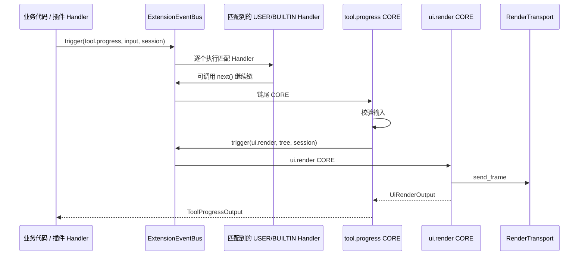

# JiuwenSwarm 新增事件流程指南

## 元信息

| 项 | 内容 |
| --- | --- |
| 类型 | 开发指南 |
| 所属模块 | `jiuwenswarm/extensions_v2/` |
| 适用对象 | 在 JiuwenSwarm 侧新增事件类型、CORE Handler 或前端交互的开发者 |
| 示例事件 | `tool.progress`：工具执行进度，后端触发，渲染到输入框上方槽位 |
| 最近一次修订日期 | 2026-10-22 |

## 1. 先确定事件契约

新增事件前先写清楚六件事，避免实现阶段反复改接口：

| 项 | 示例值 | 约束 |
| --- | --- | --- |
| 事件名 | `tool.progress` | 小写、点分；每段匹配 `[a-z][a-z0-9_]*`；不得以 `ops.` 开头 |
| 触发方 | AgentServer 业务代码、插件 Handler | 前端触发的事件另见第 5 节 |
| 输入类型 | `ToolProgressInput` | 必须是不可变 dataclass；只放本次调用需要的数据 |
| 输出类型 | `ToolProgressOutput` | CORE Handler 的返回值；调用方据此判断结果 |
| CORE Handler | 一个 | 每个事件类型有且只有一个，负责校验与最终动作 |
| Handler 层级 | 插件可登记 `user` / `builtin` | `core` 只能由宿主通过 `register_event_type` 注册 |

事件名、输入和输出建议放在同一个模块，避免定义散落。

## 2. 代码落点

| 文件 | 职责 |
| --- | --- |
| `extensions_v2/events/<name>.py` | 事件名常量、输入输出类型、匹配函数、CORE Handler、注册函数 |
| `extensions_v2/handler_ops/<namespace>.py` | 需要暴露给插件时，注册 Ops 命名空间与方法 |
| `extensions_v2/assembly.py` | 把注册函数组合进 `host_event_types` / `host_handlers` |
| `extensions_v2/webui/models.py` | 复用 `RenderTarget`、`UiRenderInput` 等既有模型 |
| `tests/unit_tests/extensions_v2/` | 事件注册、触发、校验与失败隔离 |

## 3. 示例：`tool.progress`

### 3.1 定义输入输出

```python
# extensions_v2/events/tool_progress.py
from dataclasses import dataclass

TOOL_PROGRESS_EVENT = "tool.progress"


@dataclass(frozen=True, slots=True)
class ToolProgressInput:
    tool_call_id: str
    session_id: str
    slot_id: str
    percent: int
    label: str


@dataclass(frozen=True, slots=True)
class ToolProgressOutput:
    accepted: bool
    status: str
```

输入携带 `session_id` 与 `slot_id`，CORE Handler 不需要从全局状态推断渲染目标。

### 3.2 实现匹配函数

匹配函数只回答“这个 Handler 的 `match_pattern` 是否命中本次输入”，必须同步返回 `bool`：

```python
def match_tool_progress(event_input, match_pattern) -> bool:
    if not isinstance(event_input, ToolProgressInput):
        return False
    for key, expected in match_pattern.items():
        if getattr(event_input, key, None) != expected:
            return False
    return True
```

插件登记 `{"tool_call_id": "call-1"}` 时只接收对应调用的进度；空 pattern 表示全部接收。

### 3.3 实现 CORE Handler

CORE Handler 是链尾，负责校验和最终动作。需要更新界面时，触发已有的 `ui.render`，不要绕过渲染服务直接发消息：

```python
from openjiuwen.core.events import Event, EventHandler, ExtensionEventBus

from jiuwenswarm.extensions_v2.webui.models import RenderNode, RenderTarget, UiRenderInput


def build_tool_progress_core(bus: ExtensionEventBus) -> EventHandler:
    async def core(event, ops, next_handler):
        del next_handler
        request = event.event_input
        if not isinstance(request, ToolProgressInput):
            raise TypeError("tool.progress requires ToolProgressInput")
        if not 0 <= request.percent <= 100:
            return ToolProgressOutput(accepted=False, status="invalid")

        root = RenderNode(
            component="Progress",
            props={"value": request.percent, "label": request.label},
        )
        session = ops.session_context if ops is not None else None
        await bus.trigger(
            Event(
                "ui.render",
                UiRenderInput(
                    target=RenderTarget(
                        session_id=request.session_id,
                        slot_id=request.slot_id,
                        package_id="tool.progress",
                        instance_key=request.tool_call_id,
                    ),
                    root=root,
                ),
            ),
            session,
        )
        return ToolProgressOutput(accepted=True, status="rendered")

    return core
```

`instance_key` 使用 `tool_call_id`，同一工具调用的多次进度会更新同一实例，revision 单调递增；不同调用互不覆盖。

### 3.4 注册事件类型

```python
def register_tool_progress_events(bus: ExtensionEventBus) -> None:
    bus.register_event_type(
        TOOL_PROGRESS_EVENT,
        match_tool_progress,
        build_tool_progress_core(bus),
    )
```

`register_event_type` 同时登记事件类型和唯一 CORE Handler。重复登记同名事件会抛出 `EVENTS_REGISTRATION_INVALID`。

### 3.5 接入装配

`assembly.py` 目前把 `webui.register_event_types` 直接传给 `Registry.init`。新增第二个事件模块后，需要组合成一个宿主注册函数：

```python
def register_host_events(bus):
    webui.register_event_types(bus)
    register_tool_progress_events(bus)


await manager.init(
    bus,
    host_version=_host_version(),
    host_event_types=register_host_events,
    host_handlers=webui.register_handlers,
)
```

顺序要求：先注册事件类型，再由 `Registry.init` 触发一次 `ops.build`。

### 3.6 触发事件

业务代码在会话上下文中触发，调用方只负责构造输入：

```python
from openjiuwen.core.events import Event, SessionContext

await bus.trigger(
    Event(
        "tool.progress",
        ToolProgressInput(
            tool_call_id="call-1",
            session_id=session_id,
            slot_id="conversation.input.above",
            percent=40,
            label="读取文件",
        ),
    ),
    SessionContext(session_id=session_id),
)
```

触发失败不应中断工具主流程；调用方记录错误后继续执行。

### 3.7 如果插件也要触发

在 `handler_ops/` 中新增 BUILTIN Handler，把动词加入 Ops 目录：

```python
def build_tool_ops_build_handler(bus: ExtensionEventBus) -> EventHandler:
    async def tool_progress(ops_view, request: ToolProgressInput):
        return await bus.trigger(Event("tool.progress", request), ops_view.session_context)

    async def build(event, ops, next_handler):
        builder = await next_handler(event)
        builder.add_namespace("tool")
        builder.add_method("tool", "progress", tool_progress)
        return builder

    return build
```

同一个 `ops.build` 事件的多个 BUILTIN Handler 会依次执行；namespace 只能由一个 Handler 创建，重复 `add_namespace` 会失败。插件 Handler 中通过 `await ops.tool.progress(request)` 触发。

### 3.8 测试

最小用例覆盖三件事：注册成功、CORE Handler 收到正确输入、`ui.render` 收到预期目标与树。

```python
async def test_tool_progress_renders_to_target(bus, fake_transport):
    register_tool_progress_events(bus)
    await bus.trigger(Event("ops.build", None))  # 仅限尚未构建的总线

    output = await bus.trigger(Event("tool.progress", ToolProgressInput(...)))

    assert output == ToolProgressOutput(accepted=True, status="rendered")
    assert fake_transport.frames[-1].target.instance_key == "call-1"
```

装配链路上的测试复用 `tests/unit_tests/extensions_v2/management/support.py` 中的 `make_bus()` 与样例包辅助函数。

## 4. 执行顺序



要点：CORE Handler 不在原链路里“继续”，它通过新的 `trigger` 进入另一个事件链；两条链的返回值分别回到各自调用方。

## 5. 事件来自前端时

如果事件由浏览器产生，需要额外完成三处：

| 位置 | 改动 |
| --- | --- |
| `extensions_v2/webui/constants.py` | 把事件名加入 `UPSTREAM_EVENTS` |
| `extensions_v2/webui/adapter.py` | 复用现有 `webui.dispatch` 校验；按需补充 payload 校验 |
| `gateway/channel_manager/web/webui_handlers.py` | 确认 `webui.dispatch` 转发范围覆盖该事件 |

前端调用形状：

```json
{
  "method": "webui.dispatch",
  "params": {
    "event": "ui.press",
    "session_id": "s1",
    "target": {"slot_id": "conversation.input.below", "package_id": "webui.token-weather", "instance_key": "token-weather.summary"},
    "payload": {"action_id": "file.0"}
  }
}
```

上行事件的 CORE Handler 只做活动实例校验并返回回执；真正的业务处理由插件登记的 USER Handler 完成。

## 6. 检查清单

- 事件名合法、全小写、带域前缀，且未与现有事件重名。
- 输入输出是 `frozen=True, slots=True` 的 dataclass。
- 有且只有一个 CORE Handler；插件未登记 `core`。
- 匹配函数同步返回 `bool`，不会访问网络或修改状态。
- Handler 返回可等待对象；异常不会阻断业务主流程。
- 触发前 `ops.build` 已成功（装配路径由 `Registry.init` 保证）。
- 会话与实例标识来自输入或 `ops.session_context`，不读全局变量。
- 更新界面统一走 `ui.render`，不直接调用 WebSocket。
- 单元测试覆盖成功、非法输入和失败隔离。

## 7. 常见错误

| 现象 | 原因 |
| --- | --- |
| `EVENTS_UNKNOWN_EVENT_INVALID` | 触发前未注册事件类型 |
| `EVENTS_REGISTRATION_INVALID: event type is already registered` | 同名事件被两个模块重复注册 |
| `EVENTS_STATE_INVALID: ops.build has not succeeded` | 在装配完成前触发普通事件 |
| `EVENTS_MATCH_INVALID` | 匹配函数抛错或返回非 `bool` |
| `EXTENSION_HANDLER_LEVEL_FORBIDDEN` | 扩展包尝试登记 `core` |
| `EVENTS_OPS_INVALID: duplicate namespace` | 两个 Build Handler 重复声明同一 namespace |
