# JiuwenSwarm Extensions V2 详细架构设计

| 项 | 内容 |
| --- | --- |
| 文档类型 | 设计基线；产品侧实现与未决协议仍待确认和验证 |
| 最近一次修订日期 | 2026-10-22 |
| 维护责任 | Extensions V2 模块维护者；与 agent-core 相关维护者共同确认跨模块约定 |
| 所属模块 | `jiuwenswarm/extensions_v2/` |
| 配套文档 | [设计概览](extensions-v2-overview.md)、[模块维护规范](../../AGENTS.md)、[架构模板](../../../docs/templates/architecture-template.md) |
| 协作模块设计 | agent-core [Events 概览](../../../../../agent-core/openjiuwen/core/events/docs/designs/events-overview.md)、[Events 架构](../../../../../agent-core/openjiuwen/core/events/docs/designs/events-architecture.md)、[Extension 概览](../../../../../agent-core/openjiuwen/core/extension/docs/designs/extension-overview.md)、[Extension 架构](../../../../../agent-core/openjiuwen/core/extension/docs/designs/extension-architecture.md) |

本文承接[设计概览](extensions-v2-overview.md)，解释 JiuwenSwarm 如何把 agent-core 的包管理与事件机制接到具体业务流程：由谁装配和触发，Handler（事件处理函数）如何调用产品能力，业务结果怎样交给UI界面或渠道，以及失败后由谁处理。

**实现状态：** agent-core `core/events/` 已实现 EventBus、Builder、Ops 和执行链；`core/extension/` 已实现 Registry、九类管理事件、manifest、安装目录、依赖排序、Plan、candidate、发布和生效记录。`extensions_v2/` 已实现 Registry 门面、安装存储接入、AgentServer 装配、WebUI 事件与渲染运行时，以及 Token Weather 示例包，并有本地单元验证；重连重发、会话删除清理、真实业务触发、Gateway/WebClient 跨进程联调及产品化 UI 验收仍待开展。本文的产品 API、事件名及状态用于解释目标设计，已实现范围以特性方案和门面规约为准。已有基础见第 3.4 节，开放条件见第 10.1 节。

**依据与分工：** 产品范围由概览维护，事件和扩展的通用机制由 agent-core 文档维护。本文以 Extension 管理入口、EventBus 和 Ops 为集成依赖，重点说明 JiuwenSwarm 在哪里装配、如何开放业务处理点与能力、怎样把扩展结果交给业务和UI界面。公共机制只保留接入所需的约束，其内部模型、调度算法、构建协议和包管理实现通过链接查阅；完整产品字段、代码修改和验证步骤进入后续特性方案（feature），定稿契约进入规约（spec）。参考材料的适用边界见第 12.3 节。

| 阅读目的 | 章节入口 |
| --- | --- |
| 建立整体认识 | 第 1～3 节：定位、核心对象、模块职责与依赖 |
| 理解单个模块如何工作 | 第 4.1～4.6 节：AgentServer 装配、业务适配、WebUI 与传输 |
| 为产品增加扩展入口 | 第 4.2～4.3 节：事件与 Ops 接入；第 11.4～11.5 节：分领域例子 |
| 理解模块如何共同完成工作 | 第 5 节：主流程与协作顺序 |
| 核对共同规则 | 第 6～10 节：完成条件、数据、故障、权限与运行保障 |
| 检查设计及未决问题 | 第 11～12 节：场景、验证责任、取舍与待确认项 |

正文围绕 JiuwenSwarm 的 AgentServer 装配、业务扩展点、能力适配和UI界面交付展开，第 11.1 节集中介绍报告扩展示例及相关异常场景。

## 1. 定位、目标与范围

### 1.1 定位与目标

Extensions V2 将 agent-core 的包管理与事件机制接入 JiuwenSwarm，让扩展在产品开放的处理点参与工作。它负责产品注册、业务扩展点的事件接入和能力提供；工具、会话、UI界面和渠道的实际操作仍由所属服务完成。

接入围绕两种入口展开：**事件决定扩展可以参与哪段处理，Ops（平台能力调用入口）决定处理函数可以调用哪些能力**。架构需要防止新旧入口重复执行默认动作、避免上下文串用，并能分别核对业务与交付结果。

### 1.2 范围与外部责任

本期范围与排除项由[概览第 1.3 节](extensions-v2-overview.md#13-当前范围与后续扩展)统一维护。本架构覆盖 AgentServer 的本地包装配、业务事件与 Ops 接入、WebUI，以及到 Gateway 的受控渠道调用。

Python 扩展在 AgentServer 业务运行时执行，agent-core 管理包与进程内事件，Front、Gateway 和 WebClient 适配跨服务消息。在线管理和迁移按第 10.1 节的条件分别开放。

不同 Harness（智能体执行框架）、同步／异步／流式工具流程及非 Web 渠道逐项接入和验证。一个业务流程完成事件接入，不能证明其他执行路径已支持 V2。

### 1.3 关键要求与对应设计

| 关键要求 | 对应设计 |
| --- | --- |
| 业务逻辑在扩展点触发事件，默认动作有唯一执行位置，能力绑定正确上下文 | 第 4.1～4.3 节装配、事件与能力接入；第 5.2.1 节事件调用 |
| UI界面项发现、挂载、交互和主动下发形成可核对的UI界面链路 | 第 4.4～4.6 节UI界面与传输；第 5.2.2～5.2.3 节协作 |
| 各方能独立确认结果，失败不掩盖已发生事实，退出不释放在用资源 | 第 6～8 节状态、数据与故障；第 5.2.4 节退出 |
| 多会话、多视图和可跳层调用仍保持授权与隔离 | 第 9 节权限及资源规则 |

这些要求对应第 2.2 节的架构规则，验证分工见第 11.2 节。

### 1.4 影响架构选择的因素

本方案复用现有 Python 业务与 Web / E2A 传输，因此扩展在业务运行时内执行，跨进程消息由 AgentServer Front、Gateway 和 WebClient 适配。E2A 是 Gateway 与 AgentServer 间的协议，需要与Web前端请求、响应和事件帧转换。

同一 AgentServer 可服务多个会话，同一UI界面项也可挂载多个视图。这决定了注册在 AgentServer 内共享，而上下文、Ops 和渲染目标须按各自范围绑定。链内顺序不意味着不同会话或工具调用全局串行。

工具可能产生不可逆副作用，页面又可能断线，因此业务结果与展示结果分别确认。性能、容量和退出时限尚无实测数值，待确认责任见第 12.2 节。

## 2. 核心概念与共同规则

### 2.1 核心概念、关系与生命周期

从 JiuwenSwarm 接入角度，需要区分三个范围：**AgentServer 接入哪些扩展、业务在哪里让扩展参与、UI界面内容显示到哪里**。

#### 2.1.1 包与注册：哪些代码可以参与处理

AgentServer 把本地扩展包路径交给 agent-core Registry，读取逐包管理结果（Report），据此决定开放哪些业务与扩展UI界面项。包通过 `manifest.yaml` 声明后端扩展及可选UI界面内容；后端 Handler（事件处理函数）参与产品开放的事件，扩展UI界面项供Web前端发现和挂载。

| 接入对象 | JiuwenSwarm 如何使用 |
| --- | --- |
| Registry / Report | AgentServer 提交宿主登记回调和包来源，核对逐包 Report；只有未取得 Report 等结果未知的情况才查询，不自行维护另一套包实例和注册记录 |
| 产品事件 / Handler | 产品定义可参与的业务事件及其 Core Handler，按需注册 BUILTIN Handler；个人扩展通过包注册 USER Handler |
| 扩展UI界面项 | 扩展提供的面板、卡片等UI界面内容，WebUI 从有效包的UI界面声明中派生可用目录；只有后端逻辑的包无需提供UI界面 |

包加载与注册模型见 [Extension 架构](../../../../../agent-core/openjiuwen/core/extension/docs/designs/extension-architecture.md)。AgentServer 装配与管理接入见第 4.1 节。

#### 2.1.2 事件与 Ops：一次处理怎样执行

JiuwenSwarm 用**事件开放业务处理点，用 Ops 开放产品能力**。业务逻辑在预定的扩展点调用 EventBus 触发事件，传入业务输入，以及根据服务端会话记录构造的 SessionContext。扩展通过 Handler 参与处理；每个事件在 CORE 层注册唯一的 Core Handler，负责该事件的默认动作，按需调用所属业务服务。扩展 Handler 合法短路时，不补执行 Core Handler。Handler 也可通过 Ops 能力函数使用产品服务。

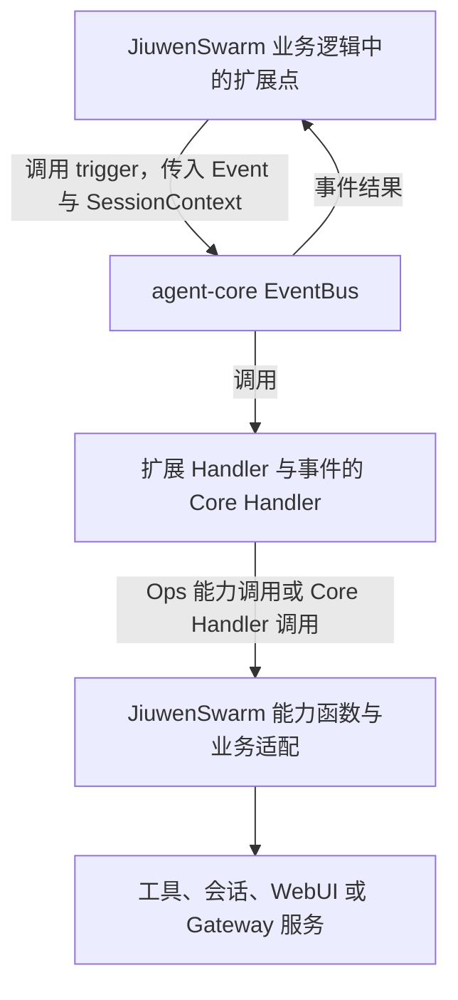

**图 1：事件触发、Handler 执行与产品服务调用**

图中箭头表示调用或结果交接。产品事件、能力函数和实际服务由 JiuwenSwarm 接通，Handler 的匹配、调度及 Ops 绑定复用 agent-core。

| 接入约束 | JiuwenSwarm 的责任 |
| --- | --- |
| Event / SessionContext | 业务逻辑在触发事件前构造 Event，并根据服务端会话记录构造只读 SessionContext；不采信业务载荷自报的会话身份 |
| USER / BUILTIN / CORE | 使用公共处理层级，让 USER Handler、BUILTIN Handler 与事件的 Core Handler 协作；触发事件的业务逻辑须接受合法短路，必要授权不能只放在可跳过的 BUILTIN |
| Ops / Build Handler | 平台通过 `ops.build` 的能力构建处理器（Build Handler）注册产品能力；普通 Handler 使用 agent-core 按次绑定的 Ops，能力函数负责访问服务和检查权限 |
| next / Ops 动词 | 扩展继续当前处理使用 next，申请另一项操作使用 Ops 动词；产品适配须避免默认动作重入或重复执行 |

本文把 `ops.build` 以外的事件和处理器称为普通事件、普通 Handler。事件执行与 Ops 构建协议见 [Events 架构](../../../../../agent-core/openjiuwen/core/events/docs/designs/events-architecture.md)，产品会话准备见第 4.2.3 节，Ops 适配见第 4.3 节，业务调用见第 5.2.1 节。

<a id="213-贡献与视图内容显示到哪里"></a>

<a id="213-界面项与视图内容显示到哪里"></a>

#### 2.1.3 UI界面项与视图：内容显示到哪里

**扩展UI界面项是扩展向 JiuwenSwarm 提供的一项UI界面内容，例如“报告面板”。** 扩展在 `manifest.yaml` 的 `ui` 段声明界面项，字段与 `web.slot.contribution` 的声明同构：`apiVersion` 加 `items`，每项给出类型、标识、目标 slot、排序、面板标题和渲染器，语言资源由同包的 `web.locale` 条目提供；`renderer.kind` 新增 `webui-tree`。用户打开面板后，扩展生成本次显示的 JSON UI界面树，由Web前端渲染。包内可附带静态树模板作为首帧素材；模板仍经同一 Schema 校验和渲染链，包加载本身不创建视图，也不会自动写入 slot。

**视图实例就是Web前端中一次具体打开的面板。** 例如，用户在会话 A 打开“报告面板”时，Web前端会在页面预留的显示区域中创建一个用于显示该面板的对象，文中称为“视图实例”，后文简称“视图”。创建并放入页面的过程称为“挂载”，预留的显示区域称为 slot。同一个报告面板在会话 B 再打开时，会创建另一个视图；每个视图分别维护自己的显示内容、加载状态和交互状态。报告等业务数据仍由所属服务按会话和业务规则保存。

**视图绑定记录是服务端保存的这次面板打开的活跃状态和投递信息。** 首版以渲染目标 `(session_id, slot_id, package_id, instance_key)` 作为记录主键，保存目标、revision 与最近一帧，不额外分配 `viewBindingId`。这条记录用于核对点击来自哪个会话和实例，以及更新应发到哪个视图。文中将它简称为“视图绑定”；当前仍有效的记录称为“活跃绑定”。

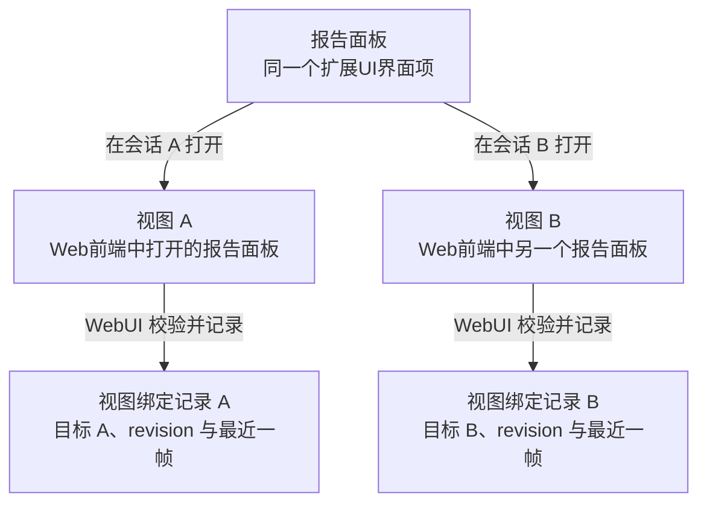

**图 2：UI界面项、视图实例与视图绑定的关系**

图中前两条箭头表示打开面板并创建视图，后两条表示服务端为各视图建立独立记录。用户点击视图 A 的“刷新”时，服务端通过记录 A 核对会话和操作权限；生成报告后，使用同一条记录把更新发回视图 A。视图 B 使用自己的记录，不接收这次只面向视图 A 的更新。同一会话也可能打开多个视图，因此仅有会话 ID 或包 ID 不足以确定更新目标，必须使用完整渲染目标。

视图关闭、会话切换、Web前端断线或包退出时，相关视图绑定失效，后续交互和渲染不能继续使用它。重新打开时按挂载协议建立新的有效关联；重连时由服务端重发各活跃实例最近一帧，不要求扩展重新生成。关闭一个面板不等于卸载报告扩展包。

渲染帧携带目标、数据结构约束（Schema）版本和 JSON UI界面树；服务端分配渲染版本 revision，Web前端核对目标、Schema 和 revision 后应用。revision 在实例内单调递增，实例由会话、slot、包与实例标识共同定位，前端只应用更大的 revision。renderer 指渲染器，action 指树中声明的交互动作，样式 token 指平台预置的样式标识。UI界面项、绑定与渲染的具体规则见第 4.4～4.6 节。

三个范围的生命周期分别管理：

| 范围 | 创建或生效 | 结束及影响 |
| --- | --- | --- |
| 包实例与注册 | agent-core 加载包、创建实例并记录注册 | 卸载遇在途调用或反向依赖立即失败；重载成功后旧快照继续旧代码，对应调用结束后才清理旧模块，见第 5.2.4 节 |
| 一次事件与 Handler 调用 | 业务逻辑准备本次 SessionContext 并触发事件，Events 在每次进入 Handler 前提供独立 Ops 与 next | Ops 只在所属 Handler 调用期间使用，next 在 Handler 退出后失效；事件返回不注销包的注册，也不关闭视图 |
| 一次面板打开及其视图绑定 | Web前端创建用于显示面板的视图实例，AgentServer WebUI 服务校验后保存该视图的归属和投递记录 | 关闭、会话切换、断线或包卸载成功使相关视图绑定失效；关闭一个视图不等于卸载包，重载失败不清空原可用视图 |

同一包可以参与多次事件调用，同一UI界面项可以挂载多个视图；包生效、一次业务完成和一个视图显示成功，需要分别确认。

### 2.2 共同规则索引

EXTV2-A 是本设计的架构规则编号，尚未发布为正式 spec。下表只列结论和主要说明位置。

| 规则 | 负责方及要求 | 不满足时的处理 | 主要说明 |
| --- | --- | --- | --- |
| EXTV2-A01 | AgentServer 在初始化、加载核对后开放对应业务 | 保留失败和残留，限制相关入口 | 第 4.1、6.1 节 |
| EXTV2-A02 | 业务适配为一项默认操作指定唯一执行入口 | 不在事件返回后补跑同一动作 | 第 4.2 节 |
| EXTV2-A03 | 平台注册能力并使用 Events 为当前 Handler 绑定的 Ops，不缓存或跨调用复用 | 构建失败向触发事件的业务逻辑返回错误，不补跑默认动作 | 第 4.3 节 |
| EXTV2-A04 | Handler 与能力提供方区分同链推进和动词新事件 | 非法推进拒绝，新事件保留原授权范围 | 第 5.2.1 节 |
| EXTV2-A05 | 触发事件的业务逻辑、能力函数与 WebUI 使用可信会话、agent-core 包归属及连接记录 | 缺失或不符则拒绝，不采信 payload 自报身份 | 第 7.1、9.1 节 |
| EXTV2-A06 | AgentServer WebUI 服务、Gateway 与Web前端根据当前有效的视图绑定记录核对交互来源和更新目标 | 不把一个视图的交互或更新改交给其他视图 | 第 4.4 节 |
| EXTV2-A07 | AgentServer WebUI 服务与Web前端只让合法、属于当前视图且更新的帧生效 | 拒绝无效树和旧帧，保留有效画面 | 第 4.6、6.2 节 |
| EXTV2-A08 | 管理、业务、传输和Web前端分别确认结果 | 结果未知先核对 | 第 6.3、8 节 |
| EXTV2-A09 | AgentServer 与 agent-core 确认相关使用结束后才释放资源，重载保留旧快照所需模块 | 卸载 BUSY 保持原状；重载失败保留旧 Handler，在用资源不提前释放 | 第 5.2.4 节 |
| EXTV2-A10 | 受控入口和资源服务承担必需授权 | 操作前检查当前权限，拒绝越权 | 第 9.1 节 |

## 3. 架构总览与模块分工

### 3.1 系统与外部的关系

扩展的后端代码在 AgentServer 业务运行时中执行，扩展UI界面由Web前端渲染。下面以“点击报告面板的刷新按钮，再更新面板”为例，分别说明上行和下行：**上行由 WebUI 服务把Web前端请求转换为业务事件；下行由后端触发渲染事件，执行到该事件的 Core Handler 后，再生成发送给Web前端的消息。** 两次事件都在 AgentServer 内通过 EventBus 触发和执行。

两图都按“触发方 → 事件适配 → EventBus → Handler 执行 → 结果返回”展开，并逐跳列出 WebClient、Gateway 和 Front。**实线箭头表示前向调用或消息发送，虚线箭头表示本次调用的结果返回。** 处理链中的 USER / BUILTIN Handler 可按契约继续或短路；实线画出继续到 Core Handler 的分支，虚线也适用于短路后从已进入的 Handler 返回。

**上行：Web前端发出交互请求，AgentServer 触发并执行 UI 事件。**

Web前端交互桥从当前视图取得按钮 action、参数和目标，发送 `webui.dispatch` 请求。采用 WebClient 代理时，请求依次经过 WebClient、Gateway 和 AgentServer Front；Gateway 核对连接身份及目标 AgentServer，Front 将请求和可信连接信息交给业务运行时中的 WebUI 服务。

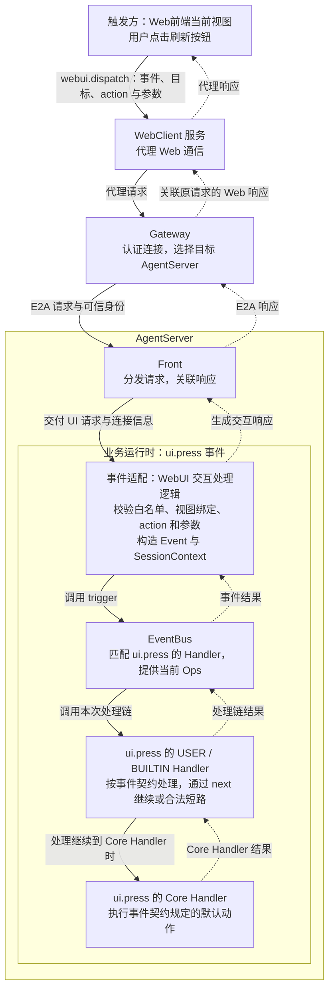

**图 3：Web前端交互上行与 UI 事件处理**

图中的事件触发点是 **WebUI 服务校验请求之后对 EventBus 的调用**。EventBus 调用匹配的 Handler；Handler 可处理业务、通过 next 继续到内层，也可按契约返回短路结果。事件结果回到 WebUI 服务，再经 Front → Gateway → WebClient 作为本次点击的响应返回Web前端。`ui.press` 等事件的输入、返回和 Core Handler 行为仍需在产品事件契约中明确，见第 12.2.2 节“事件与能力”。

**下行：后端触发新的渲染事件，Core Handler 调用 WebUI 服务发送更新。**

上行 Handler 需要更新面板时，在当前有效调用中使用 `ops.ui.render(...)`。JiuwenSwarm 的能力函数核对调用上下文和目标，构造 `ui.render` 事件，并调用 EventBus 触发一条新的 Handler 调用链。该事件使用本次可信 SessionContext，保持原请求授权范围；它和原来的 `ui.press` 是两次独立的事件调用。

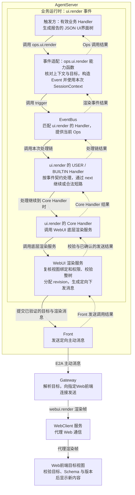

**图 4：后端渲染事件与画面更新下行**

图中的下行事件触发点是 **`ops.ui.render` 能力函数对 EventBus 的调用**；执行到 `ui.render` 的 Core Handler 后，才进入图示的 WebUI 渲染和发送步骤。渲染事件被合法短路时，不补执行 Core Handler，也不能仅凭事件返回就判定画面已发送。服务端发送成功和Web前端显示成功分别确认，见第 6.3 节。

下行图的虚线从 Front 的发送调用结果返回到业务 Handler，只表达 AgentServer 已确认的校验和发送边界。Gateway、WebClient 和Web前端继续处理各自收到的消息；Web前端是否已显示新内容是另一项事实，应用确认协议仍待 WebUI、业务和Web前端共同确定。因此，图中未将Web前端显示完成画成返回给 `ops.ui.render(...)` 的确认。

工具执行完成后主动更新面板，也可以从当次有效业务 Handler 的 `ops.ui.render(...)` 开始；AgentServer 业务逻辑也可在核对上下文和目标后直接触发 `ui.render`。这两种情况复用下行流程，无需先收到Web前端点击请求。交互响应与画面更新分别传输，到达顺序不固定；首次打开面板和交互的完整协作见第 5.2.2～5.2.3 节。

本地包加载由 AgentServer 根据配置提交路径、调用 Extension 管理入口完成，见第 4.1 节。工具、文件和渠道等实际操作仍由所属业务服务完成，跨服务调用按第 4.3.5 节适配。上述图表达目标接入关系；Front 与业务运行时的部署适配仍待确定，见第 12.2.2 节“Front 与运行时”；WebUI 方法和主动消息映射见第 4.5 节。

### 3.2 内部组成与依赖

AgentServer 的扩展接入分为两个阶段：**启动时注册事件、能力和扩展；运行时在业务扩展点触发事件，再调用产品服务。** 下面分别画出两个阶段，图中的逻辑模块不要求部署在独立进程。

两张图按职责分区：黄色表示注册内容，蓝色表示事件处理，紫色表示 Ops，绿色表示 Handler 和产品服务，青绿色表示直接查询，橙色表示触发新事件。**实线表示注册、调用或消息发送，虚线表示结果返回。** 节点文字说明具体职责，颜色作为辅助。

**启动装配：AgentServer 创建 EventBus，把同一实例和产品登记回调交给 `ExtensionManager.init`；门面委托 core `Registry.init` 执行回调并触发一次 `ops.build`，成功返回后再加载扩展包。**

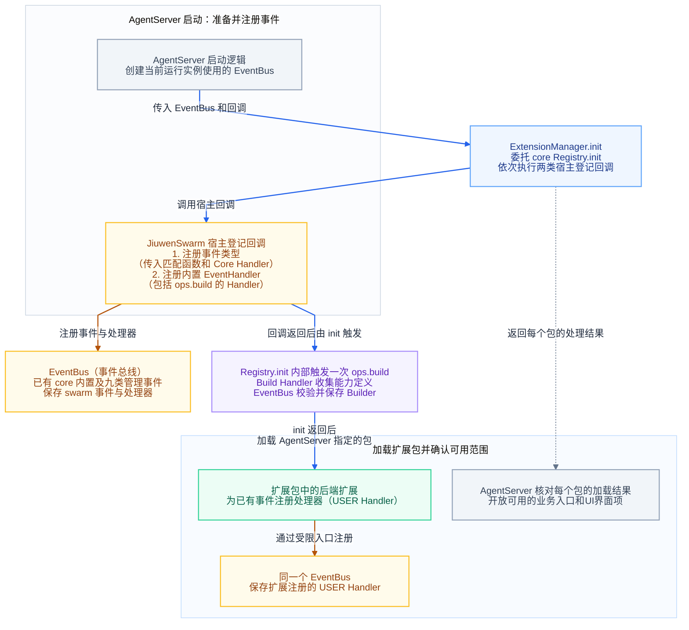

**图 5：AgentServer 启动时的事件注册、能力目录构建与扩展包加载**

按图从上向下阅读：AgentServer 创建 EventBus，其上已经登记 core 内置事件，包括九类包管理事件。AgentServer 将这个实例和产品登记回调交给 `Registry.init`。Registry 先调用事件登记回调，一起登记 swarm 事件、匹配函数和唯一 Core Handler；再调用 Handler 登记回调，登记 BUILTIN Handler 和 `ops.build` 的 BUILTIN Handler。

宿主回调返回后，`Registry.init` 内部触发一次 `ops.build`。Build Handler 收集能力定义，EventBus 保存成功返回的 Builder。门面设置安装目录后返回，AgentServer 再调用 `manager.load_installed()`，由门面选取版本并交给 core 安装。扩展声明的 Handler 由 Extension Runtime 收集并发布到同一个 EventBus，AgentServer 根据逐包 Report 开放对应业务。

图中的两处 EventBus 表示同一个实例：上方用于登记 core 与 swarm 内置内容，下方用于发布扩展包 Handler。产品登记通过管理门面传入 `Registry.init` 的回调完成，AgentServer 不再另外调用登记函数或触发 Build。具体顺序见第 4.1 节。

**运行时协作：业务和UI界面交互触发事件，Handler 通过 Ops 或 Core Handler 调用实际服务。**

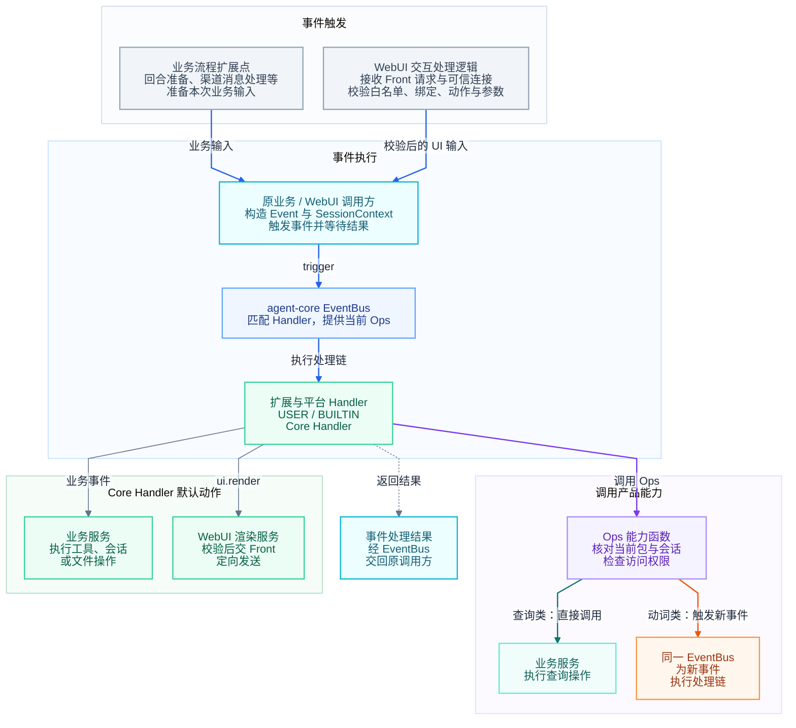

**图 6：运行时事件处理与产品能力调用**

图 6 按“事件触发 → 执行处理链 → 调用产品服务”从上到下阅读。顶部并列展示业务扩展点与 WebUI 交互处理；Front 交付请求与可信连接后，由 WebUI 服务完成校验。两条路径汇合到原业务 / WebUI 调用方，再沿中间的主链触发并执行事件。下方左侧展示 Core Handler 的默认动作，右侧展示 Ops 的查询与新事件调用；虚线指向的“事件处理结果”表示当前处理链结束后，由 EventBus 将结果交回原触发方。底部的“同一 EventBus”是上方实例的重复标注，表示动词类 Ops 仍在该 EventBus 上执行新事件。各环节的职责如下：

1. **触发事件并等待结果。** 业务逻辑在预定扩展点准备业务输入；WebUI 交互处理逻辑在收到 Front 请求后，先校验事件白名单、视图绑定、action 和参数。各触发方随后构造本次 Event，并根据服务端会话记录构造 SessionContext，调用 `EventBus.trigger(...)` 并等待结果。Web前端请求需经 WebUI 适配才能触发进程内事件；返回的事件结果由原业务逻辑或 WebUI 交互处理逻辑按契约使用，Front 只负责协议和连接交接。
2. **执行 Handler。** EventBus 匹配本次处理链，为实际进入的 Handler 提供当前 Ops。Handler 可按契约继续或短路；处理继续到 Core Handler 时，由它执行事件的默认动作。
3. **调用产品能力。** 查询类 Ops 直接访问业务服务；动词类 Ops 触发新事件，回到同一个 EventBus，重新匹配和执行 Handler。`ops.ui.render(...)` 就是后一种情况，最终由 `ui.render` 的 Core Handler 调用 WebUI 渲染服务，再交给 Front 定向发送。完整的前向和返回链路见第 3.1 节。

代码依赖沿 `extensions_v2 → core.extension → core.events`，业务适配也可直接使用 Events 公共入口。agent-core 不反向导入 JiuwenSwarm。

AgentServer 保持 Front 与业务运行时的职责分离：Front 管理协议和连接，Registry、EventBus、Handler 及产品能力适配位于业务运行时。独立进程模式沿现有 Backend 接口交接，具体适配仍需在 AgentServer 接入方案中确定。

### 3.3 各模块负责什么

模块分工围绕三个问题展开：**谁让扩展可用，谁让扩展参与业务，谁把请求和结果交给用户。** 以下按这三个方面归纳逻辑职责，部署位置与依赖方向沿用第 3.2 节。

#### 3.3.1 装配扩展与接入公共机制

AgentServer 组织启动并判断哪些能力可以开放，Extensions V2 装配目录汇总产品注册内容，agent-core 提供包管理和事件执行机制。

| 模块 | 主要职责 | 与其他模块的交接 |
| --- | --- | --- |
| AgentServer 生命周期 | 准备 EventBus、ExtensionManager 和包来源，协调业务准入，跟踪并等待自身业务调用结束 | 将同一 EventBus 和产品登记回调交给门面；初始化返回后调用 `load_installed` 并核对 Report；停止时先收尾业务，再核对包清理结果 |
| Extensions V2 装配目录 | 汇总产品事件、匹配函数、Core Handler、BUILTIN Handler 和 Ops Build Handler | 提供宿主登记回调，由 `ExtensionManager.init` 传给 core Registry；具体定义和实际业务服务由所属模块维护 |
| agent-core Extension / Registry（集成依赖） | 调用宿主回调后触发一次 Build，提供包加载、重载和卸载 | JiuwenSwarm 门面直接持有 Registry；Runtime 核实包信息，发布 Handler 时交给 EventBus 保存；九类管理事件已在 EventBus 构造时登记 |
| agent-core Events / EventBus（集成依赖） | 提供事件注册、触发、Handler 调用以及当前 Ops 的构建与绑定 | JiuwenSwarm 提供事件定义、处理器、能力定义与调用上下文；Events 执行调用链，将结果或异常交回触发方，不负责可信包身份认证或宿主在途调用等待 |

这里的注册使事件和 Handler 可被使用。扩展何时真正参与业务，仍由业务逻辑中的事件触发位置决定。装配方式见第 4.1 节，事件接入见第 4.2 节；公共机制的内部设计由 agent-core 文档维护。

#### 3.3.2 触发业务事件与调用产品能力

各业务模块维护自己的事件契约、平台 Handler 和实际服务。**业务逻辑触发事件，Handler 参与处理，Ops 能力函数连接产品能力，所属服务完成实际操作。** WebUI 服务承担其中与UI界面有关的业务适配。

| 模块或角色 | 主要职责 | 与其他模块的交接 |
| --- | --- | --- |
| 业务逻辑中的扩展点 | 核对原请求授权，准备 Event 和可信 SessionContext，调用 EventBus 并等待、使用合法结果 | 把预定处理点开放给 Handler；默认动作交给事件的 Core Handler 调用服务执行，原业务逻辑按事件契约使用结果 |
| 平台 Build Handler | 在能力构建时向本次 Builder 补充产品能力定义 | 通过宿主 Handler 回调登记；`Registry.init` 在回调返回后触发一次 `ops.build`，Events 调用处理器添加所属模块的能力函数 |
| Ops 能力函数 | 读取当前包和会话绑定，校验参数、目标与权限，转换调用结果和错误 | 查询类方法直接访问服务；动词类方法触发新事件，处理继续到该事件的 Core Handler 时，再调用服务或受控代理 |
| 所属业务服务 | 执行工具、会话、文件等实际操作，维护业务状态和结果，承担资源权限检查与业务幂等 | 由 Core Handler 或查询类 Ops 调用；实际操作是否完成，以服务记录或外部回执为准 |
| AgentServer WebUI 服务 | 从有效包派生可用UI界面目录，维护视图绑定；校验交互输入、渲染树和目标，管理服务端 revision | 上行接收 Front 请求，校验后触发 UI 事件；下行由 `ui.render` 的 Core Handler 调用，校验后交 Front 定向发送 |
| 个人扩展 | 经受限入口为已有事件注册 USER Handler，维护自身业务状态，按需生成UI界面树并清理自建资源 | 在当前 Handler 中通过 next 继续处理或合法返回，通过当前 Ops 使用开放能力；UI界面树经 WebUI 服务校验后发送 |

Build Handler 负责提供能力定义，Ops 能力函数在被调用时才访问服务或触发事件。事件处理可以在进入 Core Handler 前合法短路；触发方接受相应结果，不补执行默认动作。能力接入见第 4.3 节，业务协作见第 5.2.1 节。

#### 3.3.3 传输消息与呈现UI界面

Front、Gateway 和 WebClient 负责请求、响应及主动消息的交接；V2 事件及其 Python Handler 在 AgentServer 业务运行时执行。Web前端负责把经过校验的内容显示在具体视图中。

| 模块 | 主要职责 | 与其他模块的交接 |
| --- | --- | --- |
| AgentServer Front | 管理与 Gateway 的连接、E2A 协议处理、请求分发、响应关联和主动消息发送 | 将请求及可信连接信息交给业务运行时；将运行时的响应和主动事件分别交回 Gateway |
| Gateway | 认证连接，检查方法范围，选择目标 AgentServer，关联响应并定向下发 | 与 Front 通过 E2A 交接，与对应渠道完成协议映射；按已核实目标选择连接或渠道实例，业务权限仍由业务入口和实际服务检查 |
| ChannelManager 与渠道适配器 | 在 Gateway 中管理渠道实例、配置、连接和监听任务；由适配器对接外部平台收发并释放自有资源 | 上行消息经 Gateway 路由至 AgentServer；下行接收已授权的渠道动作，返回能够确认的操作结果；客户端和凭据保留在 Gateway |
| WebClient 服务 | 提供静态资源，代理 WebSocket / API 通信 | 在采用 WebClient 代理的链路中，转发Web前端与 Gateway 之间的请求、响应和主动消息，保留协议内容与请求关联 |
| Web前端通信模块 | 管理请求等待、响应关联、主动消息订阅和断线处理 | 经配置的网络入口发送请求，将响应、事件帧和通信错误交给UI界面模块 |
| Web前端UI界面模块 | 筛选UI界面项与兼容 slot，创建和关闭视图，校验绑定、Schema 与 revision，渲染树并采集用户动作 | 通过通信模块提交挂载和交互请求、接收画面更新；仅使用平台支持的组件、动作和样式 |

服务端的视图绑定记录由 AgentServer WebUI 服务维护，Web前端维护本地视图和已显示内容。交互响应与渲染推送独立传输；事件返回、消息发送完成和页面已更新分别确认，完成依据见第 6.3 节。WebUI 与传输设计见第 4.4～4.6 节，Gateway 渠道接入另见第 4.3.5 节及第 12.2.2 节“Gateway 事件与 Channel 能力”。

#### 3.3.4 接通各模块需要满足什么

上述分工要形成可用链路，还需逐项核对交接条件：

- **装配完成：** AgentServer 将同一 EventBus 与产品登记回调传给 `Registry.init`；回调登记和内部 Build 全部成功后才加载包，失败时核对本次登记与资源清理。
- **扩展可用：** AgentServer 能核对可信包归属、实际生效与残留；开放卸载或重载前，还需接通使用结束与清理确认。
- **业务接通：** 选定业务流程在预定扩展点触发事件、保留授权并使用处理结果，所需 Core Handler 与 Ops 已连接实际服务。
- **消息可达：** 传输链保留可信身份和请求关联，按连接或渠道实例定向发送；需要主动更新的链路另有独立下行入口。
- **UI界面兼容：** AgentServer WebUI 服务与Web前端对UI界面项、视图绑定、Schema、版本和动作的解释一致。

各条件按能力范围分别验证；没有UI界面的业务无需等待 WebUI 接通，非 Web 渠道按自身协议核对。条件缺失时限制对应能力，开放条件见第 10.1 节，验证分工见第 11.2 节。

### 3.4 已有基础与接入缺口

下表说明哪些现有代码可以作为接入基础，以及 V2 还缺什么。业务准入指 AgentServer 核对依赖后，决定哪些请求可以开始处理；旧机制具备相似能力，不代表 V2 链路已经接通。

| 现有依据 | 可复用内容 | 待建设或核对事项 |
| --- | --- | --- |
| [Worker 生命周期](../../../server/worker/lifecycle.py)、[Gateway 启动](../../../gateway/app_gateway.py) | 旧扩展启停入口，Worker 排除传输扩展 | V2 管理入口所在运行时、新旧入口选择与就绪条件；保留 Gateway 传输职责 |
| [旧管理器](../../../extensions/manager.py)、[加载器](../../../extensions/loader.py)、[公开导出](../../../extensions/__init__.py) | 发现、加载和 SDK 类型的核对入口 | `extension.yaml`、`register_extensions`、旧依赖安装与 V2 的差异 |
| [旧注册表](../../../extensions/registry.py) | AsyncCallbackFramework 调用关系 | 在 V2 业务扩展点调用 EventBus，并替换对应 Callback 触发，避免双重执行 |
| [会话管理](../../../server/runtime/session/session_manager.py)、[元数据](../../../server/runtime/session/session_metadata.py) | 会话资料和任务生命周期 | cwd 来源、只读投影、取消、切换与并发验证 |
| [Web 服务](../../../channels/web/app_web.py)、[Web前端通信](../../../channels/web/frontend/src/services/webClient.ts) | 静态资源、代理、请求关联和订阅 | V2 消息、认证、断线与未完成请求处理 |
| [WebChannel](../../../gateway/channel_manager/web/web_connect.py)、[E2A 代理](../../../gateway/routing/e2a_proxy.py)、[路由绑定](../../../gateway/routing/route_binding.py) | 方法注册、定向发送和实例路由 | `webui.*` 方法范围、可信身份与目标映射 |
| [BaseChannel](../../../gateway/channel_manager/base.py)、[ChannelManager](../../../gateway/channel_manager/channel_manager.py)、[Telegram 示例](../../../gateway/channel_manager/im_platforms/telegram/telegram_connect.py) | 渠道实现、实例注册、收发和配置回调 | 新 Channel 在 Gateway 中的装配、精确路由及 V2 能力接入；不是现成的 V2 Channel 包 SDK |
| [Front 协议](../../../server/front/protocol.py)、[EventForwarder](../../../server/front/event_forwarder.py)、[AgentServer 客户端](../../../gateway/routing/agent_client.py) | 连接发送入口与独立主动推送接收路径 | WebUI 请求分发、E2A 事件转换和运行时准入 |
| [旧应用插件声明解析](../../../channels/web/frontend/src/applicationPlugins/manifest.ts)、[呈现入口](../../../channels/web/frontend/src/applicationPlugins/ApplicationPluginOutlet.tsx) | bundled / iframe / none 解析与展示 | V2 UI界面项、`webui-tree`、绑定、Schema 和交互；不默认沿用旧 `/api/application-plugins` 格式 |
| [渠道配置](../../../resources/config.yaml)、[路由键与地址](../../../gateway/routing/keys.py)、[分发](../../../gateway/routing/session_sharing.py)、[IM 入站](../../../gateway/im_pipeline/im_inbound.py)与[出站](../../../gateway/im_pipeline/im_outbound.py) | 配置模板、消息归一化与渠道寻址 | 新渠道配置由 Gateway 的 `_apply_channel_config` 等入口装配；同时核对 ChannelType 消费方及地址解析 |
| agent-core [Events 公开导出](../../../../../agent-core/openjiuwen/core/events/__init__.py)、[Protocol](../../../../../agent-core/openjiuwen/core/events/protocol.py)、[契约测试](../../../../../agent-core/tests/unit_tests/core/events/test_events_contract.py)及 Events / Extension 设计 | Events 的 EventBus、Builder、Ops 和执行链已实现；Extension 控制面已实现 manifest、安装目录、依赖排序、Plan、candidate 和生效记录 | Registry、管理事件、candidate 发布及跨仓集成；`ui` 段由 JiuwenSwarm 从包根原始 manifest 读取 |
| V2 [包管理门面](../../management/registry.py)、[安装目录配置](../../config.py)、[装配入口](../../assembly.py) | 安装、启动加载、卸载、重载、查询与停机；宿主事件注册、失败副本补偿和停机编排 | 跨进程安装目录串行化、重连重发与真实业务触发 |

现有 Channel 接入还需注意：`register_channel` 注册实例并接入默认入站；自定义入站使用 `register_channel_with_inbound`，外部已完成接线时可用 `register_external_channel`。这些入口不替代认证、启动、去重或关闭资源；同键注册存在覆盖行为。`BaseChannel.send` 也没有统一投递回执模型，正常返回不能证明平台已接受或用户已读。Gateway Ops 的跨进程适配要求见第 4.3.5 节。

## 4. 关键模块设计

本节按接入工作的依赖顺序展开：先装配扩展运行环境，再接通业务事件与 Ops，最后说明UI界面服务、消息传输和Web前端。每个主题集中说明它的定义、注册、调用及边界，跨模块的完整协作顺序见第 5 节。

| 要解决的问题 | 章节 |
| --- | --- |
| AgentServer 启动时如何注册产品内容、加载和管理扩展包 | 第 4.1 节 |
| 业务在哪里触发事件，传入什么上下文，怎样使用结果 | 第 4.2 节 |
| Handler 怎样通过 Ops 使用产品能力和实际服务 | 第 4.3 节 |
| 服务端怎样管理UI界面项、视图绑定和渲染输出 | 第 4.4 节 |
| 请求、响应和主动更新怎样跨服务交接 | 第 4.5 节 |
| Web前端怎样挂载视图、校验画面和上报交互 | 第 4.6 节 |

### 4.1 AgentServer 装配与管理接入

AgentServer 负责创建当前运行实例所需的 EventBus 和 Extension 管理入口，并根据初始化、包加载和退出的实际结果控制业务准入。管理入口是 JiuwenSwarm 对 agent-core `Registry` 的门面，调用方只依赖门面方法。产品注册、包加载和在线管理分别说明如下。

<a id="411-装配方式与配置来源"></a>

#### 4.1.1 启动装配与产品注册

**AgentServer 提供 EventBus 和登记回调，管理门面委托 Registry 按固定顺序完成初始化。**

1. AgentServer 创建 EventBus。core 内置事件及九类管理事件在这一步登记，swarm 不重复登记。
2. AgentServer 将同一 EventBus、`host_event_types` 和 `host_handlers` 交给 `ExtensionManager.init`，门面原样传给 `Registry.init`。回调由 swarm 提供，core 不导入 swarm。
3. Registry 先调用事件回调，登记 swarm 事件、匹配函数和唯一 Core Handler；再调用 Handler 回调，登记 BUILTIN Handler 及 Ops Build Handler。
4. 回调返回后，Registry 触发一次 `ops.build`。Build Handler 添加能力定义，EventBus 保存成功返回的 Builder。
5. core 初始化成功后，门面设置安装目录并返回；AgentServer 再调用 `load_installed` 加载包，不再触发 Build。

下面保留管理门面和 WebUIRuntime 的装配关系；完整导入与新增事件的接入示例见[内置事件开发模板](builtin-event-development-guide.md#22-启动时登记事件handler-和-ops-能力)。

```python
from openjiuwen.core.events import ExtensionEventBus

from jiuwenswarm.extensions_v2 import bootstrap

# AgentServer prepares Events infrastructure for this runtime.
bus = ExtensionEventBus()

# The facade delegates to agent-core Registry; host callbacks run inside init.
manager = ExtensionManager(resolve_install_dir())
webui = WebUIRuntime(
    bus=bus,
    transport=transport,
    catalog=WebUICatalogService(manager.active_packages),
)
await manager.init(
    bus,
    host_version=host_version,
    host_event_types=lambda bus: bootstrap.register_event_types(bus, webui),
    host_handlers=lambda bus: bootstrap.register_handlers(bus, webui),
)

# Registry.init has already triggered ops.build once.
report = await manager.load_installed()
```

`Registry.init` 不读用户 manifest、不安装包；门面随后调用 `open_install_dir` 记住目录，再由 `load_installed` 完成启动加载。首次 Build 成功后不能再次 Build 或增删 Build Handler；Builder 没有额外的冻结 API，普通事件只用已保存的 Builder 创建独立 Ops。

代码按四类职责组织：`bootstrap.py` 汇总宿主登记，由 AgentServer 装配通过两类回调调用；`event_types/` 提供事件定义、匹配函数和 Core Handler；`event_handlers/` 提供 JiuwenSwarm 的 BUILTIN Handler，目录已预留、当前无实现；`handler_ops/` 提供能力函数及 Ops Build Handler。依赖 WebUI 运行时的 Core Handler 归 `webui/core_handlers/`。目录与写法见[内置事件开发模板](builtin-event-development-guide.md)。

**初始化失败时禁用本次扩展装配。** 回调或 Build 失败时不加载包；当前 `install_extensions` 记录错误并返回 `None`，聊天服务可继续启动。重建前核对本次已登记内容和自有资源，不清空 core 内置事件，也不在残留的产品登记上重复初始化。接口和 Build 时机见 core [Registry 规约](../../../../../agent-core/openjiuwen/core/extension/docs/specs/S_02_registry-and-bus.md#2-registry)。

#### 4.1.2 包来源配置与加载准入

AgentServer 使用 `resolve_install_dir()` 解析 `extensions.install_dir`、环境变量或默认目录 `~/.jiuwenswarm/extension_pkgs`，创建管理门面。门面在 core `Registry.init` 成功后调用 `open_install_dir`；随后 AgentServer 调用 `manager.load_installed()`，由门面选择已安装版本并交给 core 安装。启动不再扫描或自动安装 `examples/`。外部安装请求只接受 ZIP 文件的绝对路径，在请求入口拒绝目录，再通过同一门面安装；安装目录中的解压副本仍由启动加载和热重载使用。来源解析、声明校验、依赖排序和计划执行归 agent-core。

| 配置主题 | 当前要求 | 待确定的来源与启动规则 |
| --- | --- | --- |
| 路径 | 使用 `extensions.install_dir`，缺省为 `~/.jiuwenswarm/extension_pkgs`；相对路径以用户工作区为基准，由 swarm 解析后交给 core | 产品配置入口的覆盖关系和部署适配需结合调用方核对 |
| 重复与冲突 | 同批重复包 ID 整批失败；已生效 ID 再安装则拒绝，不覆盖 | 同一来源被重复提交前可做路径去重；不能改变 core 的 ID 冲突规则 |
| 启动失败 | 保留逐包失败、依赖跳过和残留 | 必需 / 可选包、整服务失败或局部降级 |
| 生效时机 | 配置对应当前 Registry，修改配置不自动重载 | 在线加载入口及配置更新何时应用 |

AgentServer 核对管理入口返回的逐包结果与实际生效、残留后，再开放相应业务和UI界面项。初始化完成、包加载完成与具体能力可用分别确认，完成依据见第 6.3 节，开放条件见第 10.1 节。

<a id="412-管理入口与资源责任"></a>

#### 4.1.3 管理入口与资源责任

运行中的后端通过 `extensions.v2.query/install/uninstall/reload` 管理 V2 包。Gateway 只转发，AgentServer 的管理适配器调用已装配的唯一 `ExtensionManager`；与旧 `extensions.*` 分开。协议见 [S_02](../specs/S_02_backend-package-management.md)，入口与验证见 [F_09](../features/F_09_backend-management-requests.md)。

门面串行执行根写操作，查询不占写锁，包退出通知在锁外执行。取得失败 Report 就按报告处理；只有未取得 Report 时才查询，不重放原操作或另发回滚。失败核对见 [F_10](../features/F_10_management-failure-recovery.md)。串行与取消见 [F_11](../features/F_11_management-serialization.md)。

AgentServer 通过 Registry 便捷方法或受控事件请求包管理，按公共接口提交操作并读取结果。公共入口见[Extension 第 4.1 节](../../../../../agent-core/openjiuwen/core/extension/docs/designs/extension-architecture.md#41-registry统一管理入口)。

AgentServer 检查管理权限，关联本次根操作，并核对逐包 Report 与查询记录。管理超时或异常后的查询和重试规则统一见第 8 节。EventBus 的创建和最终释放、Registry 的生命周期由 AgentServer 协调；包实例与包注册资源由 agent-core 管理，业务服务与连接池仍由原模块管理。释放 EventBus 和业务资源前须确认相关调用与清理结束，具体顺序见第 5.2.4 节。

<a id="42-事件目录与业务扩展点接入"></a>

<a id="48-新增-jiuwenswarm-事件类型"></a>

<a id="42-事件目录与真实业务适配"></a>

### 4.2 业务事件定义与扩展点接入

新增事件类型，是为产品建立一个具有明确业务含义的扩展参与点。产品先定义并注册事件，再在具体业务流程的预定扩展点调用 EventBus 触发该事件，让已注册的 Handler 参与处理。给已有事件增加 Handler 或 action，只是在使用该类型。

<a id="421-事件目录组织"></a>

#### 4.2.1 事件类型与注册归属

本节只说明事件定义与注册的职责归属。JiuwenSwarm 具体提供哪些事件类型，以及各类型的标识、业务含义、输入输出和触发场景，由对应的特性设计文档定义，本架构暂不列出事件类型清单。

各业务模块提供事件定义及其处理器，Extensions V2 将它们汇总到 `host_event_types` 和 `host_handlers`，由 `Registry.init` 依次调用，登记到同一个 EventBus。agent-core 已定义的事件沿用其公共入口；用户包只声明已有事件的 Handler，Runtime 在发布时补入包信息。

注册与业务触发分别接通：仅注册事件和 Handler 不会自动让扩展参与业务，业务逻辑仍须在预定扩展点调用 EventBus。特性设计需要明确的事件契约见第 4.2.2 节，接入步骤见第 4.2.4 节；相关特性设计文档建立后，在此补充引用，已确认的接口和约束由所属规约维护。

<a id="481-新事件需要定义什么"></a>

#### 4.2.2 事件契约

| 设计项 | 必须明确的内容 |
| --- | --- |
| 类型身份与含义 | 由哪个业务模块维护，表达一次操作还是通知，与已有事件的区别 |
| 输入和输出 | 数据约束、是否允许 None、成功与拒绝、错误及结果未知的含义 |
| 匹配规则 | 由平台提供 MatchPatternFunc，规定合法模式和不可在同链修改的匹配字段；匹配不能承担资源授权 |
| 唯一 Core Handler | 在 CORE 层注册唯一处理器，负责事件的默认动作。无匹配的 USER / BUILTIN Handler 时，由它提供默认处理；有前序 Handler 时，处理继续到它才执行。通知事件也需明确其返回值，不借用业务执行成功含义 |
| 触发位置和上下文 | 在哪个业务流程、哪一步触发事件，业务输入和服务端会话记录从哪里取得；无会话时明确允许空上下文，不伪造会话 |
| 控制与执行责任 | 允许怎样修改输入、继续或短路；必需授权和生命周期检查仍由不可绕过的入口及实际服务完成 |

#### 4.2.3 触发前的会话与授权

**会话资料在业务逻辑触发事件前准备，Ops 按 Handler 构建。** 业务逻辑从服务端会话记录生成只读 SessionContext；无法确认 cwd（工作目录）时保留缺失，不回退到进程目录。同一链使用同一份会话资料，但各 Handler 的 Ops 绑定自己的包信息。平台直接注册的 Core Handler 或 BUILTIN Handler 可没有所属包，授权仍按第 9.1 节检查。

| 工作 | 产品侧处理与交接 |
| --- | --- |
| 适配会话 | 业务逻辑在触发事件前从会话管理器构造 SessionContext，并保留原请求授权；无会话的业务场景按事件契约处理 |

原请求授权和 SessionContext 分别保留：SessionContext 提供本次调用需要的会话资料，授权范围仍由可信请求和实际资源权限确定。当前 Handler 的包归属由 agent-core 提供，产品事件输入不能覆盖它，检查位置见第 9.1 节。

<a id="482-从定义到真正生效"></a>

#### 4.2.4 从注册到业务调用

1. **判断是否需要新类型。** 先检查现有类型能否表达该业务；不为每个按钮、渠道实例或 Handler 复制事件。
2. **实现并注册定义。** 产品模块落实第 4.2.2 节契约，在宿主事件登记回调中调用 `register_event_type(event_type, match_pattern_func, core_handler)`，一起登记类型、匹配函数和唯一 Core Handler。普通 Handler 登记不能新增 Core Handler 或覆盖同名类型。
3. **注册参与者。** 平台按需增加 BUILTIN；用户包经 Extension 的受限入口注册 USER，由 agent-core 记录可信包归属。包所需产品类型应先就绪，缺失则明确失败；单包卸载只清理自身 Handler，不删除平台类型。
4. **在业务扩展点触发事件。** 在回合准备、UI 交互或渠道消息处理等 JiuwenSwarm 业务逻辑的预定位置，根据业务输入构造 Event，并根据服务端会话记录构造 SessionContext；调用 `EventBus.trigger(...)`，等待并使用合法结果。明确默认动作改由事件的 Core Handler 执行后的旧路径替换关系，避免原动作执行两次。
5. **验证处理分支。** 检查无扩展默认行为、匹配、继续／短路／跳层、输出校验、异常与取消，再逐业务流程确认事件触发位置与支持范围。

事件公共接口与类型标识以 [Events 公共契约](../../../../../agent-core/openjiuwen/core/events/docs/specs/S_01_events-contract.md)为准；业务模型由 JiuwenSwarm 维护，agent-core 不反向导入产品类型。

<a id="422-工具接入与执行边界"></a>

<a id="425-工具流程的接入边界"></a>

#### 4.2.5 业务事件与实际操作的执行边界

JiuwenSwarm 的回合准备、UI 交互、渠道消息处理等流程在预定扩展点触发产品事件，实际操作仍由所属业务服务完成。触发点、Core Handler 和底层服务需要明确分工：

1. 原业务流程检查请求授权，准备业务输入与可信 SessionContext，调用 EventBus 触发相应事件并等待结果。
2. 处理链继续到事件的 Core Handler 时，由它调用底层服务；该服务不再触发当前处理的同一个事件。
3. 原业务流程按事件契约使用最终结果；已经交给 Core Handler 的默认动作，不再由原路径重复执行。Handler 合法短路时，也不补跑默认动作。

事件类型及用于匹配的业务标识在当前链中固定。其他参数能否修改、短路结果是否有效，由对应产品事件的契约规定。需要发起另一项操作时使用 Ops 动词，同链推进规则见第 5.2.1 节。

不同 Harness、同步／异步／流式执行路径及渠道入口可能经过不同函数，必须逐业务流程验证触发位置。底层服务具有 `stream()` 不代表相应 V2 事件已定义流式契约。迁移时为每项动作指定唯一的事件触发位置，避免旧 Callback 与 V2 同时执行。

<a id="483-三个业务领域的触发与交接"></a>

#### 4.2.6 各业务领域的触发入口

事件在 AgentServer 业务运行时执行，各领域的差别主要在触发来源：

- **AgentServer：** 所选 Harness、会话或任务处理逻辑在预定扩展点调用 EventBus 触发事件，事件的 Core Handler 调用业务服务；同步、异步和流式语义逐流程确认。
- **WebUI：** AgentServer WebUI 服务接收经 `webui.dispatch` 传递的Web前端交互，校验事件白名单、参数与绑定后，在交互处理逻辑中调用 EventBus 触发 UI 事件；后端 Ops 能力函数也可触发相应UI界面事件。Web前端支持必须同时接通，未知事件拒绝。
- **Gateway：** 上行渠道消息经可信路由到达 AgentServer 后，由消息处理逻辑构造并触发相应事件；下行操作在发送业务逻辑或 Ops 能力函数中触发事件，事件的 Core Handler 经代理调用 Gateway 渠道并关联回传结果。服务位置见第 4.3.5 节。

Gateway 无需另建 V2 EventBus。[GatewayHookEvents](../../../extensions/hook_event.py)、[旧消息 Hook](../../../gateway/message_handler/message_handler.py)和 ChannelManager 的 `ChannelEvent` 需逐项映射，不能按同名直接视为新事件。握手、认证和必要路由校验仍由本地服务保证；无业务会话的通知应另定目标与上下文。

业务逻辑主动触发的事件与 Ops 动词触发的事件可复用同一类型，二者不要求一一对应。继续当前处理用 next，申请另一项操作才发起新事件；分领域例子见第 11.5 节。

<a id="43-会话适配与-ops-能力提供"></a>

<a id="47-将-jiuwenswarm-能力开放为新的-ops"></a>

### 4.3 Ops 能力注册与服务适配

开放一个 Ops 方法，需要产品能力函数、平台能力注册和底层服务三者接通。能力注册与构建接入见第 4.3.2 节；服务位于 AgentServer、WebUI 还是 Gateway，决定能力函数如何到达实际服务。

<a id="471-能力函数build-handler-与业务-handler-的分工"></a>

#### 4.3.1 能力函数、Build Handler 与业务 Handler 的分工

这三类函数在不同时间工作：**能力函数实现操作，Build Handler 注册能力，业务 Handler 使用能力**。

| 角色 | 负责什么 |
| --- | --- |
| 产品能力函数 | 使用当前 Ops 的可信绑定校验参数和授权，调用服务或发起事件，转换结果与错误；不向扩展暴露客户端和凭据 |
| 平台 Build Handler | 通过宿主 Handler 回调登记；`Registry.init` 触发 Build 后，由 Events 调用并向本次 Builder 补充能力定义 |
| 扩展业务 Handler | 包加载后注册为 USER，在业务调用中通过自己的 Ops 使用能力、处理结果与失败 |

agent-core Extension Runtime 负责核实包身份，Events 负责按注册记录和本次 SessionContext 构建独立 Ops。`Runtime.publish` 在登记每条声明时写入 `PackageMetadata(package_id, version, root)`；Events 不从 EventInput 或 SessionContext 推断包身份。扩展的受限注册入口只收集 Handler 声明，不接收包身份。依据见[Events 公共契约第 1.1、4.4 节](../../../../../agent-core/openjiuwen/core/events/docs/specs/S_01_events-contract.md#11-责任范围)。

上述身份适配是基础业务接入的必要前提。JiuwenSwarm 的能力函数使用当前 Ops 中的包信息检查授权，接入验证需证明其与本次 Handler 的归属一致；不从 Event 或 SessionContext 自报字段补造身份。用户包增加 manifest 字段或自行注册 USER，都不能替代平台能力注册。

#### 4.3.2 能力注册与构建接入

JiuwenSwarm 在接入侧完成会话适配、能力注册和服务连接三项工作。会话资料在触发前准备，见第 4.2.3 节；本节说明能力注册和服务连接：

| 工作 | 产品侧处理与交接 |
| --- | --- |
| 注册能力 | `Registry.init` 调用宿主 Handler 登记回调，将各领域 Build Handler 登记到同一 EventBus 的 `ops.build` |
| 构建能力目录 | `Registry.init` 在宿主回调返回后触发一次 `ops.build`；各 Build Handler 向同一个 Builder 添加 namespace / method，EventBus 保存结果；不执行实际业务操作 |
| 连接服务 | 能力函数在普通 Handler 调用 Ops 时读取当前可信绑定，执行目标校验和授权，再访问业务服务或受控代理 |

能力目录构建成功后，Events 使用已保存的 Builder 为每个实际进入的普通 Handler 创建独立 Ops。普通事件不再触发 Build；Ops 创建失败按调用失败处理，不绕过事件直接执行业务。构建和绑定遵循 [Events 公共契约](../../../../../agent-core/openjiuwen/core/events/docs/specs/S_01_events-contract.md)。连接池等共享资源由平台独立管理，不在每次创建 Ops 时重复创建。

产品统一分配命名空间，建议一个 Build Handler 负责一个完整 namespace，新增方法归入原主责处理器，避免命名冲突。共享服务的并发安全由提供方负责。

<a id="472-新增-ops-的通用步骤"></a>

#### 4.3.3 开放 Ops 的通用步骤

1. **确定契约与调用方式。** 分配 namespace 和方法名，明确输入输出、必需上下文、允许主体、错误、取消语义及资源所有者。名词方法直接读取或计算；动词方法发起业务事件，已有类型能表达操作时复用它，否则按第 4.2 节增加类型。
2. **实现能力函数。** 从当前 Ops 读取包与会话，按原请求及当前权限核对目标，再访问本地服务或受控代理。缺失上下文、无权限与服务不可用分别返回可识别错误，不通过全局“当前会话”传递身份。
3. **注册并构建能力。** Build Handler 通过 `add_namespace`、`add_method` 向同一个 Builder 添加能力函数。已有 namespace 增加方法时修改原主责处理器；新 Build Handler 纳入宿主 Handler 登记回调，由 `Registry.init` 执行登记后触发 Build。首次 Build 成功后不再修改能力目录或增删 Build Handler。
4. **验证真实调用。** 从普通 Handler 使用新方法，检查合法结果、上下文缺失、授权拒绝、命名冲突、并发和退出失效；涉及共享服务或跨进程调用时，同时验证其生命周期与结果交接。

Builder 与能力函数绑定关系以 [Events 公共契约第 4.6 节](../../../../../agent-core/openjiuwen/core/events/docs/specs/S_01_events-contract.md#46-builder-与-ops)为准。core 已提供相关实现，swarm 负责注入产品服务并验证真实调用。

#### 4.3.4 调用方式与 Ops 有效期

能力函数在被普通 Handler 调用时使用当前绑定。下表列出产品侧的能力示意；方法名、缺失值与支持范围仍按所属契约确认。

| 能力示意 | 提供方与语义 |
| --- | --- |
| `await ops.session.id()` / `cwd()` | 会话适配；直接读取绑定资料，无上下文和目录缺失分别处理 |
| `await ops.channel.send(request)` | Gateway 渠道适配；在 AgentServer 触发产品事件，保持或收紧原授权，处理继续到 Core Handler 时再经受控代理调用渠道；候选设计见第 11.4.3 节 |
| `await ops.ui.render(...)` | WebUI 适配；发起新渲染事件，需要明确且获准的活跃目标 |
| 工作区、配置与 AgentServer 运行信息 | 所属能力方按可见范围提供，首版方法及命名空间（namespace）待定 |

扩展不能把 Ops、代理、绑定方法和 next 缓存到实例供后续调用。辅助任务须在 Handler 退出前结束并清理；后续主动更新从新的可信事件或当次有效 Handler 发起。能力函数发起新事件时保留原请求授权边界，按入口规则重新校验会话；需要更新 cwd 时回到可信会话来源核对。

<a id="473-三个业务领域的底层适配"></a>

#### 4.3.5 各业务领域的服务适配

查询类能力可以直接访问对应服务。下表中的动作路径描述事件处理继续到 Core Handler 的情况；前序 Handler 合法短路时，调用方按事件契约使用相应结果。

| 领域 | 到达实际服务的路径 | 必要适配 |
| --- | --- | --- |
| AgentServer | 能力函数访问当前运行时服务；动词经事件的 Core Handler 调用底层业务 | 服务注入、可信上下文和授权；Core Handler 不回到会重触发自身事件的入口 |
| WebUI | 查询读取视图记录；动作经事件的 Core Handler 调用 WebUI，再经传输到Web前端 | 活跃绑定、Schema、消息映射和Web前端支持；仅增加后端方法不能完成呈现 |
| Gateway | Ops 和事件仍在 AgentServer，事件的 Core Handler 经受控代理到 Gateway，由白名单动作调用渠道 | 请求关联、身份与目标映射、结果回传、取消与超时；Ops、Builder 和平台客户端不跨进程传递 |

Gateway 代理须明确“业务操作 → 网络动作 → 本地服务”的映射。目标需包含实际寻址所需的渠道、应用、用户、会话及平台地址，单个 channel_id 不足以选择实例。操作完成、平台接受和用户已读采用第 6.3 节的不同确认口径。

新增 Channel 或组件时，先补实际服务、配置、依赖、启停与兼容，再开放所需 Ops。渠道连接、监听任务和凭据由 Gateway管理；提供方声明、受控工厂、冲突处理及自动包加载协议仍待渠道接入方案确定。接入例子见第 11.4 节。

### 4.4 AgentServer WebUI 服务

WebUI 服务由 `extensions_v2/webui/` 提供，运行在 AgentServer 进程内，连接业务运行时与Web前端：先确认哪些UI界面项可用、每个视图属于谁，再分别处理交互输入和渲染输出。

<a id="441-贡献目录与视图绑定"></a>

<a id="441-可用界面目录与视图绑定"></a>

#### 4.4.1 可用UI界面目录与视图绑定

AgentServer WebUI 服务分别管理“用户可以打开哪些UI界面项”和“已打开的每个视图属于谁、更新应发到哪里”。

- **可用UI界面目录**从已生效且可访问的包派生，提供UI界面项标识、slot、展示和 renderer／Schema 信息。声明读取 `manifest.yaml` 的 `ui` 段，字段与 `web.slot.contribution` 的 `UiEntryDeclaration` 同构：`apiVersion`、`items[].type`、`id`、`slot`、`order`、`panel`、`localeId`、`renderer`，以及 `web.locale` 条目的 `resources`；`renderer.kind` 新增 `webui-tree`，前端需支持该渲染模式；同一类型与 `id` 的组合在包内唯一。磁盘文件存在不代表UI界面项可用。

包加载只更新可用目录，不自动挂载视图；没有有效视图绑定时不发送渲染帧。包内静态树模板可用于挂载后的首帧，仍按同一 Schema 校验，不能绕过白名单或视图绑定。

  ```yaml
  ui:
    apiVersion: 1
    items:
      - type: web.locale
        id: report-messages
        resources:
          zh: frontend/locales/zh.json
          en: frontend/locales/en.json
      - type: web.slot.contribution
        id: report-panel
        slot: conversation.panel.right
        order: 20
        panel:
          titleKey: report.title
        renderer:
          kind: webui-tree
          schemaVersion: 1
        localeId: report-messages
  ```

  声明校验由 JiuwenSwarm 完成：`apiVersion` 必须为 1，`type` 只接受 `web.slot.contribution` 与 `web.locale`，`slot` 必须在平台槽位白名单内，`order` 必须是安全整数，`localeId` 必须引用同包的 `web.locale` 条目，资源路径不得逃逸包根，首版 `renderer.kind` 只接受 `webui-tree`。agent-core 只解析 manifest 的已知字段；JiuwenSwarm 从生效记录的包根读取原始 `manifest.yaml` 校验 `ui` 段，不依赖 agent-core 返回该段。`web.locale` 资源由服务端从包内读取，按请求方语言解析为标题等文本后再下发，前端不拼接包内文件地址；语言来源与回退顺序在 UI 界面项规约中确定。

- **视图绑定记录**在用户打开面板、服务端校验挂载请求后按渲染目标建立，保存渲染目标 `(session_id, slot_id, package_id, instance_key)`、当前投递连接、revision 和最近一帧。服务端收到交互时用它核对来源和归属，发送更新时用它定位具体视图；记录必须仍然有效，并通过当前权限检查。一个会话打开两个面板视图时目标不同，分别保存两条记录，不能只凭包 ID 或会话 ID 选目标。

首版不额外分配 `viewBindingId`。挂载响应只确认 `ui.ready` 已受理，不携带视图标识；首帧携带完整渲染目标，Web前端收到首帧后按目标创建或更新本地视图。响应与首帧独立传输，先后到达都不影响关联。上行交互携带同一目标，服务端以该目标是否有活跃记录判断来源，记录不存在或已清理时拒绝。知道目标不等于拥有操作权限，权限检查见第 9.1 节。

#### 4.4.2 UI 输入与渲染输出

WebUI 服务同时适配交互输入和渲染输出，两条路径分别校验：

| 路径 | 输入与处理 | 输出 |
| --- | --- | --- |
| 交互上行 | 核对渲染目标对应的活跃记录、允许事件、action 和参数，从服务端准备会话 | 普通 UI 事件及其合法结果；`webui.dispatch` 不开放 `ops.build`、包管理或其他未获准的业务事件 |
| 渲染下行 | `ui.render` 的 Core Handler 调用底层服务，核对授权和目标、校验 Schema 与整树 | 校验通过后分配 revision，交传输发送；无目标不发送，无效树不替换有效画面 |

异步等待后，发送前仍须复核目标有效性。下行交接顺序见第 5.2.3 节，完成依据见第 6.3 节。

绑定失效由 AgentServer WebUI 服务根据连接、会话与包的生命周期维护，不能依赖扩展一定继续到 `ui.unmount` 的 Core Handler。退出范围与顺序见第 5.2.4 节。

### 4.5 Gateway、WebClient 与 Front 传输适配

本节负责进程内业务调用与网络消息之间的交接。业务事件在 AgentServer 内执行，传输组件负责保留身份、目标、请求关联和消息含义。

#### 4.5.1 消息类型与协议边界

Web前端沿用 `req / res / event` 帧，上行目标 method 为 `webui.dispatch`，参数表达 `event + target + payload`；下行为 `webui.render`、`webui.render.clear` 和 `webui.render.error`。这些是目标协议名称，完整字段待定稿。

#### 4.5.2 请求、响应与主动更新的交接

| 交接边界 | 保留或转换什么 | 失败由谁处理 |
| --- | --- | --- |
| Web前端 → WebClient → Gateway | 方法、请求 ID、目标和参数，按现有认证约定传递连接信息 | 代理 / Gateway 返回可关联错误，Web前端处理待响应请求 |
| Gateway → Front → 业务运行时 | Gateway 校验方法白名单、选择实例并转换为 E2A；Front 将可信身份、原请求关联与 UI 参数交给业务运行时 | Gateway / Front 拒绝未知方法或不可用运行时 |
| 运行时 → Front → Gateway | 已验证目标、事件类别、版本和载荷，经独立主动推送路径传输 | 记录真实发送边界，不依赖一次性 RPC |
| Gateway → 指定连接 → Web前端 | 转换为对应渲染、清除或错误事件，保留目标 | 目标断开则停止，不回退为同会话广播 |
| 业务响应 → 原请求 | 事件结果或错误与原请求 ID | 与主动帧分别处理，不依赖到达先后 |

#### 4.5.3 准入、兼容与非 Web 渠道

除方法注册外，还须接通 E2A 表示、Front 分发、运行时准入、响应转换和主动事件映射。现有 `server_ready` 仅说明 Front 传输连接就绪，不能替代业务运行时和扩展能力就绪。

WebClient 服务提供静态资源和代理；Web前端的 `webClient.ts` 管理请求和订阅。统一方法可承载新增的允许 UI 事件，新增动作类型或协议版本仍需核对各端兼容。非 Web Channel 须另定下行事件、允许动作、目标授权和投递回执，不能将任意事件映射为任意 Channel 方法。

<a id="46-react-slot树渲染与交互桥"></a>

### 4.6 Web前端 slot、树渲染与交互桥

Web前端按服务端提供的UI界面项和视图绑定工作，负责本地视图的创建、显示、交互与释放。

#### 4.6.1 视图挂载与退出

Web前端先筛选可用的UI界面项，在用户打开面板时创建视图实例，并将它放入兼容的页面预留区域（slot）；随后接收 JSON UI界面树，更新这个视图的内容，并上报用户操作。关闭面板时，Web前端释放该视图及其消息订阅。`webui-tree` 是目标 renderer，支持哪些组件和 slot，仍需在 UI界面项与渲染交互规约中确定。

#### 4.6.2 树校验与画面更新

Web前端在修改画面前整体校验 Schema、当前绑定与 revision；无效树不部分应用。内容只能选择平台白名单组件、props、action 和样式 token，不允许自由 CSS、HTML 或包提供的 JavaScript。富文本也须规定链接、内嵌 HTML 和外部资源规则。

首版候选采用完整树替换，便于校验与重连。参考方案的 `append` 尚需基准版本、合并与缺帧规则，不能视为已支持。多个UI界面项的选择与排序、静态树模板与清除 / 错误的处理统一进入 WebUI 规约。

#### 4.6.3 交互上报与失败反馈

交互桥从有效树提取声明的动作和参数，带当前目标发送；服务端仍独立校验。Web前端可以显示处理中或结果未知，但无业务幂等依据时不自动重发。

## 5. 模块协作与处理流程

### 5.1 从启动加载到业务交付的主流程

下表串起一次工作的完整路径，具体交互在第 5.2 节展开。没有 WebUI 的业务在取得业务结果后即可结束。

| 阶段 | 负责方与交接结果 | 详细说明 |
| --- | --- | --- |
| 装配 | AgentServer 将 EventBus 和产品登记回调交给 `Registry.init`；Registry 执行回调后触发一次 Build，成功返回后才进入包加载 | 第 4.1 节 |
| 加载 | AgentServer 提交本地包路径，agent-core 经管理事件返回逐包 Report；核对后开放对应业务和UI界面项 | 第 4.1、6.1 节 |
| 执行业务 | 业务逻辑在预定扩展点调用 EventBus 触发事件，传入 Event 与 SessionContext；扩展参与调用链，调用链进入事件的 Core Handler 时执行底层业务，结果返回触发事件的业务逻辑 | 第 5.2.1 节 |
| 展示与交互 | Web前端发现UI界面项并申请绑定；扩展生成树，经定向发送后由Web前端应用 | 第 5.2.2～5.2.3 节 |
| 退出 | 关闭视图，或由 AgentServer 协调包注册撤销、等待使用结束和资源清理 | 第 5.2.4 节 |

AgentServer 根据管理结果决定准入与后续操作；触发事件的业务逻辑则按事件契约使用返回值，接受在进入 Core Handler 前合法短路的结果。各阶段的失败责任见第 8 节。

### 5.2 关键协作机制

<a id="521-运行时匹配逐-handler-构建与嵌套调用"></a>

<a id="521-真实业务触发扩展参与与结果交回"></a>

#### 5.2.1 业务逻辑触发事件、扩展参与与结果交回

以 AgentServer 的回合准备流程为例，说明 JiuwenSwarm 如何在产品业务中接入事件。这里只描述触发、执行和结果交接；候选场景见第 11.5.1 节，具体类型与字段由对应特性设计文档定义。

1. **触发业务事件。** 选定 Harness 的回合处理逻辑在进入准备步骤时核对原请求授权，取得目标 Agent、准备参数和请求关联，根据服务端会话记录构造 SessionContext；调用 `EventBus.trigger(...)` 触发回合准备事件并等待结果。
2. **扩展参与。** EventBus 调用匹配的 Handler 并提供当前 Ops。扩展可加工允许修改的准备参数、通过 next 继续，或按产品契约返回合法短路结果。
3. **执行默认准备。** 处理继续到该事件的 Core Handler 时，由它调用底层准备服务。服务在操作前检查当前资源权限并记录实际结果；该底层函数不再触发同一个准备事件，也不代替原业务逻辑执行整个回合。
4. **调用其他能力。** 扩展需要生成报告或更新视图时，使用 `ops.ui.render(...)` 等能力。能力函数核对目标后发起新的渲染事件，处理继续到 `ui.render` 的 Core Handler 时，再调用 WebUI 服务校验并交传输下发。新事件沿用原请求授权范围，实际操作前仍检查当前权限。
5. **交回结果。** 原回合处理逻辑按契约使用准备结果或处理异常，再决定是否继续后续业务。合法短路不补跑默认准备；准备已完成而后续加工或渲染失败时，按第 8.2 节核对实际结果，不能直接重复执行。

下图以一个匹配的扩展 Handler 为例，展示默认准备、合法短路，以及取得准备结果后调用渲染能力的顺序：

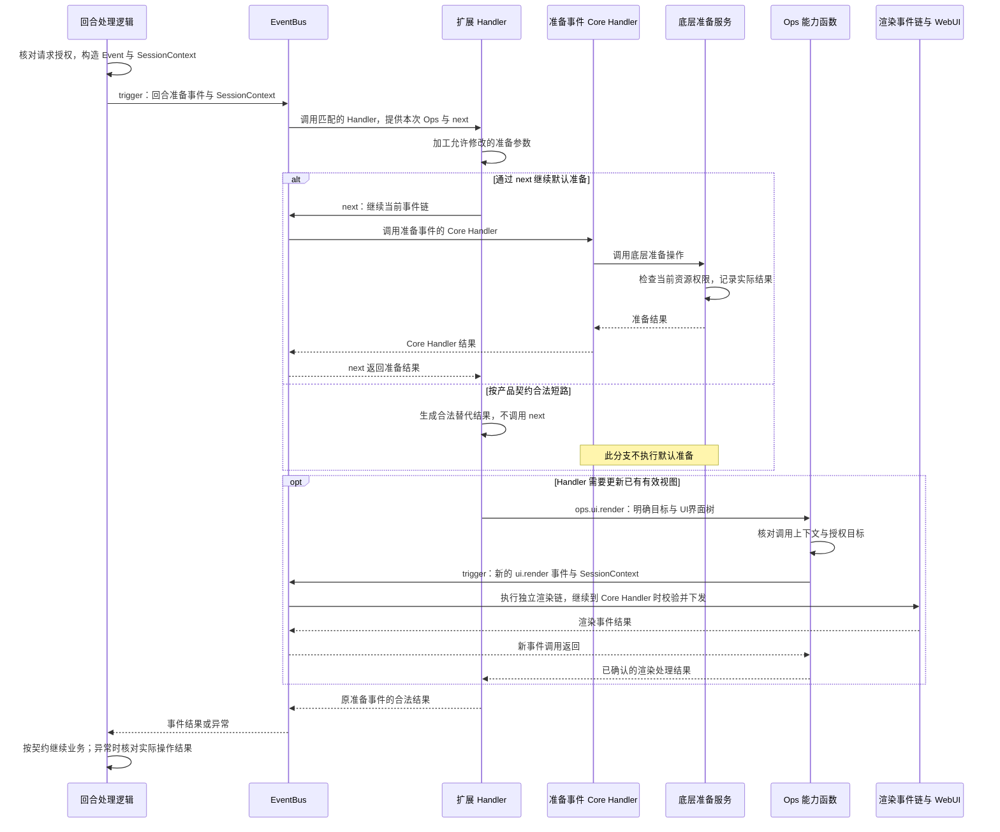

**图 7：业务事件触发、默认准备与 Ops 新事件调用时序**

实线表示调用，虚线表示结果沿等待链返回。图中省略其他匹配的 USER / BUILTIN Handler；next 继续原事件链，Ops 动词通过同一个 EventBus 发起新事件。渲染事件链包括自己的 Handler 和 WebUI 校验发送，具体下行步骤见第 5.2.3 节；图中返回的渲染结果不代表Web前端已显示。准备已完成而后续处理失败时，按第 8.2 节核对结果。

Handler 层级、匹配、next 推进和 Ops 构建遵循 [Events 架构](../../../../../agent-core/openjiuwen/core/events/docs/designs/events-architecture.md)。JiuwenSwarm 在接入时必须落实：匹配字段固定、返回值合法、默认动作由事件唯一的 Core Handler 承担、必需授权不可绕过，以及 Ops 不跨调用保存。

同会话的多个事件不自动排队，业务状态、外部操作和UI界面更新的并发由所属模块协调。嵌套、递归与并发限额见第 9.3 节。

<a id="522-贡献发现首次挂载与首次渲染"></a>

<a id="522-界面项发现首次挂载与首次渲染"></a>

#### 5.2.2 UI界面项发现、首次挂载与首次渲染

以用户打开“报告面板”为例，在页面支持相应 slot，且传输、扩展包和 WebUI 就绪后：

1. Web前端查询当前用户有权使用的UI界面项，确认报告面板与页面的 slot、renderer 和 Schema 兼容。
2. Web前端先订阅渲染、清除和错误消息，为这次打开创建本地视图实例并显示加载状态，再发送拟议 `ui.ready` 挂载请求。挂载请求只带会话与槽位，不等待服务端分配视图标识。
3. AgentServer WebUI 服务核对连接、会话权限、包、UI界面项和 slot，按渲染目标保存这次打开的活跃记录，构造 SessionContext，再调用 EventBus 触发挂载事件。
4. UI界面事件 Handler 根据已核实的会话和视图生成报告内容，经 `ops.ui.render(...)` 提交首棵完整树；`ui.render` 的 Core Handler 校验并交传输发送。
5. Web前端收到首帧后，按帧中的完整渲染目标把首帧关联到这次创建的视图，通过目标、Schema 与版本校验后显示报告。

下图展示发现、挂载和首帧交付的正常流程。为突出首次打开的协作顺序，将 WebClient、Gateway 和 Front 合并为传输链路；各模块的认证、路由和转换职责仍按第 4.5 节执行。

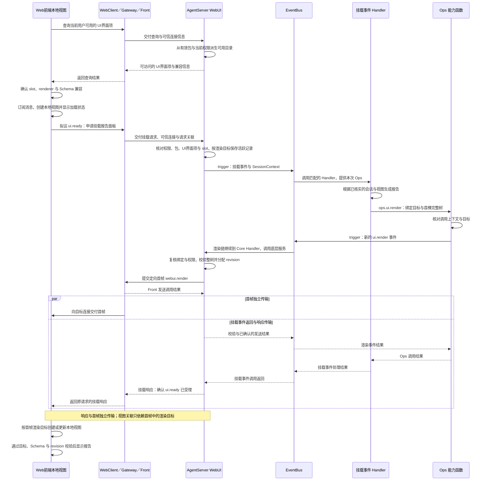

**图 8：UI界面项发现、首次挂载与首帧交付时序**

实线表示调用或消息发送，虚线表示调用结果返回。图中画出挂载 Handler 生成首帧、渲染链继续到 Core Handler 的分支；服务端先建立按渲染目标索引的活跃记录，再触发挂载事件。首帧和挂载响应独立传输，服务端的发送结果不能代替Web前端显示完成的确认。

挂载响应与首帧独立传输：响应只确认 `ui.ready` 已受理，首帧携带完整目标，Web前端按目标创建或更新视图，因此不依赖两者到达顺序，也不需要暂存关联。挂载响应丢失时可重新发送 `ui.ready`；服务端对同一目标重复挂载只做幂等确认，不创建新视图。

服务端已保存活跃记录，但首帧生成或发送失败时，面板仍可能没有内容，Web前端应显示空态或错误态。重新获取报告画面前，先确认该渲染目标仍有活跃记录。

#### 5.2.3 交互上行与后端主动更新

有效视图产生交互时，Gateway 与 Front 完成上行消息的认证、路由和适配，AgentServer WebUI 服务校验绑定、动作与参数后，在交互处理逻辑中调用 EventBus 触发相应 UI 事件。该事件的 Handler 需要更新画面时，调用 `ops.ui.render(...)`，由能力函数通过 EventBus 触发另一条渲染事件链；执行到 `ui.render` 的 Core Handler 后，WebUI 服务校验并发送画面。下图以 `ui.press` 和 `ui.render` 两次事件调用说明这一过程：

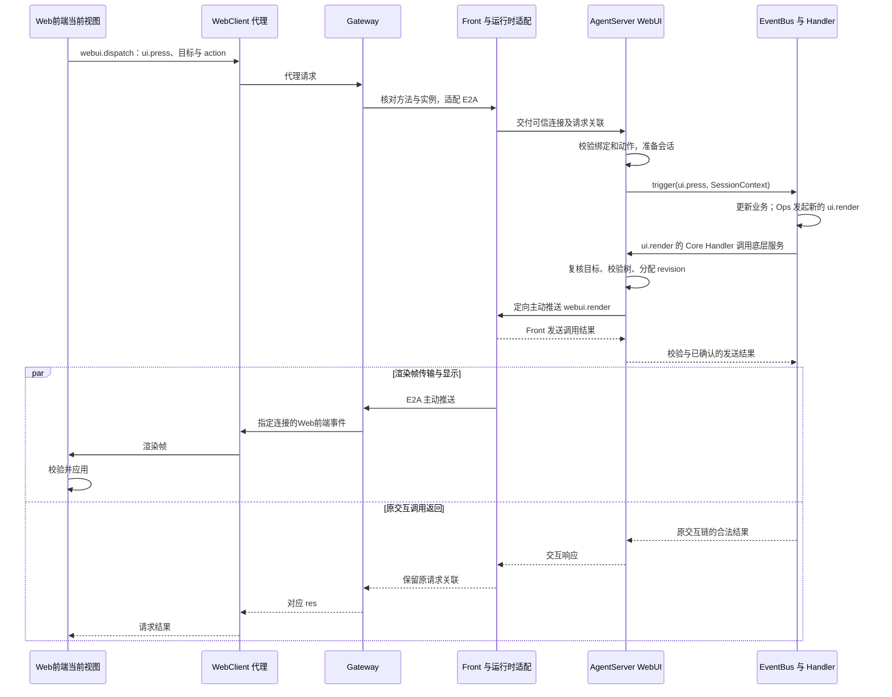

**图 9：交互上行、画面推送与响应返回时序**

实线表示调用或消息发送，虚线表示调用结果返回。图中画出渲染链继续到 Core Handler 的分支；响应和推送用并行分支表示独立传输，Web前端不依赖固定到达顺序。接收标记（如 `accepted`）只表示接收，不能代替事件完成；渲染链也可能短路，其返回仍须按实际发送记录核对。

后端主动更新复用图 9 中 `ui.render` 事件及后续的校验、发送和结果返回流程。有效业务 Handler 通过 `ops.ui.render(...)` 触发新事件，能力函数先核对上下文与目标并保留原请求授权范围；AgentServer 业务逻辑也可在预定扩展点完成这些检查后直接触发渲染事件。这类更新无需等待中的聊天或交互请求，也没有图中的上行交互和对应响应；渲染结果交回实际调用方。应用确认协议仍待确定，调用返回不能证明Web前端已显示。

多个视图需要更新时，AgentServer WebUI 服务按授权选择明确的目标集合，逐目标处理并记录结果；失效目标不由其他绑定补位。目标失效或校验失败时拒绝发送，并向调用方返回可核对的失败。

视图在计算或发送等待期间关闭，服务端停止后续发送；已在途帧由Web前端按旧绑定拒绝。业务成功而发送失败的处置见第 8.2 节。

#### 5.2.4 视图退出、包卸载、重载与 AgentServer 停止

关闭视图、卸载包和重载包是三种不同操作。关闭面板只结束该视图；重载使用 core 的 Handler 热切换，不先卸载。

| 触发情况 | 协作顺序与范围 |
| --- | --- |
| 关闭视图 / 会话切换 | Web前端释放订阅与实例；WebUI 服务使对应绑定失效，包注册不变 |
| Web前端断线 | Gateway、Front 将断线信息交给 WebUI，使旧连接的绑定失效，不依赖前端退出通知 |
| 包卸载 | 通过管理门面委托 Registry 检查反向依赖和在途调用；被依赖或仍有调用时立即 FAILED，原注册和目录不变。成功卸载后，swarm 失效相关绑定并定向 clear |
| 包重载 | 依赖检查通过后准备完整新 candidate，成功后一次替换该包 Handler；失败保留旧 Handler。新 trigger 使用新代码，切换前的旧快照继续旧代码 |
| AgentServer 停止 | 停止外部新业务和管理请求，等待已接收业务及辅助任务退出，再核对包清理，最后关闭共享服务和传输 |

**卸载被拒绝时保留原可用视图。** swarm 可以在管理期间暂时限制新交互，但不能在取得 BUSY 或依赖拒绝之前就清空视图。收到失败 Report 后按原因处理；调用结束后可由操作者重新请求卸载。core 不等待在途调用，也不把本次拒绝变成后台卸载任务。

**重载失败不影响旧 Handler。** 新代码先收集到 candidate，业务暂时看不到；全部成功后同步切换。旧快照继续持有旧 Handler 和模块，相关调用结束后才清理旧模块，重载返回不等待这一步。开始重载时不先失效旧绑定；失败保留原可用视图。成功切换后是否需要重新挂载，按 WebUI 版本兼容规则处理，不能仅凭同一个包 ID 就认定新旧画面兼容。

上述 BUSY 规则是 core 契约；当前 swarm 的在途计数接入尚未完成，不能据此认定已能识别全部产品业务调用。

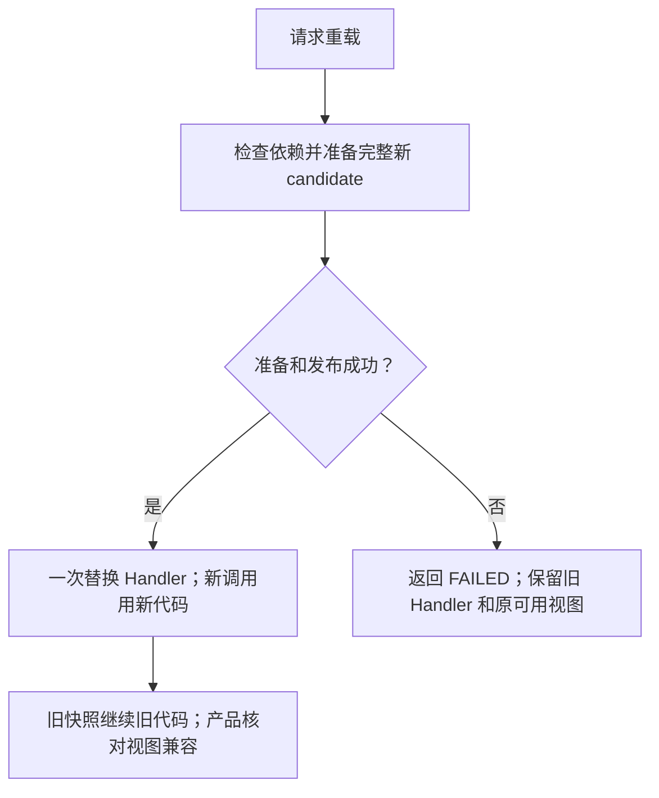

**图 10：单包重载的成功与失败处理**

图中箭头表示管理步骤。重载只切换 Handler，不回滚外部业务操作，也不自动迁移扩展全局状态、Gateway 连接或前端视图。包管理契约见 core [Registry 与 Bus 规约](../../../../../agent-core/openjiuwen/core/extension/docs/specs/S_02_registry-and-bus.md)。

停机时由 AgentServer 跟踪并等待自身业务调用和辅助任务。Events 注销只影响后续调用，不提供 drain 或停机等待接口。超时后即使请求取消，也要等调用实际退出后才释放在用资源；必要子操作、clear 和收尾传输在此期间保留。只有没有取得 Report、结果未知时才查询生效记录，不假定存在通用续清理 API。

## 6. 状态、事件与完成条件

### 6.1 状态分类与转换

以下为解释性逻辑状态，不要求新增枚举或第二套 AgentServer 状态机。

| 状态类别 | 管理者与变化依据 |
| --- | --- |
| AgentServer 装配中 / 对应能力可用 / 停止中 / 已结束 | AgentServer 核对 Registry、能力目录构建、业务和传输依赖；只开放满足条件的入口 |
| 包准备 / 生效 / 清理中 / 失败且有残留 | agent-core 生效及清理记录，经 Report / 查询交接 |
| 事件准备 / 执行 / 返回、异常或取消 | Events 管理当前调用，按第 6.3 节解释返回 |
| UI界面项可见 / 隐藏或不可用 | WebUI 根据包状态和权限派生，可见仅表示允许尝试挂载 |
| 面板打开中 / 视图绑定有效 / 已失效 | Web前端维护本次打开的视图实例；AgentServer WebUI 服务维护归属和投递记录，通过挂载协议将两者对应起来 |
| 树校验 / 帧发送 / 本地应用结果 | WebUI、传输与Web前端分别确认 |

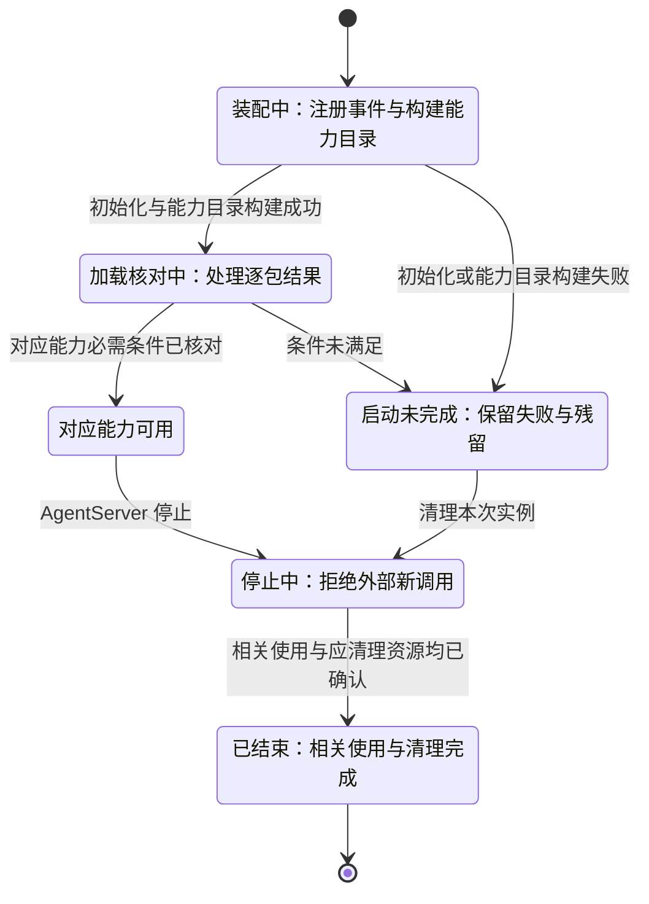

**图 11：AgentServer 扩展相关准入状态转换**

图只表示扩展相关准入。局部失败时开放哪些业务，仍需在来源与启动规则中确定；停止超时不能直接进入“已结束”。视图关闭、断线、撤权、会话切换和包卸载成功均使相应绑定失效；重载失败保留原可用绑定，重连处理见第 8.3 节。

### 6.2 事件传递、顺序与流量控制

顺序分为两个范围：事件链按第 5.2.1 节推进、反向返回；UI界面帧按当前绑定与版本决定能否应用。不同事件的开始、结束及外部操作完成没有全局顺序，Events 不提供持久队列或自动重试。

请求 ID 关联响应，E2A 标识关联跨跳请求，传输 `seq` 表示协议顺序，revision 表示渲染版本。它们各有用途，不能相互替代，也不能自动防止重复业务操作。

| 情况 | 处理原则与负责方 |
| --- | --- |
| 重复请求、取消与完成竞争 | 业务方按实际记录核对，安全重试条件见第 8.2 节 |
| 乱序、旧绑定或过期帧 | Web前端按当前绑定和版本拒绝；clear / error 同样遵守顺序与失效规则 |
| 帧缺失 | 重连后由服务端重发最近一帧，不补执行历史交互 |
| 并发生成树 | 业务与 WebUI 共同判断状态新旧，不能仅因计算晚结束、revision 更大就覆盖较新的业务状态 |
| Web前端慢或发送积压 | WebUI 与传输限制待发送量和等待时间，反馈可核对失败 |

revision 在实例内单调递增，跨包排序由前端槽位模式处理；并发业务状态、clear / error 与 render 的相对顺序仍需明确。参考方案的简化版本键不能直接采用。完整替换帧可研究合并尚未发送的更新，但必须保留清除、错误和业务结果语义；增量片段不能任意丢弃。限额与拒绝规则见第 9.3 节，待确认内容见第 12.2.2 节“容量与观测”。

### 6.3 完成与结果交接

本表是各流程和场景统一采用的完成口径。

| 确认点 | 谁依据什么确认 | 不能据此推断什么 |
| --- | --- | --- |
| 初始化完成 | 管理门面委托 `Registry.init` 完成宿主登记和内部 Build，随后设置安装目录并返回 | 用户包已生效、具体业务及传输能力均可用 |
| 能力目录构建成功 | `Registry.init` 内部触发 Build，EventBus 保存成功结果 | 具体业务已获授权、对应服务可用或用户包已生效 |
| 包安装成功 | AgentServer 核对 agent-core 生效记录与逐包 Report | Handler 已在真实业务中执行 |
| Handler 可进入 | Events 完整构建并绑定 Ops | 能力已获授权、外部服务可用 |
| 事件正常返回 | 调用方取得合法输出或允许的 None | Core Handler 已执行、工具成功或帧已发送 |
| 工具实际完成 | 业务服务操作结果、系统记录或外部回执 | 外层加工成功、页面已应用 |
| 渠道已注册 / 连接就绪 | ChannelManager 记录实例；Gateway 另核对监听任务及外部连接状态 | 已注册或创建任务不代表可收发，连接就绪也不代表单次发送完成 |
| 渠道发送结果 | Gateway 与适配器取得平台结果，并按协议回传原操作 | 正常返回、排队或平台接受不等于对方已读；未知结果不自动重发 |
| 视图绑定生效 | AgentServer WebUI 服务核对挂载请求，保存该视图与连接、会话等信息的对应记录 | 面板内容已生成、首帧已发送或Web前端已显示 |
| 帧已发送 | WebUI 与传输取得约定发送结果 | 后续各跳到达及页面应用 |
| 页面已应用 | Web前端核对绑定、Schema、revision 后更新树 | 服务端已获得该事实；应用确认协议仍待建立 |
| 包卸载成功 | 注册撤销、相关使用结束及应清理资源完成 | 所有Web前端已应用 clear、用户源码已删除 |

交接失败只改变该环节的事实。后续加工或展示失败不改变已完成的工具操作，业务结果与交付结果分别记录。

## 7. 数据管理与保存规则

### 7.1 数据由谁维护，以什么记录为准

| 数据 | 管理者与权威来源 | 保存及使用规则 |
| --- | --- | --- |
| 扩展路径配置 | JiuwenSwarm 配置与启动入口 | 可持久保存，只表示候选来源 |
| 包身份、版本、可信归属、生效和残留 | agent-core，经 Registry 管理结果或查询提供 | AgentServer 据此维护业务准入与UI界面项可用性，不复制内部管理记录 |
| 产品事件定义与平台注册项 | 所属业务模块定义，`Registry.init` 调用 swarm 宿主登记回调后由 EventBus 保存 | 宿主登记失败时核对本次登记，不撤销 core 已有定义；包卸载或重载不删除平台事件类型 |
| 会话及业务结果 | 原会话管理与业务服务 | 沿原持久化规则，V2 不另建权威副本 |
| SessionContext | 触发事件的业务逻辑根据服务端会话记录构造 | 只提供本次调用需要的会话资料，不作为授权事实的替代来源 |
| Ops、next | agent-core 提供给当前 Handler | 产品和扩展仅在当前调用中使用，不跨会话或进程存储 |
| 可用UI界面目录 | WebUI 从有效包与权限派生 | 可重建，不能反向修改包状态 |
| 视图绑定记录与服务端 revision | AgentServer WebUI 服务 | 按渲染目标保存归属、投递连接、revision 和最近一帧；进程内记录不跨重启复用，渲染版本的完整作用域仍需在版本与交付协议中明确 |
| 视图实例、订阅、已显示的树与版本 | Web前端当前页面 | 每个打开的面板分别维护显示和交互状态；这些是Web前端本地事实，不是业务结果的权威来源 |
| 请求映射与路由 | Web前端通信、Gateway、Front | 连接退出时按协议结束关联 |
| 渠道实例、配置和发送事实 | Gateway、ChannelManager 与适配器；外部平台确认其接受或投递事实 | 凭据和实例留在 Gateway，业务仅取得协议允许的能力与结果；回执保存和查询仍需在渠道接入协议中明确 |
| 扩展业务状态与静态树模板 | 所属业务维护，树由 WebUI 校验 | 存储和并发按业务定义，模板仍经正常渲染链 |

记录由所属模块修改，其他模块通过公开入口读取或查询。共享范围与可变状态的隔离责任见第 9.2 节。

### 7.2 生效顺序与非事务交接

包注册、业务状态和Web前端画面分别生效，没有跨模块事务。以下是交接的前置关系，实际调用顺序见第 5 节，完成依据见第 6.3 节：

1. AgentServer 核对 Extension 管理入口返回的实际生效与残留后才开放业务和UI界面项；失败或有残留的包不能作为可用UI界面项发布。
2. AgentServer WebUI 服务按渲染目标建立并确认活跃记录后，才接受该目标的交互与渲染；交互按目标核对来源，首帧按目标关联本地视图，不依赖挂载响应与首帧的先后。
3. 业务按自身规则保存结果，再生成画面。渲染失败不回滚业务，计算先后与状态新旧按第 6.2 节判断。
4. 服务端校验树并发送，Web前端校验后应用；退出资源的释放另以第 5.2.4 节的使用结束为前提。

当前没有持久渲染待办、跨服务事务日志或自动补偿任务，进程退出后不承诺补齐原通知。可靠追踪页面应用仍需建立保存、确认与恢复协议。

### 7.3 文件、缓存与清理范围

卸载成功时由 core 删除安装目录中的该包版本副本，用户原始目录和上传的 zip 不动。JiuwenSwarm 通过 Registry 请求卸载并核对结果，不自行删除任意包路径；包文件与安装产物的校验、所有权及清理规则见 [Extension 架构](../../../../../agent-core/openjiuwen/core/extension/docs/designs/extension-architecture.md)。

UI界面项缓存随包与权限变化失效，活跃记录随连接、会话和视图目标退出失效。保留旧画面不授予继续操作的权限；失效后隐藏、只读提示或清除的呈现方式待 WebUI 规约明确。

## 8. 故障处理与继续执行

### 8.1 故障范围与处理责任

管理结果未知时，AgentServer 先通过目标 `package.query` 核对实际生效与残留；业务和展示失败则查询各自负责的记录。下表说明由谁接着处理。

| 故障位置 | 谁核对什么 | 后续处理 |
| --- | --- | --- |
| 宿主登记回调或 Registry 初始化失败 | AgentServer 停止本次扩展装配，记录错误并核对本次登记和自有资源；聊天服务可继续启动 | 不加载包或开放依赖本次扩展装配的业务；不清空 core 内置定义，清理完成后重建实例，见第 4.1.1 节 |
| 来源、声明、依赖或加载失败 | AgentServer 取得 Report 后按每个包的失败原因处理；未取得 Report 时查询实际生效记录 | 限制失败包及依赖方的业务与UI界面项；独立包按产品策略开放，清理通过 Registry 完成 |
| 管理调用异常或超时，未取得 Report | AgentServer 查询实际生效和清理记录；已取得 Report 时直接按状态和错误原因处理 | 不因调用报错直接重新安装 |
| 事件匹配或 Ops 构建、绑定失败 | 触发事件的业务逻辑接收 EventBus 错误，定位产品定义和能力注册 | 返回可关联失败，不绕过事件直接执行默认动作；不据此判断整个 Bus 不可用 |
| 工具或外层 Handler 失败 | 业务方核对实际操作，Handler 清理自身资源 | 按第 8.2 节决定是否重试 |
| 未知方法、错误实例或运行时不可用 | Gateway / Front 返回可关联错误 | 不在 Gateway 替代执行，恢复连接后仍核对协议兼容 |
| UI界面项、绑定或动作无效 | WebUI 在原请求范围内拒绝 | 重新查询和挂载，不改投其他视图 |
| 树无效或 Schema 不兼容 | 服务端拒绝发送或Web前端拒绝应用 | 保留有效画面，修正内容或兼容范围 |
| 单次推送失败 | 传输记录该次发送边界，WebUI 核对目标和失败原因 | 反馈本次交付失败，不因单条消息失败使整个连接的绑定失效；核对业务后处理画面恢复 |
| 连接断开 | Gateway / Front 交付断线信息，WebUI 使旧连接的绑定失效 | 按第 8.3 节重新认证和挂载，不沿用旧绑定 |
| 卸载被拒绝或重载失败 | 有 Report 时直接按错误原因处理；只有未取得 Report 时才查询生效记录 | BUSY / 被依赖的卸载保持原注册、目录与可用视图；重载失败继续使用旧 Handler，不先失效旧绑定 |
| 进程退出 | AgentServer 重新装配，业务模块核对外部结果 | 只建立新实例，不续接旧调用栈、Ops 或绑定 |

EventBus 异常由 AgentServer 请求边界转换为可理解的响应或错误帧，Events 不定义网络 `handler_error`。错误与 clear 同样核对目标授权；无法核实目标时只保留诊断，不向任意视图发送。用户反馈避免泄露其他会话或内部参数。

### 8.2 外部操作与安全重试条件

**先确认原动作是否发生，再决定重试哪一步。** 业务能力提供方负责请求关联、实际记录、外部回执与幂等边界。只有确认未执行，或具备已确认的幂等重试契约，才可重新发起操作。请求关联标识和渲染 revision 都不天然去重，日志缺失也不能证明动作未发生。

实际操作已完成而后续加工失败时，应保留原操作结果，只修复失败环节。交互响应丢失时，Web前端标记结果未知；重取画面只读取当前状态，不重放交互。

管理调用取得 Report 时直接按 SUCCESS / FAILED 及错误原因处理；只有未取得 Report、结果未知时才查询。卸载被拒绝时保留当前包，重载失败时保留旧 Handler，不自动重放管理动作。

### 8.3 恢复依据与继续边界

| 方式 | 核对与继续顺序 | 限制 |
| --- | --- | --- |
| 修正构建 / 注册配置 | 维护者修正定义后，从新业务调用验证 | 不从旧 next 位置继续，旧副作用仍须核对 |
| 同进程核对 | 未取得 Report 时通过 `package.query` 核对生效记录，再决定后续操作 | 查询不补做安装或清理；不假定存在通用续清理 API |
| Web前端重连 | 重新认证，核对UI界面项与兼容性，重新发送 `ui.ready`，按渲染目标接收活跃实例最近一帧 | 不使用已失效的旧记录或应用其渲染帧，不持久重放历史交互 |
| AgentServer 重启 | 重新装配、加载明确来源、核对结果后接收新事件和视图 | 旧调用现场及进程内清理记录不可直接继承 |
| 新版准备失败 / 切换后退回旧版 | 准备失败保留旧 Handler；成功切换后需要退回旧行为时，恢复安装目录中的旧文件再 `reload` | 再次重载仍须通过依赖检查；不会撤销已经发生的业务操作 |

重连时按渲染目标重发最近一帧，revision 保持不变；应用确认和同目标旧挂载实例的隔离规则另待确定。条件未满足时只显示恢复中或不可用。外部结果无法核实时，由业务维护者或操作者确认下一步，当前没有通用自动接管协议。

## 9. 权限、隔离与资源限制

### 9.1 身份与权限检查

授权需要同时知道：代码来自哪个包、原请求允许做什么、消息属于哪个连接与视图。AgentServer 使用 agent-core 提供的可信包归属，建立原请求范围，Gateway 认证连接，AgentServer 核对视图访问。普通事件输入和 metadata 自报字段不能覆盖这些记录。

| 检查位置 | 负责方与检查内容 |
| --- | --- |
| 包管理 | AgentServer 和对端受控入口核对调用身份、目标及范围；子操作只保持或收紧授权，实际导入、释放和删除前复核 |
| USER 注册 | 个人扩展仅经 agent-core 受限入口注册 USER Handler；AgentServer 直接执行可信产品注册函数，注册产品事件、Core Handler、BUILTIN Handler 和 Build Handler |
| Web 接入 | Gateway 核对连接、方法和实例路由，无效时不转发 |
| 渠道配置与发送动作 | Gateway 核对管理权限、允许动作、应用实例、用户和物理目标；不能让 Handler 自报目标取得其他渠道凭据或跨应用投递 |
| UI界面项查询与挂载 | WebUI 核对当前会话、包、UI界面项和 slot，不以缓存或单个 ID 代替授权 |
| 交互与渲染 | AgentServer WebUI 服务核对当前有效的视图绑定记录、允许事件、action 和参数；等待后发送前再次确认原视图仍可接收更新，不改发到新打开的视图 |
| Ops 与实际资源访问 | 能力提供方检查原请求、当前包和最新资源权限；新事件调用进入 Core Handler 不提高权限，空包也不默认获权 |
| clear / error | WebUI 与 Gateway 使用受控目标关联，即使绑定已失效也不能扩大到其他连接 |

USER 可以跳过 BUILTIN，强制授权和必要生命周期校验须在受控入口和实际服务中完成。撤权后旧 Handler 可能仍在运行，但后续资源访问按当前权限拒绝；已发远程操作能否撤回由业务决定。通知延迟、缓存失效与撤权生效范围须在接入规约中验证。

### 9.2 共享与隔离

| 范围 | 可以共享 | 必须分别管理 |
| --- | --- | --- |
| AgentServer 运行实例 | Registry、Bus、事件定义、能力实现和合规连接池 | 与其他实例的扩展集合、生效记录和停止状态 |
| 会话 / 工作区 | 业务允许共享的服务 | 授权、目录、业务状态与私有缓存 |
| 单次事件 | 只读 SessionContext | 业务输入输出、请求授权和父子关联 |
| 单个 Handler | 能力定义引用的公共服务 | 当前 Ops、包绑定和 next 的有效范围 |
| 单个视图 / 连接 | 扩展UI界面声明与组件实现 | 每个面板的显示和交互状态、视图绑定、版本、订阅和投递目标 |

同一 Registry 的注册对该实例内会话共享，匹配条件不承担租户隔离。扩展实例字段、模块全局变量和共享缓存由业务明确分区和并发控制。不同租户需要不同扩展集合时，应使用独立实例或另行确定隔离方案。

每个 AgentServer 业务运行实例按一个 EventBus 对应一个 Registry 装配。产品事件、管理事件、USER 注册以及 Ops 发起的新事件都使用该 EventBus；多个独立 Registry 共用同一个 EventBus 的管理归属与清理不在本期范围内。

受限注册和 Ops 约束合作代码的调用方式，不能阻止同进程恶意 Python 使用已有进程权限；执行不可信代码需另设进程或沙箱边界。

### 9.3 容量与使用条件

资源治理复用 AgentServer 和能力提供模块，覆盖接收、构建、执行与发送；V2 不新增模型预算系统。

| 资源 | 管理方及要求 |
| --- | --- |
| 包来源、扩展和 Handler 数量 | AgentServer 按公共配置限制接入规模，并核对 Registry 的拒绝结果 |
| 管理请求与等待请求 | AgentServer 限制入口排队，并按 Registry 公共约束处理冲突、超时与拒绝 |
| 普通事件、工具并发和嵌套 | AgentServer 与业务方限制任务、递归和等待，明确拒绝及超时语义；Events 不负责并发限额或嵌套深度 |
| 树深度、节点、字符串、列表和帧大小 | WebUI 与Web前端在生效前拒绝超限整树，保留有效画面 |
| 连接绑定、交互频率与发送积压 | WebUI 与传输限制活跃量和等待，不以广播或无限缓冲补救 |
| 模型、工具和外部额度 | 原能力模块沿用业务授权和配额，事件框架不额外授予额度 |

数值、默认配置、错误和阈值仍需由相关模块维护者经容量验证后确定，见第 12.2.2 节“容量与观测”。产品集成测试需覆盖无扩展、多 Handler、多能力、嵌套和并发的真实业务负载，评估事件接入与 Ops 使用的总开销；优化应遵守公共绑定与生命周期约束。

## 10. 运行保障与版本维护

### 10.1 保证范围与成立条件

目标保证以第 2.2 节规则为准。下表是各项能力开放条件的主要维护位置；验证主题与责任见第 11.2 节，实际用例、环境和执行证据由后续 feature 维护。未满足条件时限制对应入口。

| 能力范围 | 开放前必须确认什么 |
| --- | --- |
| 启动加载 | EventBus 已有 core 内置事件；`Registry.init` 执行宿主回调并触发一次 Build；返回后再加载包，失败时核对本次登记；Report 与实际生效一致 |
| 业务扩展 | 业务入口触发事件并使用结果；Runtime 发布时填入的包信息经 EventBus 绑定到当前 Ops；授权、控制、返回和取消符合契约 |
| Web 传输 | 可信身份、实例路由、请求响应及独立主动推送完成真实联调 |
| WebUI 挂载 | UI界面项可追溯到有效包，兼容筛选、绑定与首帧交接可核对 |
| WebUI 交互与更新 | 交互与主动更新链路可用，多会话多视图、乱序与重连处理正确 |
| Gateway 事件与新 Channel | 事件、网络动作及渠道接通，真实收发、路由、结果与退出分别验证 |
| 在线卸载与重载 | 有在途调用的卸载立即失败且原注册不变；重载成功热切换、失败保留旧 Handler，旧快照继续旧代码；产品视图和资源退出分别验证 |
| 旧扩展迁移 | 指定类型的入口、配置、行为、执行次数与资源退出分别验证 |

保证受各自范围限制：链内顺序不约束不同事件；唯一默认入口不能防止外部重复请求；启动核对不能证明在线加载整包原子可见。恢复以第 8.3 节为限，交付以第 6.3 节实际取得的依据为限。

### 10.2 问题发现与定位

诊断按“加载 → 业务扩展点触发事件 → Handler → 实际操作 → 渲染 → 传输 → 页面应用”关联，优先确定哪个环节已发生、哪个环节失败。

| 观察范围 | 关联信息与负责方 |
| --- | --- |
| 管理 | AgentServer 关联管理请求、包、Extension 管理入口返回结果与查询到的残留 |
| 调用 | 触发事件的业务逻辑关联原请求、事件、扩展参与、Core Handler 执行情况与最终结果，必要时连接 Events 诊断 |
| WebUI | WebUI / 扩展关联业务状态、原请求、会话、UI界面项、绑定、revision 和校验结果 |
| 传输 | Gateway / Front / WebClient 关联实例路由、连接、请求、发送边界及积压 |
| 页面 | Web前端记录旧帧丢弃、Schema 拒绝和应用错误；应用确认建立前属于本地事实 |

采集复用既有日志和请求体系，不要求将所有诊断标识加入协议。记录须区分未进入 Core Handler、工具完成、外层加工失败、无目标、树无效和发送失败。默认不记录完整参数、业务输出、metadata、树或凭据，路径和身份沿用脱敏规则。指标、阈值和运维入口由对应 feature 定义。

### 10.3 保留、删除、升级与迁移

包 `schemaVersion`、`package.version`、可用UI界面目录版本、渲染 Schema 和事件 / Ops 契约分别管理。包可加载不代表Web前端可呈现；升级须核对树组件、action、版本规则和 E2A 映射，不静默忽略必需字段。

重载沿第 5.2.4 节使用 core 热切换：先加载安装目录中的新代码并收集完整 candidate，成功后一次替换该包 Handler；失败保留旧 Handler。新调用使用新代码，旧快照继续使用旧模块直至调用结束。持久业务数据和 WebUI 兼容由产品另行处理，Handler 热切换不代表这些内容也能自动迁移。

| 旧机制 | 迁移时需要确认什么 |
| --- | --- |
| Callback / Hook | 事件含义、返回、顺序、参数修改和异常；指定唯一触发入口 |
| BaseExtension 与注册函数 | `initialize/shutdown`、`register_extensions` 与 V2 工厂 / 受限 register 的差异，明确适配和退出 |
| 应用插件 | 旧 bundled / iframe 目录与 JSON 树UI界面项各自的入口及 renderer |
| 加密、AgentServer 客户端和第三方传输 | 保留配置读取与 Gateway 接入职责，不随 AgentServer V2 装配整体替换 |
| 旧发现与依赖安装 | `extensions.extension_dirs`、默认目录及 pip / uv 行为与 V2 配置的差异 |

同一包不能因被两个入口发现而在旧新机制同时生效。入口选择、支持类型、配置映射和回退由迁移 feature 维护。[旧管理器测试](../../../../tests/unit_tests/test_extension_manager.py)与[旧扩展测试](../../../../tests/unit_tests/extensions/)用于回归现状，不能替代 V2 验收。

清理记录保留到相关资源退出完成，文件所有权见第 7.3 节。当前没有独立备份恢复协议，备份包文件不能恢复旧调用栈或证明业务动作未发生。

## 11. 完整场景与验证要求

### 11.1 代表性场景

本节集中用报告扩展示例串联前文设计：扩展参与 AgentServer 的回合准备，保存准备结果报告，并通过 WebUI 面板展示；用户可打开多个视图、刷新内容或断线重连。回合准备场景沿用第 11.5.1 节的候选设计，具体事件契约仍由特性设计文档定义。第 11.1.1～11.1.3 节依次说明正常链路、多视图交互和失败恢复，第 11.1.4～11.1.5 节说明 AgentServer 怎样处理包管理对业务准入和UI界面的影响。所有场景采用第 6.3 节的完成口径，不新增状态或接口。

<a id="1111-报告包启动加载bash-执行与首次面板展示"></a>

#### 11.1.1 报告包启动加载、回合准备与首次面板展示

1. **准备。** AgentServer 将 EventBus 和产品登记回调交给 `Registry.init`；Registry 完成登记并触发一次 Build，成功返回后加载报告包，核对 Report，再开放对应业务。
2. **执行业务。** AgentServer 的回合处理逻辑到达准备步骤时，调用 EventBus 触发产品定义的回合准备事件，并传入根据服务端会话记录构造的 SessionContext。报告 Handler 读取本次会话，用 next 继续；处理到该事件的 Core Handler 时，调用底层准备服务，结果返回后由扩展保存准备报告。
3. **呈现。** 用户打开面板，Web前端发现UI界面项、订阅并申请挂载；WebUI 建立绑定后触发首帧生成，Web前端校验并应用。

已有有效报告视图时，报告 Handler 先用 next 等待准备结果，再用 `ops.ui.render(...)` 发起渲染。没有活跃目标时只保存报告，待挂载后生成画面。下图说明回合准备逻辑、报告扩展与 WebUI 如何协作：

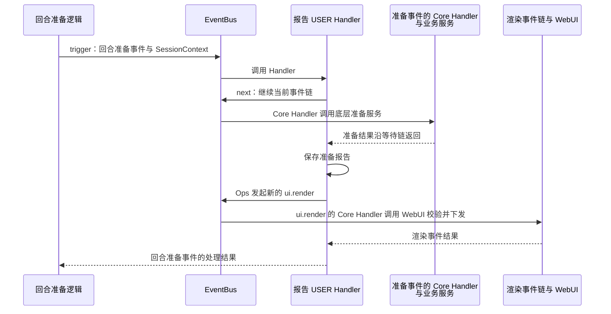

**图 12：回合准备、报告生成与画面更新时序**

图省略了 BUILTIN 等中间 Handler，返回箭头表示沿等待链交接。若报告 Handler 在 next 前直接返回，准备事件的 Core Handler 不执行；若渲染链失败，已完成的准备操作仍须按第 8.2 节核对。

检查时分别核对包生效、准备操作实际执行次数和首帧交接。应用确认建立前，服务端只能证明发送边界。关键协作见第 5.2.1～5.2.2 节。

<a id="1112-两个会话同贡献多视图及一次刷新"></a>

<a id="1112-两个会话同一界面项多视图及一次刷新"></a>

#### 11.1.2 两个会话、同一UI界面项多视图及一次刷新

会话 A 打开两个报告面板视图 A1、A2，会话 B 打开报告面板视图 B1。三者来自同一个UI界面声明，但Web前端分别维护显示和交互状态，服务端按三个渲染目标分别保存活跃记录。

用户点击 A1 的“刷新”时，服务端核对 A1 的记录和当前权限，读取会话 A 的报告，生成的画面只发回 A1。业务明确要求同时刷新 A1、A2 时，才分别核对并向两个视图发送，逐目标记录结果；B1 不接收这次更新。A1 已关闭时，不能把原本发给 A1 的内容改发到 A2。旧计算也不能覆盖更新的业务状态，此场景检查第 6.2、9.2 节的版本与隔离规则。

<a id="1113-工具已完成报告失败且浏览器断线"></a>

<a id="1113-工具已完成报告失败且web前端断线"></a>

#### 11.1.3 准备已完成，报告失败且Web前端断线

在准备服务已完成并保存结果的场景中，报告树无效，随后连接断开。业务保留已确认的准备结果，WebUI 记录校验失败，丢失响应的Web前端标记结果未知。重连后按第 8.2～8.3 节核对绑定，由服务端重发活跃实例最近一帧（revision 不变），不重复执行已完成的准备操作，也不接受旧绑定的渲染或 clear。

<a id="1114-在线卸载遇到旧快照与超时"></a>

#### 11.1.4 在途业务期间卸载包与超时处理

报告扩展仍在处理回合准备事件时，操作者请求卸载。core 返回 `EXTENSION_PACKAGE_BUSY`，不注销、不删目录，也不等待；swarm 保留原可用绑定和画面。调用结束后，操作者可再次请求卸载。若请求的是重载，则准备新 candidate，成功后热切换，当前回合仍使用旧快照；新 candidate 失败时旧 Handler 保持不变。检查时分别核对卸载拒绝、重载切换和旧调用结束后的模块清理。

#### 11.1.5 部分加载失败与未知管理结果

A 失败，依赖 A 的 B 未加载，独立 C 可能成功。AgentServer 按来源与启动规则决定开放范围，不发布 A／B UI界面项；独立包能否降级运行仍待确定。若包安装管理事件的 Core Handler 已完成安装而外层 Handler 抛错，按第 8.1 节查询实际生效与残留，不重装整批。

### 11.2 架构要求与验证归属

本节维护 JiuwenSwarm 的集成验证主题，验证从业务扩展点触发事件到业务执行与UI界面更新的结果；agent-core 内部机制的验证由对端维护。具体用例、故障注入、环境和结果进入后续 feature / 验证记录。当前均不表示已经通过。

| 主题 | 要证明的关键性质 | 依据及负责方 |
| --- | --- | --- |
| 启动与来源 | EventBus 自动登记 core 内置事件，`Registry.init` 执行宿主登记回调并完成唯一一次 Build；初始化失败不加载包，返回后按安装目录批量加载并核对 Report | A01；第 4.1、6.1 节；AgentServer / Extension / Events |
| 业务事件接入 | JiuwenSwarm 选定业务流程的无扩展、加工、短路和跳层行为正确，实际执行次数和新旧入口可核对 | A02、A04；第 4.2、5.2.1 节；各业务入口 / 能力提供方 |
| 会话与 Ops | 业务入口提供服务端 SessionContext；用户登记不收包信息，Runtime 发布时填入，EventBus 保存并为实际进入的 Handler 创建对应 Ops；并发隔离和上下文缺失处理正确 | A03、A05；第 4.2.3、4.3 节；Extension / Events / 会话 / 能力方 |
| 授权 | 跳过 BUILTIN、新事件、未关联扩展包的 Core Handler 及旧调用撤权均不扩大原权限 | A05、A10；第 9.1 节；安全 / 能力方 |
| Web 传输 | 跨跳身份与关联、实例路由、独立主动推送、未知方法、运行时未就绪及断线正确 | A06；第 4.5 节；Front / Gateway / WebClient |
| UI界面项与首次挂载 | manifest 关联、目录授权、兼容筛选、绑定交接、首帧竞争与重复挂载正确 | A05、A06；第 4.4、5.2.2 节；WebUI / Web前端 |
| 渲染与多视图 | 双端校验、整树应用、乱序与旧计算保护，交互、错误、clear 和重连不跨目标 | A06、A07；第 4.6、6.2、9.2 节；WebUI / 业务 / Web前端 / 传输 |
| 新增 Ops | AgentServer、WebUI、Gateway 能力按统一协议注册；能力函数读取当前绑定，名词 / 动词分清，本地及跨进程结果可核对 | 第 4.3、11.4 节；各领域能力方 / Events / AgentServer |
| 新增事件类型 | 类型、匹配、唯一 Core Handler 与业务逻辑中的事件触发同时接通；三领域均验证默认、匹配、短路、校验和旧路径无重复执行 | 第 4.2、11.5 节；产品事件维护者 / Events / 接入方 |
| 结果未知 | 业务操作成功后加工或推送失败、响应丢失均不自动补执行业务 | A08；第 6.3、8 节；业务 / WebUI |
| 退出与重载 | 有在途调用时卸载返回 BUSY 且原注册、目录和可用视图不变；重载先准备后切换、失败保留旧 Handler；停机等待自身业务收尾后再释放资源 | A09；第 5.2.4 节；AgentServer / Extension / 业务 / WebUI / 传输 |
| 迁移与容量 | 旧扩展职责保持；构建、并发、树规模和发送积压经真实负载验证 | 第 9.3、10.3 节；各模块维护者 |

公共机制验证参考[Events 第 11.2 节](../../../../../agent-core/openjiuwen/core/events/docs/designs/events-architecture.md#112-架构要求与验证归属)和[Extension 第 11 节](../../../../../agent-core/openjiuwen/core/extension/docs/designs/extension-architecture.md#11-完整场景与验证要求)。Events 接口与调用语义以[公共契约](../../../../../agent-core/openjiuwen/core/events/docs/specs/S_01_events-contract.md)为准。公共单元验证与 JiuwenSwarm 跨仓、跨服务联调分别记录，旧扩展通过不等于 V2 通过。

### 11.3 本次文档验证范围

2026-10-22 修订按 V5 与 core 当前规约统一启动、包信息传递和热切换：同步正文、图表、示例、失败处理及待确认项，新增分模块开发模板。文档检查覆盖内容一致性、链接和差异，不构成 swarm 业务实现或跨服务集成验收；实际检查结果随本次交付说明。

### 11.4 新增 Ops 的具体例子

以下三例采用第 4.3.3 节的步骤，产品能力名称与服务适配为候选设计，不是可运行 SDK。Events 调用关系遵循公共契约，公共模型、Protocol 与执行运行时均已实现；例子只说明平台如何开放能力，用户包负责使用。

#### 11.4.1 AgentServer：开放 Agent 状态查询

**需求与契约。** Handler 需要查询获准 Agent 的运行状态，候选名词方法为 `ops.agent.status(request)`。它只查询运行时服务，不修改状态，也不额外发起业务事件。

**接入。** 业务方实现 `agent_status`，在调用时读取当前 Ops，核对目标范围后查询运行时服务。平台增加 `agent` namespace 的 Build Handler，由宿主 Handler 登记回调注册：

```python
async def build_agent_ops(event, ops, next_handler):
    builder = await next_handler(event)
    builder.add_namespace("agent")
    builder.add_method("agent", "status", agent_status)
    return builder


# Called by host_handlers inside Registry.init.
bus.register_event_handler(
    OPS_BUILD_EVENT_TYPE,
    build_agent_ops,
    {},
    handler_level=BUILTIN,
)
```

这段伪代码展示能力登记：`next_handler(event)` 直接返回 Builder，Build Handler 补充定义后返回同一个 Builder。已有 `agent` namespace 时，方法加入原主责处理器。`Registry.init` 随后触发唯一一次 Build；初始化成功返回后，普通 Handler 才能调用 `await ops.agent.status(request)`。

**验证重点。** 正常查询、目标越权、无会话、服务不可用、并发隔离和退出失效；不从全局“当前 Agent”读取状态。

<a id="1142-webui开放界面通知操作"></a>

#### 11.4.2 WebUI：开放UI界面通知操作

**需求与契约。** 后端 Handler 向获准视图显示平台通知，候选动词为 `ops.ui.notify(request)`。

**接入。** 在 `ui` 的主责 Build Handler 中注册 `notify`。能力函数校验上下文与目标，构造通知事件；类型尚不存在时先按第 4.2 节定义。通知事件的 Core Handler 调用 WebUI 底层服务，经第 4.5 节的传输到Web前端，并接通Web前端通知展示、Schema 与兼容规则。具体格式仍需在事件与 Ops、渲染交互、版本交付和跨服务传输规约中确定。

**验证重点。** 无效内容、目标失效、旧Web前端和发送失败。返回只确认协议已证明的边界；Web前端尚未适配时不能开放完整能力。

#### 11.4.3 Gateway：开放渠道发送并接入新 Channel

**需求与契约。** Handler 通过候选动词 `ops.channel.send(request)` 向获准渠道发送内容。Ops 入口在 AgentServer，实际发送由 Gateway 完成，客户端和凭据留在 Gateway。

**接入。** 平台注册 `channel.send` 能力函数，构造第 11.5.3 节的发送事件。渠道发送事件的 Core Handler 经受控代理提交动作，Gateway 核对渠道、应用与物理目标，调用适配器并关联回传结果。

已有 Channel 能发送时直接复用；若需新增企业渠道 `acme`，先补实际服务，再纳入获准调用范围：

| 阶段 | 接入内容与检查重点 |
| --- | --- |
| 实现与配置 | 参考第 3.4 节的 BaseChannel、Telegram 实现 AcmeChannel，提供标识、`on_message`、`start`、`stop`、`send` 及路由消费的接口，接通配置校验和实例化 |
| 注册与启动 | Gateway 按 `(channel_id, app_id)` 注册，保存监听任务并核对外部连接；同键冲突不能静默覆盖在用实例 |
| 上行与回复 | 校验平台来源，归一化 Message，经回调进入 MessageHandler；回复转换为平台调用。核对用户、应用、会话、目标 AgentServer、ChannelType 消费方及必要 IM adapter |
| 主动发送 | 让现有发送动作选择新实例并回传结果，RoutingTarget／DeliveryTarget 能表达平台地址；语义相同时无需新建 acme 专用 Ops 或事件 |
| 更新与退出 | 限制新使用、处理在途操作、停止任务和连接，再清理注册与 adapter；一个应用退出不影响其他实例，残留必须保留 |

**验证重点。** 渠道注册、连接就绪与实际收发分别验证，底层服务接通与 Ops 可用分别验证。`BaseChannel.send` 尚无统一回执，V2 的结果查询、幂等及未知结果规则，以及从包发现渠道提供方的协议，均需在渠道接入方案中确定；安装 AgentServer 包不能代替 Gateway 装配。

### 11.5 新增事件类型的具体例子

以下三例按第 4.2.4 节的步骤增加具有独立语义的事件类型，均为未实现的候选设计。

#### 11.5.1 AgentServer：增加回合准备事件

**需求与定义。** 在选定 Agent 的回合处理逻辑中，正式执行回合前触发 `agent.turn.prepare`，允许扩展参与准备。输入含目标 Agent、回合标识及准备参数，按目标 Agent 匹配；前两项固定，只允许调整准备参数。输出为合法准备结果，`agent.turn.prepare` 的 Core Handler 调用底层准备服务，不执行整个回合。

**注册与触发。** 将类型、匹配函数和 Core Handler 放入宿主事件登记回调，由 `Registry.init` 调用。回合处理逻辑到达准备步骤时，构造 Event 和服务端 SessionContext，通过同一 EventBus 触发事件并等待结果，再继续原回合。以下伪代码只表达登记与调用关系：

```python
# Product registration called by host_event_types inside Registry.init.
bus.register_event_type(
    AGENT_TURN_PREPARE,
    match_turn_prepare,
    prepare_core,
)

# Trigger at the preparation point in the selected agent's turn logic.
prepared = await bus.trigger(
    Event(event_type=AGENT_TURN_PREPARE, event_input=turn_input),
    session_context,
)
```

**验证重点。** 无扩展时默认准备执行一次；USER 可继续或提供合法短路结果，不能改写匹配字段或提高原权限。注册失败、准备异常或输出无效时，不继续依赖准备成功的步骤；其他 Harness 需另行接入。具体写法见[AgentServer 开发模板](builtin-event-development-guide.md#agentserver-template)。

#### 11.5.2 WebUI：增加视图尺寸事件

**需求与定义。** 视图尺寸变化时，扩展据此调整布局，候选类型为 `ui.view.resize`。输入含已核实视图及有界尺寸，按UI界面项或 slot 匹配。`ui.view.resize` 的 Core Handler 处理当前尺寸并返回约定结果，不代表新画面已显示。

**接入。** WebUI 模块提供类型、匹配、校验和 Core Handler，纳入 `Registry.init` 的宿主事件登记回调。Web前端增加尺寸采集与频率控制，经 `webui.dispatch` 上报；AgentServer WebUI 服务校验白名单、绑定与参数，构造 Event 和 SessionContext，调用同一 EventBus。通用帧兼容时复用 Gateway 方法；USER 可通过 `ops.ui.render(...)` 更新布局。完整开发步骤见[内置事件开发模板](builtin-event-development-guide.md#3-webclient-开发模板界面交互)。

**验证重点。** 非法或超限尺寸、过量上报、旧绑定迟到消息、匹配、默认结果和旧Web前端。

#### 11.5.3 Gateway：增加渠道发送事件

**需求与定义。** 发送前允许扩展加工内容，候选类型为 `channel.message.send`。输入包含逻辑目标、内容及关联，按渠道与内容类型匹配；目标和匹配字段固定，只允许修改约定内容。输出区分已证明的发送状态、拒绝和结果未知。

**注册与交接。** 渠道适配模块提供类型、匹配函数和 Core Handler，纳入 `Registry.init` 的宿主事件登记回调。发送业务逻辑或 `ops.channel.send(...)` 触发该事件，继续到 Core Handler 时，经 Front／E2A 的允许动作交给 Gateway；Gateway 核对目标、调用渠道并回传结果。事件和 Python Handler 在 AgentServer 中执行。开发步骤见[内置事件开发模板](builtin-event-development-guide.md#4-gateway-开发模板请求转发与渠道事件)。

**验证重点。** 默认发送一次，加工不改变授权目标，短路不伪造送达；未知动作、实例不可用和平台错误可识别，响应丢失按第 8.2 节处理。事件契约仍需由业务与 V2 维护者明确，跨服务动作与回执仍需在传输和渠道接入协议中确定。

## 12. 设计选择与待确认事项

### 12.1 重要设计选择及理由

本节记录选择的原因和代价，具体规则在所列章节维护。

| 选择 | 理由与代价 | 主要说明 |
| --- | --- | --- |
| 包管理复用 agent-core | 避免产品另建一套通用机制，公共接口和退出协作成为跨仓前置 | 第 3、4.1 节 |
| Registry 执行 swarm 登记回调并触发一次 Build | 沿用 V5/core 的单一启动入口；AgentServer 传入 EventBus、回调和服务，初始化返回后加载包 | 第 3.2、4.1.1、9.2 节 |
| 产品能力统一通过 Ops 开放 | 复用公共包与会话绑定，集中连接所属服务；代价是每项能力需完成注册、授权和结果适配 | 第 4.3 节 |
| 在预定业务扩展点显式触发事件 | 扩展参与实际操作，事件的 Core Handler 调用底层服务；迁移时需逐业务流程处理短路、返回和旧路径重复执行 | 第 4.2、5.2.1 节 |
| 执行与网络适配分工 | 复用 AgentServer Front、Gateway 和 WebClient 的传输链路，需完整接通方法、路由和主动推送 | 第 3.2、4.5 节 |
| 白名单 JSON 树 | 统一呈现与校验，表达能力受组件集合限制，扩展集合需服务端与Web前端同步 | 第 4.4、4.6 节 |
| 按每个视图的有效绑定记录发送 | 明确点击来自哪个面板、更新应发往哪个面板；增加打开、关闭、断线和重连时的记录管理成本 | 第 5.2.2～5.2.4 节 |
| 分段确认结果 | 保留真实业务和交付边界，需要关联多个环节的记录 | 第 6.3 节 |
| 单包重载采用 Handler 热切换 | 新 candidate 全部成功后替换，失败保留旧 Handler；旧调用继续旧代码，业务状态和视图兼容另行核对 | 第 5.2.4、8.3 节 |

### 12.2 未验证前提与待确认问题

#### 12.2.1 尚未验证的重要前提

| 前提 | 已有依据与缺口 | 不成立的影响及验证方 |
| --- | --- | --- |
| Extension 的可信包身份可进入 Ops 构建 | `Runtime.publish` 以 manifest/Plan 生成 `PackageMetadata` 并随注册记录注入 Ops | 扩展代码无权传入包身份；复核发布入口与撤销路径 |
| 宿主业务收尾与包资源清理可以衔接 | Events 明确不提供调用跟踪或 drain；AgentServer 业务调用等待与 Extension 包清理尚缺接入验证 | 安全停机受阻；AgentServer / Extension；在线单包卸载另行验证后开放 |
| JiuwenSwarm 各业务流程能在预定扩展点触发事件并保留授权 | 有现有回合、UI 交互和渠道消息入口，缺 V2 事件触发与执行证据 | 可能绕过或重复执行；各业务入口 / 能力提供方 |
| 可信会话投影和共享能力支持并发 | 有会话记录，缺投影与并发验证 | 上下文或状态可能串用；会话 / 能力方 |
| 既有推送链可承载非聊天 UI 消息 | 有 EventForwarder 和独立推送路径，缺 V2 映射联调 | 无待响应请求时无法交付；Front / Gateway / WebClient |
| 连接生命周期能及时失效绑定 | 有连接基础，缺绑定和断线协议 | 迟到消息与误投风险；WebUI / 传输 / Web前端 |

#### 12.2.2 尚未确定的设计问题

下表集中说明尚待确定的设计内容、负责模块和对实现的影响。Registry / Events 的公共接口及退出契约由 agent-core 维护，本文只记录 JiuwenSwarm 接入时需要明确的事项。

| 主题 | 需要确定什么 | 责任与后续维护位置 | 确认前的影响 |
| --- | --- | --- | --- |
| 公共入口接入 | 管理门面把 core 已提供的 Registry 回调、安装目录、Report、查询和包信息登记接口接入 swarm，验证初始化失败清理 | 公共接口以 core spec 为准；两侧接入 feature 维护使用映射 | Registry、九类管理事件与 candidate 发布已可用，门面直接委托；不另建包信息通道或重复 Build |
| 来源与启动 | 采用 `extensions.install_dir` 和 core 的目录、冲突规则；相对路径基准、目录缺失、必需 / 可选包和降级仍需在产品侧明确 | AgentServer / V2 配置与启动规约，对齐对端来源规则 | 不改变已确认配置键和 ID 冲突规则，部分失败后按产品策略开放功能 |
| 事件与能力 | AgentServer、WebUI、Gateway 的首版事件与 Ops 目录；业务流程中的事件触发位置、匹配字段、校验、None、namespace、能力函数绑定与缺失值 | 业务 / V2 / Events；具体事件类型由对应特性设计文档定义，已确认的接口和约束由事件与 Ops 规约维护 | 本文候选方法和类型不作为最终 SDK，不泛化工具、流式和 Harness 支持 |
| UI界面项与 slot | 目录查询更新、支持集合、同槽位多包的排序与冲突 | WebUI / 包接入 / Web前端；UI界面项规约 | 声明形式已定；不发布无有效包的UI界面项 |
| 视图绑定与挂载 | 同目标旧挂载实例产生迟到交互时如何隔离；重复挂载与关闭时如何清理活跃记录 | WebUI / Front / Gateway / Web前端；视图挂载规约 | v1 以目标活跃性和 revision 判断；不开放归属不可核对的挂载，不复用已失效的目标 |
| 树与交互 | JSON Schema 2020-12 适用范围、组件 / props / action / token、富文本、静态树和完整 / 增量模式 | WebUI / Web前端；渲染交互规约 | 不承诺参考全组件与 append，不允许自由 HTML / CSS |
| 版本与交付 | 并发业务状态、clear / error 与 render 的相对顺序、发送及应用确认 | WebUI / 业务 / Web前端；交付规约 | revision 作用域已定；delivered 不等于已显示 |
| 跨服务映射 | 方法范围、Web / E2A 转换、可信身份、主动推送、路由和断线关联清理 | Gateway / WebClient / Front / WebUI；传输规约 | 连接或同名方法不能证明链路可用 |
| Front 与运行时 | Extension 管理入口所在位置、Backend 交接、就绪准入及运行模式 | Front / Worker / Backend；AgentServer 接入 feature | Front 不执行扩展，不泛化所有部署形态 |
| 停止与退出接入 | 宿主调用跟踪、停机等待、超时和取消；对齐 BUSY 卸载拒绝、重载热切换、旧模块退出以及视图处理 | core spec 维护包操作契约；swarm 接入 feature 维护业务、视图和传输收尾，Events 不提供 drain | 卸载被拒绝保留原注册和可用视图，重载失败保留旧 Handler；不假定通用续清理接口 |
| 并存与迁移 | 包归属、入口选择、Callback、配置和 SDK 差异，传输 / 加密保留与回退 | V2 / 旧扩展 / 业务；迁移 feature | 不整体替换旧机制，避免同动作双触发 |
| 容量与观测 | 并发、嵌套、绑定、树和帧、积压、退出时限、指标及脱敏 | AgentServer / Events / 能力 / WebUI / 传输；容量观测 feature | 不承诺无依据数值，不允许无界堆积 |
| Gateway 事件与 Channel 能力 | 渠道事件与 Ops 目录、网络动作白名单、可信目标映射、结果回传 / 查询 / 幂等；提供方声明与工厂、冲突策略、配置和退出；旧 Hook 迁移 | Gateway / 业务 / V2 维护者；渠道接入规约与 feature | 不承诺任意 Channel 自动包加载，不以注册或下行发送代替连接与投递成功 |

非 Web 渠道另由 Gateway Channel 与业务方确认下行事件、允许动作、目标授权和回执，不作为本期 WebUI 前置。定稿后更新所属正文与 spec，整体结论同步概览；实施与验证归 feature，多阶段进度按实际需要统一建计划。

### 12.3 参考依据与文档分工

V5 和 WebUI 方案是外部设计材料，下面以文件名标识，不要求仓库中另有一份副本。具体公共接口以 core 规约为准。

| 依据 | 适用内容与边界 |
| --- | --- |
| [设计概览](extensions-v2-overview.md) | 产品定位、范围、主要工作链路和能力开放边界 |
| [Events 公共契约](../../../../../agent-core/openjiuwen/core/events/docs/specs/S_01_events-contract.md) | 已确认并实现的公共模型、接口、能力目录构建、逐 Handler Ops 创建及错误语义；Events 接口与调用语义以此为准 |
| [Events 架构](../../../../../agent-core/openjiuwen/core/events/docs/designs/events-architecture.md) | 通用事件、匹配、推进、会话、Ops、快照与退出协作 |
| [Extension 架构](../../../../../agent-core/openjiuwen/core/extension/docs/designs/extension-architecture.md) | 包来源、独立管理事件、可信计划、归属、查询和清理 |
| [Registry 与 Bus 规约](../../../../../agent-core/openjiuwen/core/extension/docs/specs/S_02_registry-and-bus.md) | Registry 宿主回调、内部 Build、包信息发布及热切换；精确接入契约以此为准 |
| 外部设计材料：`扩展性方案总览_V5.md` | 启动时的宿主登记、安装目录、整包发布和热切换；本文与 V5/core 保持一致 |
| 外部 WebUI 方案：`jiuwenswarm_webui_event_extension_design_v2.0.md` | 文件名 v2.0、正文 v2.2；借鉴 JSON 树、slot、统一交互与三类下行，字段需正式规约化 |
| [内置事件开发模板](builtin-event-development-guide.md) | 按 WebClient、Gateway 和 AgentServer 分别说明目录、事件定义、Handler、登记和真实触发；新增产品服务方法明确标为开发示例 |

参考冲突按当前 core 规约处理：包入口采用 `manifest.yaml`；EventBus 初始化登记 core 内置事件及九类管理事件；`Registry.init` 执行 swarm 登记回调后触发一次 Build，AgentServer 不再单独 Build；包信息由 Runtime 发布时填入并由 EventBus 保存；重载采用 Handler 热切换。网络仍由 Front、Gateway 和 WebClient 适配。旧示例中的 `delivered`、`handler_error` 和简化 revision 键不直接成为产品契约，分别按第 6.3、8.1、6.2 节解释。

概览维护整体说明，本架构维护模块协作；spec 维护定稿契约，feature 维护具体方案与证据，开发计划维护执行进度。包管理门面契约见[门面规约](../specs/S_01_extension-management-facade.md)，包管理与 WebUI 方案见[F_02](../features/F_02_control-plane.md)至[F_08](../features/F_08_frontend-render.md)，开发计划见[特性开发计划](extensions-v2-development-plan.md)；不复制完整公共模型、manifest Schema 或 WebUI 帧结构，也不为填满目录创建空文档。
