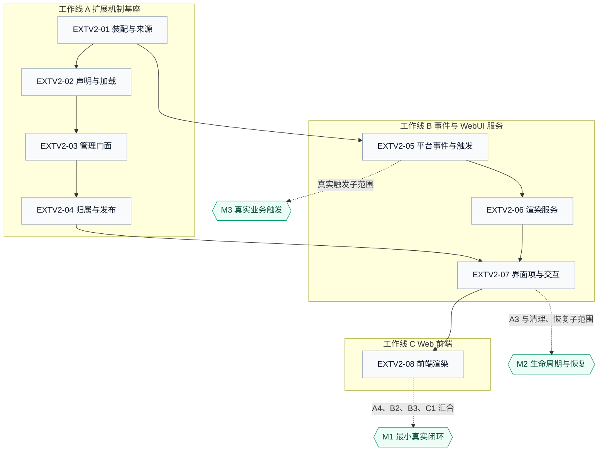

# JiuwenSwarm Extensions V2 特性开发计划

## 1. 这份计划怎么读和维护

- 计划范围：`jiuwenswarm/extensions_v2/` 负责的 V2 扩展机制——扩展包的装配、声明校验、加载生效与生命周期管理，平台事件（含 WebUI 渲染事件）的定义与触发，扩展UI界面项的发现、挂载与交互，以及 AgentServer 与 Gateway、Web 前端之间的上下行交接。
- 范围之外：agent-core 的 Events 与 Extension 公共机制实现；旧 `jiuwenswarm/extensions/` 机制的改造；Gateway 渠道能力与旧机制迁移；工具、会话与模型服务自身的业务实现。
- 所属模块：`jiuwenswarm/jiuwenswarm/extensions_v2/`。协作方为 AgentServer 运行时（`jiuwenswarm/server/`）、Gateway WebChannel（`jiuwenswarm/gateway/`）与 Web 前端（`jiuwenswarm/channels/web/frontend/`）。
- 交付分类：本期为本地包装载与 WebUI 渲染交互闭环，共 8 项；Gateway 渠道能力与旧机制迁移列为独立扩展，不在本期。
- 本轮安排：8 项全部纳入，按 A、B、C 三条工作线并行推进；交付节点 M1、M2、M3 见第 3、4 节。
- 更新日期：2026-10-21。
- 设计依据：[设计概览](extensions-v2-overview.md)、[详细架构](extensions-v2-architecture.md)、agent-core [扩展包加载规约](../../../../../agent-core/openjiuwen/core/extension/docs/specs/S_01_package-loading.md)、agent-core [Events 公共契约](../../../../../agent-core/openjiuwen/core/events/docs/specs/S_01_events-contract.md)。
- 关键口径与待确认项：见第 1.2、1.3 节；未确认前，受影响的工作项不标注完成。
- 术语与全局约束：见第 1.1 节。
- 进度摘要：按第 4 节维护；状态、负责人、关联 PR 与进展说明只在该节登记。

先读本节确认范围和完成口径，再到第 2 节了解特性与验收要求，第 3 节判断开工条件和并行机会，第 4 节确认安排、认领和进度。

- 特性是有明确责任和验收边界的开发单元；开工硬前置只列独立实现必需的基础；交付节点表示若干特性与真实依赖汇合后的可演示结果。
- 新增或调整特性时同步第 2 节定义、第 3 节图和第 4 节表；认领、开发、验证或阻塞变化时更新表中负责人、状态、关联 PR、进展说明和日期。
- 状态统一使用“待开始、进行中、阻塞、待验收、完成”；完成须覆盖约定验收范围并有可追溯证据，子范围或模拟验证通过不自动代表整项完成。
- 代码开发前维护对应 feature 方案；契约变化同步 spec；遵循所属目录的 [AGENTS.md](../../AGENTS.md)。
- 具体维护规范：[特性开发计划模板](../../../docs/templates/feature-development-plan-template.md)。

### 1.1 术语与全局约束

| 术语 | 含义 |
| --- | --- |
| 扩展包 / 包根 | 含 `manifest.yaml` 的目录；V2 安装副本位于 `<install_dir>/<package.id>/<version>/` |
| 扩展单元 | `manifest.extensions` 的一项，指向包根下的一个 `.py` 入口文件 |
| 生效记录 | agent-core 控制面中该包已生效的事实，含版本、包根与 generation |
| Report | 一次管理操作的逐包结果，区分成功、失败与依赖未满足 |
| EX-03 / EX-04 | agent-core Extension 已交付项：Registry 管理入口；整包 Handler 发布与撤销 |
| 事件与 Handler | 一次处理中按 USER、BUILTIN、CORE 顺序执行的处理器链 |
| Ops | Handler 使用平台能力的入口，按命名空间与方法组织，例如 `ops.ui.render` |
| 扩展UI界面项 | 包向平台声明的一项界面内容，含标识、标题与允许挂载的 slot |
| 视图绑定 | 服务端保存的一次面板打开归属记录，用于核对交互来源与更新目标 |
| revision | 服务端为渲染实例分配的版本号，前端只应用更新的一帧 |

全局约束（依据架构与 agent-core 契约）：

- 扩展包只能登记 `user` 与 `builtin` 层级；`core` 由平台通过 `register_event_type` 登记。
- 一个包的 Handler 由管理门面集中登记，登记失败注销本次已登记项；每次业务调用使用固定注册快照，重载只影响切换后的新调用，卸载不等待在途调用。
- 界面内容只能使用平台白名单组件、props、action 与样式 token，不允许自由 HTML、CSS 或包内脚本。
- 渲染实例由会话、slot、包与实例标识四元组定位；revision 在该实例内单调递增。
- 平台只为当前 Handler 调用构建一次 Ops，Handler 不得缓存或跨调用复用。

### 1.2 本轮已定口径

| 主题 | 结论 | 影响条目 |
| --- | --- | --- |
| WebUI 渲染服务归属 | 迁入 `extensions_v2/webui/`，由 V2 模块提供，运行在 AgentServer 进程内 | EXTV2-06、EXTV2-07 |
| 包管理注册表 | 门面直接委托 agent-core `Registry`；控制面与发布不在宿主重建 | EXTV2-03、EXTV2-04 |
| 包身份 | 归属事实以 agent-core 生效记录为准；发布 Handler 时通过 `register_event_handler(..., package_metadata=...)` 写入注册记录，由 Events 在构建 Ops 时注入，不从事件输入或会话上下文读取；扩展的受限注册入口不接收包身份 | EXTV2-04 |
| 清理帧 | 独立下行事件 `webui.render.clear`，只携带目标与原因，不复用带 `mode` 的渲染帧 | EXTV2-06 |
| 界面项声明 | 写在 `manifest.yaml` 的 `ui` 段，字段与 `web.slot.contribution` 的 `UiEntryDeclaration` 同构；`renderer.kind` 在本方案中新增 `webui-tree`，前端需支持该渲染模式；agent-core 只解析已知字段，JiuwenSwarm 从生效记录的包根读取原始 `manifest.yaml` 并完成内容校验 | EXTV2-07 |
| revision 作用域 | 实例内单调；实例由会话、slot、包与实例标识定位，跨包排序由前端槽位模式处理 | EXTV2-06、EXTV2-08 |
| 重连恢复 | 服务端重发各活跃实例最近一帧，revision 不变；不新增同步接口，不要求扩展重新生成 | EXTV2-06 |

### 1.3 待确认项

| 主题 | 待确认内容 | 建议 | 责任方 |
| --- | --- | --- | --- |
| 真实业务触发点 | 回合准备、工具调用或两者 | 先接工具调用前后边界，与 mods 的 tool 事件对齐且演示稳定；回合准备随后接入 | 协调业务模块 |

## 2. 要开发的特性

每个特性按以下格式填写，并与第 3 节节点、第 4 节行一一对应。验收标准写预期；实际执行结果统一写第 4 节进展说明。来源验证点引用架构规则编号与章节，完整要求只在主责特性或对应 feature 文档中维护。

### EXTV2-01 启动装配与包来源

- **目标与范围：** AgentServer 启动时按固定顺序完成装配：准备事件总线、注册产品事件与 Handler、初始化包管理（由其触发一次 `ops.build`）并保存首次成功构建的能力目录、收集安装目录与候选来源并批量安装。同时保证与旧 `jiuwenswarm/extensions/` 机制互不扫描、互不共用配置。不包含具体事件定义、包管理门面实现与 UI 渲染。
- **责任与契约：** `extensions_v2/assembly.py` 提供唯一入口 `install_extensions(server)`，由 `jiuwenswarm/server/worker/lifecycle.py` 在装配屏障内调用。`extensions_v2/config.py` 读取配置键 `extensions.install_dir`（缺省 `~/.jiuwenswarm/extension_pkgs`），与旧机制的 `extensions.extension_dirs` 分离。装配失败不阻断运行时启动，扩展能力标记为不可用并记录原因。
- **开工硬前置：** 无。包管理门面由替身注入，`openjiuwen.core.events.ExtensionEventBus` 已可用。
- **独立验证入口：** `tests/unit_tests/extensions_v2/test_assembly.py`；旧机制共存扫描用例待补。
- **独立验证条件：** `ExtensionEventBus` 与门面替身即可，不需要 Gateway 与前端。
- **验收标准：**
  1. EXTV2-01-V-01：装配顺序为事件注册先于包管理初始化、`ops.build` 先于任何包安装，替身记录的调用序列符合该顺序。
  2. EXTV2-01-V-02：任一步骤抛错时运行时仍可启动，扩展能力被标记为不可用且原因被记录，不留下半装配状态。
  3. EXTV2-01-V-03：V2 扫描结果不含旧机制目录，旧机制扫描结果不含 V2 安装目录；同根重复路径去重，不按收集顺序覆盖同 ID 包。
- **来源验证点与共享场景：** 架构 EXTV2-A01 与第 4.1.1、4.1.2、10.3 节；主责 EXTV2-01，参与 EXTV2-M1。
- **前端独立验证：** 不适用。
- **联合交付与开放条件：** 作为 EXTV2-M1 的装配前提，不单独开放业务能力。
- **设计索引：** [详细架构](extensions-v2-architecture.md) 第 4.1.1、4.1.2、10.3 节；`jiuwenswarm/server/worker/lifecycle.py`、`jiuwenswarm/resources/config.yaml`。
- **特性文档：** `../features/F_01_assembly-and-source.md`。

### EXTV2-02 包声明与加载控制面接入

- **目标与范围：** 接入 agent-core 包加载控制面：读取并校验 `manifest.yaml`、写入安装副本、按依赖定序执行单包计划、创建候选模块、写入生效记录、判断卸载条件。JiuwenSwarm 不自建 manifest Schema、依赖排序或版本规则。不包含管理门面、总线发布与界面项。
- **责任与契约：** `ExtensionManager` 触发 agent-core 的 `package.install` 管理事件，解析、依赖定序、复制与加载全部由对端完成；宿主只读取 `PackageManager.list_installed()` 并补偿 prepare 失败留下的新副本。错误沿用 `EXTENSION_*` 号段，对上层返回逐包 `ActivationReport`。
- **开工硬前置：** 安装目录解析 `extensions_v2/config.py`（EXTV2-01 的配置子项，已提供）。
- **独立验证入口：** `tests/unit_tests/extensions_v2/management/test_registry_facade.py`。
- **独立验证条件：** 覆盖合法、依赖、冲突与入口逃逸的样例包；不需要总线与前端。
- **验收标准：**
  1. EXTV2-02-V-01：非法 manifest（`schemaVersion`、包标识、版本、入口逃逸、`runtime` 非 `backend`）整包拒绝，不产生安装副本。
  2. EXTV2-02-V-02：同批重复包标识整批失败，已生效同标识返回 `PACKAGE_EXISTS`，依赖缺失或成环分别返回 `DEPENDENCY_NOT_MET`、`DEPENDENCY_CYCLE`，均不部分安装。
  3. EXTV2-02-V-03：安装副本写入 `<install_dir>/<package.id>/<version>/`，已存在的版本目录拒绝覆盖；卸载判断覆盖被依赖（`PACKAGE_IN_USE`）与存在在途调用（`PACKAGE_BUSY`）两种拒绝。
- **来源验证点与共享场景：** agent-core [包加载规约](../../../../../agent-core/openjiuwen/core/extension/docs/specs/S_01_package-loading.md) 第 3、4 节；架构第 4.1.2 节；主责 EXTV2-02，参与 EXTV2-M1。
- **前端独立验证：** 不适用。
- **联合交付与开放条件：** 参与 EXTV2-M1；门面已对接 EX-03 交付的 `Registry`。
- **设计索引：** agent-core `openjiuwen/core/extension/{manifest,selection,ordering,orchestrator,runtime}.py`；架构第 4.1.2 节。
- **特性文档：** `../features/F_02_control-plane.md`。

### EXTV2-03 包管理门面与生命周期

- **目标与范围：** 提供 agent-core `Registry` 上的宿主门面，覆盖初始化、安装、卸载、重载、查询与停机，返回 agent-core 的 `ActivationReport` 与 `QueryResult`。包含安装目录配置、启动选版、失败副本补偿与停机顺序。不包含事件定义与 UI 渲染。
- **责任与契约：** `extensions_v2/management/registry.py` 为门面，方法为 `init(event_bus, *, host_version, host_event_types, host_handlers)`、`install(paths)`、`load_installed()`、`uninstall(package_id)`、`reload(package_id)`、`query(package_id=None)`、`shutdown()`；内部只持有 `Registry`，不缓存 manifest、Handler 或生效记录。
- **开工硬前置：** EXTV2-02。
- **独立验证入口：** `tests/unit_tests/extensions_v2/management/test_registry_facade.py`。
- **独立验证条件：** `ExtensionEventBus`、agent-core `Registry` 与样例包；不需要网络与前端。
- **验收标准：**
  1. EXTV2-03-V-01：五类操作返回逐包结果，成功、失败与依赖未满足可区分，单个包失败不影响同批独立包。
  2. EXTV2-03-V-02：未初始化时拒绝安装并返回可区分错误；卸载被依赖或存在在途调用时立即失败，不等待。
  3. EXTV2-03-V-03：包未生效但存在副本时，卸载删除全部版本目录并返回成功；既无生效记录也无副本时返回 `EXTENSION_PACKAGE_NOT_INSTALLED`。
- **来源验证点与共享场景：** 架构 EXTV2-A01、EXTV2-A09 与第 4.1.3、5.2.4、8.3 节；主责 EXTV2-03，参与 EXTV2-M1、M2。
- **前端独立验证：** 不适用。
- **联合交付与开放条件：** 参与 EXTV2-M1 与 M2；门面生命周期已按 EX-03 交付实现验证。
- **设计索引：** 架构第 4.1.3、5.2.4 节；agent-core `openjiuwen/core/extension/runtime.py`。
- **特性文档：** `../features/F_03_registry-facade.md`。

### EXTV2-04 包归属与 Handler 发布

- **目标与范围：** 候选加载成功后集中登记整包 Handler，登记完成后向业务入口开放；限制包只能登记 `user` 与 `builtin`；发布时把包身份写入 Handler 注册记录，由 Events 在构建 Ops 时注入。包含登记失败时注销本次已登记项。不包含包加载本身。
- **责任与契约：** agent-core `Runtime.prepare` 加载候选，`Runtime.publish` / `replace_published` / `unpublish` 完成整包登记与撤销。扩展入口只接收 `ExtensionRegistrar`，只收集 Handler 声明；`PackageMetadata` 由 `Runtime` 在登记时写入，不由扩展自报。
- **开工硬前置：** EXTV2-03。
- **独立验证入口：** `tests/unit_tests/extensions_v2/management/test_activation_publish.py`。
- **独立验证条件：** `ExtensionEventBus`；样例包分别含合法登记与越级登记。
- **验收标准：**
  1. EXTV2-04-V-01：登记完成后新调用可见本包 Handler，登记前不可见；每次调用使用固定注册快照，重载失败不撤销旧 Handler。
  2. EXTV2-04-V-02：包内登记 `core` 被拒（`EXTENSION_HANDLER_LEVEL_FORBIDDEN`）；登记失败时注销本次已登记项，不残留半套 Handler。
  3. EXTV2-04-V-03：Ops 构建能读到当前 Handler 的包信息，且不采信事件输入或会话上下文中的自报字段。
- **来源验证点与共享场景：** 架构 EXTV2-A03、EXTV2-A05 与第 4.3.1 节；主责 EXTV2-04，参与 EXTV2-M1。
- **前端独立验证：** 不适用。
- **联合交付与开放条件：** 参与 EXTV2-M1；在途计数接入后复核 `PACKAGE_BUSY` 场景。
- **设计索引：** agent-core [包加载规约](../../../../../agent-core/openjiuwen/core/extension/docs/specs/S_01_package-loading.md) 第 4.2 节；架构第 4.3.1 节。
- **特性文档：** `../features/F_04_activation-and-attribution.md`。

### EXTV2-05 平台事件、能力注册与业务触发

- **目标与范围：** 把 `ui.render` 与全部上行 `ui.*` 的事件类型、匹配函数与 CORE Handler 归入 `extensions_v2/events/webui.py`；把 `ops.build` 的 BUILTIN Handler 与 `ops.ui.render` 归入 `extensions_v2/handler_ops/ui.py`；在真实业务链路接入触发点，验证 Handler 内和 AgentServer 业务逻辑都能主动更新界面。不包含渲染服务与上行入口实现。
- **责任与契约：** `register_webui_events(bus)` 注册 WebUI 事件，由产品注册函数在装配时调用；`bus` 为 `openjiuwen.core.events.ExtensionEventBus`，每个事件类型有且仅有一个 CORE Handler。Handler 内通过 `ops.ui.render(...)` 发起渲染；AgentServer 业务逻辑在核对上下文和目标后直接构造并触发 `ui.render` 事件。触发方不拼装渲染树、不直接下发消息；触发失败不影响业务主流程。业务触发位置见第 1.3 节。
- **开工硬前置：** EXTV2-01。
- **独立验证入口：** `tests/unit_tests/extensions_v2/webui/test_webui_runtime.py`；真实业务触发用例待补。
- **独立验证条件：** `ExtensionEventBus` 即可验证注册与能力；真实触发需要可运行会话。
- **验收标准：**
  1. EXTV2-05-V-01：注册后事件类型清单包含 `ui.render` 与全部上行事件，每个类型有且仅有一个 CORE Handler。
  2. EXTV2-05-V-02：任意 Handler 内调用 `ops.ui.render` 能进入渲染事件链并到达链尾，返回可区分结果。
  3. EXTV2-05-V-03：真实会话在约定触发点更新界面，前端对应槽位出现内容；触发点抛错时业务主流程不受影响且错误被记录。
- **来源验证点与共享场景：** 架构 EXTV2-A02、EXTV2-A03 与第 4.2、4.3、5.2.1 节；主责 EXTV2-05，参与 EXTV2-M1、M3。
- **前端独立验证：** 不适用。
- **联合交付与开放条件：** 参与 EXTV2-M1；真实业务触发范围由 EXTV2-M3 单独确认。
- **设计索引：** 架构第 4.2、4.3、5.2.1 节；`extensions_v2/events/webui.py`、`extensions_v2/handler_ops/ui.py`、`extensions_v2/webui/runtime.py`。
- **特性文档：** `../features/F_05_platform-events.md`。

### EXTV2-06 渲染服务与下行帧

- **目标与范围：** 在 `extensions_v2/webui/` 提供渲染请求校验、视图绑定与 revision 分配、容量淘汰、下行发送，以及实例清理与重连重发。不包含界面项发现与上行交互入口。
- **责任与契约：** `extensions_v2/webui/` 下的 `models`、`schema`、`constants`、`view_registry`、`transport`。下行分为 `webui.render`、独立的 `webui.render.clear` 与 `webui.render.error`；clear 帧只携带目标与原因。视图绑定由会话、slot、包与实例标识定位，revision 在实例内单调。
- **开工硬前置：** EXTV2-05。
- **独立验证入口：** `tests/unit_tests/extensions_v2/webui/test_webui_runtime.py`；重连重发用例待补。
- **独立验证条件：** 传输层使用替身；不需要真实 WebSocket 与前端。
- **验收标准：**
  1. EXTV2-06-V-01：白名单之外的组件、props、token 或超出规模上限的树被整体拒绝，不下发部分内容。
  2. EXTV2-06-V-02：同一实例 revision 单调递增，旧帧被丢弃；超过容量上限时淘汰最久未更新实例并下发清除帧。
  3. EXTV2-06-V-03：会话删除或包卸载只清理目标范围并下发清除帧，其他包与其他会话不受影响。
  4. EXTV2-06-V-04：重连后服务端重发各活跃实例最近一帧且 revision 不变，前端空 store 直接应用，非空时只接受更大的 revision。
- **来源验证点与共享场景：** 架构 EXTV2-A06、EXTV2-A07、EXTV2-A09 与第 4.4、5.2.4、8.3 节；主责 EXTV2-06，参与 EXTV2-M1、M2。
- **前端独立验证：** 不适用（前端解析逻辑归 EXTV2-08）。
- **联合交付与开放条件：** 参与 EXTV2-M1、M2。
- **设计索引：** 架构第 4.4、5.2.4、8.3 节；`extensions_v2/webui/`。
- **特性文档：** `../features/F_06_render-service.md`。

### EXTV2-07 界面项声明、挂载与上行交互

- **目标与范围：** 从生效包派生可用的扩展UI界面项与允许槽位供前端发现；挂载上报按该目录校验，未声明的包或槽位被拒，没有界面贡献时不占位；上行交互进入事件链并返回可区分回执。
- **责任与契约：** `extensions_v2/webui/contributions.py` 从生效记录的包根读取 `manifest.yaml` 的 `ui` 段（`apiVersion` 加 `items`；字段与 `web.slot.contribution` 的 `UiEntryDeclaration` 同构，`renderer.kind` 新增 `webui-tree`），校验 `type`、`id`、`slot`、`order`、`panel`、`localeId`、`renderer` 与 `web.locale` 资源路径，产出可用界面项目录；语义校验全部在本模块完成，不依赖 agent-core 返回该段。`extensions_v2/webui/adapter.py` 是唯一上行入口，回执沿用 `event`、`accepted`、`status`、`code` 字段。
- **开工硬前置：** EXTV2-04、EXTV2-06。
- **独立验证入口：** `tests/unit_tests/extensions_v2/webui/test_webui_adapter.py`、`tests/unit_tests/extensions_v2/webui/test_webui_runtime.py` 与页面路径。
- **独立验证条件：** 至少一个含界面声明的样例包与一个纯后端包。
- **验收标准：**
  1. EXTV2-07-V-01：只有生效包声明的界面项可以挂载；未声明、包已停用或槽位不在声明内均被拒绝。
  2. EXTV2-07-V-02：纯后端包不产生界面项，页面不出现空占位。
  3. EXTV2-07-V-03：`apiVersion` 非 1、`type` 未知、同类型 `id` 重复、`localeId` 悬空、资源路径逃逸或 `renderer.kind` 不受支持时整包拒绝，不发布部分条目。
  4. EXTV2-07-V-04：按压、输入、开关、选择四类交互在活跃实例上返回处理结果；无 Handler 时回执为 `no_handler`，非活跃实例为 `inactive`，两者都不产生副作用。
- **来源验证点与共享场景：** 架构 EXTV2-A06 与第 4.4.1、4.4.2、5.2.2 节；主责 EXTV2-07，参与 EXTV2-M1、M2。
- **前端独立验证：** 槽位宿主在没有可用界面项时不渲染容器。
- **联合交付与开放条件：** 参与 EXTV2-M1、M2；声明来源固定为生效记录的包根，不依赖 agent-core 返回 `ui` 段。
- **设计索引：** 架构第 4.4.1、4.4.2 节；`extensions_v2/webui/contributions.py`、`extensions_v2/webui/adapter.py`。
- **特性文档：** `../features/F_07_ui-contributions.md`。

### EXTV2-08 前端槽位渲染与复杂面板

- **目标与范围：** 前端按界面项与渲染树渲染内容，样式只取平台 token，覆盖加载、空、成功、失败与重复操作状态；同一界面项支持多实例并存、按交互切换详情，内容由 Handler 在运行时生成。不包含服务端校验与下行发送。
- **责任与契约：** `jiuwenswarm/channels/web/frontend/src/features/webui/`。组件、props、action 与样式 token 白名单由服务端与前端共同维护同一份契约，字段保持一致；多实例使用会话、slot、包与实例标识四元组定位。
- **开工硬前置：** EXTV2-07。
- **独立验证入口：** `npm run test:webui-store`（`channels/web/frontend/tests/webuiStore.test.mjs`）与页面路径。
- **独立验证条件：** 使用模拟帧即可验证；真实后端可选。
- **验收标准：**
  1. EXTV2-08-V-01：加载、空、成功、失败与重复操作五种状态都有明确呈现。
  2. EXTV2-08-V-02：白名单之外的组件或 token 不被渲染，且不影响同槽位其他实例。
  3. EXTV2-08-V-03：多实例各自独立更新、互不覆盖；交互后内容按 Handler 返回的数据变化。
- **来源验证点与共享场景：** 架构 EXTV2-A06、EXTV2-A07 与第 4.6、6.2 节；主责 EXTV2-08，参与 EXTV2-M1、M2。
- **前端独立验证：** 本项即前端特性，使用模拟帧完成交互验收。
- **联合交付与开放条件：** 参与 EXTV2-M1、M2。
- **设计索引：** 架构第 4.6、6.2 节；现状代码 `jiuwenswarm/channels/web/frontend/src/features/webui/`。
- **特性文档：** `../features/F_08_frontend-render.md`。

## 3. 特性依赖关系与并行开发

下图覆盖第 2 节全部特性。矩形为特性，六边形为交付节点，分组为工作线；实线表示开工硬前置，虚线表示联合验收参与。

读图要点：

- A 线上的顺序由包加载控制面决定：装配与来源先提供目录与启动上下文，声明与加载再产出候选与生效记录，门面汇总结果，最后发布 Handler。
- B1 依赖 A1 的装配入口；B2、B3 在事件注册之后接入渲染与交互；B3 同时依赖 A4 的生效包目录。
- C1 可用模拟帧先行开发，与 B3 的联调在界面项契约稳定后进行。
- 虚线只标注各节点的汇合入口，参与范围写在标签中：M1 覆盖 A4、B2、B3、C1；M2 覆盖 A3 与清理、恢复子范围；M3 覆盖 B1 的真实触发子范围。

| 工作线 | 条目 | 可并行前提 | 汇合节点 |
| --- | --- | --- | --- |
| A 扩展机制基座 | EXTV2-01 → 02 → 03 → 04 | 01 完成后 02 可独立开工，03、04 依次推进 | M1、M2 |
| B 事件与 WebUI 服务 | EXTV2-05 → 06 → 07 | 05 依赖 01；06 依赖 05；07 依赖 04 与 06 | M1、M2 |
| C Web 前端 | EXTV2-08 | 模拟帧可先行，联调依赖 07 | M1、M2 |

顺序限制：`ops.build` 必须先于任何包安装；候选发布必须先于界面项发现；渲染服务必须先于上行回执校验。软依赖不写入硬前置，只在节点验收中体现。

## 4. 开发计划与进展

下表是唯一的进度台账。状态、负责人、关联 PR 与进展说明只在此处更新；未开工时保持空白，不填写计划日期以外的推断。

| 条目 | 类型 / 分类 | 本轮安排 | 验收范围 | 优先级 / 批次 | 工作线 / 节点 | 计划时间 | 状态 | 负责人 | 关联 PR | 进展说明 | 最近更新 |
| --- | --- | --- | --- | --- | --- | --- | --- | --- | --- | --- | --- |
| EXTV2-01 启动装配与包来源 | 特性 / 本期 | 纳入 | 第 2 节范围 | 高 | A / M1 | 未排期 | 进行中 | 李雷 | — | 装配与示例加载已实现，2 项单测通过；旧机制共存扫描待补 | 2026-10-22 |
| EXTV2-02 包声明与安装存储 | 特性 / 本期 | 纳入 | 第 2 节范围 | 高 | A / M1 | 未排期 | 待验收 | 李雷 | — | 管理事件复用与失败副本补偿已实现，单元验证通过 | 2026-10-22 |
| EXTV2-03 包管理门面与生命周期 | 特性 / 本期 | 纳入 | 第 2 节范围 | 高 | A / M1、M2 | 未排期 | 待验收 | 李雷 | — | Registry 门面与生命周期已实现，单元验证通过 | 2026-10-22 |
| EXTV2-04 包归属与 Handler 发布 | 特性 / 本期 | 纳入 | 第 2 节范围 | 高 | A / M1 | 未排期 | 待验收 | 李雷 | — | 整包发布与可信包身份已实现，7 项单测通过；在途计数待对端接线 | 2026-10-22 |
| EXTV2-05 平台事件、能力注册与业务触发 | 特性 / 本期 | 纳入 | 第 2 节范围 | 高 | B / M1、M3 | 未排期 | 进行中 | 李雷 | — | 事件注册与 ops.ui.render 已实现；真实业务触发待接入 | 2026-10-22 |
| EXTV2-06 渲染服务与下行帧 | 特性 / 本期 | 纳入 | 第 2 节范围 | 高 | B / M1、M2 | 未排期 | 进行中 | 李雷 | — | 校验、实例登记与下发已实现，6 项运行时用例通过；重连重发待补 | 2026-10-22 |
| EXTV2-07 界面项声明、挂载与上行交互 | 特性 / 本期 | 纳入 | 第 2 节范围 | 高 | B / M1、M2 | 未排期 | 待验收 | 李雷 | — | 目录、槽位校验与上行入口已实现，2 项适配用例通过 | 2026-10-22 |
| EXTV2-08 前端槽位渲染与复杂面板 | 特性 / 本期 | 纳入 | 第 2 节范围 | 高 | C / M1、M2 | 未排期 | 进行中 | 李雷 | — | 槽位渲染、组件映射与交互回传已实现，10 项 store 用例通过；加载态待补 | 2026-10-22 |
| EXTV2-M1 最小真实闭环 | 节点 / 本期 | 纳入 | EXTV2-04、06、07、08 的约定子范围 | 高 | A、B、C | 未排期 | 待开始 | 李雷 | — | — | — |
| EXTV2-M2 生命周期与恢复闭环 | 节点 / 本期 | 纳入 | EXTV2-03、06、07、08 的约定子范围 | 中 | A、B、C | 未排期 | 待开始 | 李雷 | — | — | — |
| EXTV2-M3 真实业务触发 | 节点 / 本期 | 纳入 | EXTV2-05 的触发子范围 | 中 | B | 未排期 | 待开始 | 李雷 | — | — | — |

节点不计入本期特性分母。子范围或模拟验证通过只记录为对应验收 ID 的证据，不代表整项完成；在途计数与跨进程联调在对端交付后单独登记。

## 附录 A. 迁移与接入安排

现有穿刺实现用于验证链路可行性，不作为契约。下表给出它与目标结构的对应关系，具体实施按第 2 节条目执行。

| 现有位置 | 目标位置 | 改造动作 | 关联条目 |
| --- | --- | --- | --- |
| `server/runtime/webui/bootstrap.py` | `extensions_v2/assembly.py` 与 `management/registry.py` | 拆分职责：装配编排归装配入口，事件注册归事件目录，发布与归属归 agent-core `Runtime`；移除演示任务与 WebUI 模块内的包登记表 | EXTV2-01、04 |
| `server/runtime/webui/event_bus.py` | 删除 | 改用 agent-core `ExtensionEventBus`；只保留事件目录与注册函数 | EXTV2-05 |
| `server/runtime/webui/handlers/` | `extensions_v2/events/webui.py` 与 `handler_ops/ui.py` | 事件定义、匹配与 CORE Handler 归事件目录；Build Handler 归能力目录，从 `ops.session_context` 读取会话 | EXTV2-05 |
| `server/runtime/webui/` 的模型、校验、常量、实例登记与传输模块 | `extensions_v2/webui/` | 搬迁；实例登记更名视图绑定；清理改为独立 `webui.render.clear` | EXTV2-06 |
| `server/runtime/webui/adapter.py` | `extensions_v2/webui/adapter.py` | 搬迁并补齐挂载校验与回执语义；注册点仍在 `server/agent_ws_server.py` | EXTV2-07 |
| `server/runtime/webui/demo.py` | 删除 | 由样例包与真实触发点替代 | EXTV2-05、08 |
| `server/worker/lifecycle.py` 的装配调用 | 只调用 `install_extensions(server)` | 收敛为单一入口，顺序由装配模块保证 | EXTV2-01 |
| `gateway/channel_manager/web/webui_handlers.py`、`common/schema/message.py`、`gateway/channel_manager/web/web_connect.py` | 保持现状 | 传输层只做白名单转发与负载透传，不新增职责 | — |
| `channels/web/frontend/src/features/webui/` 与页面中的槽位宿主 | 保持现状并增强 | 增加界面项驱动的挂载、状态呈现与样式 token 落地 | EXTV2-08 |
| `jiuwenswarm/extensions/` 旧机制 | 保持现状 | 不迁移、不改配置键、不共用安装目录 | EXTV2-01 |
| 新增 `extensions_v2/config.py`、`management/registry.py`、`webui/contributions.py` | 新建 | 承载安装目录、Registry 门面与界面项目录 | EXTV2-01 至 04、07 |

安装目录约定：配置键 `extensions.install_dir`，缺省 `~/.jiuwenswarm/extension_pkgs`，与旧机制的 `extensions.extension_dirs`（缺省 `jiuwenswarm/extensions`）区分使用。
