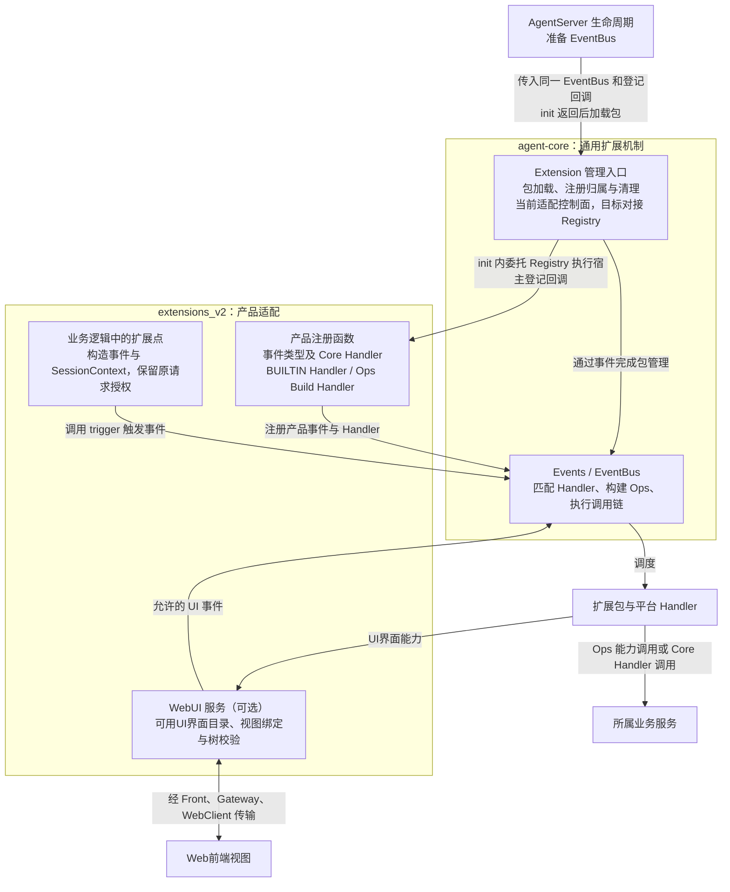

# JiuwenSwarm Extensions V2 设计概览

## 文档状态与阅读说明

| 项 | 说明 |
| --- | --- |
| 类型 | 设计基线；Events、Extension 公共机制、Registry 门面、AgentServer 装配与 WebUI 本地渲染链路已实现，跨进程联调待开展 |
| 最近一次修订日期 | 2026-10-30 |
| 维护责任 | Extensions V2 模块维护者；跨模块约定由 agent-core 与 JiuwenSwarm 相关维护者共同确认 |
| 所属模块 | `jiuwenswarm/extensions_v2/` |
| 详细设计 | [详细架构](extensions-v2-architecture.md) |
| 公共机制依据 | agent-core [Events 架构](../../../../../agent-core/openjiuwen/core/events/docs/designs/events-architecture.md)、[Extension 架构](../../../../../agent-core/openjiuwen/core/extension/docs/designs/extension-architecture.md) |
| 模板与目录规范 | [Overview 模板](../../../docs/templates/overview-template.md)、[模块维护规范](../../AGENTS.md) |
| 关键前提 | Events 已提供 EventBus、Builder、Ops 与执行链；Extension 已提供 Registry、九类管理事件、candidate 发布与包加载控制面，JiuwenSwarm Registry 门面与 WebUI 本地链路已实现。Gateway/WebClient 跨进程传输仍待联调，见第 5 节 |

本文面向首次了解方案的开发、评审和测试人员，说明 Extensions V2 的架构分层、模块职责，以及包管理、事件调用和UI界面呈现如何协作。第 1～5 节依次介绍目标与范围、核心模型、主要流程、关键约束和落地条件。

概览保留整体设计结论；模块工作方式、接入步骤和异常处理在架构中展开，阅读入口集中在第 5.3 节。文中的能力与事件名称用于解释方案，尚非已发布接口。

## 1. 目标与范围

### 1.1 定位与目标

Extensions V2 是 JiuwenSwarm 接入 agent-core 通用扩展机制的产品适配层。它让扩展包在平台开放的业务处理点参与工作，并通过受控入口使用工具、会话、UI界面和渠道等产品能力。

这层适配要解决两个问题：将产品的业务处理点接入统一事件调用链，让扩展能够参与处理；将产品服务封装为 Ops 能力，让扩展在当前调用上下文中使用。包的加载与注册、事件的匹配与调用由 agent-core 提供，产品事件、Ops 能力及业务流程中的事件触发由 JiuwenSwarm 接入。

### 1.2 职责与范围边界

agent-core 提供包管理和事件调用机制，JiuwenSwarm 将它们接到产品服务，扩展包实现自己的业务逻辑。扩展与平台通过事件处理器参与调用链，处理器遵循 `EventHandler` 回调约定，下文简称 Handler。Handler 在 AgentServer 的业务运行时执行；跨服务通信复用 AgentServer Front、Gateway 和 WebClient 的传输链路，每个包无需建立专用 WebSocket 服务。

工具、文件或渠道的实际操作仍由所属服务完成。WebUI 是按需使用的呈现能力；没有UI界面的扩展也可以独立参与业务。

### 1.3 当前范围与后续扩展

本期范围包括**包加载与安装存储、在线管理门面、携带可信会话的业务事件**，以及 WebUI 的 JSON 树呈现与交互。包管理门面直接委托 agent-core `Registry`，已覆盖安装、卸载、重载与查询；在线管理的真实接入、Gateway 渠道能力及旧扩展迁移分别验证后开放，当前实现状态见第 5.1 节。

不同 Harness（智能体执行框架）、同步／异步／流式工具路径及非 Web 渠道需逐项接入。新增渠道也需单独验证实际收发与 V2 调用链。

远程包市场、自动联网安装依赖、Web前端执行任意插件代码、跨进程事件总线、持久事件重放和崩溃续跑不在本期范围。单包重载沿用 core 的 Handler 热切换，产品接入与视图兼容仍须验证。

## 2. 核心模型与职责

### 2.1 总体关系

整体按职责分为三层：**agent-core 提供通用机制，`extensions_v2` 完成产品适配，扩展包提供业务逻辑。** AgentServer 装配这些模块；工具、会话等所属业务服务负责实际操作；WebUI 和传输组件负责可选的UI界面交互。

下图表示逻辑调用和注册关系，框内模块不要求独立部署。包管理负责使扩展可用，事件调用负责每次业务处理；扩展需要UI界面时，再使用 WebUI 能力。

| 参与方 | 主要职责 |
| --- | --- |
| AgentServer | 创建业务运行实例，准备同一 EventBus 和 ExtensionManager；把产品登记回调交给 `ExtensionManager.init`，初始化返回后核对包加载结果，协调业务准入和启停 |
| `extensions_v2` | 汇总产品事件、Core Handler、BUILTIN Handler 和 Ops Build Handler，提供宿主登记回调；管理门面将回调传给 core Registry，接入业务触发、上下文和 WebUI |
| agent-core Extension / Events | EventBus 构造时登记 core 内置事件，包括九类管理事件；Registry 调用宿主登记回调并触发一次 `ops.build`，Extension 管理包加载和包信息，Events 保存登记并执行事件链 |
| 所属业务服务 | 完成实际操作，检查业务权限，保存并确认业务结果 |
| 扩展包 | 注册业务 Handler，通过开放事件参与处理、通过 Ops 使用能力，维护自身业务状态 |
| AgentServer WebUI 服务与Web前端 | 服务端管理可呈现内容、视图关系及下发内容；Web前端负责挂载、显示和采集交互 |
| Front、Gateway、WebClient | 认证、路由或传递请求、响应和主动更新；Gateway 的渠道适配器连接外部平台 |

代码依赖沿 `extensions_v2 → agent-core Extension → agent-core Events`，产品适配也可直接使用 Events 公共入口；agent-core 不反向依赖 JiuwenSwarm。Extension 管理入口与 Handler 位于 AgentServer 的业务运行时，Front 负责协议和连接；事件调用发生在进程内，跨进程或跨服务消息由 AgentServer Front、Gateway 和 WebClient 显式适配。

业务结果沿调用链返回触发事件的业务逻辑；UI界面更新通过独立消息发送，不能依赖请求响应总先到达。包加载成功不会自动触发业务，业务处理也不要求先有UI界面。

### 2.2 对象及事实权威

| 核心对象 | 含义与管理方 |
| --- | --- |
| 扩展包与注册 | 包组织代码和声明，可包含多个后端扩展单元；单元注册 Handler，包可选声明扩展UI界面项。agent-core 保存生效、注册归属和清理记录，AgentServer 据此判断可用性 |
| Event、EventBus 与 Handler | Event 表达一次处理请求；Handler 是遵循 `EventHandler` 回调约定的事件处理器，由 EventBus 根据注册匹配并调用。同一条注册可供多次事件调用复用 |
| SessionContext、Ops 与 next | 业务入口根据服务端会话记录构造只读 SessionContext；EventBus 为实际进入的每个普通 Handler 创建独立 Ops，包信息取自该 Handler 的登记记录。Extension Runtime 负责核实并在发布时填入包信息，用户扩展不填写。Ops 仅在所属 Handler 调用期间使用，next 在 Handler 退出后失效 |
| 扩展UI界面项与 slot | 扩展UI界面项是包提供的面板、卡片等UI界面内容；扩展UI界面声明说明其标识、展示信息、挂载位置及渲染方式。slot 是产品预置的挂载位置；服务端提供可用目录，Web前端选择兼容内容 |
| 视图实例 | 页面预留区域（slot）中的具体显示对象，后文简称“视图”；支持会话槽位和全局槽位，分别按聊天会话和 Web 连接隔离。各视图维护自己的显示和交互状态 |
| 视图绑定与渲染帧 | 服务端根据槽位范围记录视图所属的会话或 Web 连接，以及包、slot 和实例标识，据此定位交互与更新目标。实例存在不等于拥有操作权限。目标字段、路由和当前实现边界见[详细架构第 4.4 节](extensions-v2-architecture.md#44-agentserver-webui-服务) |
| 业务结果 | 工具、文件或外部操作的实际结果，以所属业务服务的记录或外部回执为准 |

每个事件在 CORE 层有唯一的 Core Handler，负责该事件的默认动作。本文将 `ops.build` 以外的事件称为普通事件，参与这些事件的 USER、BUILTIN 层 Handler 及 Core Handler 统称普通 Handler。`ops.build` 的 Handler 称为 Build Handler，只负责收集能力，构建时不接收会话和可用 Ops，也不为自身递归构建 Ops；构建流程见[架构第 4.3.2 节](extensions-v2-architecture.md#432-能力注册与构建接入)。

这些对象形成三个范围：包及注册属于 AgentServer 运行实例，一次事件及其 Handler 拥有本次调用上下文，每个已打开的面板拥有独立的视图和视图绑定。例如，会话 A、B 分别打开同一个报告面板时，Web前端创建两个视图，服务端保存两条记录；刷新 A 的面板时，通过 A 的记录核对会话并把更新发回 A 的面板。包是否可用、一次业务是否完成和面板是否显示内容，需要分别判断。

### 2.3 贯穿设计的原则

- **实际操作由所属服务完成。** 每个事件的 Core Handler 负责其默认动作，触发事件的业务逻辑不再重复执行同一动作；扩展 Handler 合法短路时，也不补执行 Core Handler。
- **上下文随调用绑定。** 每个实际进入的普通 Handler 使用独立 Ops；共享业务状态的隔离与并发仍由所属模块负责。
- **结果分环节确认。** 包生效、事件返回、业务完成和页面显示各有依据，后续失败不能抹去已发生的事实。

### 2.4 集成 agent-core 实现扩展机制时的接入工作

产品接入包含两件事：**用事件开放扩展可以参与的处理点，用 Ops 开放 Handler 可以调用的产品能力**。

**新增产品事件。** 明确事件的输入、返回、匹配规则和 Core Handler，汇总到传给 `ExtensionManager.init` 的宿主事件登记回调，由门面委托 core `Registry.init` 调用；业务逻辑在预定扩展点调用同一 EventBus，传入业务输入和根据服务端记录构造的 SessionContext。扩展登记 Handler 后，在该事件被触发时参与处理。

**新增 Ops 能力。** 产品实现连接所属服务的能力函数，再通过宿主 Handler 登记回调，为 `ops.build` 增加 BUILTIN Handler。`Registry.init` 在回调返回后触发一次 Build，Build Handler 向同一个 Builder 添加命名空间和方法，EventBus 保存构建结果。初始化返回后即可加载包，AgentServer 不再单独触发 Build。普通事件只使用已保存的 Builder，为每个实际进入的 Handler 创建独立 Ops。构建协议见 [Events 公共契约](../../../../../agent-core/openjiuwen/core/events/docs/specs/S_01_events-contract.md#43-opsbuild)。

AgentServer、WebUI、Gateway 分别提供所属领域的服务与适配。增加组件或渠道后，还需接通事件或能力入口，才能供扩展使用；一个 Ops 方法与一个事件类型不要求一一对应。通用步骤和分领域例子见第 5.3 节。

## 3. 关键流程与完成语义

### 3.1 入口与正常链路

系统有三条相互关联、触发时机不同的链路。

**包管理链路：使扩展可用。** AgentServer 准备 EventBus，其上已有 core 内置事件及九类管理事件；随后把同一实例和产品登记回调交给 `ExtensionManager.init`。门面委托 `Registry.init` 先执行回调，登记 swarm 事件、BUILTIN Handler 和 Ops Build Handler，再触发一次 `ops.build`。门面用 `resolve_install_dir()` 解析安装目录，默认使用 `~/.jiuwenswarm/extension_pkgs`，并调用 core 的 `open_install_dir`。初始化返回后，AgentServer 调用 `manager.load_installed()`，由门面选取已安装版本并交给 core 安装；AgentServer 核对逐包 Report 后开放对应业务入口。

**业务调用链路：让扩展参与一次处理。** 业务逻辑在预定的扩展点调用 EventBus 触发事件，传入包含业务输入的 Event、根据服务端会话记录构造的 SessionContext，并保留原请求授权范围。EventBus 匹配本次 Handler，按 USER（个人扩展）、BUILTIN（平台内置）、CORE（Core Handler）层级推进；每次进入普通 Handler 前独立构建 Ops。Handler 可按契约调用 next 继续处理，也可直接返回；实际进入 Core Handler 时，由其调用所属服务执行默认动作。结果沿已进入的调用链返回触发事件的业务逻辑，不再补跑同一默认动作。例如，AgentServer 在回合准备步骤触发产品事件，处理继续到该事件的 Core Handler 时，再调用底层准备服务；具体类型由对应特性设计文档定义。

**UI界面链路：打开面板、交互和更新。** 用户选择可用的扩展UI界面项后，Web前端在兼容的 slot 中创建视图并申请挂载。AgentServer WebUI 服务校验请求，保存这个视图的归属和投递记录。扩展生成 JSON UI界面树，经校验并沿 AgentServer Front、Gateway 和 WebClient 的传输链路发送到对应视图，由Web前端显示。用户点击面板中的按钮时，服务端先根据视图绑定核对会话和权限，再触发允许的 UI 事件；生成的新画面仍发送到指定视图。后端也可在有效业务调用中主动更新指定视图，无需等待中的聊天请求。

包加载后可以处理多次业务调用；业务状态可先于视图存在，用户尚未打开面板时仍可保存业务结果，打开后再生成画面。没有UI界面的扩展只需接入前两条链路。详细协作见[架构第 5 节](extensions-v2-architecture.md#5-模块协作与处理流程)。

### 3.2 完成与交付的确认点

| 结果 | 由谁确认 | 对整体流程意味着什么 |
| --- | --- | --- |
| 初始化完成 | `ExtensionManager.init` 委托 `Registry.init` 执行宿主回调和内部 Build，随后设置安装目录并成功返回 | 产品事件、管理组件和能力目录已就绪；用户包与具体业务能力仍须分别核对 |
| 能力目录构建成功 | `Registry.init` 内部触发的 `ops.build` 成功，EventBus 保存 Builder | 可以加载包；实际授权和服务可用性仍须检查，AgentServer 不再单独 Build |
| 包可用 | AgentServer 核对 agent-core 生效记录与 Report | 允许对应入口使用扩展 |
| 事件返回 | 调用方取得符合契约的结果 | 本次调用结束；Core Handler 是否执行需另核对 |
| 业务完成 | 所属服务记录或外部回执 | 实际操作已完成，扩展后续处理与UI界面显示仍可能失败 |
| UI界面交付 | 传输确认发送，Web前端确认本地应用 | 发送和显示分别成立；服务端取得应用确认的协议尚待建立 |

初始化、绑定、渠道收发及卸载的完整确认依据见[架构第 6.3 节](extensions-v2-architecture.md#63-完成与结果交接)。

### 3.3 控制、失败与重试

失败由对应环节处理：AgentServer 核对加载与清理，业务方核对实际操作，WebUI 与传输处理内容和发送，Web前端处理本地应用。

宿主登记回调或 Build 失败时，初始化不成功返回。当前 `install_extensions` 记录错误并禁用本次扩展装配，不继续加载包；聊天服务可继续启动。重建前应核对本次已登记内容和自有资源，不能在已有部分登记的 EventBus 上盲目重试；core 内置事件不作为本次产品登记撤销。

实际操作完成后，即使扩展后续处理或UI界面发送失败，已发生的业务结果仍然有效。超时或断线导致结果未知时，先查询实际结果，再决定是否重试；重新取得画面不会自动重放点击或工具操作。详细责任见[架构第 8 节](extensions-v2-architecture.md#8-故障处理与继续执行)。

## 4. 持续状态与关键约束

### 4.1 状态与资源生命周期

包实例和注册属于当前 AgentServer 运行实例；Ops 只在所属 Handler 调用期间使用。面板视图由Web前端创建和释放，AgentServer WebUI 服务按渲染目标维护活跃记录。关闭面板、切换会话、Web前端断线或包退出时，相关记录失效，后续交互和画面更新不能继续使用旧记录；重新打开时按渲染目标建立新的有效关联，重连时由服务端重发该目标最近一帧。

每个 AgentServer 业务运行实例按一个 EventBus 对应一个 Extension 管理入口装配，业务、管理和 USER 注册使用同一 EventBus。AgentServer 协调 EventBus 的创建和最终释放，不在初始化后替换实例；多个独立管理入口共用同一个 EventBus 不在本期范围内。

卸载时若仍被依赖或还有在途调用，按 core 契约立即返回失败，原注册和安装目录保留；swarm 不因这次拒绝清空原可用视图。允许卸载时才移除注册、删除安装副本并清除相关视图。重载先准备完整 candidate，成功后一次切换；准备、发布或生效记录写入失败时旧实例保持不变，旧快照调用继续用旧代码。AgentServer 负责自身业务调用的跟踪与等待，Events 不提供 drain；当前在途计数接入仍待完成。停机先停止新请求、等待自身调用退出，再协调包清理和资源释放。协作顺序见[架构第 5.2.4 节](extensions-v2-architecture.md#524-视图退出包卸载重载与-agentserver-停止)。

### 4.2 恢复与一致性

包记录、业务结果和Web前端画面分别生效，没有跨模块事务。重启可以重新加载包，重连可以重新认证、建立视图并接收服务端重发的最近一帧，但都不能续接旧调用栈或重放历史交互。并发更新和页面应用确认仍待定稿，恢复限制见[架构第 8.3 节](extensions-v2-architecture.md#83-恢复依据与继续边界)。

### 4.3 授权、隔离与资源约束

AgentServer 与 Gateway 检查接入范围，业务服务在实际操作前检查当前权限；会话或包标识本身不授予权限。UI界面操作通过当前有效的视图绑定记录核对具体面板及其归属，知道渲染目标也不能代替权限检查。目标面板已关闭或记录已失效时，停止这次交互或更新，不改发到其他面板。

Web前端只呈现平台允许的组件、动作和样式。独立 Ops 不会自动隔离扩展全局状态，受限接口也不能代替不可信 Python 代码的沙箱。并发、嵌套、UI界面树和发送积压需设限并实测，当前没有数值保证。检查位置与隔离责任见[架构第 9 节](extensions-v2-architecture.md#9-权限隔离与资源限制)。

## 5. 现有基础与落地边界

### 5.1 可复用基础与待建设能力

截至本次修订，agent-core Events 已实现 EventBus、Builder、Ops 和执行链；agent-core Extension 已实现 Registry、九类管理事件、manifest、安装目录、依赖排序、Plan、candidate、发布和生效记录。JiuwenSwarm 已实现 Registry 门面、安装存储接入、AgentServer 装配、WebUI 事件与渲染运行时及 Token Weather 示例包，覆盖安装、启动加载、卸载、重载、查询、停机、槽位挂载、渲染下发、交互回传与刷新恢复，并有本地单元验证；重连重发、会话删除清理、真实业务触发及 Gateway/WebClient 跨进程联调仍待交付或验证。源码及测试入口见[架构第 3.4 节](extensions-v2-architecture.md#34-已有基础与接入缺口)。

旧扩展启停、工具与会话服务、Web 代理、主动推送和渠道收发提供了接入基础。V2 仍需建设业务扩展点的事件触发、可信上下文、扩展UI界面项与绑定、树渲染和跨服务适配。源码依据与缺口集中在[架构第 3.4 节](extensions-v2-architecture.md#34-已有基础与接入缺口)，旧机制的逐类迁移约束见[第 10.3 节](extensions-v2-architecture.md#103-保留删除升级与迁移)。

### 5.2 能力开放条件

能力按范围分别开放：基础扩展需先证明加载结果可核对、业务逻辑在预定扩展点触发事件并使用处理结果、可信包身份到 Ops 的适配及会话和授权正确；WebUI 还需完成UI界面项挂载、交互、定向推送及重连的真实联调；在线管理、渠道接入和旧扩展迁移各自验证生命周期与兼容边界。

架构[第 10.1 节](extensions-v2-architecture.md#101-保证范围与成立条件)集中维护各项能力的具体开放条件，[第 11.2 节](extensions-v2-architecture.md#112-架构要求与验证归属)说明验证主题与责任。未满足条件时限制对应入口；当前没有 V2 验收记录，旧测试通过不能替代 V2 验收。

### 5.3 详细设计与实施文档索引

后端包管理请求已接入同一门面，包含安装、查询、卸载、热重载以及失败结果核对；新增工作与后端验证见计划 EXTV2-09～12。[后端协议](../specs/S_02_backend-package-management.md)维护请求和响应，本轮不包含前端操作界面。

| 阅读目的 | 入口 |
| --- | --- |
| 理解模块组成和内部工作方式 | 架构[第 3 节](extensions-v2-architecture.md#3-架构总览与模块分工)、[第 4 节](extensions-v2-architecture.md#4-关键模块设计) |
| 按模板开发内置事件与 Handler | [开发模板](builtin-event-development-guide.md)：分别介绍 WebClient、Gateway 和 AgentServer |
| 开放产品能力、增加扩展参与点 | [Ops 接入](extensions-v2-architecture.md#43-ops-能力注册与服务适配)、[事件类型接入](extensions-v2-architecture.md#42-业务事件定义与扩展点接入) |
| 查阅 AgentServer、WebUI、Gateway 接入例子 | [新增 Ops 示例](extensions-v2-architecture.md#114-新增-ops-的具体例子)、[新增事件示例](extensions-v2-architecture.md#115-新增事件类型的具体例子) |
| 核对协作流程、完成依据与数据归属 | 架构[第 5 节](extensions-v2-architecture.md#5-模块协作与处理流程)、[第 6 节](extensions-v2-architecture.md#6-状态事件与完成条件)、[第 7 节](extensions-v2-architecture.md#7-数据管理与保存规则) |
| 查找前提、待确认的设计内容和参考来源 | 架构[第 12.2 节](extensions-v2-architecture.md#122-未验证前提与待确认问题)、[第 12.3 节](extensions-v2-architecture.md#123-参考依据与文档分工) |

包管理门面的当前契约见[门面规约](../specs/S_01_extension-management-facade.md)，包管理与 WebUI 方案见[F_02](../features/F_02_control-plane.md)至[F_08](../features/F_08_frontend-render.md)，开发计划见[特性开发计划](extensions-v2-development-plan.md)。后续按[模块规范](../../AGENTS.md)分别维护定稿契约、实施与验证证据、任务与进度；概览同步整体结论。

## 2026-10-31 七项会话查询事件化

已开放 cwd/root/model/repo/messages/turns/usage 采用 Ops→同名查询 Event→USER/BUILTIN/CORE 的路径，返回格式优先对齐 Claude。字段、兼容与逐项解释见 [S_08](../specs/S_08_session-query-events.md) 和 [查询协议与特性索引](../specs/S_08_session-query-events.md#7-特性与验收索引)。仅 Worker 持有 EventBus；验证返回参数，不介入原 Token Weather 渲染。
