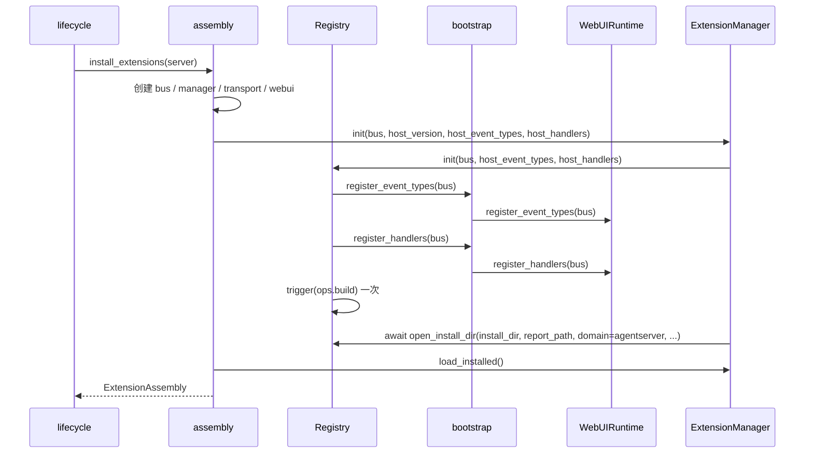

# 启动装配与包来源设计方案

## 元信息

| 项 | 内容 |
| --- | --- |
| 类型 | feature |
| 编号 / slug | `F_01 / assembly-and-source` |
| 关联计划 | EXTV2-01 启动装配与包来源 |
| 所属模块 | `jiuwenswarm/extensions_v2/{assembly,config}.py`、`server/worker/lifecycle.py` |
| 设计依据 | [F_02](F_02_control-plane.md)、[F_03](F_03_registry-facade.md)、agent-core [Registry](../../../../../agent-core/openjiuwen/core/extension/registry.py) |
| 最近一次修订日期 | 2026-10-24 |
| 方案状态 | 已实现，单元验证通过 |

## 1. 问题与目标

AgentServer 在一次进程启动中只应创建一套扩展运行时。装配必须保证 EventBus、宿主事件、包管理和 WebUI 运行时彼此引用同一实例，并在任一步失败时不影响会话主流程。

一句话概括：**装配入口创建单例组件，把宿主注册函数交给 Registry 调用，再激活配置安装目录中的包。**

## 2. 范围

### 2.1 本次范围

- `install_extensions(server)` 单例装配与 `shutdown_extensions()`。
- EventBus 创建、宿主事件与 Handler 注册回调。
- 安装目录解析与宿主版本读取。
- 配置安装目录中的已安装包激活。
- 装配失败时扩展能力降级，不阻断 AgentServer。

### 2.2 非目标

- 不定义事件类型、Handler 或渲染协议。
- 不实现包解析、依赖决策与发布。
- 不扫描旧 `jiuwenswarm/extensions/` 目录。

## 3. 总体设计

### 3.1 装配顺序

### 3.2 组件职责

| 组件 | 负责 |
| --- | --- |
| `assembly` | 单例、锁、创建顺序、失败降级、停机编排 |
| `bootstrap` | 汇总平台事件类型、CORE Handler 与 BUILTIN Handler 的注册 |
| `ExtensionManager` | Registry 门面与安装目录 |
| `WebUIRuntime` | `ui.*` 事件类型、CORE Handler、`ops.build` BUILTIN Handler |
| `RenderTransport` | 将渲染帧转交给 AgentServer 推送能力 |
| `WebUICatalogService` | 从生效包 manifest 读取 `ui` 声明 |

### 3.3 顺序约束

1. EventBus 必须先创建；九类管理事件与 `ops.build` 由 Events 内置模块在构造时登记。
2. 宿主事件与 Handler 必须在 `Registry.init` 内、`ops.build` 之前注册。
3. `ops.build` 只触发一次，由 `Registry.init` 完成；装配层不再重复触发。
4. 包安装只能在 `init` 与 `open_install_dir` 之后进行。

## 4. 来源与激活

### 4.1 安装目录

`resolve_install_dir()` 按 F_03 的优先级解析，缺省 `~/.jiuwenswarm/extension_pkgs`。目录不存在时由 agent-core 在首次复制时创建。

### 4.2 已安装包

`manager.load_installed()` 委托 Core 从根目录完整发现、选版和稳定排序，再选择 `agentserver` 的包加载。共享报告和 domain 规则见 [F_32](F_32_domain-install-report.md)。单包失败不阻断独立包。

### 4.3 新包来源

启动只加载 `config.yaml` 中 `extensions.install_dir` 指定的安装目录，默认是
`~/.jiuwenswarm/extension_pkgs`；不扫描源码中的 `examples/`，也不从中复制或补装包。
新包通过 `/extension install` 或对应管理请求传入 ZIP 文件。已有安装副本由启动加载和热重载复用。

## 5. 失败与停机

| 阶段 | 失败处理 |
| --- | --- |
| 组件创建 | 记录异常，返回 `None`，扩展能力不可用 |
| `Registry.init` | 解除已绑定上下文，返回 `None` |
| 已安装包激活 | 逐包失败，继续启动 |

停机顺序：

1. 调用方停止新业务入口；`ExtensionManager.shutdown()` 先撤销依赖方，再撤销依赖包；
2. 失败则保留单例和未退出包，供查询及重试；成功退出包通过回调清理自身视图；
3. 全部撤销成功后，`WebUIRuntime.shutdown()` 清理剩余视图，再清空单例；重新装配创建新 Bus。

## 6. 实施影响

- `lifecycle` 在启动阶段调用 `install_extensions(server)`，在退出阶段调用 `shutdown_extensions()`。
- 新增配置键 `extensions.install_dir`，与旧机制的 `extensions.extension_dirs` 隔离。
- 装配失败不抛出到会话启动路径。

## 7. 验证

验证入口：`tests/unit_tests/extensions_v2/test_assembly.py`、`test_config.py`。

| 场景 | 结果 |
| --- | --- |
| 重复装配返回同一实例，只激活安装目录中的包 | 通过 |
| 空安装目录不复制或加载源码示例 | 通过 |
| 装配失败返回 `None`，服务器仍可启动 | 通过 |
| 停机后单例清空 | 通过 |
| 安装目录优先级、环境变量与相对路径基准 | 通过 |

2026-10-24 随完整 V2、Gateway E2A 和命令清单回归验证，180 项通过。
WebUI 示例相关测试自行安装夹具，不依赖启动自动安装。

## 8. 风险与遗留

- 装配单例按进程持有；同一进程多个 Agent 模式共享一套包与视图目录，若后续需要按模式隔离，应改为按模式注入独立实例。
- V2 与旧 `extensions/` 目录的互斥扫描尚无独立用例，当前依赖两套目录与配置键分离。
