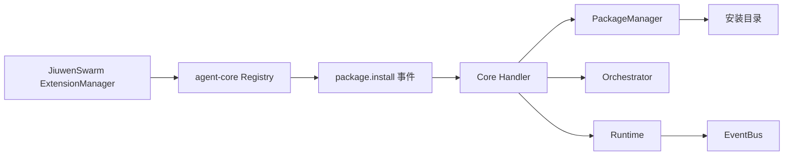
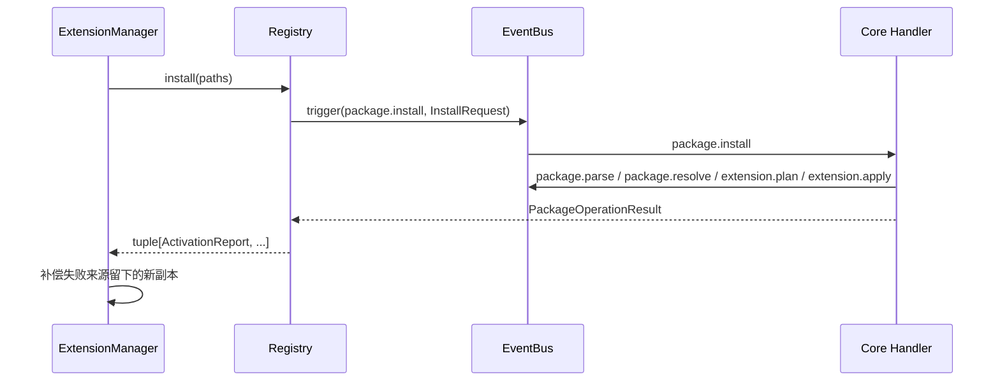

# 包加载控制面复用与安装存储设计方案

## 元信息

| 项 | 内容 |
| --- | --- |
| 类型 | feature |
| 编号 / slug | `F_02 / control-plane` |
| 关联计划 | EXTV2-02 包声明与安装存储 |
| 所属模块 | `jiuwenswarm/extensions_v2/management/registry.py`；agent-core `openjiuwen/core/extension/{package_manager,management}` |
| 设计依据 | agent-core [扩展架构](../../../../../agent-core/openjiuwen/core/extension/docs/designs/extension-architecture.md)、[包加载规约](../../../../../agent-core/openjiuwen/core/extension/docs/specs/S_01_package-loading.md) |
| 最近一次修订日期 | 2026-10-22 |
| 方案状态 | 已实现；宿主侧只保留来源选择和失败副本补偿 |

## 1. 问题与目标

agent-core 已通过 `Registry` 和九类 `package.*` 事件提供完整的包加载控制面：解析 manifest、依赖定序、复制安装副本、生成计划、加载模块和写入生效记录。JiuwenSwarm 不再维护第二套控制面，只需要决定“装什么、从哪装、失败后清理什么”。

一句话概括：**包加载规则全部由 agent-core 管理事件执行，宿主只负责选择来源并补偿 prepare 失败留下的安装副本。**

## 2. 范围

### 2.1 本次范围

- 复用安装目录布局 `<install_dir>/<package.id>/<version>/`。
- 通过 `Registry.install` 触发 `package.install`，按来源返回逐包 `ActivationReport`。
- 安装目录的列出、版本目录定位和副本删除使用 agent-core `PackageManager`。
- 对 `prepare` 失败且 agent-core 未清理的副本做宿主侧补偿删除。
- 启动时选择每个包的最高已安装版本交给 `load_installed`。

### 2.2 非目标

- 不定义 manifest 字段、版本语法、依赖排序或错误码。
- 不解析 zip、不复制文件、不加载模块。
- 不登记 Handler，不定义 WebUI 事件。

## 3. 总体设计

### 3.1 组件关系



### 3.2 责任划分

| 组件 | 负责 | 不负责 |
| --- | --- | --- |
| `ExtensionManager`（宿主） | 安装目录配置、来源列表、启动选版、失败副本补偿、停机编排 | manifest 校验、依赖决策、模块加载 |
| `Registry`（agent-core） | 初始化上下文、触发根管理事件、返回 `ActivationReport` | 选择来源、跨进程锁 |
| `PackageManager`（agent-core） | 打开目录或 zip、复制副本、列出和删除版本目录 | 是否生效 |
| `Orchestrator` / `Runtime`（agent-core） | 生成计划、准备候选、发布与撤销 | 宿主业务语义 |

### 3.3 关键接口

| 接口 | 语义 |
| --- | --- |
| `Registry.install(source)` | 触发 `package.install`，返回 `tuple[ActivationReport, ...]` |
| `Registry.uninstall(package_id)` | 触发 `package.uninstall`，删除生效包及其版本目录 |
| `Registry.reload(package_id)` | 从安装副本触发 `package.reload` |
| `PackageManager.list_installed()` | 返回带 `manifest.yaml` 的版本目录列表 |
| `PackageManager.version_dir(id, version)` | 返回副本路径，拒绝逃逸安装目录 |
| `PackageManager.remove_installed(id, version)` | 删除一个版本目录；不存在时报 `EXTENSION_PACKAGE_NOT_INSTALLED` |
| `load_manifest(root)` | 读取并校验 manifest，失败抛 `ExtensionFailure` |

## 4. 处理流程

### 4.1 批量安装



单个来源失败不会回滚同批其他已成功的包。依赖包失败时，依赖方以 `FAILED + EXTENSION_DEPENDENCY_NOT_MET` 结束，agent-core 不产生 `SKIPPED` 状态。

### 4.2 安装副本

1. 来源可以是目录或 `.zip`；zip 由 agent-core 解压到临时目录并在安装结束后关闭。
2. 副本写入 `<install_dir>/<package.id>/<version>/`，先写 staging 再重命名。
3. 同版本目录已存在时复制失败（`EXTENSION_INSTALL_COPY_FAILED`），不覆盖正在使用的代码。
4. 用户来源目录和 zip 不由本层删除。

### 4.3 失败副本补偿

agent-core 在**发布失败**时会触发 `extension.rollback` 并删除本次新建副本；但**prepare 失败**只返回 `PrepareResult(error=...)`，不触发回滚。宿主在 `install` 前后比较 `list_installed()`，对本批新增且结果为 `FAILED` 的版本目录执行删除，避免坏包长期占用同版本路径。

补偿只删除本批新增的目录。若目录已被 agent-core 删除，则跳过，不产生二次错误。

### 4.4 启动选版

`load_installed` 读取安装目录，按 `package_id` 分组，取版本号最高的副本；已生效的包跳过。没有有效 manifest 的目录记录告警后忽略，不阻断其他包。

## 5. 异常与清理

| 阶段 | 结果 | 清理责任 |
| --- | --- | --- |
| 来源不可读 | `FAILED + EXTENSION_SOURCE_INVALID` | 未复制 |
| manifest 非法 | `FAILED + EXTENSION_MANIFEST_INVALID` | 未复制 |
| 依赖冲突或缺失 | 逐包 `FAILED` | 未复制或由 agent-core 回滚 |
| 复制失败 | `FAILED + EXTENSION_INSTALL_COPY_FAILED` | agent-core 删除 staging |
| prepare 失败 | `FAILED + EXTENSION_LOAD_FAILED` | 宿主删除本批新副本 |
| publish 失败 | `FAILED` | agent-core 回滚已登记 Handler 并删除新副本 |

## 6. 关键决策

| 编号 | 决策 | 依据 |
| --- | --- | --- |
| D-01 | 不在宿主复制 manifest、排序和版本规则 | 避免与 agent-core 契约漂移 |
| D-02 | 安装和卸载都走管理事件，不直接调用 `PackageManager` 完成主流程 | 保证 Runtime、EventBus 和安装目录同步 |
| D-03 | 只补偿 prepare 失败的副本 | agent-core 已覆盖 publish 失败的回滚 |
| D-04 | 启动时每个包只激活最高版本 | 同包多版本共存时行为可预测 |

## 7. 实施影响

- 宿主实现位于 `jiuwenswarm/extensions_v2/management/registry.py`。
- 依赖 agent-core `Registry`、`PackageManager`、`load_manifest` 和 `management` 请求类型。
- 安装目录由 `extensions_v2/config.py` 解析，缺省 `~/.jiuwenswarm/extension_pkgs`。
- 不修改 `jiuwenswarm/extensions/` 旧机制。

## 8. 验证

验证入口：`tests/unit_tests/extensions_v2/management/test_registry_facade.py`。

| 场景 | 结果 |
| --- | --- |
| 合法包安装并写入副本 | 通过 |
| 非法 manifest 不产生副本 | 通过 |
| 同批重复包标识整批失败 | 通过 |
| 坏来源不阻断同批合法包 | 通过 |
| 依赖缺失返回 `DEPENDENCY_NOT_MET` | 通过 |
| 同版本副本拒绝覆盖 | 通过 |
| 卸载删除生效包版本目录 | 通过 |

执行命令：

```powershell
.venv\Scripts\python.exe -m pytest tests\unit_tests\extensions_v2\management -q -o addopts="" --asyncio-mode=auto
```

## 9. 风险与遗留

- 安装目录是进程共享资源，宿主没有跨进程写锁；多个 AgentServer 写同一目录需部署层串行化。
- agent-core 的 `uninstall` 只删除当前生效版本目录；同包的其他历史版本由宿主在包未生效时按需删除。
- 在途调用计数尚未接入 EventBus 调用路径，详见 F_04。
