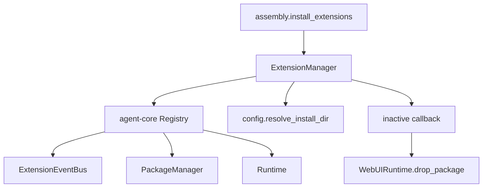
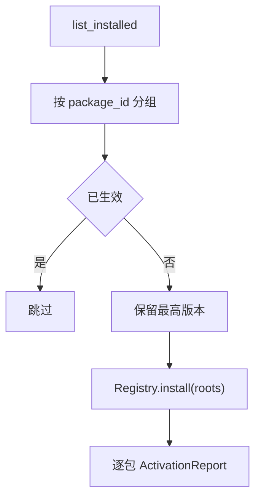

# 扩展包管理门面与生命周期设计方案

## 元信息

| 项 | 内容 |
| --- | --- |
| 类型 | feature |
| 编号 / slug | `F_03 / registry-facade` |
| 关联计划 | EXTV2-03 包管理门面与生命周期 |
| 所属模块 | `jiuwenswarm/extensions_v2/management/registry.py`、`extensions_v2/config.py` |
| 设计依据 | [F_02 控制面复用](F_02_control-plane.md)、agent-core [Registry](../../../../../agent-core/openjiuwen/core/extension/registry.py) |
| 最近一次修订日期 | 2026-10-23 |
| 方案状态 | 已实现，单元验证通过 |

## 1. 问题与目标

agent-core `Registry` 只负责绑定 EventBus 并触发管理事件；宿主仍需要处理安装目录来自哪里、启动时安装哪些包、停机时按什么顺序释放、卸载一个未生效副本时如何收敛结果。本特性提供 `ExtensionManager` 作为 AgentServer 唯一使用的管理入口，把这些宿主关注点固定在门面内。

一句话概括：**门面把宿主配置与生命周期动作收敛为一组固定方法，包解析、加载、发布和错误分类全部委托给 agent-core。**

## 2. 范围

### 2.1 本次范围

- 绑定一个 `ExtensionEventBus`，并打开一次安装目录。
- 批量安装、启动激活、卸载、重载、查询和停机。
- 启动时按包选择最高版本，跳过已生效包。
- 卸载未生效但仍有副本的包。
- 停机时按依赖逆序撤销已发布 Handler，保留安装副本。
- 包卸载或停机后通知宿主清理界面实例。

### 2.2 非目标

- 不定义 manifest、版本、依赖或 Handler 级别规则。
- 不实现远程下载、签名校验或包市场。
- 不定义 WebUI 事件与渲染。
- 不提供跨进程 Registry。

## 3. 总体设计

### 3.1 组件关系

`ExtensionManager` 只持有一个 `Registry` 实例，不缓存 manifest 或 Handler 声明。所有写操作串行进入 agent-core；宿主不另建包状态表。

### 3.2 安装目录

`resolve_install_dir` 取值顺序：

1. 配置键 `extensions.install_dir`；
2. 环境变量 `EXTENSION_INSTALL_DIR`；
3. 缺省值 `extension_pkgs`，相对路径落在 `~/.jiuwenswarm/` 下。

相对路径以用户工作区为基准，最终展开为绝对路径。

## 4. 门面接口

### 4.1 `ExtensionManager`

| 方法 | 签名 | 行为 |
| --- | --- | --- |
| `init` | `async init(event_bus, *, host_version=None, host_event_types=None, host_handlers=None)` | 调用 `Registry.init` 注册宿主事件与 Handler，随后 `open_install_dir`；重复调用直接返回 |
| `install` | `async install(paths: Sequence[Path]) -> list[ActivationReport]` | 委托 `Registry.install`，补偿失败副本 |
| `load_installed` | `async load_installed() -> list[ActivationReport]` | 每包选最高未生效版本，一次性批量安装 |
| `uninstall` | `async uninstall(package_id) -> ActivationReport` | 委托 `Registry.uninstall`；未生效时删除残留副本 |
| `reload` | `async reload(package_id) -> ActivationReport` | 从安装副本热切换，generation 递增 |
| `query` | `async query(package_id=None) -> QueryResult` | 触发 `package.query`，返回 agent-core 事实 |
| `active_packages` | `active_packages() -> tuple[ActivePackageRecord, ...]` | 供界面目录等只读消费者使用 |
| `set_inactive_callback` | `set_inactive_callback(callback)` | 包卸载或停机后通知宿主清理视图 |
| `shutdown` | `async shutdown()` | 逆依赖顺序 `Runtime.unpublish`，不删除副本，重置 Registry |

### 4.2 返回结构

门面直接返回 agent-core 的 `ActivationReport` 和 `QueryResult`，不维护同义类型：

| 类型 | 关键字段 |
| --- | --- |
| `ActivationReport` | `plan_id`、`package_id`、`operation`、`status`、`previous_generation`、`current_generation`、`error` |
| `QueryResult` | `active`、`installed`、`inflight`、`published` |
| `ActivePackageRecord` | `package_id`、`version`、`root`、`generation`、`requires_packages` |

## 5. 生命周期流程

### 5.1 初始化

1. `Registry.init` 绑定管理上下文，调用宿主 `host_event_types` 和 `host_handlers`。
2. `Registry.init` 内部触发一次 `ops.build`；门面与装配层都不得再次触发。
3. `open_install_dir` 记录安装目录和宿主版本，返回已有副本列表，不安装。
4. 任一步失败时，若 Registry 已绑定则解除上下文，重建空 Registry 并向上抛出。

### 5.2 启动激活

manifest 不可读或版本非法的目录记录告警后忽略，不影响其他包。

### 5.3 卸载

1. 调用 `Registry.uninstall`。
2. 成功时通知 inactive callback。
3. 返回 `EXTENSION_PACKAGE_NOT_INSTALLED` 时，检查安装目录是否存在该包副本：
   - 存在则删除全部版本目录并返回成功；
   - 不存在则保留原失败结果。

该分支覆盖“包已复制但尚未生效”和“上次停机遗留副本”两种场景。

### 5.4 停机

按 `requires_packages` 计算依赖叶子，先撤销没有剩余依赖方的包，再逐层向上。先核对 Core 的公开卸载判断，再调用 `Runtime.unpublish`，不删除安装目录。失败时继续处理独立包，只通知撤销成功的包；仍有失败则保留门面并抛错，全部成功才解除上下文。

## 6. 并发与状态边界

- 同一门面的根写操作由宿主写锁串行，查询不占锁，包退出通知在锁外执行；补充方案见 [F_11](F_11_management-serialization.md)。
- `init` 幂等：同一门面重复调用不会重复注册事件或重复触发 `ops.build`。
- `shutdown` 后门面回到未初始化状态；再次使用必须重新 `init`。
- 生效包事实只来自 `Runtime`，门面不做缓存。

## 7. 错误语义

| 场景 | 结果 |
| --- | --- |
| 未初始化调用写方法 | `ExtensionFailure`，原因 `extension manager is not initialized` |
| 包不存在或未生效 | `ActivationReport(FAILED, EXTENSION_PACKAGE_NOT_INSTALLED)` |
| 被其他包依赖 | `ActivationReport(FAILED, EXTENSION_PACKAGE_IN_USE)` |
| 同版本副本已存在 | `ActivationReport(FAILED, EXTENSION_INSTALL_COPY_FAILED)` |
| 包内声明 core Handler | `ActivationReport(FAILED, EXTENSION_HANDLER_LEVEL_FORBIDDEN)` |

## 8. 验证

验证入口：`tests/unit_tests/extensions_v2/management/test_registry_facade.py`、`test_activation_publish.py`。

| 场景 | 结果 |
| --- | --- |
| 重复初始化只触发一次 `ops.build` | 通过 |
| 安装、查询、重载、卸载闭环 | 通过 |
| 启动只激活最高版本 | 通过 |
| 卸载未生效副本 | 通过 |
| 停机撤销 Handler 并保留安装副本 | 通过 |
| 卸载后触发 inactive callback | 通过 |
| 卸载被依赖包返回 `EXTENSION_PACKAGE_IN_USE` | 通过 |
| 重载失败保留旧生效实例 | 通过 |

## 9. 风险与遗留

- 门面依赖 agent-core 当前 `Registry.init` 自动触发 `ops.build` 的语义；对端若改为显式构建，门面需同步。
- 在途调用计数未接入事件调用路径，`EXTENSION_PACKAGE_BUSY` 目前不可达，详见 F_04。
- `Runtime.unpublish` 不释放 `sys.modules`；重载依赖 agent-core 的模块命名隔离，宿主不额外清理。
