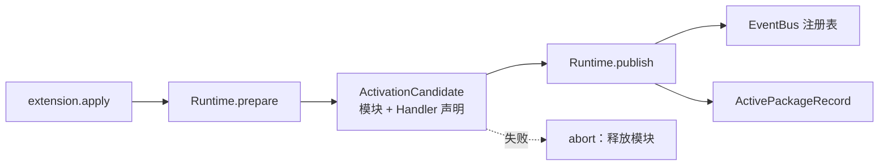

# 候选发布与包归属设计方案

## 元信息

| 项 | 内容 |
| --- | --- |
| 类型 | feature |
| 编号 / slug | `F_04 / activation-and-attribution` |
| 关联计划 | EXTV2-04 包归属与 Handler 发布 |
| 所属模块 | agent-core `openjiuwen/core/extension/runtime.py`、`management/handlers.py` |
| 设计依据 | [F_02 控制面复用](F_02_control-plane.md)、agent-core [包加载规约](../../../../../agent-core/openjiuwen/core/extension/docs/specs/S_01_package-loading.md) |
| 最近一次修订日期 | 2026-10-22 |
| 方案状态 | 已实现，单元验证通过；在途计数存在对端缺口 |

## 1. 问题与目标

一个包只有在全部 Handler 同时可见时才允许承载业务调用，且调用方必须能够确认 Handler 属于哪个包。agent-core 的 `Runtime` 用三阶段完成这件事：`prepare` 只加载代码并收集声明，`publish` 一次性写入 EventBus，`unpublish` 只撤销本包登记的 id。

一句话概括：**候选先在总线之外完成加载，再整包原子发布；Handler 的包身份由框架写入，扩展代码无权自报。**

## 2. 范围

### 2.1 本次范围

- 扩展入口 `create_extension()` 与 `register(registrar)` 的约定。
- `user` / `builtin` 两级 Handler 的限制。
- `Runtime.prepare`、`publish`、`replace_published`、`unpublish` 的执行语义。
- 发布失败时撤销本批已登记 id。
- `PackageMetadata` 随注册写入，并在构建 Ops 时注入。

### 2.2 非目标

- 不定义业务事件类型与匹配函数。
- 不实现界面渲染或视图绑定。
- 不实现在途调用的业务拦截。

## 3. 总体设计

### 3.1 发布关系

准备阶段不触碰 EventBus，因此业务调用看不到半套 Handler。发布阶段逐个登记声明；任一登记失败时注销本批已写入的 id，候选模块被释放。

### 3.2 登记层级

| 登记来源 | 允许层级 | 说明 |
| --- | --- | --- |
| 扩展包 `register(registrar)` | `user`、`builtin` | `ExtensionRegistrar` 拒绝 `core` 及其他值 |
| 宿主事件定义 | `core` | 只能通过 `EventBus.register_event_type` 定义，扩展包不可见 |

JiuwenSwarm 的 WebUI 事件由宿主注册为 CORE，`ops.build` 的 BUILTIN Handler 由宿主注册；扩展包只能登记业务 Handler。

### 3.3 包归属

`Runtime._register_batch` 为每条声明附加 `PackageMetadata(package_id, version, root)`。`ops.build` 产出的 Builder 在某次调用中创建 `EventHandlerOps` 时带入该元数据，Handler 通过 `ops.package_metadata` 读取。

归属事实只来自发布记录，不读取事件输入或会话上下文中的自报字段。

## 4. 发布流程

### 4.1 安装与重载

| 操作 | 调用 | 语义 |
| --- | --- | --- |
| 首次安装 | `publish(candidate, plan, bus, manifest=...)` | 登记新 id，写入生效记录，generation 从 1 开始 |
| 重载 | `replace_published(...)` | 先登记新批次，再注销旧 id；新批次失败时旧 Handler 继续服务 |
| 卸载 | `unpublish(package_id, bus)` | 先注销本包 id，再删除生效记录 |

### 4.2 失败回滚

1. 登记过程中记录已成功 id。
2. 任一登记抛错时注销这些 id，调用 `abort` 释放候选模块。
3. `extension.apply` 的 Core Handler 在发布失败时触发 `extension.rollback`。
4. 若本次安装新建了副本，回滚同时删除该副本。

重载失败只影响新批次，旧 Handler 保持可用。

### 4.3 卸载判断

`Runtime.uninstall_decision` 按顺序返回：

1. 包不存在：`EXTENSION_PACKAGE_NOT_INSTALLED`；
2. 仍被其他生效包依赖：`EXTENSION_PACKAGE_IN_USE`；
3. 在途调用数大于 0：`EXTENSION_PACKAGE_BUSY`；
4. 通过。

## 5. 一致性与失败语义

| 场景 | 结果 |
| --- | --- |
| prepare 失败 | 本次模块释放，无 Handler 可见 |
| 单条登记失败 | 本批已登记 id 全部注销 |
| 重载新批次失败 | 旧 Handler 继续服务，generation 不变 |
| 卸载被依赖 | 拒绝，返回 `EXTENSION_PACKAGE_IN_USE` |
| 卸载时有在途调用 | 设计上拒绝，当前不可达（见第 8 节） |

## 6. 关键决策

| 编号 | 决策 | 依据 |
| --- | --- | --- |
| D-01 | 包代码只接收受限 registrar | 防止扩展包替换 CORE Handler |
| D-02 | 发布以“整包”为单位 | 避免业务调用命中半套 Handler |
| D-03 | 包身份由框架注入 | 事件输入可伪造，注册记录不可伪造 |
| D-04 | 重载先登记后撤销 | 失败时保持旧版本可用 |

## 7. 实施影响

- 宿主不再维护 `registrar.py` 或 `CandidatePublisher`；发布全部由 agent-core `Runtime` 完成。
- 扩展包入口保持 `create_extension() -> object`，对象实现 `register(registrar)`。
- `ops.build` 由宿主注册，包元数据由框架在每次发布时写入。

## 8. 验证

验证入口：`tests/unit_tests/extensions_v2/management/test_activation_publish.py`。

| 场景 | 结果 |
| --- | --- |
| 发布后 Handler 携带真实包身份 | 通过 |
| 安装前 Handler 不可见 | 通过 |
| 匹配模式过滤包 Handler | 通过 |
| 包内登记 `core` 被拒 | 通过 |
| 登记失败撤销本批已登记项 | 通过 |
| 卸载后 Handler 不再可见 | 通过 |
| 在途计数阻止卸载 | 通过（直接调用 Runtime 构造） |

## 9. 风险与遗留

- **在途计数未接线（agent-core）**：`Runtime.begin_calls/end_calls` 已定义，但 EventBus 调用路径尚未调用它们，`inflight` 恒为 0，`EXTENSION_PACKAGE_BUSY` 在真实链路不可达。宿主不自研计数，避免与对端接口重复；对端接入后门面与测试无需改签名。
- `Runtime.unpublish` 只移除注册记录和生效记录，不释放 `sys.modules`；模块生命周期由重载时的命名隔离与进程退出兜底。
- 撤销与登记之间的原子性受 EventBus 单次同步注册保证；跨多次注册的并发可见性由调用快照隔离。
