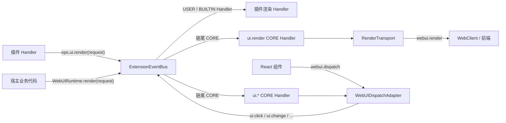
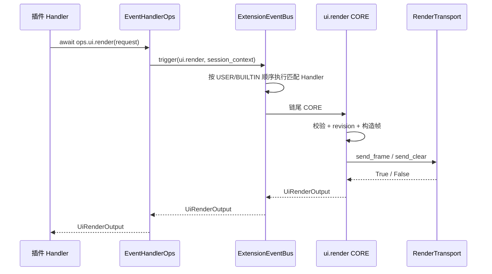
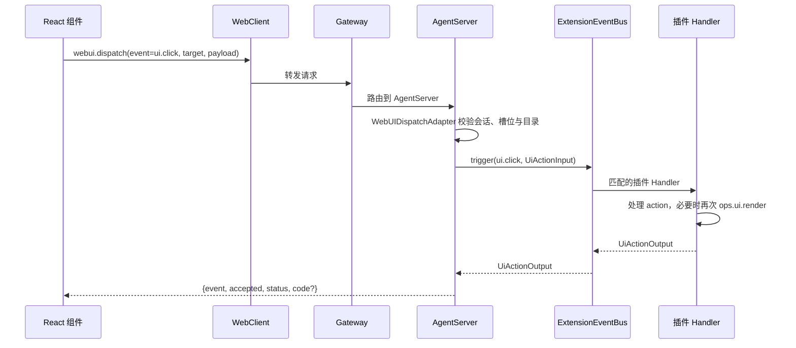

# WebUI 平台事件与能力注册设计方案

## 元信息

| 项 | 内容 |
| --- | --- |
| 类型 | feature |
| 编号 / slug | `F_05 / platform-events` |
| 关联计划 | EXTV2-05 平台事件、能力注册与业务触发 |
| 所属模块 | `jiuwenswarm/extensions_v2/event_types/webui.py`、`handler_ops/ui.py`、`webui/runtime.py`、`bootstrap.py` |
| 设计依据 | agent-core [Events 公共契约](../../../../../agent-core/openjiuwen/core/events/docs/specs/S_01_events-contract.md)、[详细架构](../designs/extensions-v2-architecture.md) |
| 最近一次修订日期 | 2026-10-22 |
| 方案状态 | 事件类型与 `ops.ui.render` 已实现；`context.usage.updated` 已接入回合用量；工具调用等业务触发点待接入 |

## 1. 问题与目标

插件需要在前端槽位中呈现内容，并在用户操作后继续更新；宿主业务逻辑也可能需要主动刷新界面。两条路径都必须走同一条事件链，才能复用包身份、会话上下文、层级顺序和失败处理，而不是为 WebUI 单独开一套回调。

一句话概括：**WebUI 把渲染与交互定义成普通扩展事件，插件通过 `ops.ui.render` 触发渲染，浏览器通过 `webui.dispatch` 触发上行事件，两条路径共用 `ExtensionEventBus`。**

## 2. 范围

### 2.1 本次范围

- 注册 `ui.render` 与全部上行事件类型，每个类型绑定一个 CORE Handler。
- 通过 `ops.build` 的 BUILTIN Handler 向能力目录加入 `ui.render`。
- 定义事件匹配函数，让插件按 `target.slot_id`、`target.package_id`、`target.instance_key` 过滤。
- 插件 Handler 内调用 `ops.ui.render(request)` 发起一次新的渲染链。
- 提供宿主直接触发 `ui.render` 的运行时入口 `WebUIRuntime.render`。
- 定义 `context.usage.updated`，在 `chat.usage_summary` 生成后发布单轮用量。

### 2.2 非目标

- 不实现渲染树校验、revision 分配和下行发送，归 F_06。
- 不实现界面项发现与上行请求解析，归 F_07。
- 不实现前端组件映射与槽位布局，归 F_08。
- 除回合用量外，不接入其他业务触发点；回合准备、工具调用前后等位置仍待确认。

## 3. 总体设计

### 3.1 组件关系



`ui.render` 是下行事件：触发方可以是插件 Handler，也可以是宿主业务代码。`ui.*` 上行事件由浏览器产生，经 AgentServer 的 `WebUIDispatchAdapter` 转成事件链调用。

### 3.2 事件注册

`register_webui_events` 对每个事件类型调用一次 `ExtensionEventBus.register_event_type`，同时提供匹配函数和 CORE Handler：

```python
register_webui_events(
    bus,
    build_render_core_handler(transport, registry),
    build_action_core_handler(registry),
)
```

`bootstrap.register_event_types` 汇总 WebUI 事件与其他平台事件的注册；`assembly.py` 只引用该函数，不直接拼装各事件模块。

注册结果是：

| 事件 | 匹配函数 | CORE Handler |
| --- | --- | --- |
| `ui.render` | `match_pattern_subset` | 校验、分配 revision、下发 |
| `ui.ready` | 同上 | 接受挂载上报，不检查实例 |
| `ui.click` / `ui.change` / `ui.press_enter` | 同上 | 检查实例是否活跃 |
| `ui.select` / `ui.search` / `ui.clear` | 同上 | 同上 |

CORE Handler 由平台注册，插件不能通过 `register_event_handler` 登记 `core` 层级；扩展只能使用 `user` 或 `builtin`。

### 3.3 `ops.build` 与 `ops.ui.render`

`WebUIRuntime.register_event_types` 登记 `ui.*` 事件类型与 CORE Handler；`register_handlers` 单独登记 `ops.build` 的 BUILTIN Handler。装配时由 `bootstrap.register_event_types` 与 `bootstrap.register_handlers` 汇总，分别作为 `host_event_types` 与 `host_handlers` 传给 `Registry.init`。该 Handler 在链尾拿到 `EventHandlerOpsBuilder`，加入 `ui` 命名空间和 `render` 方法：

```python
builder.add_namespace("ui")
builder.add_method("ui", "render", ui_render)
```

`ops.ui.render` 是**动词**：它用当前 Handler 的 `session_context` 触发一次新的 `ui.render` 链，不推进当前链，也不直接拼装或发送帧。

```python
async def ui_render(ops_view: EventHandlerOps, request: UiRenderInput) -> object:
    return await bus.trigger(Event("ui.render", request), ops_view.session_context)
```

`ops.build` 只在装配阶段成功执行一次，之后能力目录冻结；每个普通 Handler 调用仍会获得独立的 `EventHandlerOps` 实例，包身份由 EventBus 从注册记录注入。

### 3.4 匹配规则

`match_pattern_subset` 支持点路径，例如 `target.slot_id`、`target.package_id`。它同时支持映射和对象属性，事件输入不匹配时该 Handler 被跳过；没有匹配到任何 Handler 时，只执行 CORE Handler。

## 4. 事件清单

| 事件 | 触发方 | 语义 | CORE Handler 行为 |
| --- | --- | --- | --- |
| `ui.render` | 后端（插件或宿主） | 渲染或清除一个实例 | 校验请求与帧大小，分配 revision，经传输层下发 |
| `ui.ready` | 前端（槽位挂载） | 槽位已就绪，允许插件创建实例 | 直接回执 `ready`，不要求实例已存在 |
| `ui.click` | 前端（`Button`、`Input`、`Switch`） | 按钮按压、输入框点击、开关点击 | 实例活跃时回执 `handled`，否则回执 `inactive` |
| `ui.change` | 前端（`Input`、`Switch`、`TreeSelect`、`Slider`、`Tabs`） | 编辑、开关、选择或页签变化 | 同上 |
| `ui.press_enter` | 前端（`Input`） | Enter 提交 | 同上 |
| `ui.select` | 前端（`Select`、`TreeSelect`） | 选中单个选项或节点 | 同上 |
| `ui.search` | 前端（`Select`） | 搜索值变化 | 同上 |
| `ui.clear` | 前端（`Select`、`TreeSelect`） | 清空选择 | 同上 |
| `context.usage.updated` | 后端（`chat.usage_summary`） | 单轮 token 用量与上下文窗口信息 | 校验输入并返回回执；插件按需渲染 |

旧事件名 `ui.press`、`ui.toggle`、`ui.input` 已随旧 action 组件移除，不再进入事件链。
当前未实现设计稿中的 `ui.scroll`、`ui.focus`、`ui.close`、`ui.unmount`、`ui.host_info.changed` 和 `ui.message`。这些事件在架构中保留为后续能力，接入前不得在插件中依赖。

## 5. 处理流程

### 5.1 插件主动渲染



`ops.ui.render` 返回 `UiRenderOutput`，其中 `status` 为 `delivered`、`rejected` 或 `delivery_failed`。插件可以据此决定是否重试或提示；渲染失败不会自动抛出到业务链，除非插件 Handler 自己抛错。

### 5.2 前端交互



上行事件先经过界面项目录校验。没有对应贡献时返回 `no_contribution`，不进入事件链；实例不存在时 CORE Handler 返回 `inactive`。

## 6. 异常与边界

- 未注册的事件类型不能登记 Handler，EventBus 返回 `EVENTS_REGISTRATION_INVALID`。
- 插件登记 `core` 层级被拒绝，包准备失败，整包不生效。
- `ui.ready` 没有实例，因此不检查活跃状态；插件可在该事件中创建实例。
- 上行事件在实例被清除后返回 `inactive`，不产生副作用。
- `ops.ui.render` 使用当前 Handler 的 `session_context`；没有会话上下文时，渲染目标仍由请求中的 `RenderTarget` 决定。
- 事件 Handler 抛出的异常由调用方处理；业务代码若要求渲染失败不影响主流程，需要自行捕获。

## 7. 实施影响

- 新增 `extensions_v2/event_types/webui.py`、`extensions_v2/event_types/context_usage.py`、`extensions_v2/handler_ops/ui.py`。
- 新增 `extensions_v2/bootstrap.py`，集中汇总平台事件与 BUILTIN Handler 的注册。
- `interface_deep.py` 在 `chat.usage_summary` 生成后异步触发 `context.usage.updated`，不阻塞对话流。
- `WebUIRuntime` 负责注册事件和构建能力目录；`assembly.py` 在包安装前调用。
- `ops.build` 必须先于任何包安装，否则插件 Handler 拿不到 `ops.ui.render`。
- 新增事件类型不影响旧扩展目录；V2 与旧 `extensions/` 机制各自维护事件与注册表。

## 8. 验证

验证入口：`tests/unit_tests/extensions_v2/webui/test_webui_runtime.py`。

覆盖内容：

- 事件注册后 `ui.ready`、`ui.click` 可到达示例包 Handler。
- `ops.build` 完成后插件可调用 `ops.ui.render`，渲染链到达 CORE Handler 并返回 `delivered`。
- 上行事件的目标匹配与实例检查由 F_07 的适配用例覆盖。

当前执行结果：上述用例通过；真实业务触发点尚未接入，EXTV2-05-V-03 未验证。

## 9. 风险与遗留

- 事件集合是设计稿的子集；滚动、焦点、关闭、卸载和宿主信息变化需要后续补齐，补齐前插件不应依赖。
- `ops.ui.render` 的异常传播由插件或业务调用方负责，当前没有统一的“渲染失败不影响主流程”包装。
- 回合用量已接入 `chat.usage_summary`；工具调用前后、回合准备等位置仍需与业务模块共同确认触发时机和失败语义。
- `ui.render` 的 USER Handler 可以短路链尾 CORE；插件若返回自定义结果，需要明确是否仍要下发帧。
