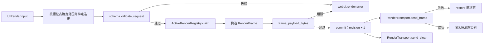
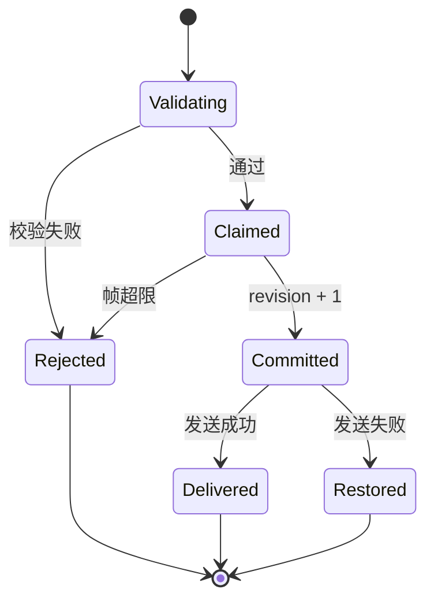

# 渲染服务与下行帧设计方案

## 元信息

| 项 | 内容 |
| --- | --- |
| 类型 | feature |
| 编号 / slug | `F_06 / render-service` |
| 关联计划 | EXTV2-06 渲染服务与下行帧 |
| 所属模块 | `jiuwenswarm/extensions_v2/webui/{models,schema,constants,registry,transport}.py`、`webui/core_handlers/render_core.py` |
| 设计依据 | [F_05 平台事件](F_05_platform-events.md)、[详细架构](../designs/extensions-v2-architecture.md) |
| 最近一次修订日期 | 2026-10-30 |
| 方案状态 | 已实现；重连重发未实现 |

## 1. 问题与目标

插件生成的界面必须变成前端可消费的受控 JSON，而不是任意 HTML 或脚本。服务端需要保证：组件和样式在平台白名单内、单帧大小可控、同一实例的更新有序、实例数量有上限、发送失败不污染本地状态。

一句话概括：**渲染服务把一次 `ui.render` 校验成受控渲染帧，按实例分配单调 revision，并通过 AgentServer 推送通道下发；发送失败回滚实例状态。**

## 2. 范围

### 2.1 本次范围

- 定义渲染树、目标、帧和事件输入输出模型。
- 校验槽位、组件、props、动作、深度、节点数、文本量、帧大小与实例标识长度。
- 维护活跃实例：实例定位、revision、同实例串行、按会话或 Web 连接分别限制容量，以及按包和会话清理。
- 通过 `RenderTransport` 下发 `webui.render`、`webui.render.clear` 和 `webui.render.error`。
- 槽位允许依赖聊天会话，也允许只依赖 Web 连接；两类目标的字段、实例标识和下行路由规则在本文维护。

### 2.2 非目标

- 不发现界面项，不校验上行 action 语义；归 F_07。
- 不实现前端组件映射；归 F_08。
- 不持久化渲染树，不跨进程共享实例。
- 不实现重连后的活跃帧重发。

## 3. 总体设计

### 3.1 组件关系



### 3.2 数据模型

| 类型 | 字段 | 说明 |
| --- | --- | --- |
| `RenderTarget` | `session_id`、`slot_id`、`package_id`、`instance_key`、`scope`、`connection_id` | 按槽位范围确定实例归属，字段与实例键见下文 |
| `RenderNode` | `component`、`props`、`children`、`action`、`events` | 渲染树节点，组件名区分大小写；action 与 events 不能同时声明 |
| `UiRenderInput` | `target`、`root`、`mode` | `mode` 为 `replace` 或 `clear` |
| `UiRenderOutput` | `status`、`revision` | `delivered`、`rejected` 或 `delivery_failed` |
| `RenderFrame` | `target`、`revision`、`mode`、`root`、`schema_version` | 下行 `webui.render` 载荷 |
| `ClearFrame` | `target`、`revision`、`reason` | 独立 `webui.render.clear` 载荷 |

`revision` 按实例递增，不跨实例比较；`instance_key` 由插件在请求中给出，用于同一包在同一槽位创建多个实例。
节点序列化递归处理 `children` 和 Tabs 的内容节点。registry 在 commit 时保存独立的只读树快照，
插件随后修改原始 props、args 或 events 不会改变当前 revision 的声明。

#### 3.2.1 槽位范围与目标字段

支持会话槽位和全局槽位。`SLOT_SPECS` 为每个槽位指定 `scope` 和展示模式：
`session` 属于一个聊天会话；`application` 是全局槽位，不依赖当前聊天会话。
全局槽位按 Web 连接隔离，每个连接分别维护自己的实例和 revision。

| 字段 | 默认值与含义 |
| --- | --- |
| `slot_id` | 必须是平台白名单中的槽位，插件不能自行新增 |
| `scope` | 默认空字符串，表示采用槽位表的范围；显式填写时必须与槽位表一致 |
| `session_id` | Python 构造函数要求传入；会话目标必须非空，全局目标归一化为空字符串，序列化时省略该字段 |
| `package_id`、`instance_key` | 默认为空字符串；`ui.ready` 可以先不指定包和实例，其他用途沿用对应事件要求 |
| `connection_id` | 默认为空字符串；全局目标在服务端绑定 Web 连接，前端不接收或填写该内部字段 |

正常 Web 上行请求的连接 ID 由 Gateway 从实际 WebSocket 取得，放入请求的 `metadata.ws_id`。
WebUIRuntime 为调用绑定独立的连接上下文，后续 `ops.ui.render` 自动沿用；请求同时指定不同连接 ID 时拒绝。
会话槽位使用真实的 `SessionContext`；全局槽位没有聊天会话时传入 `None`，不将连接 ID 填入会话 ID。
连接上下文在调用返回、异常或取消时恢复，并发连接之间互不影响。
宿主直接调用渲染入口且没有连接上下文时，当前实现也允许显式提供 `connection_id`，其来源由宿主负责。
连接 ID 只用于定位投递目标，不是用户身份或授权结果。

槽位定义方式见 [F_07 第 3.3 节](F_07_ui-contributions.md#33-槽位)，前端挂载与收发方式见
[F_08 第 4.4 节](F_08_frontend-render.md#44-会话与全局槽位的挂载)。

#### 3.2.2 实例标识

| 槽位范围 | 服务端实例键 |
| --- | --- |
| 会话 | `session_id\|slot_id\|package_id\|instance_key`，保持原有格式 |
| 应用 | `application\|connection_id\|slot_id\|package_id\|instance_key` |

同一个全局界面在两个 Web 连接打开时，会形成两个实例，各自维护 revision 和渲染树。
连接 ID 不放入下行 `target`；当前接收连接本身就是该全局目标的范围。

### 3.3 组件与样式白名单

组件属性与事件数据规则见
[组件规约](../../../channels/web/frontend/src/features/webui/docs/specs/S_01_components.md)，
后端规则定义在 `webui/component_rules.py`。组件是否可显示取决于前端对应渲染器的注册。
此外，后端保留以下组件与原有属性的校验：

| 类别 | 组件 |
| --- | --- |
| 容器 | `Column`、`Row`、`Card`、`Tabs` |
| 基础 | `Divider`、`Text`、`Icon`、`Badge`、`Progress` |
| 交互 | `Button`、`TextField`、`CheckBox`、`MultipleChoice`、`Slider`、`List` |

每个组件只允许声明的 props；未声明的 props 会让整棵树被拒绝，而不是忽略。
原有组件的样式只接受 token，例如 `variant`、`tone`、`size`、`gap`、`padding`、`density`、`align`、`justify`、`weight`、`spacing`、`axis`；其他组件以各自规则为准。

### 3.4 规模限制

| 限制 | 值 |
| --- | --- |
| 树深度 | 8 |
| 节点数 | 512 |
| 单文本 prop | 16 KiB |
| 列表项 | 100 |
| 整帧 | 256 KiB |
| 活跃实例 | 每个会话最多 32 个；全局目标按每个 Web 连接分别限制为 32 个 |
| `action.args` | 8 KiB |
| `package_id`、`instance_key`、`connection_id` | 每项最多 200 字节 |

超限统一拒绝并返回 `SCHEMA_ERROR`，不做截断。
Tabs 的全部内容节点共享深度与节点数预算，隐藏内容也参与计数；Panel 和 Iframe 不能嵌套为普通子节点。

## 4. 处理流程

### 4.1 渲染

1. 根据槽位表归一化目标范围；会话目标校验会话 ID，全局目标绑定连接 ID。再校验槽位和标识长度。
2. `replace` 模式必须有根节点；`clear` 模式不要求。
3. 深度、节点数、组件、props、动作逐项校验。
4. 进入实例锁，复制旧状态，构造预览帧并检查整帧字节量。
5. 通过后 `commit`：revision 加一，保存当前树。
6. 下发帧；失败时恢复旧状态，新建实例则直接移除。
7. 下发成功后处理容量淘汰，向被淘汰实例发送清除帧。



### 4.2 容量淘汰

会话目标按会话分组，全局目标按 Web 连接分组，每组最多保留 32 个实例，两类目标不共用同一份额度。
新实例到来且该组已达上限时，按 `updated_at` 选出最久未更新的实例；新帧发送成功后才向被淘汰实例发送
`webui.render.clear`，避免新帧失败时误删旧内容。此上限不限制所有连接的实例总数。

### 4.3 下行消息

`RenderTransport` 生成 AgentServer 主动推送消息。目标与路由分别放在两层：

| 位置 | 会话目标 | 全局目标 |
| --- | --- | --- |
| `payload.target` | 包含 `scope="session"` 和会话 ID | 包含 `scope="application"`，省略 `session_id` 和内部 `connection_id` |
| AgentServer 推送消息外层 | 包含 `session_id` | 省略 `session_id`，使用 `metadata.ws_id` 指定 Web 连接 |

全局目标经 Web Channel 投递；指定连接已经关闭或找不到时，不改投其他连接。
传输返回成功只证明消息已交给推送传输层，不证明浏览器已经收到或完成渲染。

以下为会话目标的下行消息：

```json
{
  "request_id": "webui-webui.render-1a2b3c4d5e6f",
  "channel_id": "web",
  "session_id": "web_xxx",
  "payload": {
    "event_type": "webui.render",
    "target": {
      "scope": "session",
      "session_id": "web_xxx",
      "slot_id": "conversation.input.below",
      "package_id": "webui.token-weather",
      "instance_key": "token-weather.summary"
    },
    "revision": 3,
    "mode": "replace",
    "root": {"component": "Card", "props": {"title": "Token Weather"}, "children": []},
    "schema_version": 1
  }
}
```

`webui.render.error` 携带 `target`、`revision`、`code`、`message`；`webui.render.clear` 携带 `target`、`revision` 和可选 `reason`。

## 5. 异常与边界

| 情况 | 结果 |
| --- | --- |
| 槽位不在白名单 | `SCHEMA_ERROR`，下发错误帧 |
| 组件或 props 未声明 | 整棵树拒绝 |
| 帧超过 256 KiB | 拒绝，不提交 revision |
| 下发失败 | 恢复旧 revision 和旧树，返回 `delivery_failed` |
| `clear` 请求 | 提交 revision 后下发清除帧，并移除实例 |
| 包卸载 | 清理该包全部实例并逐个下发清除帧 |
| 调用 `drop_session` | 只清理该会话的会话级实例，不影响应用级实例；会话删除入口尚未接入 |
| Web 连接关闭 | Gateway 通知 AgentServer 清理该连接的全局实例；其他连接和聊天会话不受影响 |

实例清理是进程内操作；多 AgentServer 进程不共享登记表。

## 6. 关键决策

- **白名单拒绝而非忽略**：未知 props 或组件直接拒绝，避免前端和后端对同一棵树产生不同解释。
- **先校验后提交**：帧大小检查在 revision 提交前完成，失败不会造成 revision 空跳。
- **发送失败回滚**：本地状态与前端可见状态保持一致，重试可以复用同一 revision。
- **淘汰后置**：先保证新帧送达，再清理旧实例，避免容量边界上的内容丢失。
- **独立的 clear 帧**：不复用 `replace` 加空树，前端可以明确区分“清空”和“渲染空容器”。

## 7. 实施影响

- `assembly.py` 创建 `RenderTransport` 和 `WebUIRuntime`，并把 AgentServer 的 `send_push` 注入传输层。
- `WebUIRuntime.drop_package` 由包管理门面的 inactive 回调触发。
- `WebUIRuntime.drop_session` 已提供，但会话删除入口尚未接入。
- Gateway 在断连钩子中发送内部 `webui.connection.closed` 通知，适配器调用 `WebUIRuntime.drop_connection`。
  清理不向已经关闭的浏览器发送帧；尚在等待的旧调用也不能重新创建该连接的实例。
- 下行帧沿用 AgentServer 现有推送通道，Gateway 与 WebClient 只做转发，不解析渲染树。

## 8. 验证

验证入口：

- `tests/unit_tests/extensions_v2/webui/test_webui_runtime.py`
- `tests/unit_tests/extensions_v2/webui/test_webui_events.py`
- `tests/unit_tests/channel/test_web_channel_webui_payload.py`
- `tests/unit_tests/extensions_v2/webui/test_application_slots.py`
- `tests/unit_tests/extensions_v2/webui/test_slot_lifecycle.py`

覆盖内容：

- Token Weather 示例包按轮次渲染用量并在刷新后恢复视图。
- 下发失败恢复 revision。
- `clear` 移除实例，下一帧从 1 开始。
- 超大帧拒绝且不提交。
- 包卸载清理该包视图。
- 容量淘汰在新帧送达后发生。
- WebClient 透传帧时保留完整 payload。
- 组件属性、事件声明、Tabs 隐藏内容预算及只读树快照。
- 测试临时登记应用槽位，覆盖连接绑定、不同连接的实例隔离、按连接限制容量、缺少连接和非 Web 渠道的拒绝。

当前执行结果：上述用例通过。重连重发未实现，EXTV2-06-V-04 未验证。

2026-10-30 对 `8b78d0634` 的定向复核：

```text
python -m pytest -q -o addopts= tests/unit_tests/extensions_v2/webui/ tests/unit_tests/channel/test_web_channel_webui_payload.py
```

原 commit 的初步复核为 **22 passed**，其中应用槽位专项为 8 项。
补充修复后，增加错误帧寻址、无会话渲染、连接清理、并发和取消测试，并覆盖 Gateway 通知经 E2A 转换后到达适配器。
与 E2A 及消息协议回归合并执行时为 **103 passed**。推送使用替身；前端 Runtime、React 宿主和交互的验证见 F_08。
这次修复沿用 F_06～F_08，不新增 feature 或开发计划条目。

合并回归命令在上述测试路径后追加
`tests/unit_tests/e2a/test_gateway_normalize.py tests/unit_tests/evolution/test_message.py`。

## 9. 风险与遗留

- 活跃实例只在进程内保存；AgentServer 重启后前端需要重新挂载并触发 `ui.ready`。
- 重连重发未实现，断线重连后已渲染内容会丢失，直到插件再次触发渲染。
- 会话删除入口未接入 `drop_session`，已结束会话的实例可能保留到进程退出或容量淘汰。
- 帧大小按完整 JSON 计算，压缩后的传输量不在校验范围内。
- 传输层默认使用 `WebSocketGatewayPushTransport`；单元测试注入替身，跨进程链路仍需联调。
- 断连通知依赖 Gateway 与 AgentServer 的通信。通知失败会记录清理失败，不能据此确认实例已经释放；
  包卸载和运行时退出仍会清理相关实例。
