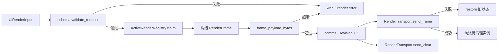
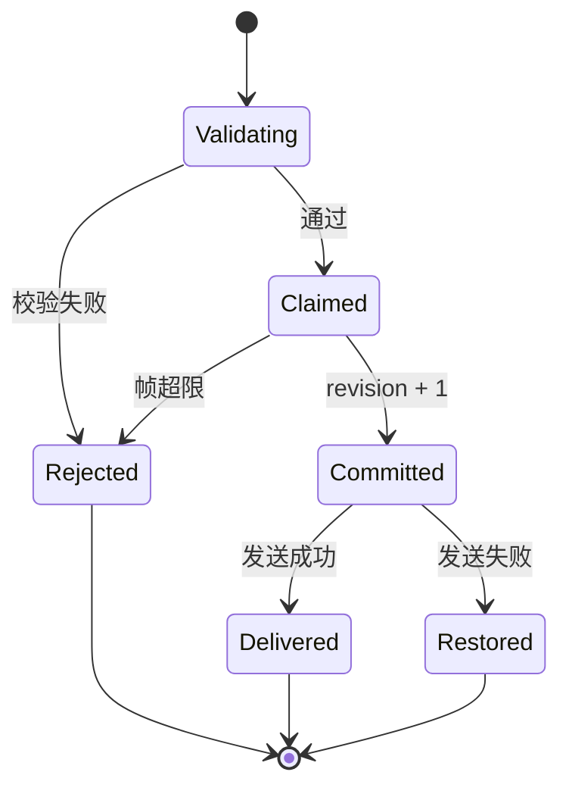

# 渲染服务与下行帧设计方案

## 元信息

| 项 | 内容 |
| --- | --- |
| 类型 | feature |
| 编号 / slug | `F_06 / render-service` |
| 关联计划 | EXTV2-06 渲染服务与下行帧 |
| 所属模块 | `jiuwenswarm/extensions_v2/webui/{models,schema,constants,registry,transport}.py`、`webui/core_handlers/render_core.py` |
| 设计依据 | [F_05 平台事件](F_05_platform-events.md)、[详细架构](../designs/extensions-v2-architecture.md) |
| 最近一次修订日期 | 2026-10-22 |
| 方案状态 | 已实现；重连重发未实现 |

## 1. 问题与目标

插件生成的界面必须变成前端可消费的受控 JSON，而不是任意 HTML 或脚本。服务端需要保证：组件和样式在平台白名单内、单帧大小可控、同一实例的更新有序、实例数量有上限、发送失败不污染本地状态。

一句话概括：**渲染服务把一次 `ui.render` 校验成受控渲染帧，按实例分配单调 revision，并通过 AgentServer 推送通道下发；发送失败回滚实例状态。**

## 2. 范围

### 2.1 本次范围

- 定义渲染树、目标、帧和事件输入输出模型。
- 校验槽位、组件、props、动作、深度、节点数、文本量、帧大小与实例标识长度。
- 维护活跃实例：实例定位、revision、同实例串行、容量淘汰、按包和会话清理。
- 通过 `RenderTransport` 下发 `webui.render`、`webui.render.clear` 和 `webui.render.error`。

### 2.2 非目标

- 不发现界面项，不校验上行 action 语义；归 F_07。
- 不实现前端组件映射；归 F_08。
- 不持久化渲染树，不跨进程共享实例。
- 不实现重连后的活跃帧重发。

## 3. 总体设计

### 3.1 组件关系



### 3.2 数据模型

| 类型 | 字段 | 说明 |
| --- | --- | --- |
| `RenderTarget` | `session_id`、`slot_id`、`package_id`、`instance_key` | 实例四元组；`key` 用 `|` 拼接 |
| `RenderNode` | `component`、`props`、`children`、`action` | 渲染树节点，组件名区分大小写 |
| `UiRenderInput` | `target`、`root`、`mode` | `mode` 为 `replace` 或 `clear` |
| `UiRenderOutput` | `status`、`revision` | `delivered`、`rejected` 或 `delivery_failed` |
| `RenderFrame` | `target`、`revision`、`mode`、`root`、`schema_version` | 下行 `webui.render` 载荷 |
| `ClearFrame` | `target`、`revision`、`reason` | 独立 `webui.render.clear` 载荷 |

`revision` 按实例递增，不跨实例比较；`instance_key` 由插件在请求中给出，用于同一包在同一槽位创建多个实例。

### 3.3 组件与样式白名单

组件名与前端 `RenderTree.tsx` 的 `switch` 一一对应：

| 类别 | 组件 |
| --- | --- |
| 容器 | `Column`、`Row`、`Card`、`Tabs` |
| 基础 | `Divider`、`Text`、`Icon`、`Badge`、`Progress` |
| 交互 | `Button`、`TextField`、`CheckBox`、`MultipleChoice`、`Slider`、`List` |

每个组件只允许声明的 props；未声明的 props 会让整棵树被拒绝，而不是忽略。样式只接受 token，例如 `variant`、`tone`、`size`、`gap`、`padding`、`density`、`align`、`justify`、`weight`、`spacing`、`axis`，插件不能直接写颜色、像素或 CSS。

### 3.4 规模限制

| 限制 | 值 |
| --- | --- |
| 树深度 | 8 |
| 节点数 | 512 |
| 单文本 prop | 16 KiB |
| 列表项 | 100 |
| 整帧 | 256 KiB |
| 单会话活跃实例 | 32 |
| `action.args` | 8 KiB |
| `target` 字符串 | 200 字节 |

超限统一拒绝并返回 `SCHEMA_ERROR`，不做截断。

## 4. 处理流程

### 4.1 渲染

1. 校验 `target`：会话非空、槽位在白名单内、包与实例标识不超长。
2. `replace` 模式必须有根节点；`clear` 模式不要求。
3. 深度、节点数、组件、props、动作逐项校验。
4. 进入实例锁，复制旧状态，构造预览帧并检查整帧字节量。
5. 通过后 `commit`：revision 加一，保存当前树。
6. 下发帧；失败时恢复旧状态，新建实例则直接移除。
7. 下发成功后处理容量淘汰，向被淘汰实例发送清除帧。



### 4.2 容量淘汰

同一会话最多保留 32 个实例。新实例到来且已达上限时，按 `updated_at` 选出最久未更新的实例；新帧发送成功后才向被淘汰实例发送 `webui.render.clear`，避免新帧失败时误删旧内容。

### 4.3 下行消息

`RenderTransport` 生成 AgentServer 主动推送消息：

```json
{
  "request_id": "webui-webui.render-1a2b3c4d5e6f",
  "channel_id": "web",
  "session_id": "web_xxx",
  "payload": {
    "event_type": "webui.render",
    "target": {
      "session_id": "web_xxx",
      "slot_id": "conversation.input.below",
      "package_id": "webui.token-weather",
      "instance_key": "token-weather.summary"
    },
    "revision": 3,
    "mode": "replace",
    "root": {"component": "Card", "props": {"title": "Token Weather"}, "children": []},
    "schema_version": 1
  }
}
```

`webui.render.error` 携带 `target`、`revision`、`code`、`message`；`webui.render.clear` 携带 `target`、`revision` 和可选 `reason`。

## 5. 异常与边界

| 情况 | 结果 |
| --- | --- |
| 槽位不在白名单 | `SCHEMA_ERROR`，下发错误帧 |
| 组件或 props 未声明 | 整棵树拒绝 |
| 帧超过 256 KiB | 拒绝，不提交 revision |
| 下发失败 | 恢复旧 revision 和旧树，返回 `delivery_failed` |
| `clear` 请求 | 提交 revision 后下发清除帧，并移除实例 |
| 包卸载 | 清理该包全部实例并逐个下发清除帧 |
| 会话关闭 | 清理该会话全部实例并下发清除帧 |

实例清理是进程内操作；多 AgentServer 进程不共享登记表。

## 6. 关键决策

- **白名单拒绝而非忽略**：未知 props 或组件直接拒绝，避免前端和后端对同一棵树产生不同解释。
- **先校验后提交**：帧大小检查在 revision 提交前完成，失败不会造成 revision 空跳。
- **发送失败回滚**：本地状态与前端可见状态保持一致，重试可以复用同一 revision。
- **淘汰后置**：先保证新帧送达，再清理旧实例，避免容量边界上的内容丢失。
- **独立的 clear 帧**：不复用 `replace` 加空树，前端可以明确区分“清空”和“渲染空容器”。

## 7. 实施影响

- `assembly.py` 创建 `RenderTransport` 和 `WebUIRuntime`，并把 AgentServer 的 `send_push` 注入传输层。
- `WebUIRuntime.drop_package` 由包管理门面的 inactive 回调触发。
- `WebUIRuntime.drop_session` 已提供，但会话删除入口尚未接入。
- 下行帧沿用 AgentServer 现有推送通道，Gateway 与 WebClient 只做转发，不解析渲染树。

## 8. 验证

验证入口：

- `tests/unit_tests/extensions_v2/webui/test_webui_runtime.py`
- `tests/unit_tests/channel/test_web_channel_webui_payload.py`

覆盖内容：

- Token Weather 示例包按轮次渲染用量并在刷新后恢复视图。
- 下发失败恢复 revision。
- `clear` 移除实例，下一帧从 1 开始。
- 超大帧拒绝且不提交。
- 包卸载清理该包视图。
- 容量淘汰在新帧送达后发生。
- WebClient 透传帧时保留完整 payload。

当前执行结果：上述用例通过。重连重发未实现，EXTV2-06-V-04 未验证。

## 9. 风险与遗留

- 活跃实例只在进程内保存；AgentServer 重启后前端需要重新挂载并触发 `ui.ready`。
- 重连重发未实现，断线重连后已渲染内容会丢失，直到插件再次触发渲染。
- 会话删除入口未接入 `drop_session`，已结束会话的实例可能保留到进程退出或容量淘汰。
- 帧大小按完整 JSON 计算，压缩后的传输量不在校验范围内。
- 传输层默认使用 `WebSocketGatewayPushTransport`；单元测试注入替身，跨进程链路仍需联调。
