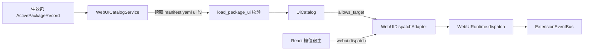
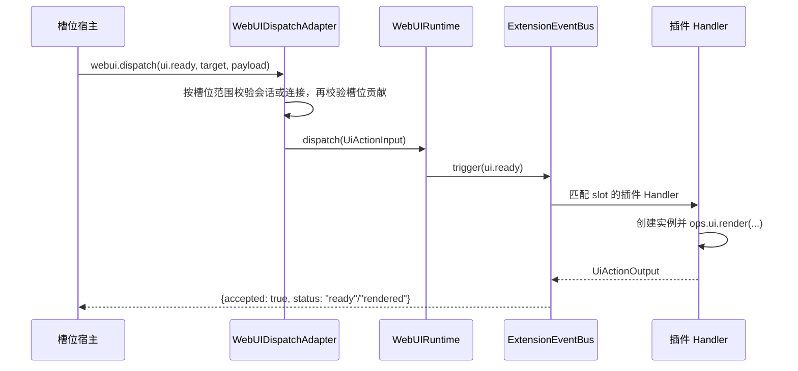

# 界面项声明、挂载与上行交互设计方案

## 元信息

| 项 | 内容 |
| --- | --- |
| 类型 | feature |
| 编号 / slug | `F_07 / ui-contributions` |
| 关联计划 | EXTV2-07 界面项声明、挂载与上行交互 |
| 所属模块 | `jiuwenswarm/extensions_v2/webui/{contributions,adapter}.py` |
| 设计依据 | [F_05 平台事件](F_05_platform-events.md)、[F_06 渲染服务](F_06_render-service.md)、[详细架构](../designs/extensions-v2-architecture.md) |
| 最近一次修订日期 | 2026-10-30 |
| 方案状态 | 已实现 |

## 1. 问题与目标

前端不能凭插件任意声明就占用页面位置，也不能把任意请求送进事件链。宿主需要从**已生效**的包中派生可用界面项，
只允许声明的槽位挂载，并为浏览器交互确认会话或 Web 连接归属。全局槽位不依赖聊天会话。

一句话概括：**界面项目录从生效包的 `manifest.yaml ui` 段派生，前端按目录挂载槽位，所有上行交互经唯一入口 `webui.dispatch` 校验后进入事件链。**

## 2. 范围

### 2.1 本次范围

- 读取并校验生效包的 `ui` 段，产出界面项目录。
- 声明槽位、顺序、面板标题、语言资源和 `webui-tree` 渲染器。
- 提供槽位白名单与槽位展示模式（`list` / `single`）。
- 提供唯一上行入口 `webui.dispatch`，按槽位范围校验事件名、会话或连接、目标和贡献。
- 定义上行回执字段与状态。

### 2.2 非目标

- 不校验渲染树内容；归 F_06。
- 不实现前端布局与组件；归 F_08。
- 不提供界面项运行时开关、灰度或用户级授权。
- 不支持 `webui-tree` 之外的渲染器。

## 3. 总体设计

### 3.1 组件关系



`WebUICatalogService` 以 `(package_id, version, generation)` 作为缓存签名；生效包集合变化时重新加载，避免每次上行请求都读磁盘。

### 3.2 声明结构

```yaml
ui:
  apiVersion: 1
  items:
    - type: web.slot.contribution
      id: token-weather.turn
      slot: message.assistant.meta
      order: 10
      panel:
        title: Turn Usage
      renderer:
        kind: webui-tree
```

| 字段 | 必填 | 说明 |
| --- | --- | --- |
| `apiVersion` | 是 | 当前只接受 `1` |
| `items[].type` | 是 | `web.slot.contribution` 或 `web.locale` |
| `items[].id` | 是 | 包内同类型唯一 |
| `items[].slot` | 贡献项必填 | 必须在槽位白名单内 |
| `items[].order` | 否 | 整数，默认 0，用于同槽位排序 |
| `items[].panel` | 否 | 映射，当前用于 `title` |
| `items[].renderer.kind` | 贡献项必填 | 当前只接受 `webui-tree` |
| `items[].localeId` | 否 | 必须引用同包的 `web.locale` 条目 |
| `items[].resources` | 否 | 语言到包内相对路径的映射，路径不得逃逸包根 |

一个包只要有一项声明非法，整包的界面项都不发布，错误记录在 `UiCatalog.errors`；其他包不受影响。

### 3.3 槽位

| 槽位 | 展示模式 | 说明 |
| --- | --- | --- |
| `conversation.input.above` | `list` | 输入区上方，可并列多个实例 |
| `conversation.input.below` | `single` | 输入区下方，只展示最新实例 |
| `conversation.panel.right` | `list` | 右侧工作区，可并列多个实例 |
| `message.assistant.meta` | `list` | 助手消息 meta 行，按 `instance_key=requestId` 对应单轮实例 |

槽位是平台预定义位置，插件只能选择，不能新增。前端在没有实例时不渲染容器。
平台在 `webui/constants.py` 的 `SLOT_SPECS` 中维护槽位的范围和展示模式；范围及目标字段见
[F_06 第 3.2 节](F_06_render-service.md#32-数据模型)。新增槽位还需要接入前端，不能只改后端表项；
前端挂载方式见 [F_08 第 4.4 节](F_08_frontend-render.md#44-会话与全局槽位的挂载)。

#### 3.3.1 定义会话槽位和全局槽位

范围由平台定义，插件的 manifest 只选择槽位，不改变范围。下面用两个表项说明后端登记方式，
合入 `webui/constants.py` 的现有表时保留其他表项：

```python
SLOT_SPECS = MappingProxyType({
    "conversation.panel.right": SlotSpec("list", SlotScope.SESSION),
    "application.panel.right": SlotSpec("list", SlotScope.APPLICATION),
})
```

`application.panel.right` 是新增位置的示例名称。平台还需在前端登记相同的槽位名称、范围和展示模式，
并将宿主放到需要显示内容的位置；不需要按槽位名称新增后端分支。
`list` / `single` 决定展示多个实例还是单个实例，`session` / `application` 决定实例属于会话还是连接，两者分别配置。
扩展包仍使用第 3.2 节的 `web.slot.contribution` 声明，在 `slot` 中选择已登记的全局位置；manifest 不另行指定范围。

## 4. 处理流程

### 4.1 挂载



`ui.ready` 只接受空 payload。会话级槽位的目标只带会话和槽位，包与实例标识为空；实例由插件在 Handler 中创建，因此 CORE Handler 对 `ui.ready` 不检查实例是否存在。消息级槽位在本地缺少实例时，会携带 `instance_key=requestId` 上报，插件可据此恢复该轮已缓存的视图。

全局槽位挂载时不要求聊天会话。Gateway 从实际 WebSocket 取得连接 ID，并通过 E2A 的 `metadata.ws_id`
交给 AgentServer；浏览器提交的目标不能指定投递连接。前端的全局宿主可以在没有当前聊天会话时挂载并上报 `ui.ready`。

### 4.2 上行交互

组件使用 `events` 声明事件及其动作。新组件事件的数据规则由
[组件规约](../../../channels/web/frontend/src/features/webui/docs/specs/S_01_components.md)维护；
后端校验实现位于 `webui/component_rules.py`。以下旧 action 组件仍保留，表中的字段现在放在 `payload.data`：

| 事件 | 来源组件 | payload |
| --- | --- | --- |
| `ui.press` | `Button` / `List` | `{}` / `{key}` |
| `ui.toggle` | `CheckBox` | `{name, checked}` |
| `ui.input` | `TextField` | `{name, value}` |
| `ui.select` | `MultipleChoice`、`Slider` | `{name, value}` |

`action_id`、`args` 来自对应事件声明；旧节点仍从 `action` 读取。同一节点不允许同时声明两者。
插件按 `action_id` 区分同一实例内的多个动作，读取交互值时使用 `payload.data`。

请求处理顺序为：适配器校验字段类型和可信会话 → 目录校验包与槽位贡献 → runtime 校验当前实例、
revision、节点路径、事件、action_id、args 与 data → 触发事件链。包、实例和会话标识不做字符串强制转换。
args 必须与树中的声明完全相同，data 按组件事件规则校验。

例如当前实例 revision 为 3，路径 `0.1` 声明 `ui.click → refresh` 且未指定 args，
只有 revision=3、node_key="0.1"、action_id="refresh"、args={} 且 data={} 的请求才可进入 Handler。
revision=2、伪造 args 或把点击改成输入事件都在进入事件链前被拒绝。

Input 的 `ui.change` 与 `ui.press_enter` 使用同一个入口和 CORE Handler，不单独创建网络方法或 Ops。
change 业务 Handler 从 data 读取 value 与 isComposing；需要完整文本时可跳过组合输入草稿，
在 isComposing=false 时处理提交值，并通过 `ops.ui.render` 返回新视图。
Enter 业务 Handler 只读取 `{value}`，其中 value 是按下 Enter 时的当前编辑值，可以为空字符串；
该事件不携带 isComposing，组合输入期间的 Enter 由前端拦截。
服务端仍按下发节点检查 disabled、readOnly、maxLength 和数据预算，
不能因为前端已禁用控件就省略校验。

### 4.3 请求与回执

请求方法为 `webui.dispatch`，以下是会话级请求：

```json
{
  "event": "ui.press",
  "session_id": "web_xxx",
  "target": {
    "scope": "session",
    "slot_id": "message.assistant.meta",
    "package_id": "webui.token-weather",
    "instance_key": "req-123"
  },
  "payload": {"revision": 3, "node_key": "0.1", "action_id": "example.action", "args": {}, "data": {}}
}
```

普通交互的 payload 只接受 `node_key`、`revision`、`action_id`、`args`、`data` 五个字段，
其中 revision 为正整数。宿主从已显示的实例与节点获取定位字段和动作声明。

会话级请求从 `params.session_id` 或请求封套取得会话 ID，两者同时存在且不一致时拒绝。
应用级请求省略 `params.session_id`，目标不带会话 ID 和连接 ID；连接由 Gateway 补充。
`target.scope` 可以省略，省略时使用槽位表的范围；显式值与槽位定义不一致时拒绝。

应用级请求缺少可信连接时返回 `CONNECTION_REQUIRED`；显式来自非 Web 渠道时返回 `CHANNEL_UNSUPPORTED`。
下行帧的目标与连接路由字段见 [F_06 第 4.3 节](F_06_render-service.md#43-下行消息)。

下面是全局槽位的浏览器请求参数，与会话级请求共用同一个方法：

```json
{
  "event": "ui.ready",
  "target": {
    "scope": "application",
    "slot_id": "application.panel.right",
    "package_id": "",
    "instance_key": ""
  },
  "payload": {}
}
```

插件在事件 Handler 内调用 `ops.ui.render` 时，连接上下文自动沿用。
全局事件的 `ops.session_context` 为 `None`，需要聊天会话的能力仍按各自契约拒绝无会话调用。

#### 4.3.1 连接关闭

Gateway 通过现有断连钩子发送内部 E2A 方法 `webui.connection.closed`，在 metadata 中携带实际连接的 `ws_id`。
该方法只在 AgentServer 适配器登记，不作为浏览器方法开放，也不作为插件可处理的 `ui.*` 事件。
适配器调用 `drop_connection`，只清理这个连接的全局实例，并阻止等待中的旧调用重新创建全局视图。
聊天会话及其后台处理不因 Web 连接关闭而结束。

回执字段：

| 字段 | 说明 |
| --- | --- |
| `event` | 原样返回事件名 |
| `accepted` | 是否被接受 |
| `status` | `ready`、`handled`、`inactive`、`stale`、`invalid_action`、`no_contribution`、`no_handler`，或插件自定义状态 |
| `code` | 拒绝时的稳定错误码 |

错误码：`WEBUI_UNAVAILABLE`（运行时未装配）、`SCHEMA_ERROR`（事件或目标非法）、`SESSION_MISMATCH`（请求会话与目标不一致）、`NO_CONTRIBUTION`（槽位没有生效的界面项）、`TARGET_INACTIVE`（实例不存在）、`INTERNAL_ERROR`（事件链异常）。

## 5. 异常与边界

- 事件名必须在 `UPSTREAM_EVENTS` 内；节点只能绑定自身组件声明的事件。
- 请求带 `session_id` 且与目标不一致时返回 `SESSION_MISMATCH`。
- 目录校验目标包是否声明了该槽位；广播 ready 的空包目标只检查槽位贡献。实例由四元组定位，未登记实例返回 `inactive`。
- revision 与当前实例不符时返回 `stale/TARGET_INACTIVE`；动作或数据非法时返回 `invalid_action/SCHEMA_ERROR`。
- 校验保证进入事件链时请求有效，不锁住 Handler 的整个执行期；Handler 等待期间视图可能被其他任务替换。

- 事件名不在 `ui.ready`、`ui.press`、`ui.toggle`、`ui.input`、`ui.select` 内时直接拒绝。
- 会话级请求的会话 ID 与请求封套不一致时返回 `SESSION_MISMATCH`；应用级请求不把封套中的会话 ID 当成聊天会话使用。
- 目录校验当前只检查槽位是否有贡献，不校验目标包是否声明了该槽位；实例键按槽位范围确定，见
  [F_06 第 3.2.2 节](F_06_render-service.md#322-实例标识)。未登记的实例在上行时返回 `inactive`。
- 语言资源只校验路径存在且不逃逸包根；文本解析与按语言选择尚未实现。
- `panel` 目前只做结构校验并保留在目录中，前端尚未使用；标题本地化未实现。

## 6. 关键决策

- **目录从生效包读取原始 manifest**：agent-core 不返回 `ui` 段，宿主不能依赖其解析结果。
- **整包拒绝**：一项非法导致整包界面项不发布，避免半套界面进入前端。
- **单入口上行**：所有 `ui.*` 共用一个 `webui.dispatch`，便于统一鉴权、错误码和审计。
- **`ui.ready` 不做实例检查**：挂载时实例尚不存在，由插件在事件链内创建，避免额外握手。
- **槽位模式由前端决定**：服务端只声明槽位白名单，`list` / `single` 是展示策略。
- **按下发快照校验交互**：registry 保存独立只读树，插件修改原字典不会改变当前 revision 的动作和参数。

## 7. 实施影响

- `manifest.yaml` 新增 `ui` 段；agent-core 只解析已知字段，宿主从生效记录的包根读取原始文件。
- Gateway 需要把 `webui.dispatch` 路由到 AgentServer；AgentServer 注册 `WebUIDispatchAdapter`。
- 前端槽位宿主在挂载和切换会话时上报 `ui.ready`。
- 包卸载时目录因生效记录变化自动刷新，前端同时收到清除帧。

## 8. 验证

验证入口：

- `tests/unit_tests/extensions_v2/webui/test_webui_adapter.py`
- `tests/unit_tests/extensions_v2/webui/test_webui_runtime.py`
- `tests/unit_tests/extensions_v2/webui/test_webui_events.py`
- `tests/unit_tests/extensions_v2/webui/test_webui_input.py`
- 前端 `npm run test:webui-dispatch`

- `tests/unit_tests/extensions_v2/webui/test_application_slots.py`

覆盖内容：

- `ui.ready` 到达 Token Weather 示例包后，按会话或 `requestId` 恢复已缓存的展示。
- 没有界面贡献的槽位返回 `no_contribution`。
- 槽位、会话和目标字段校验。
- 正常交互、非法事件数据、过期 revision、伪造动作与参数，以及拒绝请求不触发业务 Handler。
- 包卸载、会话与实例隔离，以及 action 组件的属性和事件校验。

组件属性测试共用前端测试目录下的 `webuiComponentCases.json`。Python 测试覆盖进程内的
render → Handler → replace；前端测试使用 jsdom 验证页面点击产生的请求。

- 应用槽位缺少连接或来自非 Web 渠道时拒绝；同一个包在两个连接上分别渲染，目标不携带聊天会话 ID。

当前执行结果：上述用例通过。
2026-10-30 的后端定向复核见 [F_06 第 8 节](F_06_render-service.md#8-验证)，前端宿主与交互验证见
[F_08 第 8 节](F_08_frontend-render.md#8-验证)。

## 9. 风险与遗留

- 目标包与槽位贡献校验不等于用户授权或业务权限校验。
- 目录随生效记录刷新、包卸载后目录失效尚未单独验证；当前用例只覆盖实例清理。
- 本地化资源已声明和校验，但尚未参与标题解析。
- 界面项不支持运行时禁用、灰度或按用户过滤。
- 当前槽位为三个会话级位置及助手消息 meta 位置；新增槽位需要同时修改后端白名单和前端宿主。

- 新增槽位时，前后端登记的名称、范围和展示模式必须一致；未知槽位或范围不一致的目标会被拒绝。
