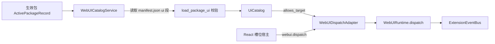
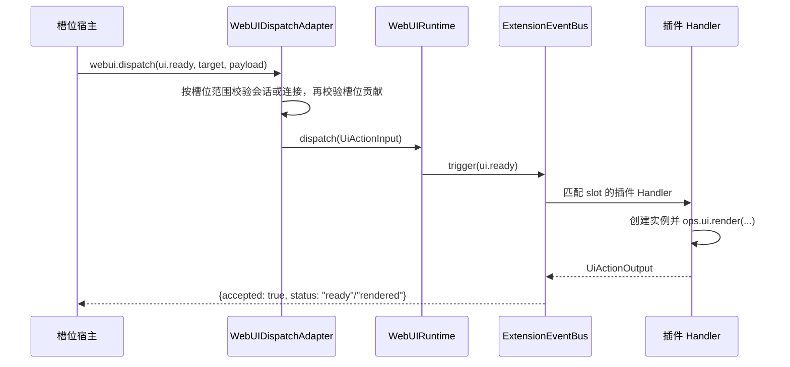

# 界面项声明、挂载与上行交互设计方案

## 元信息

| 项 | 内容 |
| --- | --- |
| 类型 | feature |
| 编号 / slug | `F_07 / ui-contributions` |
| 关联计划 | EXTV2-07 界面项声明、挂载与上行交互 |
| 所属模块 | `jiuwenswarm/extensions_v2/webui/{contributions,adapter}.py` |
| 设计依据 | [F_05 平台事件](F_05_platform-events.md)、[F_06 渲染服务](F_06_render-service.md)、[详细架构](../designs/extensions-v2-architecture.md) |
| 最近一次修订日期 | 2026-11-04 |
| 方案状态 | 已实现 |

## 1. 问题与目标

前端不能凭插件任意声明就占用页面位置，也不能把任意请求送进事件链。宿主需要从**已生效**的包中派生可用界面项，
只允许声明的槽位挂载，并为浏览器交互确认会话或 Web 连接归属。全局槽位不依赖聊天会话。

一句话概括：**界面项目录从生效包的 `manifest.json ui` 段派生，前端按目录挂载槽位，所有上行交互经唯一入口 `webui.dispatch` 校验后进入事件链。**

## 2. 范围

### 2.1 本次范围

- 读取并校验生效包的 `ui` 段，产出界面项目录。
- 声明槽位、顺序和 `webui-tree` 渲染器。
- 提供槽位白名单与槽位展示模式（`list` / `single`）。
- 提供唯一上行入口 `webui.dispatch`，按槽位范围校验事件名、会话或连接、目标和贡献。
- 定义上行回执字段与状态。

### 2.2 非目标

- 不校验渲染树内容；归 F_06。
- 不实现前端布局与组件；归 F_08。
- 不提供界面项运行时开关、灰度或用户级授权。
- 不支持 `webui-tree` 之外的渲染器。

## 3. 总体设计

### 3.1 组件关系



`WebUICatalogService` 以 `(package_id, version, generation)` 作为缓存签名；生效包集合变化时重新加载，避免每次上行请求都读磁盘。

### 3.2 声明结构

```json
{
  "ui": {
    "apiVersion": 1,
    "items": [
      {
        "type": "web.slot.contribution",
        "id": "token-weather.turn",
        "slot": "message.assistant.meta",
        "order": 10,
        "renderer": { "kind": "webui-tree" }
      }
    ]
  }
}
```

| 字段 | 必填 | 说明 |
| --- | --- | --- |
| `apiVersion` | 是 | 当前只接受 `1` |
| `items[].type` | 是 | 当前只接受 `web.slot.contribution` |
| `items[].id` | 是 | 包内同类型唯一 |
| `items[].slot` | 贡献项必填 | 必须在槽位白名单内 |
| `items[].order` | 否 | 整数，默认 0，用于同槽位排序 |
| `items[].renderer.kind` | 贡献项必填 | 当前只接受 `webui-tree` |

一个包只要有一项声明非法，整包的界面项都不发布，错误记录在 `UiCatalog.errors`；其他包不受影响。

### 3.3 槽位

| 槽位 | 展示模式 | 说明 |
| --- | --- | --- |
| `conversation.input.above` | `list` | 输入区上方，可并列多个实例 |
| `conversation.input.below` | `single` | 输入区下方，只展示最新实例 |
| `conversation.panel.right` | `list` | 右侧工作区，可并列多个实例；插件实例与原生页签并列 |
| `conversation.header.title.after` | `list` | 会话标题之后，横向排列 |
| `conversation.header.actions` | `list` | 会话头部操作区，横向排列 |
| `conversation.session.content.after` | `list` | 单轮回复内容之后、footer 之前，只在 footer 可见的最后一条助手消息挂载一次，按 `instance_key=requestId` 归属 |
| `conversation.turn.footer.actions` | `list` | 单轮回复 meta 行，横向排列 |
| `message.assistant.meta` | `list` | 助手消息 meta 行，按 `instance_key=requestId` 对应单轮实例 |
| `application.entry` | `single` | 应用范围的首次访问入口 |
| `application.sidebar.footer` | `single` | 左侧图标栏底部的应用范围入口区 |
| `application.settings` | `list` | 设置页内容区 |
| `application.menu` | `list` | 左侧导航栏，点击进入 `application.menu.main` |
| `application.menu.main` | `single` | 应用菜单主页面 |
| `task.function` | `list` | 应用范围的侧栏任务功能区，点击进入 `task.function.main` |
| `task.function.main` | `single` | 应用范围的任务功能区页面，保留会话侧栏 |

槽位是平台预定义位置，插件只能选择，不能新增。前端在没有实例时不渲染容器。
`application.entry` 为应用范围的 single 入口，由 `WebUIEntryHost` 在浏览器首次访问时挂载；ready 被接受后写入访问标记，后续刷新跳过挂载，clear 或失败关闭入口。
`application.sidebar.footer` 同为应用范围的 single 槽位，由 `WebUIHost` 在左侧图标栏底部挂载，不要求聊天会话；没有实例时不渲染容器。
`task.function` 与 `task.function.main` 同为应用范围，复用当前 Web 连接的实例身份，不要求聊天会话；
入口与页面共享包和实例标识。切换会话不重新挂载入口，也不因 session 变化关闭任务页面。
离开任务页面查看聊天时，宿主保留已打开的应用范围页面及其 iframe，仅隐藏页面容器；
返回同一任务入口复用原页面。会话范围菜单页面仍随导航卸载，选择其他插件页面时释放原页面。
`application.menu`、`application.menu.main` 仍为会话范围，新建空对话中不挂载；设置范围见 [S_18](../specs/S_18_settings-location.md)。
平台在 `webui/constants.py` 的 `SLOT_SPECS` 中维护槽位的范围和展示模式；范围及目标字段见
[F_06 第 3.2 节](F_06_render-service.md#32-数据模型)。新增槽位还需要接入前端，不能只改后端表项；
前端挂载方式见 [F_08 第 4.5 节](F_08_frontend-render.md#45-会话与全局槽位的挂载)。

#### 3.3.1 定义会话槽位和全局槽位

范围由平台定义，插件的 manifest 只选择槽位，不改变范围。下面用两个表项说明后端登记方式，
合入 `webui/constants.py` 的现有表时保留其他表项：

```python
SLOT_SPECS = MappingProxyType({
    "conversation.panel.right": SlotSpec("list", SlotScope.SESSION),
    "application.panel.right": SlotSpec("list", SlotScope.APPLICATION),
})
```

`application.panel.right` 是新增位置的示例名称。平台还需在前端登记相同的槽位名称、范围和展示模式，
并将宿主放到需要显示内容的位置；不需要按槽位名称新增后端分支。
`list` / `single` 决定展示多个实例还是单个实例，`session` / `application` 决定实例属于会话还是连接，两者分别配置。
扩展包仍使用第 3.2 节的 `web.slot.contribution` 声明，在 `slot` 中选择已登记的全局位置；manifest 不另行指定范围。

## 4. 处理流程

### 4.1 挂载



`ui.ready` 通常只接受空 payload；`application.entry` 接受 `{"reason": "first_visit"}`。会话级槽位的目标只带会话和槽位，包与实例标识为空；实例由插件在 Handler 中创建，因此 CORE Handler 对 `ui.ready` 不检查实例是否存在。消息级槽位在本地缺少实例时，会携带 `instance_key=requestId` 上报，插件可据此恢复该轮已缓存的视图。

`list` 槽位的未指定包 ui.ready，由上行适配器按活动 web.slot.contribution 对包去重，按 order、package_id、id 稳定排序后分别定向派发，保留原 instance_key、payload 与连接/会话上下文。每个包负责创建自己的实例；一个包提前返回或初始化异常不阻止其他包。单包保留原回执，多包返回逐包 results（package_id、accepted、status、可选 code），全部接受时顶层 accepted=true/status=ready，部分接受时 accepted=false/status=partial，全部拒绝时 status=rejected。已有定向交互与 single 槽位派发保持原语义。

全局槽位挂载时不要求聊天会话。Gateway 从实际 WebSocket 取得连接 ID，并通过 E2A 的 `metadata.ws_id`
交给 AgentServer；浏览器提交的目标不能指定投递连接。前端的全局宿主可以在没有当前聊天会话时挂载并上报 `ui.ready`。

会话级上行在触发事件前，WebUIRuntime 从宿主的工作区查询取得 `cwd` 与 `project_root`，分别写入 `SessionContext.cwd` 和 `metadata.project_root`；查询失败不阻断事件。插件应以 `cwd` 为工作目录，缺失时再回退 `project_root`。

### 4.2 上行交互

组件使用 `events` 声明事件及其动作。新组件事件的数据规则由
[组件规约](../../../channels/web/frontend/src/features/webui/docs/specs/S_01_components.md)维护；
后端校验实现位于 `webui/component_rules.py`。旧 action 组件（`Row`/`TextField`/`CheckBox`/
`MultipleChoice`/`List` 等）与对应事件 `ui.press`/`ui.toggle`/`ui.input` 已移除，不再接受声明。

`action_id`、`args` 来自对应事件声明；节点不再支持 `action` 字段。
插件按 `action_id` 区分同一实例内的多个动作，交互值统一从 `payload.data` 读取。

请求处理顺序为：适配器校验字段类型和可信会话 → 目录校验包与槽位贡献 → runtime 校验当前实例、
revision、节点路径、事件、action_id、args 与 data → 触发事件链。包、实例和会话标识不做字符串强制转换。
args 必须与树中的声明完全相同，data 按组件事件规则校验。

例如当前实例 revision 为 3，路径 `0.1` 声明 `ui.click → refresh` 且未指定 args，
只有 revision=3、node_key="0.1"、action_id="refresh"、args={} 且 data={} 的请求才可进入 Handler。
revision=2、伪造 args 或把点击改成输入事件都在进入事件链前被拒绝。

Input 的 `ui.change` 与 `ui.press_enter` 使用同一个入口和 CORE Handler，不单独创建网络方法或 Ops。
change 业务 Handler 从 data 读取 value 与 isComposing；需要完整文本时可跳过组合输入草稿，
在 isComposing=false 时处理提交值，并通过 `ops.ui.render` 返回新视图。
Enter 业务 Handler 只读取 `{value}`，其中 value 是按下 Enter 时的当前编辑值，可以为空字符串；
该事件不携带 isComposing，组合输入期间的 Enter 由前端拦截。
服务端仍按下发节点检查 disabled、readOnly、maxLength 和数据预算，
不能因为前端已禁用控件就省略校验。

### 4.3 请求与回执

请求方法为 `webui.dispatch`，以下是会话级请求：

```json
{
  "event": "ui.click",
  "session_id": "web_xxx",
  "target": {
    "scope": "session",
    "slot_id": "message.assistant.meta",
    "package_id": "webui.token-weather",
    "instance_key": "req-123"
  },
  "payload": {"revision": 3, "node_key": "0.1", "action_id": "example.action", "args": {}, "data": {}}
}
```

普通交互的 payload 只接受 `node_key`、`revision`、`action_id`、`args`、`data` 五个字段，
其中 revision 为正整数。宿主从已显示的实例与节点获取定位字段和动作声明。

会话级请求从 `params.session_id` 或请求封套取得会话 ID，两者同时存在且不一致时拒绝。
应用级请求省略 `params.session_id`，目标不带会话 ID 和连接 ID；连接由 Gateway 补充。
`target.scope` 可以省略，省略时使用槽位表的范围；显式值与槽位定义不一致时拒绝。

应用级请求缺少可信连接时返回 `CONNECTION_REQUIRED`；显式来自非 Web 渠道时返回 `CHANNEL_UNSUPPORTED`。
下行帧的目标与连接路由字段见 [F_06 第 4.3 节](F_06_render-service.md#43-下行消息)。

下面是全局槽位的浏览器请求参数，与会话级请求共用同一个方法：

```json
{
  "event": "ui.ready",
  "target": {
    "scope": "application",
    "slot_id": "application.panel.right",
    "package_id": "",
    "instance_key": ""
  },
  "payload": {}
}
```

插件在事件 Handler 内调用 `ops.ui.render` 时，连接上下文自动沿用。
全局事件的 `ops.session_context` 为 `None`，需要聊天会话的能力仍按各自契约拒绝无会话调用。

#### 4.3.1 连接关闭

Gateway 通过现有断连钩子发送内部 E2A 方法 `webui.connection.closed`，在 metadata 中携带实际连接的 `ws_id`。
该方法只在 AgentServer 适配器登记，不作为浏览器方法开放，也不作为插件可处理的 `ui.*` 事件。
适配器调用 `drop_connection`，只清理这个连接的全局实例，并阻止等待中的旧调用重新创建全局视图。
聊天会话及其后台处理不因 Web 连接关闭而结束。

回执字段：

| 字段 | 说明 |
| --- | --- |
| `event` | 原样返回事件名 |
| `accepted` | 是否被接受 |
| `status` | `ready`、`partial`、`rejected`、`handled`、`inactive`、`stale`、`invalid_action`、`no_contribution`、`no_handler`，或插件自定义状态 |
| `code` | 拒绝时的稳定错误码 |
| `results` | 多包 list ready 的逐包回执；单包与其他交互省略 |

错误码：`WEBUI_UNAVAILABLE`（运行时未装配）、`SCHEMA_ERROR`（事件或目标非法）、`SESSION_MISMATCH`（请求会话与目标不一致）、`NO_CONTRIBUTION`（槽位没有生效的界面项）、`TARGET_INACTIVE`（实例不存在）、`INTERNAL_ERROR`（事件链异常）。

### 4.4 文件能力（目录与预览）

2026-11-03 扩展 FilePreview 的文件输入，保持目录请求、插件动作和小文本返回不变。
FilePreview 内部使用原生 img 展示图片、原生 iframe 展示 PDF，大文本获取后沿用文本视图，
不生成额外 RenderNode，不调整全局消息预算或通用 Iframe 规则。
文件 URL 复用已有的受管下载资源与下载端点，不增加格式转换或音视频功能。

`ops.session.files(expanded_paths=[])` 与 `ops.session.read_file(path)` 由宿主只读文件服务提供。
插件在 `ui.ready` 或 `ui.change` 后查询目录，用 `FileTree` 渲染；选中文件后调用 `read_file` 取预览数据，
再用 `FilePreview` 展示。会话与渠道取自当前 Ops 上下文，根目录来自已绑定的会话工作区，不接受浏览器自报路径。

- `files` 返回 `status`、`treeData`、`truncated`、`readFailed`；目录最多 8 层、512 节点、每层 100 项、96 KiB 预算，最多同时展开 100 个目录。符号链接和非常规文件被跳过，不计为超限；读取失败由 readFailed 单独表示，truncated 仅表示达到浏览预算。
- `read_file` 返回 `status` 与 `file`（name/path/mimeType/size，以及 content 或 downloadUrl）。
  16 KiB 以内的 UTF-8 文本继续内嵌 content；更大文本（最多 1 MiB）、图片和 PDF 返回宿主签发的 downloadUrl。
  PDF 必须以 `%PDF-` 开头；其他二进制、非 UTF-8 文本和超过 1 MiB 的文本仍返回原有失败状态。
  目录边界、符号链接与文件类型在 Server 复核。
- Server 从已校验的文件描述符复制受管快照，下载时不再读取可被替换的工作区路径。
  快照及令牌有效期为 10 分钟，沿用受管资源的过期清理；签发失败时撤销快照。
  `user_id` 从 Ops 的可信会话元数据取得，仅用于下载路由，不接受插件或浏览器自报身份。
  URL 过期后需重新选择文件；原文件替换或删除不改变已签发快照。
  Windows 下受管目录按稳定的用户目录标识定位，支持同用户跨进程校验，并在清理只读快照前恢复写权限。

FileTree 在前端保留目录更新前的滚动位置和本地宽度；右侧分界线可拖拽或用方向键调整。
这些状态使用现有实例状态端口，不新增插件字段或目录请求；节点移除、clear 或断连时按原有生命周期清理。

PDF iframe 不设置 sandbox；前端只允许带 token 的同源下载端点，并先检查实际响应类型和前 5 字节，
拒绝重定向，通过后使用 inline=1 加载。通用 Iframe 的沙箱不变，检查与切换取消规则见
[组件规约 C-27](../../../channels/web/frontend/src/features/webui/docs/specs/S_01_components.md)。

定向验证覆盖旧文本、大小边界、路径拒绝、URL 校验、可信用户路由、快照隔离与过期、失败清理及组件切换。
此前图片和大文本已在独立浏览器测试页显示；PDF 曾因试验分支在内嵌浏览器中为空白而暂停。
本次恢复来源受限的原生 PDF iframe，实际浏览器显示仍待手工验证。
完整 WebClient 跨进程及 AgentOS 部署联调尚未完成。

### 4.5 Workbench 本轮用量展示（2026-11-03）

工作台原来的固定用量按钮用于占位。本次在 `conversation.session.content.after` 保留
`Button(variant="ghost", size="md", icon="database")` 的外观，不绑定点击动作，仅展示用量，
按实际 requestId 显示 provider 的本轮用量；普通状态仅显示一行，轮次菜单操作后另显示操作结果。
最初展示 total_tokens，当前展示采用下述输入、输出拆分修订。
“本轮详情”保留 requestId 和该轮筛选摘要；“刷新本轮”重新查询可用用量，同时保留既有摘要刷新行为。

2026-11-04 修订：当前 [S_07](../specs/S_07_session-usage-ops.md) 的 `ops.session.usage()` 已不公开 turn，旧消费方因此一直显示“未上报”。
后端插件直接读取 `context.usage.updated.total_tokens`，通过既有 `ops.store` 按会话与 requestId 保存；不增加宿主接口，不读宿主内部历史文件。
重复通知覆盖该轮数值，不累加；不把上下文占用或其他轮次借作当前消耗，也不以输入和输出重算总量。真实零值显示 0，缺失显示“未上报”。

通知和 UI 事件沿用同一个会话锁；只更新已挂载的对应轮次内容槽位，通知先于 ready 时仅缓存。
ready 从插件自己的存储恢复对应轮次，“刷新本轮”重新读存储；持久数据沿用 [F_27](F_27_store-persistence.md) 的目录、提交和生命周期。
保存成功后才更新缓存和界面，失败不假称已经提交；非法保存值明确报错，不伪造零值。重载和服务重启保留数据，卸载删除数据。修复前未保存或没有收到通知的历史轮次仍然未知。
最初改成 Text 后，用户要求保留原按钮样式和图标，因此恢复原 Button 配置，只替换真实用量文案，
不声明 `ui.click`；本次不扩展组件协议。

验证覆盖 ready 与通知先后、重复通知、零值/缺失、会话及轮次隔离、重载后的查询边界、菜单反馈。
2026-11-03：`test_workbench_turn_actions.py` 与 `test_application_slots.py` 定向测试合计 35 项通过。
其中安装/重载用例经过真实管理器、事件总线、Session Ops 和 WebUI 渲染服务，数据使用绑定宿主快照，
不代表已完成真实模型及跨进程联调。产品页面由用户手工验收。

2026-11-04：修复迁移并新增通知先后、非法值、持久化失败、重载恢复、零值和会话隔离回归。
工作台、独立 Token Weather 和应用槽位定向测试共 109 项通过，原先失败的工作台安装用例已按当前通知及 store 契约更新并通过。
实际工作台安装副本已同步处理器，经正式 /extension reload 返回热重载成功；本轮没有调用模型，尚未验证修复后新模型回合的实际数值。
本次只修改工作台插件及验证与说明，未扩展宿主；没有为修复前缺失的插件记录复制宿主历史或造数。

2026-11-04 口径与文案修订：用户确认保留真实本轮总量，将标签改为中英文独立的“本轮消耗”/“Turn usage”，数字统一为十进制 K、保留一位小数并省略末尾零；不将本轮消耗改成上下文占用。
与独立插件、应用槽位的定向测试共 139 项通过，覆盖 1K 边界、二进制浮点舍入点、零值与中英文文案。
安装副本已更新并热重载；Chrome 在同一真实历史回合确认中文“本轮消耗：23K Token”、英文“Turn usage: 23K tokens”，天气条上下文仍为 22.9K/256K。原始用量及持久化键值未修改，本轮未发起模型请求。

2026-11-04 输入、输出拆分修订（已实现，替代上述总量展示）：用户确认消息下方仅显示
“输入 22.9K · 输出 82” / “Input 22.9K · Output 82”，沿用原 Button 样式与 database 图标。
直接保存同一 `context.usage.updated` 通知的 input_tokens、output_tokens，不从总量或上下文占用推导。
两项数值都通过非负有限数校验后，以 `turn-usage.v2`、session_id、requestId 为键一次保存；保存成功后才更新界面。
ready、刷新和热重载均恢复同一记录。零值明确显示 0；未收到拆分通知时显示
“输入 未上报 · 输出 未上报” / “Input not reported · Output not reported”。旧 v1 总量记录保留，
不解释为输入或输出，不读取宿主内部历史补值。按用户后续确认省略 Token/tokens 后缀，
格式化沿用十进制 K、一位小数及省略末尾零。输入框上方的上下文天气条及宿主组件接口不变。

验证：`.venv/bin/python -m pytest tests/unit_tests/extensions_v2/webui/test_workbench_turn_actions.py tests/unit_tests/extensions_v2/webui/test_application_slots.py tests/unit_tests/extensions_v2/webui/test_token_weather_glass.py -q --no-cov -o log_cli=false`
共 71 项通过，覆盖通知时序、重复更新、隔离、持久化失败、非法值、零值、旧记录、刷新、重载恢复及中英文标签。
本地 1.0.9 安装副本已同步两个实现文件及中英文说明，ZIP 已重建；正式 `/extension reload` 返回热重载成功。
Chrome 在用户截图对应的 20:13 历史回合确认显示“输入 未上报 · 输出 未上报”，刷新后保留，
天气条仍显示 8.7% · 22.9K/256K Token。旧 v1 总量记录未改写，本轮没有调用模型或向真实会话注入用量，
新数值的通知与恢复通过上述受控测试验证。真实页面截图为本次可视化目录的 workbench-input-output-live.png。

## 5. 异常与边界

- 事件名必须在 `UPSTREAM_EVENTS` 内；节点只能绑定自身组件声明的事件。
- 会话级请求带 `session_id` 且与目标或封套不一致时返回 `SESSION_MISMATCH`；应用级请求不把封套中的会话 ID 当成聊天会话使用。
- 目录校验目标包是否声明了该槽位；广播 ready 的空包目标只检查槽位贡献。实例键按槽位范围确定，见 [F_06 第 3.2.2 节](F_06_render-service.md#322-实例标识)；未登记实例返回 `inactive`。
- revision 与当前实例不符时返回 `stale/TARGET_INACTIVE`；动作或数据非法时返回 `invalid_action/SCHEMA_ERROR`。
- 校验保证进入事件链时请求有效，不锁住 Handler 的整个执行期；Handler 等待期间视图可能被其他任务替换。

## 6. 关键决策

- **目录从生效包读取原始 manifest**：agent-core 不返回 `ui` 段，宿主不能依赖其解析结果。
- **整包拒绝**：一项非法导致整包界面项不发布，避免半套界面进入前端。
- **单入口上行**：所有 `ui.*` 共用一个 `webui.dispatch`，便于统一鉴权、错误码和审计。
- **`ui.ready` 不做实例检查**：挂载时实例尚不存在，由插件在事件链内创建，避免额外握手。
- **槽位模式**：list/single 的展示与可见数量由前端执行；服务端按已有槽位目录对 list 的广播 ready 逐包初始化，避免一个包的提前返回阻止其他贡献。
- **按下发快照校验交互**：registry 保存独立只读树，插件修改原字典不会改变当前 revision 的动作和参数。

## 7. 实施影响

- `manifest.json` 新增 `ui` 段；agent-core 只解析已知字段，宿主从生效记录的包根读取原始文件。
- Gateway 需要把 `webui.dispatch` 路由到 AgentServer；AgentServer 注册 `WebUIDispatchAdapter`。
- 前端槽位宿主在挂载和切换会话时上报 `ui.ready`。
- 包卸载时目录因生效记录变化自动刷新，前端同时收到清除帧。

## 8. 验证

验证入口：

- `tests/unit_tests/extensions_v2/webui/test_webui_adapter.py`
- `tests/unit_tests/extensions_v2/webui/test_webui_runtime.py`
- `tests/unit_tests/extensions_v2/webui/test_webui_events.py`
- `tests/unit_tests/extensions_v2/webui/test_webui_input.py`
- `tests/unit_tests/extensions_v2/webui/test_application_slots.py`
- `tests/unit_tests/extensions_v2/test_session_files.py`
- 前端 `npm run test:webui-events`

覆盖内容：

- `ui.ready` 到达 Token Weather 示例包后，按会话或 `requestId` 恢复已缓存的展示。
- 没有界面贡献的槽位返回 `no_contribution`。
- 槽位、会话和目标字段校验。
- 正常交互、非法事件数据、过期 revision、伪造动作与参数，以及拒绝请求不触发业务 Handler。
- 包卸载、会话与实例隔离，以及目录外组件与旧组件属性的拒绝。
- 应用槽位缺少连接或来自非 Web 渠道时拒绝；同一个包在两个连接上分别渲染，目标不携带聊天会话 ID。

组件属性测试共用前端测试目录下的 `webuiComponentCases.json`。Python 测试覆盖进程内的
render → Handler → replace；前端测试使用 jsdom 验证页面点击产生的请求。

当前执行结果：上述用例通过。
2026-10-30 的后端定向复核见 [F_06 第 8 节](F_06_render-service.md#8-验证)，前端宿主与交互验证见
[F_08 第 8 节](F_08_frontend-render.md#8-验证)。

### 2026-11-04 任务槽位应用范围验证

- 后端：`.venv/bin/python -m pytest tests/unit_tests/extensions_v2/webui/test_application_slots.py tests/unit_tests/extensions_v2/webui/test_workbench_turn_actions.py --no-cov -q -o log_cli=false`，53 项通过。
  覆盖任务入口和页面的目标校验、缺少连接与错误作用域的拒绝、示例插件不创建会话状态、投递失败回执，
  以及安装示例后通过真实适配器在空对话与两个聊天中保持连接实例身份、两个连接的 revision 隔离和断连清理。
- 前端目录：`node scripts/build-webui-components.mjs` 后执行
  `node --test tests/webuiComponents.test.mjs tests/webuiComponentsReact.test.mjs`，215 项通过。
  新增 JSDOM 回归覆盖无会话挂载、点击打开同包同实例任务页面、切换聊天不重建入口和 Iframe、标题中英文切换。
- `npx vite build`、`git diff --check` 与 `git diff --cached --check` 通过。
  按仓库约束未运行格式化、lint 或类型检查；该轮尚未执行真实浏览器与跨进程服务联调。

### 2026-11-04 真实浏览器复验与页面挂载修复

- 使用 Chrome 访问本地真实 WebClient、Gateway 和 Runtime Worker，更新已安装的工作台示例副本，
  重启本地后端及独立存活的 Runtime Worker，使其加载新的应用范围定义与处理器。
- 首次复验确认 `/chat/new` 空对话可以打开任务检查，但点击已有会话会因 `activeNav` 切到聊天而卸载页面。
  修复 `App`：当前应用范围页面在查看聊天期间只隐藏，不释放宿主；返回入口复用页面。
  会话范围菜单仍按原导航生命周期处理，选择其他插件页面释放原页面。
- 在应用入口增加临时被动 DOM 观测，使用 `WeakMap` 记录 iframe 对象身份，并记录创建、移除和 load 事件。
  实际点击完成“空对话打开 → 会话 A → 返回任务页 → 会话 B → 返回任务页 → 新建空对话 → 再开任务页”。
  所有阶段始终使用 iframe 1，累计创建 1 次、load 1 次、移除 0 次；聊天显示时任务页面不可见，返回后可见。
- 此验证经过真实插件渲染与页面导航，不调用模型。临时观测入口与测试服务在验证后清理。
  截图和分步记录保存在当前任务的 `task-slot-browser` 交付目录。
- 修复后任务导航定向组件测试与 `npx vite build` 通过，差异空白检查通过；未运行格式化、lint 或类型检查。

## 9. 风险与遗留

- 目标包与槽位贡献校验不等于用户授权或业务权限校验。
- 目录随生效记录刷新、包卸载后目录失效尚未单独验证；当前用例只覆盖实例清理。
- 本地化资源已声明和校验，但尚未参与标题解析。
- 界面项不支持运行时禁用、灰度或按用户过滤。
- 当前槽位为 15 个位置：应用范围包含 `application.entry`、`application.sidebar.footer`、`task.function` 和 `task.function.main`；其余 11 个位置默认使用会话范围，设置槽位还允许显式应用范围。新增槽位时，前后端登记的名称、范围和展示模式必须一致，未知槽位或范围不一致的目标会被拒绝。
