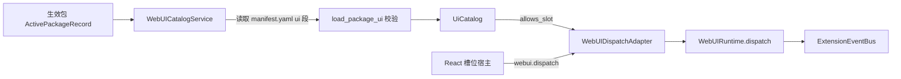
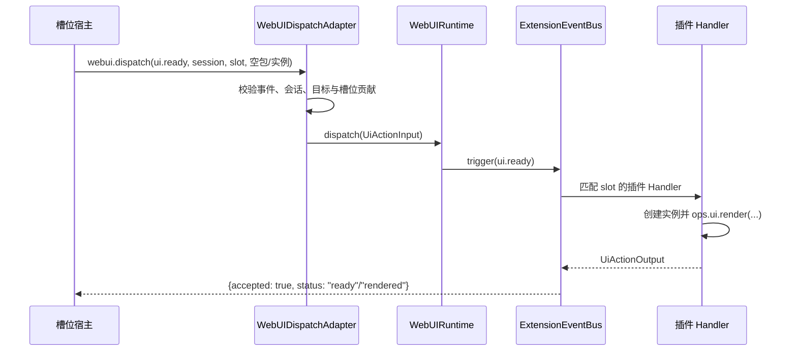

# 界面项声明、挂载与上行交互设计方案

## 元信息

| 项 | 内容 |
| --- | --- |
| 类型 | feature |
| 编号 / slug | `F_07 / ui-contributions` |
| 关联计划 | EXTV2-07 界面项声明、挂载与上行交互 |
| 所属模块 | `jiuwenswarm/extensions_v2/webui/{contributions,adapter}.py` |
| 设计依据 | [F_05 平台事件](F_05_platform-events.md)、[F_06 渲染服务](F_06_render-service.md)、[详细架构](../designs/extensions-v2-architecture.md) |
| 最近一次修订日期 | 2026-10-22 |
| 方案状态 | 已实现 |

## 1. 问题与目标

前端不能凭插件任意声明就占用页面位置，也不能把任意请求送进事件链。宿主需要从**已生效**的包中派生可用界面项，只允许声明的槽位挂载，并把浏览器交互还原成带可信会话的事件。

一句话概括：**界面项目录从生效包的 `manifest.yaml ui` 段派生，前端按目录挂载槽位，所有上行交互经唯一入口 `webui.dispatch` 校验后进入事件链。**

## 2. 范围

### 2.1 本次范围

- 读取并校验生效包的 `ui` 段，产出界面项目录。
- 声明槽位、顺序、面板标题、语言资源和 `webui-tree` 渲染器。
- 提供槽位白名单与槽位展示模式（`list` / `single`）。
- 提供唯一上行入口 `webui.dispatch`，校验事件名、会话、目标和贡献。
- 定义上行回执字段与状态。

### 2.2 非目标

- 不校验渲染树内容；归 F_06。
- 不实现前端布局与组件；归 F_08。
- 不提供界面项运行时开关、灰度或用户级授权。
- 不支持 `webui-tree` 之外的渲染器。

## 3. 总体设计

### 3.1 组件关系



`WebUICatalogService` 以 `(package_id, version, generation)` 作为缓存签名；生效包集合变化时重新加载，避免每次上行请求都读磁盘。

### 3.2 声明结构

```yaml
ui:
  apiVersion: 1
  items:
    - type: web.slot.contribution
      id: token-weather.turn
      slot: message.assistant.meta
      order: 10
      panel:
        title: Turn Usage
      renderer:
        kind: webui-tree
```

| 字段 | 必填 | 说明 |
| --- | --- | --- |
| `apiVersion` | 是 | 当前只接受 `1` |
| `items[].type` | 是 | `web.slot.contribution` 或 `web.locale` |
| `items[].id` | 是 | 包内同类型唯一 |
| `items[].slot` | 贡献项必填 | 必须在槽位白名单内 |
| `items[].order` | 否 | 整数，默认 0，用于同槽位排序 |
| `items[].panel` | 否 | 映射，当前用于 `title` |
| `items[].renderer.kind` | 贡献项必填 | 当前只接受 `webui-tree` |
| `items[].localeId` | 否 | 必须引用同包的 `web.locale` 条目 |
| `items[].resources` | 否 | 语言到包内相对路径的映射，路径不得逃逸包根 |

一个包只要有一项声明非法，整包的界面项都不发布，错误记录在 `UiCatalog.errors`；其他包不受影响。

### 3.3 槽位

| 槽位 | 展示模式 | 说明 |
| --- | --- | --- |
| `conversation.input.above` | `list` | 输入区上方，可并列多个实例 |
| `conversation.input.below` | `single` | 输入区下方，只展示最新实例 |
| `conversation.panel.right` | `list` | 右侧工作区，可并列多个实例 |
| `message.assistant.meta` | `list` | 助手消息 meta 行，按 `instance_key=requestId` 对应单轮实例 |

槽位是平台预定义位置，插件只能选择，不能新增。前端在没有实例时不渲染容器。

## 4. 处理流程

### 4.1 挂载



会话级槽位的 `ui.ready` 目标只带会话和槽位，包与实例标识为空；实例由插件在 Handler 中创建，因此 CORE Handler 对 `ui.ready` 不检查实例是否存在。消息级槽位在本地缺少实例时，会携带 `instance_key=requestId` 上报，插件可据此恢复该轮已缓存的视图。

### 4.2 上行交互

前端把组件事件归一化为以下 payload：

| 事件 | 来源组件 | payload |
| --- | --- | --- |
| `ui.press` | `Button` | `{action_id, args}` |
| `ui.toggle` | `CheckBox` | `{action_id, name, checked, args}` |
| `ui.input` | `TextField` | `{action_id, name, value, args}` |
| `ui.select` | `MultipleChoice`、`Slider` | `{action_id, name, value, args}` |

`action_id` 来自渲染节点的 `action.id`，`args` 来自 `action.args`。插件按 `action_id` 区分同一实例内的多个动作。

### 4.3 请求与回执

请求方法为 `webui.dispatch`，参数结构：

```json
{
  "event": "ui.press",
  "session_id": "web_xxx",
  "target": {
    "slot_id": "message.assistant.meta",
    "package_id": "webui.token-weather",
    "instance_key": "req-123"
  },
  "payload": {"action_id": "example.action", "args": {}}
}
```

回执字段：

| 字段 | 说明 |
| --- | --- |
| `event` | 原样返回事件名 |
| `accepted` | 是否被接受 |
| `status` | `ready`、`handled`、`inactive`、`no_contribution`、`no_handler`，或插件自定义状态 |
| `code` | 拒绝时的稳定错误码 |

错误码：`WEBUI_UNAVAILABLE`（运行时未装配）、`SCHEMA_ERROR`（事件或目标非法）、`SESSION_MISMATCH`（请求会话与目标不一致）、`NO_CONTRIBUTION`（槽位没有生效的界面项）、`TARGET_INACTIVE`（实例不存在）、`INTERNAL_ERROR`（事件链异常）。

## 5. 异常与边界

- 事件名不在 `ui.ready`、`ui.press`、`ui.toggle`、`ui.input`、`ui.select` 内时直接拒绝。
- 请求带 `session_id` 且与目标不一致时返回 `SESSION_MISMATCH`。
- 目录校验当前只检查槽位是否有贡献，不校验目标包是否声明了该槽位；实例定位仍由四元组决定，未登记的实例在上行时返回 `inactive`。
- 语言资源只校验路径存在且不逃逸包根；文本解析与按语言选择尚未实现。
- `panel` 目前只做结构校验并保留在目录中，前端尚未使用；标题本地化未实现。

## 6. 关键决策

- **目录从生效包读取原始 manifest**：agent-core 不返回 `ui` 段，宿主不能依赖其解析结果。
- **整包拒绝**：一项非法导致整包界面项不发布，避免半套界面进入前端。
- **单入口上行**：所有 `ui.*` 共用一个 `webui.dispatch`，便于统一鉴权、错误码和审计。
- **`ui.ready` 不做实例检查**：挂载时实例尚不存在，由插件在事件链内创建，避免额外握手。
- **槽位模式由前端决定**：服务端只声明槽位白名单，`list` / `single` 是展示策略。

## 7. 实施影响

- `manifest.yaml` 新增 `ui` 段；agent-core 只解析已知字段，宿主从生效记录的包根读取原始文件。
- Gateway 需要把 `webui.dispatch` 路由到 AgentServer；AgentServer 注册 `WebUIDispatchAdapter`。
- 前端槽位宿主在挂载和切换会话时上报 `ui.ready`。
- 包卸载时目录因生效记录变化自动刷新，前端同时收到清除帧。

## 8. 验证

验证入口：

- `tests/unit_tests/extensions_v2/webui/test_webui_adapter.py`
- `tests/unit_tests/extensions_v2/webui/test_webui_runtime.py`

覆盖内容：

- `ui.ready` 到达 Token Weather 示例包后，按会话或 `requestId` 恢复已缓存的展示。
- 没有界面贡献的槽位返回 `no_contribution`。
- 槽位、会话和目标字段校验。

当前执行结果：上述用例通过。

## 9. 风险与遗留

- 目录只按槽位判断贡献，未校验“该包是否声明了该槽位”；后续可把校验收紧到 `(package_id, slot_id)`。
- 目录随生效记录刷新、包卸载后目录失效尚未单独验证；当前用例只覆盖实例清理。
- 本地化资源已声明和校验，但尚未参与标题解析。
- 界面项不支持运行时禁用、灰度或按用户过滤。
- 槽位集合固定为三个会话级位置；新增槽位需要同时修改后端白名单和前端宿主。
