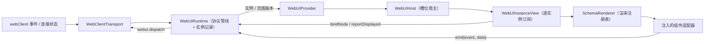

# 前端槽位渲染设计方案

## 元信息

| 项 | 内容 |
| --- | --- |
| 类型 | feature |
| 编号 / slug | `F_08 / frontend-render` |
| 关联计划 | EXTV2-08 前端槽位渲染与复杂面板 |
| 所属模块 | `jiuwenswarm/channels/web/frontend/src/features/webui/` |
| 设计依据 | [F_06 渲染服务](F_06_render-service.md)、[F_07 界面项与上行交互](F_07_ui-contributions.md) |
| 最近一次修订日期 | 2026-11-06 |
| 方案状态 | 新链路已接入生产页面并承接全部 15 个已登记槽位，同时支持会话与全局槽位范围；旧链路与旧 action 组件已删除；真实插件联调与浏览器验收待整批验证 |

## 1. 问题与目标

前端需要在会话槽位和全局槽位展示插件内容，并把用户操作回传给对应插件实例。渲染树来自后端，组件和样式必须受控；同一槽位可能有多个实例，更新可能乱序到达，也可能在 `clear` 后按相同 `revision` 重新生成。

前端按槽位范围（会话槽位跟随当前会话，全局槽位跟随当前 Web 连接）保存最近一帧；运行时负责协议校验、实例状态、挂载所有权和上行交互，React 宿主通过可注入的组件目录与渲染注册表把规范化树映射为组件。

## 2. 范围

### 2.1 本次范围

新增前端运行时底座（本方案对应的实现，已落地，已接入页面入口）：

- 协议管线：`webui.render`、`webui.render.clear`、`webui.render.error` 的 wire 校验、限额检查与规范化；组件目录用于校验组件名、props、子节点与 events。
- 运行时：实例记录、`revision` 比较、`clear`/`error` 处理、挂载所有权与释放、节点绑定、上行事件校验、显示确认与渲染失败反馈。
- React 宿主：`WebUIProvider`、`WebUIHost`、`WebUIInstanceView`、实例错误边界与渲染注册表。
- 接入适配：可注入的 `WebUICatalog`、`WebUIRendererRegistry` 与 `WebUIClientLike`；WebClient 传输适配与 Mock 传输。
- 独立验证：demo 目录、demo 适配器、共享组件样本与协议、运行时、事件、传输及渲染测试。

当前生产入口使用 `WebUIAppRoot`、`WebUIProvider`、`WebUIHost`、`useWebUIPanels` 与
`WebUINavigationHost`/`WebUIPageHost`，由组件、协议、运行时、传输与渲染测试共同覆盖。

组件契约模块包含独立目录、事件数据规则和属性校验器。模块职责见
[F_01 组件目录与属性校验](../../../channels/web/frontend/src/features/webui/docs/features/F_01_antd-components.md)，
规则边界见 [S_01 组件规则](../../../channels/web/frontend/src/features/webui/docs/specs/S_01_components.md)。

### 2.2 非目标

- 不支持插件自定义 HTML、CSS 或脚本。
- 不实现加载态、空态样式、离线缓存、跨标签页同步与自动重放业务操作；重连后重新上报 `ui.ready` 生成视图。

## 3. 总体设计

### 3.1 组件关系

新链路按「接入适配 → 协议管线 → 运行时 → React 宿主 → 渲染注册表」分层，旧链路已移除：

生产页面由 `WebUIAppRoot` 组装的唯一运行时承接：`WebUIHost` 负责槽位挂载，`useWebUIPanels` 负责右侧面板，
`WebUIHost` 与槽位上下文共同解析会话与页面导航。旧的 `useWebUIRender`、`WebUISlotHost` 与 `RenderTree`
已删除，不存在第二套订阅。

### 3.2 实例状态

运行时按槽位范围生成实例键（会话槽位为 `sessionId|slotId|packageId|instanceKey`，全局槽位在当前连接内为 `application|slotId|packageId|instanceKey`）保存最近一帧的快照：

| 字段 | 类型 | 含义与约束 |
| --- | --- | --- |
| `key` | `string` | 实例键，与后端 `RenderTarget.key` 语义一致 |
| `target` | `WebUINormalizedTarget` | 会话（或全局范围）、槽位、包、实例标识 |
| `state` | `'active' \| 'error'` | 有渲染帧或仅有错误帧 |
| `revision` | `number` | 后端在该实例内的单调版本 |
| `frame` | `WebUINormalizedRenderFrame \| null` | 最近接受的规范化渲染帧 |
| `error` | `{ code, message } \| null` | 最近错误帧的反馈，可附着在已有内容上 |
| `connected` | `boolean` | 最近一次连接状态 |
| `displayedRevision` | `number` | 最近确认显示的 `revision`，初值为 0 |
| `displayedLocalFrameId` | `number \| null` | 当前已显示的本地代次；null 表示当前代次尚未确认显示 |
| `renderFailure` | `{ revision, message } \| null` | 当前渲染代次的失败反馈，写入前校验 localFrameId |
| `localFrameId` | `number` | 运行时本地单调渲染代次，每次创建快照时分配，不随 `revision` 重置 |
| `lifetimeId` | `number` | 实例生存期标识，replace 时保留，clear 后重建时重新分配 |

`revision` 是后端语义的实例内版本；`clear` 后实例被删除，重建时 `revision` 可能从 1 重新开始，因此不能用 `revision` 单独判断 React 渲染代次或反馈归属。`localFrameId` 在运行时生命周期内只增不减，用于 React 重挂载键，以及显示确认、失败反馈的归属校验。

### 3.3 槽位展示与消费者范围

| 槽位 | 模式 | 页面位置 |
| --- | --- | --- |
| `conversation.input.above` | `list` | `ChatPanel` 消息列表下方、输入区上方 |
| `conversation.input.below` | `single` | 输入区下方 |
| `conversation.panel.right` | `list` | `App` 主区域右侧工作区 |
| `message.assistant.meta` | `list` | `MessageItem` 的助手消息 meta 行，消息级宿主按实例键过滤 |

- `list` 槽位展示范围内全部实例，每个实例对应一个独立的 `WebUIInstanceView`。
- `single` 槽位按 `localFrameId` 选择最新实例，不跨实例比较 `revision`。
- 不传 `instanceKey` 的消费者覆盖整个槽位，传入时只覆盖该实例；可用 `packageId` 进一步限定所属包。

### 3.4 公开接口与生命周期

运行时公开接口（`WebUIRuntime`，不依赖 React）：

| 接口 | 调用方 | 语义 |
| --- | --- | --- |
| `start()` | 组装入口 | 幂等订阅接入层；已销毁的运行时不可复用 |
| `dispose()` | 组装入口 | 取消订阅并清理实例、消费者与监听器 |
| `mountSlot(sessionId, slotId, options?)` | `WebUIHost` | 注册消费者并返回挂载句柄；槽位未在目录中注册时抛错 |
| `handle.notifyReady()` | `WebUIHost` | 上报消费者就绪；范围消费者上报空实例键，实例消费者上报自己的实例键 |
| `handle.release()` | `WebUIHost` 卸载 | 只释放本消费者；清理不再被剩余消费者覆盖的实例 |
| `bindNode(instanceKey, localFrameId, nodeKey, mountLeaseId?)` | `SchemaRenderer` 经实例视图注入 | 创建属于当前挂载消费者的节点绑定，返回 emit 与 release |
| `dispatchIntent(request)` | 节点绑定 | 校验绑定与事件数据，再转为 `webui.dispatch`，返回统一状态 |
| `reportDisplayed(instanceKey, revision, localFrameId)` | `WebUIInstanceView` | React 提交后确认显示；帧版本与代次都必须匹配 |
| `reportRenderFailure(instanceKey, revision, message, localFrameId)` | 实例错误边界 | 记录当前代次的整树渲染失败；旧代次反馈被拒绝 |
| `clearSession(sessionId)` | 宿主或组装入口 | 清理一个会话的实例与消费者 |
| `subscribeInstance` / `subscribeScope` | React 宿主 | 内容更新只通知实例；实例增删只通知范围 |

React 宿主接口：

| 组件 | Props | 语义 |
| --- | --- | --- |
| `WebUIProvider` | `runtime`、`registry`、`children` | 挂载前校验目录与注册表精确对应，缺失或多余适配器直接失败 |
| `WebUIHost` | `slotId`、`sessionId`、`instanceKey?`、`packageId?`、`className?`、`runtime?`、`registry?` | 订阅范围快照、注册消费者、按 `list`/`single` 展示实例 |
| `WebUIInstanceView` | `runtime`、`registry`、`instanceKey`、`mountLeaseId?` | 独立订阅一个实例，持有错误边界、显示确认与节点绑定 |

生命周期与所有权语义：

1. `WebUIHost` 挂载时调用 `mountSlot` 并立即 `notifyReady()`；卸载时 `release()`。
2. 消费者释放时，只有仍被剩余消费者覆盖的实例保留：范围消费者覆盖整槽，实例消费者只覆盖自己的实例键；最后一个消费者退出时清理范围与残留实例。
3. 连接断开后重新连接时，运行时按每个消费者上报过的就绪身份重发 `ui.ready`；范围消费者重发空实例键，实例消费者重发自己的实例键。
4. 收到后端 `extensions.v2.installed` 时，只对指定包、当前 session 的仍挂载消费者重发 `ui.ready`。该通知由服务端在安装完成，或热重载 clear 完成后发送。
5. 内容 `clear` 只删除实例与范围成员，不删除消费者的就绪身份；消费者释放前，重连仍以原实例键上报。

接入顺序（应用级装配与槽位落位均已落地）：

1. 用后端目录镜像创建 `WebUICatalog`，并为目录中每个组件实现同名适配器，创建 `WebUIRendererRegistry`。
2. 调用 `createWebUIAppRuntime({ client, catalog, registry })` 得到 `runtime` 与 `registry`，在应用生命周期中显式 `start()`。
3. 在应用子树外层挂载 `WebUIProvider`，在槽位位置挂载 `WebUIHost`；消息级槽位传入 `instanceKey`，其余槽位传 `sessionId` 与 `slotId`。
4. 应用卸载时 `dispose()`，释放运行时与消费者；旧链路已删除，运行时是唯一订阅方。

当前状态：`main.tsx` 用 `WebUIAppRoot` 创建唯一运行时，并由 `WebUIEntryHost` 承接 `application.entry`；
15 个已登记槽位全部由 `WebUIHost` 承载，位置为：ChatPanel（输入区、头部）、MessageItem（单轮内容、meta）、
ToolPanel（右侧页签）、SettingsPageLayout（设置页）、SessionSidebar（应用菜单与底部用户入口）、ConversationSidebar（任务功能区）、
`WebUIPageHost`（菜单主页面与任务页面）。

### 3.5 渲染代次、显示确认与失败反馈

- `WebUIInstanceView` 以 `localFrameId` 作为错误边界与 `SchemaRenderer` 的重挂载键：`clear` 后按相同 `revision` 重建时，旧组件树被卸载，节点局部状态和旧错误不会继承。
- 渲染树按帧对象与代次缓存；显示确认等快照更新不重建未变化的组件树，避免重复执行适配器。
- `reportDisplayed` 与 `reportRenderFailure` 同时匹配 `revision` 和 `localFrameId`；旧代次迟到的确认或失败被忽略。
- 新的合法渲染帧会清空上一帧的失败反馈；错误帧只附着错误信息，不触发整树重建。
- 节点绑定在 layout effect 中建立并在清理时释放；隐藏内容通过 `WebUIContentActivity` 停用绑定。
- 实例视图持有可选组件状态端口。组件可按节点路径与组件名保留自身交互值，节点删除或类型改变时清理；clear、断连或消费者更换时重建端口。状态端口按 lifetimeId 区分实例生存期，因此同一次 React 更新中的 clear 与重建也不会继承旧状态。

## 4. 处理流程

### 4.1 下行

1. 传输适配把事件外壳交给协议管线，帧以 `unknown` 接收。
2. 协议层校验目标字符串、槽位、范围、`revision`、`mode`/`schema_version`、节点数量/深度/文本大小及 events 参数大小；非法帧整帧丢弃。
3. 规范化：目标字段转驼峰，节点生成路径 key（根 `0`、子节点 `0.0`、Tabs 内容 `0.items.1.children.0`），事件参数补齐为对象，结果与输入隔离并递归冻结。Tabs 隐藏内容共享预算，根组件受槽位约束。
4. 实例提交：`replace` 帧只接受更大的 `revision`；`clear` 帧删除实例；旧 `error` 帧被忽略，其余错误附着到已有实例，没有实例时创建只显示错误的空实例。
5. 通知：新实例、删除实例、消费者变化通知范围；实例内容更新只通知该实例；`single` 槽位在内容更新时额外通知范围，宿主据此按 `localFrameId` 重新选择最新实例。
6. `WebUIHost` 渲染实例列表；`WebUIInstanceView` 订阅的快照变化后按新代次重建或复用组件树。

### 4.2 上行

组件适配器通过 `emit(event, data)` 触发当前节点声明的事件；运行时按以下顺序校验并发送：

1. 实例存在且 `frame.revision === request.frameRevision`，否则返回 `inactive`。
2. 连接状态为 `connected`，否则返回 `disconnected`。
3. 节点绑定属于当前消费者、实例与 localFrameId，当前代次已显示且未渲染失败；禁用或加载中的节点返回 `inactive`。只读 Input 允许 `ui.click`，其余事件返回 `inactive`。
4. 节点和目录均声明该事件，data 为合法 JSON 对象且满足事件形状与组件语义限制，否则返回 `invalid_action`。
5. 从当前树读取动作与 args，构造 `{action_id, args, data, node_key, revision}`。完整 payload 按 `maxFrameBytes` 校验序列化字节数，默认上限 256 KiB；data 中的文本字段单独执行 16 KiB 限制。每次合法回调独立发送，不合并重复值。
6. 发送异常返回 `failed`；回执到达时绑定和代次仍有效则返回 `sent`，否则返回 `stale`。stale 只表示本地视图已失效，不撤销服务端已经执行的动作。

### 4.3 挂载、释放与重连

1. `mountSlot` 创建消费者并加入范围消费者集合，同时通知范围版本。
2. `notifyReady` 记录消费者就绪身份并立即上报；上报失败不影响挂载，断连重连后重发。
3. `release` 从消费者与范围集合中移除本消费者，逐个检查范围实例是否仍被剩余消费者覆盖；未覆盖实例被删除并通知对应实例与范围。
4. 范围没有剩余消费者时删除范围记录并通知范围；最后一个实例的本地状态不会自动保留给后来挂载的消费者。
5. 连接状态由断开变为连接时，按消费者重发 `ui.ready`；收到指定包的 `extensions.v2.installed` 时也按相同方式重发；就绪身份不因内容 `clear` 而删除。
6. replace、clear、断连、渲染失败和所属消费者释放都会使旧节点绑定失效，重连或包变更后必须由当前视图重新绑定。

### 4.4 React 渲染、显示确认与错误隔离

1. `WebUIInstanceView` 用 `useSyncExternalStore` 订阅实例版本，只重建变化实例的视图；组件树按帧与代次缓存。
2. 实例错误边界以 `localFrameId` 为 key；任一适配器抛错时整棵实例树降级为失败态，不展示部分内容，并把失败反馈写回运行时。
3. 渲染提交后，确认组件在 effect 中以 `{ revision, localFrameId }` 上报显示；同一帧的显示确认不会再次执行适配器。
4. `StrictMode` 的挂载/卸载与宿主重复挂载按消费者句柄独立处理，不泄漏范围所有权。

### 4.5 会话与全局槽位的挂载

前端在 `catalog/slots.ts` 与后端 `SLOT_SPECS` 中同步登记范围与展示模式。`WebUIHost` 从
`WebUICatalog` 读取定义；会话槽位使用 `WebUISlotProvider` 提供的真实会话 ID，应用槽位不要求会话。
范围及目标字段见 [F_06 第 3.2 节](F_06_render-service.md#32-数据模型)，上行参数见
[F_07 第 4.3 节](F_07_ui-contributions.md#43-请求与回执)。

当前应用范围有 `application.entry` 与 `application.sidebar.footer`。前者由 `WebUIEntryHost` 在首次访问时挂载并发送
`{"reason": "first_visit"}`，ready 被接受后保存浏览器访问标记，后续刷新跳过；clear 或失败关闭入口。
后者由 `WebUIHost` 在左侧图标栏底部挂载，ready 使用空 payload。`readyOnce` 避免同一挂载消费者重复就绪。
其余 13 个槽位仍需要真实会话，`application.menu`、`task.function` 和 `application.settings` 在新建空对话中不挂载。

| 行为 | 会话槽位 | 全局槽位 |
| --- | --- | --- |
| 挂载与切换 | 需要会话 ID，切换会话时切换实例 | 无需会话 ID，切换聊天不重新挂载 |
| 上行 | 带 `session_id`，范围为 `session` | 省略 `session_id`，范围为 `application` |
| 下行解析 | 要求会话 ID 与槽位范围合法 | 不要求会话 ID，仍校验槽位和范围 |
| 清理 | 按会话清理 | 当前连接断开时清理本地全局实例 |
| 重连 | 按既有会话恢复方式处理 | 重新上报 `ui.ready`，接受新连接从 revision 1 开始的首帧 |

前端不发送 `connection_id` 或 `ws_id`；Gateway 从实际连接取得信息，AgentServer 按连接隔离实例。
两种宿主的事件和渲染树协议一致，都使用 `webui.dispatch` 及现有三类下行帧。

### 4.6 Iframe 权限与点击交互

Iframe 的 URL 校验允许相对路径与 HTTP(S) 地址，但这只检查地址格式，不证明页面可信。
不可信文档若同时获得脚本与同源权限，且最终地址与宿主同源，就能访问父页面 DOM 和同源存储，
并可移除 sandbox 后重新加载以解除剩余限制。因此宿主固定设置
`sandbox="allow-scripts allow-forms allow-popups allow-modals allow-downloads"`，不允许插件传入或扩展权限。
该限制同样适用于绝对地址指向宿主、重定向或后续导航回宿主的文档。

脚本、表单、弹窗、模态框和下载能力保持可用；弹窗继承 sandbox，不开放
`allow-popups-to-escape-sandbox` 或顶层导航权限。普通点击、输入和 iframe 内导航不需要 `allow-same-origin`。
`referrerPolicy="no-referrer"` 只限制 Referer，不承担同源隔离或禁用凭据的职责。

加载提示改为角标并设置 `pointer-events: none`，不再用全屏提示层拦截已渲染文档的点击。
错误与非激活提示仍占满容器，且不保留 iframe。浏览器的 `load` 事件只用于结束加载提示，不保证远端页面业务可用。

2026-11-02 修订取消本地曾加入的 `allow-same-origin`：没有证据表明普通点击需要该权限。
保留它并仅禁止相对路径不能隔离绝对同源地址；仅增加风险说明也不能恢复隔离。
代价是 iframe 文档使用不透明 origin，依赖 localStorage、IndexedDB 或同源请求的页面可能无法正常工作；
这类需求应另行设计独立 origin、请求授权和导航边界，不能直接放开宿主同源访问。
该隔离限制脚本访问父页面，不承诺阻止所有携带 cookie 的网络请求。

## 5. 组件与样式映射

### 5.1 独立运行时

- 组件名、props 规则、默认值、子节点、内容组与上行事件由 `WebUICatalog` 描述；组件目录在初始化时校验重复项、非法事件和默认值未声明。
- `WebUIRendererRegistry` 只在组装时创建一次，运行期不做全局注册；`WebUIProvider` 要求目录与注册表精确对应，缺失适配器或多余适配器都会在子树挂载前抛错。
- `SchemaRenderer` 按节点 `component` 查注册表并递归渲染；适配器只接收节点、子内容、内容组、实例上下文与 `emit`，不接触 Runtime、通信客户端或完整实例快照。
- demo 目录与 demo 适配器用于模块测试，实际组件与样式 token 映射由宿主适配器提供。

### 5.2 旧链路（已删除）

`RenderTree`、`WebUISlotHost`、`webuiStore`、`actionBridge` 与 `useWebUIRender` 已从仓库删除，
对应的 `webuiStore` / `webuiDispatch` 测试与 npm 脚本一并移除。旧组件 `Row`、`Column`、`Icon`、`Badge`、
`TextField`、`CheckBox`、`MultipleChoice`、`List`、`Progress` 不再被协议接受，
旧事件 `ui.press`、`ui.toggle`、`ui.input` 不再进入事件链。迁移对照可查阅本文件历史版本。

## 6. 异常与边界

- 会话目标缺少会话、槽位未注册、范围不匹配或帧字段非法时整帧丢弃；全局目标不依赖聊天会话。
- 旧 `revision` 帧被忽略；`clear` 的旧 `revision` 被忽略；跨实例的 `revision` 不比较。
- 未知组件在目录校验阶段即失败：要么组装前目录与注册表不匹配，要么实例渲染时缺少适配器，整棵实例树降级，不影响其他实例。
- 组件没有声明对应事件时不派发；目录或节点未声明该事件时返回 `invalid_action`。
- 交互请求失败保留当前界面，不自动重试；结果只作为适配器可观察的返回值。
- `clear` 后按相同 `revision` 重建时，以新的 `localFrameId` 触发重新挂载；旧代次的显示确认与失败反馈被拒绝。
- 消费者释放后不再持有其未覆盖的实例；旧交互因实例不存在返回 `inactive`。

## 7. 实施影响

- 新增 `src/features/webui/` 下的 `assembly/`、`catalog/`、`contracts/`、`protocol/`、`react/`、`renderer/`、`runtime/`、`testing/`、`transport/` 与统一导出；旧文件已删除。
- `package.json` 保留 `test:webui-protocol`、`test:webui-runtime`、`test:webui-transport`、`test:webui-renderer` 与 `test:webui-components`；旧 `test:webui-store`、`test:webui-dispatch` 已移除。
- `App.tsx`、`ChatPanel`、`MessageItem`、`ToolPanel`、侧栏与设置页均已改用新宿主；后续文件能力增加了 `ops.session.files`、`ops.session.read_file` 与宿主只读文件服务，应用入口使用 `application.entry` 的 ready 负载。
- 组件属性与事件契约由组件目录维护，并与后端规则同步；调整白名单时检查两侧校验。

## 8. 验证

### 8.1 验证设计与通过条件

| 验证 ID | 场景 / 前置状态与输入 | 操作或验证入口 | 预期结果 / 通过条件 |
| --- | --- | --- | --- |
| EXTV2-08-V-01 | 正常帧、clear、错误帧与重复操作 | 协议与运行时测试 | 状态转移、显示确认与事件派发符合上文 |
| EXTV2-08-V-02 | 目录外组件、非法帧、适配器缺失 | 协议与渲染测试 | 非法输入被丢弃或整树失败，不影响其他实例 |
| EXTV2-08-V-03 | 多实例独立更新、交互回传 | 运行时与 JSDOM 测试 | 更新 A 不执行 B 的适配器；交互 payload 与绑定归属正确 |
| F-08-V-04 | `clear` 后按相同 `revision` 重建 | 运行时与 JSDOM 测试 | 新 `localFrameId` 触发重新挂载；局部状态与旧错误不继承；显示确认重新上报 |
| F-08-V-05 | 请求未完成时连续提交相同或不同输入 | 事件测试 | 每次合法回调都发出请求，旧代次回执返回 stale |
| F-08-V-06 | 实例级消费者与范围消费者混合释放 | 运行时测试 | 只删除不再被剩余消费者覆盖的实例 |
| F-08-V-07 | 内容 `clear` 后重连 | 运行时测试 | 按消费者原实例键重发 `ui.ready`，不变成空实例键 |
| F-08-V-08 | Iframe 加载、非激活、错误及同源 URL | 组件 JSDOM 回归；浏览器另验证实际交互 | 加载提示不拦截鼠标；错误与非激活时卸载 iframe；相对与绝对同源地址均不开放同源权限 |
| F-08-V-09 | 已挂载包热重载 | 运行时与传输测试 | 收到 clear 后的 `extensions.v2.installed`，只为该包重发 `ui.ready`，无需浏览器刷新 |

### 8.2 验证入口

前端目录下执行 `npm run test:webui-protocol`、`npm run test:webui-runtime`、
`npm run test:webui-events`、`npm run test:webui-transport`、`npm run test:webui-renderer`
与 `npm run test:webui-components`。

2026-11-06 补充包变更恢复验证：`npm run test:webui-runtime` 的 19 项和
`npm run test:webui-transport` 的 9 项通过，分别覆盖指定包的 ready 重放和通知参数校验。

## 9. 风险与遗留

- **真实联调未完成**：15 个槽位已由新宿主承接，但尚未完成真实插件发帧 → 页面操作 → Handler → 回执的跨进程验证；
  旧链路已删除，后续问题只能在单链路上定位。
- **双端规则维护**：前端组件目录与后端规则分别实现，共用组件属性样本；变更规则时需要同时验证两端。
- **显示确认仅本地（未联调）**：`displayedRevision` 只保存在前端运行时，未接入后端显示回执事件；跨端显示语义需要另行确认。
- **真实恢复链路（未验证）**：`ui.ready` 的重连重发只验证到请求构造，插件端是否按实例键恢复轮次视图需要真实联调。
- **槽位范围同步**：槽位范围来自平台目录，前后端配置需要保持一致；新增位置应同时登记并挂载宿主。

### 2026-10-31 评审修复验证

前后端共享 `webuiEventCases.json` 验证输入长度、Slider 步进、Tabs 和选择控件的合法选项，
并区分 TreeSelect 的点选与复选语义。JSDOM 回归覆盖已访问用户跳过应用入口，以及 FileTree 拒绝回执仅回滚当前字段。
后端 Extensions V2、会话清理与工作区测试 664 项通过；随后新增的 Deep Code normal/plan 快照测试 2 项通过，
Code 适配器的无项目/有项目绑定测试也通过。文件服务 12 项定向测试通过，包含逐级符号链接拒绝、读取失败与预算超限区分；回归用例约束组件与文件服务的 100 个展开目录上限一致，核心层不反向依赖 Server。8 组前端测试（contracts、components、protocol、runtime、events、
transport、renderer、i18n-locales）通过，Vite 生产打包通过。

本次遵守本地约束，未运行格式化、lint 或类型检查。Vite 打包与 JSDOM 不能代替浏览器验收；
全页 Iframe 高度、深浅主题及真实插件的跨进程链路仍待浏览器验证。

### 2026-11-02 Iframe 点击与权限修复验证

- `npm run test:webui-components`：52 项通过。JSDOM 加载真实 Iframe 样式，覆盖加载提示不拦截鼠标、错误与暂停状态、断连重连，以及相对和绝对宿主 URL 的固定权限。
- 在内置浏览器用本机临时页面挂载真实 `Iframe` 组件，子文档使用同源 URL。按钮点击、文本输入、表单提交、普通链接导航和弹窗均通过；子文档访问父页面 DOM 和自身 localStorage 均被浏览器拒绝。
- 人为保持子文档图片请求未完成时，加载提示仍在，但点击和输入正常；实际提示区域为 117 × 36 px，容器为 1230 × 420 px，计算样式的 `pointer-events` 为 `none`。释放请求后提示消失，停用与重新激活会卸载并重建文档。浅色和深色下均检查了提示外观。
- 右侧网页预览示例曾临时使用百度进行验证，但百度通过 `frame-ancestors` 限制了本地页面嵌入，且其脚本读取 cookie/localStorage 时触发 sandbox `SecurityError`；现改为 `https://httpbin.org/forms/post`。该页面响应未声明 `X-Frame-Options` 或限制性的 `frame-ancestors`，包含文本框、选项和提交按钮，适合作为 iframe 联调页。
- 上述浏览器试验只验证组件，不代表已完成真实插件安装、跨进程发帧和生产页面验收。未运行格式化、lint 或类型检查。
