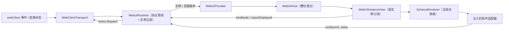

# 前端槽位渲染设计方案

## 元信息

| 项 | 内容 |
| --- | --- |
| 类型 | feature |
| 编号 / slug | `F_08 / frontend-render` |
| 关联计划 | EXTV2-08 前端槽位渲染与复杂面板 |
| 所属模块 | `jiuwenswarm/channels/web/frontend/src/features/webui/` |
| 设计依据 | [F_06 渲染服务](F_06_render-service.md)、[F_07 界面项与上行交互](F_07_ui-contributions.md) |
| 最近一次修订日期 | 2026-10-30 |
| 方案状态 | 旧链路（store + 槽位宿主）保持线上；WebUI 前端运行时底座已实现并通过模块测试，尚未接入生产页面入口；加载态、真实插件联调未验收 |

## 1. 问题与目标

前端需要在固定位置展示插件内容，并把用户操作回传给对应插件实例。渲染树来自后端，组件和样式必须受控；同一会话可能有多个实例，更新可能乱序到达，也可能在 `clear` 后按相同 `revision` 重新生成。

前端按 `session × slot × package × instance` 保存最近一帧；运行时负责协议校验、实例状态、挂载所有权和上行交互，React 宿主通过可注入的组件目录与渲染注册表把规范化树映射为组件。

## 2. 范围

### 2.1 本次范围

新增前端运行时底座（本方案对应的实现，已落地，尚未接入页面入口）：

- 协议管线：`webui.render`、`webui.render.clear`、`webui.render.error` 的 wire 校验、限额检查与规范化；组件目录用于校验组件名、props、子节点与 events。
- 运行时：实例记录、`revision` 比较、`clear`/`error` 处理、挂载所有权与释放、节点绑定、上行事件校验、显示确认与渲染失败反馈。
- React 宿主：`WebUIProvider`、`WebUIHost`、`WebUIInstanceView`、实例错误边界与渲染注册表。
- 接入适配：可注入的 `WebUICatalog`、`WebUIRendererRegistry` 与 `WebUIClientLike`；WebClient 传输适配与 Mock 传输。
- 独立验证：demo 目录、demo 适配器、共享组件样本与协议、运行时、事件、传输及渲染测试。

当前生产入口使用 `webuiStore`、`useWebUIRender`、`WebUISlotHost`、`RenderTree` 和 `actionBridge`，由 `test:webui-store` 覆盖存储行为。

组件契约模块包含独立目录、事件数据规则和属性校验器。模块职责见
[F_01 组件目录与属性校验](../../../channels/web/frontend/src/features/webui/docs/features/F_01_antd-components.md)，
规则边界见 [S_01 组件规则](../../../channels/web/frontend/src/features/webui/docs/specs/S_01_components.md)。

### 2.2 非目标

- 不新增或修改后端事件、Ops 方法、槽位与文件服务；使用既有下行事件与 `webui.dispatch` 上行方法。
- 不启用新的页面入口，不迁移 `App.tsx`、`ChatPanel` 等生产挂载点；旧入口与旧测试保留。
- 提供可注入注册表、组件契约和 demo 适配器；不包含 Ant Design 等实际组件适配。
- 不实现加载态、空态样式、离线缓存、跨标签页同步与真实插件端到端联调。

## 3. 总体设计

### 3.1 组件关系

新链路按「接入适配 → 协议管线 → 运行时 → React 宿主 → 渲染注册表」分层，旧链路保持原状：



旧链路仍由 `App.tsx` 的 `useWebUIRender`、`WebUISlotHost` 与 `RenderTree` 承担生产渲染；新链路只在测试与显式组装入口中运行，二者不共享实例状态。

### 3.2 实例状态

运行时以 `sessionId|slotId|packageId|instanceKey` 为实例键保存最近一帧的快照：

| 字段 | 类型 | 含义与约束 |
| --- | --- | --- |
| `key` | `string` | 实例键，与后端 `RenderTarget.key` 语义一致 |
| `target` | `WebUINormalizedTarget` | 会话、槽位、包、实例四元组 |
| `state` | `'active' \| 'error'` | 有渲染帧或仅有错误帧 |
| `revision` | `number` | 后端在该实例内的单调版本 |
| `frame` | `WebUINormalizedRenderFrame \| null` | 最近接受的规范化渲染帧 |
| `error` | `{ code, message } \| null` | 最近错误帧的反馈，可附着在已有内容上 |
| `connected` | `boolean` | 最近一次连接状态 |
| `displayedRevision` | `number` | 最近确认显示的 `revision`，初值为 0 |
| `displayedLocalFrameId` | `number \| null` | 当前已显示的本地代次；null 表示当前代次尚未确认显示 |
| `renderFailure` | `{ revision, message } \| null` | 当前渲染代次的失败反馈，写入前校验 localFrameId |
| `localFrameId` | `number` | 运行时本地单调渲染代次，每次创建快照时分配，不随 `revision` 重置 |
| `lifetimeId` | `number` | 实例生存期标识，replace 时保留，clear 后重建时重新分配 |

`revision` 是后端语义的实例内版本；`clear` 后实例被删除，重建时 `revision` 可能从 1 重新开始，因此不能用 `revision` 单独判断 React 渲染代次或反馈归属。`localFrameId` 在运行时生命周期内只增不减，用于 React 重挂载键，以及显示确认、失败反馈的归属校验。

### 3.3 槽位展示与消费者范围

| 槽位 | 模式 | 页面位置 |
| --- | --- | --- |
| `conversation.input.above` | `list` | `ChatPanel` 消息列表下方、输入区上方 |
| `conversation.input.below` | `single` | 输入区下方 |
| `conversation.panel.right` | `list` | `App` 主区域右侧工作区 |
| `message.assistant.meta` | `list` | `MessageItem` 的助手消息 meta 行，消息级宿主按实例键过滤 |

- `list` 槽位展示范围内全部实例，每个实例对应一个独立的 `WebUIInstanceView`。
- `single` 槽位按 `localFrameId` 选择最新实例，不跨实例比较 `revision`。
- 不传 `instanceKey` 的消费者覆盖整个槽位，传入时只覆盖该实例；可用 `packageId` 进一步限定所属包。

### 3.4 公开接口与生命周期

运行时公开接口（`WebUIRuntime`，不依赖 React）：

| 接口 | 调用方 | 语义 |
| --- | --- | --- |
| `start()` | 组装入口 | 幂等订阅接入层；已销毁的运行时不可复用 |
| `dispose()` | 组装入口 | 取消订阅并清理实例、消费者与监听器 |
| `mountSlot(sessionId, slotId, options?)` | `WebUIHost` | 注册消费者并返回挂载句柄；槽位未在目录中注册时抛错 |
| `handle.notifyReady()` | `WebUIHost` | 上报消费者就绪；范围消费者上报空实例键，实例消费者上报自己的实例键 |
| `handle.release()` | `WebUIHost` 卸载 | 只释放本消费者；清理不再被剩余消费者覆盖的实例 |
| `bindNode(instanceKey, localFrameId, nodeKey, mountLeaseId?)` | `SchemaRenderer` 经实例视图注入 | 创建属于当前挂载消费者的节点绑定，返回 emit 与 release |
| `dispatchIntent(request)` | 节点绑定 | 校验绑定与事件数据，再转为 `webui.dispatch`，返回统一状态 |
| `reportDisplayed(instanceKey, revision, localFrameId)` | `WebUIInstanceView` | React 提交后确认显示；帧版本与代次都必须匹配 |
| `reportRenderFailure(instanceKey, revision, message, localFrameId)` | 实例错误边界 | 记录当前代次的整树渲染失败；旧代次反馈被拒绝 |
| `clearSession(sessionId)` | 宿主或组装入口 | 清理一个会话的实例与消费者 |
| `subscribeInstance` / `subscribeScope` | React 宿主 | 内容更新只通知实例；实例增删只通知范围 |

React 宿主接口：

| 组件 | Props | 语义 |
| --- | --- | --- |
| `WebUIProvider` | `runtime`、`registry`、`children` | 挂载前校验目录与注册表精确对应，缺失或多余适配器直接失败 |
| `WebUIHost` | `slotId`、`sessionId`、`instanceKey?`、`packageId?`、`className?`、`runtime?`、`registry?` | 订阅范围快照、注册消费者、按 `list`/`single` 展示实例 |
| `WebUIInstanceView` | `runtime`、`registry`、`instanceKey`、`mountLeaseId?` | 独立订阅一个实例，持有错误边界、显示确认与节点绑定 |

生命周期与所有权语义：

1. `WebUIHost` 挂载时调用 `mountSlot` 并立即 `notifyReady()`；卸载时 `release()`。
2. 消费者释放时，只有仍被剩余消费者覆盖的实例保留：范围消费者覆盖整槽，实例消费者只覆盖自己的实例键；最后一个消费者退出时清理范围与残留实例。
3. 连接断开后重新连接时，运行时按每个消费者上报过的就绪身份重发 `ui.ready`；范围消费者重发空实例键，实例消费者重发自己的实例键。
4. 内容 `clear` 只删除实例与范围成员，不删除消费者的就绪身份；消费者释放前，重连仍以原实例键上报。

接入顺序（应用级装配与槽位落位均已落地）：

1. 用后端目录镜像创建 `WebUICatalog`，并为目录中每个组件实现同名适配器，创建 `WebUIRendererRegistry`。
2. 调用 `createWebUIAppRuntime({ client, catalog, registry })` 得到 `runtime` 与 `registry`，在应用生命周期中显式 `start()`。
3. 在应用子树外层挂载 `WebUIProvider`，在槽位位置挂载 `WebUIHost`；消息级槽位传入 `instanceKey`，其余槽位传 `sessionId` 与 `slotId`。
4. 应用卸载时 `dispose()`，释放运行时与消费者；旧链路的 `useWebUIRender`/`WebUISlotHost` 在迁移完成前继续工作，不与新运行时共享实例状态。

当前状态：`main.tsx` 用 `WebUIAppRoot` 创建唯一运行时（不含 `application.entry` 入口宿主）；
13 个已登记槽位全部由 `WebUIHost` 承载，位置为：ChatPanel（输入区、头部）、MessageItem（单轮内容、meta）、
ToolPanel（右侧页签）、SettingsPageLayout（设置页）、SessionSidebar（应用菜单）、ConversationSidebar（任务功能区）、
`WebUIPageHost`（菜单主页面与任务页面）。旧链路仅保留代码，生产槽位不再使用它；删除放在独立提交。

### 3.5 渲染代次、显示确认与失败反馈

- `WebUIInstanceView` 以 `localFrameId` 作为错误边界与 `SchemaRenderer` 的重挂载键：`clear` 后按相同 `revision` 重建时，旧组件树被卸载，节点局部状态和旧错误不会继承。
- 渲染树按帧对象与代次缓存；显示确认等快照更新不重建未变化的组件树，避免重复执行适配器。
- `reportDisplayed` 与 `reportRenderFailure` 同时匹配 `revision` 和 `localFrameId`；旧代次迟到的确认或失败被忽略。
- 新的合法渲染帧会清空上一帧的失败反馈；错误帧只附着错误信息，不触发整树重建。
- 节点绑定在 layout effect 中建立并在清理时释放；隐藏内容通过 `WebUIContentActivity` 停用绑定。
- 实例视图持有可选组件状态端口。组件可按节点路径与组件名保留自身交互值，节点删除或类型改变时清理；clear、断连或消费者更换时重建端口。状态端口按 lifetimeId 区分实例生存期，因此同一次 React 更新中的 clear 与重建也不会继承旧状态。

## 4. 处理流程

### 4.1 下行

1. 传输适配把事件外壳交给协议管线，帧以 `unknown` 接收。
2. 协议层校验目标字符串、槽位、`revision`、`mode`/`schema_version`、节点数量/深度/文本大小及 events 参数大小；非法帧整帧丢弃。
3. 规范化：目标字段转驼峰，节点生成路径 key（根 `0`、子节点 `0.0`、Tabs 内容 `0.items.1.children.0`），事件参数补齐为对象，结果与输入隔离并递归冻结。Tabs 隐藏内容共享预算，根组件受槽位约束。
4. 实例提交：`replace` 帧只接受更大的 `revision`；`clear` 帧删除实例；旧 `error` 帧被忽略，其余错误附着到已有实例，没有实例时创建只显示错误的空实例。
5. 通知：新实例、删除实例、消费者变化通知范围；实例内容更新只通知该实例；`single` 槽位在内容更新时额外通知范围，宿主据此按 `localFrameId` 重新选择最新实例。
6. `WebUIHost` 渲染实例列表；`WebUIInstanceView` 订阅的快照变化后按新代次重建或复用组件树。

### 4.2 上行

组件适配器通过 `emit(event, data)` 触发当前节点声明的事件；运行时按以下顺序校验并发送：

1. 实例存在且 `frame.revision === request.frameRevision`，否则返回 `inactive`。
2. 连接状态为 `connected`，否则返回 `disconnected`。
3. 节点绑定属于当前消费者、实例与 localFrameId，当前代次已显示且未渲染失败；禁用或加载中的节点返回 `inactive`。只读 Input 允许 `ui.click`，其余事件返回 `inactive`。
4. 节点和目录均声明该事件，data 为合法 JSON 对象且满足事件形状与组件语义限制，否则返回 `invalid_action`。
5. 从当前树读取动作与 args，构造 `{action_id, args, data, node_key, revision}`。完整 payload 按 `maxFrameBytes` 校验序列化字节数，默认上限 256 KiB；data 中的文本字段单独执行 16 KiB 限制。每次合法回调独立发送，不合并重复值。
6. 发送异常返回 `failed`；回执到达时绑定和代次仍有效则返回 `sent`，否则返回 `stale`。stale 只表示本地视图已失效，不撤销服务端已经执行的动作。

### 4.3 挂载、释放与重连

1. `mountSlot` 创建消费者并加入范围消费者集合，同时通知范围版本。
2. `notifyReady` 记录消费者就绪身份并立即上报；上报失败不影响挂载，断连重连后重发。
3. `release` 从消费者与范围集合中移除本消费者，逐个检查范围实例是否仍被剩余消费者覆盖；未覆盖实例被删除并通知对应实例与范围。
4. 范围没有剩余消费者时删除范围记录并通知范围；最后一个实例的本地状态不会自动保留给后来挂载的消费者。
5. 连接状态由断开变为连接时，按消费者重发 `ui.ready`；就绪身份不因内容 `clear` 而删除。
6. replace、clear、断连、渲染失败和所属消费者释放都会使旧节点绑定失效，重连后必须由当前视图重新绑定。

### 4.4 React 渲染、显示确认与错误隔离

1. `WebUIInstanceView` 用 `useSyncExternalStore` 订阅实例版本，只重建变化实例的视图；组件树按帧与代次缓存。
2. 实例错误边界以 `localFrameId` 为 key；任一适配器抛错时整棵实例树降级为失败态，不展示部分内容，并把失败反馈写回运行时。
3. 渲染提交后，确认组件在 effect 中以 `{ revision, localFrameId }` 上报显示；同一帧的显示确认不会再次执行适配器。
4. `StrictMode` 的挂载/卸载与宿主重复挂载按消费者句柄独立处理，不泄漏范围所有权。

### 4.4 会话与全局槽位的挂载

前端支持 `session` 和 `application` 两种槽位。范围及目标字段见
[F_06 第 3.2 节](F_06_render-service.md#32-数据模型)，上行参数见
[F_07 第 4.3 节](F_07_ui-contributions.md#43-请求与回执)。

当前页面使用 `WebUISlotHost` 时，在 `types.ts` 的 `WEBUI_SLOT_SPECS` 登记与后端一致的表项：

```ts
export const WEBUI_SLOT_SPECS = {
  'conversation.panel.right': { scope: 'session', mode: 'list' },
  'application.panel.right': { scope: 'application', mode: 'list' },
};
```

以上是表项示例，保留其他现有项。登记全局位置后，将 `<WebUISlotHost slotId="application.panel.right" />`
放到对应页面位置即可；宿主按定义决定是否读取当前会话，全局槽位不要求 `activeSessionId`。

通过 Runtime/Provider 使用公开的 `WebUIHost` 时，在传入的 `WebUICatalog` 中配置
`{ id: 'application.panel.right', display: 'list', scope: 'application' }`，然后挂载
`<WebUIHost slotId="application.panel.right" />`，无需传 `sessionId`。
省略 catalog 中的 `scope` 时，沿用会话槽位的默认行为。

| 行为 | 会话槽位 | 全局槽位 |
| --- | --- | --- |
| 挂载与切换 | 需要会话 ID，切换会话时切换实例 | 无需会话 ID，切换聊天不重新挂载 |
| 上行 | 带 `session_id`，范围为 `session` | 省略 `session_id`，范围为 `application` |
| 下行解析 | 要求会话 ID 与槽位范围合法 | 不要求会话 ID，仍校验槽位和范围 |
| 清理 | 按会话清理 | 当前连接断开时清理本地全局实例 |
| 重连 | 按既有会话恢复方式处理 | 重新上报 `ui.ready`，接受新连接从 revision 1 开始的首帧 |

前端不发送 `connection_id` 或 `ws_id`；Gateway 从实际连接取得信息，AgentServer 按连接隔离实例。
两种宿主的事件和渲染树协议一致，都使用 `webui.dispatch` 及现有三类下行帧。

## 5. 组件与样式映射

### 5.1 独立运行时

- 组件名、props 规则、默认值、子节点、内容组与上行事件由 `WebUICatalog` 描述；组件目录在初始化时校验重复项、非法事件和默认值未声明。
- `WebUIRendererRegistry` 只在组装时创建一次，运行期不做全局注册；`WebUIProvider` 要求目录与注册表精确对应，缺失适配器或多余适配器都会在子树挂载前抛错。
- `SchemaRenderer` 按节点 `component` 查注册表并递归渲染；适配器只接收节点、子内容、内容组、实例上下文与 `emit`，不接触 Runtime、通信客户端或完整实例快照。
- demo 目录与 demo 适配器用于模块测试，实际组件与样式 token 映射由宿主适配器提供。

### 5.2 旧链路（保留代码，生产不再使用）

旧链路代码仍在仓库中，便于与迁移结果对照；生产槽位已全部由新宿主承载，删除旧链路放在独立提交，
删除前需完成真实往返验证与示例插件迁移。

旧链路支持下列白名单组件与样式 token 映射：

| 组件 | 主要 props | 行为 |
| --- | --- | --- |
| `Column` / `Row` | `gap`、`align`、`justify`、`padding`、`wrap`、`density` | 纵向/横向布局 |
| `Card` | `title`、`tone`、`padding`、`collapsible`、`density` | 带标题容器 |
| `Tabs` | `items`、`selected` | 展示标签头，内容由 children 提供 |
| `Divider` | `axis`、`spacing` | 分隔线 |
| `Text` | `value`、`variant`、`tone`、`size`、`weight`、`max_lines`、`monospace` | 文本 |
| `Icon` | `name`、`size`、`tone` | 内置字形，不加载外部资源 |
| `Badge` | `label`、`tone`、`size` | 状态标签 |
| `Button` | `label`、`variant`、`size`、`disabled` | 点击触发 `ui.press` |
| `TextField` | `name`、`placeholder`、`value`、`max_length` | 受控输入 |
| `CheckBox` | `name`、`label`、`checked`、`disabled` | 开关 |
| `MultipleChoice` | `name`、`options`、`value`、`multiple`、`disabled` | 下拉或多选 |
| `Slider` | `name`、`min`、`max`、`step`、`value`、`disabled` | 数值选择 |
| `List` | `items`、`ordered`、`selected` | 列表，支持 `title`、`tone`、`monospace` |
| `Progress` | `value`、`tone`、`label` | 进度条 |

样式 token 在旧链路 `RenderTree.tsx` 内集中映射为 Tailwind 类；插件不能传颜色或像素。迁移到新运行时后，适配器按同一 token 规则实现。

## 6. 异常与边界

- 目标缺少会话、槽位未注册或帧字段非法时整帧丢弃。
- 旧 `revision` 帧被忽略；`clear` 的旧 `revision` 被忽略；跨实例的 `revision` 不比较。
- 未知组件在目录校验阶段即失败：要么组装前目录与注册表不匹配，要么实例渲染时缺少适配器，整棵实例树降级，不影响其他实例。
- 组件没有声明对应事件时不派发；目录或节点未声明该事件时返回 `invalid_action`。
- 交互请求失败保留当前界面，不自动重试；结果只作为适配器可观察的返回值。
- `clear` 后按相同 `revision` 重建时，以新的 `localFrameId` 触发重新挂载；旧代次的显示确认与失败反馈被拒绝。
- 消费者释放后不再持有其未覆盖的实例；旧交互因实例不存在返回 `inactive`。

## 7. 实施影响

- 新增 `src/features/webui/` 下的 `assembly/`、`catalog/`、`contracts/`、`protocol/`、`react/`、`renderer/`、`runtime/`、`testing/`、`transport/` 与统一导出；旧文件与旧入口保持不变。
- `package.json` 新增 `test:webui-protocol`、`test:webui-runtime`、`test:webui-transport`、`test:webui-renderer`；保留 `test:webui-store` 及其他脚本。
- 不修改 `App.tsx`、`ChatPanel` 等生产挂载点，不新增后端事件、Ops 方法、槽位或文件服务；前端只消费既有 `webClient` 事件与 `webui.dispatch`。
- 组件属性与事件契约由组件目录维护，并与后端规则同步；调整白名单时检查两侧校验。

## 8. 验证

### 8.1 验证设计与通过条件

| 验证 ID | 场景 / 前置状态与输入 | 操作或验证入口 | 预期结果 / 通过条件 |
| --- | --- | --- | --- |
| EXTV2-08-V-01 | 正常帧、clear、错误帧与重复操作 | 协议与运行时测试 | 状态转移、显示确认与事件派发符合上文 |
| EXTV2-08-V-02 | 目录外组件、非法帧、适配器缺失 | 协议与渲染测试 | 非法输入被丢弃或整树失败，不影响其他实例 |
| EXTV2-08-V-03 | 多实例独立更新、交互回传 | 运行时与 JSDOM 测试 | 更新 A 不执行 B 的适配器；交互 payload 与绑定归属正确 |
| F-08-V-04 | `clear` 后按相同 `revision` 重建 | 运行时与 JSDOM 测试 | 新 `localFrameId` 触发重新挂载；局部状态与旧错误不继承；显示确认重新上报 |
| F-08-V-05 | 请求未完成时连续提交相同或不同输入 | 事件测试 | 每次合法回调都发出请求，旧代次回执返回 stale |
| F-08-V-06 | 实例级消费者与范围消费者混合释放 | 运行时测试 | 只删除不再被剩余消费者覆盖的实例 |
| F-08-V-07 | 内容 `clear` 后重连 | 运行时测试 | 按消费者原实例键重发 `ui.ready`，不变成空实例键 |

### 8.2 验证入口

前端目录下执行 `npm run test:webui-protocol`、`npm run test:webui-runtime`、
`npm run test:webui-events`、`npm run test:webui-transport`、`npm run test:webui-renderer` 和 `npm run test:webui-store`。

## 9. 风险与遗留

- **入口未迁移（未实现）**：生产页面仍走旧链路，两套实现并存期间需要避免重复订阅与重复渲染；迁移时按页面逐点接入并回归旧入口。
- **双端规则维护**：前端组件目录与后端规则分别实现，共用组件属性样本；变更规则时需要同时验证两端。
- **显示确认仅本地（未联调）**：`displayedRevision` 只保存在前端运行时，未接入后端显示回执事件；跨端显示语义需要另行确认。
- **真实恢复链路（未验证）**：`ui.ready` 的重连重发只验证到请求构造，插件端是否按实例键恢复轮次视图需要真实联调。
