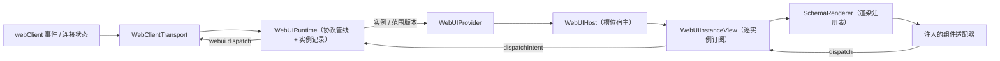

# 前端槽位渲染设计方案

## 元信息

| 项 | 内容 |
| --- | --- |
| 类型 | feature |
| 编号 / slug | `F_08 / frontend-render` |
| 关联计划 | EXTV2-08 前端槽位渲染与复杂面板 |
| 所属模块 | `jiuwenswarm/channels/web/frontend/src/features/webui/` |
| 设计依据 | [F_06 渲染服务](F_06_render-service.md)、[F_07 界面项与上行交互](F_07_ui-contributions.md) |
| 最近一次修订日期 | 2026-10-30 |
| 方案状态 | 旧链路（store + 槽位宿主）保持线上；WebUI 前端运行时底座已实现并通过模块测试，尚未接入生产页面入口；加载态、真实插件联调未验收 |

## 1. 问题与目标

前端需要在固定位置展示插件内容，并把用户操作回传给对应插件实例。渲染树来自后端，组件和样式必须受控；同一会话可能有多个实例，更新可能乱序到达，也可能在 `clear` 后按相同 `revision` 重新生成。

一句话概括：**前端按 `session × slot × package × instance` 保存最近一帧；新运行时负责协议校验、实例状态、挂载所有权和上行交互，React 宿主通过可注入的组件目录与渲染注册表把规范化树映射为组件。生产页面迁移前，旧链路继续工作。**

## 2. 范围

### 2.1 本次范围

新增前端运行时底座（本方案对应的实现，已落地，尚未接入页面入口）：

- 协议管线：`webui.render`、`webui.render.clear`、`webui.render.error` 的 wire 校验、限额检查与规范化；组件目录用于校验组件名、props、子节点与 action。
- 运行时：实例记录、`revision` 比较、`clear`/`error` 处理、挂载所有权与释放、上行交互校验与去重、显示确认与渲染失败反馈。
- React 宿主：`WebUIProvider`、`WebUIHost`、`WebUIInstanceView`、实例错误边界与渲染注册表。
- 接入适配：可注入的 `WebUICatalog`、`WebUIRendererRegistry` 与 `WebUIClientLike`；WebClient 传输适配与 Mock 传输。
- 独立验证：demo 目录、demo 适配器、测试夹具与四组模块测试；`package.json` 新增四条测试脚本。

沿用旧链路（仍为当前生产入口，本批不迁移）：`webuiStore`、`useWebUIRender`、`WebUISlotHost`、`RenderTree`、`actionBridge` 与 `test:webui-store`。

### 2.2 非目标

- 不新增或修改后端事件、Ops 方法、槽位与文件服务；使用既有下行事件与 `webui.dispatch` 上行方法。
- 不启用新的页面入口，不迁移 `App.tsx`、`ChatPanel` 等生产挂载点；旧入口与旧测试保留。
- 不实现 Ant Design 等实际组件适配，本批只提供可注入注册表、组件契约和 demo 适配器。
- 不实现加载态、空态样式、离线缓存、跨标签页同步与真实插件端到端联调。

## 3. 总体设计

### 3.1 组件关系

新链路按「接入适配 → 协议管线 → 运行时 → React 宿主 → 渲染注册表」分层，旧链路保持原状：

旧链路仍由 `App.tsx` 的 `useWebUIRender`、`WebUISlotHost` 与 `RenderTree` 承担生产渲染；新链路只在测试与显式组装入口中运行，二者不共享实例状态。

### 3.2 实例状态

运行时以 `sessionId|slotId|packageId|instanceKey` 为实例键保存最近一帧的快照：

| 字段 | 类型 | 含义与约束 |
| --- | --- | --- |
| `key` | `string` | 实例键，与后端 `RenderTarget.key` 语义一致 |
| `target` | `WebUINormalizedTarget` | 会话、槽位、包、实例四元组 |
| `state` | `'active' \| 'error'` | 有渲染帧或仅有错误帧 |
| `revision` | `number` | 后端在该实例内的单调版本 |
| `frame` | `WebUINormalizedRenderFrame \| null` | 最近接受的规范化渲染帧 |
| `error` | `{ code, message } \| null` | 最近错误帧的反馈，可附着在已有内容上 |
| `connected` | `boolean` | 最近一次连接状态 |
| `displayedRevision` | `number` | React 提交后确认显示的 `revision`；0 表示尚未确认 |
| `renderFailure` | `{ revision, localFrameId, message } \| null` | 当前渲染代次的失败反馈 |
| `localFrameId` | `number` | 运行时本地单调渲染代次，每次创建快照时分配，不随 `revision` 重置 |

`revision` 是后端语义的实例内版本；`clear` 后实例被删除，重建时 `revision` 可能从 1 重新开始，因此不能用 `revision` 单独判断 React 渲染代次或反馈归属。`localFrameId` 在运行时生命周期内只增不减，用于 React 重挂载键，以及显示确认、失败反馈的归属校验。

### 3.3 槽位展示与消费者范围

| 槽位 | 模式 | 页面位置 |
| --- | --- | --- |
| `conversation.input.above` | `list` | `ChatPanel` 消息列表下方、输入区上方 |
| `conversation.input.below` | `single` | 输入区下方 |
| `conversation.panel.right` | `list` | `App` 主区域右侧工作区 |
| `message.assistant.meta` | `list` | `MessageItem` 的助手消息 meta 行，消息级宿主按实例键过滤 |

- `list` 槽位展示范围内全部实例，每个实例对应一个独立的 `WebUIInstanceView`。
- `single` 槽位由宿主按 `revision` 选择最新实例；不同实例的 `revision` 不可比较，排序使用 `localFrameId`，避免跨实例误比较。
- 挂载消费者分为两类：不传 `instanceKey` 的消费者覆盖整个槽位；传 `instanceKey` 的消费者只覆盖该实例（消息级槽位使用）。

### 3.4 公开接口与生命周期

运行时公开接口（`WebUIRuntime`，不依赖 React）：

| 接口 | 调用方 | 语义 |
| --- | --- | --- |
| `start()` | 组装入口 | 幂等订阅接入层；已销毁的运行时不可复用 |
| `dispose()` | 组装入口 | 取消订阅并清理实例、消费者与监听器 |
| `mountSlot(sessionId, slotId, options?)` | `WebUIHost` | 注册消费者并返回挂载句柄；槽位未在目录中注册时抛错 |
| `handle.notifyReady()` | `WebUIHost` | 上报消费者就绪；范围消费者上报空实例键，实例消费者上报自己的实例键 |
| `handle.release()` | `WebUIHost` 卸载 | 只释放本消费者；清理不再被剩余消费者覆盖的实例 |
| `dispatchIntent(request)` | `WebUIInstanceView` | 校验并把交互转为 `webui.dispatch`，返回统一状态 |
| `reportDisplayed(instanceKey, revision, localFrameId)` | `WebUIInstanceView` | React 提交后确认显示；帧版本与代次都必须匹配 |
| `reportRenderFailure(instanceKey, revision, message, localFrameId)` | 实例错误边界 | 记录当前代次的整树渲染失败；旧代次反馈被拒绝 |
| `clearSession(sessionId)` | 宿主或组装入口 | 清理一个会话的实例与消费者 |
| `subscribeInstance` / `subscribeScope` | React 宿主 | 内容更新只通知实例；实例增删只通知范围 |

React 宿主接口：

| 组件 | Props | 语义 |
| --- | --- | --- |
| `WebUIProvider` | `runtime`、`registry`、`children` | 挂载前校验目录与注册表精确对应，缺失或多余适配器直接失败 |
| `WebUIHost` | `slotId`、`sessionId`、`instanceKey?`、`className?`、`runtime?`、`registry?` | 订阅范围快照、注册消费者、按 `list`/`single` 展示实例 |
| `WebUIInstanceView` | `runtime`、`registry`、`instanceKey` | 独立订阅一个实例，持有错误边界、显示确认与交互接口 |

生命周期与所有权语义：

1. `WebUIHost` 挂载时调用 `mountSlot` 并立即 `notifyReady()`；卸载时 `release()`。
2. 消费者释放时，只有仍被剩余消费者覆盖的实例保留：范围消费者覆盖整槽，实例消费者只覆盖自己的实例键；最后一个消费者退出时清理范围与残留实例。
3. 连接断开后重新连接时，运行时按每个消费者上报过的就绪身份重发 `ui.ready`；范围消费者重发空实例键，实例消费者重发自己的实例键。
4. 内容 `clear` 只删除实例与范围成员，不删除消费者的就绪身份；消费者释放前，重连仍以原实例键上报。

接入顺序（目标接入方式，当前仅在模块测试中验证，生产入口未迁移）：

1. 用后端目录镜像创建 `WebUICatalog`，并为目录中每个组件实现同名适配器，创建 `WebUIRendererRegistry`。
2. 调用 `createWebUIAppRuntime({ client, catalog, registry })` 得到 `runtime` 与 `registry`，在应用生命周期中显式 `start()`。
3. 在应用子树外层挂载 `WebUIProvider`，在槽位位置挂载 `WebUIHost`；消息级槽位传入 `instanceKey`，其余槽位传 `sessionId` 与 `slotId`。
4. 应用卸载时 `dispose()`，释放运行时与消费者；旧链路的 `useWebUIRender`/`WebUISlotHost` 在迁移完成前继续工作，不与新运行时共享实例状态。

### 3.5 渲染代次、显示确认与失败反馈

- `WebUIInstanceView` 以 `localFrameId` 作为错误边界与 `SchemaRenderer` 的重挂载键：`clear` 后按相同 `revision` 重建时，旧组件树被卸载，节点局部状态和旧错误不会继承。
- 渲染树按帧对象与代次缓存；显示确认等快照更新不重建未变化的组件树，避免重复执行适配器。
- `reportDisplayed` 与 `reportRenderFailure` 同时匹配 `revision` 和 `localFrameId`；旧代次迟到的确认或失败被忽略。
- 新的合法渲染帧会清空上一帧的失败反馈；错误帧只附着错误信息，不触发整树重建。

## 4. 处理流程

### 4.1 下行

1. 传输适配把事件外壳交给协议管线，帧以 `unknown` 接收。
2. 协议层校验目标字符串、槽位、`revision`、`mode`/`schema_version`、节点数量/深度/文本大小与 action 参数大小；非法帧整帧丢弃。
3. 规范化：目标字段转驼峰，节点生成路径 key（根 `0`、子节点 `0.0`），action 归一为对象或 `null`。
4. 实例提交：`replace` 帧只接受更大的 `revision`；`clear` 帧删除实例；`error` 帧附着到已有实例，没有实例时创建只显示错误的空实例。
5. 通知：新实例、删除实例、消费者变化通知范围；实例内容更新只通知该实例；`single` 槽位在内容更新时额外通知范围，宿主据此按 `localFrameId` 重新选择最新实例。
6. `WebUIHost` 渲染实例列表；`WebUIInstanceView` 订阅的快照变化后按新代次重建或复用组件树。

### 4.2 上行

组件适配器只通过 `dispatch` 派发当前节点声明的 action；运行时按以下顺序校验并发送：

1. 实例存在且 `frame.revision === request.frameRevision`，否则返回 `inactive`。
2. 连接状态为 `connected`，否则返回 `disconnected`。
3. 节点存在、声明了 action、`actionId` 匹配且目录允许该组件的上行事件，否则返回 `invalid_action` 或 `unsupported_action`。
4. 去重键由 `instanceKey`、`frameRevision`、`nodeKey`、`actionId`、`args` 和实际提交的 `payload` 组成；同一请求未完成时重复操作返回 `duplicate`。不同输入、不同帧或不同参数不合并。
5. 发送 `webui.dispatch`，payload 包含 `action_id`、`args` 与适配器提交的字段；发送异常返回 `failed`，成功返回 `sent`。

### 4.3 挂载、释放与重连

1. `mountSlot` 创建消费者并加入范围消费者集合，同时通知范围版本。
2. `notifyReady` 记录消费者就绪身份并立即上报；上报失败不影响挂载，断连重连后重发。
3. `release` 从消费者与范围集合中移除本消费者，逐个检查范围实例是否仍被剩余消费者覆盖；未覆盖实例被删除并通知对应实例与范围。
4. 范围没有剩余消费者时删除范围记录并通知范围；最后一个实例的本地状态不会自动保留给后来挂载的消费者。
5. 连接状态由断开变为连接时，按消费者重发 `ui.ready`；就绪身份不因内容 `clear` 而删除。

### 4.4 React 渲染、显示确认与错误隔离

1. `WebUIInstanceView` 用 `useSyncExternalStore` 订阅实例版本，只重建变化实例的视图；组件树按帧与代次缓存。
2. 实例错误边界以 `localFrameId` 为 key；任一适配器抛错时整棵实例树降级为失败态，不展示部分内容，并把失败反馈写回运行时。
3. 渲染提交后，确认组件在 effect 中以 `{ revision, localFrameId }` 上报显示；同一帧的显示确认不会再次执行适配器。
4. `StrictMode` 的挂载/卸载与宿主重复挂载按消费者句柄独立处理，不泄漏范围所有权。

## 5. 组件与样式映射

### 5.1 新运行时（本批）

- 组件名、props 规则、默认值、是否允许子节点与 action、上行事件由 `WebUICatalog` 描述；组件目录在初始化时校验重复项、交互组件缺少事件和默认值未声明。
- `WebUIRendererRegistry` 只在组装时创建一次，运行期不做全局注册；`WebUIProvider` 要求目录与注册表精确对应，缺失适配器或多余适配器都会在子树挂载前抛错。
- `SchemaRenderer` 按节点 `component` 查注册表并递归渲染；适配器只接收节点、子内容、实例上下文与 `dispatch`，不接触 Runtime、通信客户端或完整实例快照。
- 本批只提供 demo 目录与 demo 适配器用于模块测试，实际组件适配与样式 token 映射在后续批次接入。

### 5.2 旧链路（现行生产）

旧链路仍使用下列白名单组件与样式 token 映射，本批不修改其行为：

| 组件 | 主要 props | 行为 |
| --- | --- | --- |
| `Column` / `Row` | `gap`、`align`、`justify`、`padding`、`wrap`、`density` | 纵向/横向布局 |
| `Card` | `title`、`tone`、`padding`、`collapsible`、`density` | 带标题容器 |
| `Tabs` | `items`、`selected` | 展示标签头，内容由 children 提供 |
| `Divider` | `axis`、`spacing` | 分隔线 |
| `Text` | `value`、`variant`、`tone`、`size`、`weight`、`max_lines`、`monospace` | 文本 |
| `Icon` | `name`、`size`、`tone` | 内置字形，不加载外部资源 |
| `Badge` | `label`、`tone`、`size` | 状态标签 |
| `Button` | `label`、`variant`、`size`、`disabled` | 点击触发 `ui.press` |
| `TextField` | `name`、`placeholder`、`value`、`max_length` | 受控输入 |
| `CheckBox` | `name`、`label`、`checked`、`disabled` | 开关 |
| `MultipleChoice` | `name`、`options`、`value`、`multiple`、`disabled` | 下拉或多选 |
| `Slider` | `name`、`min`、`max`、`step`、`value`、`disabled` | 数值选择 |
| `List` | `items`、`ordered`、`selected` | 列表，支持 `title`、`tone`、`monospace` |
| `Progress` | `value`、`tone`、`label` | 进度条 |

样式 token 在旧链路 `RenderTree.tsx` 内集中映射为 Tailwind 类；插件不能传颜色或像素。迁移到新运行时后，适配器按同一 token 规则实现。

## 6. 异常与边界

- 目标缺少会话、槽位未注册或帧字段非法时整帧丢弃。
- 旧 `revision` 帧被忽略；`clear` 的旧 `revision` 被忽略；跨实例的 `revision` 不比较。
- 未知组件在目录校验阶段即失败：要么组装前目录与注册表不匹配，要么实例渲染时缺少适配器，整棵实例树降级，不影响其他实例。
- 组件没有 action 时不派发事件，只展示；目录未声明上行事件时返回 `unsupported_action`。
- 交互请求失败保留当前界面，不自动重试；结果只作为适配器可观察的返回值。
- `clear` 后按相同 `revision` 重建时，以新的 `localFrameId` 触发重新挂载；旧代次的显示确认与失败反馈被拒绝。
- 消费者释放后不再持有其未覆盖的实例；旧交互因实例不存在返回 `inactive`。

## 7. 实施影响

- 新增 `src/features/webui/` 下的 `assembly/`、`catalog/`、`contracts/`、`protocol/`、`react/`、`renderer/`、`runtime/`、`testing/`、`transport/` 与统一导出；旧文件与旧入口保持不变。
- `package.json` 新增 `test:webui-protocol`、`test:webui-runtime`、`test:webui-transport`、`test:webui-renderer`；保留 `test:webui-store` 及其他脚本。
- 不修改 `App.tsx`、`ChatPanel` 等生产挂载点，不新增后端事件、Ops 方法、槽位或文件服务；前端只消费既有 `webClient` 事件与 `webui.dispatch`。
- 目录与注册表契约后续替换为后端 `extensions_v2/webui/constants.py` 的镜像；调整组件白名单时两侧需要同步。

## 8. 验证

### 8.1 验证设计与通过条件

| 验证 ID | 场景 / 前置状态与输入 | 操作或验证入口 | 预期结果 / 通过条件 |
| --- | --- | --- | --- |
| EXTV2-08-V-01 | 正常帧、clear、错误帧与重复操作 | 四组模块测试 | 状态转移、显示确认与重复拦截符合上文 |
| EXTV2-08-V-02 | 目录外组件、非法帧、适配器缺失 | 协议与渲染测试 | 非法输入被丢弃或整树失败，不影响其他实例 |
| EXTV2-08-V-03 | 多实例独立更新、交互回传 | 运行时与 JSDOM 测试 | 更新 A 不执行 B 的适配器；交互 payload 与去重语义正确 |
| F-08-V-04 | `clear` 后按相同 `revision` 重建 | 运行时与 JSDOM 测试 | 新 `localFrameId` 触发重新挂载；局部状态与旧错误不继承；显示确认重新上报 |
| F-08-V-05 | 不同输入在请求未完成时连续提交 | 运行时测试 | 不同 payload/帧不被误判为 duplicate，两次请求都发出 |
| F-08-V-06 | 实例级消费者与范围消费者混合释放 | 运行时测试 | 只删除不再被剩余消费者覆盖的实例 |
| F-08-V-07 | 内容 `clear` 后重连 | 运行时测试 | 按消费者原实例键重发 `ui.ready`，不变成空实例键 |

### 8.2 实际执行与证据

| 执行日期 / 验证范围 | 实现版本与环境 | 命令 / 复现步骤 | 实际结果 | 未覆盖项 |
| --- | --- | --- | --- | --- |
| 2026-10-30 / 四组模块测试 | 本方案实现（2026-10-30 工作区版本），Node v24.20.0，依赖取目标分支 lockfile | `npm run test:webui-protocol`、`test:webui-runtime`、`test:webui-transport`、`test:webui-renderer` | 通过：13 + 18 + 6 + 13 = 50 项，0 失败 | 未做真实插件端到端联调 |
| 2026-10-30 / 旧链路回归 | 同上，Node v24.20.0，依赖取目标分支 lockfile | `npm run test:webui-store` | 通过：10 项 | 仅旧 store 模块 |
| 2026-10-30 / 前端打包 | 同上 | `node node_modules/vite/bin/vite.js build` | 通过（Vite 5.4.21，约 39s） | 只证明可构建，不代表生产入口已接入 |
| 2026-10-30 / 定向复现评审问题 | 同上 | Runtime/JSDOM 新增用例：clear 重建、payload 去重、混合释放、clear 后重连 | 通过：见 8.1 的 V-04 至 V-07 | 未覆盖真实后端恢复链路 |

### 8.3 验证结论

- 已证明范围：协议校验与规范化、实例提交与通知、挂载所有权释放、上行校验与去重、显示确认与失败反馈、`clear` 后同 revision 重建、重连就绪身份，均在模块与 JSDOM 测试中通过；前端可构建。
- 未覆盖或未通过的承诺：新运行时未接入生产页面，未进行真实插件与后端联调；加载态、空态样式与真实恢复链路未验收。
- 可支持的交付判断：可作为 WebUI 前端运行时底座交付并进行评审；上线切换仍依赖后续入口迁移与联调。

## 9. 风险与遗留

- **入口未迁移（未实现）**：生产页面仍走旧链路，两套实现并存期间需要避免重复订阅与重复渲染；迁移时按页面逐点接入并回归旧入口。
- **后端契约镜像（未验证）**：前端组件目录与限额当前由测试目录注入，尚未替换为后端 `constants.py` 的真实镜像；两侧需要同步维护并补充一致性测试。
- **去重键序列化（有意取舍）**：去重使用 `JSON.stringify` 比较参数与 payload，键顺序不同会被视为不同请求；如果后续适配器产生不稳定键顺序，需要改为稳定序列化。
- **显示确认仅本地（未联调）**：`displayedRevision` 只保存在前端运行时，未接入后端显示回执事件；跨端显示语义需要另行确认。
- **真实恢复链路（未验证）**：`ui.ready` 的重连重发只验证到请求构造，插件端是否按实例键恢复轮次视图需要真实联调。

## 10. 设计演进与修订

### 2026-10-30 clear 重建、释放覆盖与重连就绪语义修正

- 原结论与适用范围：3.2、3.4、4.2 的原实现只用 `revision` 作为 React 重挂载、显示确认与失败反馈的归属依据；`release` 在范围仍有其他消费者时直接返回；`clear` 会删除消费者的就绪实例键。
- 新证据与原因：评审用额外 Runtime/JSDOM 用例复现四个问题——(1) `clear` 后按相同 `revision` 重建时 React 复用旧树，局部状态与旧错误被继承、显示确认停在 0；(2) 去重键缺少 `payload` 与当前帧，连续提交不同输入被误判为重复；(3) 实例级消费者释放后未覆盖实例仍留在运行时可继续派发；(4) `clear` 删除就绪身份后，重连把消息级实例上报为空实例键。
- 最终变化：引入并启用 `localFrameId` 作为渲染代次与反馈归属；去重键加入 `frameRevision` 与提交数据；`release` 按剩余消费者覆盖范围清理实例；`clear` 保留消费者就绪身份，重连按原实例键重发。
- 旧结论的效力：`revision` 仍是后端帧版本与实例内去重依据，但不再单独承担 React 代次与反馈归属；原 3.2、3.4、4.2 的相关描述已按本节更新。
- 影响与同步：同步更新 `runtime/types.ts`、`createWebUIRuntime.ts`、`WebUIInstanceView.tsx` 及运行时/渲染测试；本方案与开发计划 EXTV2-08 条目同步。
- 验证：四组模块测试 50 项与旧 store 10 项通过，Vite 构建通过；未做真实插件联调。
