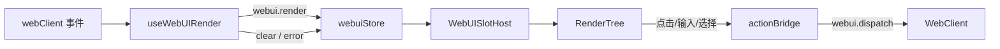

# 前端槽位渲染设计方案

## 元信息

| 项 | 内容 |
| --- | --- |
| 类型 | feature |
| 编号 / slug | `F_08 / frontend-render` |
| 关联计划 | EXTV2-08 前端槽位渲染与复杂面板 |
| 所属模块 | `jiuwenswarm/channels/web/frontend/src/features/webui/` |
| 设计依据 | [F_06 渲染服务](F_06_render-service.md)、[F_07 界面项与上行交互](F_07_ui-contributions.md) |
| 最近一次修订日期 | 2026-10-22 |
| 方案状态 | 已实现；加载态与重连恢复未实现 |

## 1. 问题与目标

前端需要在固定位置展示插件内容，并把用户操作回传给对应插件实例。渲染树来自后端，组件和样式必须受控；同一会话可能有多个实例，更新可能乱序到达。

一句话概括：**前端按 `session × slot × package × instance` 保存最近一帧，用白名单组件把 JSON 树映射为 React，槽位宿主只展示当前会话的实例。**

## 2. 范围

### 2.1 本次范围

- 订阅 `webui.render`、`webui.render.clear`、`webui.render.error`。
- 解析帧与目标，丢弃非法或过期帧。
- 维护实例 store，按槽位展示 `list` 或 `single`。
- 把 15 个白名单组件映射为 React，token 映射为 Tailwind 类。
- 组件交互转为 `webui.dispatch`，同一动作去重。
- 在输入区上方、输入区下方、右侧工作区和助手消息 meta 行挂载槽位。

### 2.2 非目标

- 不校验渲染树；服务端已完成。
- 不发现界面项；由 `ui.ready` 触发后端目录校验。
- 不支持插件自定义 HTML、CSS 或脚本。
- 不实现离线缓存、跨标签页同步或重连恢复。

## 3. 总体设计

### 3.1 组件关系



`useWebUIRender` 在应用根组件挂载一次；`WebUISlotHost` 可以在多个页面位置复用，只按 `slotId` 过滤实例。

### 3.2 实例状态

```ts
interface WebUIInstanceState {
  target: { session_id; slot_id; package_id; instance_key };
  revision: number;
  mode: 'replace' | 'clear';
  root: WebUIRenderNode | null;
  error: { code: string; message?: string } | null;
}
```

实例键为 `session_id|slot_id|package_id|instance_key`。`applyFrame` 只接受更大的 `revision`；`applyClear` 删除实例；`applyError` 在当前实例上记录错误，没有实例时创建一个空实例显示错误码。

### 3.3 槽位展示

| 槽位 | 模式 | 页面位置 |
| --- | --- | --- |
| `conversation.input.above` | `list` | `ChatPanel` 消息列表下方、输入区上方 |
| `conversation.input.below` | `single` | 输入区下方 |
| `conversation.panel.right` | `list` | `App` 主区域右侧工作区 |
| `message.assistant.meta` | `list` | `MessageItem` 的助手消息 meta 行，按 `requestId` 取单个实例 |

`single` 槽位按 `revision` 取最新实例；`list` 槽位展示全部实例。没有实例时宿主返回 `null`，不产生空占位。

## 4. 处理流程

### 4.1 下行

1. `webClient.on('webui.render')` 收到消息。
2. `parseWebUIRenderFrame` 校验目标、槽位、`revision` 和 `mode`；非法帧丢弃。
3. `applyFrame` 比较 `revision`，旧帧丢弃，新帧覆盖实例。
4. `WebUISlotHost` 按当前会话和槽位选取实例并渲染。
5. `RenderTree` 递归映射组件；未知组件返回 `null`，不影响其他节点。

### 4.2 上行

| 组件 | 事件 | payload |
| --- | --- | --- |
| `Button` | `ui.press` | `{action_id, args}` |
| `CheckBox` | `ui.toggle` | `{action_id, name, checked, args}` |
| `TextField` | `ui.input` | 失焦或回车提交 `{action_id, name, value, args}` |
| `MultipleChoice` | `ui.select` | `{action_id, name, value, args}` |
| `Slider` | `ui.select` | 指针抬起或键盘抬起时提交 |

`actionBridge` 以会话、槽位、包、实例、事件、`action_id` 和 `args` 组成去重键；首次请求返回前重复操作被忽略。请求失败不改变当前渲染，也不弹错。

### 4.3 挂载上报

会话级槽位宿主在 `sessionId` 或 `slotId` 变化时发送一次 `ui.ready`，目标只带会话与槽位，包和实例为空。消息级槽位在本地没有对应实例时发送 `ui.ready`，并携带 `instance_key=requestId`；插件可据此恢复刷新前的轮次视图。

## 5. 组件与样式映射

组件名与后端白名单一致，使用 PascalCase：

| 组件 | 主要 props | 行为 |
| --- | --- | --- |
| `Column` / `Row` | `gap`、`align`、`justify`、`padding`、`wrap`、`density` | 纵向/横向布局 |
| `Card` | `title`、`tone`、`padding`、`collapsible`、`density` | 带标题容器 |
| `Tabs` | `items`、`selected` | 展示标签头，内容由 children 提供 |
| `Divider` | `axis`、`spacing` | 分隔线 |
| `Text` | `value`、`variant`、`tone`、`size`、`weight`、`max_lines`、`monospace` | 文本 |
| `Icon` | `name`、`size`、`tone` | 内置字形，不加载外部资源 |
| `Badge` | `label`、`tone`、`size` | 状态标签 |
| `Button` | `label`、`variant`、`size`、`disabled` | 点击触发 `ui.press` |
| `TextField` | `name`、`placeholder`、`value`、`max_length` | 受控输入 |
| `CheckBox` | `name`、`label`、`checked`、`disabled` | 开关 |
| `MultipleChoice` | `name`、`options`、`value`、`multiple`、`disabled` | 下拉或多选 |
| `Slider` | `name`、`min`、`max`、`step`、`value`、`disabled` | 数值选择 |
| `List` | `items`、`ordered`、`selected` | 列表，支持 `title`、`tone`、`monospace` |
| `Progress` | `value`、`tone`、`label` | 进度条 |

样式 token 在 `RenderTree.tsx` 内集中映射为 Tailwind 类，例如 `gap=sm` 映射 `gap-1`，`tone=danger` 映射危险色变量。插件不能传颜色或像素。

## 6. 异常与边界

- 目标缺少会话或槽位未知时整帧丢弃。
- `revision` 非数字或 `mode` 非法时整帧丢弃。
- 旧 `revision` 帧被忽略；`clear` 的旧 revision 也被忽略。
- 未知组件静默忽略，避免新组件导致旧前端崩溃。
- 组件没有 `action` 时不派发事件，只展示。
- 交互请求失败时保留当前界面，不自动重试。

## 7. 实施影响

- `App.tsx` 挂载 `useWebUIRender`，并在右侧工作区渲染 `conversation.panel.right`。
- `ChatPanel/index.tsx` 在消息列表下方渲染 `conversation.input.above`，在输入区下方渲染 `conversation.input.below`。
- `package.json` 新增 `test:webui-store` 脚本。
- 前端只依赖 `webClient` 的现有事件与方法接口，不新增网络通道。

## 8. 验证

验证入口：

```powershell
cd jiuwenswarm/channels/web/frontend
npm run test:webui-store
npx tsc --noEmit
npx eslint src/features/webui --ext ts,tsx
```

覆盖内容：

- 目标解析拒绝未知槽位和缺失会话。
- 帧解析要求 `revision` 与合法 `mode`。
- 实例键稳定；旧帧丢弃；`clear` 删除实例后新 revision 从 1 开始。
- `single` 槽位只保留最新实例；`clearSession` 清理会话全部实例。

当前执行结果：store 用例 10 项通过；`tsc` 与 `eslint` 通过。加载态、失败态样式和重连恢复未单独验收。

## 9. 风险与遗留

- 前端没有加载态和骨架屏；`ui.ready` 到首帧之间槽位保持空白。
- `webui.render.error` 只在实例内显示错误码，没有重试入口。
- 重连后前端 store 为空，后端不会主动重发最近一帧；消息级槽位重新挂载时会按 `requestId` 上报 `ui.ready`，可恢复插件内存中保留的轮次。会话级槽位仍依赖插件的 ready Handler 重新生成视图。
- 复杂面板受组件白名单限制；完整 diff 视图、虚拟滚动等需要扩展组件或新的渲染通道。
- 前端与后端各自维护一份组件名和 token 清单，新增组件需要同步修改并补测试。
