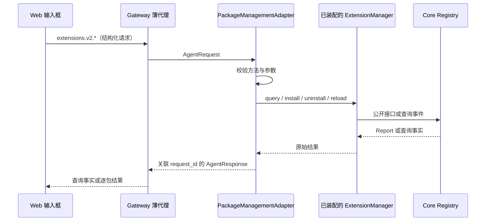

# 后端包管理请求接入

## 元信息

| 项 | 内容 |
| --- | --- |
| 类型 / 编号 | feature / F_09 |
| 建档日期 | 2026-10-23 |
| 最近修订 | 2026-10-24 |
| 关联计划 | [EXTV2-09](../designs/extensions-v2-development-plan.md#extv2-09-后端包管理请求接入) |
| 接口规约 | [S_02 后端包管理协议](../specs/S_02_backend-package-management.md) |
| 验证状态 | 已实现；后端 181 项、Web 86 项回归通过，Vite 打包通过；进度和负责人只在计划维护 |

## 1. 为什么需要这项接入

门面已有安装、卸载、查询和热重载方法，但运行中的 AgentServer 还没有 V2 包管理请求入口。
本项补齐后端请求，包加载、依赖判断和 Handler 发布继续由 Core 完成。

## 2. 范围与约束

新增四个 `extensions.v2.*` 请求，不替换旧 `extensions.*`，不开发业务内置事件。
请求经已有认证和路由到达所属 AgentServer，在进程内唯一门面上执行，不根据 `user_id` 切换目录。
外部安装参数只接受 ZIP 文件的绝对路径，目录和其它文件在进入 Core 加载前拒绝。
Core 与门面的目录加载能力保留给启动加载；ZIP 解压、manifest 和包内路径检查沿用 Core。

本次在已有后端上增加 Web 输入框的 `/extension` 命令，使用现有菜单和结果消息，不增加管理页面。
命令在单 Agent 模式下开放，新建对话尚未发送消息时也可使用；不接入 TUI 或 IM。
包管理不依赖聊天会话，不要求先发一条消息，也不为了执行命令创建聊天会话。

## 3. 请求怎样执行



`PackageManagementAdapter.handle(request: AgentRequest) -> AgentResponse` 负责校验、调用、编码及成功安装后的界面通知。
查询返回 `state`；写操作返回 `reports` 数组，卸载和重载各一份。
取得 Report 时响应 `ok=True`，操作是否成功由 Report 的 `status` 决定。
门面不可用或参数错误返回 `ok=False`，不临时创建 Registry 或重跑初始化。

### 3.1 命令怎样生效

Gateway 在 `commands.list` 中登记 `/extension` 的说明、用法和示例；Web 命令注册表登记执行函数。
用户选中菜单后填写子命令，回车时先解析参数，再直接调用对应请求，不进入普通对话或模型执行。
新建对话中的命令结果写入当前页面；请求不携带前端占位会话 `new`，沿用连接认证和后端路由。
已有真实会话时继续携带该会话标识。命令清单和 Web 注册表都声明无需已有会话，避免菜单或提交入口提前拦截。
具体语法见 [S_02 第 3 节](../specs/S_02_backend-package-management.md#3-web-命令)。

2026-11-05 修复：AgentServer 安装成功后的槽位通知由公共适配器发送，网页与本机 CLI 共用；
页面收到通知后重新发送 ready，无需手动刷新。失败边界归 S_02，验证记录见 [F_31 第 7 节](F_31_extension-cli.md#7-验证)。

参数只作为数据传递。install 后的完整内容是一个 ZIP 路径，支持直接粘贴含空格的路径，
也兼容外层引号；Windows 反斜杠保留，不按 shell 转义或执行。
无参数显示帮助；未知子命令、缺参或多参显示用法，多行输入提示改用单行并提供帮助入口，均不发送管理请求。
命令完成后只显示一条结果，不把等待提示写入消息记录。一次命令只发一次请求，失败或超时不自动重试。

### 3.2 安装后告诉用户修改哪里

安装成功的响应增加 `installed_packages`，含包 ID、版本、实际安装绝对路径和 generation。
数据来自门面公开的生效记录，并与本次成功 Report 的包 ID 和 generation 对应；不猜安装目录，
不修改 Core `ActivationReport`，也不为展示路径额外触发 `package.query`。
如果已无法取得对应记录，仍保留原始 Report，前端提示通过查询核对目录。

前端展示明确的 `package_id`、版本和“安装目录”，并提示修改该目录内代码后执行重载命令。
查询分别展示包 ID、版本、状态和目录，未生效副本也返回可供卸载的 ID；不显示内部进程名称或 generation。
安装失败时只展示失败报告；热重载读取安装副本，不重新读取最初的 ZIP 来源。

## 4. 关键决策与排除方案

- 使用独立 V2 方法名，避免将旧包按 V2 manifest 加载。
- 复用当前进程门面，不创建与正在运行的 Handler 分离的 Runtime。
- 不公开 `rollback(plan)`。Core 回滚只处理未发布候选，不表示恢复上一版包。
- Gateway 只转发，不读取部署侧文件替代用户包来源。
- 使用 `/extension` 统一入口，不增加 `/ext` 别名，也不为 Core 内部管理步骤新增命令。
- 四个命令属于同一特性的用户入口，继续在 F_09 维护；失败呈现引用 F_10，不按命令新建 feature。

## 5. 改动与验证

改动方法枚举、AgentServer 适配器登记、Gateway 代理登记及管理适配器。
本次追加命令元数据、Web 解析与结果呈现、中英文文案，以及安装响应的目录信息。
Gateway 从业务参数中剔除路由用的 `session_id`，并完整传递失败 payload，避免丢失结果未知和核对事实。
用真实门面和临时包验证四类请求、同版本热重载、失败保留旧 Handler、错误输入及身份关联。
Gateway 测试核对方法、参数、用户、会话及响应交接。
入口：`tests/unit_tests/extensions_v2/management/test_management_adapter.py`。

Web 定向验证覆盖四类命令映射、帮助和非法参数、Windows/Unix 路径、安装目录、失败报告、
结果未知、超时及只请求一次；命令注册和原有 `/plan`、`/goal` 行为一并回归。
新建对话使用真实前端消息 store 验证结果可展示、不进入任务队列、不创建聊天会话；
后端四类请求分别验证有会话与无会话的 Gateway 到真实管理适配器链路，身份关联保持不变。
入口：前端 `npm run test:extension-command`、`npm run test:slash-command-registry`。

## 6. 结论与遗留

2026-10-23 执行 `test_management_adapter.py`，16 项通过，覆盖真实 Core 门面与 Gateway 代理。
完整 V2 后端与既有 Gateway E2A 代理回归合跑，92 项通过。
另跑 AgentServer 请求分发回归，21 项通过。该环境未安装 `a4p`，测试临时从 `uv.lock` 对应提交的本地缓存导入，未改依赖或锁文件。
2026-10-23 追加 Web 命令时，完整 V2、Gateway E2A 和命令清单回归共 169 项通过，Web 68 项通过。
安装后直接修改响应给出的目录，再重载并触发事件，验证新代码确实生效。

2026-10-24 收紧外部安装入口并调整呈现：目录、`.zip` 目录、其它文件和不存在的 ZIP 在查询运行实例前拒绝；
有效 ZIP 内的模块导入错误仍返回 Core 加载失败。补测包 ID 约束、未生效副本的 ID 与目录信息，
并验证启动只加载安装目录，空目录不自动补装源码示例。完整后端回归 180 项通过。

Web 命令 59 项、原命令注册表 19 项通过，覆盖含空格的 ZIP 路径、明确的 package_id、
不展示进程名称或 generation，以及参数、服务不可用、超时和失败报告呈现。
前者使用请求替身，并通过真实命令注册表核对消息归属；后者回归既有 `/plan`、`/goal` 等命令。
入口脚本是 `npm run test:extension-command` 和 `npm run test:slash-command-registry`。
本机 npm 启动包装脚本异常，验证分别直接运行 Node 测试入口、以 Node 调用 npm-cli 执行同一脚本。
直接执行 Vite 生产打包通过，保留现有分包告警。
本次按仓库约束未运行格式化或静态检查工具。

同日修复新建对话必须先发送聊天消息才能执行命令的问题。原因是命令清单与 Web 注册表误设为需要真实会话。
两处改为无需会话，新建页请求省略 `session_id`，前端占位标识不发到后端；已有会话继续携带真实标识。
补充 6 项前端用例，验证帮助、全量与单包查询、安装、卸载、重载均可作为新建页的首次操作，
结果仍写入当前页面，且没有发起聊天或创建会话。Web 命令 65 项、原注册表 19 项通过；
完整后端回归 181 项通过，包括无聊天会话时的真实安装、查询、重载和卸载链路。
另跑 4 项 Web 连接路由回归通过，确认无显式会话的请求不会替换原连接路由或积累临时会话。

随后按使用反馈取消立即追加的等待消息，命令只写入一条最终结果，不调整通用消息展示逻辑。
补充请求尚未返回、成功返回和失败返回的消息数量验证；Web 命令 67 项、原注册表 19 项通过，生产打包通过。

后端回归从仓库根目录运行：

```powershell
.venv\Scripts\python.exe -m pytest tests/unit_tests/extensions_v2 `
  tests/unit_tests/gateway/test_e2a_proxy.py tests/unit_tests/gateway/test_slash_command.py `
  -o addopts= --asyncio-mode=auto -q -o log_cli=false
```

验证覆盖独立命令和进程内协作，不等同于浏览器真实操作或网络部署联调；这两项未执行。
Core 自动在途计数与旧模块回收仍为既有遗留，本次未处理。
