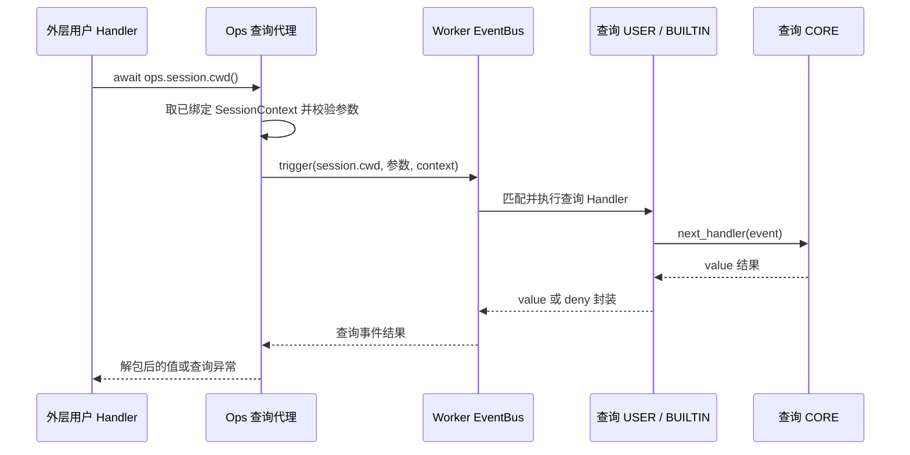

# ops.session.cwd / ops.session.root 特性设计

# session.cwd / session.root 与会话工作区 Ops 特性设计

# ops.session.cwd() / session.cwd 特性设计

## 1. 范围、状态与依据

最近修订 2026-10-31。本文仅维护 `ops.session.cwd()` 与同名查询事件 `session.cwd` 的使用说明、接入和验证边界；一个方法与一个查询事件组成一项特性。开发状态、负责人和交付统一见[开发计划 EXTV2-22](../designs/extensions-v2-development-plan.md#extv2-22-七项只读查询事件化)，交付 [PR !100](https://gitcode.com/huenrui_/jiuwenswarm/merge_requests/100)。

公共协议主责为 [S_16](../specs/S_16_session-query-events.md)，专项字段主责为 [S_03_session-workspace-ops.md](../specs/S_03_session-workspace-ops.md)；下文表格解释怎样填写、怎样消费，不另立契约。共享实现和既有验收记录见[查询公共机制与七项特性索引](../designs/session-query-events.md)。

2026-10-31 按单个 Ops / Event 拆分特性文档；原合篇只作为文档组织历史，不代表仍需一起调用。此次拆分没有改变运行时契约或实现。

## 2. 能力说明与 Claude 对照

`await ops.session.cwd()`：查询本次 Handler 所绑定会话的执行工作目录，适合生成工作区摘要或对读取行为做审计。它不切换目录、不检查目录是否仍存在，也不读取 Worker 的进程当前目录。

`session.cwd` 是这一次查询调用的拦截事件。方法代理验证参数和已绑定会话后触发它；查询 Handler 接收下述参数，可继续默认处理、增加前后操作、返回合法替代视图或明确拒绝。默认 CORE 读取平台事实，结果返回原方法调用者；它不表示状态发生变化，也不自动写历史或显示到界面。

| 项 | 当前默认行为 |
| --- | --- |
| 默认数据来源 | SessionContext.cwd；经本机绝对路径校验。 |
| 方法公开返回 | str 或 None |
| Claude 对齐与差异 | Claude 返回 string；本地在平台没有目录资料时保留 None，不伪造当前进程目录。 |

对照依据是 Claude Code Mods 2.1.277 的固定公开类型声明，提交 `80c6959d28c4c30ecd14fc1cdf172f19d9adad81`；不是运行 Claude 私有宿主的结果。

## 3. 事件契约

### 3.1 触发位置、粒度与完整链路

方法代理通过会话、参数及重入检查后，每次调用触发一次 `session.cwd`；检查未通过时不会进入查询链。下图展示 Handler 继续默认读取的路径；合法短路或明确拒绝可以在 USER 返回，不进入 CORE。返回箭头对应同一次 await 的结果，不是额外业务通知。



平台业务方法先收集可信会话资料并随外层事件传入 Bus，Core 为实际 Handler 创建 Ops。现成示例是 notify_context_usage 发布 context.usage.updated；其他已由平台接好的事件也能使用本方法，前提是本次 Handler 已绑定下表所需资料。用户不需要修改 Adapter、自己创建 Bus，或先调用 notify 来取得上下文。

### 3.2 事件输入、会话上下文与字段说明

| 事件输入字段 | 类型 / 默认 | 谁填写 | 准确含义与改写边界 | 填写示例 |
| --- | --- | --- | --- | --- |
| Event.event_input | 空映射 {} | Ops 代理自动构造 | 查询 Handler 收到空参数对象；不是 SessionContext，也不携带可改写目标身份 | 注册时使用 match_pattern={} |

会话上下文通过 `bus.trigger(Event(...), context)` 的第二个参数传递，与 Event.event_input 分开。下面字段由平台和 Core 绑定，不能通过增加查询参数改换会话或读取目标。

| 对象 / 字段 | 类型与是否必需 | 谁提供 / 表达什么 | 填写或读取示例 |
| --- | --- | --- | --- |
| ops.session_context | Core 只读属性 | 平台随外层事件传入，Core 在执行 Handler 前绑定 | 直接读属性；不是 await 方法，不收集、不组装上下文 |
| SessionContext.session_id | 有效非空 str，必需 | 平台业务边界提供的当前会话身份 | session-a；不从 query 输入或 Hook 返回值改换目标 |
| SessionContext.cwd | str 或 None | 平台绑定执行目录；默认 CORE 校验本机绝对路径格式 | D:/projects/demo/src；没有目录资料为 None，不读取进程 cwd 兜底 |
| current_query_origin().package | str 或 None | Server 查询代理从原调用 Ops 的包身份记录 | 是原发起包，不是当前 Hook 所属包；无 Ops 查询域时 helper 返回 None，须先判空；不是 Core next.origin |

`ops.session_context` 是已有只读属性。业务方法负责采集和组装，查询代理只取出它并继续传给查询事件；Bus 会规范化为只读副本，保留同一会话身份和资料，不承诺前后是同一个 Python 对象。

### 3.3 事件输出、允许的改写、失败与取消

| 事件结果字段 | 类型 | 出现规则 | 准确含义 | 如何消费 |
| --- | --- | --- | --- | --- |
| value | str 或 None | 成功时唯一顶层键 | 本次查询值；允许 None 的查询仍须包装为 {"value": None} | Ops 会取出 value；调用者不需要再访问 result["value"] |
| deny | 去空白后非空 str，原字符串最多 512 字符 | 明确拒绝时唯一顶层键 | 公开拒绝原因；不能和 value 同时出现 | return {"deny": "QUERY_DISABLED"}；Ops 转为 SessionQueryDenied |

下面的返回字段位于事件结果的 `value` 内。方法成功返回时已经去掉外层 value 包装，因此消费示例中的对象就是方法返回值。

| 返回字段 | 类型 / 出现条件 | 谁提供 | 准确含义 | 消费方式与例子 |
| --- | --- | --- | --- | --- |
| 方法返回 / value | str 或 None | 由平台 CORE 或查询 Handler 返回 | 执行目录绝对路径；None 表示这次绑定没有目录资料，不代表磁盘路径不存在 | D:/projects/demo/src；不是 {'cwd': ...} |

继续默认查询使用 `await next_handler(event)`。需要短路时，可直接返回 `{"value": 'D:/projects/demo/src'}`；需要明确拒绝时返回 `{"deny": "QUERY_DISABLED"}`，下游可以不执行。加工结果必须符合本表的值类型及专项 spec；只改变本次返回视图，不改写平台真实状态、上下文或授权范围。

普通 USER / BUILTIN 异常或无效输出按 Core 隔离规则处理，可能继续默认 CORE；抛异常不能代替明确 deny。CORE / 框架读取失败向调用者传播，不用成功空值掩盖；取消继续传播并在 finally 清理查询调用域。匹配在 trigger 初始固定，next 改写合法参数不会重新选择 Handler；多次 next 可能重复读取，不承诺结果缓存。

### 3.4 可安装用户包中的注册与调用示例

将下面代码作为扩展包的入口模块，并按[现有示例 manifest](../../examples/session_query_audit/manifest.yaml) 的形式指定入口。示例同时展示外层业务 Handler 如何调用本 Ops，以及本查询的 USER Handler 如何继续默认链。

```python
import logging

logger = logging.getLogger(__name__)


class Extension:
    def register(self, registrar):
        # Example outer event: the platform already binds SessionContext.
        registrar.register_event_handler(
            "context.usage.updated", self.on_usage, {}, "user"
        )
        # Intercept this query only.
        registrar.register_event_handler(
            "session.cwd", self.on_query, {}, "user"
        )

    async def on_query(self, event, ops, next_handler):
        logger.debug("before query: %s", event.event_type)
        # Continue this query chain; do not call the same public Ops here.
        result = await next_handler(event)
        logger.debug("after query: denied=%s", "deny" in result)
        return result

    async def on_usage(self, event, ops, next_handler):
        value = await ops.session.cwd()
        # Use value in your own business code; no ui.render is required.
        logger.info("session.cwd result type: %s", type(value).__name__)
        # Continue the original event, not the nested query event.
        return await next_handler(event)


def create_extension():
    return Extension()
```

查询 Hook 想取得默认值应调用 next；在自己的 `session.cwd` Hook 中再次调用同名 Ops 会被循环保护拒绝。USER → BUILTIN → CORE 在各层继续时执行，结果反向返回；共享 BUILTIN 负责计时与独立副本，默认 CORE 负责实际读取。

## 4. 方法契约

### 4.1 签名、参数与调用场合

下列是调用侧签名；Core 自动注入的内部 ops 参数不由用户填写。

```python
# Public call signature; no session_id or path argument.
async def cwd() -> str | None: ...
```

| 方法参数 | 类型 / 默认 | 谁填写 | 准确含义 | 应该怎样填 |
| --- | --- | --- | --- | --- |
| 方法参数 | 无 | 调用者不填写 | 查询已绑定会话，不接受 session_id、路径、模型名或包 ID | 直接调用 await ops.session.cwd() |

典型调用如下；它可写在任何满足会话前提的已注册业务 Handler 中。

```python
cwd = await ops.session.cwd()
if cwd is not None:
    logger.info("execution directory: %s", cwd)
```

### 4.2 方法与事件转换、返回值及错误

```text
方法参数 → 查询代理规范化 → Event.event_input
当前 ops.session_context → trigger 的独立 context 参数
  → 同名查询事件 session.cwd
事件 {value: 结果} → 参数/结果校验、独立复制、解包 → 方法返回值
事件 {deny: 原因} → SessionQueryDenied(code=DENIED, reason=原因)
```

成功返回 `str | None`，字段及缺失语义见第 3.3 节。无 SessionContext 报 RuntimeError；非法会话 ID 由平台会话校验拒绝；方法参数非法报 TypeError。活跃同名或间接循环报 QUERY_REENTRANT，深度超过 16 报 QUERY_DEPTH_EXCEEDED；不允许调用方覆盖 bus / event_type。平台读取故障保持其原有异常类型和稳定 code。Handler 未捕获 Ops 错误时，还受外层事件自身的故障隔离规则约束，不能把外层继续误认为查询成功。

## 5. 接入与兼容方案

### 5.1 启动登记、上下文绑定与 CORE 分工

平台 bootstrap 向 Bus 登记 `session.cwd` 的 Matcher、Validator 和默认 CORE，并登记查询 BUILTIN。Registry.init 触发一次 ops.build；其 CORE 创建 Builder，BUILTIN 将 session.cwd 对应的封闭查询代理加入方法目录，Bus 保存 Builder。执行每个实际 Handler 前，Core 用共享目录及本次包身份 / SessionContext 创建新的 Ops。

业务时，用户调用本方法，Core 方法访问器自动把当前 Ops 传给登记的代理；代理读取已绑定上下文并显式 trigger `session.cwd`。查询链各实际 Handler 也获得各自的 Ops，查询 CORE 走 `read_session_query` 的 cwd 分支 → `_path(context.cwd, event_type)`，不再调用公共同名 Ops。Builder 保存方法定义，不保存会话查询结果；ops.build 与运行时 builder.build(...) 是两种操作。

统一实现职责见[公共设计第 5 节](../designs/session-query-events.md#5-接入与兼容方案)。默认查询不写业务数据、不发模型请求、不自动渲染；没有全局查询结果缓存。用户包卸载只移除自己的 Hook，不移除平台查询类型或 CORE。

### 5.2 迁移与生效边界

| 方法 | 本次需要调整什么 |
| --- | --- |
| 编号 | F_13 / session-workspace-ops |
| 建档日期 | 2026-10-26 |
| 后续修订 | 2026-10-29，统一使用契约、字段含义和填写示例；仅文档 |
| 关联功能 PR | PR01 [!71](https://gitcode.com/huenrui_/jiuwenswarm/merge_requests/71)，已合入 |
| 主责契约 | [S_03](../specs/S_03_session-workspace-ops.md) |

## 1. 范围、状态与依据

两项只读 Ops 已实现并合入。本次在最新 `rsi_native_agent_os` 的 7795851916dd5ce1d34b70f5a20d6d30eafc25e3 上统一说明，业务代码不变。最初解决的是宿主尚未开放目录查询的问题；该背景不是当前未完成状态。

范围是当前 Worker 中 Handler 所绑定会话的目录快照。它们不接收查询目标/路径，不根据进程目录或用户 payload 猜目录，也不触发新事件。历史与本轮文档验证分开记录在第 6 节。

## 2. 能力说明与 Claude 对照

`await ops.session.cwd()` 读取这次调用绑定的执行工作目录；`await ops.session.root()` 读取同次调用绑定的项目根目录。两者返回宿主平台的绝对路径字符串，未知为 None；读取不创建/切换目录，不检查路径此刻仍存在，不返回 Path 对象或包装字典。

Claude 固定版本的 `$.session.cwd()` / `$.session.root()` 同样提供目录读取。本地能力明确允许 None，root 只表示用户项目绑定，不能用内部任务工作区填充。对照只说明业务分工，不宣称 TypeScript 接口可直接互换。

## 3. 复用事件与上下文契约

本特性没有新增查询事件或查询 CORE。示例订阅既有 `context.usage.updated`；这只是一个已接线的业务触发入口，不是调用查询的前置操作。其他已有事件只要平台提供所需 SessionContext，其 USER Handler 同样可以调用。

| 对象 | 字段 / 来源 | 用户应如何使用 |
| --- | --- | --- |
| 原通知输入 | ContextUsageUpdate：session_id、request_id、input_tokens、output_tokens、total_tokens、cache_tokens、cache_hit_rate、context_window_tokens、usage_percent、model | 由平台汇总填写；不包含本特性查询的权威目录/模型/仓库返回值。仅用于观察和筛选，不能靠改 payload 重定向 Ops |
| 原通知输出 | ContextUsageOutput：accepted 为 bool；request_id 为 str | 默认 CORE 填 accepted=True 并回显请求 ID，仅确认输入类型已接受，不表示目录/模型/Git/UI 验收成功。用户通常原样 next 返回 |
| Ops 绑定 | Core 已有只读属性 ops.session_context | 平台随 Event 单独提供，Core 规范化/冻结后绑定到本次 Ops；不是本次新增的异步方法，用户不调用它来收集资料 |

原通知在已接线的原生流式请求末尾、有有效用量时由平台调度，Worker 内实际 trigger；不按每个 Token、工具调用或目录/模型变化触发。默认通知 CORE 只校验输入类型，没有因本次查询新增完整数值 Validator。用户保持输入并 `return await next_handler(event)` 继续原链；短路不撤销已完成回合，USER 异常依 Core 隔离规则处理。

完整通知定义以 [context_usage.py](../../event_types/context_usage.py) 为准。查询本身不会再 trigger、不会再次 ops.build，也不会把自己的返回值自动塞入原通知回执。


## 4. 方法输入输出与填写规则

### 4.1 输入：两个方法均无参数

```python
cwd = await ops.session.cwd()
project_root = await ops.session.root()
```

**用户不填写任何输入字段。**不要传 session_id、路径、项目 ID、cwd 初值或文件名。当前会话与目录由平台提供，不从用户 Event payload 里读取，也不从 Worker 的 os.getcwd() 兜底。

| 平台上下文字段 | 类型 / 缺省 | 准确含义、由谁填写 | 示例与权限 |
| --- | --- | --- | --- |
| SessionContext.session_id | str，会话绑定时提供 | 这次事件的会话关联身份；用户不靠修改 payload 更换它 | session-a；只读 |
| SessionContext.cwd | str 或 None，未提供为 None | 原生执行任务/平台入口在事件边界采集的工作目录，不是整个 Worker 的进程目录 | Windows 的 D:/projects/repo/app/src；只读 |
| SessionContext.metadata.project_root | str 或缺省 | 平台确认绑定的用户项目根目录；没有绑定则缺失/None | D:/projects/repo/app；只读，不自动补成 cwd |

平台需使用本机绝对路径语法：Windows 如 D:/projects/repo/app/src，POSIX 如 /home/me/repo/app/src。Ops 不展开 `~`、环境变量或相对路径，也不在读取时 normalize/resolve/修复原路径。

### 4.2 返回：整体就是字符串或 None

| 返回项 | 类型 / 何时出现 | 准确含义、示例与消费方式 |
| --- | --- | --- |
| cwd() 的非 None 返回 | str | 本次快照的工作目录，如 D:/projects/repo/app/src；不是 {'cwd':...}，直接使用字符串 |
| root() 的非 None 返回 | str | 本次快照的项目根，如 D:/projects/repo/app；不是 Git 根、内部 Agent workspace 或临时目录 |
| None | 该项未提供 | 表示当前上下文没有该目录资料；不证明会话不存在或磁盘目录不存在，不回退为 '.' / 空字符串 |

例如 cwd=repo/app/src、root=repo/app，而 repo() 可返回 repo。三者可以不同；无项目会话仍可能有 cwd、root=None。若事件只提供 session_id，两项都可能为 None。两次读取同一调用中的目录是同一事件边界的事实，不是持续跟踪外部 chdir 的实时视图。

### 4.3 错误与缺失不要混用

| 情况 | 能力函数行为 | 用户应如何处理 |
| --- | --- | --- |
| 没有 SessionContext | RuntimeError | 选择平台已绑定会话的事件接入；不手工猜会话 |
| 目录为 None | 返回 None | 显示未知或跳过需要目录的业务 |
| 目录不是 str/None | TypeError | 属于平台资料格式错误，不冒充“无项目” |
| 空字符串或非本机绝对路径 | ValueError | 不用相对路径补救为另一目录 |

经 EventBus 时，不合法上下文也可能先被 Core 拒绝。USER 中未捕获异常按原事件的故障隔离处理；原回合继续不等于本次查询成功。

## 5. 平台接入与用户使用

```text
启动：Worker 装配 → ops.build → CORE 返回 Builder
  → session_ops_build BUILTIN 在 next 返回后登记共享 session 方法
  → Core 保存能力目录；Registry 发布用户 Handler

业务：已接线的平台入口收集真实 SessionContext
  → Worker EventBus.trigger(原事件, context)
  → Core 为实际 Handler 创建当次 Ops，绑定会话和包身份
  → 用户 Handler await 本特性只读 Ops
  → Core 方法代理自动把当前 Ops 传给对应平台函数
  → 平台读取可信快照或本特性明确允许的数据源 → 直接返回值
  → 用户自行记录/展示，再 next_handler(原事件)
  → 剩余原事件 Handler → 原 CORE → 原通知任务收到回执
```

启动时准备的是共享方法目录，不执行查询。业务时创建绑定本次会话/包身份的 Ops 视图，不按事件名只创建少数方法；用户实际 await 哪个方法才执行哪个查询。这里的“Core 方法代理”是框架适配，不是新建的业务 CORE。

USER 负责自己的日志或展示；BUILTIN 负责启动时登记 Ops；原事件 CORE 处理原事件。三个查询特性均不新增专用查询 CORE、Rail、Front/Supervisor 协议。EventBus 仍只由 Worker 持有。

用户提供 manifest.yaml / extension.py，通过既有管理入口安装包并进行正常业务操作。平台负责业务触发和可信资料，用户不修改 Adapter，不创建 EventBus/Builder，不调用 notify 来“取回上下文”。安装成功只说明 Handler 已发布；尚无对应业务事件时不会自动执行查询。

返回值交给调用方，不自动缓存查询结果、写第二份状态文件或渲染 UI。示例的 logger 是用户显式写日志；其他使用方式需用户接好自己的消费逻辑。卸载移除 USER Handler，不删除平台能力或既有会话事实。


### 5.1 可复制的用户包

PR01 没有另附仓库示例目录；用户可把下面两个文件放在同一新目录并打成 ZIP。日志是显式消费结果，不代表自动前端展示。

`extension.py`：

```python
import logging

logger = logging.getLogger(__name__)

class WorkspaceInfo:
    def register(self, registrar):
        registrar.register_event_handler("context.usage.updated", self.on_usage, {}, "user")

    async def on_usage(self, event, ops, next_handler):
        cwd = await ops.session.cwd()
        root = await ops.session.root()
        logger.info("workspace: cwd=%s root=%s", cwd, root)
        return await next_handler(event)

def create_extension():
    return WorkspaceInfo()
```

`manifest.yaml`：

```yaml
schemaVersion: 1
package:
  id: example.session-workspace-info
  version: 1.0.0
  displayName: Session Workspace Info
extensions:
  - id: workspace-reader
    runtime: backend
    module: extension.py
```

将两文件放在 ZIP 根目录，在服务可读路径使用 `/extension install "D:/extensions/session-workspace-info.zip"`。正常消息产生有效原生用量通知后，USER 日志可见 cwd/root；其他已有会话绑定事件同样可调用。原生入口会提供真实快照，但本特性不承诺所有未接线入口都有目录资料。

## 6. 验收与未决问题

2026-10-29 本轮只修改文档，不重跑历史业务/模型验收。已核对无参签名、目录读取与错误、示例注册/调用/next、完整链路和本地引用；验证记录：`D:\work_space\.codex-temp\server-session-docs-20261029\documentation-verification.json`。

<a id="5-验证设计执行记录与结论"></a>

### 6.1 原功能验证（2026-10-26，保留原结果）

| 场景 | 验收要求 | 实际结果 |

| cwd | 方法返回类型保持；内部现在派发 session.cwd。用户 Handler 新增拦截后可改变本次返回视图，真实执行目录不变。 |
| root | 方法返回类型保持；内部现在派发 session.root。改写查询值不会改变平台项目绑定或文件访问根。 |

本次文档拆分不再改变上述兼容边界。执行目录、模型、Git、历史和用量事实仍由平台服务维护；对返回视图的改写不成为另一项平台操作的可信输入。

### 5.3 现成案例和可观察效果

对应用户示例见 [examples/session_query_audit](../../examples/session_query_audit/)，七项联合参数返回示例见 [session_query_audit](../../examples/session_query_audit/)。联合案例中的 collect_session_parameters 是普通用户侧辅助函数，本方法可单独调用；用户业务函数收到返回参数即可验证，不依赖 ui.render。

## 6. 验收与未决问题

### 6.1 本特性的独立验收场景

| 场景 ID | 输入与前置 | 操作 | 预期结果 |
| --- | --- | --- | --- |
| F_13-V-01 | 已绑定执行目录 D:/projects/demo/src | 调用 cwd() | 返回该绝对路径；不会 chdir，也不验证磁盘存在 |
| F_13-V-02 | 有效会话但 cwd=None | 调用 cwd() | 返回 None，不伪造进程当前目录 |
| F_13-V-03 | 安装仅拦截 session.cwd 的用户包 | 分别 next、短路 value、显式 deny | 默认值 / 合法替代值 / SessionQueryDenied 分别可观测 |
| F_13-V-04 | 不同会话绑定不同上下文；或在 Hook 中同名递归 | 分别调用本方法 | 会话隔离；活跃同名或间接循环报 QUERY_REENTRANT，不能无限递归 |
| F_13-V-05 | 读取失败、Hook 异常或查询取消 | 分别构造这些分支 | 按第 3.3 / 4.2 节区分隔离、明确拒绝、平台错误与取消，不把失败当成功空值 |

对应事件化用例位于 [test_session_query_events.py](../../../../tests/unit_tests/extensions_v2/test_session_query_events.py)：包含七项默认调用、各项短路 / 拒绝、非法参数、查询顺序、隔离、循环 / 取消及实际用户包装载卸载。每个场景只验证本方法承诺，不把其他六项也作为调用前置。

### 6.2 已有实施证据与本次文档调整

实现验证基于本 PR 实现提交 `f313f513ee9b`、已合入 Server 基线 `c6a07f909` 与 Core `bdde48a8`，Python 3.11。扩展 632 项、相关平台 140 项及独立进程 ZIP / notify / 七项参数返回验证的实际范围、命令和限制统一保留在[公共设计第 6 节](../designs/session-query-events.md#6-验收与未决问题)。这属于查询事件化实现的既有证据；此次仅拆分文档，不声称重新执行了这些业务测试。

Claude 返回 string；本地在平台没有目录资料时保留 None，不伪造当前进程目录。 该限制属于已知支持边界；此轮未增加新的运行时待决项。未执行 Claude 私有宿主、新模型 API、浏览器或 Front/Supervisor 跨进程验收，不能由文档完整推断这些验收已完成。

## 7. 参考资料

结果为 225 项通过、11 项失败。失败集中在原有路径脱敏、路径分隔符及 Windows 大小写比较；在未修改的 `9e9539dde` 基线上用相同 Core 和解释器复跑两个失败文件，得到 45 项通过、相同的 11 项失败，失败用例集合完全一致。本次未修订这些外围行为，也不将整轮回归表述为全绿。

独立进程验证使用隔离配置目录和生产 `install_extensions()`，经真实管理门面加载临时后端包，订阅现有用量事件并调用两个 Ops。两个项目会话分别得到自己的子目录与项目根；无项目会话保留 cwd、root 为 None；缺少路径的旧发布调用两个值均为 None。卸载后用户 Handler 不再执行；停机、日志关闭与临时目录清理通过，进程退出码为 0。此验证未使用模型和网络传输，不等同于真实聊天或浏览器联调。

已核对 `handler_ops/` 归属、生产 bootstrap 接线、唯一一次 Ops Build、公开导入、文档编号和引用；按仓库约束未运行格式化或静态检查工具。当前进度和验收依据统一维护在关联开发计划中。

### 6.2 当前边界

未提供可信目录的入口需由该平台入口维护者接线；注册 USER Handler 本身不自动收集目录。目录读取不代表目录存在、授权到所有文件、完整恢复任务或浏览器已展示。原历史验证的替身/真实进程/网络边界保留原记录，本轮不扩大解释。

## 7. 参考资料

- [S_03](../specs/S_03_session-workspace-ops.md)、[session_ops.py](../../handler_ops/session_ops.py)、[通知定义与平台触发](../../event_types/context_usage.py)。
- [PR02 主模型](F_14_session-model-ops.md)、[PR03 Git 工作树](F_15_session-repo-ops.md)：目录身份与模型/Git 事实不同。
- [内置事件接入说明](../designs/builtin-event-development-guide.md)、[Claude 固定版本声明](https://github.com/anthropics/claude-code/blob/bf2323b3021c9d3db7a31e1e7d61068c3f704497/mods/types/claude-code.d.ts)。

- [Claude 会话方法](https://github.com/anthropics/claude-code/blob/80c6959d28c4c30ecd14fc1cdf172f19d9adad81/mods/types/claude-code.d.ts#L2342-L2447)
- [Claude OpEventOf 与拦截规则](https://github.com/anthropics/claude-code/blob/80c6959d28c4c30ecd14fc1cdf172f19d9adad81/mods/types/claude-code.d.ts#L5529-L5624)

- [专项字段规约 S_03_session-workspace-ops.md](../specs/S_03_session-workspace-ops.md)
- [S_16 查询公共协议](../specs/S_16_session-query-events.md)
- [七项独立特性索引与共享实施记录](../designs/session-query-events.md)
- [Claude 会话方法](https://github.com/anthropics/claude-code/blob/80c6959d28c4c30ecd14fc1cdf172f19d9adad81/mods/types/claude-code.d.ts#L2342-L2447)
- [Claude 同名 OpEventOf 查询事件](https://github.com/anthropics/claude-code/blob/80c6959d28c4c30ecd14fc1cdf172f19d9adad81/mods/types/claude-code.d.ts#L5529-L5624)
- [内置事件开发指南](../designs/builtin-event-development-guide.md)
