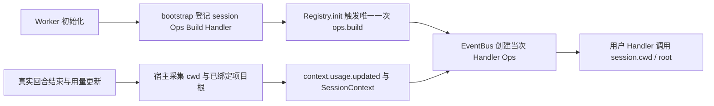

# 会话工作区查询能力设计方案

| 项 | 值 |
| --- | --- |
| 编号 | F_13 / session-workspace-ops |
| 建档日期 | 2026-10-26 |
| 关联计划 | [EXTV2-13，会话工作区查询](../designs/extensions-v2-development-plan.md)；Server PR-01 |
| 主责契约 | [S_03 会话工作区 Ops](../specs/S_03_session-workspace-ops.md) |
| 方案状态 | 已实现，本地验证范围见第 5 节 |

## 1. 背景、目标与范围

扩展 Handler 已能获得 Core 创建的 Ops，但宿主尚未登记 `session` 命名空间，现有用量事件也只绑定会话 ID。扩展无法通过平台能力读取所在会话的工作目录与项目根目录。

本特性提供 `ops.session.cwd()`、`ops.session.root()`，并让现有 `context.usage.updated` 的真实触发入口携带会话工作区快照。两者是只读能力，不触发新事件、不启动 Agent、不创建或切换目录。生命周期和其它 Server Ops 在各自特性中实现。

## 2. 设计约束与事实来源

EventBus 仅在 Worker 装配。复用 Core 的 `SessionContext`、`EventHandlerOpsBuilder` 和唯一一次 `ops.build`，不修改 agent-core 公共机制。

Core 的 CWD 由每个执行任务的上下文维护，不能用 Worker 进程的 `os.getcwd()` 代替。宿主在产生事件时读取当前任务 CWD 和会话适配器已绑定的项目目录；Bus 冻结本次上下文，Ops 只读取该快照，不根据事件输入中的路径补造事实。没有项目绑定时根目录缺失，即使存在临时任务工作区也不把它当成用户项目。

## 3. 总体方案与取舍



关键决策：能力定义放在 `handler_ops/session_ops.py`；登记接入 `bootstrap.py`；事实采集留在原有回合宿主入口。普通事件继续沿原链执行，Ops 查询不调用 `next_handler`。

排除从进程当前目录兜底的方案，因为并发会话会读到同一个宿主目录。排除 Ops 自行读取任意请求路径或创建运行时的方案，因为查询不应改变会话及文件系统。排除把项目根直接等同于 cwd 的方案，因为项目子目录与项目根可以不同。

## 4. 详细设计与实施影响

- `handler_ops/session_ops.py`：提供两个异步读取函数和 `ops.build` BUILTIN Handler，一次登记整个 `session` 命名空间；缺失、返回类型和错误以主责契约为准。
- `bootstrap.py`：在现有 WebUI 注册之后登记 session Build Handler，保持原有装配流程。
- `event_types/context_usage.py`：发布函数增加可选关键字参数 `cwd`、`project_root`；在排队前创建上下文，兼容不提供路径的原调用。
- `server/runtime/agent_adapter/interface_deep.py`：在用量事件真实触发点传入当前任务 CWD 与已绑定项目根。只影响事件上下文，不改变用量载荷和原有响应。
- 测试：校验共享 Builder 的接线、每次 Handler 的上下文绑定、并发会话隔离、目录缺失与非法值，以及真实扩展包经管理门面加载后调用能力的结果。

其它事件若只提供会话 ID，两个能力返回目录缺失，不承诺自动查询或激活该会话。调用时读取的是事件边界的快照，不是 Handler 执行期间不断变化的目录。

## 5. 验证设计、执行记录与结论

| 场景 | 验收要求 | 实际结果 |
| --- | --- | --- |
| V-01 | 经生产 bootstrap 与 ops.build，Handler 可同时调用两个 Ops，并保留原 ui 能力 | 通过：真实包装载用例和独立进程验证 |
| V-02 | cwd 为项目子目录时，cwd 与 root 返回不同的绝对路径 | 通过：`project/src` 与 `project` 分别返回 |
| V-03 | 无会话上下文报错；缺少目录资料返回 None；相对或非法路径报错 | 通过：能力边界用例及无目录快照用例 |
| V-04 | 两个并发会话、嵌套事件各自保持自己的路径，不使用事件输入自报路径 | 通过：并发、嵌套及事件输入伪造路径用例 |
| V-05 | 用量发布入口在调度前固定路径，空项目绑定不伪造 root | 通过：发布后修改任务 CWD 不改变已发布快照；旧调用兼容 |
| V-06 | 真实扩展包安装、激活、调用、卸载均通过，查询不创建目录或启动模型 | 通过：生产装配、Registry、真实后端包、独立进程与清理检查 |
| V-07 | 既有 Extensions V2 与相关宿主测试回归通过 | V2 115 项、原生用量 3 项及无项目工作区 62 项通过；外围 11 项 Windows 失败在未修改基线全部复现，详见下文 |

执行日期为 2026-10-26，环境为 Windows、Python 3.11.15 隔离环境，Core 源码使用 `rsi_native_agent_os` 的 `ead700d7d` 快照，未修改 Core。通过 `PYTHONPATH` 核对两仓源码来源后运行：

```powershell
python -m pytest tests/unit_tests/extensions_v2 `
  tests/unit_tests/agentserver/test_context_usage.py `
  tests/unit_tests/agentserver/test_workspace_paths.py `
  tests/unit_tests/agentserver/test_projectless_agent_workspace.py `
  tests/unit_tests/agentserver/test_auto_permission_workspace_owner.py `
  -o addopts='' -o asyncio_mode=auto -o log_cli=false -q
```

结果为 225 项通过、11 项失败。失败集中在原有路径脱敏、路径分隔符及 Windows 大小写比较；在未修改的 `9e9539dde` 基线上用相同 Core 和解释器复跑两个失败文件，得到 45 项通过、相同的 11 项失败，失败用例集合完全一致。本次未修订这些外围行为，也不将整轮回归表述为全绿。

独立进程验证使用隔离配置目录和生产 `install_extensions()`，经真实管理门面加载临时后端包，订阅现有用量事件并调用两个 Ops。两个项目会话分别得到自己的子目录与项目根；无项目会话保留 cwd、root 为 None；缺少路径的旧发布调用两个值均为 None。卸载后用户 Handler 不再执行；停机、日志关闭与临时目录清理通过，进程退出码为 0。此验证未使用模型和网络传输，不等同于真实聊天或浏览器联调。

已核对 `handler_ops/` 归属、生产 bootstrap 接线、唯一一次 Ops Build、公开导入、文档编号和引用；按仓库约束未运行格式化或静态检查工具。当前进度和验收依据统一维护在关联开发计划中。

## 6. 已知遗留

未携带可信目录资料的其它事件入口需由所属业务在后续接入，本特性不在 Ops 层猜测目录。WebUI、Gateway 跨进程和真实模型回合的验收范围须在执行记录中分别说明。
