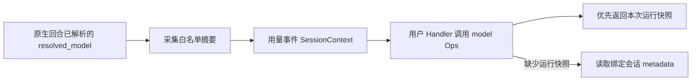

# 会话主模型查询设计方案

| 项 | 值 |
| --- | --- |
| 编号 | F_14 / session-model-ops |
| 归档日期 | 2026-10-26 |
| 关联计划 | [EXTV2-14](../designs/extensions-v2-development-plan.md) |
| 主责规约 | [S_04](../specs/S_04_session-model-ops.md) |

## 1. 问题与范围

PR-01 已提供目录查询，但扩展仍不能通过标准 Ops 取得当前会话的主模型信息。全局默认模型不能代表会话保存的选择，也不能代表请求覆盖后的实际运行模型。

本特性增加 `await ops.session.model()`。它读取可信调用上下文内的运行模型摘要；未提供摘要时，在线程中读取该会话保存的稳定选择或旧版模型名称。查询不创建 Agent、模型或会话，不调用模型，不启动查询事件。

## 2. 方案与取舍



- D-01：复用 `ops.build`、现有 session Build Handler 和用户包装载机制，不新增 `session.model` 事件或业务 CORE。
- D-02：原生执行在应用请求模型后，立即从局部 `resolved_model` 捕获安全字段，再随已有用量事件传递。不能在事件任务执行时查询适配器最近模型，否则可能串读后续请求。
- D-03：运行快照优先，不把旧的持久化选择混入本次请求覆盖后的模型信息。模型组的配置名称不推断为本次物理路由成员。
- D-04：持久化记录不能证明模型是否已激活，返回 `activated=None`，而非猜测 `False`。已捕获的运行模型返回 `True`，其含义是该调用边界确认的运行绑定，不是查询时的全局 Worker 存活状态。
- D-05：只开放固定的选择标识、模型名称、提供方、事实来源和激活状态。凭据、端点、请求默认值、客户端及内部模型对象均不返回。

## 3. 代码与真实入口

- `handler_ops/session_ops.py`：在原 session 目录中登记 model 方法，按当次上下文查询。
- `server/runtime/session/model_selection_store.py`：模型事实的白名单转换、纯运行摘要采集和已有会话 metadata 的只读访问。
- `event_types/context_usage.py`：在调度异步任务前复制模型摘要到 SessionContext，旧发布入口保持兼容。
- `server/runtime/agent_adapter/interface_deep.py`：应用原生请求的实际模型后采集局部摘要，在回合用量发布时传入。

## 4. 用户接入

用户提供 manifest 和 USER Handler，订阅已有会话事件，在 Handler 内等待 `ops.session.model()`，然后使用返回值并按需要继续原事件链。可安装示例见 `examples/session_model_info/`。

```python
async def on_usage(event, ops, next_handler):
    info = await ops.session.model()
    # Use safe per-invocation model facts; None means unavailable.
    return await next_handler(event)
```

## 5. 验证设计与执行记录

验证覆盖真实 Registry 用户包调用、两会话隔离、请求覆盖、缺失事实、持久化选择与旧模型名称、无会话、非法 ID、损坏 metadata、白名单与返回值隔离、异步调度前快照，以及原生 Adapter 发布接线。

执行结果（2026-10-26）：

- 新增能力与接线定向验证：26 项通过，覆盖 15 个模型 Ops 用例、5 个用量事件用例和 6 个原生流结束用例。
- 扩展机制与原生用量回归：140 项通过；模型选择迁移、资源修复、目录及 MOA 兼容回归：116 项通过。两组共 256 项通过；上述 26 项包含在内，不重复累计。仅出现外部 Authlib 弃用提示。
- 独立 Python 进程使用仓库内示例生成 ZIP，通过真实 PackageManagementAdapter 安装，并经真实 Registry、EventBus、原生 Adapter 用量入口和 USER Handler 调用 Ops。两会话保持各自运行模型快照，另一个会话返回保存选择；实际 `agent_server.log` 输出了三条示例记录。
- 查询本身创建模型次数为 0；验证器中的两次模型解析来自正常请求。卸载后不再执行示例 Handler，最终独立进程正常退出并清理自身工作目录。

```powershell
python -m pytest -o addopts= -q tests/unit_tests/extensions_v2 tests/unit_tests/agentserver/test_deep_adapter_stream_end_final.py tests/unit_tests/agentserver/test_context_usage.py --asyncio-mode=auto -o log_cli=false
python -m pytest -o addopts= -q tests/unit_tests/test_model_selection_migration.py tests/unit_tests/test_model_resource_fixes.py tests/unit_tests/runtime/test_model_catalog.py tests/unit_tests/agentserver/test_moa_runtime.py --asyncio-mode=auto -o log_cli=false
```

测试从当前 JiuwenSwarm 工作树与固定的 agent-core `ead700d7d18a247968d64de54918cf5d201a207a` 导入。独立进程的 Agent 输出为测试替身；未调用真实模型，未验证浏览器或网络链路，UI 展示不属于本次实现。

## 6. 限制

当前只有已接线的原生用量入口提供运行模型摘要。其它事件可读取宿主绑定的同格式摘要；若没有则只读取保存的选择。查不到会话模型事实时为 None，不根据全局默认值补造信息。模型激活、切换、权限变更及 UI 展示不属于该 Ops 的副作用。
