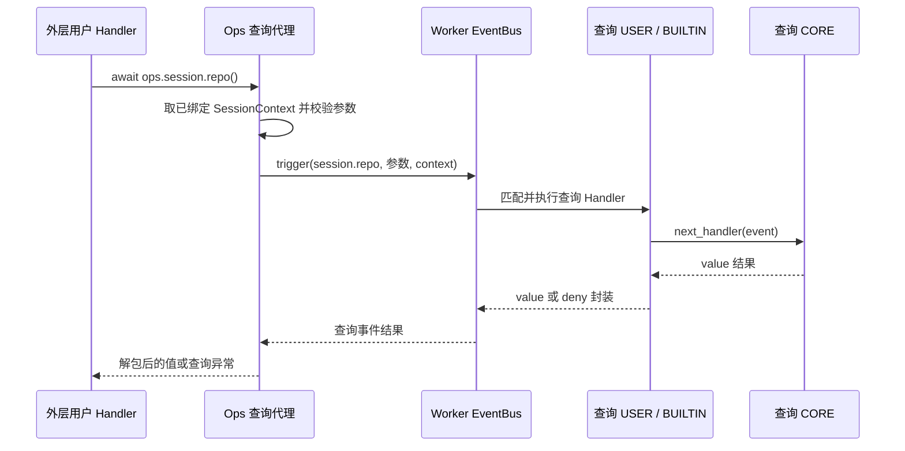

# ops.session.repo 特性设计

| 项 | 值 |
| --- | --- |
| 编号 | F_15 / session-repo-ops |
| 建档日期 | 2026-10-27 |
| 后续修订 | 2026-10-29，完整字段、Git 状态和填写说明；仅文档 |
| 关联功能 PR | PR03 [!81](https://gitcode.com/huenrui_/jiuwenswarm/merge_requests/81)，已合入 |
| 主责契约 | [S_05](../specs/S_05_session-repo-ops.md) |

## 1. 范围、状态与依据

本能力已实现并合入。本轮基于最新扩展目标 7795851916dd5ce1d34b70f5a20d6d30eafc25e3 校核，只统一说明，不改变查询代码。查询的是绑定 cwd 所在的最近 Git 工作树，包括 linked worktree，不是模型或项目配置中的任意仓库。

## 2. 能力说明与 Claude 对照

`await ops.session.repo()` 根据可信 cwd 在线程中执行固定只读 Git 命令，返回工作树根、分支、HEAD 和 detached 四字段字典；没有 cwd、非 Git 或裸仓库为 None。它不 fetch、init、checkout、提交、写配置或自动渲染。

Claude 固定版本也提供 repo 查询；本地返回范围只有下面四字段，不返回远端地址或 internal 等额外分类，不宣称可原样套用其他产品的 repo 结构。

## 3. 复用事件与上下文契约

本特性没有新增查询事件或查询 CORE。示例订阅既有 `context.usage.updated`；这只是一个已接线的业务触发入口，不是调用查询的前置操作。其他已有事件只要平台提供所需 SessionContext，其 USER Handler 同样可以调用。

| 对象 | 字段 / 来源 | 用户应如何使用 |
| --- | --- | --- |
| 原通知输入 | ContextUsageUpdate：session_id、request_id、input_tokens、output_tokens、total_tokens、cache_tokens、cache_hit_rate、context_window_tokens、usage_percent、model | 由平台汇总填写；不包含本特性查询的权威目录/模型/仓库返回值。仅用于观察和筛选，不能靠改 payload 重定向 Ops |
| 原通知输出 | ContextUsageOutput：accepted 为 bool；request_id 为 str | 默认 CORE 填 accepted=True 并回显请求 ID，仅确认输入类型已接受，不表示目录/模型/Git/UI 验收成功。用户通常原样 next 返回 |
| Ops 绑定 | Core 已有只读属性 ops.session_context | 平台随 Event 单独提供，Core 规范化/冻结后绑定到本次 Ops；不是本次新增的异步方法，用户不调用它来收集资料 |

原通知在已接线的原生流式请求末尾、有有效用量时由平台调度，Worker 内实际 trigger；不按每个 Token、工具调用或目录/模型变化触发。默认通知 CORE 只校验输入类型，没有因本次查询新增完整数值 Validator。用户保持输入并 `return await next_handler(event)` 继续原链；短路不撤销已完成回合，USER 异常依 Core 隔离规则处理。

完整通知定义以 [context_usage.py](../../event_types/context_usage.py) 为准。查询本身不会再 trigger、不会再次 ops.build，也不会把自己的返回值自动塞入原通知回执。


## 4. 方法输入输出与填写规则

### 4.1 输入：不接受任何参数

```python
info = await ops.session.repo()
```

用户不填写 repo 路径、cwd、project_root、分支、session_id、Git 参数或超时。平台绑定 SessionContext.cwd，Ops 校验其为本机绝对路径，后台查询再确认目录可访问。不会从 event_input 自报路径、进程当前目录或项目根兜底。

### 4.2 非 None 返回的全部字段

以下全部由平台返回，用户只读取，不填写或回传。每次是新字典，没有持久化缓存；修改返回值不会修改 Git。

| 字段 | 类型 / 何时有值 | 准确含义、合法状态与来源 | 示例与消费方式 |
| --- | --- | --- | --- |
| repo_root | str，非 None 结果必有 | 当前 Git 工作树根的绝对、已解析路径；从绑定 cwd 向 Git 发现，linked worktree 返回自己的根，不返回共享 .git 管理目录 | D:/projects/repo；可能与 root() 的项目根不同 |
| branch | str 或 None，键必有 | 本地符号分支名，已去掉 refs/heads/ 前缀；detached 时为 None；无提交但有符号分支时仍有名字 | feature/demo；None 时不要用 HEAD 哈希冒充分支名 |
| head | str 或 None，键必有 | 查询时 HEAD 的完整对象 ID，不是短 SHA；通常为 40/64 位，不能按固定 7 位截断解释；无提交仓库为 None | 0123456789abcdef0123456789abcdef01234567（示意）；用于关联，不作为写入锁 |
| detached | bool，键必有 | HEAD 是否没有符号分支：branch=None 时 True；尚无提交但存在分支为 False | False；不代表工作树是否 dirty 或本地是否有未提交改动 |

### 4.3 用状态组合解释，不能只看一个 None

| 场景 | repo_root | branch | head | detached |
| --- | --- | --- | --- | --- |
| 普通有提交分支 | 当前工作树根 | 当前分支名 | 完整对象 ID | False |
| 分离 HEAD | 当前工作树根 | None | 完整对象 ID | True |
| 尚无提交的 unborn 分支 | 当前工作树根 | 分支名 | None | False |
| linked worktree | 该 linked worktree 自身根 | 按实际状态 | 按实际状态 | 按实际状态 |

无 cwd、非 Git 目录、裸仓库时整个返回 None，不返回四个空字段。cwd 有值但已不存在/不可访问不是同一种“无仓库”情况，会明确报错。

例如 cwd=D:/projects/repo/app/src，root()=D:/projects/repo/app，repo_root=D:/projects/repo，三者各有含义。cwd 是事件边界快照，Git 分支和 HEAD 是执行查询时读取；并发 Git 修改期间不承诺多个命令组成原子快照。

### 4.4 错误与超时

| 情况 | 结果或异常 | 应如何处理 |
| --- | --- | --- |
| 没有 SessionContext | RuntimeError | 选平台已有会话绑定事件 |
| cwd 为 None | 返回 None | 显示未知，不自行选别的目录 |
| cwd 非字符串/None；空/相对路径 | TypeError / ValueError | 资料格式错误，不视为无 Git |
| 有 cwd 但目录不可用 | SessionRepoError，code=WORKSPACE_UNAVAILABLE | 提示不可访问或用户自行降级 |
| 无可执行 Git | code=GIT_NOT_FOUND | 宿主环境缺少 Git，不返回虚假空仓库 |
| Git 命令共享时限耗尽 | code=GIT_QUERY_TIMEOUT | 默认命令阶段共享 5 秒，不是用户可传参数；此前目录解析/程序发现不在该 deadline 内 |
| Git 所有权拒绝 | code=GIT_DUBIOUS_OWNERSHIP | 不自动改 safe.directory 绕过检查 |
| 其他命令或结果异常 | code=GIT_QUERY_FAILED | 保留明确错误，不展示原始 stdout/stderr |

查询等待取消可传播 CancelledError，正在执行的线程/子进程读取不会因 await 被取消而回滚，Git 命令仍受既有 deadline 约束。USER 未捕获异常沿原 EventBus 故障隔离，不把外层回合继续当作查询成功。

## 5. 平台接入与用户使用

```text
启动：Worker 装配 → ops.build → CORE 返回 Builder
  → session_ops_build BUILTIN 在 next 返回后登记共享 session 方法
  → Core 保存能力目录；Registry 发布用户 Handler

业务：已接线的平台入口收集真实 SessionContext
  → Worker EventBus.trigger(原事件, context)
  → Core 为实际 Handler 创建当次 Ops，绑定会话和包身份
  → 用户 Handler await 本特性只读 Ops
  → Core 方法代理自动把当前 Ops 传给对应平台函数
  → 平台读取可信快照或本特性明确允许的数据源 → 直接返回值
  → 用户自行记录/展示，再 next_handler(原事件)
  → 剩余原事件 Handler → 原 CORE → 原通知任务收到回执
```

启动时准备的是共享方法目录，不执行查询。业务时创建绑定本次会话/包身份的 Ops 视图，不按事件名只创建少数方法；用户实际 await 哪个方法才执行哪个查询。这里的“Core 方法代理”是框架适配，不是新建的业务 CORE。

USER 负责自己的日志或展示；BUILTIN 负责启动时登记 Ops；原事件 CORE 处理原事件。三个查询特性均不新增专用查询 CORE、Rail、Front/Supervisor 协议。EventBus 仍只由 Worker 持有。

用户提供 manifest.yaml / extension.py，通过既有管理入口安装包并进行正常业务操作。平台负责业务触发和可信资料，用户不修改 Adapter，不创建 EventBus/Builder，不调用 notify 来“取回上下文”。安装成功只说明 Handler 已发布；尚无对应业务事件时不会自动执行查询。

返回值交给调用方，不自动缓存查询结果、写第二份状态文件或渲染 UI。示例的 logger 是用户显式写日志；其他使用方式需用户接好自己的消费逻辑。卸载移除 USER Handler，不删除平台能力或既有会话事实。


### 5.1 用户包与可观察效果

现成包见 [session_repo_info README](../../examples/session_repo_info/README.md)。仓库 USER 示例：

```python
# Copyright (c) Huawei Technologies Co., Ltd. 2026. All rights reserved.

"""Log repository identity when a native turn reports usage."""

import logging

logger = logging.getLogger("jiuwenswarm.server.extensions.example.session_repo_info")


class SessionRepoInfo:
    """User-owned behavior consuming the host's read-only Git capability."""

    def register(self, registrar):
        registrar.register_event_handler("context.usage.updated", self.on_usage, {}, "user")

    async def on_usage(self, event, ops, next_handler):
        info = await ops.session.repo()
        logger.info("session repo: session=%s info=%s", ops.session_context.session_id, info)
        return await next_handler(event)


def create_extension():
    return SessionRepoInfo()
```

示例只写 session repo 日志；需要前端呈现由用户另行接自己的 UI。查询使用 shell=False、清理继承的 Git 定向环境变量、关闭可选锁/fsmonitor，仍保留 Git 所有权检查。结果不是授权凭据、写操作锁或长期稳定保证。

## 6. 验收与未决问题

2026-10-29 本轮只修改文档，校核四字段、状态组合、错误码、5 秒 deadline 范围、无参签名和示例。未重跑历史业务/真实 Git/模型验收；检查证据：`D:\work_space\.codex-temp\server-session-docs-20261029\documentation-verification.json`。

<a id="5-验证设计与执行记录"></a>

### 6.1 原功能验证（2026-10-27，保留原结果）

# session.repo / ops.session.repo 特性设计

# ops.session.repo() / session.repo 特性设计

## 1. 范围、状态与依据

最近修订 2026-10-31。本文仅维护 `ops.session.repo()` 与同名查询事件 `session.repo` 的使用说明、接入和验证边界；一个方法与一个查询事件组成一项特性。开发状态、负责人和交付统一见[开发计划 EXTV2-22](../designs/extensions-v2-development-plan.md#extv2-22-七项只读查询事件化)，交付 [PR !100](https://gitcode.com/huenrui_/jiuwenswarm/merge_requests/100)。

公共协议主责为 [S_16](../specs/S_16_session-query-events.md)，专项字段主责为 [S_05_session-repo-ops.md](../specs/S_05_session-repo-ops.md)；下文表格解释怎样填写、怎样消费，不另立契约。共享实现和既有验收记录见[查询公共机制与七项特性索引](../designs/session-query-events.md)。

2026-10-31 按单个 Ops / Event 拆分特性文档；原合篇只作为文档组织历史，不代表仍需一起调用。此次拆分没有改变运行时契约或实现。

## 2. 能力说明与 Claude 对照

`await ops.session.repo()`：根据可信 cwd 查询所在 Git 仓库的身份，适合判断项目来源或展示远端。每次默认真实读取；不执行 fetch、刷新、提交、切分支或修改 Git 配置。

`session.repo` 是这一次查询调用的拦截事件。方法代理验证参数和已绑定会话后触发它；查询 Handler 接收下述参数，可继续默认处理、增加前后操作、返回合法替代视图或明确拒绝。默认 CORE 读取平台事实，结果返回原方法调用者；它不表示状态发生变化，也不自动写历史或显示到界面。

| 项 | 当前默认行为 |
| --- | --- |
| 默认数据来源 | read_session_repo_view(cwd)：验证工作副本，读取主工作树和 origin；不调用可改写的公共 cwd 查询结果。 |
| 方法公开返回 | dict 或 None |
| Claude 对齐与差异 | 四个公开字段及 worktree 主根对齐 Claude；本地没有构建内部仓库清单，internal=False/name=None；URL 会去除潜在凭据。 |

对照依据是 Claude Code Mods 2.1.277 的固定公开类型声明，提交 `80c6959d28c4c30ecd14fc1cdf172f19d9adad81`；不是运行 Claude 私有宿主的结果。

## 3. 事件契约

### 3.1 触发位置、粒度与完整链路

方法代理通过会话、参数及重入检查后，每次调用触发一次 `session.repo`；检查未通过时不会进入查询链。下图展示 Handler 继续默认读取的路径；合法短路或明确拒绝可以在 USER 返回，不进入 CORE。返回箭头对应同一次 await 的结果，不是额外业务通知。



平台业务方法先收集可信会话资料并随外层事件传入 Bus，Core 为实际 Handler 创建 Ops。现成示例是 notify_context_usage 发布 context.usage.updated；其他已由平台接好的事件也能使用本方法，前提是本次 Handler 已绑定下表所需资料。用户不需要修改 Adapter、自己创建 Bus，或先调用 notify 来取得上下文。

### 3.2 事件输入、会话上下文与字段说明

先分清谁需要填写。普通调用者只填写方法参数；返回值由平台或查询 Handler 提供，用户拿到后直接消费。
只有在自己的查询 Handler 中短路或加工输出时，才需要按输出表构造值。所有表格分别解释“填什么、代表什么、起什么作用”，并写明缺失和错误边界。

| 数据所在位置 | 谁负责 | 用户应该做什么 | 作用 |
| --- | --- | --- | --- |
| Ops 方法参数 | 普通调用者 | 调用 usage 时按需填 breakdown/columns；其他六项不传参数 | 选择本次查询选项，不选择另一个会话 |
| Event.event_input | Ops 代理自动构造；查询 USER 可合法改写 | 按下表读选项；需要改写时构造新 Event 后 next | 让本次查询链使用合法选项，不修改可信上下文 |
| SessionContext | 平台采集，Core 绑定 | 普通用户不补填；通过 ops.session_context 只读访问 | 确定本次查谁、使用哪些可信目录和快照 |
| Event 输出 value/deny | 默认 CORE；或替代结果的查询 Handler | 查询 Handler 才需构造 return {value: ...} 或 return {deny: ...} | 决定这次查询的返回视图或明确拒绝 |
| Ops 直接返回值 | 分派器校验、复制并解包 | 普通调用者消费字段即可，不需要重新填写或再次解包 value | 作为自己业务方法的参数，不自动写回平台或渲染 |

事件信封与查询输入如下。event_type 不属于参数字典；event_input 与可信 SessionContext 是独立传递的两部分。

| 字段 / 参数 | 类型、必填与默认 | 谁填写 / 从哪里来 | 填写什么 / 正确例子 | 代表什么意思 | 有什么作用 / 怎样使用 | 不填、未知或错填时怎样处理 |
| --- | --- | --- | --- | --- | --- | --- |
| Event.event_type | 固定 str | Ops 代理自动填写；不是方法参数 | "session.repo" | 进入哪一条查询处理链的类型名 | Bus 据此寻找已注册的 Matcher / Validator / Handler 链 | 用户不用填；不要在 arguments 中增加 event_type，也不要通过改类型跳到另一条查询链 |
| Event.event_input | 只读 Mapping；无选项时 {} | Ops 代理复制并构造；查询 Handler 读取 | {}；由代理生成，用户调用方法时仍不传参数 | 这一次查询的选项，独立于 SessionContext | 供 Matcher / 查询 Handler / CORE 读取；不承载可改写会话身份 | 仅 usage 允许下述选项；其余六项必须是空映射。不可原地改写；合法改写用新的 Event 和参数映射传 next |

平台随本次调用附带的资料如下。这些是已绑定事实，用户不需要在调用 Ops 时逐项填写；查询 Handler 也不能通过改写 Event 输入替换它们。

| 字段 / 参数 | 类型、必填与默认 | 谁填写 / 从哪里来 | 填写什么 / 正确例子 | 代表什么意思 | 有什么作用 / 怎样使用 | 不填、未知或错填时怎样处理 |
| --- | --- | --- | --- | --- | --- | --- |
| ops.session_context | Core 只读属性，查询需要非 None | 平台把上下文随外层 Event 交给 Bus，Core 绑定到实际 Handler 的 Ops | 用户不用填，也不用 await；直接读取 ops.session_context | 本次 Handler 的可信会话资料入口 | 代理取出这份资料，随查询 Event 的独立 context 参数继续传递 | 缺少上下文时查询报错；不要把用户输入 payload 包装成平台可信上下文 |
| SessionContext.session_id | 平台验证过的非空 str，必需 | 平台业务入口提供；用户普通调用不填写 | 平台例如绑定 session-a；查询方法和 Event 输入里都不再填 session_id | 本次绑定的是哪个会话 | 读取相应会话的历史、保存模型或用量服务；同时参与隔离和循环保护 | 缺失/非法不能查询；返回值或 Event 输入不能把目标改成另一个会话 |
| SessionContext.cwd | str 或 None | 平台收集可信执行目录 | 平台提供宿主绝对目录；用户不用填 Git 根或 remote | 从哪里开始查询真实 Git 工作副本 | repo 查询使用此事实，不使用另一个可改写 cwd() 查询的返回值 | cwd=None 返回 None；坏路径或 Git 读取故障保留相应错误 |
| current_query_origin().package | str 或 None；helper 本身也可返回 None | Server 分派器从原 Ops 的包身份记录；不是用户传参 | 先 origin = current_query_origin()，非 None 时再读 origin.package | 谁发起了本次查询，而不是当前查询 Hook 属于哪个包 | 用于用户自己的审计和来源判断；它不是 Core next.origin 或授权证明 | 直接宿主触发而没有 Ops 调用域时 helper 可为 None；不要无判空访问 .package |

`ops.session_context` 是只读属性，不是采集或组装上下文的 Ops 方法。平台业务方法负责收集和构造；
查询代理只读取这份资料，再交给查询事件。Bus 会生成规范化的只读副本，保留同一会话身份和资料，不要求前后是同一个 Python 对象。

### 3.3 事件输出、允许的改写、失败与取消

先看查询 Handler 的事件输出封装。普通 Ops 调用者不用构造这层封装；查询 Handler 从 next 得到完整封装后，
可直接返回，不要又包成 {"value": result} 形成两层 value。

| 字段 / 参数 | 类型、必填与默认 | 谁填写 / 从哪里来 | 填写什么 / 正确例子 | 代表什么意思 | 有什么作用 / 怎样使用 | 不填、未知或错填时怎样处理 |
| --- | --- | --- | --- | --- | --- | --- |
| value | dict[str, object] \| None；成功时唯一顶层键 | 默认 CORE 提供；查询 USER 短路或加工结果时按同样结构填写 | return {"value": {'root': 'D:/projects/demo', 'remote': 'https://git.example.invalid/demo/repo.git', 'internal': False, 'name': None}} | 这一次查询成功给出的值；下一张表解释它内部每个字段 | Ops 校验、独立复制并解包；普通调用者拿到的是 value 本身 | 未知允许 return {"value": None}，但不能直接 return None。不能同时填写 deny 或增加未知顶层键；USER 无效输出会按 Core 隔离规则处理，不能靠错填来拒绝 |
| deny | 去空白后非空 str，原字符串最多 512 字符；拒绝时唯一顶层键 | 希望明确拒绝此次查询的查询 Handler 填写 | return {"deny":"QUERY_DISABLED"}；也可使用能公开给调用者的简短原因 | 明确拒绝这一次查询，不是返回了一个未知数值或平台读取故障 | 分派器将其转换为 SessionQueryDenied，code=DENIED，reason 保留原因；调用者可按拒绝分支处理 | 正常成功不填；不能与 value 同时出现，也不能填空白、False、None 或异常对象。抛普通异常可能被隔离后继续，并不等于 deny |

下面以 **Ops 直接返回值为根**解释所有公开字段；在事件输出中，它们位于 value 内。

本方法返回 repo 对象或 None。例如表中的 root 由 repo["root"] 读取，事件结果中对应 value.root。 None/True/False 是 Python 写法，JSON 示例中分别写 null/true/false，不能加引号冒充字符串。

| 字段 / 参数 | 类型、必填与默认 | 谁填写 / 从哪里来 | 填写什么 / 正确例子 | 代表什么意思 | 有什么作用 / 怎样使用 | 不填、未知或错填时怎样处理 |
| --- | --- | --- | --- | --- | --- | --- |
| 方法直接返回值（事件中的 value） | 恰含 root/remote/internal/name 四键的 dict，或 None | CORE 根据可信 cwd 查询真实 Git；USER 替代值仍须满足四字段结构 | {"root":"D:/projects/demo","remote":None,"internal":False,"name":None}；没有 Git 工作副本时填 None | 当前工作副本的仓库身份视图；不是原平台 branch/head/detached 详情 | 生成仓库摘要或区分仓库来源；查询不执行 clone、fetch、checkout、commit 等 Git 写入/网络操作 | None 表示没有可查询的 Git 工作副本；成功对象必须包含四个键，不可只返回 {} 或增加 branch 等旧字段；真正读取故障仍应报错 |
| root | 非空绝对路径 str，成功对象必有 | Git worktree 信息；linked worktree 使用主工作树根 | D:/projects/demo；Linux 使用 /home/me/demo 等宿主绝对路径 | 这个仓库的主工作树根，不一定等于当前 linked worktree 的目录、cwd 或用户 project_root | 作为仓库归属标签，识别多个工作树属于同一主仓库；不会切换执行目录 | 成功对象不能省略或填 None；不能用用户输入的任意路径替代平台默认查询目标 |
| remote | 非空 str 或 None，键必有 | 默认取 origin.pushurl，未配置时取 origin.url；网络 URL 对外剥离凭据信息 | https://git.example.invalid/demo/repo.git；没有 origin 地址填 None | 仓库配置的首选推送来源地址；可为 Git 支持的地址格式，不保证目标网络当前可达 | 展示或关联仓库来源；读取这个字段不会访问远端，也不验证登录权限 | 缺少配置用 None，不用空字符串、假网址或私密 Token 占位；键仍须保留 |
| internal | bool，成功对象必有；默认 False | 主机内部仓库识别事实；当前默认没有内部构建清单 | 当前默认填 False；自定义返回 True 时必须同时提供非空 name | 是否按宿主内部仓库规则识别；不表示私有仓库、可信目录或用户具有访问权限 | 让消费方选择是否展示内部仓库标签；不能据此授予权限或放宽路径检查 | 必须是 True/False，不能用字符串或 0/1；False 时 name 必须为 None |
| name | 非空 str 或 None，键必有 | 内部仓库识别结果；当前默认 None | internal=False 时填 None；有内部识别事实且 internal=True 时例如 owner/repo | 已识别内部仓库的名称，不是随意截取文件夹名或远端字符串推断出的身份 | 在内部仓库场景显示稳定名称；普通仓库仍可用 root/remote 展示 | internal=True 时不能省略或填 None；internal=False 时不能填名称；默认不凭空推断 |

路径例子按宿主系统解释：Windows 用带盘符的绝对路径，Linux/macOS 用 / 开头的绝对路径。用户修改的是查询返回视图；平台不会据此更换实际目录、项目绑定、Git 查询目标或授权根。

继续默认查询使用 `await next_handler(event)`。需要短路时，可直接返回 `{"value": {'root': 'D:/projects/demo', 'remote': None, 'internal': False, 'name': None}}`；需要明确拒绝时返回 `{"deny": "QUERY_DISABLED"}`，下游可以不执行。加工结果必须符合本表的值类型及专项 spec；只改变本次返回视图，不改写平台真实状态、上下文或授权范围。

普通 USER / BUILTIN 异常或无效输出按 Core 隔离规则处理，可能继续默认 CORE；抛异常不能代替明确 deny。CORE / 框架读取失败向调用者传播，不用成功空值掩盖；取消继续传播并在 finally 清理查询调用域。匹配在 trigger 初始固定，next 改写合法参数不会重新选择 Handler；多次 next 可能重复读取，不承诺结果缓存。

### 3.4 可安装用户包中的注册与调用示例

将下面代码作为扩展包的入口模块，并按[现有示例 manifest](../../examples/session_repo_info/manifest.yaml) 的形式指定入口。示例同时展示外层业务 Handler 如何调用本 Ops，以及本查询的 USER Handler 如何继续默认链。

```python
import logging

logger = logging.getLogger(__name__)


class Extension:
    def register(self, registrar):
        # Example outer event: the platform already binds SessionContext.
        registrar.register_event_handler(
            "context.usage.updated", self.on_usage, {}, "user"
        )
        # Intercept this query only.
        registrar.register_event_handler(
            "session.repo", self.on_query, {}, "user"
        )

    async def on_query(self, event, ops, next_handler):
        logger.debug("before query: %s", event.event_type)
        # Continue this query chain; do not call the same public Ops here.
        result = await next_handler(event)
        logger.debug("after query: denied=%s", "deny" in result)
        return result

    async def on_usage(self, event, ops, next_handler):
        value = await ops.session.repo()
        # Use value in your own business code; no ui.render is required.
        logger.info("session.repo result type: %s", type(value).__name__)
        # Continue the original event, not the nested query event.
        return await next_handler(event)


def create_extension():
    return Extension()
```

查询 Hook 想取得默认值应调用 next；在自己的 `session.repo` Hook 中再次调用同名 Ops 会被循环保护拒绝。USER → BUILTIN → CORE 在各层继续时执行，结果反向返回；共享 BUILTIN 负责计时与独立副本，默认 CORE 负责实际读取。

## 4. 方法契约

### 4.1 签名、参数与调用场合

下列是调用侧签名；Core 自动注入的内部 ops 参数不由用户填写。

```python
# Public call signature; no session_id or path argument.
async def repo() -> dict[str, object] | None: ...
```

| 字段 / 参数 | 类型、必填与默认 | 谁填写 / 从哪里来 | 填写什么 / 正确例子 | 代表什么意思 | 有什么作用 / 怎样使用 | 不填、未知或错填时怎样处理 |
| --- | --- | --- | --- | --- | --- | --- |
| 方法参数 | 无参数 | 普通调用者不填写参数 | await ops.session.repo() | 查询目标由当前 Ops 已绑定的会话上下文确定 | 直接读取这次会话的视图；不需要另填会话 ID 或路径 | 括号留空；不要调用 ops.session.repo({})，也不要传 None/session_id/cwd；空 {} 仅由代理生成在 Event 输入中 |

表中“无参数”就是调用括号留空，不是让用户传入空字典。只有 usage 有可选查询选项；
平台会话身份、目录和快照不通过这些选项填写。完整参数对象和事件结果的对应例子见第 4.3 节。

典型调用如下；它可写在任何满足会话前提的已注册业务 Handler 中。

```python
repo = await ops.session.repo()
if repo is not None:
    logger.info("repository: root=%s remote=%s", repo["root"], repo["remote"])
```

### 4.2 方法与事件转换、返回值及错误

```text
方法参数 → 查询代理规范化 → Event.event_input
当前 ops.session_context → trigger 的独立 context 参数
  → 同名查询事件 session.repo
事件 {value: 结果} → 参数/结果校验、独立复制、解包 → 方法返回值
事件 {deny: 原因} → SessionQueryDenied(code=DENIED, reason=原因)
```

成功返回 `dict[str, object] | None`，字段及缺失语义见第 3.3 节。无 SessionContext 报 RuntimeError；非法会话 ID 由平台会话校验拒绝；方法参数非法报 TypeError。活跃同名或间接循环报 QUERY_REENTRANT，深度超过 16 报 QUERY_DEPTH_EXCEEDED；不允许调用方覆盖 bus / event_type。平台读取故障保持其原有异常类型和稳定 code。Handler 未捕获 Ops 错误时，还受外层事件自身的故障隔离规则约束，不能把外层继续误认为查询成功。

### 4.3 从填写输入到消费输出的完整字段例子

假设可信 cwd 位于 Git 工作副本内，主工作树根及 origin 地址已由平台查询到。 用户无需在查询参数中重新填写平台资料。下面的 Event 参数由方法代理自动构造：

```json
{}
```

查询 Handler 默认继续后，完整事件输出可为：

```json
{
  "value": {
    "root": "D:/projects/demo",
    "remote": "https://git.example.invalid/demo/repo.git",
    "internal": false,
    "name": null
  }
}
```

Ops 返回的是上面 value 对应的值，不包含额外的 value 外壳。以下代码放在已绑定会话的业务 Handler 中，
logger 沿用第 3.4 节模块中的定义。它展示字段怎样影响用户自己的消费逻辑：

```python
repo = await ops.session.repo()
if repo is None:
    logger.info("no Git working copy is available")
else:
    logger.info("main worktree: %s", repo["root"])
    logger.info("remote: %s", repo["remote"] if repo["remote"] is not None else "not configured")
    if repo["internal"]:
        logger.info("internal repository: %s", repo["name"])
```

若查询 Handler 希望明确拒绝，可返回以下完整事件结果；此时普通调用方收到 SessionQueryDenied，
而不是一个需要自行解析 deny 的成功字典：

```json
{"deny": "QUERY_DISABLED"}
```

## 5. 接入与兼容方案

### 5.1 启动登记、上下文绑定与 CORE 分工

平台 bootstrap 向 Bus 登记 `session.repo` 的 Matcher、Validator 和默认 CORE，并登记查询 BUILTIN。Registry.init 触发一次 ops.build；其 CORE 创建 Builder，BUILTIN 将 session.repo 对应的封闭查询代理加入方法目录，Bus 保存 Builder。执行每个实际 Handler 前，Core 用共享目录及本次包身份 / SessionContext 创建新的 Ops。

业务时，用户调用本方法，Core 方法访问器自动把当前 Ops 传给登记的代理；代理读取已绑定上下文并显式 trigger `session.repo`。查询链各实际 Handler 也获得各自的 Ops，查询 CORE 走 `read_session_query` → 校验可信 cwd → `read_session_repo_view(cwd)`，不再调用公共同名 Ops。Builder 保存方法定义，不保存会话查询结果；ops.build 与运行时 builder.build(...) 是两种操作。

统一实现职责见[公共设计第 5 节](../designs/session-query-events.md#5-接入与兼容方案)。默认查询不写业务数据、不发模型请求、不自动渲染；没有全局查询结果缓存。用户包卸载只移除自己的 Hook，不移除平台查询类型或 CORE。

### 5.2 迁移与生效边界

repo_root 改为 root；移除 branch/head/detached 访问。注意 linked worktree 的 root 现在对齐 Claude 的主工作树根；当前执行目录仍由 cwd() 给出。平台内部原 Git 身份读取服务保留。

本次文档拆分不再改变上述兼容边界。执行目录、模型、Git、历史和用量事实仍由平台服务维护；对返回视图的改写不成为另一项平台操作的可信输入。

### 5.3 现成案例和可观察效果

对应用户示例见 [examples/session_repo_info](../../examples/session_repo_info/)，七项联合参数返回示例见 [session_query_audit](../../examples/session_query_audit/)。联合案例中的 collect_session_parameters 是普通用户侧辅助函数，本方法可单独调用；用户业务函数收到返回参数即可验证，不依赖 ui.render。

## 6. 验收与未决问题

### 6.1 本特性的独立验收场景

| 场景 ID | 输入与前置 | 操作 | 预期结果 |
| --- | --- | --- | --- |
| F_15-V-01 | 可信 cwd 位于真实 Git 子目录 / linked worktree | 调用 repo() | 返回四字段对象；root 为主工作树根 |
| F_15-V-02 | 配置含凭据的网络远端；或 cwd 不属于 Git | 调用 repo() | 网络远端剥离凭据；非 Git 返回 None，真实 Git 故障仍报错 |
| F_15-V-03 | 安装仅拦截 session.repo 的用户包 | 分别 next、短路 value、显式 deny | 默认值 / 合法替代值 / SessionQueryDenied 分别可观测 |
| F_15-V-04 | 不同会话绑定不同上下文；或在 Hook 中同名递归 | 分别调用本方法 | 会话隔离；活跃同名或间接循环报 QUERY_REENTRANT，不能无限递归 |
| F_15-V-05 | 读取失败、Hook 异常或查询取消 | 分别构造这些分支 | 按第 3.3 / 4.2 节区分隔离、明确拒绝、平台错误与取消，不把失败当成功空值 |

对应事件化用例位于 [test_session_query_events.py](../../../../tests/unit_tests/extensions_v2/test_session_query_events.py)：包含七项默认调用、各项短路 / 拒绝、非法参数、查询顺序、隔离、循环 / 取消及实际用户包装载卸载。每个场景只验证本方法承诺，不把其他六项也作为调用前置。

### 6.2 已有实施证据与本次文档调整

实现验证基于本 PR 实现提交 `f313f513ee9b`、已合入 Server 基线 `c6a07f909` 与 Core `bdde48a8`，Python 3.11。扩展 632 项、相关平台 140 项及独立进程 ZIP / notify / 七项参数返回验证的实际范围、命令和限制统一保留在[公共设计第 6 节](../designs/session-query-events.md#6-验收与未决问题)。这属于查询事件化实现的既有证据；此次仅拆分文档，不声称重新执行了这些业务测试。

四个公开字段及 worktree 主根对齐 Claude；本地没有构建内部仓库清单，internal=False/name=None；URL 会去除潜在凭据。 该限制属于已知支持边界；此轮未增加新的运行时待决项。未执行 Claude 私有宿主、新模型 API、浏览器或 Front/Supervisor 跨进程验收，不能由文档完整推断这些验收已完成。

## 7. 参考资料

### 6.2 当前边界

只提供会话 ID、未提供 cwd 的入口返回 None；本能力不会激活会话来补目录。Git 可访问性、所有权和并发变化仍按真实状态处理；不提供 remote URL、变更文件列表或写操作。

## 7. 参考资料

- [S_05](../specs/S_05_session-repo-ops.md)、[目录契约](../specs/S_03_session-workspace-ops.md)、[Ops](../../handler_ops/session_ops.py)、[Git 服务](../../../server/runtime/session/session_repo.py)。
- [用户示例](../../examples/session_repo_info/README.md)、[通知定义](../../event_types/context_usage.py)、[内置事件接入说明](../designs/builtin-event-development-guide.md)。
- [Claude 固定版本声明](https://github.com/anthropics/claude-code/blob/bf2323b3021c9d3db7a31e1e7d61068c3f704497/mods/types/claude-code.d.ts)。

- [Claude 会话方法](https://github.com/anthropics/claude-code/blob/80c6959d28c4c30ecd14fc1cdf172f19d9adad81/mods/types/claude-code.d.ts#L2342-L2447)
- [Claude OpEventOf 与拦截规则](https://github.com/anthropics/claude-code/blob/80c6959d28c4c30ecd14fc1cdf172f19d9adad81/mods/types/claude-code.d.ts#L5529-L5624)

- [专项字段规约 S_05_session-repo-ops.md](../specs/S_05_session-repo-ops.md)
- [S_16 查询公共协议](../specs/S_16_session-query-events.md)
- [七项独立特性索引与共享实施记录](../designs/session-query-events.md)
- [Claude 会话方法](https://github.com/anthropics/claude-code/blob/80c6959d28c4c30ecd14fc1cdf172f19d9adad81/mods/types/claude-code.d.ts#L2342-L2447)
- [Claude 同名 OpEventOf 查询事件](https://github.com/anthropics/claude-code/blob/80c6959d28c4c30ecd14fc1cdf172f19d9adad81/mods/types/claude-code.d.ts#L5529-L5624)
- [内置事件开发指南](../designs/builtin-event-development-guide.md)
