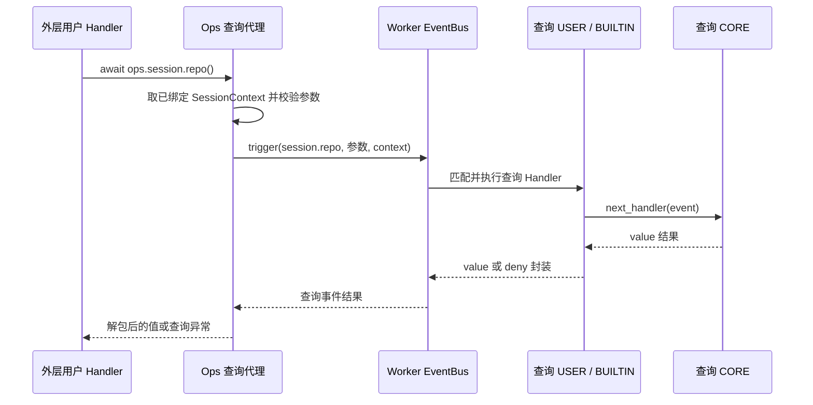

# session.repo / ops.session.repo 特性设计

| 项 | 值 |
| --- | --- |
| 编号 | F_15 / session-repo |
| 建档日期 | 2026-10-27 |
| 后续修订 | 2026-10-31，拆分独立查询特性、按事件命名；本次以 session.append 的七章结构补齐字段、接入实例与函数链，契约不变 |
| 关联计划 | [EXTV2-22 / 七项只读查询事件化](../designs/extensions-v2-development-plan.md#extv2-22-七项只读查询事件化) |
| 主责规约 | [S_16 查询公共协议](../specs/S_16_session-query-events.md)、[S_05](../specs/S_05_session-repo-ops.md) |

## 1. 范围、状态与依据

最近修订 2026-10-31。本文仅维护 `ops.session.repo()` 与同名查询事件 `session.repo` 的使用说明、接入和验证边界；一个方法与一个查询事件组成一项特性。开发状态、负责人和交付统一见[开发计划 EXTV2-22](../designs/extensions-v2-development-plan.md#extv2-22-七项只读查询事件化)，交付 [PR !100](https://gitcode.com/huenrui_/jiuwenswarm/merge_requests/100)。

公共协议主责为 [S_16](../specs/S_16_session-query-events.md)，专项字段主责为 [S_05_session-repo-ops.md](../specs/S_05_session-repo-ops.md)；下文表格解释怎样填写、怎样消费，不另立契约。共享实现和既有验收记录见[查询公共机制与七项特性索引](../designs/session-query-events.md)。

2026-10-31 按单个 Ops / Event 拆分特性文档；原合篇只作为文档组织历史，不代表仍需一起调用。此次拆分没有改变运行时契约或实现。

## 2. 能力说明与 Claude 对照

`session.repo` 是这一次查询调用的拦截事件。方法代理验证参数和已绑定会话后触发它；查询 Handler 接收下述参数，可继续默认处理、增加前后操作、返回合法替代视图或明确拒绝。默认 CORE 读取平台事实，结果返回原方法调用者；它不表示状态发生变化，也不自动写历史或显示到界面。

`await ops.session.repo()`：根据可信 cwd 查询所在 Git 仓库的身份，适合判断项目来源或展示远端。每次默认真实读取；不执行 fetch、刷新、提交、切分支或修改 Git 配置。

| 项 | 本次实现 | 与固定 Claude 定义的关系 |
| --- | --- | --- |
| 事件输入 | 无业务选项，Event 输入为空映射 {} | 以同名查询 OpEvent 为扩展点；会话身份独立绑定，不作为可改写参数 |
| 默认数据来源 | read_session_repo_view(cwd)：验证工作副本，读取主工作树和 origin；不调用可改写的公共 cwd 查询结果。 | 使用本地真实平台服务或绑定快照，不伪造 Claude 私有宿主数据 |
| 方法公开返回 | dict 或 None | 四个公开字段及 worktree 主根对齐 Claude；本地没有构建内部仓库清单，internal=False/name=None；URL 会去除潜在凭据。 |
| 改写与拒绝 | 可 next、短路合法 value、返回合法 deny | 只影响本次查询结果，不修改平台会话事实或授权范围 |

对照依据是 Claude Code Mods 2.1.277 的固定公开类型声明，提交 `80c6959d28c4c30ecd14fc1cdf172f19d9adad81`；不是运行 Claude 私有宿主的结果。

## 3. 事件契约

### 3.1 触发前后与粒度

方法代理通过会话、参数及重入检查后，每次调用触发一次 `session.repo`；检查未通过时不会进入查询链。下图展示 Handler 继续默认读取的路径；合法短路或明确拒绝可以在 USER 返回，不进入 CORE。返回箭头对应同一次 await 的结果，不是额外业务通知。



平台业务方法先收集可信会话资料并随外层事件传入 Bus，Core 为实际 Handler 创建 Ops。现成示例是 notify_context_usage 发布 context.usage.updated；其他已由平台接好的事件也能使用本方法，前提是本次 Handler 已绑定下表所需资料。用户不需要修改 Adapter、自己创建 Bus，或先调用 notify 来取得上下文。

一次外层通知中调用本 Ops 两次，会发起两次查询；只订阅查询事件但无人调用 Ops，不会自动查询。本查询不会把原来的事件改成查询事件：外层 Handler 暂停等待，查询返回后继续执行原函数。同一事件有多个匹配 USER 时，只有各 Handler 调用 next 才继续后续链；短路返回合法结果后无需再进入默认 CORE。

### 3.2 输入：每个字段表达什么、由谁填写

先分清谁需要填写。普通调用者只填写方法参数；返回值由平台或查询 Handler 提供，用户拿到后直接消费。
只有在自己的查询 Handler 中短路或加工输出时，才需要按输出表构造值。所有表格分别解释“填什么、代表什么、起什么作用”，并写明缺失和错误边界。

| 数据所在位置 | 谁负责 | 用户应该做什么 | 作用 |
| --- | --- | --- | --- |
| Ops 方法参数 | 普通调用者 | 调用 usage 时按需填 breakdown/columns；其他六项不传参数 | 选择本次查询选项，不选择另一个会话 |
| Event.event_input | Ops 代理自动构造；查询 USER 可合法改写 | 按下表读选项；需要改写时构造新 Event 后 next | 让本次查询链使用合法选项，不修改可信上下文 |
| SessionContext | 平台采集，Core 绑定 | 普通用户不补填；通过 ops.session_context 只读访问 | 确定本次查谁、使用哪些可信目录和快照 |
| Event 输出 value/deny | 默认 CORE；或替代结果的查询 Handler | 查询 Handler 才需构造 return {value: ...} 或 return {deny: ...} | 决定这次查询的返回视图或明确拒绝 |
| Ops 直接返回值 | 分派器校验、复制并解包 | 普通调用者消费字段即可，不需要重新填写或再次解包 value | 作为自己业务方法的参数，不自动写回平台或渲染 |

事件信封与查询输入如下。event_type 不属于参数字典；event_input 与可信 SessionContext 是独立传递的两部分。

| 字段 / 参数 | 类型、必填与默认 | 谁填写 / 从哪里来 | 填写什么 / 正确例子 | 代表什么意思 | 有什么作用 / 怎样使用 | 不填、未知或错填时怎样处理 |
| --- | --- | --- | --- | --- | --- | --- |
| Event.event_type | 固定 str | Ops 代理自动填写；不是方法参数 | "session.repo" | 进入哪一条查询处理链的类型名 | Bus 据此寻找已注册的 Matcher / Validator / Handler 链 | 用户不用填；不要在 arguments 中增加 event_type，也不要通过改类型跳到另一条查询链 |
| Event.event_input | 只读 Mapping；无选项时 {} | Ops 代理复制并构造；查询 Handler 读取 | {}；由代理生成，用户调用方法时仍不传参数 | 这一次查询的选项，独立于 SessionContext | 供 Matcher / 查询 Handler / CORE 读取；不承载可改写会话身份 | 仅 usage 允许下述选项；其余六项必须是空映射。不可原地改写；合法改写用新的 Event 和参数映射传 next |

平台随本次调用附带的资料如下。这些是已绑定事实，用户不需要在调用 Ops 时逐项填写；查询 Handler 也不能通过改写 Event 输入替换它们。

| 字段 / 参数 | 类型、必填与默认 | 谁填写 / 从哪里来 | 填写什么 / 正确例子 | 代表什么意思 | 有什么作用 / 怎样使用 | 不填、未知或错填时怎样处理 |
| --- | --- | --- | --- | --- | --- | --- |
| ops.session_context | Core 只读属性，查询需要非 None | 平台把上下文随外层 Event 交给 Bus，Core 绑定到实际 Handler 的 Ops | 用户不用填，也不用 await；直接读取 ops.session_context | 本次 Handler 的可信会话资料入口 | 代理取出这份资料，随查询 Event 的独立 context 参数继续传递 | 缺少上下文时查询报错；不要把用户输入 payload 包装成平台可信上下文 |
| SessionContext.session_id | 平台验证过的非空 str，必需 | 平台业务入口提供；用户普通调用不填写 | 平台例如绑定 session-a；查询方法和 Event 输入里都不再填 session_id | 本次绑定的是哪个会话 | 读取相应会话的历史、保存模型或用量服务；同时参与隔离和循环保护 | 缺失/非法不能查询；返回值或 Event 输入不能把目标改成另一个会话 |
| SessionContext.cwd | str 或 None | 平台收集可信执行目录 | 平台提供宿主绝对目录；用户不用填 Git 根或 remote | 从哪里开始查询真实 Git 工作副本 | repo 查询使用此事实，不使用另一个可改写 cwd() 查询的返回值 | cwd=None 返回 None；坏路径或 Git 读取故障保留相应错误 |
| current_query_origin().package | str 或 None；helper 本身也可返回 None | Server 分派器从原 Ops 的包身份记录；不是用户传参 | 先 origin = current_query_origin()，非 None 时再读 origin.package | 谁发起了本次查询，而不是当前查询 Hook 属于哪个包 | 用于用户自己的审计和来源判断；它不是 Core next.origin 或授权证明 | 直接宿主触发而没有 Ops 调用域时 helper 可为 None；不要无判空访问 .package |

`ops.session_context` 是只读属性，不是采集或组装上下文的 Ops 方法。平台业务方法负责收集和构造；
查询代理只读取这份资料，再交给查询事件。Bus 会生成规范化的只读副本，保留同一会话身份和资料，不要求前后是同一个 Python 对象。

### 3.3 输出：默认值、替代结果与拒绝

先看查询 Handler 的事件输出封装。普通 Ops 调用者不用构造这层封装；查询 Handler 从 next 得到完整封装后，
可直接返回，不要又包成 {"value": result} 形成两层 value。

| 字段 / 参数 | 类型、必填与默认 | 谁填写 / 从哪里来 | 填写什么 / 正确例子 | 代表什么意思 | 有什么作用 / 怎样使用 | 不填、未知或错填时怎样处理 |
| --- | --- | --- | --- | --- | --- | --- |
| value | dict[str, object] \| None；成功时唯一顶层键 | 默认 CORE 提供；查询 USER 短路或加工结果时按同样结构填写 | return {"value": {'root': 'D:/projects/demo', 'remote': 'https://git.example.invalid/demo/repo.git', 'internal': False, 'name': None}} | 这一次查询成功给出的值；下一张表解释它内部每个字段 | Ops 校验、独立复制并解包；普通调用者拿到的是 value 本身 | 未知允许 return {"value": None}，但不能直接 return None。不能同时填写 deny 或增加未知顶层键；USER 无效输出会按 Core 隔离规则处理，不能靠错填来拒绝 |
| deny | 去空白后非空 str，原字符串最多 512 字符；拒绝时唯一顶层键 | 希望明确拒绝此次查询的查询 Handler 填写 | return {"deny":"QUERY_DISABLED"}；也可使用能公开给调用者的简短原因 | 明确拒绝这一次查询，不是返回了一个未知数值或平台读取故障 | 分派器将其转换为 SessionQueryDenied，code=DENIED，reason 保留原因；调用者可按拒绝分支处理 | 正常成功不填；不能与 value 同时出现，也不能填空白、False、None 或异常对象。抛普通异常可能被隔离后继续，并不等于 deny |

下面以 **Ops 直接返回值为根**解释所有公开字段；在事件输出中，它们位于 value 内。

本方法返回 repo 对象或 None。例如表中的 root 由 repo["root"] 读取，事件结果中对应 value.root。 None/True/False 是 Python 写法，JSON 示例中分别写 null/true/false，不能加引号冒充字符串。

| 字段 / 参数 | 类型、必填与默认 | 谁填写 / 从哪里来 | 填写什么 / 正确例子 | 代表什么意思 | 有什么作用 / 怎样使用 | 不填、未知或错填时怎样处理 |
| --- | --- | --- | --- | --- | --- | --- |
| 方法直接返回值（事件中的 value） | 恰含 root/remote/internal/name 四键的 dict，或 None | CORE 根据可信 cwd 查询真实 Git；USER 替代值仍须满足四字段结构 | {"root":"D:/projects/demo","remote":None,"internal":False,"name":None}；没有 Git 工作副本时填 None | 当前工作副本的仓库身份视图；不是原平台 branch/head/detached 详情 | 生成仓库摘要或区分仓库来源；查询不执行 clone、fetch、checkout、commit 等 Git 写入/网络操作 | None 表示没有可查询的 Git 工作副本；成功对象必须包含四个键，不可只返回 {} 或增加 branch 等旧字段；真正读取故障仍应报错 |
| root | 非空绝对路径 str，成功对象必有 | Git worktree 信息；linked worktree 使用主工作树根 | D:/projects/demo；Linux 使用 /home/me/demo 等宿主绝对路径 | 这个仓库的主工作树根，不一定等于当前 linked worktree 的目录、cwd 或用户 project_root | 作为仓库归属标签，识别多个工作树属于同一主仓库；不会切换执行目录 | 成功对象不能省略或填 None；不能用用户输入的任意路径替代平台默认查询目标 |
| remote | 非空 str 或 None，键必有 | 默认取 origin.pushurl，未配置时取 origin.url；网络 URL 对外剥离凭据信息 | https://git.example.invalid/demo/repo.git；没有 origin 地址填 None | 仓库配置的首选推送来源地址；可为 Git 支持的地址格式，不保证目标网络当前可达 | 展示或关联仓库来源；读取这个字段不会访问远端，也不验证登录权限 | 缺少配置用 None，不用空字符串、假网址或私密 Token 占位；键仍须保留 |
| internal | bool，成功对象必有；默认 False | 主机内部仓库识别事实；当前默认没有内部构建清单 | 当前默认填 False；自定义返回 True 时必须同时提供非空 name | 是否按宿主内部仓库规则识别；不表示私有仓库、可信目录或用户具有访问权限 | 让消费方选择是否展示内部仓库标签；不能据此授予权限或放宽路径检查 | 必须是 True/False，不能用字符串或 0/1；False 时 name 必须为 None |
| name | 非空 str 或 None，键必有 | 内部仓库识别结果；当前默认 None | internal=False 时填 None；有内部识别事实且 internal=True 时例如 owner/repo | 已识别内部仓库的名称，不是随意截取文件夹名或远端字符串推断出的身份 | 在内部仓库场景显示稳定名称；普通仓库仍可用 root/remote 展示 | internal=True 时不能省略或填 None；internal=False 时不能填名称；默认不凭空推断 |

路径例子按宿主系统解释：Windows 用带盘符的绝对路径，Linux/macOS 用 / 开头的绝对路径。用户修改的是查询返回视图；平台不会据此更换实际目录、项目绑定、Git 查询目标或授权根。

继续默认查询使用 `await next_handler(event)`。需要短路时，可直接返回 `{"value": {'root': 'D:/projects/demo', 'remote': None, 'internal': False, 'name': None}}`；需要明确拒绝时返回 `{"deny": "QUERY_DISABLED"}`，下游可以不执行。加工结果必须符合本表的值类型及专项 spec；只改变本次返回视图，不改写平台真实状态、上下文或授权范围。

普通 USER / BUILTIN 异常或无效输出按 Core 隔离规则处理，可能继续默认 CORE；抛异常不能代替明确 deny。CORE / 框架读取失败向调用者传播，不用成功空值掩盖；取消继续传播并在 finally 清理查询调用域。匹配在 trigger 初始固定，next 改写合法参数不会重新选择 Handler；多次 next 可能重复读取，不承诺结果缓存。

### 3.4 注册、筛选与用户接入示例

将下面代码作为扩展包的入口模块，并按[现有示例 manifest](../../examples/session_repo_info/manifest.yaml) 的形式指定入口。示例同时展示外层业务 Handler 如何调用本 Ops，以及本查询的 USER Handler 如何继续默认链。

`manifest.yaml`（与下面的 `extension.py` 放在 ZIP 根目录）：

```yaml
schemaVersion: 1
package:
  id: example.session-repo-query
  version: 1.0.0
  displayName: Session Repo Query
extensions:
  - id: repo-query
    runtime: backend
    module: extension.py
```

`extension.py`：

```python
import logging

logger = logging.getLogger(__name__)


class Extension:
    def register(self, registrar):
        # Example outer event: the platform already binds SessionContext.
        registrar.register_event_handler(
            "context.usage.updated", self.on_usage, {}, "user"
        )
        # Intercept this query only.
        registrar.register_event_handler(
            "session.repo", self.on_query, {}, "user"
        )

    async def on_query(self, event, ops, next_handler):
        logger.debug("before query: %s", event.event_type)
        # Continue this query chain; do not call the same public Ops here.
        result = await next_handler(event)
        logger.debug("after query: denied=%s", "deny" in result)
        return result

    async def on_usage(self, event, ops, next_handler):
        value = await ops.session.repo()
        # Use value in your own business code; no ui.render is required.
        parameters = {"repo": value}
        self.on_parameters(parameters)
        # Continue the original event, not the nested query event.
        return await next_handler(event)


    def on_parameters(self, parameters):
        # A user-owned consumer; receiving parameters proves this query returned.
        logger.info("received parameter keys: %s", sorted(parameters))


def create_extension():
    return Extension()
```

查询 Hook 想取得默认值应调用 next；在自己的 `session.repo` Hook 中再次调用同名 Ops 会被循环保护拒绝。USER → BUILTIN → CORE 在各层继续时执行，结果反向返回；共享 BUILTIN 负责计时与独立副本，默认 CORE 负责实际读取。

将 ZIP 通过已有 `/extension install "D:\extensions\session-repo-query.zip"` 安装；安装只发布订阅，不会立即执行查询。下一次平台真实发布外层事件并绑定会话时，示例 on_usage 才调用本方法；on_query 观察新开的 `session.repo` 链，on_parameters 收到 `repo` 参数。空 matcher `{}` 匹配该事件全部合法输入；本方法无会话 ID matcher 可填，会话身份由独立上下文决定。

## 4. 方法契约

### 4.1 签名、参数与调用场合

下列是调用侧签名；Core 自动注入的内部 ops 参数不由用户填写。

```python
# Public call signature; no session_id or path argument.
async def repo() -> dict[str, object] | None: ...
```

| 字段 / 参数 | 类型、必填与默认 | 谁填写 / 从哪里来 | 填写什么 / 正确例子 | 代表什么意思 | 有什么作用 / 怎样使用 | 不填、未知或错填时怎样处理 |
| --- | --- | --- | --- | --- | --- | --- |
| 方法参数 | 无参数 | 普通调用者不填写参数 | await ops.session.repo() | 查询目标由当前 Ops 已绑定的会话上下文确定 | 直接读取这次会话的视图；不需要另填会话 ID 或路径 | 括号留空；不要调用 ops.session.repo({})，也不要传 None/session_id/cwd；空 {} 仅由代理生成在 Event 输入中 |

表中“无参数”就是调用括号留空，不是让用户传入空字典。只有 usage 有可选查询选项；
平台会话身份、目录和快照不通过这些选项填写。完整参数对象和事件结果的对应例子见第 4.3 节。

典型调用如下；它可写在任何满足会话前提的已注册业务 Handler 中。

```python
repo = await ops.session.repo()
if repo is not None:
    logger.info("repository: root=%s remote=%s", repo["root"], repo["remote"])
```

### 4.2 方法与事件转换、返回值及错误

```text
方法参数 → 查询代理规范化 → Event.event_input
当前 ops.session_context → trigger 的独立 context 参数
  → 同名查询事件 session.repo
事件 {value: 结果} → 参数/结果校验、独立复制、解包 → 方法返回值
事件 {deny: 原因} → SessionQueryDenied(code=DENIED, reason=原因)
```

成功返回 `dict[str, object] | None`，字段及缺失语义见第 3.3 节。无 SessionContext 报 RuntimeError；非法会话 ID 由平台会话校验拒绝；方法参数非法报 TypeError。活跃同名或间接循环报 QUERY_REENTRANT，深度超过 16 报 QUERY_DEPTH_EXCEEDED；不允许调用方覆盖 bus / event_type。平台读取故障保持其原有异常类型和稳定 code。Handler 未捕获 Ops 错误时，还受外层事件自身的故障隔离规则约束，不能把外层继续误认为查询成功。

| 位置 / 条件 | 调用方看到什么 | 该怎样处理 |
| --- | --- | --- |
| 进入查询前没有 SessionContext | RuntimeError，不触发同名查询事件 | 由平台既有入口提供上下文；用户不伪造会话或在参数里补 session_id |
| 方法签名或事件参数不合法 | TypeError；非法会话 ID 由会话服务按其原契约拒绝 | 按第 4.1 节填写，不传 bus/event_type/目标路径 |
| 合法查询 Hook 返回 deny | SessionQueryDenied；code=DENIED，reason 为原原因 | 需要分支时在调用 Ops 处捕获；不要把拒绝当作未知数据 |
| 活跃同名查询循环 / 深度超过 16 | SessionQueryError：QUERY_REENTRANT / QUERY_DEPTH_EXCEEDED | 在当前查询 Hook 内用 next 取得默认结果，避免再次调用同名 Ops |
| USER 抛普通异常或返回非法结构 | 依既有 Core 故障隔离继续原有效链或保留真实下游结果 | 不能靠异常/错填制造可靠拒绝；拒绝用合法 deny |
| 默认 CORE 或框架读取失败 / 查询取消 | 原读取异常或 CancelledError 沿等待关系传播 | 不要转换成成功空值；外层通知是否隔离错误由外层自己的契约决定 |

### 4.3 从填写输入到消费输出的完整字段例子

假设可信 cwd 位于 Git 工作副本内，主工作树根及 origin 地址已由平台查询到。 用户无需在查询参数中重新填写平台资料。下面的 Event 参数由方法代理自动构造：

```json
{}
```

查询 Handler 默认继续后，完整事件输出可为：

```json
{
  "value": {
    "root": "D:/projects/demo",
    "remote": "https://git.example.invalid/demo/repo.git",
    "internal": false,
    "name": null
  }
}
```

Ops 返回的是上面 value 对应的值，不包含额外的 value 外壳。以下代码放在已绑定会话的业务 Handler 中，
logger 沿用第 3.4 节模块中的定义。它展示字段怎样影响用户自己的消费逻辑：

```python
repo = await ops.session.repo()
if repo is None:
    logger.info("no Git working copy is available")
else:
    logger.info("main worktree: %s", repo["root"])
    logger.info("remote: %s", repo["remote"] if repo["remote"] is not None else "not configured")
    if repo["internal"]:
        logger.info("internal repository: %s", repo["name"])
```

若查询 Handler 希望明确拒绝，可返回以下完整事件结果；此时普通调用方收到 SessionQueryDenied，
而不是一个需要自行解析 deny 的成功字典：

```json
{"deny": "QUERY_DISABLED"}
```

## 5. 接入与兼容方案

### 5.1 启动登记、上下文绑定与 CORE 分工

平台 bootstrap 向 Bus 登记 `session.repo` 的 Matcher、Validator 和默认 CORE，并登记查询 BUILTIN。Registry.init 触发一次 ops.build；其 CORE 创建 Builder，BUILTIN 将 session.repo 对应的封闭查询代理加入方法目录，Bus 保存 Builder。执行每个实际 Handler 前，Core 用共享目录及本次包身份 / SessionContext 创建新的 Ops。

业务时，用户调用本方法，Core 方法访问器自动把当前 Ops 传给登记的代理；代理读取已绑定上下文并显式 trigger `session.repo`。查询链各实际 Handler 也获得各自的 Ops，查询 CORE 走 `read_session_query` → 校验可信 cwd → `read_session_repo_view(cwd)`，不再调用公共同名 Ops。Builder 保存方法定义，不保存会话查询结果；ops.build 与运行时 builder.build(...) 是两种操作。

统一实现职责见[公共设计第 5 节](../designs/session-query-events.md#5-接入与兼容方案)。默认查询不写业务数据、不发模型请求、不自动渲染；没有全局查询结果缓存。用户包卸载只移除自己的 Hook，不移除平台查询类型或 CORE。

### 5.2 迁移与生效边界

repo_root 改为 root；移除 branch/head/detached 访问。注意 linked worktree 的 root 现在对齐 Claude 的主工作树根；当前执行目录仍由 cwd() 给出。平台内部原 Git 身份读取服务保留。

本次文档结构与说明调整不改变上述兼容边界。执行目录、模型、Git、历史和用量事实仍由平台服务维护；对返回视图的改写不成为另一项平台操作的可信输入。

| 旧调用 / 容易混淆的用法 | 现在怎样写 | 对使用者的影响 |
| --- | --- | --- |
| repo["repo_root"] | 改为 repo["root"] | linked worktree 返回主工作树根；不是当前子 worktree 的执行目录 |
| 读取 branch/head/detached 字段 | 删除对这些已移除公开字段的依赖 | 本方法公开 root/remote/internal/name 四字段 |
| 把 origin 原始 URL 直接展示 | 使用去凭据后的 remote；无 origin 为 None | 不根据用户改写的 cwd 查询视图执行 Git |

### 5.3 完整业务案例：给项目摘要附上真实 Git 来源

平台已绑定 Git 工作副本内的 cwd，用户需要判断本轮工作区属于哪个仓库，无需自己执行 Git 命令。 下面说明用户为什么调用、平台查什么以及结果在哪里可观察，不要求用户改写平台入口。

1. 用户安装第 3.4 节的包，发布外层 on_usage 和本查询 on_query 两个 USER；此时尚无查询结果。
2. 平台真实业务入口收集会话资料，随外层事件交给 Worker EventBus；Core 为 on_usage 创建带包身份、会话上下文的 Ops。
3. on_usage 执行 `await ops.session.repo()`；代理触发 `session.repo`，on_usage 在 await 处等待。
4. on_query 先记录查询开始，再 next；查询 BUILTIN 开始计时并继续，CORE 直接以可信 context.cwd 调用 read_session_repo_view；校验真实工作副本、解析主工作树根并读取去凭据后的 origin。
5. CORE 的 value 封装经 BUILTIN、on_query 返回，代理校验并解包；用户得到 root/remote/internal/name 四字段视图，按第 3.3 节使用；普通 linked worktree 的 root 是主工作树根，当前执行目录仍由 cwd 的独立契约表达。
6. 用户 on_parameters 收到 `{"repo": value}`，是本例的可观察结果；随后 on_usage 的 next 继续原来的外层事件，不再重复这次查询。

没有 cwd 或没有 Git 仓库时可能为 None；无 origin 时 remote=None。Git 故障与“不是仓库”不同，不应一律吞成空结果。

现成七项联合示例见 [session_query_audit](../../examples/session_query_audit/)；`collect_session_parameters(ops)` 是用户普通辅助函数，分别等待七个 Ops，最终返回七键参数字典，不是新增 Ops。单项示例只调用本方法，其他六项不是前置条件。

### 5.4 关键函数：Ops、SessionContext 与同名查询事件如何接上

以下为现有实现的关键节选；完整校验、来源记录和重入保护以链接中的源码为准。启动时只有方法登记，业务时才绑定会话并执行查询。

```python
# Startup: contribute definitions to the Builder returned by ops.build CORE.
builder = await next_handler(event)
builder.add_namespace("session")
for event_type in SESSION_QUERY_EVENTS:
    builder.add_method(
        "session", event_type.split(".", 1)[1],
        session_query_method(bus, event_type),
    )
```

Core 在实际进入 Handler 前调用 `builder.build(package_metadata, session_context)`；方法访问器再执行 `method(current_ops, *args, **kwargs)`，自动注入当前 Ops。Builder 保存全部已登记能力的定义，不预读结果，也不会在本次查询重跑 ops.build。

本方法实际登记的代理函数如下。bus 与 event_type 在启动时由闭包固定；用户只填写第 4.1 节允许的参数。这里是 session_query_method 内无参数查询分支。

```python
async def query(ops: EventHandlerOps) -> object:
    return await dispatch_session_query(bus, ops, event_type, {})
```

```python
# Runtime excerpt: the full dispatcher also guards recursion and caller origin.
context = require_query_context(ops)  # Reads the existing ops.session_context property.
result = await bus.trigger(
    Event(event_type, MappingProxyType(dict(arguments))),
    context,
)
if not valid_query_output(event_type, result):
    raise SessionQueryError("INVALID_QUERY_RESULT")
if "deny" in result:
    raise SessionQueryDenied(result["deny"])
value = detached_copy(result["value"])  # The public Ops returns this value.
```

这里 event_type 固定为 `session.repo`；arguments 固定为空映射，用户调用括号留空。 context 作为 trigger 的独立参数传递，不允许用户通过 Event 输入把会话、目录或快照替换掉。Ops 属性只提供已有上下文，不采集、不组装资料。

默认查询 CORE 为：

```python
async def session_query_core(event: Event, ops: EventHandlerOps | None, next_handler: EventNext) -> dict:
    """Answer from trusted platform readers, never from another public query Ops."""
    del next_handler
    context = require_query_context(ops)
    return {"value": await read_session_query(event.event_type, event.event_input, context)}
```

本特性的实际读取落点：read_session_repo_view(context.cwd)；复用原工作副本校验，新增 Claude 形状的 Git 主根/远端只读投影。 默认 CORE 直接调用平台读取函数，不再调用公共同名 Ops；这与启动时创建 Builder 的 ops.build CORE 是不同函数。查询 USER 可在 next 前后执行自己的规则；共享查询 BUILTIN 只计时、记录来源并复制结果；默认 CORE 才读取平台事实。合法短路时下游不必执行。

源码位置：[类型与校验](../../event_types/session_queries.py)、[Ops 登记](../../handler_ops/session_ops.py)、[封闭代理](../../handler_ops/session_queries.py)、[分派与解包](../../query_dispatch.py)、[查询 USER 示例](../../examples/session_query_audit/extension.py)、[查询 CORE / BUILTIN](../../event_handlers/session_queries.py)、[平台读取分支](../../../server/runtime/session/query_views.py)。


## 6. 验收与未决问题

### 6.1 本特性的独立验收场景

| 场景 ID | 输入与前置 | 操作 | 预期结果 |
| --- | --- | --- | --- |
| F_15-V-01 | 可信 cwd 位于真实 Git 子目录 / linked worktree | 调用 repo() | 返回四字段对象；root 为主工作树根 |
| F_15-V-02 | 配置含凭据的网络远端；或 cwd 不属于 Git | 调用 repo() | 网络远端剥离凭据；非 Git 返回 None，真实 Git 故障仍报错 |
| F_15-V-03 | 安装仅拦截 session.repo 的用户包 | 分别 next、短路 value、显式 deny | 默认值 / 合法替代值 / SessionQueryDenied 分别可观测 |
| F_15-V-04 | 不同会话绑定不同上下文；或在 Hook 中同名递归 | 分别调用本方法 | 会话隔离；活跃同名或间接循环报 QUERY_REENTRANT，不能无限递归 |
| F_15-V-05 | 读取失败、Hook 异常或查询取消 | 分别构造这些分支 | 按第 3.3 / 4.2 节区分隔离、明确拒绝、平台错误与取消，不把失败当成功空值 |

对应事件化用例位于 [test_session_query_events.py](../../../../tests/unit_tests/extensions_v2/test_session_query_events.py)：包含七项默认调用、各项短路 / 拒绝、非法参数、查询顺序、隔离、循环 / 取消及实际用户包装载卸载。每个场景只验证本方法承诺，不把其他六项也作为调用前置。

### 6.2 已有实施证据与本次文档调整

实现验证基于本 PR 实现提交 `f313f513ee9b`、已合入 Server 基线 `c6a07f909` 与 Core `bdde48a8`，Python 3.11。扩展 632 项、相关平台 140 项及独立进程 ZIP / notify / 七项参数返回验证的实际范围、命令和限制统一保留在[公共设计第 6 节](../designs/session-query-events.md#6-验收与未决问题)。这属于查询事件化实现的既有证据；这些数量属于实现阶段历史运行。本次按 session.append 对齐文档的结构和说明，运行代码不变；只核对字段、示例、源码链路、链接与差异，不声称重新执行业务或真实模型测试。

四个公开字段及 worktree 主根对齐 Claude；本地没有构建内部仓库清单，internal=False/name=None；URL 会去除潜在凭据。 该限制属于已知支持边界；此轮未增加新的运行时待决项。未执行 Claude 私有宿主、新模型 API、浏览器或 Front/Supervisor 跨进程验收，不能由文档完整推断这些验收已完成。

## 7. 参考资料

- [专项字段规约 S_05_session-repo-ops.md](../specs/S_05_session-repo-ops.md)
- [S_16 查询公共协议](../specs/S_16_session-query-events.md)
- [七项独立特性索引与共享实施记录](../designs/session-query-events.md)
- [Claude 会话方法](https://github.com/anthropics/claude-code/blob/80c6959d28c4c30ecd14fc1cdf172f19d9adad81/mods/types/claude-code.d.ts#L2342-L2447)
- [Claude 同名 OpEventOf 查询事件](https://github.com/anthropics/claude-code/blob/80c6959d28c4c30ecd14fc1cdf172f19d9adad81/mods/types/claude-code.d.ts#L5529-L5624)
- [内置事件开发指南](../designs/builtin-event-development-guide.md)
