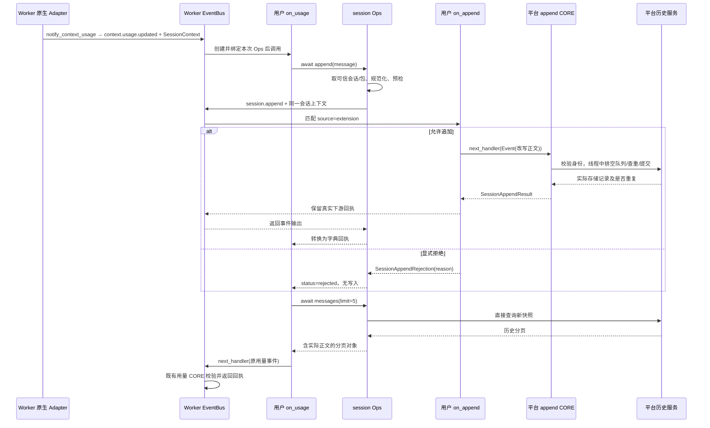

# session.append / ops.session.append / ops.session.messages 特性设计

| 项 | 值 |
| --- | --- |
| 编号 | F_16 / session-history-ops |
| 归档日期 | 2026-10-27 |
| 后续修订 | 2026-10-28，评审修订后按事件与方法编写指南重整；验证记录见第 6 节 |
| 关联计划 | [EXTV2-16 / Server PR-04](../designs/extensions-v2-development-plan.md#extv2-16-会话历史读写与追加前扩展) |
| 主责契约 | [S_06 会话历史 Ops 与追加事件规约](../specs/S_06_session-history-ops.md) |

## 1. 范围、状态与依据

本特性已实现会话产品历史的查询、扩展追加和写入前正文处理，正在 [PR !83](https://gitcode.com/huenrui_/jiuwenswarm/pull/83) 评审。本文核对的实现为该 PR 的 `32f7e707efc5947cb40ee5c96ab1c1238b93dd56`，目标为 `rsi_native_agent_os`；配套 agent-core 为 `ead700d7d18a247968d64de54918cf5d201a207a`，Core 本身未修改。本次修订调整文档组织和说明，不新增接口或改变代码行为。

使用范围是 Worker 所属主会话的产品历史。Front 和 Supervisor 沿用既有接入与路由，EventBus 只由 Worker 持有。同步后台记录、Team / 子 Agent 专用历史保持原路径。本特性不发送聊天请求、不启动 Agent 回合、不把追加正文注入模型上下文，也不负责主动推送前端展示。

Claude 对照沿用 PR04 的固定提交 `bf2323b3021c9d3db7a31e1e7d61068c3f704497`；其类型文件首行标记为 Claude Code **2.1.277**。这里借鉴事件介入与方法调用的职责分工，当前接口按 JiuwenSwarm 契约使用，差异见第 2 节及 [S_06 第 6 节](../specs/S_06_session-history-ops.md#6-与-claude-mods-的关系)。

## 2. 能力说明与 Claude 对照

`session.append` 在平台已经构造好一条主会话历史记录、尚未真正写入时触发，一次处理一条待追加记录。Handler 收到记录标识、角色、正文和接入来源，可以继续默认提交或改写正文；扩展自己发起的追加还可以在调用 next 前显式拒绝。默认 CORE 完成实际写入并返回回执，入口据此向原调用方返回。它不负责接收聊天输入或启动模型执行。

`await ops.session.append(message)` 适合扩展在审计、说明或结果留档时调用。它接收稳定 id、user/assistant 角色和字符串正文，使用当前 Handler 已绑定的会话与包身份，触发新的 `session.append` 链，再返回已写入、重复或拒绝的状态字典。成功表示产品历史已经提交，而非仅加入写入队列。

`await ops.session.messages(limit=50, cursor=None)` 适合读取当前会话已持久化的可见历史，例如追加后读回审计说明、分批展示历史。它直接调用历史查询服务，返回倒序分页对象；不触发新的查询事件。使用已有 cursor 继续固定快照，用 `cursor=None` 开始新查询才能看到后追加记录。

| 对照对象 | JiuwenSwarm 当前实现及使用影响 |
| --- | --- |
| Claude `session.append` 事件 | 共同点是写入前处理；本事件只暴露 message_id / role / content / source，只开放正文改写，不能直接使用 Claude 的 door / origin / agentId matcher 或内容块输入 |
| Claude `$.session.append` | 本方法接受 id / role / 字符串 content，返回自定义提交状态；只写产品历史，不具备 Claude user note 进入模型上下文的效果 |
| Claude `$.session.messages` / 同名 OpEvent | 本方法直接读取当前绑定主历史并返回分页对象，缺少 Claude 的查询 Hook，返回形态也不同；调用方应按本方法契约分页 |

完整类型与边界以 S_06 为主责；下面按开发者使用顺序解释必要字段、调用和可观察结果。

## 3. session.append 事件契约

### 3.1 谁触发、何时触发、返回后做什么

事件按**每次通过前置过滤的待追加记录尝试**触发，不按每轮会话固定触发。一个回合可能写入多条历史；同一 id 重试也会再次进入策略链，最终由提交层判断 duplicate。被原历史规则过滤的临时记录不会触发事件。覆盖三个入口：

| 入口 | 触发前已完成 | source | 返回结果的消费方 |
| --- | --- | --- | --- |
| 用户 Handler 调用 `ops.session.append(message)` | 校验方法参数，从 Ops 取会话和包身份，构造 transcript_only 记录，预检会话生命周期 | extension | Ops 将事件回执转换为 dict，返回当前用户 Handler |
| `run_history_io(append_history_record, **kwargs)` 的主会话可等待写入 | 原业务已给出记录资料，平台完成记录构造、临时记录过滤并收集可信 SessionContext | history | 原业务等待真实提交后继续；不重复执行原写入 |
| 既有 `history.append_record` RPC | 既有请求参数校验、角色/时间等规范化，再由平台收集目标会话资料 | history.append_record | RPC 保持既有响应协议，在提交与完成标记等待后返回 |

同步后台写入、Team / 子 Agent 专用写入不在本次 Hook 覆盖内；V2 未装配时平台入口沿用原路径。平台接入复用既有写入边界，没有新增 Agent Rail。

### 3.2 Handler 收到什么、可以改什么

```python
@dataclass(frozen=True, slots=True)
class SessionAppendInput:
    message_id: str
    role: str
    content: str
    source: str
```

该定义用于说明已实现的类型；实际导入位置为 `jiuwenswarm.extensions_v2.event_types.session_history`。

| 字段 | 含义 | Handler 权限 |
| --- | --- | --- |
| message_id | 扩展入口为调用方稳定 id；平台入口为已构造记录的 id | 只读 |
| role | 已构造记录的 user / assistant 角色 | 只读 |
| content | 即将写入的字符串正文；其余结构化元数据保留在平台可信记录中 | 可在 next 前用新输入替换，仍须符合 S_06 的正文校验 |
| source | 上表三个接入位置之一；不是包身份，也不同时表达 Claude door/origin 两个维度 | 只读 |

目标会话、包归属、时间、原记录和幂等键来自平台可信调用封装，不从可改写输入决定。`ops.session_context` 是本次 Handler 的只读会话入口；只要平台已经提供有效 session_id，就能使用两项历史 Ops，不要求 cwd、model 或用量事件。

### 3.3 返回什么、如何放行或拒绝

正常放行使用 `return await next_handler(event)`；修改正文时传入新的 Event。默认 CORE 返回 `SessionAppendResult(status, session_id, message_id, message, reason)`：

| 结果 | 含义与后续动作 |
| --- | --- |
| status=persisted | 已完成实际历史提交，message 为实际存储记录，reason 为 None |
| status=duplicate | 同一原请求已写入，返回原实际记录，本次不再追加一条 |
| `SessionAppendRejection(reason)` | 仅可信 source=extension 可在 next 前返回；入口转换为 status=rejected、message=None 的回执，不写历史；reason 去空白后为 1～512 字符 |

事件层使用上述 Python 对象，append 方法层返回字典，两者不要混用。Handler 应保留真实下游回执，可以据此记录自己的日志；不能在 next 返回后改成拒绝以撤销已写记录，也不能构造成功回执代替实际提交。重复 next 复用本次真实回执。

USER 抛异常、非法改写或返回无效结果时，沿用 Core 的故障隔离，可能跳过该 Handler 并继续原有效输入。平台来源的显式拒绝也属于无效结果，默认写入继续。实际 CORE 的 I/O 失败仍向调用方传播，不被当作扩展故障伪装为成功。取消发生在策略阶段可不写入；开始文件提交后先排空已接受的写入再传播取消，结果不确定时使用同一 id 重试。

### 3.4 注册、筛选和最小用户示例

用户包在 `register(registrar)` 中登记 USER Handler。matcher 是字段相等条件的合取，`{}` 匹配全部；可使用 source、role、message_id、content。下面仅处理扩展自身追加，不能用该规则阻断平台历史。

以下为可安装包的 `extension.py`，与仓库 [审计示例](../../examples/session_history_audit/extension.py) 使用相同的公开接口：

```python
from dataclasses import replace
import hashlib
import logging

from openjiuwen.core.events import Event
from jiuwenswarm.extensions_v2.event_types.session_history import SessionAppendRejection

logger = logging.getLogger(__name__)


class HistoryAudit:
    def register(self, registrar):
        registrar.register_event_handler("context.usage.updated", self.on_usage, {}, "user")
        registrar.register_event_handler("session.append", self.on_append, {"source": "extension"}, "user")

    async def on_usage(self, event, ops, next_handler):
        message_id = "audit-" + hashlib.sha256(event.event_input.request_id.encode("utf-8")).hexdigest()
        receipt = await ops.session.append({
            "id": message_id, "role": "assistant", "content": "This turn was audited.",
        })
        page = await ops.session.messages(limit=5)
        visible = any(row.get("extension_message_id") == message_id for row in page["messages"])
        logger.info("audit status=%s visible=%s", receipt["status"], visible)
        return await next_handler(event)

    async def on_append(self, event, ops, next_handler):
        if event.event_input.content.startswith("[block]"):
            return SessionAppendRejection("The audit policy rejected this note.")
        rewritten = replace(event.event_input, content="[audited] " + event.event_input.content)
        return await next_handler(Event(event.event_type, rewritten))


def create_extension():
    return HistoryAudit()
```

配套 `manifest.yaml` 放在 ZIP 根目录，包加载时由 Registry 提供 registrar 和包身份：

```yaml
schemaVersion: 1
package:
  id: example.session-history-audit
  version: 1.0.0
  displayName: Session History Audit
extensions:
  - id: history-audit
    runtime: backend
    module: extension.py
```

安装、查询、重载和卸载步骤见 [示例 README](../../examples/session_history_audit/README.md)。安装后正常发送一条消息并产生有效用量，平台的已有通知触发 on_usage；它调用 append 才产生另一条 session.append 链。默认例子得到加前缀的历史记录和 `visible=True` 日志；将待追加正文改成 `[block]` 开头可验证拒绝。用户只提供包和 USER 策略，平台 Ops、事件类型与 CORE 在宿主启动时已装配。

## 4. Ops 方法契约

### 4.1 await ops.session.messages(limit=50, cursor=None)

| 参数 | 默认值与要求 |
| --- | --- |
| limit | 默认 50；1～100 的整数，bool 不合法 |
| cursor | 默认 None；继续分页时传前一页的 next_cursor；非 None 时须为非空字符串 |

返回 `dict`：messages 是按新到旧排列的可见记录列表，next_cursor 是下一页游标或 None，has_more 表示快照内是否还有记录，snapshot_id 标识固定文件快照、无历史时为 None。每条记录保留平台公开历史字段，去除内部 `_session_append` 标记；字段详见 [S_06 查询](../specs/S_06_session-history-ops.md#1-查询)。

```python
async def read_two_pages(ops):
    first = await ops.session.messages(limit=10)
    second = None
    if first["has_more"]:
        second = await ops.session.messages(limit=10, cursor=first["next_cursor"])
    return first, second
```

首次查询等待既有写入队列排空后固定快照；继续旧 cursor 不包含之后追加的内容。没有历史返回空页；文件替换或截断导致旧游标失效时，调用方用 cursor=None 重查。该方法在线程中读取现有历史服务，不触发 session.messages 事件，不读取正在生成但尚未提交的片段；沿用旧 JSON 自动迁移机制，显式旧 JSON 写入模式不支持游标查询。

### 4.2 await ops.session.append(message)

message 必须恰好包含 id、role、content；不能加 session_id、路径、时间或自定义元数据。

| 字段 | 要求与用途 |
| --- | --- |
| id | 必填，1～128 位 ASCII 字母/数字或 `._:-`；同一业务动作重试保持相同 id |
| role | 必填 user 或 assistant，决定产品历史显示角色 |
| content | 必填非空字符串，UTF-8 不超过 1 MiB |

转换关系如下，CORE 最终调用既有历史提交服务：

```text
message + 当前 Ops 的 session_id / package_id
  → 参数校验、生成包隔离的记录 id / 幂等键、构造 transcript_only 记录
  → 生命周期预检、保存可信调用封装
  → SessionAppendInput(message_id=id, role, content, source="extension")
  → Worker 的新 session.append 事件链
  → SessionAppendResult / SessionAppendRejection
  → 真实回执优先、拒绝结果规范化
  → to_dict() 深拷贝，返回给原调用方
```

返回字典固定含 status、session_id、message_id、message、reason。message_id 为调用参数 id；实际记录 id 为包隔离的 `ext:<hash>`，原 id 保存在 extension_message_id，包身份保存在 extension_package_id。persisted / duplicate 携带真实记录；rejected 的 message 为 None，reason 为拒绝原因。相同会话、包和 id 的原请求一致返回 duplicate，原请求不同报 APPEND_ID_CONFLICT；Handler 改写后的正文以首次实际提交结果为准。

方法完成后可用新的 messages 查询读回记录，或由已有历史恢复入口消费。它不改变用户输入轮次、会话标题或外部投递路由，不自行渲染界面。`next_handler(event)` 继续当前链；append 触发另一条链；messages 直接读取。这三种调用各自独立，不能互相替代。

### 4.3 上下文、失败与取消

两项方法均要求平台给当前 Handler 绑定有效 SessionContext；append 再使用 Core 的包身份，没有用户包身份的平台 Handler 采用保留 `<host>` 作用域。用户不能仅靠手工构造同名 Event 或填写 session_id 获得可信写入封装，也无需修改 Adapter 来补资料。

| 情况 | 调用方得到什么、应如何处理 |
| --- | --- |
| 未绑定 SessionContext | RuntimeError；选择宿主已有的会话绑定事件接入 |
| 参数、会话、游标或生命周期不合法 | SessionHistoryError，通过 code 区分；修正输入或重新查询，错误码完整表见 S_06 |
| 扩展自身追加被合法拒绝 | 正常返回 status=rejected，不写入；检查 reason |
| 同 id 原请求不同、递归追加 | 分别报 APPEND_ID_CONFLICT / APPEND_REENTRANT；追加 Hook 内不要再次 append |
| 写入失败、回滚也失败 | 分别报 HISTORY_IO_FAILED / APPEND_OUTCOME_UNKNOWN；不把结果未知解释成未写入，同 id 重试确认 |
| 提交中取消 | 已接受的提交先排空，再抛 CancelledError；用同 id 查询/重试确认 |

这些是方法向当前 Handler 抛出的行为；USER 不捕获时，外层 EventBus 仍按既有 Handler 故障隔离规则处理，并不等于该方法成功或显式拒绝。

## 5. 接入与兼容方案

### 5.1 启动时：定义事件和登记能力

```text
Worker 装配 V2
  → bootstrap 注册 session.append 类型、输入/输出校验和平台 CORE
  → 登记已有 ops.build 的 session BUILTIN
  → Registry 初始化 Ops，触发一次 ops.build
  → CORE 创建空 Builder，BUILTIN 在回程登记 messages / append 等 session 方法
  → Core 保存能力目录；用户包注册 USER Handler
```

Builder 保存方法定义，并不执行历史查询或写入。每次业务 Handler 执行时，Core 用能力目录和该 Handler 的 SessionContext / PackageMetadata 创建当次 Ops。BUILTIN 在这里负责能力登记；本特性没有给 session.append 另加一个专属 BUILTIN。

### 5.2 运行时：示例从业务入口到真实提交



平台在真实回合产生有效用量时，既有 notify_context_usage 发布 context.usage.updated 并携带可信会话资料，示例 on_usage 才获得当次 Ops。append 从该 Ops 获取目标和包身份，发起独立追加链；on_append 只负责策略，CORE 才执行实际提交。append 返回后，messages 直接读取历史。最后 on_usage 继续原用量链，原用量 CORE 只处理用量事件，不承担历史写入。此通知是示例入口，其他宿主已绑定有效会话的事件也可调用两个 Ops。

### 5.3 平台入口与上下文归属

原生可等待主历史和独立 RPC 复用同一 append CORE。平台在触发前由 history_context 收集资料：当前原生请求内优先使用实际绑定的 cwd / project_root 和应用后的模型快照；无活跃运行时则从目标会话持久元数据读取可用目录，模型保持既有保存值查询语义。缺失为 None，不借用进程默认目录或另一会话的运行时资料。

请求专属 holder 在模型生产任务和历史消费任务之间共享，实际模型/目录绑定时分别更新；请求结束或取消后失效。追加 Ops 沿用原 Handler 的会话上下文，平台原生和 RPC 则自行收集。对外输入不能替换可信目标、包归属或这些宿主事实。Front / Supervisor 不执行用户 Handler，不持有另一份 EventBus。

| 代码入口 | 本特性责任 |
| --- | --- |
| [session_ops.py](../../handler_ops/session_ops.py) | BUILTIN 登记方法、上下文检查、直接查询与事件调用转换 |
| [event_types/session_history.py](../../event_types/session_history.py) | 事件定义/校验/注册、三个入口的可信派发与递归保护 |
| [event_handlers/session_history.py](../../event_handlers/session_history.py) | append CORE 校验并调用提交服务，不回调 append Ops |
| [session_history_ops.py](../../../server/runtime/session/session_history_ops.py) | 参数校验、分页投影、预检、错误转换与提交业务服务 |
| [history_context.py](../../../server/runtime/session/history_context.py) | 收集和绑定平台事实，管理请求作用域与失效 |
| [session_history.py](../../../server/runtime/session/session_history.py) / [history_io.py](../../../server/runtime/session/history_io.py) | 复用存储、队列、去重和取消排空；接入可等待写入 |
| [agent_ws_server.py](../../../server/agent_ws_server.py) | 保留既有 history.append_record RPC 协议并等待提交结果 |

### 5.4 提交、生效、重复调用与生命周期

Hook 前捕获生命周期 generation，Hook 内不持文件或队列锁；CORE 在线程中先排空既有队列，再在文件和生命周期锁内校验代次、查重和写入。成功回执在文件关闭后产生，文件错误明确传播；派生元数据仍沿用平台尽力而为更新，不承诺与正文一起原子提交，也不承诺断电级 fsync 耐久性。

不增加第二份存储、全局消息缓存或幂等索引文件。append 的去重事实与正文一起保存在历史记录中；完整记录保留时，进程重启或包重载后仍可识别重试，截断历史可能移除该依据。messages 的旧 cursor 固定快照，重新查询才读取新数据。卸载撤销该包的 USER Handler，保留平台 CORE、Ops 和已提交历史；重装不自动删除旧数据。

### 5.5 关键决策、替代方案与修订

- D-01：复用原历史服务，不建立扩展专用消息库，避免查询、恢复与追加各持不同事实。
- D-02：messages 直接读取；append 走新的业务事件。没有把每个只读查询都新增为事件，当前查询也因此不支持 USER 拦截。
- D-03：目标和身份保存在可信封装，事件只允许正文改写；避免任意改写目标或包归属。
- D-04：CORE 先完成提交再回执；没有采用“先写入、再通知策略”的方案，因为那无法保证写入前改写或拒绝。
- D-05：稳定 id 与原请求指纹在现有记录中去重，不用包内计数，也不增加跨文件提交窗口。
- D-06：追加 Hook 递归调用 append 拒绝，重复 next 复用真实回执；USER 异常按 Core 故障隔离，不当作拒绝指令。
- D-07：提交中的取消先排空再传播，避免调用方取消等待后立即销毁资源而遗失写入事实。
- D-08：Hook 前预检并在提交锁内校验 generation，防止等待期间删除/恢复会话后写入新代次。
- D-09：2026-10-28 评审修订将显式拒绝范围收窄到 extension，保留平台和 RPC 默认记录；同时补齐平台可信上下文、生产/消费任务交接以及固定 Claude 版本的差异说明。初版关于平台可拒绝的结论已被替代。

业务服务仍由 Server 历史模块维护；CORE 是受控事件入口，不复制另一套存储实现。本次按编写指南调整契约说明顺序，保留原编号、决策和历史证据。

## 6. 验收与未决问题

### 6.1 按契约验收

下表均为已有实现的验收场景；具体已执行环境与结果见第 6.2、6.3 节。单元用例入口为 [test_session_history_ops.py](../../../../tests/unit_tests/extensions_v2/test_session_history_ops.py)。

| 场景及输入/前置条件 | 操作 | 预期与证明方式 |
| --- | --- | --- |
| 无 USER 策略的可等待平台记录 | 触发原主历史写入 | 默认 CORE 提交一次；卸载后平台默认写入测试核对文件 |
| 安装示例且有真实绑定会话 | 触发用量事件，USER 调 append 再 messages | persisted 回执、加前缀正文和新快照读回；真实 Registry 用例及 Worker 日志 |
| extension 正文以 [block] 开头 | USER 在 next 前返回拒绝对象 | rejected 且无记录/元数据变更；显式拒绝测试 |
| 平台/RPC 来源的拒绝或伪造成功 | 对相应入口注册不合法输出 Handler | USER 输出被隔离，实际 CORE 默认提交；平台拒绝/伪造回执及 RPC 测试 |
| 已提交同会话/包/id 的原请求 | 同内容重试，再改原内容重试 | duplicate 后 APPEND_ID_CONFLICT；并发会话/包的身份相互隔离 |
| 已获取旧分页，之后追加记录 | 继续旧 cursor，再以 None 新查询 | 旧快照排除后追加，新查询读到；换会话或重写文件的游标明确报错 |
| 缺上下文、非法参数、递归 append | 分别调用方法或在 append Hook 内追加 | RuntimeError / 对应 SessionHistoryError.code，不误写入 |
| Hook 等待期间生命周期代次变化 | 删除/恢复后继续 next | 提交阶段拒绝，不能写入新一代会话 |
| Hook 中取消、提交中取消、I/O 与回滚失败 | 按阶段注入取消/失败 | Hook 无提交；已接受提交排空；回滚失败为结果未知，稳定 id 重试可确认 |
| 活跃请求、独立 RPC、并发会话 | Handler 查询 cwd/root/model/repo | 当前运行时或目标保存资料来源正确，退出/取消清理，不能跨会话借用 |

### 6.2 当前实现的已执行验证（2026-10-28）

Windows / Python 3.11.15，Core ead700d7d；复用第 6.3.1 节列出的原定向范围，并补充模型选择、登录模型、跨会话模型与重载回归。

| 范围 | 已通过结果 |
| --- | --- |
| 扩展、历史、原生链路定向回归 | 363 项通过，其中历史 Ops 65 项；本轮增加 17 项历史上下文/拒绝范围用例、1 项原生模型绑定用例 |
| 模型兼容回归 | request_scoped_login_model、deep_adapter_model_resolve、deep_adapter_login_model、agent_reload_model_scope、cross_session_model_input、cron_session_model_inherit 共 74 项通过 |
| 异步交接 | 子任务绑定的模型/目录可由父任务历史消费端读取；请求关闭和取消后失效；同会话不同请求及并发会话不共享作用域 |
| 真实服务和模型 | Front/Supervisor/Worker、Qwen3.8-Flash、两个用户 ZIP、两个真实项目/会话通过；平台原生历史 Hook 取得正确 cwd/root/当前模型，独立 RPC 取得保存目录且不冒充运行时模型 |
| 拒绝与既有能力 | 平台/RPC 拒绝结果及未经 CORE 的伪造成功结果被隔离后记录仍提交；扩展追加拒绝仍无写入；正文改写、重复提交、冲突、固定分页、原四项 Ops、原 CORE 实际回执通过 |
| 卸载和资源清理 | 两包卸载成功，Worker 已退出、端口已释放，真实验收脚本退出码 0 |

本轮真实验收未 mock 模型/Ops/Adapter，也未手工传入 SessionContext。首次真实验证暴露了生产与消费任务间的 ContextVar 交接，以及模型应用先于工作目录绑定的问题；修订采用请求专属共享 holder、按实际绑定阶段更新事实，并新增回归后重跑上述完整验证。

证据在 `D:\work_space\.codex-temp\server-pr04-review-fix-20261028` 的 regression.xml、model-regression.xml、validation-summary.json、live-run-receipt.json；其 runDirectory 内有 result.json、append-hooks.jsonl 和 cleanup.json。收据核对四个实现文件 SHA256，真实验收期间源码未变。既有 Windows symlink 用例因当前权限跳过 1 项；Gateway/浏览器 UI、非 Windows 实机、大历史性能和远端 CI 未纳入通过结论。

### 6.3 初版历史验证记录（2026-10-27）

本节保留初版执行事实：当时平台来源也允许拒绝；该行为已由 2026-10-28 修订收窄。当前拒绝范围以本文第 3 节和 S_06 为准，不能将本节历史结果作为当前平台拒绝能力的证明。

#### 6.3.1 单元与集成回归

2026-10-27，Windows / Python 3.11.15；使用本分支源码与 agent-core `rsi_native_agent_os` 的 `ead700d7d18a247968d64de54918cf5d201a207a`。Core 未修改。

定向合跑 **345 项通过、1 项跳过**；新增 `test_session_history_ops.py` 的 **48 项全部通过**。跳过项是原历史路径测试中的符号链接用例，原因是当前 Windows 未获得创建 symlink 的权限。

| 验证范围 | 已通过的结果 |
| --- | --- |
| 生产装配和真实 Registry 用户包 | `ops.build` 提供两项 Ops；USER 在已有 `ui.ready` 等宿主绑定事件中可直接调用；无需 cwd / model / 用量事件 |
| 追加处理链 | 用户改写、显式拒绝、默认 CORE 真正落盘后读回；重复 next、伪造成功、提交后改回拒绝不能伪造提交事实 |
| 隔离与幂等 | 同 session + 包 + 原请求 id 去重；不同内容冲突；跨会话和跨包隔离；对外 record.id 分包命名且保留原 extension_message_id |
| 分页 | 最新在前、稳定游标、后追加排除、跨会话游标拒绝、缺失历史与非法参数 |
| 原平台路径 | 可等待主历史写入和 `history.append_record` RPC 的改写、拒绝与重试；同步写路径保持原行为 |
| 失败与生命周期 | 部分写失败回滚、回滚失败结果未知、Hook 取消无写入、提交取消排空、Hook 内查询无锁等待、递归拒绝、generation 变化拒绝 |
| 安装与兼容 | 用户包卸载后平台默认 CORE 仍工作、重载后已有 id 去重；旧格式边界；平台字符串展示时间戳与混合 JSON 键兼容 |
| 既有行为 | V2、原历史分页 / 恢复 / 文件写入 / 空消息过滤、异步 I/O、流拆分、payload、路径安全、子 Agent 路由及原生流结束回归 |

实际命令（仓库根，设置 PYTHONPATH 为本 Swarm 与对应 Core 源码目录）：

```powershell
python -m pytest -o addopts= -q tests/unit_tests/extensions_v2 `
  tests/unit_tests/test_session_history_cursor.py tests/unit_tests/test_session_history_jsonl_read.py `
  tests/unit_tests/test_session_history_atomic_write.py tests/unit_tests/test_session_history_paths.py `
  tests/unit_tests/test_session_history_empty_filter.py tests/unit_tests/test_compact_history_records.py `
  tests/unit_tests/server/test_history_service.py tests/unit_tests/server/test_history_todo_restore.py `
  tests/unit_tests/agentserver/test_history_io_offload.py tests/unit_tests/agentserver/test_history_append_record.py `
  tests/unit_tests/agentserver/test_history_get_stream_split.py tests/unit_tests/agentserver/test_history_tool_result_restore.py `
  tests/unit_tests/agentserver/test_history_payload_limits.py tests/unit_tests/agentserver/test_session_history_path_safety.py `
  tests/unit_tests/agentserver/test_subagent_history_routing.py tests/unit_tests/agentserver/test_split_history_record_for_stream.py `
  tests/unit_tests/agentserver/test_deep_adapter_stream_end_final.py --asyncio-mode=auto -o log_cli=false
```

#### 6.3.2 真实 Front → Supervisor → Worker 验证

启动隔离数据目录的真实服务，安装实际示例 `session_history_audit` 和独立验收包两个 ZIP，创建普通 Git 仓库与 linked worktree 中的两个真实项目 / 会话，通过现有 AgentServer WebSocket 发起两次 Qwen3.8-Flash 回合。未替换模型、Ops、Adapter 或手工构造 SessionContext。

- 两个会话均得到实际模型回复和有效用量；USER Handler 在真实 Worker（PID 32612，Front PID 3336）执行。cwd / root / model / repo 四项旧能力同时读取并核对通过。
- 两项新 Ops 完成改写后追加、`persisted` 实际回执、相同 id 的 `duplicate`、不同原内容的 `APPEND_ID_CONFLICT`、显式拒绝无记录、旧快照不含后追加、新快照包含后追加。
- 两个 `session.append` USER Handler 的改写均进入实际持久化正文；现有 `history.get` 读回正文，不暴露内部去重标记。仓库内示例包的 `visible=True` 日志已核对。
- 在发模型请求前，原有 `history.append_record` RPC 的改写、重试去重、拒绝及历史读回均通过；实际回合内也观测到 `source=history` 的可等待原生写入。三种 source 都进入 Worker Bus。
- 两个扩展包卸载成功；Worker 已退出，监听端口 65095 已释放。

本地证据目录为 `D:\work_space\.codex-temp\server-history-ops-20261027`：`regression.xml`、`validation-summary.json`；真实执行目录 `real-104004` 中有 `result.json`、`cleanup.json`、用户 Handler 回执和 WebSocket 历史记录。这些包含运行数据的文件不提交到仓库。

第一次真实运行发现平台展示时间戳可为字符串，而新增校验误用了展示字段；已改为校验平台原始时间事实，补上回归用例后重新完成上述全量定向和真实服务验证。

本次未覆盖 Gateway / 浏览器展示、远端 CI、非 Windows 实机、断电恢复和大历史性能压测。历史可读回不代表已主动推送 UI。

### 6.4 本次文档校核与未决事项

本次修订核对事件类型、matcher、默认 CORE、Ops 转换、三个实际入口和固定 Claude 类型声明，检查示例语法、文档链接、章节引用和 Git 差异。业务代码未变，第 6.2 节为评审修订实现的既有证据，不将文档校核写成新一轮业务或 UI 验收。

本次文档检查已通过：22 处相对链接及锚点、3 个 Python 代码块语法、示例的两项 Handler 注册与正文改写/显式拒绝两条策略分支；manifest 与仓库可安装示例一致。已核对原真实验收收据中的四个实现文件哈希仍一致。本次未重跑业务回归；检查记录保存在 `D:\work_space\.codex-temp\server-pr04-docs-guide-20261028\documentation-verification.json`。

当前契约没有待决输入/输出项。Gateway / 浏览器实际展示、非 Windows 实机、大历史性能、断电恢复和远端 CI 未纳入通过结论，后续按对应任务由 Server 与接入端维护者联合验收。当前主历史可读不代表已主动推送 UI；完整 Claude 内容块、Agent 输入和查询 Hook 适配属于另行设计范围，不承诺现有包可直接迁移。

## 7. 参考资料

- 编写依据：《openjiuwen 事件与方法特性文档编写指南》，2026-10-28；接口按本 PR 实现核对，指南中的示例不视为已实现接口。
- [S_06 当前接口、错误与不变量](../specs/S_06_session-history-ops.md)，[现有可安装示例及部署步骤](../../examples/session_history_audit/README.md)。
- [V2 详细架构](../designs/extensions-v2-architecture.md)、[内置事件开发模板](../designs/builtin-event-development-guide.md)：公共 EventBus / Ops Build 接入与生命周期。
- [Claude 固定提交类型声明](https://github.com/anthropics/claude-code/blob/bf2323b3021c9d3db7a31e1e7d61068c3f704497/mods/types/claude-code.d.ts)：文件头版本，以及 SessionAppendArgs、SessionAppendInput、SessionAppendMessage、SessionAppendResult、session.messages 的 OpEvent / 返回值声明。
- [Core EventBus 实现](https://gitcode.com/huenrui_/agent-core/blob/ead700d7d18a247968d64de54918cf5d201a207a/openjiuwen/core/events/bus.py) 与 [Ops Build CORE](https://gitcode.com/huenrui_/agent-core/blob/ead700d7d18a247968d64de54918cf5d201a207a/openjiuwen/core/events/builtins/event_types/ops_build.py)：注册、当次 Ops 绑定、USER 故障隔离和 Builder 创建。
