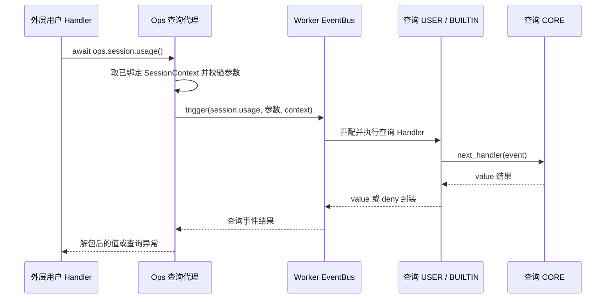

# ops.session.usage() / session.usage 特性设计

## 1. 范围、状态与依据

最近修订 2026-10-31。本文仅维护 `ops.session.usage()` 与同名查询事件 `session.usage` 的使用说明、接入和验证边界；一个方法与一个查询事件组成一项特性。开发状态、负责人和交付统一见[开发计划 EXTV2-22](../designs/extensions-v2-development-plan.md#extv2-22-七项只读查询事件化)，交付 [PR !100](https://gitcode.com/huenrui_/jiuwenswarm/merge_requests/100)。

公共协议主责为 [S_16](../specs/S_16_session-query-events.md)，专项字段主责为 [S_11_session-usage-ops.md](../specs/S_11_session-usage-ops.md)；下文表格解释怎样填写、怎样消费，不另立契约。共享实现和既有验收记录见[查询公共机制与七项特性索引](../designs/session-query-events.md)。

2026-10-31 按单个 Ops / Event 拆分特性文档；原合篇只作为文档组织历史，不代表仍需一起调用。此次拆分没有改变运行时契约或实现。

## 2. 能力说明与 Claude 对照

`await ops.session.usage()`：读取平台已有观测，返回上下文窗口占用、账户额度窗口和可得费用的统一视图，适合 Token Weather 等状态显示。默认不发模型请求、不重新计数、不触发测量事件。

`session.usage` 是这一次查询调用的拦截事件。方法代理验证参数和已绑定会话后触发它；查询 Handler 接收下述参数，可继续默认处理、增加前后操作、返回合法替代视图或明确拒绝。默认 CORE 读取平台事实，结果返回原方法调用者；它不表示状态发生变化，也不自动写历史或显示到界面。

| 项 | 当前默认行为 |
| --- | --- |
| 默认数据来源 | 优先绑定 session_usage_info；键存在但为 None 时保持未知，不用旧历史兜底；无该绑定键时才读取已提交用量。 |
| 方法公开返回 | dict |
| Claude 对齐与差异 | 顶层及基础数字字段对齐 Claude；未采集额度/费用不造数。summary 仅返回已观测分类子集；full 默认明确不支持，不偷偷执行计数 API；columns 当前不生成网格。未知 window 可省略，这比 Claude 常态必有 window 更保守。 |

对照依据是 Claude Code Mods 2.1.277 的固定公开类型声明，提交 `80c6959d28c4c30ecd14fc1cdf172f19d9adad81`；不是运行 Claude 私有宿主的结果。

## 3. 事件契约

### 3.1 触发位置、粒度与完整链路

方法代理通过会话、参数及重入检查后，每次调用触发一次 `session.usage`；检查未通过时不会进入查询链。下图展示 Handler 继续默认读取的路径；合法短路或明确拒绝可以在 USER 返回，不进入 CORE。返回箭头对应同一次 await 的结果，不是额外业务通知。



平台业务方法先收集可信会话资料并随外层事件传入 Bus，Core 为实际 Handler 创建 Ops。现成示例是 notify_context_usage 发布 context.usage.updated；其他已由平台接好的事件也能使用本方法，前提是本次 Handler 已绑定下表所需资料。用户不需要修改 Adapter、自己创建 Bus，或先调用 notify 来取得上下文。

### 3.2 事件输入、会话上下文与字段说明

| 事件输入字段 | 类型 / 默认 | 谁填写 | 准确含义与改写边界 | 填写示例 |
| --- | --- | --- | --- | --- |
| Event.event_input | 参数映射 | Ops 代理规范化构造 | 只含实际提供的 breakdown/columns；无参数为 {}，不补 session_id/origin | {'breakdown':'summary','columns':80} |
| event_input.breakdown | summary / full，可缺省 | Ops 从方法参数规范化构造；USER 可构造新 Event 改写 | 省略只读数字；summary 请求已有分类；默认 full 报 FULL_BREAKDOWN_UNAVAILABLE | {'breakdown':'summary'} |
| event_input.columns | 正 int，可缺省，不能是 bool | Ops 构造；USER 可在契约内改写 | 终端网格宽度建议，仅透传；当前默认 CORE 不生成网格，不改变 Token 数 | {'columns':80} |

会话上下文通过 `bus.trigger(Event(...), context)` 的第二个参数传递，与 Event.event_input 分开。下面字段由平台和 Core 绑定，不能通过增加查询参数改换会话或读取目标。

| 对象 / 字段 | 类型与是否必需 | 谁提供 / 表达什么 | 填写或读取示例 |
| --- | --- | --- | --- |
| ops.session_context | Core 只读属性 | 平台随外层事件传入，Core 在执行 Handler 前绑定 | 直接读属性；不是 await 方法，不收集、不组装上下文 |
| SessionContext.session_id | 有效非空 str，必需 | 平台业务边界提供的当前会话身份 | session-a；不从 query 输入或 Hook 返回值改换目标 |
| SessionContext.metadata["session_usage_info"] | 只读映射或 None，可缺省 | 平台绑定的用量观测；快照键存在但为 None 时保持未知，不回退到旧历史 | 没有这个绑定键时才按 session_id 读取已有用量；不重新测量 |
| current_query_origin().package | str 或 None | Server 查询代理从原调用 Ops 的包身份记录 | 是原发起包，不是当前 Hook 所属包；无 Ops 查询域时 helper 返回 None，须先判空；不是 Core next.origin |

`ops.session_context` 是已有只读属性。业务方法负责采集和组装，查询代理只取出它并继续传给查询事件；Bus 会规范化为只读副本，保留同一会话身份和资料，不承诺前后是同一个 Python 对象。

### 3.3 事件输出、允许的改写、失败与取消

| 事件结果字段 | 类型 | 出现规则 | 准确含义 | 如何消费 |
| --- | --- | --- | --- | --- |
| value | dict | 成功时唯一顶层键 | 本次查询值；允许 None 的查询仍须包装为 {"value": None} | Ops 会取出 value；调用者不需要再访问 result["value"] |
| deny | 去空白后非空 str，原字符串最多 512 字符 | 明确拒绝时唯一顶层键 | 公开拒绝原因；不能和 value 同时出现 | return {"deny": "QUERY_DISABLED"}；Ops 转为 SessionQueryDenied |

下面的返回字段位于事件结果的 `value` 内。方法成功返回时已经去掉外层 value 包装，因此消费示例中的对象就是方法返回值。

| 返回字段 | 类型 / 出现条件 | 谁提供 | 准确含义 | 消费方式与例子 |
| --- | --- | --- | --- | --- |
| 方法返回 / value | dict，必有 context/rateLimits | 平台 CORE 或查询 Handler | 使用 Claude 的顶层字段；完全未知时仍返回 {'context':{},'rateLimits':[]}，不伪造零读数 | 不是旧 schema_version/session_id/source/context/turn 存储对象 |
| value.context | dict，必有 | 当前主上下文观测 | 只包含已知的窗口/权威输入数字和按需分类；不是本轮输入输出 token 的总和 | {} 或 {'window':1000,'tokens':120,'percent':12} |
| context.window | 正 number，可缺省 | 观测的 limit_tokens | 模型上下文窗口容量，单位 token；不知道时省略，不能填 0 冒充未知 | 1000 |
| context.tokens | 非负 number，可缺省 | 权威主窗口 input_tokens | 最后 API 输入侧 token；只有 authoritative_total=True 时提供，本地估计不冒充该数字 | 120；确知零为 0 |
| context.percent | 0～100 的 int，可缺省 | 权威 tokens/window | 占窗口的整数百分比，四舍五入并限制到 100；不是 0～1 的比例 | 12 表示 12%，不是 0.12 |
| context.breakdown | dict，可缺省 | 请求 summary 且已有分类时 | Claude 分类字段的可得子集；不为获取此对象重新数 Token | 没有 parts 时省略整个 breakdown |
| breakdown.categories | list[dict] | 已采集的 parts 分类 | 每个有 token 估计的分类一项，不制造工具/文件级清单 | [{'name':'messages','tokens':90,'color':'promptBorder','isDeferred':False,'kind':'used'}] |
| categories[i].name | str | 平台原分类键 | 分类标签；业务判断优先看 kind，不假定翻译后的名称 | messages / tools 等已有分类 |
| categories[i].tokens | 非负 number | 原分类估计 | 该类估计 token；未分类数据不会为凑总数编造一项 | 90 |
| categories[i].color | str | 默认显示主题键 | 本地默认 promptBorder；是显示建议，不是统计来源 | promptBorder |
| categories[i].isDeferred / kind | bool / str | 本地分类投影 | 已有占用分类为 False / used；不推测 deferred 工具、free 或 buffer | False / used |
| breakdown.totalTokens | 非负 number | 已知分类 tokens 求和 | 分类估计总和，可能不同于权威 context.tokens，不能当作计费总量 | 90 |
| 未提供的 breakdown 字段 | 缺省 | 平台尚无事实或网格实现 | 不编造 rawMaxTokens、压缩设置、gridRows、memoryFiles/mcpTools/agents 清单；summary 是已知字段子集 | columns 当前不会生成 gridRows |
| value.rateLimits | list[dict]，必有 | 最后 API 额度读数或用户 Hook | 没有账户窗口读数时 []；不是无限额度，也不是零消耗 | 默认 [] |
| rateLimits[i].kind | 非空 str | 真实额度窗口类型 | 已有读数的额度窗口标识；本平台默认不生成条目 | five_hour / seven_day / spend_limit |
| rateLimits[i].percentUsed | 非负 number | 真实额度读数 | 已用百分比，可超过 100 表示超额；不是 0～1 比例 | 23.5 |
| rateLimits[i].resetsAt | str，可缺省 | 额度窗口重置时间 | 应为真实 ISO 8601 时间；不知道时省略，不用本地当前时间填充 | 2026-10-31T12:00:00Z |
| value.cost | dict，可缺省 | 真实会话费用账本 | 无账本时省略，不返回 {'usd':0} 或 None 冒充价格已知 | 本平台默认省略 |
| cost.usd | 非负 number | 会话累计已定价 API 响应 | 美元金额；不是当前轮 token 数乘一个猜测单价 | 1.25（只有真实账本才提供） |

继续默认查询使用 `await next_handler(event)`。需要短路时，可直接返回 `{"value": {'context': {}, 'rateLimits': []}}`；需要明确拒绝时返回 `{"deny": "QUERY_DISABLED"}`，下游可以不执行。加工结果必须符合本表的值类型及专项 spec；只改变本次返回视图，不改写平台真实状态、上下文或授权范围。

普通 USER / BUILTIN 异常或无效输出按 Core 隔离规则处理，可能继续默认 CORE；抛异常不能代替明确 deny。CORE / 框架读取失败向调用者传播，不用成功空值掩盖；取消继续传播并在 finally 清理查询调用域。匹配在 trigger 初始固定，next 改写合法参数不会重新选择 Handler；多次 next 可能重复读取，不承诺结果缓存。

要改写查询参数，创建新 Event 并传 next，例如 `Event(event.event_type, {"breakdown": "summary"})`；不要原地修改只读输入。
`breakdown="full"` 当前由默认 CORE 明确返回 FULL_BREAKDOWN_UNAVAILABLE 错误；一个只读查询不暗中发起新的 Token 计数请求。

### 3.4 可安装用户包中的注册与调用示例

将下面代码作为扩展包的入口模块，并按[现有示例 manifest](../../examples/session_usage_info/manifest.yaml) 的形式指定入口。示例同时展示外层业务 Handler 如何调用本 Ops，以及本查询的 USER Handler 如何继续默认链。

```python
import logging

logger = logging.getLogger(__name__)


class Extension:
    def register(self, registrar):
        # Example outer event: the platform already binds SessionContext.
        registrar.register_event_handler(
            "context.usage.updated", self.on_usage, {}, "user"
        )
        # Intercept this query only.
        registrar.register_event_handler(
            "session.usage", self.on_query, {}, "user"
        )

    async def on_query(self, event, ops, next_handler):
        logger.debug("before query: %s", event.event_type)
        # Continue this query chain; do not call the same public Ops here.
        result = await next_handler(event)
        logger.debug("after query: denied=%s", "deny" in result)
        return result

    async def on_usage(self, event, ops, next_handler):
        value = await ops.session.usage()
        # Use value in your own business code; no ui.render is required.
        logger.info("session.usage result type: %s", type(value).__name__)
        # Continue the original event, not the nested query event.
        return await next_handler(event)


def create_extension():
    return Extension()
```

查询 Hook 想取得默认值应调用 next；在自己的 `session.usage` Hook 中再次调用同名 Ops 会被循环保护拒绝。USER → BUILTIN → CORE 在各层继续时执行，结果反向返回；共享 BUILTIN 负责计时与独立副本，默认 CORE 负责实际读取。

## 4. 方法契约

### 4.1 签名、参数与调用场合

下列是调用侧签名；Core 自动注入的内部 ops 参数不由用户填写。

```python
from collections.abc import Mapping

# Public call signature; Core supplies the internal ops argument automatically.
async def usage(
    arguments: Mapping[str, object] | None = None,
    *,
    breakdown: str | None = None,
    columns: int | None = None,
) -> dict[str, object]: ...
```

| 方法参数 | 类型 / 默认 | 谁填写 | 准确含义 | 应该怎样填 |
| --- | --- | --- | --- | --- |
| arguments | Mapping 或 None，可省略 | 调用者可填 | 可传 Claude 风格参数对象；与命名参数二选一，不能混用 | await ops.session.usage({'breakdown':'summary','columns':80}) |
| breakdown | summary / full，可省略 | 调用者按需填 | 省略只读状态数字；summary 返回已观察分类估计；默认 CORE 不支持 full 逐工具/文件精确计数，报 FULL_BREAKDOWN_UNAVAILABLE | breakdown='summary'；旧 True/False 参数不再接受 |
| columns | 正 int，可省略，不接受 bool | 调用者按需填 | 沿用 Claude 网格宽度参数名称；本地默认不构建终端网格，当前值只透传给查询 Hook；不会改变 token 数 | columns=80；不是像素、token 限额或计费数量 |

典型调用如下；它可写在任何满足会话前提的已注册业务 Handler 中。

```python
usage = await ops.session.usage()
context = usage["context"]
if "percent" in context:
    logger.info("context occupancy: %s%%", context["percent"])
# 没有 cost 时不显示“费用为零”。
```

### 4.2 方法与事件转换、返回值及错误

```text
方法参数 → 查询代理规范化 → Event.event_input
当前 ops.session_context → trigger 的独立 context 参数
  → 同名查询事件 session.usage
事件 {value: 结果} → 参数/结果校验、独立复制、解包 → 方法返回值
事件 {deny: 原因} → SessionQueryDenied(code=DENIED, reason=原因)
```

成功返回 `dict[str, object]`，字段及缺失语义见第 3.3 节。无 SessionContext 报 RuntimeError；非法会话 ID 由平台会话校验拒绝；方法参数非法报 TypeError。活跃同名或间接循环报 QUERY_REENTRANT，深度超过 16 报 QUERY_DEPTH_EXCEEDED；不允许调用方覆盖 bus / event_type。平台读取故障保持其原有异常类型和稳定 code。Handler 未捕获 Ops 错误时，还受外层事件自身的故障隔离规则约束，不能把外层继续误认为查询成功。

## 5. 接入与兼容方案

### 5.1 启动登记、上下文绑定与 CORE 分工

平台 bootstrap 向 Bus 登记 `session.usage` 的 Matcher、Validator 和默认 CORE，并登记查询 BUILTIN。Registry.init 触发一次 ops.build；其 CORE 创建 Builder，BUILTIN 将 session.usage 对应的封闭查询代理加入方法目录，Bus 保存 Builder。执行每个实际 Handler 前，Core 用共享目录及本次包身份 / SessionContext 创建新的 Ops。

业务时，用户调用本方法，Core 方法访问器自动把当前 Ops 传给登记的代理；代理读取已绑定上下文并显式 trigger `session.usage`。查询链各实际 Handler 也获得各自的 Ops，查询 CORE 走 `read_session_query` → `_usage(arguments, context)` → `_usage_snapshot(context)`，不再调用公共同名 Ops。Builder 保存方法定义，不保存会话查询结果；ops.build 与运行时 builder.build(...) 是两种操作。

统一实现职责见[公共设计第 5 节](../designs/session-query-events.md#5-接入与兼容方案)。默认查询不写业务数据、不发模型请求、不自动渲染；没有全局查询结果缓存。用户包卸载只移除自己的 Hook，不移除平台查询类型或 CORE。

### 5.2 迁移与生效边界

删除 breakdown=True/False；无明细用 usage()，需要已有分类用 breakdown='summary'。旧 context.context_window.input_tokens 改成 context.tokens，limit_tokens 改成 window，occupancy_rate 改成 percent（百分比单位）。旧 turn 不再是公开结果，单轮消耗仍可从现有用量通知的输入字段获取。

本次文档拆分不再改变上述兼容边界。执行目录、模型、Git、历史和用量事实仍由平台服务维护；对返回视图的改写不成为另一项平台操作的可信输入。

### 5.3 现成案例和可观察效果

对应用户示例见 [examples/session_usage_info](../../examples/session_usage_info/)，七项联合参数返回示例见 [session_query_audit](../../examples/session_query_audit/)。联合案例中的 collect_session_parameters 是普通用户侧辅助函数，本方法可单独调用；用户业务函数收到返回参数即可验证，不依赖 ui.render。

## 6. 验收与未决问题

### 6.1 本特性的独立验收场景

| 场景 ID | 输入与前置 | 操作 | 预期结果 |
| --- | --- | --- | --- |
| F_21-V-01 | 绑定权威 tokens=120、window=1000 的主窗口观测 | 调用 usage() | 返回 context.tokens=120、window=1000、percent=12 |
| F_21-V-02 | 已有分类；或请求 full；或绑定快照未知 | 分别请求 summary/full/无参数 | summary 返回已有分类；full 明确不可用；未知数字省略且不伪造费用 |
| F_21-V-03 | 安装仅拦截 session.usage 的用户包 | 分别 next、短路 value、显式 deny | 默认值 / 合法替代值 / SessionQueryDenied 分别可观测 |
| F_21-V-04 | 不同会话绑定不同上下文；或在 Hook 中同名递归 | 分别调用本方法 | 会话隔离；活跃同名或间接循环报 QUERY_REENTRANT，不能无限递归 |
| F_21-V-05 | 读取失败、Hook 异常或查询取消 | 分别构造这些分支 | 按第 3.3 / 4.2 节区分隔离、明确拒绝、平台错误与取消，不把失败当成功空值 |

对应事件化用例位于 [test_session_query_events.py](../../../../tests/unit_tests/extensions_v2/test_session_query_events.py)：包含七项默认调用、各项短路 / 拒绝、非法参数、查询顺序、隔离、循环 / 取消及实际用户包装载卸载。每个场景只验证本方法承诺，不把其他六项也作为调用前置。

### 6.2 已有实施证据与本次文档调整

实现验证基于本 PR 实现提交 `f313f513ee9b`、已合入 Server 基线 `c6a07f909` 与 Core `bdde48a8`，Python 3.11。扩展 632 项、相关平台 140 项及独立进程 ZIP / notify / 七项参数返回验证的实际范围、命令和限制统一保留在[公共设计第 6 节](../designs/session-query-events.md#6-验收与未决问题)。这属于查询事件化实现的既有证据；此次仅拆分文档，不声称重新执行了这些业务测试。

顶层及基础数字字段对齐 Claude；未采集额度/费用不造数。summary 仅返回已观测分类子集；full 默认明确不支持，不偷偷执行计数 API；columns 当前不生成网格。未知 window 可省略，这比 Claude 常态必有 window 更保守。 该限制属于已知支持边界；此轮未增加新的运行时待决项。未执行 Claude 私有宿主、新模型 API、浏览器或 Front/Supervisor 跨进程验收，不能由文档完整推断这些验收已完成。

## 7. 参考资料

- [专项字段规约 S_11_session-usage-ops.md](../specs/S_11_session-usage-ops.md)
- [S_16 查询公共协议](../specs/S_16_session-query-events.md)
- [七项独立特性索引与共享实施记录](../designs/session-query-events.md)
- [Claude 会话方法](https://github.com/anthropics/claude-code/blob/80c6959d28c4c30ecd14fc1cdf172f19d9adad81/mods/types/claude-code.d.ts#L2342-L2447)
- [Claude 同名 OpEventOf 查询事件](https://github.com/anthropics/claude-code/blob/80c6959d28c4c30ecd14fc1cdf172f19d9adad81/mods/types/claude-code.d.ts#L5529-L5624)
- [内置事件开发指南](../designs/builtin-event-development-guide.md)
