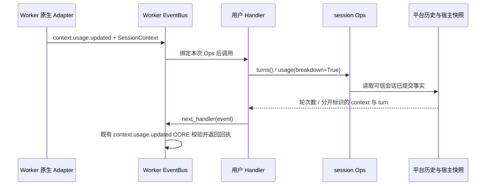

# 会话轮次与用量只读查询设计方案

| 项 | 值 |
| --- | --- |
| 编号 | F_21 / session-usage-ops |
| 建档日期 | 2026-10-28 |
| 关联计划 | [EXTV2-17](../designs/extensions-v2-development-plan.md) |
| 主责规约 | [S_11](../specs/S_11_session-usage-ops.md) |

## 1. 背景、目标与范围

PR05 提供 `await ops.session.turns()` 与 `await ops.session.usage(breakdown=False)`，让用户 Handler 读取平台已有主会话输入和用量事实。沿用 Worker 唯一 EventBus、既有 `ops.build` 和 SessionContext；不依赖 PR04 的消息读写 Ops，不新增 `session.measure` 或查询事件，不调用模型。

## 2. 方案与取舍

- D-01：轮次从主会话已提交 history.jsonl / 兼容 history.json 的用户输入记录按 request_id 去重；工具、模型调用、子 Agent、跨会话投递和扩展追加记录不计入。历史压缩的摘要不增加轮次；显式历史截断后按保留分支统计。缺失会话返回 None，存在的空会话返回 0。
- D-02：平台只读查询放在 `server/runtime/session/session_statistics.py`；共享 Ops 只校验上下文并在线程中调用。读取先等待已有历史队列边界，再在原历史文件锁下严格读取；超时、损坏和 I/O 失败显式报错，不把缺失或错误当 0。
- D-03：用量分开返回 context（某个已测量模型输入窗口）与 turn（最近一轮 provider usage 汇总），不当作累计账单。保留测量来源、estimated、phase、request_id 和时间；breakdown 才返回类别分项。无快照为 None，实测 0 保留 0。
- D-04：原生 Adapter 在流中保留最新主 Agent `context.usage` 快照，并在已有通知的 SessionContext 绑定本轮只读用量副本，避免异步通知先于 summary 落盘时读到上一轮。其它事件按 session_id 读已提交历史，不要求用户调用 notify；历史恢复无需另建统计文件或缓存。
- D-05：不复用 Token Weather 的用户包累计值，它有容量和包生命周期，不能作为平台事实。暂不建立第二份统计持久化状态，避免与截断、删除和压缩发生双写偏差；代价为查询扫描当前主会话历史，复杂度 O(N)。

## 3. 调用流程与职责



启动时 `ops.build` 的 CORE 创建 Builder；原 session BUILTIN 在回程登记两个方法。查询时没有新的业务 CORE，也不再次触发 ops.build。用户示例负责调用、日志和继续原链；平台负责资料收集与查询；Core 负责装配和会话绑定。

## 4. 实施影响与生命周期

新增平台只读统计模块和可安装示例；修改 session Ops、已有用量通知的可选关键字参数、原生 Adapter 的快照收集及历史的严格读取入口。既有通知调用兼容；不改 Front / Supervisor 协议和前端。读取在后台线程执行，取消停止等待，不会产生业务写入；历史队列仍按原机制处理。无新增任务、缓存和持久化文件，卸载包不删除平台历史。会话删除、路径拒绝和损坏读取须明确验证。

## 5. 验证设计、执行记录与结论

已验证去重及非用户输入排除、空会话与未知会话、压缩和截断、两会话隔离、真实零值和未知值、估算与 provider 来源、无明细/有明细、宿主快照与历史回读、原生通知、包安装/卸载、其他事件查询及原有能力兼容。轮次也排除已有 metadata.automation 心跳标记和 cron/heartbeat 渠道；无来源标记的旧 user/human 记录按历史用户记录解释。

环境：Windows、Python 3.11.15；Swarm 从最新扩展目标分支建立独立工作树，基线 779585191；Core rsi_native_agent_os 的 ead700d7d。未引入 PR04 提交、session_history 事件模块或 messages/append Ops；Core 无改动。

| 验证范围 | 实际结果 |
| --- | --- |
| 新增统计/Ops 测试 tests/unit_tests/extensions_v2/test_session_usage_ops.py | 28 项通过，含真实 Registry 用户包、跨事件调用、冻结上下文、取消、删除、损坏、队列超时和 I/O 失败 |
| 扩展、原生 Adapter、历史路径/JSONL/过滤/游标/原子写入与 offload 定向回归 | 297 项通过 |
| 原生流快照接线 | 新增 1 项通过；实际 context.usage 解析后绑定，子 Agent 与外会话快照不替换主窗口 |
| 真实 Front → Supervisor → 子 Worker → Qwen3.8-Flash | 两个真实 ZIP 安装成功；alpha 连续两轮 turns=1/2，beta 独立一轮 turns=1；USER 得到真实 package_id 和 Worker PID，原 CORE 回执成功 |
| 真实回合与落盘交叉核对 | 三次 USER 读数与 WebSocket chat.usage_summary、context.usage 及另一进程读取的已提交历史一致；cwd/root/model/repo 保持可用，仓库示例日志三条 |
| 卸载及清理 | 两包卸载后新增 alpha 回合不再触发用户 Handler；历史仍可查询，alpha/beta 轮次为 3/1；Worker 已退出、监听端口释放，验收脚本退出码 0 |

实际回归命令：

```text
python -m pytest -o addopts= -q tests/unit_tests/extensions_v2 tests/unit_tests/agentserver/test_deep_adapter_stream_end_final.py tests/unit_tests/test_session_history_paths.py tests/unit_tests/test_session_history_jsonl_read.py tests/unit_tests/test_session_history_empty_filter.py tests/unit_tests/test_session_history_cursor.py tests/unit_tests/test_session_history_atomic_write.py tests/unit_tests/agentserver/test_history_io_offload.py tests/unit_tests/agentserver/test_session_history_path_safety.py --asyncio-mode=auto -o log_cli=false
```

本地证据在 `D:\work_space\.codex-temp\server-session-usage-ops-20261028`：regression.xml、live-run-receipt.json 及其 runDirectory 内的 validation-summary.json / cleanup.json。收据保存五个实现文件的 SHA256，确认真实验收期间源码不变。真实验收未 mock 模型、Ops、Adapter，也未手工提供 SessionContext；使用隔离运行目录和既有 WebSocket 协议，未改用户日常配置。运行日志和凭据不提交源码仓库。

## 6. 已知遗留

不承诺实时正在生成的窗口、所有模型/工具累计计费、Team 汇总或新前端；查询返回已观测事实并保留其时点。无结构化上下文数据的旧历史只能返回 turn，context 为 None。未验证 Gateway/浏览器 UI、非 Windows 实机、大历史性能或远端 CI；回归中的既有路径安全 symlink 用例因当前 Windows 无创建权限跳过。真实验证覆盖本机 Front/Supervisor/Worker WebSocket 与真实模型服务，不等于浏览器界面验收。独立 PR04 与本项都修改共享 session_ops.py 和台账，合并时需保留双方的方法登记；这是文本合并协调，不是本项的功能依赖。

## 7. 编号核对

已知 PR04 占 F_16/S_06；并行 Gateway PR !89 占 F_16～F_20/S_06～S_10，且尚有历史编号冲突。本项避让为 F_21/S_11；两项并行 PR 的台账均占 EXTV2-16，本项取 EXTV2-17，发布前再次核对远端文件与台账，不改其它 PR 编号。
