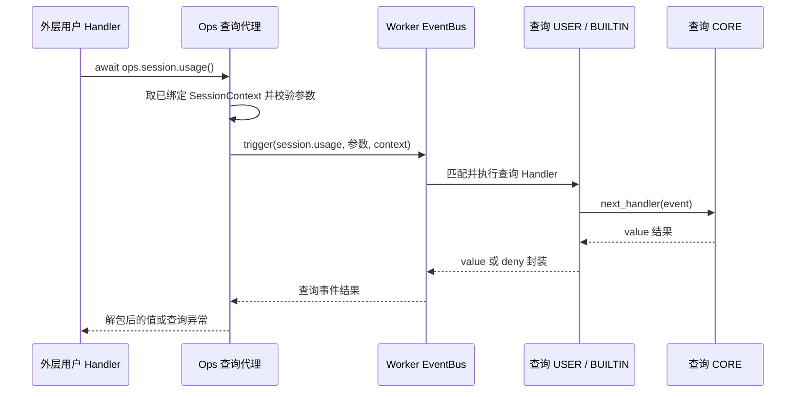

# ops.session.usage() / session.usage 特性设计

## 1. 范围、状态与依据

最近修订 2026-10-31。本文仅维护 `ops.session.usage()` 与同名查询事件 `session.usage` 的使用说明、接入和验证边界；一个方法与一个查询事件组成一项特性。开发状态、负责人和交付统一见[开发计划 EXTV2-22](../designs/extensions-v2-development-plan.md#extv2-22-七项只读查询事件化)，交付 [PR !100](https://gitcode.com/huenrui_/jiuwenswarm/merge_requests/100)。

公共协议主责为 [S_16](../specs/S_16_session-query-events.md)，专项字段主责为 [S_11_session-usage-ops.md](../specs/S_11_session-usage-ops.md)；下文表格解释怎样填写、怎样消费，不另立契约。共享实现和既有验收记录见[查询公共机制与七项特性索引](../designs/session-query-events.md)。

2026-10-31 按单个 Ops / Event 拆分特性文档；原合篇只作为文档组织历史，不代表仍需一起调用。此次拆分没有改变运行时契约或实现。

## 2. 能力说明与 Claude 对照

`await ops.session.usage()`：读取平台已有观测，返回上下文窗口占用、账户额度窗口和可得费用的统一视图，适合 Token Weather 等状态显示。默认不发模型请求、不重新计数、不触发测量事件。

`session.usage` 是这一次查询调用的拦截事件。方法代理验证参数和已绑定会话后触发它；查询 Handler 接收下述参数，可继续默认处理、增加前后操作、返回合法替代视图或明确拒绝。默认 CORE 读取平台事实，结果返回原方法调用者；它不表示状态发生变化，也不自动写历史或显示到界面。

| 项 | 当前默认行为 |
| --- | --- |
| 默认数据来源 | 优先绑定 session_usage_info；键存在但为 None 时保持未知，不用旧历史兜底；无该绑定键时才读取已提交用量。 |
| 方法公开返回 | dict |
| Claude 对齐与差异 | 顶层及基础数字字段对齐 Claude；未采集额度/费用不造数。summary 仅返回已观测分类子集；full 默认明确不支持，不偷偷执行计数 API；columns 当前不生成网格。未知 window 可省略，这比 Claude 常态必有 window 更保守。 |

对照依据是 Claude Code Mods 2.1.277 的固定公开类型声明，提交 `80c6959d28c4c30ecd14fc1cdf172f19d9adad81`；不是运行 Claude 私有宿主的结果。

## 3. 事件契约

### 3.1 触发位置、粒度与完整链路

方法代理通过会话、参数及重入检查后，每次调用触发一次 `session.usage`；检查未通过时不会进入查询链。下图展示 Handler 继续默认读取的路径；合法短路或明确拒绝可以在 USER 返回，不进入 CORE。返回箭头对应同一次 await 的结果，不是额外业务通知。



平台业务方法先收集可信会话资料并随外层事件传入 Bus，Core 为实际 Handler 创建 Ops。现成示例是 notify_context_usage 发布 context.usage.updated；其他已由平台接好的事件也能使用本方法，前提是本次 Handler 已绑定下表所需资料。用户不需要修改 Adapter、自己创建 Bus，或先调用 notify 来取得上下文。

### 3.2 事件输入、会话上下文与字段说明

先分清谁需要填写。普通调用者只填写方法参数；返回值由平台或查询 Handler 提供，用户拿到后直接消费。
只有在自己的查询 Handler 中短路或加工输出时，才需要按输出表构造值。所有表格分别解释“填什么、代表什么、起什么作用”，并写明缺失和错误边界。

| 数据所在位置 | 谁负责 | 用户应该做什么 | 作用 |
| --- | --- | --- | --- |
| Ops 方法参数 | 普通调用者 | 调用 usage 时按需填 breakdown/columns；其他六项不传参数 | 选择本次查询选项，不选择另一个会话 |
| Event.event_input | Ops 代理自动构造；查询 USER 可合法改写 | 按下表读选项；需要改写时构造新 Event 后 next | 让本次查询链使用合法选项，不修改可信上下文 |
| SessionContext | 平台采集，Core 绑定 | 普通用户不补填；通过 ops.session_context 只读访问 | 确定本次查谁、使用哪些可信目录和快照 |
| Event 输出 value/deny | 默认 CORE；或替代结果的查询 Handler | 查询 Handler 才需构造 return {value: ...} 或 return {deny: ...} | 决定这次查询的返回视图或明确拒绝 |
| Ops 直接返回值 | 分派器校验、复制并解包 | 普通调用者消费字段即可，不需要重新填写或再次解包 value | 作为自己业务方法的参数，不自动写回平台或渲染 |

事件信封与查询输入如下。event_type 不属于参数字典；event_input 与可信 SessionContext 是独立传递的两部分。

| 字段 / 参数 | 类型、必填与默认 | 谁填写 / 从哪里来 | 填写什么 / 正确例子 | 代表什么意思 | 有什么作用 / 怎样使用 | 不填、未知或错填时怎样处理 |
| --- | --- | --- | --- | --- | --- | --- |
| Event.event_type | 固定 str | Ops 代理自动填写；不是方法参数 | "session.usage" | 进入哪一条查询处理链的类型名 | Bus 据此寻找已注册的 Matcher / Validator / Handler 链 | 用户不用填；不要在 arguments 中增加 event_type，也不要通过改类型跳到另一条查询链 |
| Event.event_input | 只读 Mapping；无选项时 {} | Ops 代理复制并构造；查询 Handler 读取 | {"breakdown":"summary","columns":80} | 这一次查询的选项，独立于 SessionContext | 供 Matcher / 查询 Handler / CORE 读取；不承载可改写会话身份 | 仅 usage 允许下述选项；其余六项必须是空映射。不可原地改写；合法改写用新的 Event 和参数映射传 next |
| event_input.breakdown | summary/full，可缺省 | 代理从方法选项生成；USER 可在 next 前构造合法新输入 | "summary"；需改变选项时例如 Event(event.event_type, {"breakdown":"summary"}) | 当前查询希望取得哪种分类明细 | 查询 Handler 可按它匹配或调整本次读取；匹配完成后改写不会重新匹配 Handler | 省略只读取基本数字；full 可进入事件链但未经 Hook 处理时默认 CORE 报不支持；不能补 None 或布尔值 |
| event_input.columns | 正 int，可缺省 | 代理从方法选项生成；USER 可构造新 Event 调整 | 80 | 本次查询透传的终端网格宽度建议 | 自定义查询 Hook 可消费；当前默认 CORE 不据此构建网格 | 省略就是未提供；0、负数、字符串、bool、None 都不符合已存在键的类型要求 |

平台随本次调用附带的资料如下。这些是已绑定事实，用户不需要在调用 Ops 时逐项填写；查询 Handler 也不能通过改写 Event 输入替换它们。

| 字段 / 参数 | 类型、必填与默认 | 谁填写 / 从哪里来 | 填写什么 / 正确例子 | 代表什么意思 | 有什么作用 / 怎样使用 | 不填、未知或错填时怎样处理 |
| --- | --- | --- | --- | --- | --- | --- |
| ops.session_context | Core 只读属性，查询需要非 None | 平台把上下文随外层 Event 交给 Bus，Core 绑定到实际 Handler 的 Ops | 用户不用填，也不用 await；直接读取 ops.session_context | 本次 Handler 的可信会话资料入口 | 代理取出这份资料，随查询 Event 的独立 context 参数继续传递 | 缺少上下文时查询报错；不要把用户输入 payload 包装成平台可信上下文 |
| SessionContext.session_id | 平台验证过的非空 str，必需 | 平台业务入口提供；用户普通调用不填写 | 平台例如绑定 session-a；查询方法和 Event 输入里都不再填 session_id | 本次绑定的是哪个会话 | 读取相应会话的历史、保存模型或用量服务；同时参与隔离和循环保护 | 缺失/非法不能查询；返回值或 Event 输入不能把目标改成另一个会话 |
| SessionContext.metadata["session_usage_info"] | 平台只读快照或 None，可缺省 | 平台主窗口观测及已有用量整理逻辑 | 平台负责绑定快照；用户不把猜测 tokens、费用或会话 ID 当作快照传进查询 | 这次查询已绑定的用量事实，和查询参数 breakdown/columns 分开 | 有绑定键时优先消费该观测；没有键时才按 session_id 读取已有用量 | 键存在且为 None 代表明确未知，不回退旧历史；没有可得数字时返回空 context，仍保留 rateLimits=[] |
| current_query_origin().package | str 或 None；helper 本身也可返回 None | Server 分派器从原 Ops 的包身份记录；不是用户传参 | 先 origin = current_query_origin()，非 None 时再读 origin.package | 谁发起了本次查询，而不是当前查询 Hook 属于哪个包 | 用于用户自己的审计和来源判断；它不是 Core next.origin 或授权证明 | 直接宿主触发而没有 Ops 调用域时 helper 可为 None；不要无判空访问 .package |

`ops.session_context` 是只读属性，不是采集或组装上下文的 Ops 方法。平台业务方法负责收集和构造；
查询代理只读取这份资料，再交给查询事件。Bus 会生成规范化的只读副本，保留同一会话身份和资料，不要求前后是同一个 Python 对象。

### 3.3 事件输出、允许的改写、失败与取消

先看查询 Handler 的事件输出封装。普通 Ops 调用者不用构造这层封装；查询 Handler 从 next 得到完整封装后，
可直接返回，不要又包成 {"value": result} 形成两层 value。

| 字段 / 参数 | 类型、必填与默认 | 谁填写 / 从哪里来 | 填写什么 / 正确例子 | 代表什么意思 | 有什么作用 / 怎样使用 | 不填、未知或错填时怎样处理 |
| --- | --- | --- | --- | --- | --- | --- |
| value | dict[str, object]；成功时唯一顶层键 | 默认 CORE 提供；查询 USER 短路或加工结果时按同样结构填写 | return {"value": {'context': {}, 'rateLimits': []}} | 这一次查询成功给出的值；下一张表解释它内部每个字段 | Ops 校验、独立复制并解包；普通调用者拿到的是 value 本身 | 本方法的 value 不能为 None；未知时按表返回空数组或保留必需对象。不能同时填写 deny 或增加未知顶层键；USER 无效输出会按 Core 隔离规则处理，不能靠错填来拒绝 |
| deny | 去空白后非空 str，原字符串最多 512 字符；拒绝时唯一顶层键 | 希望明确拒绝此次查询的查询 Handler 填写 | return {"deny":"QUERY_DISABLED"}；也可使用能公开给调用者的简短原因 | 明确拒绝这一次查询，不是返回了一个未知数值或平台读取故障 | 分派器将其转换为 SessionQueryDenied，code=DENIED，reason 保留原因；调用者可按拒绝分支处理 | 正常成功不填；不能与 value 同时出现，也不能填空白、False、None 或异常对象。抛普通异常可能被隔离后继续，并不等于 deny |

下面以 **Ops 直接返回值为根**解释所有公开字段；在事件输出中，它们位于 value 内。

例如 context.window 由 usage["context"]["window"] 读取，事件结果中对应 value.context.window；categories[i] 中 i 是数组下标。 None/True/False 是 Python 写法，JSON 示例中分别写 null/true/false，不能加引号冒充字符串。

| 字段 / 参数 | 类型、必填与默认 | 谁填写 / 从哪里来 | 填写什么 / 正确例子 | 代表什么意思 | 有什么作用 / 怎样使用 | 不填、未知或错填时怎样处理 |
| --- | --- | --- | --- | --- | --- | --- |
| 方法直接返回值（事件中的 value） | dict，必含 context/rateLimits，可含 cost | CORE 读取已有主窗口观测；查询 USER 可返回符合相同结构的视图 | {"context":{"tokens":120,"window":1000,"percent":12},"rateLimits":[]}；完全未知时填 {"context":{},"rateLimits":[]} | 当前可得的上下文占用、账户额度窗口和累计费用视图，不是原用量存储对象 | 把不同用量信息交给用户业务统一消费；调用不发模型请求、不重新测量 | 不能返回 None、空对象或增加 schema_version/source/turn 等旧顶层键；未知字段按下表省略 |
| context | dict，必有；可为空 {} | 当前主会话已有上下文窗口观测 | {"tokens":120,"window":1000,"percent":12}；数字都未知时填 {} | 模型当前可得的上下文占用视图；不是 session_context 身份对象，也不是一轮输入输出相加 | 消费方从这里读取占用数字及可得分类明细 | 必须保留该键；不知道时填 {}，不要填 None 或人为补 0 |
| context.window | 有限正 number，可缺省；不能是 bool | 平台观测的模型上下文容量 limit_tokens | 1000，单位 Token | 模型上下文窗口容量，不是本轮已花费或剩余 Token | 配合 tokens 显示“120 / 1000”，有权威读数时计算占比 | 未知省略；不能用 0、负数、字符串 "1000"、None 或无穷值代替 |
| context.tokens | 有限非负 number，可缺省；不能是 bool | 平台主窗口权威输入 Token 读数，仅 authoritative_total=True 时默认提供 | 120；确知零占用可以填 0 | 已有权威输入侧占用，不是用户文字长度，也不是通知中 input_tokens+output_tokens 总和 | 显示已用上下文 Token；与 window 一起形成占比 | 无权威读数时省略；本地分类估计不能冒充该值，不用 0 或 None 表示未知 |
| context.percent | 0～100 的 int，可缺省；不能是 bool | 默认 CORE 按权威 tokens/window 四舍五入并限制到 100 | 12 表示 12%；确知零为 0 | 上下文窗口占用的整数百分比，不是 0～1 的比例 | 显示占比或让用户业务选择提示阈值；使用时不要再乘 100 | 缺少必要数字时省略；不要填 0.12、"12%" 或 101，也不要用真假判断丢掉合法 0 |
| context.breakdown | dict，可缺省 | 请求 summary 且平台已有可用分类观测时，CORE 返回已知子集 | {"categories":[{"name":"messages","tokens":90,"color":"promptBorder","isDeferred":False,"kind":"used"}],"totalTokens":90} | 已有分类的估计视图，不是新的精确 Token 测量结果 | 解释上下文主要被哪些类别占用；用户 Hook 可提供自己有事实依据的分类视图 | 未请求或没有分类时省略，不强行填 {}；默认不提供完整网格、压缩设置或逐工具/文件账本 |
| context.breakdown.categories | list[dict]；默认有 breakdown 时包含 | 已有 parts 分类的投影 | 每类一个对象；例如 messages 90 Token、tools 30 Token | 按已有类别拆分的占用估计列表，不是原生消息数组或工具调用记录 | 分类显示、排序或汇总；不得把每项都当成权威计费数字 | 默认没有有效分类会省略整个 breakdown；用户替代视图须保持分类对象的语义 |
| categories[i].name | str；默认分类项有此键 | 平台原分类键 | "messages"、"tools" 等实际已有标签 | 这一类占用的名称，不是会话、消息或工具调用 ID | 给分类加标题；不要假定所有平台都用同一翻译文本 | 不要用猜测的逐工具/文件名称补出平台未采集的分类 |
| categories[i].tokens | 有限非负 number；默认分类项有此键 | 这类 parts 的已有 Token 估计 | 90，单位 Token | 该类别估计占用，不是百分比或价格 | 比较分类大小，并计算 totalTokens | 不能用 None、字符串或负数表示未知；没有读数的分类不为凑数制造一项 |
| categories[i].color | str；默认分类项有此键 | 默认 CORE 提供主题建议键 | 当前默认 "promptBorder" | 显示颜色的主题名称；不是统计来源或严重程度 | 用户若有展示层可将主题键映射为颜色；字段不会自己渲染 | 当前不从 Token 数推算颜色，也不承诺 CSS 颜色名或十六进制值 |
| categories[i].isDeferred | bool；默认 False | 当前已采集占用分类的投影 | 当前默认填 False | 该分类是否标记为延迟加载；默认只描述已有占用，不推测未采集状态 | 有对应业务事实时区分类别；False 不能用来推断工具一定已运行 | 不填字符串 "false"；没有延迟加载事实时不猜造 True |
| categories[i].kind | str；默认 used | 当前已采集占用分类的投影 | 当前默认 "used" | 这项是已占用分类；不是模型类型、工具名或错误码 | 让消费者识别分类性质；默认不制造 free/buffer 等缺少事实的项 | 不要为补齐完整 Claude 图形而推算未采集的分类 |
| context.breakdown.totalTokens | 有限非负 number；默认有 breakdown 时包含 | 已有 categories[].tokens 求和 | 90+30 得到 120，单位 Token | 已知分类估计总和，可能与权威 context.tokens 不同 | 展示分类合计；不能把两种口径强行拉齐，也不能作为累计费用 | 未知分类不补零来凑权威总量；不要误当窗口容量或美元金额 |
| rateLimits | list[dict]，必有；默认 [] | 真实 API 额度窗口读数；平台默认没有这些窗口条目 | 没有额度读数填 []；有读数例如 [{"kind":"five_hour","percentUsed":23.5}] | 账户/网关额度窗口的已知读数，不是会话上下文容量 | 区分账户额度与当前上下文占用；不会因查询而申请或重置额度 | [] 表示无读数，不表示无限额度或零消耗；不要填 None |
| rateLimits[i].kind | 非空 str，窗口对象必有 | 真实额度窗口类型 | "five_hour"、"seven_day" 或网关真实的 "spend_limit" | 这条额度数据对应哪一个统计窗口 | 让用户业务区分不同额度限制，不把五小时和七天数值相加 | 未知时不制造窗口条目；不要拿 session_id 或模型名替代 kind |
| rateLimits[i].percentUsed | 有限非负 number，窗口对象必有 | 对应窗口的真实额度读数 | 23.5 表示已用 23.5%；超额时可以是 105 | 此额度窗口已用百分比；它与 context.percent 的 0～100 整数约束不同 | 显示额度使用情况或让用户业务提示超额；不要再乘 100 | 没有读数不创建条目；不能用 0、字符串或 None 冒充未知 |
| rateLimits[i].resetsAt | 非空 str，可缺省 | 额度服务提供的真实重置时间 | 例如 2026-10-31T12:00:00Z，应表达真实 ISO 8601 时间 | 该窗口预计何时重置，不是本次查询时间或消息创建时间 | 用户可据真实时间显示重置提示；不由查询过程修改服务端窗口 | 未知省略，不填当前时间占位。当前校验器检查非空字符串，不代替 ISO 时间解析 |
| cost | 恰含 usd 的 dict，可缺省；默认省略 | 真实会话费用账本或有相同事实依据的用户 Hook | 有账本时如 {"usd":1.25}；没有账本就不返回 cost 键 | 可得的会话累计定价结果，不是当前一轮 Token 数 | 用户有费用展示需求时消费；查询本身不计价、不补造账本 | 缺失表示没有费用事实，不等于免费；不要填 None、{} 或猜测的 0 |
| cost.usd | 有限非负 number，有 cost 时必有 | 账本累计的已定价 API 费用 | 1.25 表示 1.25 美元；真实账本确认零费用才填 0 | 美元金额，不是积分、Token 数、百分比或其他币种 | 按美元金额显示或汇总已确认成本；不要把未知单价代入估算后冒充账本 | 无金额事实省略整个 cost；不能填 "$1.25"、None、负数或增加未知账本字段 |

`breakdown` 是默认 CORE 返回的可得子集。当前验证器检查它是映射及可复制 JSON 数据，不逐项强制验证所有分类子字段；自定义 Handler 应保证表中的字段类型和统计口径。默认 CORE 不生成 rawMaxTokens、gridRows、压缩设置和逐工具/文件清单，不能把尚无事实的字段填成 0。费用、额度、上下文占用是三种口径，不能互相代替。

继续默认查询使用 `await next_handler(event)`。需要短路时，可直接返回 `{"value": {'context': {}, 'rateLimits': []}}`；需要明确拒绝时返回 `{"deny": "QUERY_DISABLED"}`，下游可以不执行。加工结果必须符合本表的值类型及专项 spec；只改变本次返回视图，不改写平台真实状态、上下文或授权范围。

普通 USER / BUILTIN 异常或无效输出按 Core 隔离规则处理，可能继续默认 CORE；抛异常不能代替明确 deny。CORE / 框架读取失败向调用者传播，不用成功空值掩盖；取消继续传播并在 finally 清理查询调用域。匹配在 trigger 初始固定，next 改写合法参数不会重新选择 Handler；多次 next 可能重复读取，不承诺结果缓存。

要改写查询参数，创建新 Event 并传 next，例如 `Event(event.event_type, {"breakdown": "summary"})`；不要原地修改只读输入。
`breakdown="full"` 当前由默认 CORE 明确返回 FULL_BREAKDOWN_UNAVAILABLE 错误；一个只读查询不暗中发起新的 Token 计数请求。

### 3.4 可安装用户包中的注册与调用示例

将下面代码作为扩展包的入口模块，并按[现有示例 manifest](../../examples/session_usage_info/manifest.yaml) 的形式指定入口。示例同时展示外层业务 Handler 如何调用本 Ops，以及本查询的 USER Handler 如何继续默认链。

```python
import logging

logger = logging.getLogger(__name__)


class Extension:
    def register(self, registrar):
        # Example outer event: the platform already binds SessionContext.
        registrar.register_event_handler(
            "context.usage.updated", self.on_usage, {}, "user"
        )
        # Intercept this query only.
        registrar.register_event_handler(
            "session.usage", self.on_query, {}, "user"
        )

    async def on_query(self, event, ops, next_handler):
        logger.debug("before query: %s", event.event_type)
        # Continue this query chain; do not call the same public Ops here.
        result = await next_handler(event)
        logger.debug("after query: denied=%s", "deny" in result)
        return result

    async def on_usage(self, event, ops, next_handler):
        value = await ops.session.usage()
        # Use value in your own business code; no ui.render is required.
        logger.info("session.usage result type: %s", type(value).__name__)
        # Continue the original event, not the nested query event.
        return await next_handler(event)


def create_extension():
    return Extension()
```

查询 Hook 想取得默认值应调用 next；在自己的 `session.usage` Hook 中再次调用同名 Ops 会被循环保护拒绝。USER → BUILTIN → CORE 在各层继续时执行，结果反向返回；共享 BUILTIN 负责计时与独立副本，默认 CORE 负责实际读取。

## 4. 方法契约

### 4.1 签名、参数与调用场合

下列是调用侧签名；Core 自动注入的内部 ops 参数不由用户填写。

```python
from collections.abc import Mapping

# Public call signature; Core supplies the internal ops argument automatically.
async def usage(
    arguments: Mapping[str, object] | None = None,
    *,
    breakdown: str | None = None,
    columns: int | None = None,
) -> dict[str, object]: ...
```

| 字段 / 参数 | 类型、必填与默认 | 谁填写 / 从哪里来 | 填写什么 / 正确例子 | 代表什么意思 | 有什么作用 / 怎样使用 | 不填、未知或错填时怎样处理 |
| --- | --- | --- | --- | --- | --- | --- |
| arguments | Mapping 或 None，可省略；默认 None | 普通调用者二选一地提供参数对象或命名参数 | await ops.session.usage({"breakdown":"summary","columns":80})；也可不提供这个位置参数 | breakdown/columns 的参数容器，不是会话上下文或用量快照 | 便于集中传入查询选项；代理复制成事件输入映射 | 省略/None 不增加参数；对象与非 None 命名参数混用报 TypeError。不能含 session_id 或其他未知键 |
| breakdown | summary/full 字符串，可省略；命名参数 None 等同未提供 | 普通调用者按是否需要分类明细填写 | breakdown="summary"；只查数字时不传；full 是已识别但默认 CORE 暂不支持的选项 | 决定是否请求上下文分类明细及其读取方式 | summary 让默认 CORE 投影已有分类；full 可先被 Hook 处理，否则默认 CORE 报 FULL_BREAKDOWN_UNAVAILABLE | 省略不生成明细；没有已有分类仍省略 breakdown 返回。True/False/"detail" 非法；参数对象内的值不能填 None |
| columns | 正 int，可省略；命名参数默认 None；bool 非法 | 普通调用者按需填写终端列宽建议 | columns=80；应为整数，不填 "80"、0、负数或 True | 分类网格的终端字符列数建议，不是像素、Token 限额或输出长度 | 选项会传给查询 Hook；当前默认 CORE 不生成网格，因此不会改变数字、触发测量或产生界面 | 省略不增加该键；参数对象中 columns=None 非法。当前只传 columns 而不传 breakdown 也不会自动请求分类 |

表中“无参数”就是调用括号留空，不是让用户传入空字典。只有 usage 有可选查询选项；
平台会话身份、目录和快照不通过这些选项填写。完整参数对象和事件结果的对应例子见第 4.3 节。

典型调用如下；它可写在任何满足会话前提的已注册业务 Handler 中。

```python
usage = await ops.session.usage()
context = usage["context"]
if "percent" in context:
    logger.info("context occupancy: %s%%", context["percent"])
# 没有 cost 时不显示“费用为零”。
```

### 4.2 方法与事件转换、返回值及错误

```text
方法参数 → 查询代理规范化 → Event.event_input
当前 ops.session_context → trigger 的独立 context 参数
  → 同名查询事件 session.usage
事件 {value: 结果} → 参数/结果校验、独立复制、解包 → 方法返回值
事件 {deny: 原因} → SessionQueryDenied(code=DENIED, reason=原因)
```

成功返回 `dict[str, object]`，字段及缺失语义见第 3.3 节。无 SessionContext 报 RuntimeError；非法会话 ID 由平台会话校验拒绝；方法参数非法报 TypeError。活跃同名或间接循环报 QUERY_REENTRANT，深度超过 16 报 QUERY_DEPTH_EXCEEDED；不允许调用方覆盖 bus / event_type。平台读取故障保持其原有异常类型和稳定 code。Handler 未捕获 Ops 错误时，还受外层事件自身的故障隔离规则约束，不能把外层继续误认为查询成功。

### 4.3 从填写输入到消费输出的完整字段例子

假设平台已有 tokens=120、window=1000 的权威观测以及 messages=90、tools=30 的分类估计；未提供额度窗口或费用账本。 用户无需在查询参数中重新填写平台资料。下面的 Event 参数由方法代理自动构造：

```json
{
  "breakdown": "summary",
  "columns": 80
}
```

查询 Handler 默认继续后，完整事件输出可为：

```json
{
  "value": {
    "context": {
      "tokens": 120,
      "window": 1000,
      "percent": 12,
      "breakdown": {
        "categories": [
          {
            "name": "messages",
            "tokens": 90,
            "color": "promptBorder",
            "isDeferred": false,
            "kind": "used"
          },
          {
            "name": "tools",
            "tokens": 30,
            "color": "promptBorder",
            "isDeferred": false,
            "kind": "used"
          }
        ],
        "totalTokens": 120
      }
    },
    "rateLimits": []
  }
}
```

Ops 返回的是上面 value 对应的值，不包含额外的 value 外壳。以下代码放在已绑定会话的业务 Handler 中，
logger 沿用第 3.4 节模块中的定义。它展示字段怎样影响用户自己的消费逻辑：

```python
usage = await ops.session.usage(breakdown="summary", columns=80)
context = usage["context"]
if "percent" in context:
    logger.info("context usage: %s%%", context["percent"])
else:
    logger.info("context percentage is unknown")
for category in context.get("breakdown", {}).get("categories", []):
    logger.info("category=%s tokens=%s", category["name"], category["tokens"])
if "cost" in usage:
    logger.info("known session cost: USD %s", usage["cost"]["usd"])
else:
    logger.info("no session cost ledger is available")
```

若查询 Handler 希望明确拒绝，可返回以下完整事件结果；此时普通调用方收到 SessionQueryDenied，
而不是一个需要自行解析 deny 的成功字典：

```json
{"deny": "QUERY_DISABLED"}
```

## 5. 接入与兼容方案

### 5.1 启动登记、上下文绑定与 CORE 分工

平台 bootstrap 向 Bus 登记 `session.usage` 的 Matcher、Validator 和默认 CORE，并登记查询 BUILTIN。Registry.init 触发一次 ops.build；其 CORE 创建 Builder，BUILTIN 将 session.usage 对应的封闭查询代理加入方法目录，Bus 保存 Builder。执行每个实际 Handler 前，Core 用共享目录及本次包身份 / SessionContext 创建新的 Ops。

业务时，用户调用本方法，Core 方法访问器自动把当前 Ops 传给登记的代理；代理读取已绑定上下文并显式 trigger `session.usage`。查询链各实际 Handler 也获得各自的 Ops，查询 CORE 走 `read_session_query` → `_usage(arguments, context)` → `_usage_snapshot(context)`，不再调用公共同名 Ops。Builder 保存方法定义，不保存会话查询结果；ops.build 与运行时 builder.build(...) 是两种操作。

统一实现职责见[公共设计第 5 节](../designs/session-query-events.md#5-接入与兼容方案)。默认查询不写业务数据、不发模型请求、不自动渲染；没有全局查询结果缓存。用户包卸载只移除自己的 Hook，不移除平台查询类型或 CORE。

### 5.2 迁移与生效边界

删除 breakdown=True/False；无明细用 usage()，需要已有分类用 breakdown='summary'。旧 context.context_window.input_tokens 改成 context.tokens，limit_tokens 改成 window，occupancy_rate 改成 percent（百分比单位）。旧 turn 不再是公开结果，单轮消耗仍可从现有用量通知的输入字段获取。

本次文档拆分不再改变上述兼容边界。执行目录、模型、Git、历史和用量事实仍由平台服务维护；对返回视图的改写不成为另一项平台操作的可信输入。

### 5.3 现成案例和可观察效果

对应用户示例见 [examples/session_usage_info](../../examples/session_usage_info/)，七项联合参数返回示例见 [session_query_audit](../../examples/session_query_audit/)。联合案例中的 collect_session_parameters 是普通用户侧辅助函数，本方法可单独调用；用户业务函数收到返回参数即可验证，不依赖 ui.render。

## 6. 验收与未决问题

### 6.1 本特性的独立验收场景

| 场景 ID | 输入与前置 | 操作 | 预期结果 |
| --- | --- | --- | --- |
| F_21-V-01 | 绑定权威 tokens=120、window=1000 的主窗口观测 | 调用 usage() | 返回 context.tokens=120、window=1000、percent=12 |
| F_21-V-02 | 已有分类；或请求 full；或绑定快照未知 | 分别请求 summary/full/无参数 | summary 返回已有分类；full 明确不可用；未知数字省略且不伪造费用 |
| F_21-V-03 | 安装仅拦截 session.usage 的用户包 | 分别 next、短路 value、显式 deny | 默认值 / 合法替代值 / SessionQueryDenied 分别可观测 |
| F_21-V-04 | 不同会话绑定不同上下文；或在 Hook 中同名递归 | 分别调用本方法 | 会话隔离；活跃同名或间接循环报 QUERY_REENTRANT，不能无限递归 |
| F_21-V-05 | 读取失败、Hook 异常或查询取消 | 分别构造这些分支 | 按第 3.3 / 4.2 节区分隔离、明确拒绝、平台错误与取消，不把失败当成功空值 |

对应事件化用例位于 [test_session_query_events.py](../../../../tests/unit_tests/extensions_v2/test_session_query_events.py)：包含七项默认调用、各项短路 / 拒绝、非法参数、查询顺序、隔离、循环 / 取消及实际用户包装载卸载。每个场景只验证本方法承诺，不把其他六项也作为调用前置。

### 6.2 已有实施证据与本次文档调整

实现验证基于本 PR 实现提交 `f313f513ee9b`、已合入 Server 基线 `c6a07f909` 与 Core `bdde48a8`，Python 3.11。扩展 632 项、相关平台 140 项及独立进程 ZIP / notify / 七项参数返回验证的实际范围、命令和限制统一保留在[公共设计第 6 节](../designs/session-query-events.md#6-验收与未决问题)。这属于查询事件化实现的既有证据；此次仅拆分文档，不声称重新执行了这些业务测试。

顶层及基础数字字段对齐 Claude；未采集额度/费用不造数。summary 仅返回已观测分类子集；full 默认明确不支持，不偷偷执行计数 API；columns 当前不生成网格。未知 window 可省略，这比 Claude 常态必有 window 更保守。 该限制属于已知支持边界；此轮未增加新的运行时待决项。未执行 Claude 私有宿主、新模型 API、浏览器或 Front/Supervisor 跨进程验收，不能由文档完整推断这些验收已完成。

## 7. 参考资料

- [专项字段规约 S_11_session-usage-ops.md](../specs/S_11_session-usage-ops.md)
- [S_16 查询公共协议](../specs/S_16_session-query-events.md)
- [七项独立特性索引与共享实施记录](../designs/session-query-events.md)
- [Claude 会话方法](https://github.com/anthropics/claude-code/blob/80c6959d28c4c30ecd14fc1cdf172f19d9adad81/mods/types/claude-code.d.ts#L2342-L2447)
- [Claude 同名 OpEventOf 查询事件](https://github.com/anthropics/claude-code/blob/80c6959d28c4c30ecd14fc1cdf172f19d9adad81/mods/types/claude-code.d.ts#L5529-L5624)
- [内置事件开发指南](../designs/builtin-event-development-guide.md)
