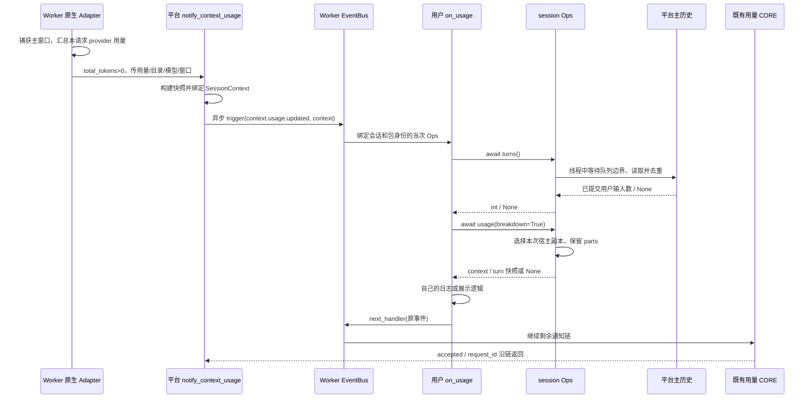

# ops.session.turns / ops.session.usage 特性设计

| 项 | 值 |
| --- | --- |
| 编号 | F_21 / session-usage-ops |
| 建档日期 | 2026-10-28 |
| 后续修订 | 2026-10-29，逐字段明确输入输出、填写责任、示例、时间/比例单位与缺失行为；业务代码不变 |
| 关联计划 | [EXTV2-17 / Server PR-05](../designs/extensions-v2-development-plan.md#extv2-17-会话轮次与用量查询) |
| 主责规约 | [S_11 会话轮次与用量查询](../specs/S_11_session-usage-ops.md) |

## 1. 范围、状态与依据

两项只读 Ops 已实现并在 [PR !90](https://gitcode.com/huenrui_/jiuwenswarm/pull/90) 评审。本次核对业务实现与既有真实验收收据的源码哈希一致，文档修订前 PR head 为 `d86ec910189252ad5d4e42dbca3fee569891f1be`，目标分支 `rsi_native_agent_os`，实现基线 `7795851916dd5ce1d34b70f5a20d6d30eafc25e3`；配套 Core 为 `ead700d7d18a247968d64de54918cf5d201a207a`，Core 本身未修改。本次只调整文档，不改变接口或业务代码。

目标是让用户 Handler 读取平台主会话已提交的用户输入次数，以及已观测的窗口占用/回合用量。沿用 Worker 唯一 EventBus、已有 ops.build 和可信 SessionContext，不依赖 PR04 的 messages/append。两项查询直接读取，不新增 session.turns、session.usage、session.measure 或 server.request.handle 事件，也不调用模型重新测量。

Claude 对照采用官方 `anthropics/claude-code` 固定提交 `bf2323b3021c9d3db7a31e1e7d61068c3f704497` 的类型声明，其文件头标记 Claude Code 2.1.277。对照只说明业务含义和实际差异，不宣称同名接口可直接互换。当前主责契约在 S_11，本文提供使用与接入说明。

## 2. 能力说明与 Claude 对照

`await ops.session.turns()` 提供当前绑定主会话在**保留历史中已提交的用户输入去重数**，适合给扩展状态条或审计日志显示“本会话已有几次用户输入”。它不接收参数，通过 session_id 读取历史并返回 int；存在但无用户输入返回 0，未知/已删除会话返回 None。一次用户请求中的模型重试、工具调用和流片段不各算一轮。

`await ops.session.usage(breakdown=False)` 提供已观测用量快照，适合扩展显示窗口占用和最近回合消耗。它接收严格 bool 参数，返回含 context / turn 的字典，二者都缺失则为 None；默认省略类别明细，True 时带上已有 parts。宿主通知中优先读当前调用绑定的快照，其他会话绑定事件可直接读已提交历史；查询不会重新测量、生成额外 Token 或返回累计账单。

| 对照对象 | JiuwenSwarm 当前实现与使用影响 |
| --- | --- |
| Claude `$.session.turns()` | 同样面向用户输入次数；本项明确按保留主历史去重，可返回 None，并排除扩展/自动化等标记，不是 AgentLoop 的 turn.start 序号；没有同名查询 Hook |
| Claude `$.session.usage(args)` | 本项是 bool breakdown，只返回已观测 context 和最近 provider 回合 turn；不提供 rateLimits、cost、columns，True 只返回已有类别数据，不执行 Claude full/summary 的计算行为 |
| Claude `session.measure` | 本项复用回合末尾的 context.usage.updated 作为示例通知；它不是每次测量变化通知，也不是 session.measure 的别名。调用两个 Ops 不会再次触发通知 |

例如用户发送 r1、r2 两条输入，同一请求产生多次模型/工具活动，turns 仍按这两个用户输入计数。若最新窗口为 1200/6000 Token，则占用比例为 0.2；某回合 provider 输入 1200、输出 80，回合消耗为 1280。窗口与回合是两个观察维度，不能把 1200 和 1280 相加当作账单。

## 3. 复用的通知事件与用户接入

### 3.1 触发位置、来源和粒度

本项没有新增查询事件；示例订阅已存在的 `context.usage.updated`。原生 Adapter 在一次流式请求末尾汇总 provider 用量，当 total_tokens>0 时调用 notify_context_usage；一次通知对应一次该请求的有效回合汇总，不按每个模型请求、工具调用、Token 流片段或窗口变化触发。无有效用量、没有运行中的事件循环或 V2 未装配时，该入口不会发布通知；未接线的运行路径也不由本特性补造通知。

触发前，平台已取得本回合计数、已观测主窗口和目录/模型资料；notify 在业务边界构建用量副本，将其放进 SessionContext，再调度异步任务，由 `_dispatch` 调用 `bus.trigger(Event("context.usage.updated", update), context)`。通知可能先于 summary 落盘，因此当前 usage 读宿主副本，避免回读上一轮。通知失败被该遥测适配层记录，不使已完成的回合失败。

CORE 的回执返回该通知任务，只确认事件输入类型已接受；它不是写入、前端展示或新用量测量的结果。平台的原流式响应与历史提交仍沿既有路径完成，不由这份回执驱动。

### 3.2 Handler 输入、输出与可修改范围

**这些字段由平台填写。用户只注册 Handler 并读取，不需要自己组装用量事件或从 Adapter 收集资料。**实际类型是 `ContextUsageUpdate`；不是调用 turns/usage 时的参数。所有 Token 计数单位均为 Token，不是字符、字节或费用。

| 输入字段 | 声明类型 / 必填或默认 | 准确含义与填写责任 | 示例与消费方式 |
| --- | --- | --- | --- |
| session_id | str，平台必填 | 发布本次通知的主会话关联标识；查询实际目标取 Core 绑定的 SessionContext，不能靠改这个字段查询另一会话 | session-demo；用户核对、记录即可 |
| request_id | str，平台必填 | 产生本次汇总的业务请求 ID，不是窗口快照 ID 或新消息 ID | request-summary-demo；用于关联本轮通知 |
| input_tokens | int，默认 0 | 本次业务回合由平台汇总的 provider 输入 Token，不是只统计用户本条文字 | 1200；作为通知计数读取，不累加为生命周期账单 |
| output_tokens | int，默认 0 | 同一回合汇总的 provider 输出 Token | 80；不是输出字符数 |
| total_tokens | int，默认 0 | 平台提供的本回合总 Token；原生入口仅 total_tokens>0 时尝试发布 | 1280；不是当前窗口容量 |
| cache_tokens | int，默认 0 | 当前通知的缓存计数，保留生产者的统计口径；转为 Ops 的 turn 快照时，仅 input_tokens>0 才携带该字段 | 0 可以是实际携带的零值，不能与未报告混淆 |
| cache_hit_rate | str 或 None，默认 None | 既有百分比展示文本；不是可直接乘算的比例浮点数 | "25.00%"；显示时原样使用或明确解析 |
| context_window_tokens | int 或 None，默认 None | 平台已知的模型窗口容量，单位 Token；未知为 None | 6000；不是本回合消耗量 |
| usage_percent | float 或 None，默认 None | 既有平台展示百分值，20.0 表示 20%；与 Ops 的 occupancy_rate=0.2 单位不同 | 20.0；不要再次当比例乘 100 |
| model | str 或 None，默认 None | 平台提供的模型名称，不是可调用模型对象、配置键或授权信息 | "demo-model"；仅做显示/筛选 |

上述为 dataclass 的声明类型与缺省值。现有事件没有完整数值 Validator，默认 CORE 仅检查输入对象类型；不能把“Handler 收到通知”理解成所有数字已通过严格校验。Ops 查询使用独立校验后的可信快照，不直接相信被改写的事件数字。

默认 CORE 返回 `ContextUsageOutput`，字段如下；用户正常接入应原样返回 `await next_handler(event)`，无需自己构造：

| 输出字段 | 类型 / 默认 | 准确含义、由谁填写及如何使用 |
| --- | --- | --- |
| accepted | bool，构造时必填；默认 CORE 填 True | 只表示默认 CORE 接受 ContextUsageUpdate 类型；不证明历史已落盘、UI 已展示、用量重新测量或用户业务成功 |
| request_id | str，默认空字符串；默认 CORE 回显输入 request_id | 通知关联回执。由 CORE 填写，用户通常直接转交，不用于指定下一次查询目标 |

输入 dataclass 为 frozen；本示例只观察，不改写。USER 的异常按 Core 故障隔离；提前返回至多跳过剩余通知处理，不能撤销已完成回合或改写平台历史。这里没有新增拒绝协议或输出 Validator。

Event payload 与 `ops.session_context` 是两条不同通道。即使用户构造新输入再 next，也不会据此覆盖本次宿主快照；next 继续原通知链，两个查询 Ops 均不触发新事件。

### 3.3 可复制的注册与调用示例

用户包只提供 USER Handler；Registry 提供 registrar 和包归属，平台已登记 Ops、事件类型与默认 CORE。matcher 是字段相等条件的合取，`{}` 匹配所有该类型通知，也可按 model、session_id 等实际输入字段筛选；以原触发输入匹配，链中改写不会重新匹配。

以下可作为 ZIP 内的 `extension.py`，对应仓库 [可安装示例](../../examples/session_usage_info/extension.py)：

```python
import logging

logger = logging.getLogger(__name__)


class SessionUsageInfo:
    def register(self, registrar):
        registrar.register_event_handler("context.usage.updated", self.on_usage, {}, "user")

    async def on_usage(self, event, ops, next_handler):
        turns = await ops.session.turns()
        usage = await ops.session.usage(breakdown=True)
        logger.info(
            "session usage: session=%s turns=%s usage=%s",
            ops.session_context.session_id, turns, usage,
        )
        return await next_handler(event)


def create_extension():
    return SessionUsageInfo()
```

配套 `manifest.yaml`：

```yaml
schemaVersion: 1
package:
  id: example.session-usage-info
  version: 1.0.0
  displayName: Session Usage Info
extensions:
  - id: usage-reader
    runtime: backend
    module: extension.py
```

将二者置于 ZIP 根目录，按 [README](../../examples/session_usage_info/README.md) 安装、正常发送一条消息，产生有效用量后日志出现 session usage。日志是本示例的可观察效果；它没有主动渲染前端。其他宿主已提供有效 SessionContext 的 Handler 可以调用相同 Ops，不必自行调用 notify 或改平台 Adapter。

## 4. 方法契约

### 4.1 await ops.session.turns() -> int | None

方法无参数，查询目标只取 `ops.session_context.session_id`。它在线程中等待已有历史写入边界，严格读取主历史，并对 user/human 记录按 request_id 去重；旧记录无 request_id 时按 id，再缺失则按记录计。详细排除标记在 [S_11 第 2 节](../specs/S_11_session-usage-ops.md#2-接口)。

| 返回值 | 调用方应如何解释 |
| --- | --- |
| 正整数 | 当前保留主历史中的有效用户输入数，不是模型/工具调用数 |
| 0 | 目标会话存在，但没有符合条件的已提交用户输入 |
| None | 目标会话不存在或已删除，不能与 0 混淆 |
| 异常 | 历史不可读、损坏或超时，不可改写为 0 继续冒充正常统计 |

压缩摘要本身不增加轮次，显式截断按保留记录重算；它不是生命周期累计值。旧 user/human 行缺少来源标记时按历史用户输入解释，所有非空 source 行按当前规则排除。查询无独立事件和业务 CORE，直接返回 int/None，不存在 `{value}` 事件结果解包。


**调用方应该填写什么：无需填写任何参数。**使用 `await ops.session.turns()`；不要传 session_id、request_id、轮次初值或文件路径。会话由平台随当前事件提供，Core 绑定到本次 Ops。

例如保留历史含 r1 用户记录两条、r1 助手/工具多条、r2 用户记录一条，则返回 2。历史截断只保留 r2 后返回 1；存在但没有有效用户输入返回 0；会话不存在/已删除返回 None。缺失或读取失败时不能自行用 0 冒充正常统计。

### 4.2 await ops.session.usage(breakdown: bool = False) -> dict | None

#### 调用参数：唯一需要用户填写的值

| 参数 | 类型 / 必填或默认 | 应该填写什么 | 结果如何变化 |
| --- | --- | --- | --- |
| breakdown | bool，可省略，默认 False | 不需要类别明细时用 `await ops.session.usage()`；需要已有明细时用 `await ops.session.usage(breakdown=True)`。只能 True/False，不能写 1、0、"true"、"full" 或 "summary" | False 删除 context.parts；True 保留已存在的 parts。不重新测量、不补齐缺少类别、不改变统计来源 |

不填写其他查询目标或 Token 数字。下面所有输出字段都是**平台返回的只读事实副本**：用户应读取、记录或展示，不需要回填；修改副本不会写回平台。说明中的默认值是底层模型补齐缺省字段时的值，不是“provider 已报告”的证明。

#### 顶层输出：先判断 None，再区分两种观察

| 字段 | 类型 / 何时出现 | 准确含义、合法取值与来源 | 示例与正确用法 |
| --- | --- | --- | --- |
| schema_version | str，非 None 返回必有 | 固定本地返回结构版本 session-usage.v1，不是宿主版本、模型版本或会话修订号 | "session-usage.v1"；做格式识别即可 |
| session_id | str，非 None 返回必有 | 当前 Ops 可信绑定的目标主会话 | "session-demo"；不是用户新传的目标 |
| source | str，非 None 返回必有 | host：本次 SessionContext 绑定快照；history：本次查询从已提交历史选择。不同于 measurement/turn/parts 内的 source | "host"；显示“本次通知快照”而不是“实时重新计算” |
| context | dict 或 None，键必有 | 最近已观测主模型输入窗口占用，字段见下表；无合格窗口时为 None | 窗口数据缺失时仍可使用有效 turn |
| turn | dict 或 None，键必有 | 最近可用业务回合的 provider 汇总，不是单次工具或模型步骤；字段见下表 | 与 context 的 request_id/时间可以不同，不能假定两者对齐 |

context 和 turn 都没有有效观测时，整个 usage 返回 None，不是两项均空的字典，也不表示总量为 0。turns 和 usage 分别读取，不保证两次调用组成原子快照。

#### context：模型窗口的观察标识

| 字段 | 类型 / 缺省 | 准确含义、单位和来源 | 示例与消费方式 |
| --- | --- | --- | --- |
| request_id | str，合格窗口必有 | 原模型观测的请求 ID；可能是内部模型请求，不必等于外层业务 turn.request_id | "request-window-demo"；按原值关联 |
| phase | str，Core 默认 pre_call | 原观测阶段，常见 pre_call/post_call；不是会话正在运行/已完成状态，当前不限制为封闭枚举 | "post_call"；显示观测阶段 |
| timestamp | str，合格窗口必有 | 原窗口观测时间；生产路径生成 ISO 8601 UTC 字符串，保留原值，不改成查询时间。当前 Core 仅要求 str，不额外保证所有旧字符串都可按日期解析 | "2026-10-29T10:00:00+00:00"；不要按 Unix 秒直接计算 |
| sequence | int，Core 默认 0 | 原观测序号，作用于原生产者的观测序列；不是用户轮数，也不保证跨生产者/重启全局单调 | 7；需与 request_id/快照标识一起关联 |
| context_window | dict，合格窗口必有 | 窗口容量、占用和来源等字段，见下一表 | 不与本回合消耗相加 |
| measurement | dict，合格窗口必有 | 类别及总量的测量方式和来源；用来解释是否估算 | 允许 estimated=True 且 authoritative_total=True |
| parts | dict，仅 breakdown=True 时保留 | 已有类别字典；键通常为 system_prompt/tools/skills/messages，不承诺齐全或四类必有。旧兼容 memory 可能存在 | 先检查键是否存在；不能自己用 0 补成“已实测” |

#### context.context_window：窗口总量

| 字段 | 类型 / Core 缺省 | 准确含义、单位和取值规则 | 示例与消费方式 |
| --- | --- | --- | --- |
| limit_tokens | int 或 None，默认 None | 模型窗口容量，单位 Token；None 表示未知，不是 0 容量 | 6000 |
| input_tokens | int 或 None，默认 None | 本次观测窗口的输入总量，单位 Token；结合 tokens_source 解释，不能当作本轮新写入文本的 Token | 1200 |
| occupancy_rate | float 或 None，默认 None | 输入/容量的比例；0.2 表示 20%。当前校验非负有限数，不额外承诺不超过 1；容量未知或无效时可 None | UI 百分数可在非 None 时乘 100 |
| tokens_source | str，默认 not_reported | input_tokens 的来源标签，如 provider_usage、本地计数/回退或混合来源；不是封闭枚举，不与顶层 host/history 混用 | "provider_usage"；保留原标签 |
| local_estimated_input_tokens | int，默认 0 | 本地预估输入总量，单位 Token；默认零值不证明已做过精确测量 | 1100 |
| reconciliation_delta_tokens | int 或 None，默认 None | provider 输入与本地预估的对账差值，单位 Token；可正、可负、可 0；不是额外消耗 | 100 表示 provider 比本地估计多 100，不能累加计费 |
| context_snapshot_id | str 或 None，默认 None | Core 对该窗口的关联标识，不是新建会话 ID，也不是任何历史消息的 uuid | "window-demo"；可与 measurement 中标识一起核对，不假定缺省时一定能补齐 |

#### context.measurement：怎么得到这些数字

| 字段 | 类型 / Core 缺省 | 准确含义与填写责任 | 示例与消费方式 |
| --- | --- | --- | --- |
| category_source | str，默认 not_reported | 类别统计的合并来源，由 Core 填写；分项估算或按 provider 总量分配不等于逐项由 provider 实测 | "provider_usage_proportional" |
| total_source | str，默认 not_reported | 窗口总量的测量来源，与类别来源可以不同 | "provider_usage" |
| tokenizer | str 或 None，默认 None | Core 使用的 tokenizer/回退计数器名称，不是模型连接或可调用对象 | "unicode_codepoints" 表示该计数器标签，应结合 estimated 解释 |
| estimated | bool，默认 True | 类别/本次测量是否包含估算语义；不能仅据它否认 provider 总量的权威来源 | True |
| authoritative_total | bool，默认 False | 总量是否由生产者标为权威来源；不保证类别也均为精确值 | True 可与 estimated=True 同时存在 |
| measurement_version | str，默认 "1" | Core 测量规则版本，不是顶层 session-usage.v1 返回结构版本 | "1"；兼容识别，不自行递增 |
| context_snapshot_id | str 或 None，默认 None | 测量对应的快照关联标识；平台原样保留，不在查询时重建或强制与另一字段相等 | "window-demo" |

#### context.parts[类别键]：每一个类别的全部字段

| 字段 | 类型 / Core 缺省 | 准确含义、单位与示例 | 消费约束 |
| --- | --- | --- | --- |
| category | str，该项必有 | 本项类别标签，通常与字典键对应；system_prompt/tools/skills/messages，旧兼容 memory 亦可能出现 | 保留返回值，不伪造新类别 |
| tokens | int，默认 0 | 本类别 Token 计数，例如 300；严格投影校验非负 | 查看 estimated 和来源，不能把默认 0 直接当实测 0 |
| percentage_of_window | float 或 None，默认 None | 本项 Token / 窗口容量的**比例**；0.05 表示 5%，不是数值 5 | 展示为百分数时乘 100；未知为 None |
| percentage_of_input | float 或 None，默认 None | 本项 Token / 输入总量的**比例**；0.25 表示 25%，不是数值 25 | 分母与窗口容量不同，不混用 |
| estimated | bool，默认 True | 这一项是否估算；与总量 authoritative_total 可不同 | True 不表示不能展示，但应保留估算含义 |
| tokenizer | str 或 None，默认 None | 本项使用的计数器标签 | 如 unicode_codepoints；只读标签 |
| carrier | str 或 None，默认 None | 本项在模型请求中的承载位置 | 如 system_message、tools、context_message；不等于事件入口或包名 |
| source | str，默认 not_reported | 本项统计来源 | 如 provider_usage_proportional；不是 usage.source 的 host/history |
| measurement_source | str，默认 not_reported | 本项具体测量/分配途径 | 可与 source 相同；按生产者标签解释，不封闭枚举 |
| fallback_reason | str 或 None，默认 None | 使用回退或对账策略的原因；None 表示没有该说明，不是查询失败 | 如 provider_total_proportional_reconciliation |
| fallback_tokenizer_model | str 或 None，默认 None | 回退计数器使用的模型标识，不是当前 Agent 主模型已激活的证明 | 未提供时 None |
| order | int 或 None，默认 None | Core 保留的逻辑片段顺序关联值；当前仍按类别聚合，不据此宣称已返回逐消息明细 | 未提供时 None |
| stable_id | str 或 None，默认 None | Core 保留的稳定逻辑片段关联标识；不是会话 ID 或 JSONL 行 uuid | 未提供时 None |

名字中带 percentage 的两个 parts 字段在当前 Core 中同样是比例值。当前投影不额外限制这些比例到 [0,1]，也不承诺分项齐全、分项之和等于总量或一定等于 100%。

#### turn：最近业务回合的 provider 消耗

| 字段 | 类型 / 缺失行为 | 准确含义、单位和来源 | 示例与消费方式 |
| --- | --- | --- | --- |
| request_id | 生产路径 str；旧值原样保留，可为 None | 回合汇总的业务请求 ID；当前投影不额外强制旧字段类型，调用方关联前先检查 | "request-summary-demo"；不要求等于 context.request_id |
| timestamp | 生产路径 float Unix 秒；旧值原样保留，可为 None | 回合汇总的源时间。历史未额外校验或统一格式/单位，不能套用 context.timestamp 的字符串解析 | 生产路径例 1793268000.0；旧数据应先确认类型和来源 |
| source | str，存在 turn 时固定 provider_usage | 当前回合计数的来源标签；不表示这份快照顶层来自 host 还是 history | "provider_usage" |
| input_tokens | int / float / None，缺失为 None | 回合汇总的 provider 输入 Token；已有 0 保留；只能非负有限数，不接受 bool | 1200；不是只计算本条用户输入的 Token |
| output_tokens | int / float / None，缺失为 None | 同一业务回合的 provider 输出 Token | 80 |
| total_tokens | int / float / None，缺失为 None | provider/平台汇总的原始总量，不在查询侧重算为 input+output | 1280；保留原口径 |
| cache_tokens | int / float / None，缺失为 None | 已携带的缓存 Token 数；通知/原生 summary 只有 input_tokens>0 才携带，零输入时可缺失 | 0 与 None 含义不同；不额外承诺缓存读/写拆分或费用 |

上述四个计数全部缺失时 turn 为 None。窗口 input_tokens 与 turn.total_tokens 是不同观察维度，不能把两者相加当账单；也不能把 usage 重复查询后的同一结果反复累加。

#### 完整形状示例与读取方式

下例为代码生成的说明数据，仅包含已提供的 messages 类别；不是本轮重新调用模型的结果。None 在 JSON 中表现为 null。

```json
{
  "schema_version": "session-usage.v1",
  "session_id": "session-demo",
  "source": "host",
  "context": {
    "request_id": "request-window-demo",
    "phase": "post_call",
    "timestamp": "2026-10-29T10:00:00+00:00",
    "sequence": 7,
    "context_window": {
      "limit_tokens": 6000,
      "input_tokens": 1200,
      "occupancy_rate": 0.2,
      "tokens_source": "provider_usage",
      "local_estimated_input_tokens": 1100,
      "reconciliation_delta_tokens": 100,
      "context_snapshot_id": "window-demo"
    },
    "measurement": {
      "category_source": "provider_usage_proportional",
      "total_source": "provider_usage",
      "tokenizer": "unicode_codepoints",
      "estimated": true,
      "authoritative_total": true,
      "measurement_version": "1",
      "context_snapshot_id": "window-demo"
    },
    "parts": {
      "messages": {
        "category": "messages",
        "tokens": 300,
        "percentage_of_window": 0.05,
        "percentage_of_input": 0.25,
        "estimated": true,
        "tokenizer": "unicode_codepoints",
        "carrier": "context_message",
        "source": "provider_usage_proportional",
        "measurement_source": "provider_usage_proportional",
        "fallback_reason": null,
        "fallback_tokenizer_model": null,
        "order": null,
        "stable_id": null
      }
    }
  },
  "turn": {
    "request_id": "request-summary-demo",
    "timestamp": 1793268000.0,
    "source": "provider_usage",
    "input_tokens": 1200,
    "output_tokens": 80,
    "total_tokens": 1280,
    "cache_tokens": 0
  }
}
```

```python
async def read_usage_for_display(ops):
    usage = await ops.session.usage(breakdown=True)
    if usage is None:
        return {"available": False}
    context = usage["context"]
    turn = usage["turn"]
    rate = context["context_window"]["occupancy_rate"] if context is not None else None
    return {
        "available": True,
        "occupancy_percent": None if rate is None else rate * 100,
        "turn_tokens": None if turn is None else turn["total_tokens"],
        "source": usage["source"],
    }
```

读取路径为：校验会话与 bool → metadata **包含** session_usage_info 时选择本次宿主副本（即使明确为 None）→ 否则在线程中读主历史并分别选最新窗口/回合 → 默认移除 parts → 返回独立 dict/None。宿主分量分别校验，坏窗口不丢有效 turn，坏 turn 不丢有效 context；两者都坏为 None，不用旧历史冒充本轮。历史损坏仍明确报错。

### 4.3 上下文、异常和典型消费

平台为当前事件提供 SessionContext，Core 再把它与 Handler 包归属绑定为当次 Ops；`ops.session_context` 是只读属性，不是本项新增的异步方法。两项 Ops 只要求有效 session_id，不要求 cwd、root、model 或特定事件名，也不接受用户传入另一个查询目标。包身份不改变主会话统计范围。

| 情况 | 方法结果与处理方式 |
| --- | --- |
| 未绑定 SessionContext | RuntimeError，选择宿主已绑定会话的事件接入 |
| 会话 ID 非法 | ValueError，不访问任意文件路径 |
| breakdown 不是 bool | TypeError，传 True/False |
| 宿主快照类型或会话身份不匹配 | ValueError，不借用其他会话数据 |
| 历史损坏、I/O 或队列超时 | SessionStatisticsError；该异常没有 PR04 式 code 属性，用户按异常类型处理 |
| 查询等待中取消 | CancelledError；后台读取或原写入队列不会因此被撤销，但本次查询没有业务写入 |

```python
from jiuwenswarm.server.runtime.session.session_statistics import SessionStatisticsError


async def read_for_status(ops):
    try:
        turns = await ops.session.turns()
        usage = await ops.session.usage(breakdown=False)
    except SessionStatisticsError:
        return {"available": False}
    return {"available": True, "turns": turns, "usage": usage}
```

available=True 只表示读取没有报错，turns/usage 仍可分别为 None；调用方应按缺失资料展示。两个方法分别读取，不能承诺一次组合调用具有同一原子快照。未捕获的方法异常仍受外层 USER Handler 故障隔离约束，不能把外层链继续执行当作查询成功。

## 5. 接入与兼容方案

### 5.1 启动时登记，业务时直接读取

```text
Worker 装配已有事件和 session BUILTIN
  → Registry 初始化 Ops，触发一次 ops.build
  → CORE 创建空 Builder
  → session BUILTIN 在回程登记 turns / usage 等方法
  → Core 保存共享能力目录，用户包登记 USER Handler
业务事件到达 → Core 为当前 Handler 创建绑定会话/包的 Ops → Handler 调用共享方法
```

Builder 收集方法定义，不执行查询。BUILTIN 指能力登记层级，不表示业务时必须先跑一个用量 BUILTIN 才能查询。本项没有新建 turns/usage 的 CORE；原用量 CORE 只负责通知输入类型与回执。

### 5.2 宿主通知入口的完整运行链



平台在已完成回合的边界先保存当前观测，再异步发布通知；事件不负责收集目录或测量用量。用户 on_usage 获得 Core 绑定的 Ops 后，turns 读取已提交历史，usage 读取本次快照，避免 summary 还没落盘就拿到上一轮。用户处理结果并继续原通知链，默认用量 CORE 返回接收回执。查询不触发第二条事件链，也不依赖回执再读取一次。

### 5.3 其他会话绑定事件如何复用

平台在已有业务入口收集有效 SessionContext 并随对应事件传入，Core 给该 Handler 绑定同一会话。用户直接调用两个 Ops：turns 读取主历史；没有 session_usage_info 键的 usage 也从主历史选择最新已提交窗口和汇总。用户不先调用 notify，不自行从 Adapter 拼上下文。若新平台入口尚未提供 SessionContext，需由该入口的平台维护者接线，不能把注册 USER Handler 本身当作自动获取会话身份。

SessionContext 带有明确的 session_usage_info=None 时，usage 返回 None 而不回落旧历史。Event payload 中同名字段不参与这项可信元数据判断。无新 Front / Supervisor 协议、无 Rail 和新前端；两层只沿已有流程提供请求与路由，不执行这两个统计方法。

### 5.4 代码分工、生效与生命周期

| 实现入口 | 责任 |
| --- | --- |
| [session_ops.py](../../handler_ops/session_ops.py) | 已有 ops.build BUILTIN 登记两项方法；校验会话、选择快照/历史、返回副本 |
| [session_statistics.py](../../../server/runtime/session/session_statistics.py) | 用户输入去重、统计投影、宿主分量独立校验和严格历史错误 |
| [context_usage.py](../../event_types/context_usage.py) | 复用通知类型/CORE，构建并绑定本轮快照，异步派发 |
| [interface_deep.py](../../../server/runtime/agent_adapter/interface_deep.py) | 捕获主窗口，生成有效回合汇总并在末尾通知 |
| [session_history.py](../../../server/runtime/session/session_history.py) | 严格读取已有队列边界与主文件，兼容 JSONL/旧 JSON，不创建统计存储 |

历史读取至多等 10 秒队列边界，再用原文件锁取已提交记录；损坏、超时和 I/O 错误明确传播。读取扫描 O(N)，宿主副本查询只读取当前绑定数据。没有第二份统计持久化文件或全局统计缓存；重复查询不加轮次、不累计 Token。删除/截断后按当前保留事实读取，宿主快照仍表示它捕获时的观测，不是实时重新测量。

卸载撤销用户 Handler，保留平台 Ops 和历史；重新安装/进程重启后可从既有历史恢复可用统计，不靠包内计数。单次宿主快照随当次调用使用；返回值的可修改副本不回写平台。包安装成功只表示 Handler 已可接收通知，不等于已经有用量、已经查询或完成前端展示。

### 5.5 关键决策、替代方案与评审修订

- D-01：轮次按已提交用户输入去重，不按模型调用、工具调用或流片段累加；显式截断后按保留分支重算。
- D-02：只读方法直接调用 Server 统计服务，不为查询新增 Event/CORE，避免把查询误写成另一条执行业务链。
- D-03：context 与 turn 分开返回并保留来源/时点，避免把窗口填充、回合消耗和累计账单混为一谈。
- D-04：通知优先绑定当前快照，其他入口可回读已提交历史；避免异步通知先于 summary 落盘时读到上一轮。
- D-05：不复用 Token Weather 包内累计状态或建立第二套平台计数，避免包卸载、会话截断/删除造成双写偏差；代价是历史查询 O(N)。
- R-01：2026-10-28 评审修订让 context/turn 独立校验；单个坏分量不丢另一有效分量，双坏返回明确 None，历史读取仍严格报错。
- R-02：cache 字段与原生 summary 的 input_tokens>0 存在规则一致，缺失与零值分别表达。
- R-03：主窗口过滤测试使用不同 token/request_id 的干扰数据，覆盖外会话、depth、父调用、成员和 Team 标记。
- R-04：历史用量也过滤非主调用标记；明确轮次排除所有非空 source 行，并非 AgentLoop turn.start 序号。

编号沿用 F_21 / S_11 与 EXTV2-17，保留最初避让并行 PR04 / Gateway 文档编号的记录。与 PR04 共享 session_ops.py 和台账，合并时需保留双方方法登记，这是文本协调而非功能依赖。

## 6. 验收与未决问题

### 6.1 按契约验收

下表为现有实现的验收场景；结果按版本记录在第 6.2、6.3 节，用例入口为 [test_session_usage_ops.py](../../../../tests/unit_tests/extensions_v2/test_session_usage_ops.py)。

| 输入与前置条件 | 操作 | 预期与证明方式 |
| --- | --- | --- |
| 主历史中重复用户输入、模型/工具、子 Agent、扩展/跨会话/自动化记录 | USER 调 turns | 仅有效主用户输入去重；源标记/旧数据规则由轮次测试核对 |
| 存在的空会话、未知或删除的会话 | 分别查询 | turns 为 0 / None，usage 无观测为 None，不新建会话目录 |
| 有结构化窗口与回合汇总 | 查询两种 breakdown | context/turn 分开，默认无 parts，True 含 parts；修改返回值不污染下次查询 |
| 同时存在不同主窗口与外会话/子调用干扰 | 原生捕获和历史回读 | 保留正确 request_id/数值，不让非主窗口替换主窗口 |
| 宿主通知先于新 summary 提交，历史仍是旧回合 | USER 读取 usage | source=host、当前回合计数；无宿主快照的其他事件可读已提交历史 |
| 宿主 context 坏、turn 坏、两者均坏 | 分别发平台通知并查询 | 保留独立有效分量；双坏为 None，不回读旧值；损坏历史仍明确报错 |
| cache 缺失、携带 0、非零及 input=0 的通知/summary | 比较当前与历史查询 | None / 0 / 非零保持区别，字段存在规则一致 |
| SessionContext 缺失、非法 ID/breakdown、损坏/I/O/队列超时、查询取消 | 调用方法 | 返回相应异常，不伪造 0 或成功，不产生业务写入 |
| 两会话、用户包卸载/重装、历史压缩/截断 | 查询和重读 | 会话隔离，按保留历史重算，卸载撤销 Handler 但保留平台事实 |
| 安装实际示例和验收 ZIP，真实回合 | Front/Supervisor/Worker/模型链路查询并对照历史 | USER 读数和原 CORE 回执可验证；具体环境与次数见已执行记录 |

### 6.2 当前实现的已执行验证（2026-10-28）

修订前复现：将新增的宿主窗口与 cache 回归运行于原实现，6 项中 4 项失败，复现了窗口无效导致回读旧用量、零输入时通知与历史的 cache 返回不一致；修订后均通过。

| 修订后验证范围 | 实际结果 |
| --- | --- |
| 统计/Ops 测试 | 44 项通过；覆盖两个宿主分量独立失效、两者都失效不回读旧值、历史损坏仍报错、cache 缺失与零值及六类非主会话 summary 过滤 |
| 第 6.3 节同范围定向回归 | 319 项通过；1 项既有 Windows symlink 用例因创建权限跳过 |
| 原生 Adapter | 五类干扰窗口使用不同 token/request_id 均通过；零输入与正输入的 summary cache 字段存在规则通过 |
| 真实 Front → Supervisor → Worker → Qwen3.8-Flash | 两个 ZIP 安装、alpha 两轮与 beta 一轮 USER 查询通过；turns 分别为 1/2 和 1，用量与 WebSocket 及独立进程历史读取一致；原 CORE 回执及 cwd/root/model/repo 查询通过 |
| 卸载与清理 | 两包卸载后新增回合不再执行 USER Handler，历史可读且轮次为 3/1；Worker 退出、端口释放，验证退出码 0，五个实现文件在运行期间哈希不变 |

修订证据位于 `D:\work_space\.codex-temp\server-pr05-review-fix-20261028`：`before-fix.xml`、`regression.xml`、`live-run-receipt.json`，以及收据 runDirectory 内的 `validation-summary.json` / `cleanup.json`。复用第 6.3 节回归命令与隔离验证方法；这些结果不代表浏览器 UI 或远端 CI 验收。

### 6.3 初次交付历史验证（2026-10-28）

以下保留评审修订前的验证范围与结果，当前版本以第 6.2 节为准。

已验证去重及非用户输入排除、空会话与未知会话、压缩和截断、两会话隔离、真实零值和未知值、估算与 provider 来源、无明细/有明细、宿主快照与历史回读、原生通知、包安装/卸载、其他事件查询及原有能力兼容。轮次也排除已有 metadata.automation 心跳标记和 cron/heartbeat 渠道；无来源标记的旧 user/human 记录按历史用户记录解释。

环境：Windows、Python 3.11.15；Swarm 从最新扩展目标分支建立独立工作树，基线 779585191；Core rsi_native_agent_os 的 ead700d7d。未引入 PR04 提交、session_history 事件模块或 messages/append Ops；Core 无改动。

| 验证范围 | 实际结果 |
| --- | --- |
| 新增统计/Ops 测试 tests/unit_tests/extensions_v2/test_session_usage_ops.py | 28 项通过，含真实 Registry 用户包、跨事件调用、冻结上下文、取消、删除、损坏、队列超时和 I/O 失败 |
| 扩展、原生 Adapter、历史路径/JSONL/过滤/游标/原子写入与 offload 定向回归 | 297 项通过 |
| 原生流快照接线 | 新增 1 项通过；实际 context.usage 解析后绑定，子 Agent 与外会话快照不替换主窗口 |
| 真实 Front → Supervisor → 子 Worker → Qwen3.8-Flash | 两个真实 ZIP 安装成功；alpha 连续两轮 turns=1/2，beta 独立一轮 turns=1；USER 得到真实 package_id 和 Worker PID，原 CORE 回执成功 |
| 真实回合与落盘交叉核对 | 三次 USER 读数与 WebSocket chat.usage_summary、context.usage 及另一进程读取的已提交历史一致；cwd/root/model/repo 保持可用，仓库示例日志三条 |
| 卸载及清理 | 两包卸载后新增 alpha 回合不再触发用户 Handler；历史仍可查询，alpha/beta 轮次为 3/1；Worker 已退出、监听端口释放，验收脚本退出码 0 |

实际回归命令：

```text
python -m pytest -o addopts= -q tests/unit_tests/extensions_v2 tests/unit_tests/agentserver/test_deep_adapter_stream_end_final.py tests/unit_tests/test_session_history_paths.py tests/unit_tests/test_session_history_jsonl_read.py tests/unit_tests/test_session_history_empty_filter.py tests/unit_tests/test_session_history_cursor.py tests/unit_tests/test_session_history_atomic_write.py tests/unit_tests/agentserver/test_history_io_offload.py tests/unit_tests/agentserver/test_session_history_path_safety.py --asyncio-mode=auto -o log_cli=false
```

本地证据在 `D:\work_space\.codex-temp\server-session-usage-ops-20261028`：regression.xml、live-run-receipt.json 及其 runDirectory 内的 validation-summary.json / cleanup.json。收据保存五个实现文件的 SHA256，确认真实验收期间源码不变。真实验收未 mock 模型、Ops、Adapter，也未手工提供 SessionContext；使用隔离运行目录和既有 WebSocket 协议，未改用户日常配置。运行日志和凭据不提交源码仓库。

### 6.4 历史文档校核（2026-10-28）及未决事项

本次按编写指南核对两项方法、复用通知与 CORE、平台触发位置、可信资料和固定 Claude 类型；检查示例、链接与差异。第 6.2 节为评审修订实现的既有业务验证证据，本次为纯文档修订，不将历史结果写成新跑的业务测试。

2026-10-28 文档检查已通过：20 处相对链接及锚点、2 个 Python 代码块语法、示例 Handler 注册、两项 Ops 调用与原通知链继续、None 处理和 SessionStatisticsError 降级分支；manifest 与仓库可安装示例一致，方法签名与源码一致。该次原真实验收收据的五个实现文件哈希保持一致，未重跑业务回归。历史检查记录位于 `D:\work_space\.codex-temp\server-pr05-docs-guide-20261028\documentation-verification.json`。

当前两项方法的已实现契约无待决项。不承诺实时正在生成的窗口、所有模型/工具累计计费、Team 汇总或新前端。无结构化窗口的旧历史可能只有 turn；所有主用量均无观测时为 None。Gateway / 浏览器展示、非 Windows 实机、大历史性能或远端 CI 未纳入通过结论，后续由 Server 与对应接入端按专项任务联合验收。

### 6.5 本轮字段文档验证（2026-10-29）

本轮仅修改 F_21、S_11、示例 README 与文档台账引用，不改变任何业务 Python 文件或接口。逐项核对实际 Core 模型字段、默认值、比例计算、平台投影与通知定义；说明用 JSON 由当前构造函数生成。检查命令和结果见 `D:\work_space\.codex-temp\server-pr05-field-docs-20261029\documentation-verification.json`。历史测试/真实模型证据仍保留原日期，本轮未重跑业务回归或模型验收。

## 7. 参考资料

- 编写依据：《openjiuwen 事件与方法特性文档编写指南》，2026-10-28；其中示例不替本特性确定未实现接口。
- [S_11 主责契约与错误](../specs/S_11_session-usage-ops.md)、[可安装用户示例](../../examples/session_usage_info/README.md)。
- [V2 详细架构](../designs/extensions-v2-architecture.md)、[内置事件开发模板](../designs/builtin-event-development-guide.md)：公共装配和事件/Ops 关系。
- [Claude 固定提交类型声明](https://github.com/anthropics/claude-code/blob/bf2323b3021c9d3db7a31e1e7d61068c3f704497/mods/types/claude-code.d.ts)：文件头版本、EngineInterface.session.turns、SessionUsage / SessionUsageArgs、SessionMeasureInput / Result、OpEvent 的同名查询。
- [Core 结构化用量模型](https://gitcode.com/huenrui_/agent-core/blob/ead700d7d18a247968d64de54918cf5d201a207a/openjiuwen/core/context_engine/usage/models.py)：ContextUsageSnapshot、ContextWindowUsage、ContextUsageMeasurement 和 ContextPartUsage。
- [Core EventBus](https://gitcode.com/huenrui_/agent-core/blob/ead700d7d18a247968d64de54918cf5d201a207a/openjiuwen/core/events/bus.py)、[Ops Builder](https://gitcode.com/huenrui_/agent-core/blob/ead700d7d18a247968d64de54918cf5d201a207a/openjiuwen/core/events/ops.py)：启动能力目录、当次会话/包绑定与故障隔离。
