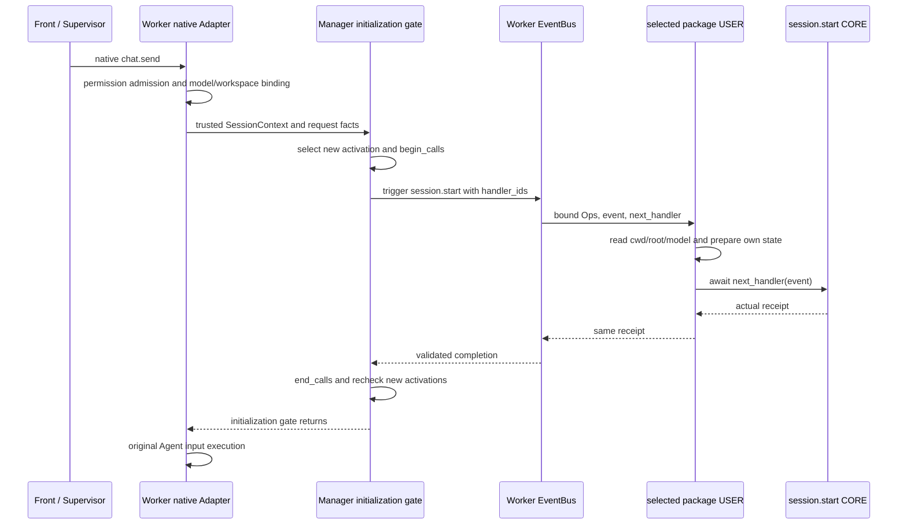

# session.start 特性设计

| 项 | 值 |
| --- | --- |
| 编号 | F_22 / session-start |
| 建档日期 | 2026-10-28 |
| 后续修订 | 2026-10-29，既有实现与验证；2026-10-31，以 session.append 为标准补齐逐字段说明、业务案例和源码调用链；运行契约不变；2026-10-31，在输入输出字段旁补充实际定义、构造、读取与返回函数 |
| 计划与进度入口 | [EXTV2-18 / Server PR06](../designs/extensions-v2-development-plan.md#extv2-18-激活实例首次输入前初始化) |
| 主责契约 | [S_12](../specs/S_12_session-start.md) |

## 1. 范围、状态与依据

本项已实现 `session.start`，用于 Worker 内每个扩展包激活实例在首次受支持输入前准备自己的资源。原生 `chat.send` 的 unary/stream 接线、用户包、默认 CORE、包隔离和重复通知保护已完成。2026-10-29 已补充真实模型回复与后续用量 Handler 验证，结果见第 6 节；前端页面验收不在本次范围。

Swarm 基于 `rsi_native_agent_os` 的 `7795851916dd5ce1d34b70f5a20d6d30eafc25e3`，Core 基于 `ead700d7d18a247968d64de54918cf5d201a207a`。配套 [Core !110](https://gitcode.com/huenrui_/agent-core/merge_requests/110) 提供通用 `handler_ids` 候选筛选，验证所用 Core 提交为 `6ef27f309c99a3b25a47d225ab1a74f8b0f44ed6`，应先合入或安装此版本。首次独立开发时两边均不包含当时未合入的 PR04 !83、PR05 !90；本特性本身不依赖其 messages/append/turns/usage。当前合并交付以第 6 节 PR !99 的基线和依赖为准。

通知主体是一个 Worker 中的包激活实例，不是每个会话、每轮消息或每次连接。覆盖原生 `chat.send` 的两个 child 入口；本项不增加 Team、Auto-Harness、外部 Harness、控制/历史/重连接线，不增加用户 Ops、额外 Agent 输入或前端页面。Worker 继续持有唯一 EventBus。

## 2. 能力说明与 Claude 对照

`session.start` 在原生输入完成权限准入、模型应用与运行目录绑定后、发送 Agent 输入前触发。每个新激活实例最多尝试通知一次。Handler 收到平台选择的包/代次及首个输入的会话、请求、渠道和目录事实，可用现有只读 Ops 准备用户自己的状态，然后 `return await next_handler(event)`；默认 CORE 返回真实接收回执，由 Manager 消费后继续原输入。它是初始化通知，不是业务请求分发或用量更新。

| 对照项 | Claude 固定版本声明 | 本特性及使用影响 |
| --- | --- | --- |
| 参考 | `bf2323b3021c9d3db7a31e1e7d61068c3f704497`，文件头 2.1.277 的 SessionStartInput/Result | 固定声明对照，不推断其他版本行为 |
| 生命周期 | 进程启动的会话初始化 | Worker 内包激活实例首次受支持输入前初始化；后续另一个会话不重跑 |
| 输入 | cwd、surface、isInteractive | cwd、project_root、is_interactive 及可信包/代次、会话/请求/渠道标识；不承诺已有真实 surface |
| 输出 | cwd | 只读通知回执；不允许改写真实运行目录、目标或身份 |
| 配套方法 | 不据相似名称补造能力 | 不新增 Ops；可复用已合入 cwd/root/model/repo |

如果用户需要每个会话各自缓存，应另外按 `session_id` 管理状态，不能把本事件的首个会话资料当作所有后续会话的 workspace。

## 3. 事件契约

### 3.1 触发前后与粒度

原生 Adapter 的 `_process_message_impl` / `_process_message_stream_impl` 只在 ReqMethod.CHAT_SEND 中，于 `_update_runtime_config` 完成后、Agent 接收输入前等待 `_ensure_extension_session_started`。平台初始化门发现某个当前激活实例尚未尝试时，才发这一包的通知；安装包、每轮结束、历史查询或重新连接本身都不触发。

```text
原生 chat.send → 权限准入、应用模型、绑定目录
  → 平台构造 SessionContext → Manager / SessionStartGate
  → 找新激活实例、记录已尝试、取得该包 published handler IDs、begin_calls
  → bind_start_invocation 固定可信输入与真实回执作用域
  → await bus.trigger(Event("session.start", input), context, handler_ids=本包 IDs)
  → 选中且匹配的 USER → 原样 next → session_start_core
  → 校验平台调用和会话 → 真实回执沿链返回 → end_calls
  → 原来的同一条 Agent 输入继续执行
```

粒度是“每个 Worker 内每个包激活实例最多一次通知尝试”，不是每个 session_id 一次。门还比较激活记录对象及发布 ID，成功重载/重装形成新实例后在下一次受支持输入前再尝试；generation 数字本身不能唯一识别实例。

### 3.2 输入：每个字段表达什么、由谁填写

#### 输入相关定义与构造函数

实际输入类型如下；这一定义中的字段名，与下方表格逐项对应。frozen=True 表示用户不能修改对象字段来改变平台事实。

```python
@dataclass(frozen=True, slots=True)
class SessionStartInput:
    """Host-owned activation and first-input observation facts."""

    package_id: str
    generation: int
    session_id: str
    request_id: str
    channel_id: str
    cwd: str | None
    project_root: str | None
    is_interactive: bool
```

类型来源：[event_types/session_start.py](../../event_types/session_start.py)。

平台初始化门的输入构造节选如下；这里保留真实函数签名和字段赋值，激活实例筛选、锁、在途计数与派发在完整函数中。record 和 context 均由平台提前确定。

```python
async def ensure_started(
    self,
    context: SessionContext,
    *,
    request_id: str,
    channel_id: str,
    is_interactive: bool,
) -> tuple[SessionStartOutput, ...]:
    # Excerpt: record/context come from the host gate; locking and dispatch are omitted.
    root = context.metadata.get("project_root")
    value = SessionStartInput(
        record.package_id, record.generation, context.session_id, request_id, channel_id,
        context.cwd, root if isinstance(root, str) else None, is_interactive,
    )
```

构造函数来源：[平台接入代码](../../management/session_start.py)；后续真实 trigger 保留在平台通知链中。

| 字段位置 | 在哪段代码形成或读取 | 沿链传到哪里 |
| --- | --- | --- |
| package_id / generation | SessionStartInput 的前两个位置参数来自 record.package_id / record.generation | 通知目标仍由本包公开 Handler IDs 限定 |
| session_id / request_id / channel_id | 分别来自 context.session_id 和平台当前请求参数 | 输入对象与独立 SessionContext 保持同一会话 |
| cwd / project_root / is_interactive | 分别来自 context.cwd、平台 metadata 中的 root 和 Adapter 能力 | 作为只读观察值进入本次初始化通知 |

实际导入位置是 `jiuwenswarm.extensions_v2.event_types.session_start`，Handler 接收 frozen dataclass `SessionStartInput`，不是任意 JSON 字典。以下是平台生成后可观察到的形状示意；用户只读，不复制这个构造器直接触发事件。

```python
from jiuwenswarm.extensions_v2.event_types.session_start import SessionStartInput

SessionStartInput(
    package_id='example.session-start',
    generation=1,
    session_id='demo-session-a',
    request_id='request-42',
    channel_id='web',
    cwd='D:/projects/demo/src',
    project_root='D:/projects/demo',
    is_interactive=True,
)
```

全部构造字段均必填、没有可省略默认；表中的 None/空串是平台明确提供的值。下表解释怎样读、代表什么、怎样使用；主责契约仍为 [S_12](../specs/S_12_session-start.md)。

| 字段 | 类型 / 必填与默认 | 由谁填写 / 应填什么 | 代表什么意思 | 作用 / 怎样使用 | 权限与缺失处理 |
| --- | --- | --- | --- | --- | --- |
| package_id | str，构造参数必填 | 平台从当前激活记录填写，如 example.session-start | 这一次准备被通知的扩展包身份 | 结合 generation 记录哪次激活已准备；平台按公开 Handler ID 只选本包 | 只读，不由用户指定通知另一个包 |
| generation | int，构造参数必填 | 平台填写激活记录的代次，如 1 或成功重载后的 2 | 本激活记录的版本代次，不是会话轮次 | 关联初始化日志；平台还比较激活记录对象和发布 ID，不只比较这个数字 | 只读；卸载重装可以回到 1，不能单独作为全局唯一键 |
| session_id | str，构造参数必填 | 平台填写首次受支持输入的真实会话 ID，如 demo-session-a | 该激活实例首次参与输入时所在的会话 | 与 ops.session_context.session_id 核对，作为本次只读查询目标 | 只读；以后切换会话不为旧激活实例再次 start |
| request_id | str，构造参数必填 | 平台保留该原生输入请求 ID；无值时为空串 | 触发首次初始化的那一条请求 | 把初始化日志关联到原生输入，不用于重新发起输入 | 只读，用户不生成第二个 request_id 回填 |
| channel_id | str，构造参数必填 | 平台保留原生请求渠道，如 web；无值时为空串 | 本次首次输入来自哪个渠道 | 按输入渠道记录/筛选；不证明一个具体视图已挂载 | 只读，不是 WebSocket 连接 ID 或 surface_id |
| cwd | str 或 None，构造参数必填 | 平台使用已绑定执行目录，如 D:/projects/demo/src；未知显式填 None | 这次输入的实际工作目录观察值 | 为扩展自己的首次运行档案提供目录；不改变运行目录 | 只读；None 不应由用户用进程 cwd 补齐 |
| project_root | str 或 None，构造参数必填 | 平台使用已绑定项目根，如 D:/projects/demo；无项目为 None | 用户项目归属目录，可与 cwd 不同 | 供扩展自己的初始化记录使用；不是自动推导的 Git 根 | 只读，不允许通过替换字段切换项目 |
| is_interactive | bool，构造参数必填 | 平台从 Adapter 能力填写 True/False；能力缺省按 True | 这次原生请求是否支持交互 | 用户可选择自己的交互或非交互准备方式 | 只读；True 不表示 ui.ready、真实视图或渲染面已经存在 |

#### 本次 Handler 的会话上下文与包身份

Event 输入是可观察的通知内容，SessionContext 是平台另行提供的可信会话资料；两者不是用户填写后再相互组装的关系。平台通知函数构造 context，Bus 为每个实际 Handler 创建绑定该资料的 Ops。

| 字段 | 类型 / 必填与默认 | 由谁填写 / 应填什么 | 代表什么意思 | 作用 / 怎样使用 | 权限与缺失处理 |
| --- | --- | --- | --- | --- | --- |
| ops.session_context | Core 只读属性，不用 await | 平台先构造，随 trigger 的独立 context 参数传入；Core 绑定给本次 Handler | 本次调用使用哪份会话资料 | 用户读取已有资料；它不负责采集或组装上下文 | 不能通过改 Event 字段替换，不是用户补填对象 |
| session_context.session_id | 有效非空 str | 平台提供首次输入的会话 ID；与事件输入 session_id 一致 | 可信查询目标是首次输入的会话 | 既有会话 Ops 根据它读取对应平台服务 | 只读；不得拿 next_session_id/previous_session_id 代替当前绑定 |
| session_context.cwd | str 或 None | start 使用已绑定运行目录；其他三种通知未确认 cwd，保持 None | 可得的真实执行目录观察值 | 已有 cwd 查询可以使用；None 表示该入口未收集到 | 不以进程默认目录或项目根伪造 cwd |
| session_context.metadata.project_root | str 或 None | start 使用已绑定项目根；其余通知只接受目标保存的绝对 project_dir | 已确认的用户项目根资料 | 已有 root 查询读取这个字段；不是自动推断的 Git 根 | 不可信/缺失时为 None；不为通知创建项目或模型 |
| ops.package_metadata | Core 绑定的当前 Handler 包身份 | 来自已注册 Handler 的真实包元信息；CORE 没有用户包身份 | 当前正在执行的 USER 属于哪个扩展包 | 管理自己包的资源和日志；与被观察会话是两个维度 | 用户不从 payload 指定或冒充其他包 |

start 还可以复用原生请求已应用的公开模型快照；不是由 start CORE 创建模型。 本 PR 沿用已合入的只读 Ops；七项查询事件化由独立 PR !100 提供，不是本生命周期特性的依赖。

### 3.3 输出：真实通知回执、继续与失败

#### 输出相关定义与默认 CORE 函数

真实通知回执的字段定义：

```python
@dataclass(frozen=True, slots=True)
class SessionStartOutput:
    """The actual notification receipt, not a resource initialization promise."""

    accepted: bool
    package_id: str
    generation: int
    session_id: str
    request_id: str
```

默认 CORE 在下面的 state.receipt 赋值处生成回执，再 return 返回；用户 Handler 从 next 得到这个真实回执。

```python
async def session_start_core(
    event: Event,
    ops: EventHandlerOps | None,
    next_handler: EventNext,
) -> SessionStartOutput:
    """Confirm a notification without creating resources or another input."""
    del next_handler
    state = current_start_invocation()
    value = event.event_input
    if not valid_start_input(value):
        raise ValueError("session.start input cannot be rewritten")
    if ops is None or ops.session_context is None or ops.session_context.session_id != value.session_id:
        raise ValueError("session.start requires its bound session")
    if state.receipt is None:
        state.receipt = SessionStartOutput(True, value.package_id, value.generation,
                                          value.session_id, value.request_id)
    return state.receipt
```

构造器中的第一个 True 对应 accepted；后面的值依次对应上面的字段顺序。state.receipt 用于同一次有效通知内复用真实回执；它不是用户外部资源操作的成功记录，也不是整项业务的最终响应。

默认 CORE 返回 `SessionStartOutput`。正常用户 Handler 必须返回 `await next_handler(event)` 得到的真实回执内容；本通知不使用查询事件的 value/deny 封装，不返回 `{"accepted": True}` 字典，也没有用户拒绝/改写平台事实的协议。

下面仅展示回执形状，**不让用户自行构造并返回假成功**；字段由 CORE 填写：

```python
from jiuwenswarm.extensions_v2.event_types.session_start import SessionStartOutput

SessionStartOutput(
    accepted=True,
    package_id='example.session-start',
    generation=1,
    session_id='demo-session-a',
    request_id='request-42',
)
```

| 字段 | 类型 / 必填与默认 | 由谁填写 / 应填什么 | 代表什么意思 | 作用 / 怎样使用 | 权限与缺失处理 |
| --- | --- | --- | --- | --- | --- |
| accepted | bool，CORE 实际填 True | 默认 CORE 在有效调用中生成；USER 不自行构造 | 本次默认初始化通知链已接受 | 判断默认链已完成；不代表用户外部资源全部初始化成功 | 原样返回真实回执内容，不改成 False 或 deny |
| package_id | str，必有 | CORE 回显输入的 package_id | 接受通知的目标包 | 与原输入和用户日志核对 | 只读，不替换成另一个包 |
| generation | int，必有 | CORE 回显输入的 generation | 接受通知的激活代次 | 关联同一次初始化记录 | 只读，不当作会话轮次或全局实例唯一 ID |
| session_id | str，必有 | CORE 回显首个输入的 session_id | 此次通知使用的会话 | 核对绑定会话；以后不同会话不会因此再次 start | 只读，不由输出改变实际输入目标 |
| request_id | str，必有 | CORE 回显首次输入 request_id，可能为空串 | 与首次原生请求关联的标识 | 追踪初始化与原输入的顺序 | 只读，不额外发起一条请求 |

所有输入只读、没有可改写字段。空 matcher 匹配本次候选中的该事件；可用第 3.2 节字段等值筛选，字段不匹配不会替用户延后重放。session.start 先按本包 published handler IDs 限定候选，其他包的空 matcher 不会混入。 正常 next 继续当前通知链；提前短路伪造成功、修改输入、后置改写回执均不构成合法平台操作，按既有 Core USER 故障隔离处理。

CORE 在当前可信调用作用域内核对原始输入和绑定会话，再记录真实回执；同次调用重复 next 复用该回执，不重复业务操作。用户抛普通异常可能被 Core 隔离后继续默认处理；不能把抛错当作取消平台业务的机制。

并发输入等待同一初始化门；框架异常或取消传播给当前原生输入，已开始的通知不重放。用户初始化产生的外部副作用不自动回滚。 没有在本特性新增统一的 2 秒通知预算；用户初始化处于原输入 await 链，不应长期阻塞。 accepted 只说明默认通知被确认，用户自有资源操作是否成功应由自己的代码记录；外部副作用不自动补偿。

### 3.4 注册、筛选与用户接入示例

用户只提供 manifest、模块和 USER Handler，不注册平台类型/CORE，不修改 Adapter 收集上下文。下面可直接放入 `extension.py`：

```python
import logging

logger = logging.getLogger(__name__)


class StartExample:
    def __init__(self):
        self.workspace = None

    def register(self, registrar):
        registrar.register_event_handler("session.start", self.on_start, {}, "user")

    async def on_start(self, event, ops, next_handler):
        self.workspace = {
            "cwd": await ops.session.cwd(),
            "root": await ops.session.root(),
            "model": await ops.session.model(),
        }
        logger.info("initialized package=%s generation=%s session=%s",
                    ops.package_metadata.package_id, event.event_input.generation,
                    ops.session_context.session_id)
        return await next_handler(event)


def create_extension():
    return StartExample()
```

配套 `manifest.yaml`：

```yaml
schemaVersion: 1
package:
  id: example.session-start
  version: 1.0.0
  displayName: Session Start Example
extensions:
  - id: activation-start
    runtime: backend
    module: extension.py
```

将两文件放在 ZIP 根目录，使用已有 `/extension install "D:\extensions\session-start.zip"` 安装。安装只发布 Handler；随后发送一次正常原生 Agent 消息才触发通知，日志出现初始化记录，后续普通输入不重复。完整[示例包与中英文使用说明](../../examples/session_start/README.md)还提供 `on_usage`，演示后续事件使用已准备状态；它仍需真实模型回合产生有效用量，不把安装或本事件本身当作用量事件。

## 4. 方法契约

### 4.1 用户侧：复用已有 Ops，没有新增 start Ops

本项无新增用户 Ops。`ops.session.cwd/root/model/repo` 仍是现有只读能力，在本事件绑定的可信 `SessionContext` 下读取；model 是当前原生请求已应用的模型快照。Ops 读取不再触发 `session.start`，也不依赖先发生 `context.usage.updated`。

用户通过 register 订阅通知，不调用 `ops.session.start()`；本特性没有定义这个方法。前提资料由平台在原输入边界提供，不要求先发生用量通知。

### 4.2 平台内部入口及其返回

平台内部 `ExtensionManager.ensure_session_started(context, *, request_id, channel_id, is_interactive)` 返回本次新尝试实例的 `tuple[SessionStartOutput, ...]`，无新实例返回空 tuple。上下文由真实 Adapter 提供；无效 session/字段类型报 ValueError，重入报 RuntimeError，框架错误或取消继续向当前输入传播。它不是用户远程请求或用户伪造上下文的接口，也不是跨进程 Bus 桥接。

平台调用侧签名如下；这是已有真实 Adapter 使用的内部入口示意，不是给用户扩展自行拼上下文的调用方法：

```python
receipts = await manager.ensure_session_started(
    context,                 # Trusted facts already collected by the Adapter.
    request_id=request_id,
    channel_id=channel_id,
    is_interactive=is_interactive,
)
```

context 必须是有效 SessionContext；其余三个命名参数全部必填，分别为 str/str/bool。返回 tuple 中每项是本次新尝试激活实例的真实 SessionStartOutput；没有新实例为 `()`。门内部调用 Core 的 handler_ids 只选择当前包，不让用户改变通知目标。

## 5. 接入与兼容方案

### 5.1 两阶段完整调用链

```text
启动装配：Worker install_extensions
  → bootstrap 注册 session.start 类型、matcher、Validator 和默认 CORE
  → 既有 ops.build：CORE 创建 Builder
  → 既有 BUILTIN 在 Builder 登记共享 cwd/root/model/repo 等方法
  → 包加载：用户 register 订阅 session.start，Runtime 发布 Handler ID
```

这条链先准备事件类型、默认处理与能力方法，再发布用户订阅。Builder 是方法工厂，不在此时获取某个会话的实际 cwd/model；业务派发时才为每个 Handler 绑定当次会话和可信包身份。`ops.build` 只执行既有构建流程，本项不重建或部分构建 Ops。



这条链从实际输入进入：Front/Supervisor 仍做原来的接入与 Worker 路由；Worker 先绑定真实会话资料，再等待新激活实例初始化。EventBus 给选中的 USER 构造会话/包专属 Ops，USER 调用只读方法准备自己的状态，然后进入默认 CORE。结果按 CORE → USER → Bus → Manager 返回，平台结束在途计数后继续原输入。`session.start` 本身没有新增 BUILTIN 业务 Handler；这里使用的 BUILTIN 属于启动时既有 `ops.build`。用户以后在 `on_usage` 中读自己的状态，是另一条既有事件链。

### 5.2 目录、生命周期与取舍

- `event_types/session_start.py` 只承载输入输出、校验作用域、matcher 与注册；真正 `bus.trigger` 留在 [management/session_start.py](../../management/session_start.py) 的平台初始化门；[event_handlers/session_start.py](../../event_handlers/session_start.py) 维护默认 CORE。
- Manager 保留公开 ActivePackageRecord 对象引用及发布 ID。不能只比较 generation：卸载重装可回到 1，空包也可能没有新 ID。普通输入与重连保留尝试状态；成功重载/重装的新实例在下一次受支持输入前通知；失败重载保留旧状态；Worker 重启重新激活后重新通知。
- 回调期间不持管理操作锁；使用 Runtime.begin_calls/end_calls 保护卸载。用户回调可查询管理状态；在途卸载按既有 BUSY 语义拒绝；热重载沿既有切换机制，门会重新检查新实例。
- 采用 Core 公共筛选，不读取私有注册表或直接调用用户函数；既有 matcher、层级顺序、Ops 绑定和故障隔离不变。Core 旧调用默认 `handler_ids=None` 保持行为，自定义 Bus/Fake 实现者需支持新可选参数。
- 外部副作用不回滚；at-most-once 指本 Worker 通知尝试，不是断电后的全局 exactly-once。热加载与已开始输入沿既有快照语义，不承诺对所有业务事件的全局激活屏障。资源清理留给后续独立生命周期特性。

### 5.3 完整业务案例：为扩展建立首次运行档案

用户想让自己的“工作区摘要扩展”第一次参与原生输入前，记录首次运行目录与模型资料，并准备扩展自身的状态。这里没有平台规定的“巡检规则”：做哪些检查、是否建立缓存由用户自己的 Handler 决定；本事件不自动注入 Agent 提示词。

1. 安装第 3.4 节用户包，只会发布 on_start；此时不会执行初始化，也没有模型输入。
2. 用户发送原生 chat.send。权限准入、模型应用和运行目录绑定完成后，Adapter 在把输入交给 Agent 前等待初始化门。
3. 门发现该包是一个尚未尝试的新激活实例，从 Runtime 取可信包身份、代次和已发布 Handler IDs，标记本次已尝试并保护在途计数。
4. 门用 session-a 的真实上下文触发 session.start；EventBus 只选该包候选，再按 matcher 执行用户 on_start。
5. 用户示例读取 cwd/root/model，存入自己对象的 workspace 并记录初始化日志。这是首次运行档案，不是所有以后会话的共享真实 cwd。
6. 用户原样 next，session_start_core 核对有效平台调用、原始输入和绑定会话，生成 accepted=True 的真实回执；门收集回执并释放在途计数。
7. 原来的同一条 Agent 输入继续。后续可在用户自己的 on_usage 读取“本包已准备”的状态；若需要当前会话资料，仍从该次事件的 Ops 读取。

同激活实例进入另一个会话不会再次 start；成功重载或卸载重装形成新激活实例后，在下一次受支持输入前再尝试一次。accepted 只确认通知链，用户检查失败的补偿和外部资源是否准备好仍由自己的代码负责。

### 5.4 关键函数：平台触发、Ops 绑定与默认 CORE

以下为当前平台派发和默认 CORE 的源码节选；包在途计数、超时、去重等外层编排保留在 [初始化门](../../management/session_start.py)，不是让用户直接调用内部函数。event_types 只维护定义、校验作用域、Matcher 和注册。

```python
# Platform excerpt inside the initialization gate, after selecting this activation.
value = SessionStartInput(
    record.package_id, record.generation, context.session_id, request_id, channel_id,
    context.cwd, root if isinstance(root, str) else None, is_interactive,
)
with bind_start_invocation(value) as invocation:
    await self._bus.trigger(
        Event(SESSION_START_EVENT, value), context, handler_ids=ids,
    )
```

Event 是通知输入，独立 context 参数是可信会话资料。Core 为每个实际进入的 USER / CORE 调用 `builder.build(package_metadata, session_context)`，得到本次 Ops；USER 从现有 `ops.session_context` 只读属性读取，不通过这个属性采集资料。启动时的 ops.build BUILTIN 已经登记了共享方法，本次事件不再创建 Builder 或临时登记能力。

默认 CORE 的完整函数见第 3.3 节输出字段旁，可逐项核对回执定义和返回位置。

current_start_invocation 要求在同一仍有效的平台调用任务中；valid_start_input 保证原输入未被改写；绑定 session_id 必须一致。首次进入 CORE 时生成并保存回执，再次 next 复用它。CORE 不创建用户资源、不触发新的模型输入。

本事件没有新增业务 BUILTIN；实际通知链是匹配 USER → 默认 CORE，结果反向返回。若有多个匹配 USER，各自原样 next 才继续；已有 ops.build 的 BUILTIN 只属于启动能力登记，不能混同为本次通知的业务处理层。

类型与校验见 [session_start.py](../../event_types/session_start.py)，CORE 见 [event_handlers/session_start.py](../../event_handlers/session_start.py)。


## 6. 验收与未决问题

2026-10-31 输入输出源码补充：本次只调整文档，将当前类型定义、构造/读取函数和回执返回位置放到字段表旁；代码摘录按本分支实际实现核对，省略的分支明确标注。以下历史业务验证保留原日期和范围，本次未重跑业务、模型或浏览器验收。

本次 2026-10-31 仅按 F_16 的写法补齐输入/输出字段、注册示例、真实触发条件、Handler 职责和完整业务案例；运行代码与契约不变。文档核对包括 dataclass 字段与示例值、源码节选、Python/YAML/JSON 示例及相对链接。下列回归和真实服务结果均保留原运行日期与范围，不宣称本次重新执行业务或模型验收。

2026-10-31 合并交付验证：本特性与会话查询文档、session.start、session.end、session.attach/session.detach 一起整理到 [Server !99](https://gitcode.com/huenrui_/jiuwenswarm/merge_requests/99)，保留四个提交和各自特性文档。合并 PR 中的 session.start 依赖 [agent-core !110](https://gitcode.com/huenrui_/agent-core/merge_requests/110) 的公开 handler_ids；必须先合入 Core !110，再合入 Server。Core 文档因与目标分支重号改为 EV-07 / F_07，接口语义不变。

本次基于 Server `c6a07f909` 和合并最新目标分支的配套 Core，Windows / Python 3.11.15 下 Server 扩展、Runtime、历史、模型上下文与 Gateway 回归 **1744 项通过、3 项跳过**；Core Events/Extension/callback **587 项通过、1 项跳过**。Gateway 的 `test_web_disconnect_unregisters_physical_subscriptions` 在未修改目标分支和合并分支上均因 SERVICE_UNAVAILABLE 失败，最终合跑显式排除该 1 项，未将其计为通过。完整命令与 XML 在 `D:\work_space\.codex-temp\consolidate-server-prs-20261031`：server-final-command.json、server-final-regression.xml、core-command.json、core-regression.xml；基线对照见 gateway-baseline.xml 与 gateway-candidate.xml。本次未重跑真实模型或浏览器，以下旧日期的真实验证保持历史归属。

原独立交付为 Server !91；合并时更新初始化测试替身以转交平台已存在的 file_service，并在实际 USER Handler 内验证历史和用量共享 Ops 也可见。初始化与固定生命周期观察者专项共 20 项通过，已包含于上述回归，不重复累计。

### 6.1 2026-10-28 单元与回归

环境：Windows、Python 3.11.15；显式 PYTHONPATH 指向本次 Swarm 工作树与配套 Core。Core 版本见第 1 节。使用真实 Registry 与用户模块发布测试，不用替代 EventBus 验证包隔离。

| 输入与前置条件 → 操作 | 预期与已验证证明 |
| --- | --- |
| A/B 两用户包 → 首次输入、重复输入、另一会话输入 | 各实例只通知一次；空 matcher 不导致旧包重跑；真实 cwd/root/model/repo 可读 |
| 已初始化包 → 新包装载、成功/失败重载、卸载重装 | 只处理新实例；失败重载保留旧实例；generation 回到 1 及空包重装仍可识别 |
| 8 个并发首次输入、用户回调查询/卸载/重载 | 串行门无重复；管理查询无死锁；在途卸载 BUSY；重载新实例被检查 |
| 用户改写输入、伪造/替换回执、重复 next、直接伪造 Event | Validator 拒绝非法结果；真实 CORE 回执保留，不可撤销已发生事实 |
| USER 抛错、框架错误、取消、同任务/子任务重入 | 按各自契约隔离或传播；计数释放；已开始通知不重放；逃逸子任务在作用域结束后不被误判重入 |
| 原生 unary/stream 请求、控制请求 | 目录/模型绑定 → 等待 start 返回 → 原 Agent 输入；控制请求不新增通知，使用应用前捕获的真实模型快照 |

`test_session_start.py` 共 15 项；原生文件新增 3 项接线用例。Server V2 与相关原生/模型兼容合跑 **253 passed**，有一项既有 Authlib 弃用警告。Core Events 单独 **112 passed**，Events/包管理/callback 合跑 **568 passed, 1 skipped**；跳过项为 Windows 创建目录 symlink 权限不足，另有既有 Pydantic 警告。

在各仓库根目录执行的命令（设置 PYTHONPATH 后）：

```text
python -m pytest -o addopts= -q tests/unit_tests/extensions_v2 tests/unit_tests/agentserver/test_deep_adapter_stream_end_final.py tests/unit_tests/agentserver/test_request_scoped_login_model.py tests/unit_tests/agentserver/test_deep_adapter_model_resolve.py tests/unit_tests/agentserver/test_deep_adapter_login_model.py tests/unit_tests/agentserver/test_agent_reload_model_scope.py tests/unit_tests/agentserver/test_cross_session_model_input.py tests/unit_tests/agentserver/test_cron_session_model_inherit.py --asyncio-mode=auto -o log_cli=false
python -m pytest -o addopts= -q tests/unit_tests/core/events tests/unit_tests/core/extension tests/unit_tests/core/runner/callback --asyncio-mode=auto -o log_cli=false
```

### 6.2 2026-10-29 真实模型与用户 Handler 验证

使用独立配置/数据目录、实际 ZIP 和真实 Front → Supervisor → child Worker；创建普通 Git 仓库子目录及独立 worktree 子目录，包在 USER 中记录进程 ID、源码位置、上下文、只读 Ops 结果与真实 CORE 回执。未手工注入 SessionContext，也未替换 Bus/Ops/Adapter/模型。实测批次 `real-090239`，使用真实 `GLM-5.2`，验证代码为 Swarm `7f3862773` / Core `6ef27f309`；两仓 8 个实现文件 SHA256 在测试中保持不变，PR04/05 模块不存在。此后只更新验证文档。

| 真实操作 | 初始化观察 | 模型与后续 Handler 结果 |
| --- | --- | --- |
| alpha 首次原生输入 | A generation=1 初始化一次，随包示例执行一次；cwd/root/model/repo 与真实回执正确 | 有模型回复与有效用量；A 的 on_usage 在初始化后执行，ready=True、count=1 |
| alpha 再输入 | A 不重复初始化 | 有模型回复；A 的 on_usage 仍为 ready=True、count=1 |
| WebSocket 重连后 beta 输入 | A 不重复，激活实例不随会话/连接切换 | 有模型回复；USER 读取当前 beta 的真实 cwd/root/model/repo |
| 加载 B 后 beta 输入 | 仅 B generation=1 初始化，A 不重复 | 有模型回复；A/B 的 on_usage 均读取各自已准备状态 |
| 重载 A 后 alpha 输入 | A generation=2 初始化，B 不重复 | 有模型回复；新 A 与 B 的 on_usage 均为 ready=True、count=1 |
| 卸载重装 A 后 alpha 输入 | A 新实例 generation=1 仍初始化 | 有模型回复；重装 A 的 on_usage 在新初始化后执行 |
| 全部卸载后再次输入 | USER 初始化/用量日志不再增加 | 原生模型回复和用量统计正常；退出后 Worker 已结束、监听端口已关闭 |

合计 **7 个真实模型回合全部成功**，均收到非空 `chat.delta`、`chat.final` 和正数 `chat.usage_summary`，回复包含 `Start validation completed`。A 初始化 3 次（代次 1/2/1）、B 1 次、随包示例 1 次。所有应参与的 USER on_usage 均观察到此前初始化已完成、count=1、默认 CORE accepted=True；卸载后的回合不再调用这些用户 Handler。随包示例日志也已验证 `ready=True count=1`。

本次通过范围覆盖初始化前后顺序、真实模型执行、实际用量通知、用户只读 Ops 和 Handler 状态延续，以及退出清理。单元与回归数量仍是第 6.1 节注明的 2026-10-28 历史运行，不因文档修订宣称重跑。浏览器 UI、远端 CI 和非 Windows 实机未执行，不在本次结论内。用户外部资源是否准备成功，仍由各自 Handler 确认；本事件 accepted 的契约不变。

文档按用户指定《openjiuwen 事件与方法特性文档编写指南》维护；实际模型调用、用量 Handler 和清理证据已补齐，本次补验项已完成。

## 7. 参考资料

- [S_12 主责契约](../specs/S_12_session-start.md)、[开发计划](../designs/extensions-v2-development-plan.md#extv2-18-激活实例首次输入前初始化)。
- [装配](../../assembly.py)、[事件注册](../../bootstrap.py)、[Manager](../../management/registry.py)、[初始化门](../../management/session_start.py)、[默认 CORE](../../event_handlers/session_start.py)。
- [原生 Adapter](../../../server/runtime/agent_adapter/interface_deep.py)、[既有 Session Ops](../../handler_ops/session_ops.py)、[示例包](../../examples/session_start/README.md)、[专项测试](../../../../tests/unit_tests/extensions_v2/test_session_start.py)。
- [Claude 固定类型声明](https://github.com/anthropics/claude-code/blob/bf2323b3021c9d3db7a31e1e7d61068c3f704497/mods/types/claude-code.d.ts)、[Core !110](https://gitcode.com/huenrui_/agent-core/merge_requests/110)、[Core 候选筛选契约](https://gitcode.com/huenrui_/agent-core/blob/6ef27f309c99a3b25a47d225ab1a74f8b0f44ed6/openjiuwen/core/events/docs/features/F_06_handler-selection.md)。
