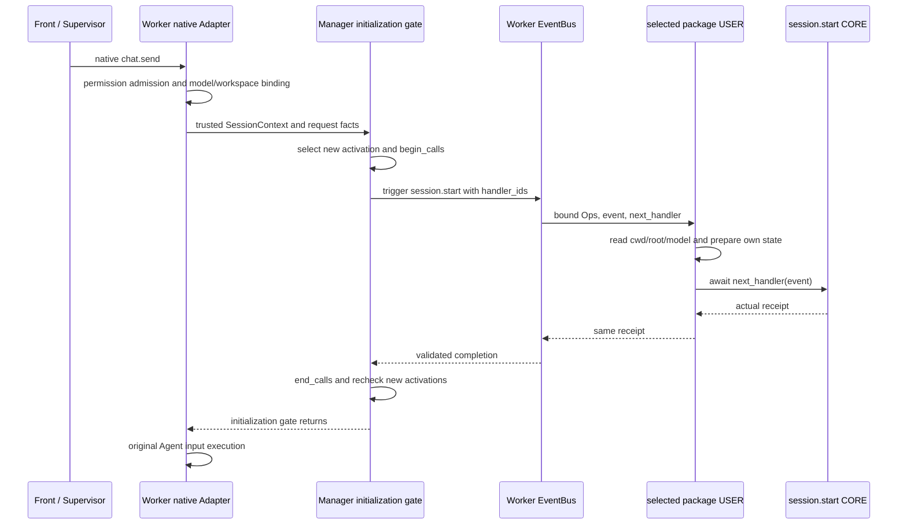

# session.start 激活初始化特性设计

| 项 | 值 |
| --- | --- |
| 编号 | F_22 / session-start |
| 建档日期 | 2026-10-28 |
| 最近修订 | 2026-10-29 |
| 计划与进度入口 | [EXTV2-18 / Server PR06](../designs/extensions-v2-development-plan.md#extv2-18-激活实例首次输入前初始化) |
| 主责契约 | [S_12](../specs/S_12_session-start.md) |

## 1. 范围、状态与依据

本项已实现 `session.start`，用于 Worker 内每个扩展包激活实例在首次受支持输入前准备自己的资源。原生 `chat.send` 的 unary/stream 接线、用户包、默认 CORE、包隔离和重复通知保护已完成。2026-10-29 已补充真实模型回复与后续用量 Handler 验证，结果见第 6 节；前端页面验收不在本次范围。

Swarm 基于 `rsi_native_agent_os` 的 `7795851916dd5ce1d34b70f5a20d6d30eafc25e3`，Core 基于 `ead700d7d18a247968d64de54918cf5d201a207a`。配套 [Core !110](https://gitcode.com/huenrui_/agent-core/merge_requests/110) 提供通用 `handler_ids` 候选筛选，验证所用 Core 提交为 `6ef27f309c99a3b25a47d225ab1a74f8b0f44ed6`，应先合入或安装此版本。两边均不包含未合入 PR04 !83、PR05 !90，也不依赖其 messages/append/turns/usage 能力。

通知主体是一个 Worker 中的包激活实例，不是每个会话、每轮消息或每次连接。覆盖原生 `chat.send` 的两个 child 入口；本项不增加 Team、Auto-Harness、外部 Harness、控制/历史/重连接线，不增加用户 Ops、额外 Agent 输入或前端页面。Worker 继续持有唯一 EventBus。

## 2. 能力说明与 Claude 对照

`session.start` 在原生输入完成权限准入、模型应用与运行目录绑定后、发送 Agent 输入前触发。每个新激活实例最多尝试通知一次。Handler 收到平台选择的包/代次及首个输入的会话、请求、渠道和目录事实，可用现有只读 Ops 准备用户自己的状态，然后 `return await next_handler(event)`；默认 CORE 返回真实接收回执，由 Manager 消费后继续原输入。它是初始化通知，不是业务请求分发或用量更新。

| 对照项 | Claude 固定版本声明 | 本特性及使用影响 |
| --- | --- | --- |
| 参考 | `bf2323b3021c9d3db7a31e1e7d61068c3f704497`，文件头 2.1.277 的 SessionStartInput/Result | 固定声明对照，不推断其他版本行为 |
| 生命周期 | 进程启动的会话初始化 | Worker 内包激活实例首次受支持输入前初始化；后续另一个会话不重跑 |
| 输入 | cwd、surface、isInteractive | cwd、project_root、is_interactive 及可信包/代次、会话/请求/渠道标识；不承诺已有真实 surface |
| 输出 | cwd | 只读通知回执；不允许改写真实运行目录、目标或身份 |
| 配套方法 | 不据相似名称补造能力 | 不新增 Ops；可复用已合入 cwd/root/model/repo |

如果用户需要每个会话各自缓存，应另外按 `session_id` 管理状态，不能把本事件的首个会话资料当作所有后续会话的 workspace。

## 3. 事件契约

### 3.1 触发点与输入输出

原生 Adapter 的 `_process_message_impl` 与 `_process_message_stream_impl` 在 `_update_runtime_config` 返回后调用 `_ensure_extension_session_started`，且只接受 `ReqMethod.CHAT_SEND`。平台从真实 `get_cwd()`、项目绑定和已应用模型快照构造 `SessionContext`，交给 Manager 的初始化门；V2 未装配时直接保留原输入行为。

输入 `SessionStartInput` 与输出 `SessionStartOutput` 均为 frozen dataclass。字段类型、含义和必填要求由 [S_12 第 1 节](../specs/S_12_session-start.md#1-输入与输出) 唯一维护：输入含 package_id/generation、session_id/request_id/channel_id、cwd/project_root/is_interactive；输出含 accepted 和对应包/代次、会话/请求。所有字段由平台显式构造，无可省略参数；目录允许 None。输入全部只读。

包和代次来自公开 Runtime 激活记录，不从用户字段决定路由。Manager 使用该实例的公开 `published_handlers` ID 调用 Core 的 `handler_ids` 参数；随后仍由既有 matcher 与注册顺序决定链。空 matcher 匹配本次已选中的本包 Handler，不会误通知其他旧包。matcher 只筛选这一次尝试，不把不匹配的初始化延期到以后输入。

### 3.2 继续、结果与失败

- 正常 USER 保持 Event，返回下游真实回执；没有 consumed/rejected 初始化协议。提前伪造成功、改写身份/目录或替换 CORE 回执，均被 Validator 拒绝，并按 Core 的 USER 故障隔离处理。
- CORE 校验有效平台调用和绑定会话，记录 `accepted=True` 的真实回执；重复 `next` 复用此回执。它不创建用户资源、不发送输入、不替用户调用其他 Ops。
- `accepted` 表示默认通知链已完成，不保证所有 USER 的外部资源初始化成功。USER 异常沿既有 Core 隔离；用户应记录自己的失败并准备补偿。
- 每个激活实例只尝试通知一次，开始调用即记录。框架错误和取消传播给当前输入，已开始的通知不自动重放；普通输入重试或重连也不重放，需要重新激活包才能获得新尝试。
- 并发输入串行等待同一初始化门；同任务或尚在初始化的子任务重入明确报错，避免死锁。取消和异常均释放 Runtime 在途计数。

### 3.3 用户接入示例

用户只提供 manifest、模块和 USER Handler，不注册平台类型/CORE，不修改 Adapter 收集上下文。下面可直接放入 `extension.py`：

```python
import logging

logger = logging.getLogger(__name__)


class StartExample:
    def __init__(self):
        self.workspace = None

    def register(self, registrar):
        registrar.register_event_handler("session.start", self.on_start, {}, "user")

    async def on_start(self, event, ops, next_handler):
        self.workspace = {
            "cwd": await ops.session.cwd(),
            "root": await ops.session.root(),
            "model": await ops.session.model(),
        }
        logger.info("initialized package=%s generation=%s session=%s",
                    ops.package_metadata.package_id, event.event_input.generation,
                    ops.session_context.session_id)
        return await next_handler(event)


def create_extension():
    return StartExample()
```

配套 `manifest.yaml`：

```yaml
schemaVersion: 1
package:
  id: example.session-start
  version: 1.0.0
  displayName: Session Start Example
extensions:
  - id: activation-start
    runtime: backend
    module: extension.py
```

将两文件放在 ZIP 根目录，使用已有 `/extension install "D:\extensions\session-start.zip"` 安装。安装只发布 Handler；随后发送一次正常原生 Agent 消息才触发通知，日志出现初始化记录，后续普通输入不重复。完整[示例包与中英文使用说明](../../examples/session_start/README.md)还提供 `on_usage`，演示后续事件使用已准备状态；它仍需真实模型回合产生有效用量，不把安装或本事件本身当作用量事件。

## 4. 方法契约

本项无新增用户 Ops。`ops.session.cwd/root/model/repo` 仍是现有只读能力，在本事件绑定的可信 `SessionContext` 下读取；model 是当前原生请求已应用的模型快照。Ops 读取不再触发 `session.start`，也不依赖先发生 `context.usage.updated`。

平台内部 `ExtensionManager.ensure_session_started(context, *, request_id, channel_id, is_interactive)` 返回本次新尝试实例的 `tuple[SessionStartOutput, ...]`，无新实例返回空 tuple。上下文由真实 Adapter 提供；无效 session/字段类型报 ValueError，重入报 RuntimeError，框架错误或取消继续向当前输入传播。它不是用户远程请求或用户伪造上下文的接口，也不是跨进程 Bus 桥接。

## 5. 接入与兼容方案

### 5.1 两阶段完整调用链

```text
启动装配：Worker install_extensions
  → bootstrap 注册 session.start 类型、matcher、Validator 和默认 CORE
  → 既有 ops.build：CORE 创建 Builder
  → 既有 BUILTIN 在 Builder 登记共享 cwd/root/model/repo 等方法
  → 包加载：用户 register 订阅 session.start，Runtime 发布 Handler ID
```

这条链先准备事件类型、默认处理与能力方法，再发布用户订阅。Builder 是方法工厂，不在此时获取某个会话的实际 cwd/model；业务派发时才为每个 Handler 绑定当次会话和可信包身份。`ops.build` 只执行既有构建流程，本项不重建或部分构建 Ops。



这条链从实际输入进入：Front/Supervisor 仍做原来的接入与 Worker 路由；Worker 先绑定真实会话资料，再等待新激活实例初始化。EventBus 给选中的 USER 构造会话/包专属 Ops，USER 调用只读方法准备自己的状态，然后进入默认 CORE。结果按 CORE → USER → Bus → Manager 返回，平台结束在途计数后继续原输入。`session.start` 本身没有新增 BUILTIN 业务 Handler；这里使用的 BUILTIN 属于启动时既有 `ops.build`。用户以后在 `on_usage` 中读自己的状态，是另一条既有事件链。

### 5.2 目录、生命周期与取舍

- `event_types/session_start.py` 只承载输入输出、校验作用域、matcher 与注册；真正 `bus.trigger` 留在 [management/session_start.py](../../management/session_start.py) 的平台初始化门；[event_handlers/session_start.py](../../event_handlers/session_start.py) 维护默认 CORE。
- Manager 保留公开 ActivePackageRecord 对象引用及发布 ID。不能只比较 generation：卸载重装可回到 1，空包也可能没有新 ID。普通输入与重连保留尝试状态；成功重载/重装的新实例在下一次受支持输入前通知；失败重载保留旧状态；Worker 重启重新激活后重新通知。
- 回调期间不持管理操作锁；使用 Runtime.begin_calls/end_calls 保护卸载。用户回调可查询管理状态；在途卸载按既有 BUSY 语义拒绝；热重载沿既有切换机制，门会重新检查新实例。
- 采用 Core 公共筛选，不读取私有注册表或直接调用用户函数；既有 matcher、层级顺序、Ops 绑定和故障隔离不变。Core 旧调用默认 `handler_ids=None` 保持行为，自定义 Bus/Fake 实现者需支持新可选参数。
- 外部副作用不回滚；at-most-once 指本 Worker 通知尝试，不是断电后的全局 exactly-once。热加载与已开始输入沿既有快照语义，不承诺对所有业务事件的全局激活屏障。资源清理留给后续独立生命周期特性。

## 6. 验收与未决问题

2026-10-31 合并交付验证：本特性与会话查询文档、session.start、session.end、session.attach/session.detach 一起整理到 [Server !99](https://gitcode.com/huenrui_/jiuwenswarm/merge_requests/99)，保留四个提交和各自特性文档。合并 PR 中的 session.start 依赖 [agent-core !110](https://gitcode.com/huenrui_/agent-core/merge_requests/110) 的公开 handler_ids；必须先合入 Core !110，再合入 Server。Core 文档因与目标分支重号改为 EV-07 / F_07，接口语义不变。

本次基于 Server `c6a07f909` 和合并最新目标分支的配套 Core，Windows / Python 3.11.15 下 Server 扩展、Runtime、历史、模型上下文与 Gateway 回归 **1744 项通过、3 项跳过**；Core Events/Extension/callback **587 项通过、1 项跳过**。Gateway 的 `test_web_disconnect_unregisters_physical_subscriptions` 在未修改目标分支和合并分支上均因 SERVICE_UNAVAILABLE 失败，最终合跑显式排除该 1 项，未将其计为通过。完整命令与 XML 在 `D:\work_space\.codex-temp\consolidate-server-prs-20261031`：server-final-command.json、server-final-regression.xml、core-command.json、core-regression.xml；基线对照见 gateway-baseline.xml 与 gateway-candidate.xml。本次未重跑真实模型或浏览器，以下旧日期的真实验证保持历史归属。

原独立交付为 Server !91；合并时更新初始化测试替身以转交平台已存在的 file_service，并在实际 USER Handler 内验证历史和用量共享 Ops 也可见。初始化与固定生命周期观察者专项共 20 项通过，已包含于上述回归，不重复累计。

### 6.1 2026-10-28 单元与回归

环境：Windows、Python 3.11.15；显式 PYTHONPATH 指向本次 Swarm 工作树与配套 Core。Core 版本见第 1 节。使用真实 Registry 与用户模块发布测试，不用替代 EventBus 验证包隔离。

| 输入与前置条件 → 操作 | 预期与已验证证明 |
| --- | --- |
| A/B 两用户包 → 首次输入、重复输入、另一会话输入 | 各实例只通知一次；空 matcher 不导致旧包重跑；真实 cwd/root/model/repo 可读 |
| 已初始化包 → 新包装载、成功/失败重载、卸载重装 | 只处理新实例；失败重载保留旧实例；generation 回到 1 及空包重装仍可识别 |
| 8 个并发首次输入、用户回调查询/卸载/重载 | 串行门无重复；管理查询无死锁；在途卸载 BUSY；重载新实例被检查 |
| 用户改写输入、伪造/替换回执、重复 next、直接伪造 Event | Validator 拒绝非法结果；真实 CORE 回执保留，不可撤销已发生事实 |
| USER 抛错、框架错误、取消、同任务/子任务重入 | 按各自契约隔离或传播；计数释放；已开始通知不重放；逃逸子任务在作用域结束后不被误判重入 |
| 原生 unary/stream 请求、控制请求 | 目录/模型绑定 → 等待 start 返回 → 原 Agent 输入；控制请求不新增通知，使用应用前捕获的真实模型快照 |

`test_session_start.py` 共 15 项；原生文件新增 3 项接线用例。Server V2 与相关原生/模型兼容合跑 **253 passed**，有一项既有 Authlib 弃用警告。Core Events 单独 **112 passed**，Events/包管理/callback 合跑 **568 passed, 1 skipped**；跳过项为 Windows 创建目录 symlink 权限不足，另有既有 Pydantic 警告。

在各仓库根目录执行的命令（设置 PYTHONPATH 后）：

```text
python -m pytest -o addopts= -q tests/unit_tests/extensions_v2 tests/unit_tests/agentserver/test_deep_adapter_stream_end_final.py tests/unit_tests/agentserver/test_request_scoped_login_model.py tests/unit_tests/agentserver/test_deep_adapter_model_resolve.py tests/unit_tests/agentserver/test_deep_adapter_login_model.py tests/unit_tests/agentserver/test_agent_reload_model_scope.py tests/unit_tests/agentserver/test_cross_session_model_input.py tests/unit_tests/agentserver/test_cron_session_model_inherit.py --asyncio-mode=auto -o log_cli=false
python -m pytest -o addopts= -q tests/unit_tests/core/events tests/unit_tests/core/extension tests/unit_tests/core/runner/callback --asyncio-mode=auto -o log_cli=false
```

### 6.2 2026-10-29 真实模型与用户 Handler 验证

使用独立配置/数据目录、实际 ZIP 和真实 Front → Supervisor → child Worker；创建普通 Git 仓库子目录及独立 worktree 子目录，包在 USER 中记录进程 ID、源码位置、上下文、只读 Ops 结果与真实 CORE 回执。未手工注入 SessionContext，也未替换 Bus/Ops/Adapter/模型。实测批次 `real-090239`，使用真实 `GLM-5.2`，验证代码为 Swarm `7f3862773` / Core `6ef27f309`；两仓 8 个实现文件 SHA256 在测试中保持不变，PR04/05 模块不存在。此后只更新验证文档。

| 真实操作 | 初始化观察 | 模型与后续 Handler 结果 |
| --- | --- | --- |
| alpha 首次原生输入 | A generation=1 初始化一次，随包示例执行一次；cwd/root/model/repo 与真实回执正确 | 有模型回复与有效用量；A 的 on_usage 在初始化后执行，ready=True、count=1 |
| alpha 再输入 | A 不重复初始化 | 有模型回复；A 的 on_usage 仍为 ready=True、count=1 |
| WebSocket 重连后 beta 输入 | A 不重复，激活实例不随会话/连接切换 | 有模型回复；USER 读取当前 beta 的真实 cwd/root/model/repo |
| 加载 B 后 beta 输入 | 仅 B generation=1 初始化，A 不重复 | 有模型回复；A/B 的 on_usage 均读取各自已准备状态 |
| 重载 A 后 alpha 输入 | A generation=2 初始化，B 不重复 | 有模型回复；新 A 与 B 的 on_usage 均为 ready=True、count=1 |
| 卸载重装 A 后 alpha 输入 | A 新实例 generation=1 仍初始化 | 有模型回复；重装 A 的 on_usage 在新初始化后执行 |
| 全部卸载后再次输入 | USER 初始化/用量日志不再增加 | 原生模型回复和用量统计正常；退出后 Worker 已结束、监听端口已关闭 |

合计 **7 个真实模型回合全部成功**，均收到非空 `chat.delta`、`chat.final` 和正数 `chat.usage_summary`，回复包含 `Start validation completed`。A 初始化 3 次（代次 1/2/1）、B 1 次、随包示例 1 次。所有应参与的 USER on_usage 均观察到此前初始化已完成、count=1、默认 CORE accepted=True；卸载后的回合不再调用这些用户 Handler。随包示例日志也已验证 `ready=True count=1`。

本次通过范围覆盖初始化前后顺序、真实模型执行、实际用量通知、用户只读 Ops 和 Handler 状态延续，以及退出清理。单元与回归数量仍是第 6.1 节注明的 2026-10-28 历史运行，不因文档修订宣称重跑。浏览器 UI、远端 CI 和非 Windows 实机未执行，不在本次结论内。用户外部资源是否准备成功，仍由各自 Handler 确认；本事件 accepted 的契约不变。

文档按用户指定《openjiuwen 事件与方法特性文档编写指南》维护；实际模型调用、用量 Handler 和清理证据已补齐，本次补验项已完成。

## 7. 参考资料

- [S_12 主责契约](../specs/S_12_session-start.md)、[开发计划](../designs/extensions-v2-development-plan.md#extv2-18-激活实例首次输入前初始化)。
- [装配](../../assembly.py)、[事件注册](../../bootstrap.py)、[Manager](../../management/registry.py)、[初始化门](../../management/session_start.py)、[默认 CORE](../../event_handlers/session_start.py)。
- [原生 Adapter](../../../server/runtime/agent_adapter/interface_deep.py)、[既有 Session Ops](../../handler_ops/session_ops.py)、[示例包](../../examples/session_start/README.md)、[专项测试](../../../../tests/unit_tests/extensions_v2/test_session_start.py)。
- [Claude 固定类型声明](https://github.com/anthropics/claude-code/blob/bf2323b3021c9d3db7a31e1e7d61068c3f704497/mods/types/claude-code.d.ts)、[Core !110](https://gitcode.com/huenrui_/agent-core/merge_requests/110)、[Core 候选筛选契约](https://gitcode.com/huenrui_/agent-core/blob/6ef27f309c99a3b25a47d225ab1a74f8b0f44ed6/openjiuwen/core/events/docs/features/F_06_handler-selection.md)。
