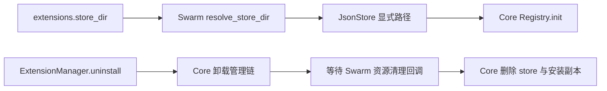

# store 持久化接入设计方案

## 1. 元信息

| 项 | 内容 |
| --- | --- |
| 建档日期 | 2026-11-02 |
| 范围 | store 目录装配、卸载与停机清理、调试扩展包 |
| 设计依据 | 内置 Event 设计第二部分第 1 节及第 4 节的 store 内容 |
| 编号 | F_27 / store-persistence |
| 关联计划 | [EXTV2-25 / store 持久化接入](../designs/extensions-v2-development-plan.md#extv2-25-store-持久化接入) |
| 进度与验证 | [开发计划 EXTV2-25](../designs/extensions-v2-development-plan.md#extv2-25-store-持久化接入)；本文维护验证证据 |

## 2. 职责与方案

Core 是通用 SDK，只实现 store 事件、Ops、JSON 文件服务与包资源清理接口。
持久化实现位于 `openjiuwen.core.extension.data`，Bus 绑定位于 `openjiuwen.core.events.ops_impl.store`。
应用数据根目录、`extensions.store_dir` 配置、WebUI 清理和程序装配均属于 Swarm。
state 由宿主另行注入 `JsonState`（见 F_03 §9.2），本文不覆盖；不改变 package 的内置 Handler 名称规则。



`resolve_store_dir()` 读取 `resources/config.yaml` 的 `extensions.store_dir`，缺省为 `extension/store`；
相对路径锚定用户工作目录，跟随已有 `JIUWENSWARM_DATA_DIR` 规则。
不增加第二套数据根变量，也不让 Core 读取 Swarm 配置。
ExtensionManager 保留原构造参数，新增可选 store_dir；AgentServer 装配显式注入，独立宿主可以自行选择。

卸载活动包与未激活副本均委托 Core，移除 Swarm 旧的副本兜底删除分支。
资源清理回调在 Core 数据删除前执行，失败传播并保留清理记录；停机以 shutdown 原因调用相同接口，保留数据。
现有 inactive callback 继续作为操作成功后的兼容通知，不承担必须成功的资源清理。
重载沿用已有 package.reload，store 无缓存或后台任务，因此保持数据即可，不新增 state 刷新机制。

## 3. 本次精简

撤回为 store 增加的通用 EventBus/Ops 生命周期接口，旧 Ops 的 store 调用由扩展 Runtime 校验。
保留设计要求的文件锁、提交结果区分、在途计数及卸载失败重试，不将这部分可靠性要求删掉。
Core 不加入 Swarm 目录、WebUI 类型或应用配置；面向应用的示例和验证说明放在本仓。

## 4. 验证与遗留

验证目录继承用户数据根、实际 AgentServer 装配、四个 Ops、跨会话与重启保留、重载保留、
活动和未激活包卸载删除、宿主回调失败后重试，以及打包后的扩展实际安装执行。
2026-11-02 完成以下验证，均使用隔离的工作区临时数据，不调用模型或真实用户会话：

| 检查 | 结果 |
| --- | --- |
| Core Events、Extension、store、callback 回归 | 640 passed、2 skipped；store 模块覆盖率 92% |
| Swarm Extensions V2 全量回归 | 594 passed、2 skipped；跳过符号链接和命名管道环境用例 |
| Swarm store / WebUI / 停机 / 串行化专项 | 23 passed |
| 交付 ZIP 的三个独立进程 | 首次 counter=1；新进程读取并重载后 counter=3；第三进程未激活卸载删除 JSON 和副本 |
| 本地依赖 | `.venv` 可编辑安装、本地导入路径、`uv lock --check --offline`、`uv run --locked --no-sync` 导入核对通过 |
| 差异检查 | 暂存和未暂存 diff 检查通过；未暂存、未提交 |

正常回归命令：

```powershell
.venv/Scripts/python.exe -m pytest -q -rs -o addopts= -o log_cli=false `
  --asyncio-mode=auto --basetemp=D:/lzy/test/.svfinal tests/unit_tests/extensions_v2
```

遵守本仓规则，没有运行格式化与静态检查工具。Core 新增 store 模块另有类型、Ruff 和拼写检查。
此前两次全量运行中，不同的既有 UI 示例各发生一次安装 FAILED；单例、带报告观察的全量及最终正常全量均通过。
未捕获到原失败的结构化原因，因此没有将短路径或任何具体猜测写成根因，也没有添加生产自动重试。
既有示例安装断言现在保留 ActivationReport，便于再次出现时定位。

交付包只包含 manifest.json、extension.py 和 README.md；用法见
[示例说明](../../examples/store_probe/README.md)。验证复用了生产管理/事件链，未启动真实浏览器或运行真实模型对话。

本地调试依赖已指向 `D:/lzy/test/agent-core`；这是本地开发配置，发布前需切回正式依赖。

## 5. 2026-11-03 安装包共存问题

桌面日志 `1.txt` 的 09:03:02 记录了安装请求；09:03:58、09:05:48 均完成用量上报。
同期 Worker 日志确认扩展装配成功。用户安装目录中的 `webui.token-weather/1.0.0` 先注册用量 Handler，
处理后直接返回，没有调用 next，因此后安装的 Store Probe 无法执行；未调用 store 时不会创建 JSON。

同一个旧包仍提交 Row 渲染节点，而当前组件目录使用 Box，因此前端收到 `component not allowed: Row`。
仓库中的 Token Weather 已使用 Box；本次 store 实现未修改 schema、组件规则或 Token Weather 渲染树。
安装目录是独立的包副本，更新仓库不会自动更新这个副本。

修复范围仅为 Token Weather 示例的用量 Handler：保留本地去重和渲染，之后继续 next 并返回下游结果。
重复用量不重复渲染，也继续通知后续插件。示例版本升至 1.0.1，交付可替换旧副本的 ZIP；
不修改 Core 的事件链短路契约，也不为旧 Row 增加组件白名单兼容。
Core 不允许重复安装已激活的包，因此替换步骤为卸载旧 Token Weather，再安装 1.0.1。
reload 只重读安装副本，不会从仓库更新。卸载会清空该示例在内存中的展示统计。

2026-11-03 验证结果如下。所有复现均在工作区隔离目录中进行，只读取用户原安装包，未修改实际用户数据。

| 检查 | 结果 |
| --- | --- |
| 实际旧包与 Store Probe ZIP 共存 | 复现两个 Row 错误、无 store 文件；移除旧包后立即 counter=1 |
| 共存回归修复前 | Token Weather 先安装时失败，反向顺序通过，确认注册顺序导致阻断 |
| store、用量通知、Token Weather 定向回归 | 13 passed；覆盖两种安装顺序、重复通知、Box、JSON 和日志 |
| 实际旧包替换为交付 ZIP | 两个槽位均为 Box，counter=1；重载后 counter=2 |
| 独立 Python 进程重新装配 | counter 从 2 延续至 3，Box 渲染通过；卸载后 JSON 删除 |
| Extensions V2 全量回归 | 737 passed、2 skipped；跳过 Windows 不支持的符号链接和命名管道 |
| ZIP 完整性与内容 | 两个 ZIP 校验通过，归档内容与对应源码逐文件一致 |

全量验证也修正了一处旧测试断言：session.start 的宿主门和 SDK Handler 各自持有在途占用，
测试应验证计数为正、卸载返回 BUSY、退出归零，而非假定计数必须恰好为 1。未修改该流程的生产逻辑。

```powershell
.venv/Scripts/python.exe -m pytest -q -rs -o addopts= -o log_cli=false `
  --asyncio-mode=auto --basetemp=D:/lzy/test/.store-validation/swarm-coexist-verified `
  tests/unit_tests/extensions_v2
```

本次没有启动真实模型或浏览器；用已有 notify_context_usage 入口驱动真实装配、包管理、事件与文件链路，
传输端收集实际 WebUI 消息。真实服务复测按[示例说明](../../examples/store_probe/README.md)替换旧包后进行。

额外观察：同一 Python 进程中销毁并重建 Registry，可能因模块命名重复复用旧包的子模块缓存。
此次独立进程重启验证通过；进程内重建的问题另行留作 SDK 加载器问题，不在本次用量 Handler 修复中改动。
