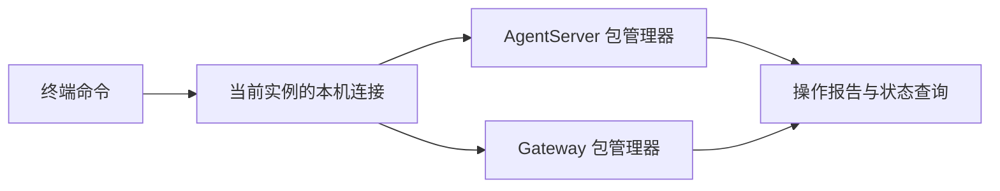

# 扩展包终端管理设计方案

## 元信息

| 项 | 内容 |
| --- | --- |
| 类型 / 编号 | feature / F_31 |
| 建档日期 | 2026-11-04 |
| 所属模块 | channels/cli、extensions_v2、gateway/extensions_v2 |
| 接口规约 | [S_02 后端包管理协议](../specs/S_02_backend-package-management.md#5-本机-cli) |
| 实现与验证 | 本文第 7 节维护验证范围和结果 |

## 1. 问题与目标

扩展包管理器已经提供安装、查询、重载和卸载能力，Web 可以通过 `/extension` 调用。
智能体通过终端开发扩展包后，也需要把最终 ZIP 安装到正在运行的 Swarm，随后核对是否生效。

终端程序是独立进程，不能直接取得运行中的包管理器。让智能体自行查找服务端口或浏览器登录信息，
既难以确定目标实例，也容易把安装操作发送到其他服务。本功能由 Swarm 准备本机连接，终端命令复用已有管理器。

本功能完成以下工作：

- **统一操作：** 源码、Wheel 和桌面包提供相同的参数、结果与退出码。
- **准确选定实例：** 使用当前运行环境提供的连接信息，不扫描服务端口。
- **核对结果：** 保留安装报告，成功后再次查询版本和安装目录。
- **更新界面：** 安装成功后通知已经打开的页面，使用已有槽位构建扩展界面。

## 2. 命令入口

| 运行方式 | 实际入口 |
| --- | --- |
| 源码、Wheel | `jiuwenswarm extension` |
| EXE、DMG | 现有后端可执行程序，后接 `extension` 参数；程序路径由 `JIUWENSWARM_EXECUTABLE` 提供 |

两个入口都调用 `jiuwenswarm.channels.cli.extension.main()`。普通 CLI 在聊天参数解析前识别 `extension`；
桌面后端在检查单实例锁前识别该参数，因此管理命令不会被当作再次打开 APP。
PyInstaller 配置显式收集命令模块，不另外发布一套桌面 CLI 启动器。

命令用法见[命令行指令](../../../../docs/zh/命令行指令.md#扩展包管理extension)。
`install` 从最终 ZIP 的 manifest 读取包 ID、版本和 domain；其他操作默认选择 AgentServer，
管理 Gateway 包时显式使用 `--domain gateway`。

## 3. 连接运行中的宿主

### 3.1 启动与连接信息

AgentServer、Gateway 在扩展模块装配完成后，各自创建一个只监听 `127.0.0.1` 的入口。
系统分配实际端口，宿主生成随机访问密钥和本次运行的实例标识。

- **内部终端：** 通过子进程环境继承当前宿主的连接信息。
- **另一个宿主：** 按数据目录、domain 和实际服务端口读取对应连接记录。
- **连接不可用：** 返回 `HOST_UNAVAILABLE`，不尝试其他实例，不启动服务。

连接记录的位置和字段归 [S_02](../specs/S_02_backend-package-management.md#51-连接与授权) 维护。
密钥只供本机管理请求使用，不读取、转存或替代浏览器登录凭据。

### 3.2 操作权限与宿主归属

本机入口先校验访问密钥和实例标识，再接受四种包管理操作。
这是当前操作系统账号使用的管理能力，不提供远程用户授权接口。

AgentServer 复用 `PackageManagementAdapter`；Gateway 调用自己的包管理器。
两侧在写入前检查包的 domain，避免把包安装到错误宿主；Gateway 与 AgentServer 不互相导入扩展实现。
包加载、依赖检查、Handler 发布和回滚继续由原管理链路完成，不创建第二套 Runtime、Bus 或 Registry。

## 4. 执行流程与失败处理

安装同一份最终 ZIP，按以下顺序执行：

1. 读取 manifest，取得包 ID、版本和 domain，计算本地 ZIP 的 SHA-256；不导入包代码。
2. 查询当前宿主。已有同 ID 包或安装副本时返回冲突，不自动卸载或覆盖。
3. 发送一次安装请求，保留管理器的原始报告。
4. 报告成功后再次查询，核对包 ID、版本、激活序号 generation 和实际安装目录。
5. 输出 JSON 与退出码，供终端调用方判断下一步操作。

重载读取安装副本，不重新读取来源 ZIP。卸载按宿主已有规则释放 Handler、界面和安装副本。
命令参数、结果字段和退出码只在 [S_02](../specs/S_02_backend-package-management.md#5-本机-cli) 定义。

处理结果时区分三种情况：

- **明确失败：** 保留失败报告和错误码，不因请求已送达就显示成功。
- **结果未知：** 超时、断连或报告不完整时，只查询一次状态，不重发写请求。
- **报告与状态不符：** 返回状态核对失败；即使报告成功，也不声明当前版本已经生效。

查询到当前状态不能证明先前请求已经成功，因此不会据此补造安装报告。

## 5. 页面通知与资源清理

安装成功后，AgentServer 的公共 `PackageManagementAdapter` 通知曾经上报 `ui.ready` 的浏览器连接；
网页 `/extension install` 和本机 CLI 共用该通知，CLI 不再另外发送。Gateway 的本机入口向已连接页面发送安装通知。
通知只包含成功安装的包 ID。前端按仍挂载的槽位重新发送 `ui.ready`，同一目标合并处理。

- **槽位设置：** `notifyReady=false` 的槽位继续由原调用方决定何时就绪。
- **连接与数据校验：** 保留现有浏览器能力声明、帧校验和请求上下文规则。
- **通知失败：** 不回滚已经成功的安装；通过 `ui_notified` 说明通知是否送达。
- **业务验证：** Handler 在后续正常事件中执行。通知送达不等于真实页面或业务效果已经验收。

宿主关闭时先停止接受管理请求，再释放包管理器。已有请求最多等待 5 秒，超时后取消，
并清理自己发布的连接记录。
旧密钥和实例标识不能访问重新启动的宿主。单个包的卸载不关闭宿主的管理入口。

## 6. 方案取舍与适用范围

| 选择 | 原因 |
| --- | --- |
| 复用已有 CLI 和桌面参数分发 | 四种发行方式共用实现，保留现有 APP 启动方式 |
| 由宿主提供本机连接 | 避免终端自行查找端口，也不依赖浏览器连接的登录状态 |
| 复用原包管理链路 | 安装、重载、卸载与 Web 使用相同的包生命周期规则 |
| 写操作不自动重试 | 请求超时时操作可能已经执行，重复安装可能产生冲突 |

命令不上传 ZIP，不提供沙箱网络或文件映射。ZIP 必须位于宿主可读取的位置；
远程沙箱无法连接本机入口时，需要由部署环境提供相应能力。

## 7. 验证

2026-11-05 网页安装修复：安装通知原先只接在本机 CLI，页面已经挂载槽位时，网页安装成功不会重新 ready。
本次将 AgentServer 通知收敛到公共安装适配器，复用既有前端处理；不调整插件组件契约或计数器示例。
补充真实 ZIP 经 Web/Gateway/AgentServer 路由安装、原连接收到通知后 ready 并渲染的回归，
以及部分失败、通知失败和 CLI 单次通知覆盖。
Windows、Python 3.12 下，管理适配器与 CLI 回归 63 项通过，前端 runtime 19 项、transport 9 项通过。
后端使用真实 ZIP 与管理器、模拟连接和推送验证链路；未执行真实浏览器操作，不将模拟推送解释为浏览器实测。

同日追加修复：上述模拟推送绕过了 `WebChannel.send()` 的实际下行路径，未发现安装事件的
`package_ids` 被聊天消息字段提取丢弃。Gateway 现将 `extensions.v2.installed` 列为完整透传事件，
保留成功包 ID、会话归属及物理连接路由；前端协议和插件源码不变。
回归先在修复前复现三项失败，再验证修复后通过，覆盖空会话和聊天会话通知，并将真实 ZIP 安装用例接入
`MessageHandler._chunk_to_message()` → `WebChannel.send()` → 前端可消费的帧后再 ready。
本轮 Windows、Python 3.12 定向后端回归 80 项通过，前端 runtime 19 项、transport 9 项通过。
另以无头 Chrome、隔离数据目录和现有 `dist/state_counter.zip` 执行输入命令安装 → 卸载 → 再次安装，
两次安装均立即显示计数器，卸载立即清除，三次管理报告成功，页面未刷新，浏览器无未捕获异常。
该浏览器验证使用隔离 WebSocket 测试宿主，经过生产前端命令处理、实际包管理器、Gateway 代理及实际下行序列化；
未启动完整生产服务，也未执行发行包安装验收。

| 场景 | 验证内容 | 结果 |
| --- | --- | --- |
| 命令入口 | 普通 CLI 子进程、冻结入口分发、退出码、中文与空格路径 | 定向测试通过 |
| 包生命周期 | 使用真实 ZIP 和已装配管理器，验证安装、查询、重载、卸载及 Handler 结果 | 通过 |
| 连接与失败 | 密钥拒绝、实例隔离、停机撤销、在途请求、参数校验、失败报告、未知结果和不重复写入 | 通过 |
| 页面通知 | 槽位目标去重、notifyReady 设置、浏览器能力声明与订阅释放 | 50 项相关前端测试通过 |
| Skill 示例 | 同一份最终 ZIP 的加载、渲染与 CLI 安装 | 23 项通过 |
| 前端构建 | 类型检查与生产构建 | 通过 |
| 桌面实包与浏览器 | EXE、DMG 实际安装及真实页面操作 | 未执行 |

验证命令按仓库测试配置显式启用 pytest-asyncio，不使用失败用例排除参数。
本功能测试位于 `tests/unit_tests/extensions_v2/management/test_local_cli.py`、
`tests/unit_tests/gateway/extensions_v2/test_gateway_package_management.py`，
前端验证使用 `test:webui-runtime`、`test:webui-transport` 和 `test:webui-client`。
下行补充回归位于 `tests/unit_tests/channel/test_web_channel_webui_payload.py` 与
`tests/unit_tests/extensions_v2/management/test_management_adapter.py`；连接路由回归为
`tests/unit_tests/gateway/test_web_channel_orphan_routing.py`。
